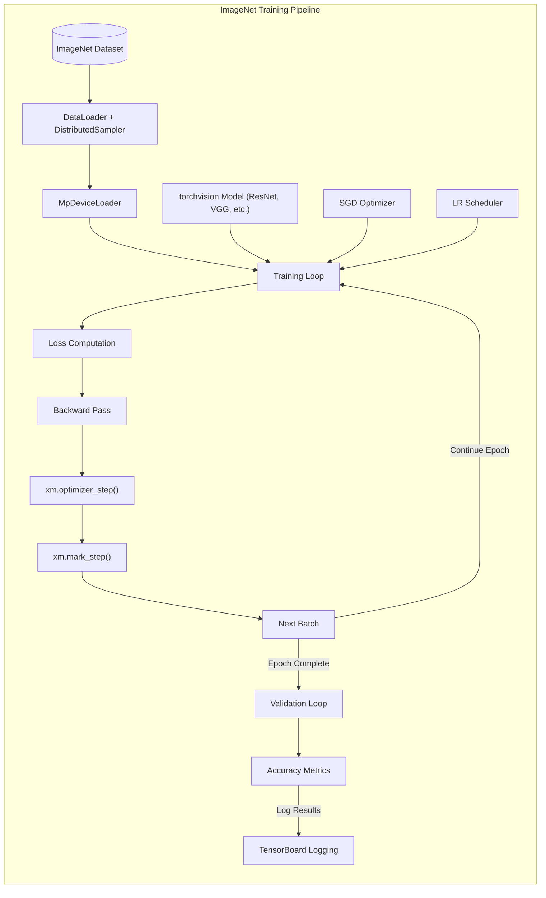
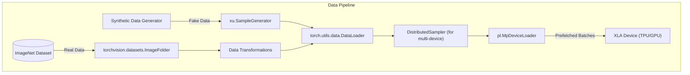
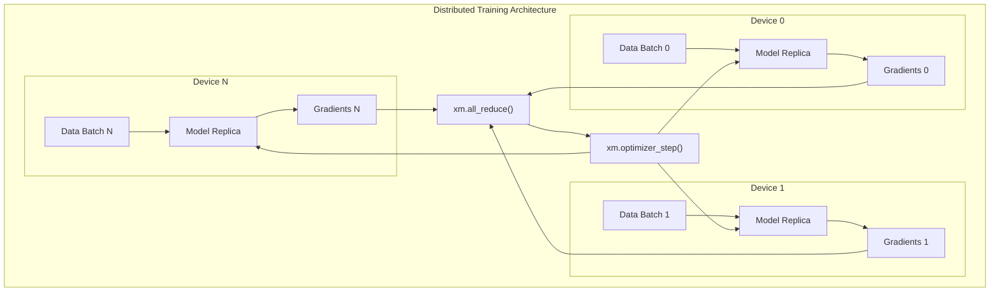
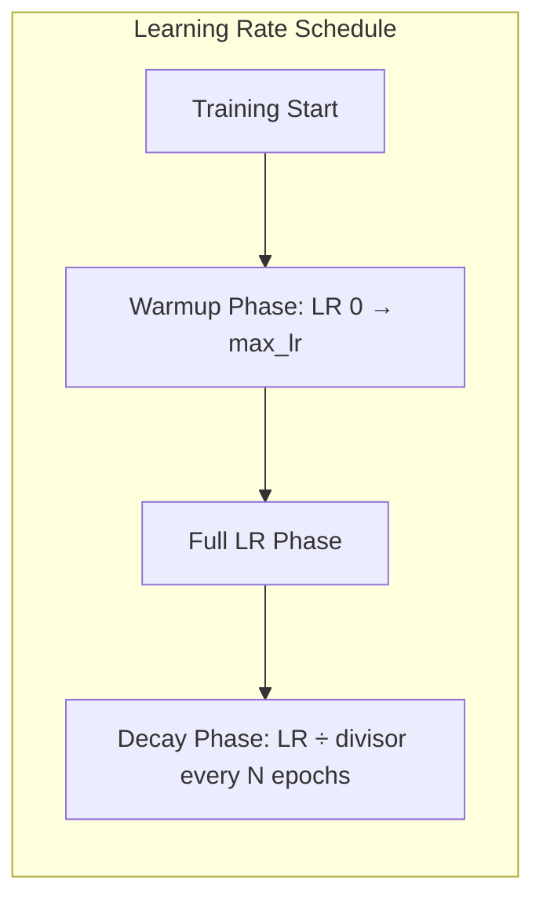
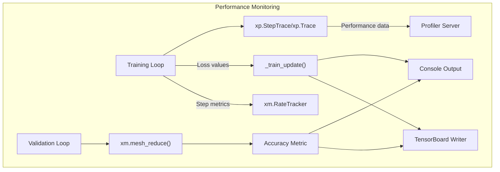

<!-- source: DeepWiki mcp.deepwiki.com · repo pytorch/xla · page 6.3 ImageNet Training Example · fetched 2026-10-21 -->

# ImageNet Training

<details>
<summary>Relevant source files</summary>

The following files were used as context for generating this wiki page:

- [test/args_parse.py](test/args_parse.py)
- [test/schedulers.py](test/schedulers.py)
- [test/test_train_mp_imagenet.py](test/test_train_mp_imagenet.py)
- [test/test_train_mp_mnist.py](test/test_train_mp_mnist.py)
- [test/test_utils.py](test/test_utils.py)
- [torch_xla/test/test_utils.py](torch_xla/test/test_utils.py)

</details>


This page provides a comprehensive guide for training deep learning models on the ImageNet dataset using PyTorch/XLA. It covers the implementation details, configurations, and best practices for efficiently training models at scale on XLA devices such as TPUs and GPUs.

For simpler dataset training examples, see [MNIST Training](#5.1).

## Overview

The PyTorch/XLA framework provides a highly optimized environment for training ImageNet models on XLA-compatible hardware. The implementation leverages distributed training capabilities, device-specific optimizations, and efficient data loading pipelines to achieve high performance.



Sources: [test/test_train_mp_imagenet.py:177-310](test/test_train_mp_imagenet.py:177-310), [torch_xla/core/xla_model.py:411-451](torch_xla/core/xla_model.py:411-451)

## Supported Models

The ImageNet training implementation supports a wide range of deep learning architectures from the `torchvision.models` package:

| Model Type | Supported Variants |
|------------|-------------------|
| ResNet     | 18, 34, 50, 101, 152 |
| DenseNet   | 121, 161, 169, 201 |
| VGG        | 11, 11_bn, 13, 13_bn, 16, 16_bn, 19, 19_bn |
| Inception  | v3 |
| AlexNet    | alexnet |
| SqueezeNet | 1_0, 1_1 |

Sources: [test/test_train_mp_imagenet.py:4-9](test/test_train_mp_imagenet.py:4-9), [test/test_train_mp_imagenet.py:153-165](test/test_train_mp_imagenet.py:153-165)

## Data Preparation and Loading

The training pipeline supports both real ImageNet data and synthetic data for testing and benchmarking. The data loading process is optimized for XLA devices with efficient prefetching mechanisms.



Sources: [test/test_train_mp_imagenet.py:183-249](test/test_train_mp_imagenet.py:183-249)

### Data Loading Parameters

The data loading pipeline is highly configurable with several performance-critical parameters:

| Parameter | Description | Default | TPUv4 Optimized |
|-----------|-------------|---------|----------------|
| `batch_size` | Training batch size | 128 | 128 |
| `test_set_batch_size` | Validation batch size | 64 | 128 |
| `num_workers` | DataLoader worker processes | 8 | 16 |
| `persistent_workers` | Keep worker processes alive | False | True |
| `prefetch_factor` | Number of batches loaded in advance per worker | 16 | 32 |
| `loader_prefetch_size` | Size of prefetch queue for loader | 8 | 128 |
| `device_prefetch_size` | Size of prefetch queue for device transfers | 4 | 1 |
| `host_to_device_transfer_threads` | Threads for H2D transfer | 1 | 4 |

Sources: [test/test_train_mp_imagenet.py:93-106](test/test_train_mp_imagenet.py:93-106), [test/test_train_mp_imagenet.py:116-129](test/test_train_mp_imagenet.py:116-129)

## Distributed Training

PyTorch/XLA provides efficient distributed training capabilities for ImageNet models using both Data Parallel and Distributed Data Parallel (DDP) approaches.



Sources: [test/test_train_mp_imagenet.py:31-36](test/test_train_mp_imagenet.py:31-36), [test/test_train_mp_imagenet.py:180-181](test/test_train_mp_imagenet.py:180-181), [test/test_train_mp_imagenet.py:258-263](test/test_train_mp_imagenet.py:258-263), [torch_xla/core/xla_model.py:417-449](torch_xla/core/xla_model.py:417-449)

### Key Components for Distributed Training

1. **Process Group Initialization**: Initialize the distributed environment using `dist.init_process_group('xla')`.

2. **Distributed Sampling**: Use `DistributedSampler` to ensure each device processes a different subset of data.

3. **Model Parameter Synchronization**: Ensure identical model initialization across devices with `xm.broadcast_master_param(model)`.

4. **DDP Wrapping**: Optionally wrap the model with PyTorch's `DistributedDataParallel` for efficient gradient synchronization.

5. **Cross-Replica Communication**: Collective operations like `all_reduce` for gradient synchronization and metric reporting.

Sources: [torch_xla/distributed/xla_multiprocessing.py:186-196](torch_xla/distributed/xla_multiprocessing.py:186-196), [torch_xla/core/xla_model.py:417-474](torch_xla/core/xla_model.py:417-474)

## Training Loop

The training loop is implemented with specific adaptations for XLA devices:

```python
def train_loop_fn(loader, epoch):
    tracker = xm.RateTracker()
    model.train()
    for step, (data, target) in enumerate(loader):
        with xp.StepTrace('train_imagenet'):
            with xp.Trace('build_graph'):
                optimizer.zero_grad()
                output = model(data)
                loss = loss_fn(output, target)
                loss.backward()
                if FLAGS.ddp:
                    optimizer.step()
                else:
                    xm.optimizer_step(optimizer)
                    tracker.add(FLAGS.batch_size)
                if lr_scheduler:
                    lr_scheduler.step()
            if step % FLAGS.log_steps == 0:
                xm.add_step_closure(
                    _train_update, args=(device, step, loss, tracker, epoch, writer))
```

Sources: [test/test_train_mp_imagenet.py:288-309](test/test_train_mp_imagenet.py:288-309), [test/test_train_mp_imagenet.py:311-326](test/test_train_mp_imagenet.py:311-326)

### Key XLA-Specific Optimizations

1. **Device-Specific Data Loader**: The `MpDeviceLoader` efficiently transfers data to XLA devices.

2. **XLA Model Operations**: Using `xm.optimizer_step()` rather than the standard PyTorch optimizer step.

3. **Metric Synchronization**: Using `xm.mesh_reduce()` to aggregate metrics across distributed devices.

4. **Step Marking**: Adding `xm.mark_step()` to trigger XLA execution.

5. **Tracing**: Profiling with `xp.StepTrace` and `xp.Trace` for performance analysis.

Sources: [test/test_train_mp_imagenet.py:329-339](test/test_train_mp_imagenet.py:329-339), [torch_xla/core/xla_model.py:275-316](torch_xla/core/xla_model.py:275-316)

## Learning Rate Scheduling

The ImageNet training implementation includes optimized learning rate scheduling via the `WarmupAndExponentialDecayScheduler`:



Sources: [test/test_train_mp_imagenet.py:132-143](test/test_train_mp_imagenet.py:132-143), [test/schedulers.py:6-92](test/schedulers.py:6-92)

The scheduler provides several important features:
- **Warmup period**: Gradually increases learning rate over initial epochs
- **Exponential decay**: Reduces learning rate by a divisor at specified intervals
- **TensorBoard logging**: Automatically logs learning rate changes
- **Efficient updates**: Only updates when learning rate changes significantly

## Model Initialization and Synchronization

To ensure consistent training across distributed devices, the model parameters must be synchronized:

```python
# Create model and move to XLA device
model = get_model_property('model_fn')().to(device)

# Synchronize model parameters across replicas
xm.broadcast_master_param(model)

# Optionally wrap with DDP for distributed training
if FLAGS.ddp:
    model = DDP(model, broadcast_buffers=False, gradient_as_bucket_view=True)
```

Sources: [test/test_train_mp_imagenet.py:253-263](test/test_train_mp_imagenet.py:253-263)

## Evaluation and Metrics

The validation loop computes accuracy metrics for evaluating model performance:

```python
def test_loop_fn(loader, epoch):
    total_samples, correct = 0, 0
    model.eval()
    for step, (data, target) in enumerate(loader):
        output = model(data)
        pred = output.max(1, keepdim=True)[1]
        correct += pred.eq(target.view_as(pred)).sum()
        total_samples += data.size()[0]
        
    # Compute accuracy and synchronize across devices
    accuracy = 100.0 * correct.item() / total_samples
    accuracy = xm.mesh_reduce('test_accuracy', accuracy, np.mean)
    return accuracy
```

Sources: [test/test_train_mp_imagenet.py:311-326](test/test_train_mp_imagenet.py:311-326), [test/test_utils.py:105-171](test/test_utils.py:105-171)

## Device-Specific Optimizations

The implementation includes pre-configured optimizations for different XLA hardware platforms:

```python
OPTIMIZED_KWARGS = {
    'tpuv4':
        dict(
            batch_size=128,
            test_set_batch_size=128,
            num_epochs=18,
            momentum=0.9,
            lr=0.1,
            target_accuracy=0.0,
            persistent_workers=True,
            prefetch_factor=32,
            loader_prefetch_size=128,
            device_prefetch_size=1,
            num_workers=16,
            host_to_device_transfer_threads=4,
        )
}
```

Sources: [test/test_train_mp_imagenet.py:114-130](test/test_train_mp_imagenet.py:114-130), [test/test_train_mp_imagenet.py:135-143](test/test_train_mp_imagenet.py:135-143)

## Running ImageNet Training

You can run ImageNet training with command-line configurations:

```bash
python3 test_train_mp_imagenet.py \
    --model=resnet50 \
    --fake_data --num_epochs=10 \
    --log_steps=300 \
    --profile \
    --use_optimized_kwargs=tpuv4 \
    --drop_last
```

Sources: [test/test_train_mp_imagenet.py:111-113](test/test_train_mp_imagenet.py:111-113), [test/test_train_mp_imagenet.py:374-380](test/test_train_mp_imagenet.py:374-380)

## Cross-Device Communication

PyTorch/XLA implements several collective communication operations for efficient distributed training:

| Operation | Function | Purpose |
|-----------|----------|---------|
| All-Reduce | `xm.all_reduce()` | Aggregate gradients across devices |
| All-Gather | `xm.all_gather()` | Collect values from all devices |
| Reduce-Scatter | `xm.reduce_scatter()` | Reduce values and scatter results |
| Broadcast | `xm.broadcast_master_param()` | Broadcast master parameters |
| Mesh-Reduce | `xm.mesh_reduce()` | Aggregate metrics across devices |

Sources: [torch_xla/core/xla_model.py:417-474](torch_xla/core/xla_model.py:417-474), [torch_xla/csrc/cross_replica_reduces.cpp:116-132](torch_xla/csrc/cross_replica_reduces.cpp:116-132), [torch_xla/csrc/ops/all_gather.cpp:47-67](torch_xla/csrc/ops/all_gather.cpp:47-67), [torch_xla/csrc/ops/reduce_scatter.cpp:65-110](torch_xla/csrc/ops/reduce_scatter.cpp:65-110)

The collective operations are optimized for different device types with features like:
- Layout pinning for consistency across devices
- Replica grouping for more flexible communication patterns
- Scaling options for normalized aggregation
- Optional bucketing of small operations

## Performance Monitoring

The training implementation includes comprehensive performance monitoring:



Sources: [test/test_utils.py:120-171](test/test_utils.py:120-171), [test/test_train_mp_imagenet.py:168-176](test/test_train_mp_imagenet.py:168-176), [test/test_train_mp_imagenet.py:285-309](test/test_train_mp_imagenet.py:285-309)

## Summary

ImageNet training with PyTorch/XLA provides a highly optimized way to train deep learning models on accelerator hardware. Key features include:

- Support for a wide range of model architectures
- Efficient distributed training with data parallelism
- Optimized data loading with prefetching
- Advanced learning rate scheduling
- Performance monitoring and profiling tools
- Device-specific optimizations for different hardware platforms

The implementation serves as a blueprint for efficient large-scale training with PyTorch on XLA devices.