# Page: Overview

# Overview

<details>
<summary>Relevant source files</summary>

The following files were used as context for generating this wiki page:

- [.github/ci.md](.github/ci.md)
- [.github/workflows/_build_torch_xla.yml](.github/workflows/_build_torch_xla.yml)
- [.github/workflows/_check_code_changes.yml](.github/workflows/_check_code_changes.yml)
- [.github/workflows/_test.yml](.github/workflows/_test.yml)
- [.github/workflows/_tpu_ci.yml](.github/workflows/_tpu_ci.yml)
- [.github/workflows/build_and_test.yml](.github/workflows/build_and_test.yml)
- [.github/workflows/build_upstream_image.yml](.github/workflows/build_upstream_image.yml)
- [.github/workflows/setup/action.yml](.github/workflows/setup/action.yml)
- [CONTRIBUTING.md](CONTRIBUTING.md)
- [README.md](README.md)
- [WORKSPACE](WORKSPACE)
- [experimental/reference_models/README.md](experimental/reference_models/README.md)
- [scripts/build_developer.sh](scripts/build_developer.sh)
- [scripts/update_deps.py](scripts/update_deps.py)
- [setup.py](setup.py)
- [test/tpu/xla_test_job.yaml](test/tpu/xla_test_job.yaml)
- [torch_xla/csrc/runtime/BUILD](torch_xla/csrc/runtime/BUILD)
- [torch_xla/csrc/runtime/computation_client.h](torch_xla/csrc/runtime/computation_client.h)
- [torch_xla/csrc/runtime/ifrt_computation_client.cpp](torch_xla/csrc/runtime/ifrt_computation_client.cpp)
- [torch_xla/csrc/runtime/ifrt_computation_client.h](torch_xla/csrc/runtime/ifrt_computation_client.h)
- [torch_xla/csrc/runtime/ifrt_computation_client_test.cpp](torch_xla/csrc/runtime/ifrt_computation_client_test.cpp)
- [torch_xla/csrc/runtime/pjrt_computation_client.cpp](torch_xla/csrc/runtime/pjrt_computation_client.cpp)
- [torch_xla/csrc/runtime/pjrt_computation_client.h](torch_xla/csrc/runtime/pjrt_computation_client.h)
- [torch_xla/csrc/runtime/pjrt_computation_client_test.cpp](torch_xla/csrc/runtime/pjrt_computation_client_test.cpp)
- [torch_xla/csrc/runtime/pjrt_registry.cpp](torch_xla/csrc/runtime/pjrt_registry.cpp)
- [torch_xla/csrc/runtime/runtime.cpp](torch_xla/csrc/runtime/runtime.cpp)
- [torch_xla/csrc/runtime/runtime.h](torch_xla/csrc/runtime/runtime.h)

</details>


PyTorch/XLA is a Python package that uses the XLA (Accelerated Linear Algebra) deep learning compiler to connect PyTorch with Cloud TPUs and other XLA-compatible hardware accelerators. The system provides a bridge between PyTorch's ATen operations and XLA's HLO (High-Level Optimizer) representation, enabling PyTorch models to run efficiently on specialized hardware with minimal code changes.

The core design uses lazy execution: operations on XLA tensors build an intermediate representation (IR) graph rather than executing immediately. When synchronization occurs (via `xm.mark_step()` or implicit materialization), the `XLAGraphExecutor` compiles the graph to HLO, the XLA compiler optimizes and compiles it to device-specific code, and the `ComputationClient` (PJRT or IFRT) executes it on the hardware.

For installation instructions, see page **1.2**.

## System Architecture

PyTorch/XLA implements a multi-layer architecture spanning from Python APIs down to hardware execution. The following diagram shows the six primary layers:

**High-Level System Architecture**

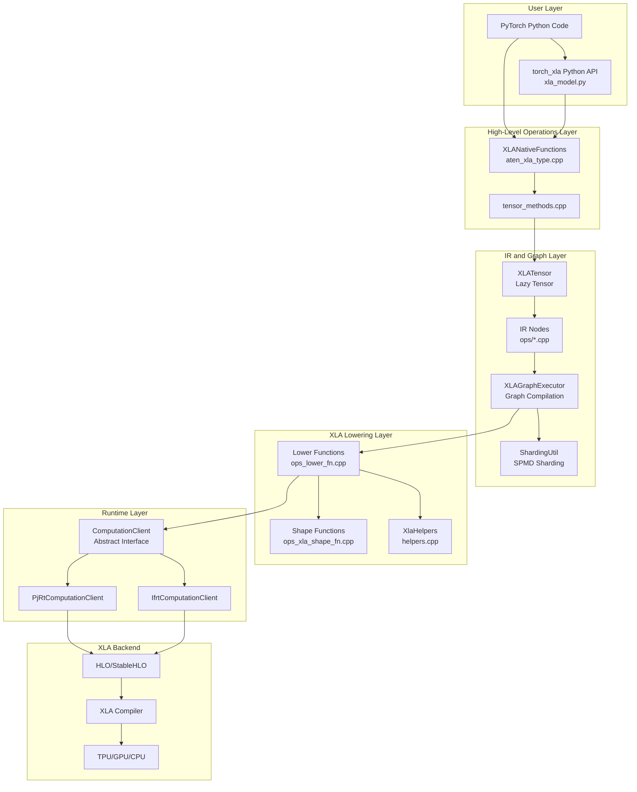

Sources:
- [torch_xla/csrc/aten_xla_type.cpp:1-100]()
- [torch_xla/csrc/tensor.cpp:1-100]()
- [torch_xla/csrc/tensor_methods.cpp:1-100]()
- [torch_xla/csrc/xla_graph_executor.h:1-50]()
- [torch_xla/csrc/runtime/computation_client.h:1-100]()
- [torch_xla/csrc/runtime/pjrt_computation_client.h:1-100]()
- [torch_xla/csrc/runtime/ifrt_computation_client.h:1-100]()

## Core Components

The following table summarizes the key components in each layer:

| Layer | Component | File Location | Purpose |
|-------|-----------|---------------|---------|
| **User Layer** | `torch_xla` Python API | `torch_xla/core/xla_model.py` | High-level API for device management, synchronization |
| **Operations** | `XLANativeFunctions` | `torch_xla/csrc/aten_xla_type.cpp` | ATen operation dispatcher to XLA implementations |
| **Operations** | `tensor_methods` | `torch_xla/csrc/tensor_methods.cpp` | XLA-specific tensor operation implementations |
| **IR/Graph** | `XLATensor` | `torch_xla/csrc/tensor.h`, `tensor.cpp` | Lazy tensor with IR value, view system, sharding spec |
| **IR/Graph** | `XLAGraphExecutor` | `torch_xla/csrc/xla_graph_executor.h` | Graph compilation, caching, synchronization |
| **Lowering** | Lower functions | `torch_xla/csrc/ops/` | IR node lowering to HLO operations |
| **Lowering** | `XlaHelpers` | `torch_xla/csrc/helpers.cpp` | Type promotion, broadcasting, shape utilities |
| **Runtime** | `ComputationClient` | `torch_xla/csrc/runtime/computation_client.h` | Abstract interface for device execution |
| **Runtime** | `PjRtComputationClient` | `torch_xla/csrc/runtime/pjrt_computation_client.h` | PJRT-based runtime implementation |
| **Runtime** | `IfrtComputationClient` | `torch_xla/csrc/runtime/ifrt_computation_client.h` | IFRT-based runtime implementation |

### ATen/XLA Bridge

The `XLANativeFunctions` class in [torch_xla/csrc/aten_xla_type.cpp:446-860]() implements PyTorch's ATen dispatcher interface. When PyTorch operations are invoked on XLA tensors, the dispatcher redirects to XLA-specific implementations. The bridge extracts `XLATensor` objects using `bridge::GetXlaTensor()` [torch_xla/csrc/aten_xla_bridge.h:1-50](), invokes `tensor_methods` functions to create IR nodes, and wraps results back into ATen tensors.

**Operation Dispatch Flow**

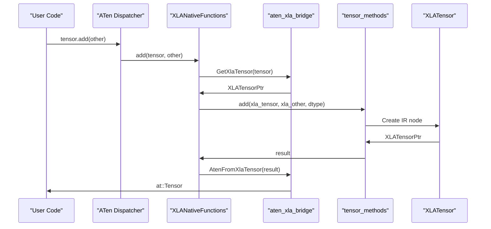

Sources:
- [torch_xla/csrc/aten_xla_type.cpp:446-860]()
- [torch_xla/csrc/aten_xla_bridge.h:1-50]()
- [torch_xla/csrc/tensor_methods.cpp:1-200]()

### XLATensor and Lazy IR

`XLATensor` [torch_xla/csrc/tensor.h:93-358]() is the core data structure representing tensors on XLA devices. Each `XLATensor` contains:

- `data_->ir_value`: A `torch::lazy::Value` pointing to an IR node
- `data_->handle`: A `BackendDataPtr` to device data (when materialized)
- `data_->view`: A `View` object for view operations
- `data_->sharding`: A `ShardingSpec` for SPMD parallelism

The lazy execution model means operations create IR nodes [torch_xla/csrc/ops/]() rather than executing immediately. The IR graph is built incrementally until synchronization.

Sources:
- [torch_xla/csrc/tensor.h:93-358]()
- [torch_xla/csrc/tensor.cpp:1-300]()

### XLAGraphExecutor

`XLAGraphExecutor` [torch_xla/csrc/xla_graph_executor.h:1-100]() manages the lazy execution lifecycle:

1. **Graph Collection**: `SyncTensorsGraph()` collects all pending IR nodes from tensors
2. **Compilation**: IR nodes are lowered to HLO via `LoweringContext` [torch_xla/csrc/lowering_context.h:1-100]()
3. **Caching**: Compiled computations are cached using a hash of the IR graph
4. **Execution**: `ComputationClient::ExecuteComputation()` runs the compiled program
5. **Synchronization**: Results update tensor data handles

The executor also implements eager mode when `TORCH_XLA_DISABLE_EAGER_LAZY_MODE=0`, which compiles and executes operations immediately.

Sources:
- [torch_xla/csrc/xla_graph_executor.h:1-100]()
- [torch_xla/csrc/lowering_context.h:1-100]()

### ComputationClient Runtime

The `ComputationClient` interface [torch_xla/csrc/runtime/computation_client.h:38-450]() abstracts device interaction with two implementations:

**PjRtComputationClient** [torch_xla/csrc/runtime/pjrt_computation_client.h:27-320]() uses PJRT (Pluggable JAX Runtime):
- `client_`: `xla::PjRtClient` for device management
- `Compile()`: Compiles XLA computations to `PjRtLoadedExecutable`
- `ExecuteComputation()`: Executes on `PjRtDevice` with async semantics
- Supports local and distributed TPU/GPU execution

**IfrtComputationClient** [torch_xla/csrc/runtime/ifrt_computation_client.h:1-200]() uses IFRT (Intermediate Format Runtime) for advanced features like SPMD.

**Runtime Client Architecture**

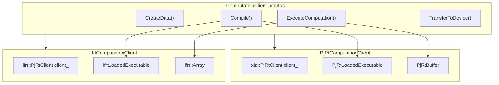

Sources:
- [torch_xla/csrc/runtime/computation_client.h:38-450]()
- [torch_xla/csrc/runtime/pjrt_computation_client.h:27-320]()
- [torch_xla/csrc/runtime/pjrt_computation_client.cpp:1-200]()
- [torch_xla/csrc/runtime/ifrt_computation_client.h:1-200]()
- [torch_xla/csrc/runtime/ifrt_computation_client.cpp:1-200]()

## Execution Model

### Lazy Evaluation and IR Graph

PyTorch/XLA uses lazy evaluation: operations on `XLATensor` objects create IR nodes without immediate execution. For example:

```python
import torch
import torch_xla.core.xla_model as xm

device = xm.xla_device()
x = torch.randn(10, 10, device=device)
y = torch.randn(10, 10, device=device)
z = x + y  # Creates an IR node, does not execute
```

The addition creates an `Add` IR node [torch_xla/csrc/ops/arithmetic_ir_ops.h:1-50]() and stores it in `z.data()->ir_value`. The operation is not executed until synchronization occurs via:
- `xm.mark_step()`: Explicit synchronization point
- `.cpu()` or `.item()`: Materialization to host
- Printing tensor values

When synchronization occurs, `XLAGraphExecutor::SyncTensorsGraph()` collects all pending IR nodes, builds a computation graph, and compiles/executes it.

Sources:
- [torch_xla/csrc/tensor.cpp:383-412]()
- [torch_xla/csrc/ops/arithmetic_ir_ops.h:1-50]()

### Compilation and Execution Pipeline

**Complete Tensor Operation Pipeline**

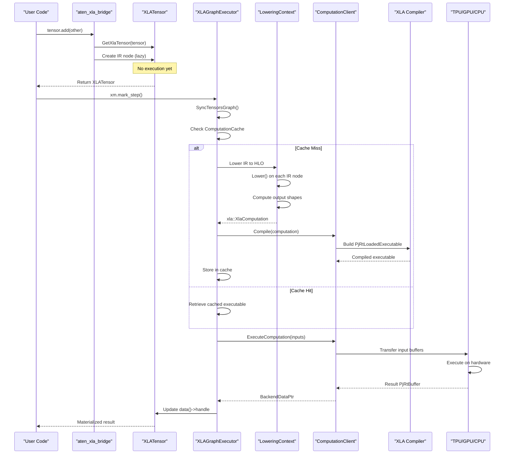

The pipeline stages:

1. **IR Graph Building** [torch_xla/csrc/tensor.cpp:383-412](): Operations create IR nodes stored in `XLATensor::data()->ir_value`

2. **Graph Collection** [torch_xla/csrc/xla_graph_executor.cpp:1-200](): `SyncTensorsGraph()` collects all pending tensors

3. **Compilation Cache Check**: Hash of IR graph is checked against `ComputationCache`

4. **Lowering** [torch_xla/csrc/lowering_context.cpp:1-200](): Each IR node's `Lower()` method generates HLO operations

5. **XLA Compilation**: `ComputationClient::Compile()` invokes XLA compiler to produce `PjRtLoadedExecutable`

6. **Execution**: `ExecuteComputation()` transfers inputs, executes on device, returns results

7. **Result Update**: Tensor `data()->handle` updated with `BackendDataPtr` pointing to device buffer

Sources:
- [torch_xla/csrc/tensor.cpp:383-412]()
- [torch_xla/csrc/xla_graph_executor.cpp:1-200]()
- [torch_xla/csrc/lowering_context.cpp:1-200]()
- [torch_xla/csrc/runtime/pjrt_computation_client.cpp:1-200]()

### Compilation Caching

The `ComputationCache` [torch_xla/csrc/xla_graph_executor.cpp:1-200]() stores compiled executables keyed by IR graph hash. Cache hits avoid recompilation, dramatically improving performance for repeated patterns. Cache statistics are available via `torch_xla._XLAC._xla_metrics_report()`.

Sources:
- [torch_xla/csrc/xla_graph_executor.cpp:1-200]()

## Deployment Options

PyTorch/XLA supports several deployment options, depending on the hardware and scale requirements:

### Single-Device Execution

For simple use cases, PyTorch/XLA can be used with a single XLA device:

```python
import torch_xla
import torch_xla.core.xla_model as xm

device = xm.xla_device()
model = Model().to(device)
optimizer = optim.SGD(model.parameters(), lr=0.01)

for data, target in train_loader:
    with torch_xla.step():
        data, target = data.to(device), target.to(device)
        output = model(data)
        loss = loss_fn(output, target)
        loss.backward()
        optimizer.step()
```

Sources:
- [README.md:125-156](https://github.com/pytorch/xla)
- [API_GUIDE.md:75-97](https://github.com/pytorch/xla)

### Multi-Device Execution

For larger models or datasets, PyTorch/XLA supports distributed training across multiple devices:

```python
import torch_xla
import torch_xla.core.xla_model as xm
import torch_xla.distributed.parallel_loader as pl

def _mp_fn(index):
    device = xm.xla_device()
    model = Model().to(device)
    
    # Wrap the dataloader to optimize data transfer
    mp_device_loader = pl.MpDeviceLoader(train_loader, device)
    
    for data, target in mp_device_loader:
        with torch_xla.step():
            output = model(data)
            loss = loss_fn(output, target)
            loss.backward()
            # Combines gradients across replicas
            xm.optimizer_step(optimizer)

if __name__ == '__main__':
    torch_xla.launch(_mp_fn, args=())
```

Sources:
- [README.md:158-189](https://github.com/pytorch/xla)
- [API_GUIDE.md:109-164](https://github.com/pytorch/xla)

### Cloud TPU Support

PyTorch/XLA provides full support for Cloud TPUs, including TPU VMs and TPU Pods. The system handles the complexities of TPU communication and data placement.

For TPU Pods, PyTorch/XLA provides utilities for distributing training across multiple TPU hosts:

```
gcloud alpha compute tpus tpu-vm ssh $USER-pjrt --zone=$ZONE --project=$PROJECT --worker=all --command="PJRT_DEVICE=TPU python train_script.py"
```

Sources:
- [README.md:164-189](https://github.com/pytorch/xla)
- [API_GUIDE.md:164-189](https://github.com/pytorch/xla)

### GPU Support

PyTorch/XLA also supports NVIDIA GPUs through a CUDA plugin:

```bash
pip install torch~=2.5.0 torch_xla~=2.5.0 https://storage.googleapis.com/pytorch-xla-releases/wheels/cuda/12.1/torch_xla_cuda_plugin-2.5.0-py3-none-any.whl
```

Sources:
- [README.md:84-97](https://github.com/pytorch/xla)
- [README.md:356-373](https://github.com/pytorch/xla)

## Installation

PyTorch/XLA can be installed using pip:

### TPU Installation

```bash
pip install torch~=2.6.0 'torch_xla[tpu]~=2.6.0' \
  -f https://storage.googleapis.com/libtpu-releases/index.html \
  -f https://storage.googleapis.com/libtpu-wheels/index.html
```

### GPU Installation

```bash
pip install torch~=2.5.0 torch_xla~=2.5.0 https://storage.googleapis.com/pytorch-xla-releases/wheels/cuda/12.1/torch_xla_cuda_plugin-2.5.0-py3-none-any.whl
```

PyTorch/XLA also provides Docker images for various configurations:

```bash
docker run --privileged --net host --shm-size=16G -it us-central1-docker.pkg.dev/tpu-pytorch-releases/docker/xla:nightly_3.10_tpuvm /bin/bash
```

Sources:
- [README.md:20-41](https://github.com/pytorch/xla)
- [README.md:84-97](https://github.com/pytorch/xla)
- [README.md:336-351](https://github.com/pytorch/xla)

## Building from Source

For development or customization purposes, PyTorch/XLA can be built from source:

1. Clone the PyTorch repository:
   ```bash
   git clone --recursive https://github.com/pytorch/pytorch.git
   ```

2. Clone the PyTorch/XLA repository:
   ```bash
   git clone https://github.com/pytorch/xla.git pytorch/xla
   ```

3. Build PyTorch:
   ```bash
   cd pytorch
   python setup.py bdist_wheel
   python setup.py develop
   ```

4. Build PyTorch/XLA:
   ```bash
   cd xla/
   python setup.py develop
   ```

The build system uses Bazel for compilation and includes various configuration options through environment variables.

Sources:
- [CONTRIBUTING.md:14-179](https://github.com/pytorch/xla)
- [setup.py:1-50](https://github.com/pytorch/xla)
- [WORKSPACE:1-50](https://github.com/pytorch/xla)

## Key Files and Directories

The PyTorch/XLA repository is organized into the following key directories:

| Directory | Description |
|-----------|-------------|
| `torch_xla/csrc/` | C++ source code for core PyTorch/XLA functionality |
| `torch_xla/csrc/runtime/` | Runtime implementation including computation clients |
| `torch_xla/core/` | Python bindings and high-level APIs |
| `torch_xla/distributed/` | Distributed training functionality |
| `test/` | Test suite |
| `examples/` | Example models and training scripts |
| `contrib/` | Community contributions and Kaggle notebooks |

Sources:
- [README.md:100-113](https://github.com/pytorch/xla)
- [torch_xla/csrc/BUILD](https://github.com/pytorch/xla)
- [torch_xla/csrc/runtime/BUILD](https://github.com/pytorch/xla)

---

# Page: System Architecture

# System Architecture

<details>
<summary>Relevant source files</summary>

The following files were used as context for generating this wiki page:

- [WORKSPACE](WORKSPACE)
- [docs/source/index.rst](docs/source/index.rst)
- [setup.py](setup.py)
- [test/cpp/test_xla_sharding.cpp](test/cpp/test_xla_sharding.cpp)
- [test/spmd/test_mp_input_sharding.py](test/spmd/test_mp_input_sharding.py)
- [test/spmd/test_xla_sharding.py](test/spmd/test_xla_sharding.py)
- [test/spmd/test_xla_sharding_base.py](test/spmd/test_xla_sharding_base.py)
- [test/test_operations.py](test/test_operations.py)
- [test/test_ops_error_message.py](test/test_ops_error_message.py)
- [torch_xla/_internal/jax_workarounds.py](torch_xla/_internal/jax_workarounds.py)
- [torch_xla/core/xla_model.py](torch_xla/core/xla_model.py)
- [torch_xla/csrc/aten_autograd_ops.cpp](torch_xla/csrc/aten_autograd_ops.cpp)
- [torch_xla/csrc/aten_xla_type.cpp](torch_xla/csrc/aten_xla_type.cpp)
- [torch_xla/csrc/init_python_bindings.cpp](torch_xla/csrc/init_python_bindings.cpp)
- [torch_xla/csrc/ir_builder.h](torch_xla/csrc/ir_builder.h)
- [torch_xla/csrc/ops/ops.cpp](torch_xla/csrc/ops/ops.cpp)
- [torch_xla/csrc/ops/ops.h](torch_xla/csrc/ops/ops.h)
- [torch_xla/csrc/runtime/BUILD](torch_xla/csrc/runtime/BUILD)
- [torch_xla/csrc/runtime/computation_client.h](torch_xla/csrc/runtime/computation_client.h)
- [torch_xla/csrc/runtime/ifrt_computation_client.cpp](torch_xla/csrc/runtime/ifrt_computation_client.cpp)
- [torch_xla/csrc/runtime/ifrt_computation_client.h](torch_xla/csrc/runtime/ifrt_computation_client.h)
- [torch_xla/csrc/runtime/ifrt_computation_client_test.cpp](torch_xla/csrc/runtime/ifrt_computation_client_test.cpp)
- [torch_xla/csrc/runtime/pjrt_computation_client.cpp](torch_xla/csrc/runtime/pjrt_computation_client.cpp)
- [torch_xla/csrc/runtime/pjrt_computation_client.h](torch_xla/csrc/runtime/pjrt_computation_client.h)
- [torch_xla/csrc/runtime/pjrt_computation_client_test.cpp](torch_xla/csrc/runtime/pjrt_computation_client_test.cpp)
- [torch_xla/csrc/runtime/pjrt_registry.cpp](torch_xla/csrc/runtime/pjrt_registry.cpp)
- [torch_xla/csrc/runtime/runtime.cpp](torch_xla/csrc/runtime/runtime.cpp)
- [torch_xla/csrc/runtime/runtime.h](torch_xla/csrc/runtime/runtime.h)
- [torch_xla/csrc/tensor.cpp](torch_xla/csrc/tensor.cpp)
- [torch_xla/csrc/tensor.h](torch_xla/csrc/tensor.h)
- [torch_xla/csrc/tensor_methods.cpp](torch_xla/csrc/tensor_methods.cpp)
- [torch_xla/csrc/tensor_methods.h](torch_xla/csrc/tensor_methods.h)
- [torch_xla/csrc/tensor_util.cpp](torch_xla/csrc/tensor_util.cpp)
- [torch_xla/csrc/tensor_util.h](torch_xla/csrc/tensor_util.h)
- [torch_xla/csrc/xla_backend_impl.cpp](torch_xla/csrc/xla_backend_impl.cpp)
- [torch_xla/csrc/xla_graph_executor.cpp](torch_xla/csrc/xla_graph_executor.cpp)
- [torch_xla/csrc/xla_graph_executor.h](torch_xla/csrc/xla_graph_executor.h)
- [torch_xla/csrc/xla_lower_util.cpp](torch_xla/csrc/xla_lower_util.cpp)
- [torch_xla/csrc/xla_lower_util.h](torch_xla/csrc/xla_lower_util.h)
- [torch_xla/csrc/xla_sharding_util.cpp](torch_xla/csrc/xla_sharding_util.cpp)
- [torch_xla/csrc/xla_sharding_util.h](torch_xla/csrc/xla_sharding_util.h)
- [torch_xla/distributed/data_parallel.py](torch_xla/distributed/data_parallel.py)
- [torch_xla/distributed/parallel_loader.py](torch_xla/distributed/parallel_loader.py)
- [torch_xla/distributed/spmd/__init__.py](torch_xla/distributed/spmd/__init__.py)
- [torch_xla/distributed/spmd/xla_sharding.py](torch_xla/distributed/spmd/xla_sharding.py)
- [torch_xla/distributed/xla_multiprocessing.py](torch_xla/distributed/xla_multiprocessing.py)
- [torch_xla/utils/utils.py](torch_xla/utils/utils.py)

</details>


## Purpose and Scope

This document describes the overall architecture of PyTorch/XLA, explaining how the system bridges PyTorch's eager execution model with XLA's graph-based compilation approach. It covers the major architectural layers, core data structures, and the flow of operations from Python user code through to hardware execution.

For information about specific subsystems, see:
- Tensor representation and lazy execution: [XLATensor and Lazy Execution](#2.2)
- Graph compilation and caching: [XLA Graph Executor](#2.3)
- Distributed training capabilities: [Distributed Training and SPMD](#3)
- Build system and dependencies: [Build System and Dependencies](#5.1)

## Architectural Layers

PyTorch/XLA is organized into five distinct layers that transform PyTorch operations into hardware-executable code:

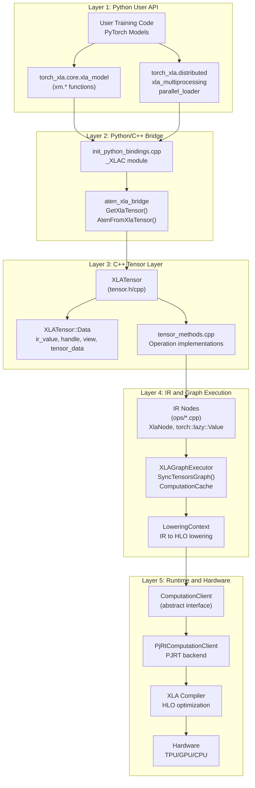

**Layer 1: Python User API** - User-facing PyTorch code interfaces with `torch_xla.core.xla_model` for device management and synchronization, and `torch_xla.distributed` for multi-device training.

**Layer 2: Python/C++ Bridge** - [torch_xla/csrc/init_python_bindings.cpp:1-4000]() implements the `_XLAC` Python module that exposes C++ functionality. [torch_xla/csrc/aten_xla_bridge.h:1-100]() provides `GetXlaTensor()` and `AtenFromXlaTensor()` to convert between PyTorch and XLA tensor representations.

**Layer 3: C++ Tensor Layer** - `XLATensor` ([torch_xla/csrc/tensor.h:94-359]()) is the core tensor type. Each `XLATensor` contains a `Data` struct ([torch_xla/csrc/tensor.h:102-152]()) holding either an IR value, a device data handle, a view, or CPU tensor data. [torch_xla/csrc/tensor_methods.cpp:1-500]() implements high-level operations.

**Layer 4: IR and Graph Execution** - Operations create `XlaNode` IR nodes ([torch_xla/csrc/ir.h:1-200]()) wrapped in `torch::lazy::Value`. `XLAGraphExecutor` ([torch_xla/csrc/xla_graph_executor.h:1-200]()) manages graph compilation, caching, and execution. `LoweringContext` converts IR to XLA HLO.

**Layer 5: Runtime and Hardware** - `ComputationClient` ([torch_xla/csrc/runtime/computation_client.h:1-100]()) provides an abstract interface. `PjRtComputationClient` ([torch_xla/csrc/runtime/pjrt_computation_client.h:1-100]()) implements the PJRT backend, interfacing with the XLA compiler and hardware devices.

Sources: [torch_xla/csrc/tensor.h:1-363](), [torch_xla/csrc/xla_graph_executor.h:1-200](), [torch_xla/csrc/runtime/computation_client.h:1-300](), [torch_xla/csrc/init_python_bindings.cpp:1-500]()

## Core Data Structures

### XLATensor and Lazy Representation

The `XLATensor` class ([torch_xla/csrc/tensor.h:94-359]()) is PyTorch/XLA's central data structure. Each tensor maintains a shared pointer to a `Data` struct that can hold tensor information in one of four states:

| State | Field | Description |
|-------|-------|-------------|
| **IR Node** | `ir_value` | Pending computation represented as IR graph |
| **Device Data** | `handle` | Materialized data on XLA device |
| **View** | `view` | Alias/view of another tensor |
| **CPU Data** | `tensor_data` | Cached CPU tensor |

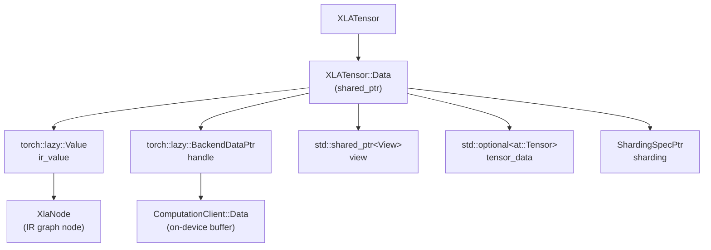

The `XLATensor::Data` structure ([torch_xla/csrc/tensor.h:102-152]()) contains:
- `ir_value`: The current IR node representing pending computation
- `handle`: A `BackendDataPtr` to materialized device data
- `view`: A view into another tensor's data
- `tensor_data`: Optional cached CPU tensor
- `sharding`: SPMD sharding specification for distributed execution
- `logical_element_type`: The PyTorch-visible dtype (may differ from HLO dtype)
- `alias_id`: Identifier for input/output aliasing
- `generation`: Mutation tracking counter

The tensor transitions between states as operations are performed. Initially, a tensor may hold only CPU data. When an operation is called, it creates an IR node. When the value is needed (e.g., printed or moved to CPU), `XLAGraphExecutor` compiles and executes the graph, storing the result in `handle`.

Sources: [torch_xla/csrc/tensor.h:94-359](), [torch_xla/csrc/tensor.cpp:53-255]()

### IR System and torch::lazy::Value

PyTorch/XLA uses `torch::lazy::Value` to represent IR nodes. A `Value` is a pair of a `NodePtr` and an output index ([torch/csrc/lazy/core/ir.h]()). Each `XlaNode` ([torch_xla/csrc/ir.h]()) inherits from `torch::lazy::Node` and implements:

- `Lower()`: Converts the IR node to XLA HLO operations
- `operands()`: Returns input values
- `shapes()`: Returns output shapes
- `sharding()`: Returns sharding annotation for SPMD

Operation nodes are created by functions in [torch_xla/csrc/ops/ops.cpp:1-1000](). For example:

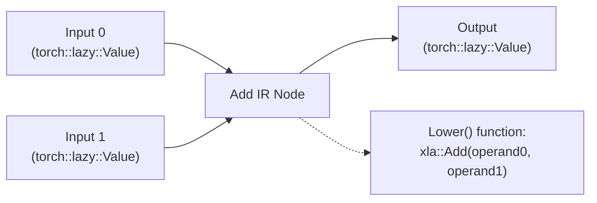

Generic operations use the `Generic` node class ([torch_xla/csrc/ops/generic.h]()) which stores a lambda for lowering. Specialized operations like `Constant`, `DeviceData`, `Cast`, etc. have dedicated node classes in [torch_xla/csrc/ops/]().

Sources: [torch_xla/csrc/ir.h:1-200](), [torch_xla/csrc/ops/ops.cpp:44-165](), [torch_xla/csrc/ops/generic.h:1-100]()

## Operation Execution Flow

PyTorch/XLA implements lazy execution: operations build an IR graph instead of executing immediately. The graph is compiled and executed only when results are needed.

### Lazy Execution Sequence

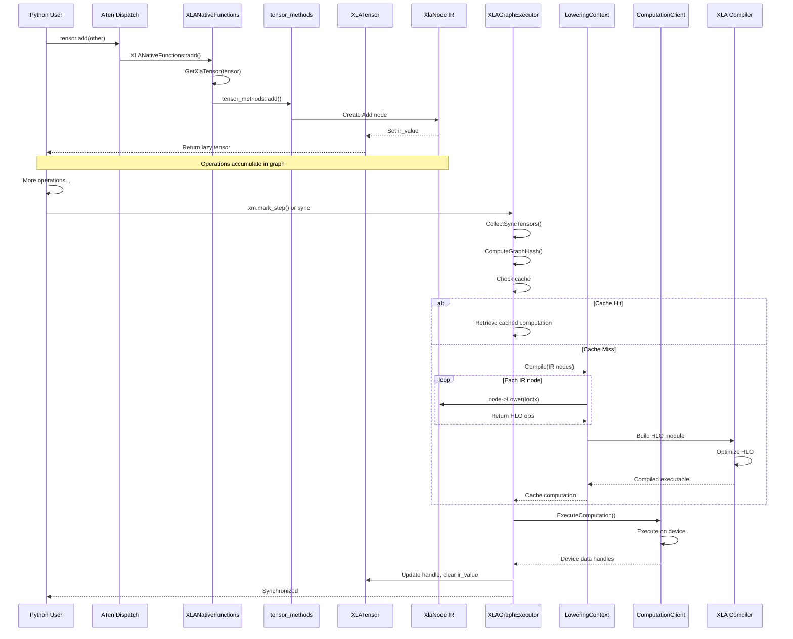

### Key Execution Steps

**1. Operation Dispatch** - PyTorch's dispatcher routes operations to `XLANativeFunctions` ([torch_xla/csrc/aten_xla_type.cpp:444-1000]()). Each function:
   - Extracts `XLATensor` from `at::Tensor` using `bridge::GetXlaTensor()` ([torch_xla/csrc/aten_xla_bridge.cpp:1-200]())
   - Calls the corresponding `tensor_methods::` function
   - Wraps the result back to `at::Tensor` using `bridge::AtenFromXlaTensor()`

**2. IR Node Creation** - `tensor_methods` functions ([torch_xla/csrc/tensor_methods.cpp:1-10000]()) create IR nodes. For example, `add()` creates an `Add` node and returns a new `XLATensor` with `ir_value` set to that node.

**3. Graph Collection** - When `xm.mark_step()` or a synchronization point is reached, `XLAGraphExecutor::SyncTensorsGraph()` ([torch_xla/csrc/xla_graph_executor.cpp:800-1200]()) collects all tensors with pending IR:
   - `CollectSyncTensors()` gathers tensors that need compilation
   - Performs topological sort via `PostOrderData()`
   - Computes a hash of the graph structure

**4. Compilation** - If the graph hash is not in the cache, `Compile()` ([torch_xla/csrc/xla_graph_executor.cpp:400-800]()):
   - Creates a `LoweringContext`
   - Iterates through IR nodes in topological order
   - Each node's `Lower()` method produces XLA HLO operations
   - Builds a complete HLO module with parameters and outputs
   - Invokes `ComputationClient::Compile()` which calls the XLA compiler

**5. Execution** - `ComputationClient::ExecuteComputation()` ([torch_xla/csrc/runtime/pjrt_computation_client.cpp:1000-1500]()):
   - Transfers input data to device if needed
   - Runs the compiled executable
   - Returns handles to device buffers
   - Updates `XLATensor::Data::handle` with results
   - Clears `ir_value` to indicate materialization

**6. Caching** - The `ComputationCache` ([torch_xla/csrc/xla_graph_executor.h:50-100]()) stores compiled executables keyed by graph hash. For persistent caching, serialized HLO can be written to disk (controlled by `XLA_PERSISTENT_CACHE_PATH`). Cache lookup avoids recompilation for identical graph patterns.

Sources: [torch_xla/csrc/xla_graph_executor.cpp:400-1200](), [torch_xla/csrc/aten_xla_type.cpp:860-900](), [torch_xla/csrc/tensor_methods.cpp:1-500](), [torch_xla/csrc/tensor.cpp:212-255]()

## Component Interactions

### ATen to XLA Bridge

The bridge layer ([torch_xla/csrc/aten_xla_bridge.h:1-150]()) provides bidirectional conversion:

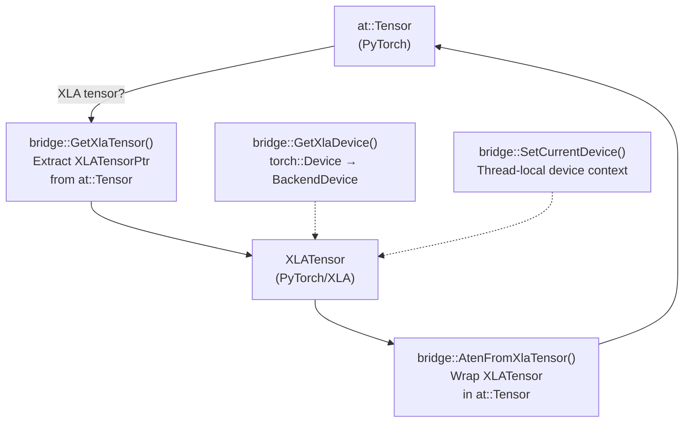

Key functions:
- `GetXlaTensor(at::Tensor)` returns `absl::StatusOr<XLATensorPtr>` ([torch_xla/csrc/aten_xla_bridge.cpp:50-100]())
- `AtenFromXlaTensor(XLATensorPtr)` creates an `at::Tensor` with `XLATensorImpl` ([torch_xla/csrc/aten_xla_bridge.cpp:150-200]())
- `GetOrCreateXlaTensor(at::Tensor, device)` ensures a tensor is on the XLA device
- Device context is thread-local, accessed via `GetCurrentDevice()` and set via `SetCurrentDevice()`

Sources: [torch_xla/csrc/aten_xla_bridge.h:1-150](), [torch_xla/csrc/aten_xla_bridge.cpp:1-300]()

### XLAGraphExecutor Orchestration

`XLAGraphExecutor` ([torch_xla/csrc/xla_graph_executor.h:28-200](), [torch_xla/csrc/xla_graph_executor.cpp:1-3000]()) is the central orchestrator, managing:

| Responsibility | Implementation |
|----------------|----------------|
| **Tensor Registration** | `RegisterTensor()` tracks all live `XLATensor::Data` instances |
| **Graph Compilation** | `SyncTensorsGraph()` compiles pending IR graphs |
| **Computation Cache** | `ComputationCache` stores compiled executables by hash |
| **Device Synchronization** | `SyncLiveTensorsGraph()` ensures all device operations complete |
| **Eager Mode** | `ApplyEagerSync()` compiles single operations immediately |
| **Scalar Cache** | `GetDeviceData()` caches scalar literals |

The executor maintains per-device state in `DeviceContextArena` ([torch_xla/csrc/xla_graph_executor.cpp:127-200]()), tracking live tensors and compilation triggers. Graph compilation is triggered by:
- Explicit `xm.mark_step()` or `xm.wait_device_ops()`
- Tensor materialization (`.cpu()`, printing, etc.)
- Eager mode execution (when `torch_xla.experimental.eager_mode()` is enabled)

Sources: [torch_xla/csrc/xla_graph_executor.h:28-200](), [torch_xla/csrc/xla_graph_executor.cpp:127-600]()

### ComputationClient Runtime

The runtime layer abstracts hardware access through `ComputationClient` ([torch_xla/csrc/runtime/computation_client.h:1-300]()):

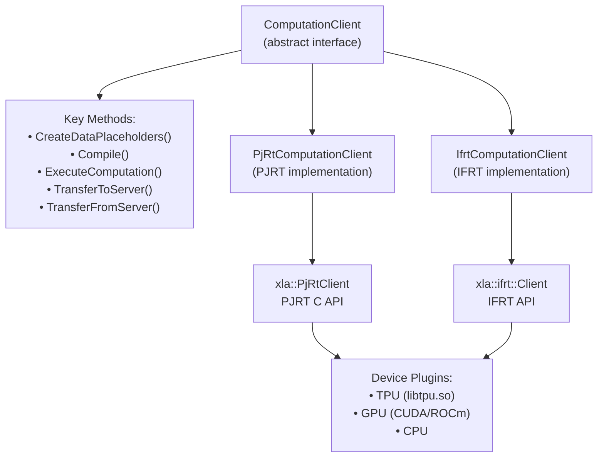

**Data Abstraction** - `ComputationClient::Data` represents on-device buffers. `PjRtData` wraps `xla::PjRtBuffer` handles. Operations transfer data between host and device via `TransferToServer()` and `TransferFromServer()`.

**Compilation** - `Compile()` takes an HLO module and returns a `ComputationClient::Computation` executable. The PJRT backend calls `PjRtClient::Compile()` from the OpenXLA project.

**Execution** - `ExecuteComputation()` runs a compiled executable with given inputs, returning output data handles. PJRT execution is asynchronous; synchronization occurs explicitly via device barriers.

**Plugin System** - Device selection is controlled by the `PJRT_DEVICE` environment variable. `pjrt_registry.cpp` discovers and loads PJRT plugins from shared libraries.

Sources: [torch_xla/csrc/runtime/computation_client.h:1-300](), [torch_xla/csrc/runtime/pjrt_computation_client.h:1-200](), [torch_xla/csrc/runtime/pjrt_computation_client.cpp:1-500]()

## Lowering and Code Generation

### IR to HLO Translation

`LoweringContext` ([torch_xla/csrc/lowering_context.h:1-150]()) manages the translation from IR to XLA HLO:

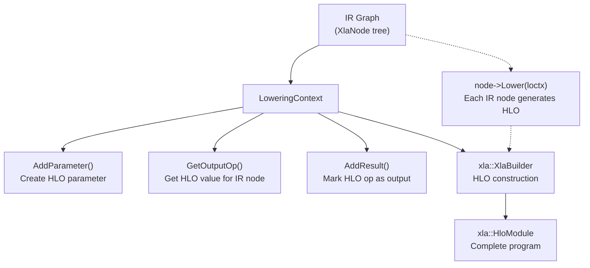

**Lowering Process**:
1. Create `LoweringContext` with an `xla::XlaBuilder`
2. Add parameters for all input tensors via `AddParameter()`
3. Iterate IR nodes in topological order
4. For each node, call `node->Lower(loctx)` which uses `xla::` ops to build HLO
5. Mark output tensors with `AddResult()`
6. Call `Build()` to finalize the HLO module

**Example**: The `Add` node's `Lower()` method ([torch_xla/csrc/ops/arithmetic_ir_ops.cpp:1-100]()):
```cpp
XlaOpVector Add::Lower(LoweringContext* loctx) const {
  xla::XlaOp lhs = loctx->GetOutputOp(operand(0));
  xla::XlaOp rhs = loctx->GetOutputOp(operand(1));
  xla::XlaOp result = xla::Add(lhs, rhs);
  return ReturnOp(result, loctx);
}
```

**Shape Inference** - Many operations use `InferOutputShape()` ([torch_xla/csrc/ops/infer_output_shape.h:1-50]()) to compute output shapes without full lowering, enabling graph optimization and memory planning.

**Dynamic Shapes** - For operations with dynamic dimensions, special IR nodes like `DynamicExpand` and `SizeAdd` handle shape computation. The `GetXlaShape()` utility converts between PyTorch and XLA shape representations.

Sources: [torch_xla/csrc/lowering_context.h:1-150](), [torch_xla/csrc/lowering_context.cpp:1-500](), [torch_xla/csrc/ops/ops.cpp:44-165]()

### Code Generation Configuration

PyTorch/XLA's code generation is controlled by:

| Configuration | Purpose |
|---------------|---------|
| `XLA_IR_DEBUG=1` | Dump IR graphs before compilation |
| `XLA_HLO_DEBUG=1` | Dump HLO before and after optimization |
| `XLA_SAVE_TENSORS_FILE` | Save IR/HLO to file |
| `XLA_SAVE_TENSORS_FMT` | Output format (text, dot, hlo) |
| `XLA_METRICS_FILE` | Write performance metrics |
| `XLA_COMPILATION_CACHE_SIZE` | Max cached compilations (default: 2048) |
| `XLA_PERSISTENT_CACHE_PATH` | Directory for persistent cache |

The `XLA_DUMP_FATAL_STACK` flag enables stack traces on errors, controlled via [torch_xla/csrc/runtime/env_vars.h:1-100]().

Sources: [torch_xla/csrc/xla_graph_executor.cpp:84-123](), [torch_xla/csrc/runtime/env_vars.h:1-100](), [torch_xla/csrc/runtime/sys_util.h:1-100]()

## Build System Architecture

PyTorch/XLA uses a hybrid build system combining Python `setuptools` and Bazel for C++ compilation:

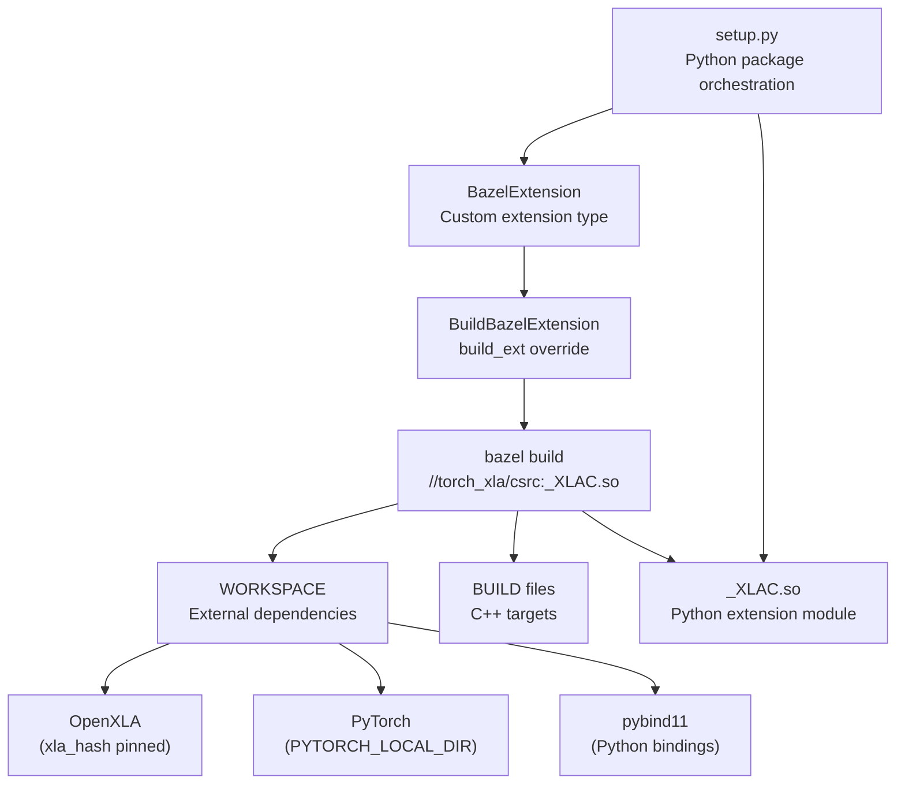

**Build Process**:
1. `python setup.py install` or `pip install .` invokes [setup.py:1-400]()
2. `BuildBazelExtension.build_extension()` ([setup.py:280-333]()) runs `bazel build //torch_xla/csrc:_XLAC.so`
3. Bazel reads [WORKSPACE:1-150]() for external dependencies (OpenXLA at pinned commit, PyTorch local path)
4. Compiles C++ with flags from environment (`CXX_ABI`, `XLA_CUDA`, etc.)
5. Copies built `.so` to Python package directory
6. Bundles `libtpu.so` if `BUNDLE_LIBTPU=1` ([setup.py:194-221]())

**Dependency Pinning**:
- OpenXLA commit: `xla_hash = '9a9aa0e11e4fcda8d6a9c3267dca6776ddbdb0ca'` ([WORKSPACE:49]())
- PyTorch: Resolved via `PYTORCH_LOCAL_DIR` from `python -c "import torch; print(torch.__path__[0])"`
- JAX/libtpu versions: `_jax_version`, `_libtpu_version` in [setup.py:119-141]()

**Plugin Architecture**: PJRT plugins are dynamically loaded shared libraries. Device selection occurs via `PJRT_DEVICE` environment variable, which loads the corresponding plugin from `pjrt_registry.cpp` ([torch_xla/csrc/runtime/pjrt_registry.cpp:1-200]()).

Sources: [setup.py:1-400](), [WORKSPACE:1-150](), [torch_xla/csrc/BUILD:1-200](), [torch_xla/csrc/runtime/BUILD:1-300]()

---

# Page: Installation and Dependencies

# Installation and Dependencies

<details>
<summary>Relevant source files</summary>

The following files were used as context for generating this wiki page:

- [.github/ci.md](.github/ci.md)
- [.github/workflows/_build_torch_xla.yml](.github/workflows/_build_torch_xla.yml)
- [.github/workflows/_check_code_changes.yml](.github/workflows/_check_code_changes.yml)
- [.github/workflows/_test.yml](.github/workflows/_test.yml)
- [.github/workflows/_tpu_ci.yml](.github/workflows/_tpu_ci.yml)
- [.github/workflows/build_and_test.yml](.github/workflows/build_and_test.yml)
- [.github/workflows/build_upstream_image.yml](.github/workflows/build_upstream_image.yml)
- [.github/workflows/setup/action.yml](.github/workflows/setup/action.yml)
- [CONTRIBUTING.md](CONTRIBUTING.md)
- [README.md](README.md)
- [WORKSPACE](WORKSPACE)
- [experimental/reference_models/README.md](experimental/reference_models/README.md)
- [scripts/build_developer.sh](scripts/build_developer.sh)
- [scripts/update_deps.py](scripts/update_deps.py)
- [setup.py](setup.py)
- [test/tpu/xla_test_job.yaml](test/tpu/xla_test_job.yaml)
- [torch_xla/csrc/runtime/BUILD](torch_xla/csrc/runtime/BUILD)
- [torch_xla/csrc/runtime/computation_client.h](torch_xla/csrc/runtime/computation_client.h)
- [torch_xla/csrc/runtime/ifrt_computation_client.cpp](torch_xla/csrc/runtime/ifrt_computation_client.cpp)
- [torch_xla/csrc/runtime/ifrt_computation_client.h](torch_xla/csrc/runtime/ifrt_computation_client.h)
- [torch_xla/csrc/runtime/ifrt_computation_client_test.cpp](torch_xla/csrc/runtime/ifrt_computation_client_test.cpp)
- [torch_xla/csrc/runtime/pjrt_computation_client.cpp](torch_xla/csrc/runtime/pjrt_computation_client.cpp)
- [torch_xla/csrc/runtime/pjrt_computation_client.h](torch_xla/csrc/runtime/pjrt_computation_client.h)
- [torch_xla/csrc/runtime/pjrt_computation_client_test.cpp](torch_xla/csrc/runtime/pjrt_computation_client_test.cpp)
- [torch_xla/csrc/runtime/pjrt_registry.cpp](torch_xla/csrc/runtime/pjrt_registry.cpp)
- [torch_xla/csrc/runtime/runtime.cpp](torch_xla/csrc/runtime/runtime.cpp)
- [torch_xla/csrc/runtime/runtime.h](torch_xla/csrc/runtime/runtime.h)

</details>


This page documents the installation methods, build system, and external dependencies for PyTorch/XLA. PyTorch/XLA connects PyTorch to XLA devices (TPUs, GPUs, CPUs) through a plugin architecture. For information about the runtime architecture, see [System Architecture](#1.1).

## Overview

PyTorch/XLA can be installed via:

1. **Pre-built wheels** - For end users
2. **Docker images** - For reproducible environments  
3. **Source builds** - For development and contributions

The build system uses `setup.py` for Python packaging orchestration and Bazel for C++ compilation. At runtime, device support is provided through PJRT plugins that are dynamically loaded.

**Installation and Dependency Flow**

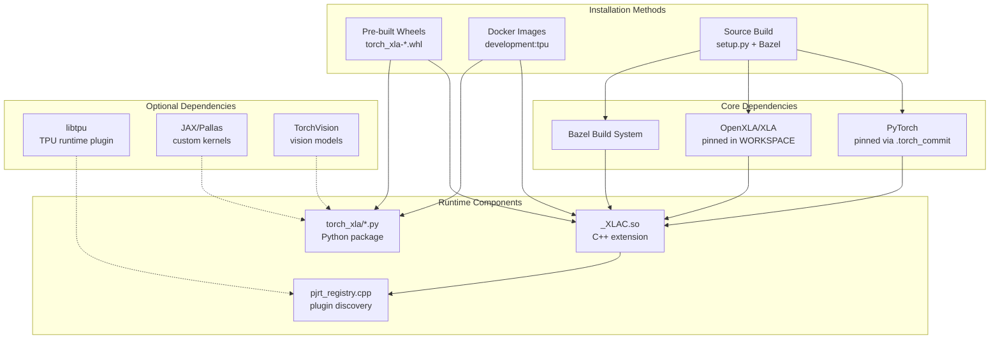

Sources: [setup.py:1-50](), [WORKSPACE:1-157](), [torch_xla/csrc/runtime/pjrt_registry.cpp:1-175]()

## Pre-built Wheel Installation

### TPU Installation

**Stable Release (PyTorch 2.8.0)**

Python 3.8 to 3.11 are supported:

```bash
pip install torch==2.8.0 'torch_xla[tpu]==2.8.0'
```

The `[tpu]` extra installs the `libtpu` plugin required for TPU communication. This is defined in [setup.py:471-477]() as:

```python
'tpu': [
    f'libtpu=={_libtpu_version}',
    'tpu-info',
]
```

**Optional: Pallas Support**

For custom TPU kernels using JAX/Pallas:

```bash
pip install --pre torch_xla[pallas] \
  --index-url https://us-python.pkg.dev/ml-oss-artifacts-published/jax/simple/ \
  --find-links https://storage.googleapis.com/jax-releases/libtpu_releases.html
```

This installs JAX and jaxlib dependencies specified in [setup.py:409-414]():

```python
def _get_jax_install_requirements():
  return [
      f'torchax=={_torchax_version}',
      f'jaxlib=={_jaxlib_version}',
      f'jax=={_jax_version}',
  ]
```

**Nightly Builds**

Starting from PyTorch/XLA 2.8, nightly wheels support Python 3.11 to 3.13:

```bash
pip install --pre torch torchvision --index-url https://download.pytorch.org/whl/nightly/cpu
pip install 'torch_xla[tpu] @ https://storage.googleapis.com/pytorch-xla-releases/wheels/tpuvm/torch_xla-2.9.0.dev-cp312-cp312-linux_x86_64.whl' \
  -f https://storage.googleapis.com/libtpu-wheels/index.html
```

For a specific date:

```bash
pip install torch==2.9.0.dev20250423+cpu --index-url https://download.pytorch.org/whl/nightly/cpu
pip install https://storage.googleapis.com/pytorch-xla-releases/wheels/tpuvm/torch_xla-2.9.0.dev20250423-cp310-cp310-linux_x86_64.whl
```

Sources: [README.md:26-53](), [setup.py:409-480]()

### C++11 ABI Builds

Starting from PyTorch/XLA 2.7, C++11 ABI is the default. The C++11 ABI provides better lazy tensor tracing performance. The ABI is determined during compilation in [setup.py:307-317]():

```python
cxx_abi = os.getenv('CXX_ABI')
if cxx_abi is None:
    try:
        import torch
        cxx_abi = getattr(torch._C, '_GLIBCXX_USE_CXX11_ABI', None)
    except:
        pass
if cxx_abi is None:
    # Default to building with C++11 ABI
    cxx_abi = "1"
bazel_argv.append(f'--cxxopt=-D_GLIBCXX_USE_CXX11_ABI={int(cxx_abi)}')
```

For PyTorch/XLA 2.6, C++11 ABI wheels are available separately:

```bash
pip install torch==2.6.0+cpu.cxx11.abi \
  https://storage.googleapis.com/pytorch-xla-releases/wheels/tpuvm/torch_xla-2.6.0%2Bcxx11-cp310-cp310-manylinux_2_28_x86_64.whl \
  'torch_xla[tpu]' \
  -f https://storage.googleapis.com/libtpu-releases/index.html \
  -f https://storage.googleapis.com/libtpu-wheels/index.html
```

Docker images with C++11 ABI:
- `us-central1-docker.pkg.dev/tpu-pytorch-releases/docker/xla:r2.6.0_3.10_tpuvm_cxx11`
- `us-central1-docker.pkg.dev/tpu-pytorch-releases/docker/xla:nightly_3.10_tpuvm_cxx11`

Sources: [README.md:55-95](), [setup.py:307-318]()

### GPU/XPU Installation

GPU support uses a plugin architecture. The plugin is registered in [setup.py:465-469]():

```python
'torch_xla.plugins': [
    'tpu = torch_xla._internal.tpu:TpuPlugin',
    'neuron = torch_xla._internal.neuron:NeuronPlugin',
    'xpu = torch_xla._internal.xpu:XpuPlugin'
]
```

At runtime, plugins are discovered via `pjrt_registry.cpp` when `PJRT_DEVICE` environment variable is set.

Sources: [setup.py:461-470](), [torch_xla/csrc/runtime/pjrt_registry.cpp:26-175]()

## Docker Images

Docker images include pre-built PyTorch, PyTorch/XLA, and dependencies.

### Available Images

| Version | Image | Notes |
|---------|-------|-------|
| 2.7 | `us-central1-docker.pkg.dev/tpu-pytorch-releases/docker/xla:r2.7.0_3.10_tpuvm` | C++11 ABI |
| 2.6 | `us-central1-docker.pkg.dev/tpu-pytorch-releases/docker/xla:r2.6.0_3.10_tpuvm` | Pre-C++11 ABI |
| 2.6 C++11 | `us-central1-docker.pkg.dev/tpu-pytorch-releases/docker/xla:r2.6.0_3.10_tpuvm_cxx11` | C++11 ABI |
| Nightly | `us-central1-docker.pkg.dev/tpu-pytorch-releases/docker/xla:nightly_3.10_tpuvm` | Latest build |

**Usage:**

```bash
docker run --privileged --net host --shm-size=16G -it \
  us-central1-docker.pkg.dev/tpu-pytorch-releases/docker/xla:nightly_3.10_tpuvm /bin/bash
```

Flags:
- `--privileged`: Required for TPU access
- `--net host`: Share host network for distributed training
- `--shm-size=16G`: Increase shared memory for data loading

Sources: [README.md:298-315]()

## Building from Source

Building from source is required for development. The build uses `setup.py` for orchestration and Bazel for C++ compilation.

**Build System Architecture**

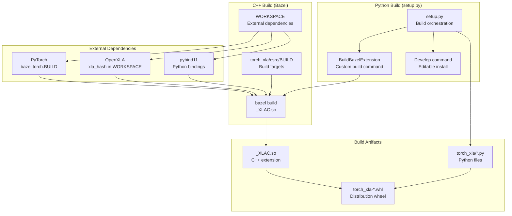

Sources: [setup.py:1-486](), [WORKSPACE:1-157](), [torch_xla/csrc/runtime/BUILD:1-505]()

### Development Setup

**Prerequisites:**

1. Clone repositories:

```bash
export WORKSPACE_DIR=/path/to/workspace
cd $WORKSPACE_DIR
git clone --recursive https://github.com/pytorch/pytorch.git
git clone --recursive https://github.com/pytorch/xla.git pytorch/xla
git clone https://github.com/pytorch/vision.git
```

2. Check out the pinned PyTorch version:

```bash
cd pytorch
COMMIT=$(tail -1 xla/.torch_commit)
git checkout $COMMIT
```

The `.torch_commit` file pins the PyTorch version that is tested with PyTorch/XLA. See [CONTRIBUTING.md:61-81]() for details.

**VS Code Dev Container:**

```bash
cd $WORKSPACE_DIR
ln -s pytorch/xla/.devcontainer/ .devcontainer
ln -s pytorch/xla/contrib/vscode/ .vscode
```

Open VS Code and select "Reopen in Container". The container images are defined in `.devcontainer/` and include all build dependencies.

**Build Commands:**

```bash
# Build PyTorch
cd pytorch
python setup.py bdist_wheel
python setup.py install

# Build PyTorch/XLA
cd xla
python setup.py develop

# Install TPU plugin
pip install torch_xla[tpu] \
  -f https://storage.googleapis.com/libtpu-wheels/index.html
```

The `develop` command creates an editable install using [setup.py:345-407]().

Sources: [CONTRIBUTING.md:14-189](), [scripts/build_developer.sh:1-104]()

### Build System Details

**setup.py Environment Variables**

Key environment variables control the build process in [setup.py:1-50]():

| Variable | Default | Description |
|----------|---------|-------------|
| `DEBUG` | - | Build with debug symbols |
| `TORCH_XLA_VERSION` | `2.9.0` | Override version string |
| `BUILD_CPP_TESTS` | `0` | Build C++ test binaries |
| `BUNDLE_LIBTPU` | `0` | Include libtpu.so in wheel |
| `CXX_ABI` | Auto-detected | Set C++ ABI version |
| `BAZEL_REMOTE_CACHE` | - | Enable remote cache |
| `BAZEL_JOBS` | - | Parallel jobs for Bazel |

**Bazel Build Process:**

The `BuildBazelExtension` class in [setup.py:280-333]() orchestrates the Bazel build:

1. Invoke Bazel to build `_XLAC.so` target
2. Detect C++ ABI from PyTorch or default to C++11
3. Copy compiled extension to package directory

Example Bazel invocation:
```bash
bazel build //:_XLAC.so \
  --cxxopt=-D_GLIBCXX_USE_CXX11_ABI=1 \
  --symlink_prefix=/tmp/bazel-
```

**Optional Libtpu Bundling:**

The [setup.py:194-221]() function `maybe_bundle_libtpu()` can download and bundle `libtpu.so`:

```python
if build_util.check_env_flag('BUNDLE_LIBTPU', '0'):
    # Download libtpu wheel and extract libtpu.so
    resp = requests.get(_libtpu_storage_path)
    # ... extract and copy to torch_xla/lib/
```

Sources: [setup.py:1-333]()

## External Dependencies

PyTorch/XLA depends on several external projects that are managed through version pinning.

**Dependency Management**

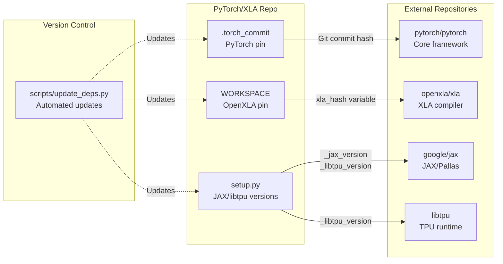

**PyTorch Version Pinning**

PyTorch is pinned via `.torch_commit` file containing a commit hash:

```
# 2025-03-18
abc123def456...
```

This ensures all PyTorch/XLA tests pass with the pinned PyTorch version. During CI builds, PyTorch is checked out at this commit in [.github/workflows/setup/action.yml:39-48]().

**OpenXLA Version Pinning**

OpenXLA is pinned in [WORKSPACE:49-66]():

```python
xla_hash = '9a9aa0e11e4fcda8d6a9c3267dca6776ddbdb0ca'  # Committed on 2025-10-01.

http_archive(
    name = "xla",
    strip_prefix = "xla-" + xla_hash,
    urls = [
        "https://github.com/openxla/xla/archive/" + xla_hash + ".tar.gz",
    ],
)
```

**JAX and libtpu Versions**

JAX and libtpu versions are defined in [setup.py:117-141]():

```python
USE_NIGHTLY = True  # Whether to use nightly or stable

_libtpu_version = '0.0.24'
_libtpu_date = '20250929'

_jax_version = '0.8.0'
_jaxlib_version = '0.8.0'
_jax_date = '20251001'

if USE_NIGHTLY:
    _libtpu_version += f".dev{_libtpu_date}+nightly"
    _jax_version += f'.dev{_jax_date}'
    _jaxlib_version += f'.dev{_jax_date}'
```

**Updating Dependencies**

Use [scripts/update_deps.py]() to update all dependencies:

```bash
# Update all dependencies to latest
scripts/update_deps.py

# Update specific dependency
scripts/update_deps.py --pytorch
scripts/update_deps.py --openxla
scripts/update_deps.py --jax
```

The script fetches latest versions and updates the version pins. See [scripts/update_deps.py:1-400]() for implementation.

Sources: [.torch_commit:1-2](), [WORKSPACE:45-66](), [setup.py:80-141](), [scripts/update_deps.py:1-400](), [.github/workflows/setup/action.yml:38-49]()

## Plugin Architecture

PyTorch/XLA uses a plugin system to support different hardware backends. Plugins are loaded dynamically at runtime based on the `PJRT_DEVICE` environment variable.

**Plugin Discovery and Loading**

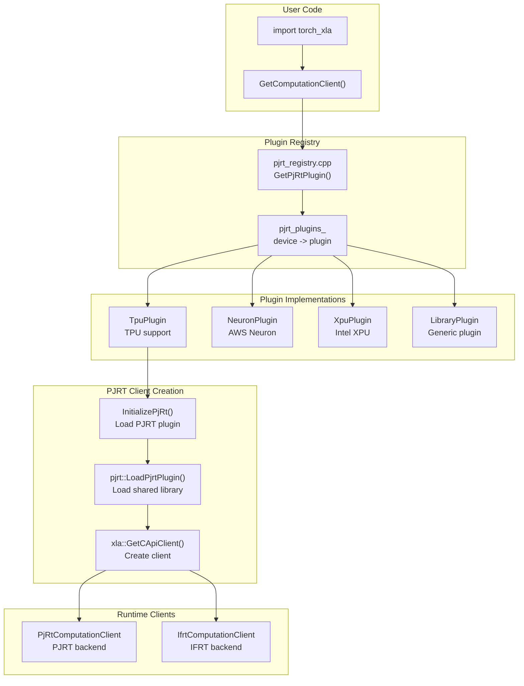

**Plugin Registration**

Plugins are registered in [setup.py:465-469]():

```python
entry_points={
    'torch_xla.plugins': [
        'tpu = torch_xla._internal.tpu:TpuPlugin',
        'neuron = torch_xla._internal.neuron:NeuronPlugin',
        'xpu = torch_xla._internal.xpu:XpuPlugin'
    ],
}
```

**Plugin Interface**

Each plugin implements the `PjRtPlugin` interface defined in [torch_xla/csrc/runtime/pjrt_registry.h]():

```cpp
class PjRtPlugin {
  virtual std::string library_path() const = 0;
  virtual const std::unordered_map<std::string, xla::PjRtValueType>
      client_create_options() const = 0;
  virtual bool requires_xla_coordinator() const = 0;
};
```

**TPU Plugin Loading**

For TPU, the plugin loading in [torch_xla/csrc/runtime/pjrt_registry.cpp:137-149]():

```cpp
else if (device_type == "TPU") {
  TF_VLOG(1) << "Initializing TFRT TPU client...";
  absl::InitializeLog();
  auto tpu_library_path = sys_util::GetEnvString(
      env::kEnvTpuLibraryPath,
      sys_util::GetEnvString(env::kEnvInferredTpuLibraryPath, "libtpu.so"));
  XLA_ASSIGN_OR_RETURN(const PJRT_Api* c_api,
                       pjrt::LoadPjrtPlugin("tpu", tpu_library_path));
  XLA_RETURN_IF_ERROR(pjrt::InitializePjrtPlugin("tpu"));
  XLA_ASSIGN_OR_RETURN(client, xla::GetCApiClient("TPU"));
  profiler::RegisterProfilerForPlugin(c_api);
}
```

The TPU library path can be specified via `TPU_LIBRARY_PATH` environment variable or defaults to `libtpu.so`.

Sources: [setup.py:461-470](), [torch_xla/csrc/runtime/pjrt_registry.cpp:26-175](), [torch_xla/csrc/runtime/runtime.cpp:14-75]()

## CI Build System

PyTorch/XLA's CI system builds and tests across CPU and TPU platforms.

**CI Build Flow**

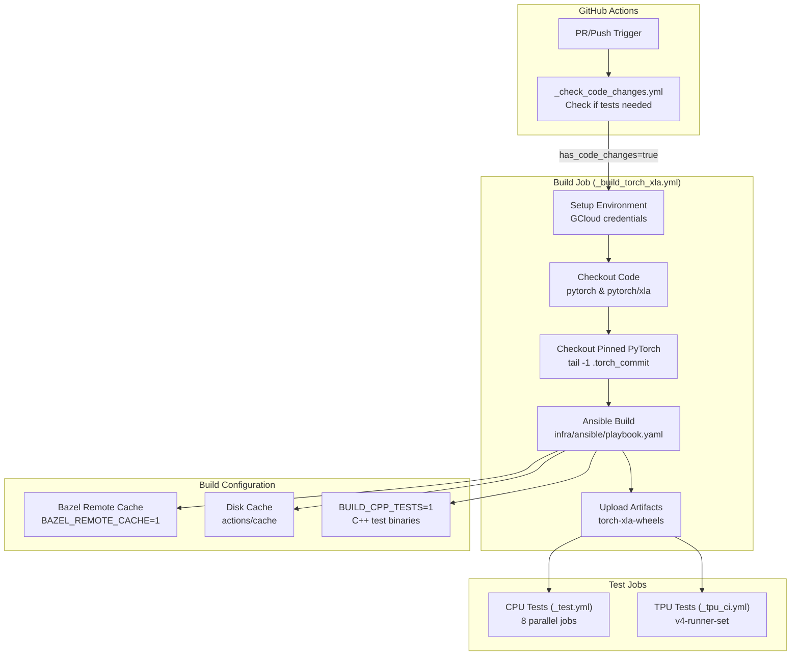

**Build Configuration**

The CI uses [.github/workflows/_build_torch_xla.yml:1-111]() with environment variables:

```yaml
env:
  BAZEL_REMOTE_CACHE: 1
  BAZEL_DISK_CACHE_PATH: "${{ github.workspace }}/disk-cache"
  BAZEL_JOBS: ""  # Let bazel decide parallelism
  BUILD_CPP_TESTS: 1
```

Ansible playbook [infra/ansible/playbook.yaml]() handles the actual build:

```bash
ansible-playbook playbook.yaml \
  -e "stage=build arch=amd64 accelerator=tpu \
      src_root=${GITHUB_WORKSPACE} bundle_libtpu=0 \
      build_cpp_tests=1 git_versioned_xla_build=1"
```

**Test Matrix**

CPU tests run in parallel in [.github/workflows/_test.yml:42-59]():

- `benchmark_tests`
- `python_tests` + `xla_op1` through `xla_op5`
- `torch_mp_op_tests`
- `cpp_tests`

TPU tests run on GKE with [test/tpu/xla_test_job.yaml:1-55]() pod configuration.

Sources: [.github/workflows/build_and_test.yml:1-98](), [.github/workflows/_build_torch_xla.yml:1-111](), [.github/workflows/_test.yml:1-164](), [.github/workflows/_tpu_ci.yml:1-91]()

## Environment Components and Integration

The following diagram illustrates how PyTorch/XLA integrates with the system components and the overall PyTorch ecosystem:

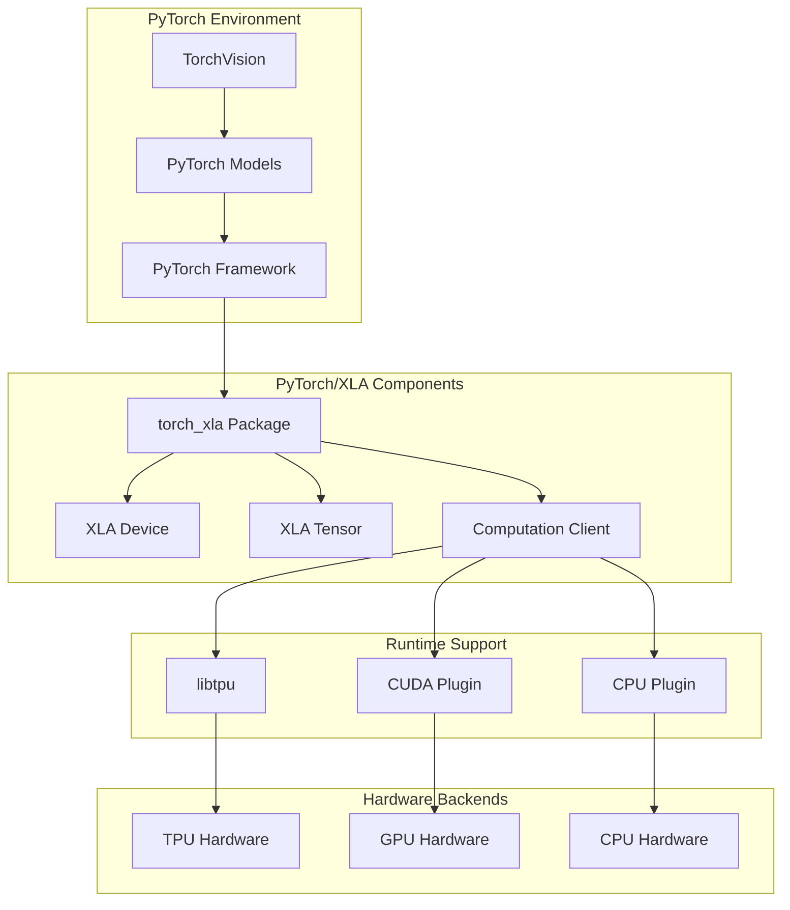

Sources: [README.md:5-12](), [API_GUIDE.md:1-12](), [CONTRIBUTING.md:177-196]()

---

# Page: Core Components

# Core Components

<details>
<summary>Relevant source files</summary>

The following files were used as context for generating this wiki page:

- [WORKSPACE](WORKSPACE)
- [setup.py](setup.py)
- [test/test_operations.py](test/test_operations.py)
- [test/test_ops_error_message.py](test/test_ops_error_message.py)
- [torch_xla/csrc/aten_autograd_ops.cpp](torch_xla/csrc/aten_autograd_ops.cpp)
- [torch_xla/csrc/aten_xla_type.cpp](torch_xla/csrc/aten_xla_type.cpp)
- [torch_xla/csrc/init_python_bindings.cpp](torch_xla/csrc/init_python_bindings.cpp)
- [torch_xla/csrc/ops/ops.cpp](torch_xla/csrc/ops/ops.cpp)
- [torch_xla/csrc/ops/ops.h](torch_xla/csrc/ops/ops.h)
- [torch_xla/csrc/runtime/BUILD](torch_xla/csrc/runtime/BUILD)
- [torch_xla/csrc/runtime/computation_client.h](torch_xla/csrc/runtime/computation_client.h)
- [torch_xla/csrc/runtime/ifrt_computation_client.cpp](torch_xla/csrc/runtime/ifrt_computation_client.cpp)
- [torch_xla/csrc/runtime/ifrt_computation_client.h](torch_xla/csrc/runtime/ifrt_computation_client.h)
- [torch_xla/csrc/runtime/ifrt_computation_client_test.cpp](torch_xla/csrc/runtime/ifrt_computation_client_test.cpp)
- [torch_xla/csrc/runtime/pjrt_computation_client.cpp](torch_xla/csrc/runtime/pjrt_computation_client.cpp)
- [torch_xla/csrc/runtime/pjrt_computation_client.h](torch_xla/csrc/runtime/pjrt_computation_client.h)
- [torch_xla/csrc/runtime/pjrt_computation_client_test.cpp](torch_xla/csrc/runtime/pjrt_computation_client_test.cpp)
- [torch_xla/csrc/runtime/pjrt_registry.cpp](torch_xla/csrc/runtime/pjrt_registry.cpp)
- [torch_xla/csrc/runtime/runtime.cpp](torch_xla/csrc/runtime/runtime.cpp)
- [torch_xla/csrc/runtime/runtime.h](torch_xla/csrc/runtime/runtime.h)
- [torch_xla/csrc/tensor.cpp](torch_xla/csrc/tensor.cpp)
- [torch_xla/csrc/tensor.h](torch_xla/csrc/tensor.h)
- [torch_xla/csrc/tensor_methods.cpp](torch_xla/csrc/tensor_methods.cpp)
- [torch_xla/csrc/tensor_methods.h](torch_xla/csrc/tensor_methods.h)
- [torch_xla/csrc/xla_lower_util.cpp](torch_xla/csrc/xla_lower_util.cpp)
- [torch_xla/csrc/xla_lower_util.h](torch_xla/csrc/xla_lower_util.h)

</details>


This document provides an overview of the fundamental C++ and Python components that implement the PyTorch/XLA bridge. These components enable PyTorch operations to be executed on XLA devices (TPUs, GPUs) through a lazy evaluation model with automatic graph compilation and optimization.

For detailed information about specific subsystems, see:
- ATen operation dispatching: [ATen/XLA Bridge and Native Functions](#2.1)
- Tensor lifecycle and lazy evaluation: [XLATensor and Lazy Execution](#2.2)
- Graph compilation and caching: [XLA Graph Executor](#2.3)
- Device runtime interface: [Computation Client and Runtime](#2.4)
- IR graph construction: [IR System and Operation Nodes](#2.5)
- HLO code generation: [Operation Lowering and Shape Inference](#2.6)

## System Architecture Overview

PyTorch/XLA is structured as a layered system that intercepts PyTorch operations and translates them into optimized XLA computations.

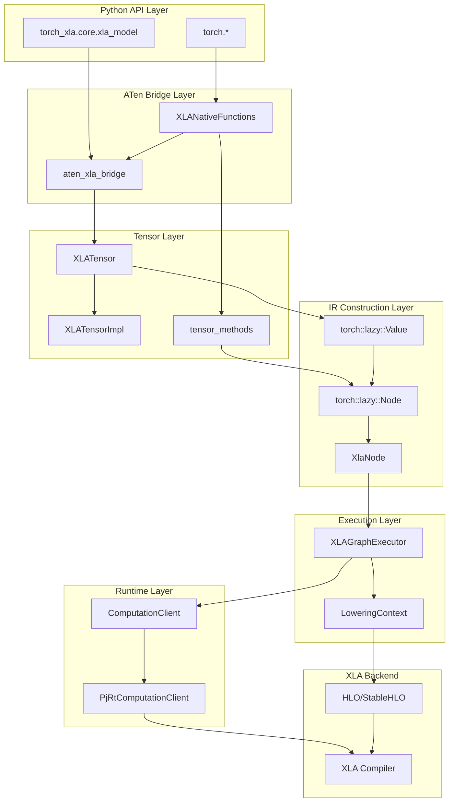

**Diagram: Core Component Interaction**

Sources: [torch_xla/csrc/aten_xla_type.cpp:1-100](), [torch_xla/csrc/tensor.cpp:1-100](), [torch_xla/csrc/aten_xla_bridge.cpp:1-100]()

## Core Component Descriptions

### XLANativeFunctions

The `XLANativeFunctions` class implements the PyTorch ATen operator interface for XLA devices. Each PyTorch operation (e.g., `add`, `mul`, `conv2d`) has a corresponding implementation that constructs IR nodes instead of executing immediately.

**Key Implementation:**
- Defined in [torch_xla/csrc/XLANativeFunctions.h]()
- Implemented in [torch_xla/csrc/aten_xla_type.cpp]()
- Registered via [torch_xla/csrc/aten_autograd_ops.cpp]() for autograd support
- Operations follow pattern: extract XLATensor → call tensor_methods → return wrapped result

**Example Operation Flow:**
```
at::Tensor add(const at::Tensor& self, const at::Tensor& other, const at::Scalar& alpha)
  → GetXlaTensor(self, other)
  → tensor_methods::add(xla_self, xla_other, alpha, dtype)
  → Return bridge::AtenFromXlaTensor(result)
```

Sources: [torch_xla/csrc/aten_xla_type.cpp:446-521](), [torch_xla/csrc/XLANativeFunctions.h:1-50]()

### XLATensor

`XLATensor` is the core lazy tensor abstraction that represents a PyTorch tensor on an XLA device. It maintains tensor state as either:
- Raw CPU tensor data (`tensor_data`)
- XLA device data handle (`handle`)
- IR computation graph (`ir_value`)
- View of another tensor (`view`)

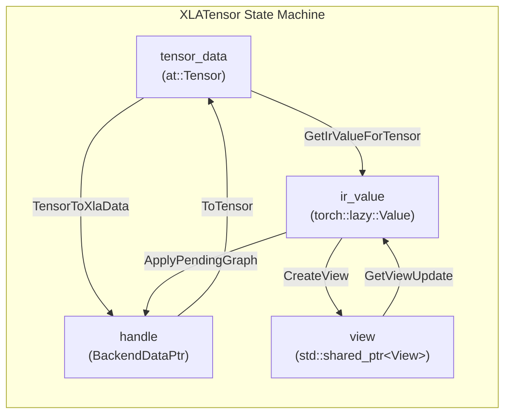

**Diagram: XLATensor State Transitions**

**Key Data Structure:**
```cpp
struct XLATensor::Data {
  std::optional<at::Tensor> tensor_data;           // CPU tensor
  torch::lazy::BackendDataPtr handle;              // Device buffer
  torch::lazy::Value ir_value;                     // IR node
  std::shared_ptr<View> view;                      // View metadata
  std::optional<at::ScalarType> logical_element_type;
  ShardingSpecPtr sharding;                        // SPMD sharding
  int64_t alias_id;                                // For input/output aliasing
}
```

Sources: [torch_xla/csrc/tensor.h:93-151](), [torch_xla/csrc/tensor.cpp:64-115]()

### XLAGraphExecutor

`XLAGraphExecutor` manages the lifecycle of IR graphs from construction through compilation to execution. It implements:
- **Lazy evaluation**: Operations build IR without executing
- **Compilation caching**: Compiled programs are cached by graph hash
- **Device synchronization**: Barrier and mark-step mechanisms
- **Eager mode**: Optional immediate execution for debugging

```mermaid
graph TB
    SYNC_REQ["Sync Request<br/>(explicit or implicit)"]
    COLLECT["CollectSyncTensors<br/>Gather tensors with pending IR"]
    EXTRACT["ExtractIRGraph<br/>Build computation graph"]
    CACHE_CHECK{{"Check<br/>CompilationCache"}}
    COMPILE["Compile<br/>Lower IR → HLO → Executable"]
    EXECUTE["Execute<br/>Transfer data & run"]
    UPDATE["UpdateTensors<br/>Attach result handles"]
    
    SYNC_REQ --> COLLECT
    COLLECT --> EXTRACT
    EXTRACT --> CACHE_CHECK
    CACHE_CHECK -->|"Cache Miss"| COMPILE
    CACHE_CHECK -->|"Cache Hit"| EXECUTE
    COMPILE --> EXECUTE
    EXECUTE --> UPDATE
```

**Diagram: XLAGraphExecutor Execution Pipeline**

**Key Methods:**
- `SyncTensorsGraph()` - Main synchronization entry point [torch_xla/csrc/xla_graph_executor.cpp]()
- `ApplyEagerSync()` - Immediate execution for eager mode
- `CompilationCache` - Hash-based caching of compiled programs
- `DeviceBarrier()` - Explicit synchronization point

Sources: [torch_xla/csrc/xla_graph_executor.h:1-100](), [torch_xla/csrc/tensor.cpp:676-684]()

### ATen/XLA Bridge

The bridge layer provides utilities for converting between PyTorch and XLA representations:

| Function | Purpose | Location |
|----------|---------|----------|
| `GetXlaTensor(at::Tensor)` | Extract XLATensor from at::Tensor | [torch_xla/csrc/aten_xla_bridge.cpp:101-112]() |
| `AtenFromXlaTensor(XLATensorPtr)` | Wrap XLATensor as at::Tensor | [torch_xla/csrc/aten_xla_bridge.cpp]() |
| `AtenDeviceToXlaDevice(c10::Device)` | Convert device specifications | [torch_xla/csrc/aten_xla_bridge.cpp]() |
| `GetCurrentDevice()` | Get thread-local default device | [torch_xla/csrc/aten_xla_bridge.cpp:256-261]() |

Sources: [torch_xla/csrc/aten_xla_bridge.h:1-100](), [torch_xla/csrc/aten_xla_bridge.cpp:1-200]()

### Tensor Methods

The `tensor_methods` namespace contains implementations for all tensor operations. These functions:
1. Accept `XLATensorPtr` arguments
2. Construct IR nodes via `MakeNode<OpType>(...)` or generic ops
3. Return new `XLATensorPtr` with IR values

**Operation Categories:**

| Category | Example Operations | Implementation |
|----------|-------------------|----------------|
| Elementwise | add, mul, relu, tanh | [torch_xla/csrc/tensor_methods.cpp:2000-3000]() |
| Reduction | sum, mean, max | [torch_xla/csrc/tensor_methods.cpp:3000-4000]() |
| Matrix | matmul, bmm, addmm | [torch_xla/csrc/tensor_methods.cpp:1000-2000]() |
| Convolution | conv2d, conv_transpose | [torch_xla/csrc/tensor_methods.cpp:4000-5000]() |
| Pooling | max_pool2d, avg_pool2d | [torch_xla/csrc/tensor_methods.cpp:5000-6000]() |
| Collective | all_reduce, all_gather | [torch_xla/csrc/tensor_methods.cpp:6000-7000]() |

Sources: [torch_xla/csrc/tensor_methods.h:1-150](), [torch_xla/csrc/tensor_methods.cpp:1-300]()

### IR System

The IR (Intermediate Representation) system uses PyTorch's lazy tensor framework:

```mermaid
graph TB
    VALUE["torch::lazy::Value<br/>(node, index)"]
    NODE["torch::lazy::Node<br/>(base class)"]
    XLANODE["XlaNode<br/>(XLA-specific)"]
    GENERIC["Generic<br/>(custom ops)"]
    SPECIFIC["Specific Nodes<br/>(Add, Mul, Conv, etc.)"]
    
    VALUE -->|"points to"| NODE
    NODE -->|"implements"| XLANODE
    XLANODE -->|"subtypes"| GENERIC
    XLANODE -->|"subtypes"| SPECIFIC
```

**Diagram: IR Node Hierarchy**

**Key Concepts:**
- `torch::lazy::Value`: Reference to a node output (node pointer + output index)
- `torch::lazy::Node`: Base class for IR nodes, tracks operands and metadata
- `XlaNode`: XLA-specific node with shape information and lowering function
- `Generic`: Flexible node type with custom lowering functions
- Specific nodes: Type-safe implementations (e.g., `Add`, `Mul`, `Permute`)

Sources: [torch_xla/csrc/ir.h:1-100](), [torch_xla/csrc/ops/ops.h:1-100](), [torch_xla/csrc/ops/ops.cpp:1-100]()

### Operation Lowering

Lowering transforms IR nodes into XLA HLO operations. Each operation implements:

```cpp
XlaOpVector Lower(const XlaNode& node, LoweringContext* loctx) {
  xla::XlaOp input = loctx->GetOutputOp(node.operand(0));
  xla::XlaOp result = xla::SomeHloOp(input);
  return node.ReturnOp(result, loctx);
}
```

**Lowering Mechanisms:**

| Mechanism | Description | Usage |
|-----------|-------------|-------|
| Built-in | Direct HLO mapping | Simple ops like Add, Mul |
| Generic | Custom lowering function | Complex ops via `GenericOp()` |
| Composite | Combination of HLO ops | BuildMatMul, BuildSoftmax |
| Code generation | Auto-generated from YAML | Generated ops |

**LoweringContext Responsibilities:**
- Track IR node to HLO operation mapping
- Manage builder state
- Handle tuple decomposition
- Apply sharding annotations

Sources: [torch_xla/csrc/lowering_context.h:1-100](), [torch_xla/csrc/ops/ops.cpp:42-105](), [torch_xla/csrc/xla_lower_util.cpp:1-100]()

### ComputationClient

`ComputationClient` is the abstract interface to XLA runtime backends:

```mermaid
graph TB
    ABSTRACT["ComputationClient<br/>(abstract interface)"]
    PJRT["PjRtComputationClient"]
    IFRT["IfrtComputationClient"]
    
    ABSTRACT -->|"implements"| PJRT
    ABSTRACT -->|"implements"| IFRT
    
    PJRT --> PJRT_PLUGIN["PJRT Plugins<br/>(TPU, GPU, CPU)"]
    IFRT --> IFRT_RUNTIME["IFRT Runtime"]
```

**Diagram: ComputationClient Architecture**

**Key Operations:**
- `Compile()`: Compile HLO to executable
- `ExecuteComputation()`: Run compiled program
- `TransferToServer()`: Upload data to device
- `TransferFromServer()`: Download results
- `GetDataShards()`: Retrieve sharded data

**Data Types:**
- `ComputationClient::Data`: Opaque handle to device buffer
- `ComputationClient::Computation`: Compiled executable
- `CompileInstance`: Specification for compilation

Sources: [torch_xla/csrc/runtime/computation_client.h:1-200](), [torch_xla/csrc/runtime/pjrt_computation_client.h:1-100]()

## Tensor Operation Lifecycle

The following diagram shows how a tensor operation flows through the core components:

```mermaid
sequenceDiagram
    participant User as User Code
    participant ATen as XLANativeFunctions
    participant Bridge as aten_xla_bridge
    participant Tensor as XLATensor
    participant Methods as tensor_methods
    participant IR as IR Nodes
    participant Exec as XLAGraphExecutor
    participant Lower as LoweringContext
    participant Client as ComputationClient
    
    User->>ATen: z = x.add(y)
    ATen->>Bridge: GetXlaTensor(x, y)
    Bridge->>Tensor: Extract XLATensorPtr
    Bridge-->>ATen: xla_x, xla_y
    ATen->>Methods: add(xla_x, xla_y, alpha)
    Methods->>IR: MakeNode<Add>(...)
    IR-->>Methods: torch::lazy::Value
    Methods->>Tensor: CreateFrom(ir_value)
    Tensor-->>Methods: New XLATensorPtr
    Methods-->>ATen: result
    ATen->>Bridge: AtenFromXlaTensor(result)
    Bridge-->>User: at::Tensor (lazy)
    
    Note over User,Client: Later: Sync/Materialization
    
    User->>Tensor: print(z) or z.cpu()
    Tensor->>Exec: SyncTensorsGraph([z])
    Exec->>Exec: CollectSyncTensors
    Exec->>Lower: Lower IR → HLO
    Lower->>Lower: node.Lower(loctx)
    Lower-->>Exec: XLA Computation
    Exec->>Client: Compile(computation)
    Client-->>Exec: Compiled executable
    Exec->>Client: Execute(inputs)
    Client-->>Exec: Result buffers
    Exec->>Tensor: SetXlaData(handle)
    Tensor-->>User: Materialized value
```

**Diagram: Complete Tensor Operation Lifecycle**

Sources: [torch_xla/csrc/aten_xla_type.cpp:862-895](), [torch_xla/csrc/tensor_methods.cpp:1-200](), [torch_xla/csrc/tensor.cpp:211-254]()

## Python Bindings

Python bindings expose core C++ functionality to Python:

**Key Binding Categories:**

| Module | Functionality | Implementation |
|--------|---------------|----------------|
| `_XLAC` | Core tensor operations | [torch_xla/csrc/init_python_bindings.cpp:1-100]() |
| Device management | get_xla_supported_devices, set_device | [torch_xla/csrc/init_python_bindings.cpp:300-400]() |
| Sync operations | sync, mark_step, wait_device_ops | [torch_xla/csrc/init_python_bindings.cpp:263-278]() |
| Metrics | MetricsArena, counter access | [torch_xla/csrc/init_python_bindings.cpp:500-600]() |
| IR utilities | get_tensor_view_alias_id, dump IR | [torch_xla/csrc/init_python_bindings.cpp:280-338]() |

**Binding Pattern:**
```cpp
PythonScope(m)
  .def("function_name", [](args...) -> ReturnType {
    // Implementation returns StatusOr<T> or Status
    // Automatically converted to exceptions
  })
```

Sources: [torch_xla/csrc/init_python_bindings.cpp:86-218](), [torch_xla/csrc/init_python_bindings.cpp:220-246]()

## Thread Safety and Device Management

PyTorch/XLA maintains thread-local device state:

**Device Selection:**
- Thread-local current device stored in `g_current_device`
- `SetCurrentDevice()` and `GetCurrentDevice()` manage state
- Operations default to current device if not specified
- Device mapper tracks ordinal ↔ device string mapping

**Synchronization:**
- Tensor sync is per-device: only tensors on same device sync together
- `mark_step()` is a synchronization barrier
- `wait_device_ops()` waits for all pending operations
- Multi-device execution uses `ParallelLoader` and device replication

Sources: [torch_xla/csrc/aten_xla_bridge.cpp:24-77](), [torch_xla/csrc/device.h:1-50]()

## View System

Views enable memory-efficient tensor operations without data copying:

**View Types:**

| ViewInfo::Type | Description | Example Operation |
|----------------|-------------|-------------------|
| `kNoOp` | Identity view | Aliasing |
| `kReshape` | Reshape without copy | view(), reshape() |
| `kPermute` | Dimension permutation | transpose(), permute() |
| `kSelect` | Single dimension slice | select() |
| `kNarrow` | Range slice | narrow() |
| `kAsStrided` | Arbitrary stride pattern | as_strided() |
| `kDiagonal` | Diagonal extraction | diagonal() |

**View Implementation:**
- `View` class tracks transformation from base tensor
- `Alias` represents the underlying tensor
- Views updated lazily: `GetViewUpdate()` materializes when needed
- View updates create `UpdateSlice` or similar IR nodes

Sources: [torch_xla/csrc/view.h:1-100](), [torch_xla/csrc/tensor.cpp:447-512]()

## Error Handling

PyTorch/XLA uses `absl::Status` and `absl::StatusOr<T>` for error propagation:

**Error Macros:**
```cpp
XLA_CHECK(condition) << "message";           // Fatal assertion
XLA_ERROR() << "message";                    // Create error status
XLA_ASSIGN_OR_RETURN(var, expr);            // Unwrap StatusOr or return error
XLA_ASSIGN_OR_THROW(var, expr);             // Unwrap or throw exception
XLA_THROW_IF_ERROR(status);                  // Throw if error
```

**Error Categories:**
- `InvalidArgumentError`: Invalid input parameters
- `InternalError`: Internal invariant violation
- `UnimplementedError`: Unimplemented functionality
- `ResourceExhaustedError`: Out of memory or resources

Sources: [torch_xla/csrc/status.h:1-50](), [torch_xla/csrc/aten_xla_type.cpp:600-700]()

---

# Page: ATen/XLA Bridge and Native Functions

# ATen/XLA Bridge and Native Functions

<details>
<summary>Relevant source files</summary>

The following files were used as context for generating this wiki page:

- [test/cpp/cpp_test_util.cpp](test/cpp/cpp_test_util.cpp)
- [test/cpp/cpp_test_util.h](test/cpp/cpp_test_util.h)
- [test/cpp/test_replication.cpp](test/cpp/test_replication.cpp)
- [test/cpp/test_tensor.cpp](test/cpp/test_tensor.cpp)
- [test/test_operations.py](test/test_operations.py)
- [test/test_ops_error_message.py](test/test_ops_error_message.py)
- [torch_xla/csrc/aten_autograd_ops.cpp](torch_xla/csrc/aten_autograd_ops.cpp)
- [torch_xla/csrc/aten_xla_bridge.cpp](torch_xla/csrc/aten_xla_bridge.cpp)
- [torch_xla/csrc/aten_xla_bridge.h](torch_xla/csrc/aten_xla_bridge.h)
- [torch_xla/csrc/aten_xla_type.cpp](torch_xla/csrc/aten_xla_type.cpp)
- [torch_xla/csrc/init_python_bindings.cpp](torch_xla/csrc/init_python_bindings.cpp)
- [torch_xla/csrc/ops/ops.cpp](torch_xla/csrc/ops/ops.cpp)
- [torch_xla/csrc/ops/ops.h](torch_xla/csrc/ops/ops.h)
- [torch_xla/csrc/tensor.cpp](torch_xla/csrc/tensor.cpp)
- [torch_xla/csrc/tensor.h](torch_xla/csrc/tensor.h)
- [torch_xla/csrc/tensor_methods.cpp](torch_xla/csrc/tensor_methods.cpp)
- [torch_xla/csrc/tensor_methods.h](torch_xla/csrc/tensor_methods.h)
- [torch_xla/csrc/xla_lower_util.cpp](torch_xla/csrc/xla_lower_util.cpp)
- [torch_xla/csrc/xla_lower_util.h](torch_xla/csrc/xla_lower_util.h)

</details>


## Purpose and Scope

The ATen/XLA Bridge is the critical interface layer that enables PyTorch operations to execute on XLA devices (TPUs, GPUs via XLA). This system intercepts standard PyTorch ATen operations and translates them into XLA-compatible lazy IR nodes. The bridge ensures seamless integration between PyTorch's eager execution model and XLA's graph-based compilation approach.

This page covers:
- The `XLANativeFunctions` class which implements PyTorch operations for XLA
- Bridge conversion functions between PyTorch tensors and `XLATensor` objects
- Operation dispatching mechanisms and helper utilities
- Type promotion and data type handling strategies

For information about lazy tensor execution and IR graph management, see [XLATensor and Lazy Execution](#2.2). For details on how IR nodes are lowered to XLA HLO, see [Operation Lowering and Shape Inference](#2.6).

## Architecture Overview

The ATen/XLA bridge sits between PyTorch's frontend and XLA's compilation backend, intercepting operations and creating lazy IR representations.

**Diagram: ATen/XLA Bridge Architecture**

```mermaid
graph TB
    subgraph "PyTorch Frontend"
        TORCH_OP["PyTorch Operation<br/>e.g., tensor.add(other)"]
        ATEN_TENSOR["at::Tensor<br/>(CPU or XLA device)"]
    end
    
    subgraph "Bridge Layer"
        NATIVE_FUNCS["XLANativeFunctions<br/>aten_xla_type.cpp"]
        BRIDGE_CONV["Bridge Conversion<br/>aten_xla_bridge.cpp"]
        GET_XLA["GetXlaTensor()"]
        ATEN_FROM_XLA["AtenFromXlaTensor()"]
    end
    
    subgraph "XLA Tensor Layer"
        XLA_TENSOR["XLATensor<br/>tensor.cpp"]
        TENSOR_IMPL["XLATensorImpl<br/>tensor_impl.cpp"]
        IR_VALUE["torch::lazy::Value<br/>(IR Node)"]
    end
    
    subgraph "Operation Implementation"
        TENSOR_METHODS["tensor_methods::*<br/>tensor_methods.cpp"]
        IR_NODES["IR Node Creation<br/>ops/*.cpp"]
    end
    
    TORCH_OP --> NATIVE_FUNCS
    NATIVE_FUNCS --> GET_XLA
    GET_XLA --> BRIDGE_CONV
    BRIDGE_CONV --> TENSOR_IMPL
    TENSOR_IMPL --> XLA_TENSOR
    
    NATIVE_FUNCS --> TENSOR_METHODS
    TENSOR_METHODS --> IR_NODES
    IR_NODES --> IR_VALUE
    IR_VALUE --> XLA_TENSOR
    
    XLA_TENSOR --> ATEN_FROM_XLA
    ATEN_FROM_XLA --> ATEN_TENSOR
```

Sources: [torch_xla/csrc/aten_xla_type.cpp:1-100](), [torch_xla/csrc/aten_xla_bridge.cpp:1-50](), [torch_xla/csrc/tensor.cpp:1-100]()

## XLANativeFunctions Class

The `XLANativeFunctions` class in `aten_xla_type.cpp` provides XLA implementations for PyTorch ATen operations. This class is code-generated and contains hundreds of operation implementations.

**Diagram: XLANativeFunctions Operation Flow**

```mermaid
graph LR
    subgraph "Entry Point"
        ADD_OP["XLANativeFunctions::add()"]
        MUL_OP["XLANativeFunctions::mul()"]
        CONV_OP["XLANativeFunctions::convolution()"]
    end
    
    subgraph "Bridge Retrieval"
        GET_TENSOR["bridge::GetXlaTensor()"]
        GET_OR_CREATE["bridge::GetOrCreateXlaTensor()"]
    end
    
    subgraph "Operation Helpers"
        DO_BINARY_OP["DoBinaryOp<>"]
        OP_CONFIG["OpConfig"]
        TYPE_PROMO["Type Promotion"]
    end
    
    subgraph "Implementation"
        TENSOR_METHOD["tensor_methods::add()"]
        IR_CONSTRUCTION["IR Node Creation"]
    end
    
    ADD_OP --> GET_TENSOR
    GET_TENSOR --> DO_BINARY_OP
    DO_BINARY_OP --> TYPE_PROMO
    TYPE_PROMO --> TENSOR_METHOD
    TENSOR_METHOD --> IR_CONSTRUCTION
    
    MUL_OP --> DO_BINARY_OP
    CONV_OP --> TENSOR_METHOD
```

Sources: [torch_xla/csrc/aten_xla_type.cpp:446-521](), [torch_xla/csrc/aten_xla_type.cpp:862-895]()

### Key Implementation Patterns

Each native function follows a standard pattern:

| Component | Purpose | Example |
|-----------|---------|---------|
| **Function Counter** | Metrics tracking | `TORCH_LAZY_FN_COUNTER_TIMED_TRACING("xla::")` |
| **Tensor Retrieval** | Extract XLATensor from at::Tensor | `bridge::GetXlaTensor(self)` |
| **Operation Dispatch** | Call tensor_methods or create IR | `tensor_methods::add(...)` |
| **Result Wrapping** | Convert XLATensor back to at::Tensor | `bridge::AtenFromXlaTensor(result)` |

Sources: [torch_xla/csrc/aten_xla_type.cpp:862-895](), [torch_xla/csrc/aten_xla_type.cpp:387-423]()

### Implementation Guidelines

The codebase includes explicit implementation guidelines at [torch_xla/csrc/aten_xla_type.cpp:58-69]():

- To call an ATen function without an XLA kernel, use the boxed CPU fallback
- Use `at::native::call_fallback_fn<&xla_fallback, ATEN_OP(...)>::call(args...)`
- Avoid calling `tensor.op()` or `at::op(tensor)` directly

Sources: [torch_xla/csrc/aten_xla_type.cpp:58-69]()

## Bridge Conversion Functions

The bridge provides bidirectional conversion between PyTorch `at::Tensor` and XLA `XLATensor` objects.

**Diagram: Tensor Conversion Flow**

```mermaid
graph TB
    subgraph "PyTorch Space"
        AT_TENSOR["at::Tensor<br/>(device='xla:0')"]
        FUNC_WRAPPER["FunctionalTensorWrapper<br/>(optional)"]
    end
    
    subgraph "Bridge Functions"
        GET_XLA_TENSOR["GetXlaTensor()<br/>aten_xla_bridge.cpp:101"]
        GET_INPUT_XLA["GetInputXlaTensor()<br/>aten_xla_bridge.cpp:131"]
        TRY_GET_XLA["TryGetXlaTensor()<br/>aten_xla_bridge.cpp:97"]
        ATEN_FROM_XLA["AtenFromXlaTensor()<br/>aten_xla_bridge.cpp:207"]
    end
    
    subgraph "Implementation Layer"
        GET_IMPL["GetXlaTensorImpl()<br/>aten_xla_bridge.cpp:79"]
        TENSOR_IMPL["XLATensorImpl<br/>tensor_impl.cpp"]
    end
    
    subgraph "XLA Space"
        XLA_TENSOR_PTR["XLATensorPtr<br/>(c10::intrusive_ptr)"]
        XLA_TENSOR["XLATensor<br/>tensor.cpp"]
    end
    
    AT_TENSOR --> GET_XLA_TENSOR
    GET_XLA_TENSOR --> FUNC_WRAPPER
    FUNC_WRAPPER --> GET_IMPL
    GET_IMPL --> TENSOR_IMPL
    TENSOR_IMPL --> XLA_TENSOR_PTR
    
    GET_INPUT_XLA --> GET_XLA_TENSOR
    TRY_GET_XLA --> GET_XLA_TENSOR
    
    XLA_TENSOR_PTR --> ATEN_FROM_XLA
    ATEN_FROM_XLA --> AT_TENSOR
```

Sources: [torch_xla/csrc/aten_xla_bridge.cpp:79-143](), [torch_xla/csrc/aten_xla_bridge.h:36-80]()

### Core Bridge Functions

| Function | Return Type | Purpose |
|----------|-------------|---------|
| `GetXlaTensor(tensor)` | `absl::StatusOr<XLATensorPtr>` | Retrieves XLATensor from at::Tensor, syncing functional wrapper |
| `GetXlaTensors(tensors)` | `absl::StatusOr<vector<XLATensorPtr>>` | Batch conversion for tensor lists |
| `GetInputXlaTensor(tensor, param)` | `absl::StatusOr<XLATensorPtr>` | Retrieves with specialized error message for inputs |
| `TryGetXlaTensor(tensor)` | `XLATensorPtr` | Legacy function returning null on failure (deprecated) |
| `IsXlaTensor(tensor)` | `bool` | Checks if tensor is an XLA tensor |
| `AtenFromXlaTensor(xla_tensor)` | `at::Tensor` | Wraps XLATensor in at::Tensor |
| `ReplaceXlaTensor(tensor, new_xla)` | `absl::Status` | Replaces underlying XLATensor in existing at::Tensor |

Sources: [torch_xla/csrc/aten_xla_bridge.cpp:97-159](), [torch_xla/csrc/aten_xla_bridge.h:36-80]()

### Device Management

The bridge maintains thread-local device state and device mapping:

```mermaid
graph LR
    subgraph "Device State"
        THREAD_LOCAL["g_current_device<br/>(thread_local)"]
        DEVICE_MAPPER["AtenXlaDeviceMapper<br/>(singleton)"]
    end
    
    subgraph "Device Operations"
        GET_CURRENT["GetCurrentDevice()"]
        SET_CURRENT["SetCurrentDevice()"]
        XLA_TO_ATEN["XlaDeviceToAtenDevice()"]
        ATEN_TO_XLA["AtenDeviceToXlaDevice()"]
    end
    
    subgraph "Device Types"
        BACKEND_DEVICE["torch::lazy::BackendDevice"]
        C10_DEVICE["c10::Device"]
    end
    
    THREAD_LOCAL --> GET_CURRENT
    GET_CURRENT --> BACKEND_DEVICE
    SET_CURRENT --> THREAD_LOCAL
    
    DEVICE_MAPPER --> XLA_TO_ATEN
    DEVICE_MAPPER --> ATEN_TO_XLA
    
    XLA_TO_ATEN --> C10_DEVICE
    ATEN_TO_XLA --> BACKEND_DEVICE
```

Sources: [torch_xla/csrc/aten_xla_bridge.cpp:24-77](), [torch_xla/csrc/aten_xla_bridge.cpp:238-298]()

## Operation Dispatching

Operation dispatching uses helper templates and functions to handle type promotion, broadcasting, and IR node creation.

### DoBinaryOp Helper Template

The `DoBinaryOp` template handles binary operations with automatic type promotion:

**Diagram: Binary Operation Dispatch**

```mermaid
graph TB
    subgraph "Entry: XLANativeFunctions::add"
        NATIVE_ADD["add(self, other, alpha)"]
    end
    
    subgraph "Type Promotion"
        RESULT_TYPE["at::result_type(self, other)"]
        UNWRAP["UnwrapNumber(other, dtype)"]
    end
    
    subgraph "Tensor Retrieval"
        GET_BINARY_OP["GetBinaryOperands(self, other)"]
        GET_OR_CREATE["GetOrCreateXlaTensor()"]
    end
    
    subgraph "Operation Execution"
        BIN_OP_LAMBDA["bin_op lambda"]
        TENSOR_METHOD["tensor_methods::add()"]
    end
    
    subgraph "Result"
        ATEN_FROM["AtenFromXlaTensor()"]
    end
    
    NATIVE_ADD --> RESULT_TYPE
    RESULT_TYPE --> UNWRAP
    UNWRAP --> GET_BINARY_OP
    GET_BINARY_OP --> GET_OR_CREATE
    GET_OR_CREATE --> BIN_OP_LAMBDA
    BIN_OP_LAMBDA --> TENSOR_METHOD
    TENSOR_METHOD --> ATEN_FROM
```

Sources: [torch_xla/csrc/aten_xla_type.cpp:387-443](), [torch_xla/csrc/aten_xla_type.cpp:345-359]()

### OpConfig Utility

`OpConfig` manages input preprocessing and output postprocessing for operations requiring special handling:

| Method | Purpose |
|--------|---------|
| `add_input(tensor)` | Adds tensor to input list |
| `cast_inputs_to_common_dtype()` | Enables automatic input type casting |
| `use_opmathtype_for_compute()` | Uses OpMathType for computation (e.g., float32 for bfloat16) |
| `run()` | Executes operation with preprocessing/postprocessing |

**OpConfig Flow:**

```mermaid
graph LR
    subgraph "Configuration"
        CONFIG["OpConfig::From(impl_fn)"]
        ADD_INPUT["add_input(tensor)"]
        CAST_FLAG["cast_inputs_to_common_dtype()"]
        OPMATH_FLAG["use_opmathtype_for_compute()"]
    end
    
    subgraph "Execution: run()"
        COMMON_TYPE["Compute common dtype"]
        OPMATH_TYPE["Get OpMathType"]
        PREPROCESS["Preprocess inputs"]
        FIND_XLA["Find XLA tensor"]
        CONVERT["Convert inputs to XLA"]
        EXECUTE["Execute impl_fn"]
        POSTPROCESS["Cast result if needed"]
    end
    
    CONFIG --> ADD_INPUT
    ADD_INPUT --> CAST_FLAG
    CAST_FLAG --> OPMATH_FLAG
    OPMATH_FLAG --> COMMON_TYPE
    
    COMMON_TYPE --> OPMATH_TYPE
    OPMATH_TYPE --> PREPROCESS
    PREPROCESS --> FIND_XLA
    FIND_XLA --> CONVERT
    CONVERT --> EXECUTE
    EXECUTE --> POSTPROCESS
```

Sources: [torch_xla/csrc/aten_xla_type.cpp:106-238]()

### GetBinaryOperands Function

The `GetBinaryOperands` helper ensures both operands are XLA tensors on the same device:

1. Attempts to get `XLATensor` from `self`
2. If `self` is not XLA, gets device from `other` and creates XLA tensor for `self`
3. If `self` is XLA, uses its device to convert `other` if needed
4. Returns pair of `XLATensorPtr` both on the same device

Sources: [torch_xla/csrc/aten_xla_type.cpp:345-359]()

## Type Promotion and Data Type Handling

The bridge handles complex type promotion scenarios to match PyTorch's semantics while respecting XLA's type system.

**Diagram: Type Promotion Flow**

```mermaid
graph TB
    subgraph "Input Types"
        TENSOR1["Tensor1: dtype1"]
        TENSOR2["Tensor2: dtype2"]
        SCALAR["Scalar: type"]
    end
    
    subgraph "Type Resolution"
        RESULT_TYPE["at::result_type()<br/>PyTorch type promotion"]
        CAN_CAST["at::canCast()<br/>Verify castability"]
        OPMATH_TYPE["at::toOpMathType()<br/>Computation type"]
    end
    
    subgraph "XLA Type Mapping"
        TORCH_TO_XLA["MakeXlaPrimitiveType()"]
        XLA_TYPE["xla::PrimitiveType"]
        LOGICAL_TYPE["logical_element_type<br/>(XLATensor)"]
    end
    
    subgraph "Type Checking"
        CHECK_BINARY["CheckBinaryOpTypePromotion()"]
        CHECK_SUB["CheckSubOperandTypes()"]
        ALPHA_CHECK["at::native::alpha_check()"]
    end
    
    TENSOR1 --> RESULT_TYPE
    TENSOR2 --> RESULT_TYPE
    SCALAR --> RESULT_TYPE
    
    RESULT_TYPE --> CAN_CAST
    RESULT_TYPE --> OPMATH_TYPE
    
    OPMATH_TYPE --> TORCH_TO_XLA
    TORCH_TO_XLA --> XLA_TYPE
    XLA_TYPE --> LOGICAL_TYPE
    
    RESULT_TYPE --> CHECK_BINARY
    CHECK_BINARY --> CHECK_SUB
    CHECK_BINARY --> ALPHA_CHECK
```

Sources: [torch_xla/csrc/aten_xla_type.cpp:263-296](), [torch_xla/csrc/aten_xla_type.cpp:375-385](), [torch_xla/csrc/aten_xla_type.cpp:281-289]()

### Special Type Handling

| Scenario | Handling |
|----------|----------|
| **Bool subtraction** | Explicitly disallowed with error message at [torch_xla/csrc/aten_xla_type.cpp:281-289]() |
| **Integer promotion** | Automatically promotes to `int64` when needed |
| **OpMathType computation** | Uses higher precision for computation (e.g., float32 for bfloat16), then casts back |
| **Scalar unwrapping** | `UnwrapNumber()` converts scalars to tensors with appropriate dtype |

Sources: [torch_xla/csrc/aten_xla_type.cpp:281-296]()

## Helper Utilities and Common Patterns

### Utility Functions

| Function | Location | Purpose |
|----------|----------|---------|
| `to_meta(tensor)` | [aten_xla_type.cpp:240-255]() | Converts tensor to meta device for shape inference |
| `GetXlaDeviceOrCurrent(device)` | [aten_xla_type.cpp:257-261]() | Gets XLA device or current if not specified |
| `GetBinaryOperands(self, other)` | [aten_xla_type.cpp:345-359]() | Ensures both operands are XLA tensors on same device |
| `CheckBinaryOpTypePromotion(out, self, other)` | [aten_xla_type.cpp:375-385]() | Validates type promotion for binary ops |
| `IsOperationOnType(opt_dtype, tensor_type, type)` | [aten_xla_type.cpp:263-269]() | Checks if operation involves specific type |

Sources: [torch_xla/csrc/aten_xla_type.cpp:240-385]()

### Fallback Mechanism

For operations without XLA lowering, the bridge uses CPU fallback:

```mermaid
graph LR
    XLA_OP["XLA Operation"] --> CHECK_SUPPORTED["Check if XLA<br/>lowering exists"]
    CHECK_SUPPORTED -->|No| FALLBACK["at::native::call_fallback_fn<br/>&xla_fallback, ATEN_OP(...)"]
    FALLBACK --> SYNC["Sync XLA tensors"]
    SYNC --> CPU_EXEC["Execute on CPU"]
    CPU_EXEC --> COPY_BACK["Copy result to XLA"]
    
    CHECK_SUPPORTED -->|Yes| XLA_EXEC["Execute on XLA"]
```

Sources: [torch_xla/csrc/aten_xla_type.cpp:58-69](), [torch_xla/csrc/aten_xla_type.cpp:523-531]()

### Template Macros for Operation Definition

The codebase uses template macros in `ops.cpp` for common operations:

| Macro | Purpose | Example |
|-------|---------|---------|
| `PTXLA_UNARY_OP` | Defines unary operations | `PTXLA_UNARY_OP(Neg, at::aten::neg, xla::Neg)` |
| `PTXLA_BINARY_OP` | Defines binary operations | `PTXLA_BINARY_OP(Min, at::aten::min, xla::Min)` |

These macros generate `GenericOp` IR nodes with automatic shape inference and lowering functions.

Sources: [torch_xla/csrc/ops/ops.cpp:43-90]()

## Lazy IR Construction

Operations create IR nodes rather than executing immediately, enabling graph optimization and batched compilation.

**Diagram: Lazy IR Construction Pipeline**

```mermaid
graph TB
    subgraph "Native Function Call"
        NATIVE["XLANativeFunctions::add"]
    end
    
    subgraph "Tensor Method"
        METHOD["tensor_methods::add"]
        GET_IR["input->GetIrValue()"]
    end
    
    subgraph "IR Node Creation"
        MAKE_NODE["MakeNode<OpType>"]
        GENERIC_OP["GenericOp()"]
        IR_NODE["torch::lazy::NodePtr"]
    end
    
    subgraph "XLATensor Update"
        CREATE_FROM["input->CreateFrom(ir_value)"]
        SET_IR["SetIrValue(ir_value)"]
        NEW_TENSOR["XLATensorPtr (with IR)"]
    end
    
    subgraph "Deferred Execution"
        NO_EXEC["No immediate execution"]
        GRAPH_BUILD["IR graph grows"]
        LAZY_EVAL["Evaluation deferred"]
    end
    
    NATIVE --> METHOD
    METHOD --> GET_IR
    GET_IR --> MAKE_NODE
    MAKE_NODE --> GENERIC_OP
    GENERIC_OP --> IR_NODE
    
    IR_NODE --> CREATE_FROM
    CREATE_FROM --> SET_IR
    SET_IR --> NEW_TENSOR
    
    NEW_TENSOR --> NO_EXEC
    NO_EXEC --> GRAPH_BUILD
    GRAPH_BUILD --> LAZY_EVAL
```

Sources: [torch_xla/csrc/tensor.cpp:88-101](), [torch_xla/csrc/tensor.cpp:338-363]()

### IR Value Lifecycle

1. **Creation**: Operations create `torch::lazy::Value` wrapping IR nodes
2. **Storage**: XLATensor stores IR value in `data()->ir_value`
3. **Composition**: New operations use existing IR values as inputs
4. **Materialization**: IR graph executed when `sync()` or `.cpu()` called
5. **Caching**: Compiled graphs cached for reuse

The `XLATensor::GetIrValue()` method retrieves or creates the IR representation:

| Source | Action |
|--------|--------|
| **Current IR value** | Returns `data()->ir_value` directly |
| **View** | Calls `GetViewUpdate()` to get updated IR |
| **Data handle** | Creates `DeviceData` IR node from handle |
| **Tensor data** | Calls `GetIrValueForTensor()` to upload and create IR |

Sources: [torch_xla/csrc/tensor.cpp:383-412]()

### Example: add Operation

```mermaid
sequenceDiagram
    participant User as User Code
    participant Native as XLANativeFunctions::add
    participant Bridge as bridge
    participant Method as tensor_methods::add
    participant XLATensor as XLATensor
    participant IR as IR System
    
    User->>Native: tensor.add(other, alpha)
    Native->>Bridge: GetXlaTensor(tensor)
    Bridge-->>Native: xla_tensor
    Native->>Bridge: GetXlaTensor(other)
    Bridge-->>Native: xla_other
    
    Native->>Method: add(xla_tensor, xla_other, alpha, dtype)
    Method->>XLATensor: xla_tensor->GetIrValue()
    XLATensor-->>Method: input_ir
    Method->>XLATensor: xla_other->GetIrValue()
    XLATensor-->>Method: other_ir
    
    Method->>IR: MakeNode<Add>(input_ir, other_ir, alpha)
    IR-->>Method: add_node
    Method->>XLATensor: CreateFrom(add_node)
    XLATensor-->>Method: result_tensor
    
    Method-->>Native: result_tensor
    Native->>Bridge: AtenFromXlaTensor(result_tensor)
    Bridge-->>Native: at::Tensor
    Native-->>User: result
    
    Note over User,IR: No execution yet - just IR construction
```

Sources: [torch_xla/csrc/aten_xla_type.cpp:862-895](), [torch_xla/csrc/tensor_methods.cpp:1-165]()

## Key Data Structures

### XLATensor::Data

The core data structure holding tensor state:

| Field | Type | Purpose |
|-------|------|---------|
| `handle` | `BackendDataPtr` | Materialized data on device |
| `ir_value` | `torch::lazy::Value` | Lazy IR node representation |
| `tensor_data` | `optional<at::Tensor>` | CPU tensor data |
| `view` | `shared_ptr<View>` | View information if tensor is a view |
| `logical_element_type` | `optional<ScalarType>` | Type visible to PyTorch |
| `sharding` | `ShardingSpecPtr` | SPMD sharding specification |
| `device` | `BackendDevice` | Target XLA device |

At any time, an XLATensor has exactly one authoritative data source: either `handle`, `ir_value`, or `tensor_data`.

Sources: [torch_xla/csrc/tensor.h:101-151]()

### XLATensorImpl

Wrapper that makes `XLATensor` usable as PyTorch `TensorImpl`:

- Stores `XLATensorPtr` 
- Implements `TensorImpl` interface for PyTorch integration
- Manages storage and device information
- Handles autograd integration

Sources: [torch_xla/csrc/tensor_impl.cpp:1-50](), [torch_xla/csrc/aten_xla_bridge.cpp:79-93]()

---

Sources: [torch_xla/csrc/aten_xla_type.cpp](), [torch_xla/csrc/aten_xla_bridge.cpp](), [torch_xla/csrc/aten_xla_bridge.h](), [torch_xla/csrc/tensor.cpp](), [torch_xla/csrc/tensor.h](), [torch_xla/csrc/tensor_methods.cpp](), [torch_xla/csrc/ops/ops.cpp]()

---

# Page: XLATensor and Lazy Execution

# XLATensor and Lazy Execution

<details>
<summary>Relevant source files</summary>

The following files were used as context for generating this wiki page:

- [test/cpp/cpp_test_util.cpp](test/cpp/cpp_test_util.cpp)
- [test/cpp/cpp_test_util.h](test/cpp/cpp_test_util.h)
- [test/cpp/test_replication.cpp](test/cpp/test_replication.cpp)
- [test/cpp/test_tensor.cpp](test/cpp/test_tensor.cpp)
- [test/test_operations.py](test/test_operations.py)
- [test/test_ops_error_message.py](test/test_ops_error_message.py)
- [torch_xla/csrc/aten_autograd_ops.cpp](torch_xla/csrc/aten_autograd_ops.cpp)
- [torch_xla/csrc/aten_xla_bridge.cpp](torch_xla/csrc/aten_xla_bridge.cpp)
- [torch_xla/csrc/aten_xla_bridge.h](torch_xla/csrc/aten_xla_bridge.h)
- [torch_xla/csrc/aten_xla_type.cpp](torch_xla/csrc/aten_xla_type.cpp)
- [torch_xla/csrc/init_python_bindings.cpp](torch_xla/csrc/init_python_bindings.cpp)
- [torch_xla/csrc/ops/ops.cpp](torch_xla/csrc/ops/ops.cpp)
- [torch_xla/csrc/ops/ops.h](torch_xla/csrc/ops/ops.h)
- [torch_xla/csrc/tensor.cpp](torch_xla/csrc/tensor.cpp)
- [torch_xla/csrc/tensor.h](torch_xla/csrc/tensor.h)
- [torch_xla/csrc/tensor_methods.cpp](torch_xla/csrc/tensor_methods.cpp)
- [torch_xla/csrc/tensor_methods.h](torch_xla/csrc/tensor_methods.h)
- [torch_xla/csrc/xla_lower_util.cpp](torch_xla/csrc/xla_lower_util.cpp)
- [torch_xla/csrc/xla_lower_util.h](torch_xla/csrc/xla_lower_util.h)

</details>


## Purpose and Scope

This document explains the `XLATensor` class and PyTorch/XLA's lazy execution model. It covers the internal data representation (`XLATensor::Data`), tensor lifecycle, state transitions, and how operations lazily build computation graphs instead of executing immediately. For information about graph compilation and execution orchestration, see [XLA Graph Executor](#2.3). For the bridge between PyTorch's ATen tensors and XLA tensors, see [ATen/XLA Bridge and Native Functions](#2.1).

---

## XLATensor Class Architecture

The `XLATensor` class is the core abstraction for lazy tensors in PyTorch/XLA. It extends `torch::lazy::LazyTensor` and manages the lazy execution model by maintaining tensor state across multiple representations.

### Class Definition

```mermaid
classDiagram
    class LazyTensor {
        <<upstream>>
    }
    class XLATensor {
        -shared_ptr~Data~ data_
        -c10::Storage storage_
        -at::Tensor base_
        +Create(tensor, device)$ XLATensorPtr
        +Create(handle)$ XLATensorPtr
        +Create(ir_value, device)$ XLATensorPtr
        +GetIrValue() Value
        +GetXlaData() BackendDataPtr
        +SetIrValue(ir_value)
        +SetXlaData(handle)
        +ToTensor(detached) at::Tensor
        +shape() MaybeRef~Shape~
        +dtype() ScalarType
        +sharding_spec() ShardingSpecPtr
        +ApplyPendingGraph()
    }
    class Data {
        +BackendDataPtr handle
        +Value ir_value
        +optional~Tensor~ tensor_data
        +shared_ptr~View~ view
        +optional~ScalarType~ logical_element_type
        +ShardingSpecPtr sharding
        +int64_t alias_id
        +int64_t generation
        +bool is_cloned
    }
    
    LazyTensor <|-- XLATensor
    XLATensor *-- Data
```

**Sources:** [torch_xla/csrc/tensor.h:94-359](), [torch_xla/csrc/tensor.cpp:53-164]()

---

## Internal Data Representation

The `XLATensor::Data` struct is the core state container for an XLA tensor. It can hold tensor data in multiple forms, and the presence of each field determines the tensor's current state.

### Data Structure Fields

| Field | Type | Purpose |
|-------|------|---------|
| `handle` | `torch::lazy::BackendDataPtr` | Pointer to materialized device data (e.g., data on TPU/GPU) |
| `ir_value` | `torch::lazy::Value` | Pointer to IR node in the computation graph |
| `tensor_data` | `std::optional<at::Tensor>` | CPU tensor data (host memory) |
| `view` | `std::shared_ptr<View>` | View metadata if tensor is a view of another tensor |
| `logical_element_type` | `std::optional<at::ScalarType>` | PyTorch-visible dtype (may differ from XLA dtype) |
| `sharding` | `ShardingSpecPtr` | SPMD sharding specification for distributed execution |
| `alias_id` | `int64_t` | Unique ID for input/output aliasing optimization |
| `generation` | `int64_t` | Version counter for tracking modifications |
| `is_cloned` | `bool` | Flag indicating if tensor is a clone |

**Sources:** [torch_xla/csrc/tensor.h:102-152](), [torch_xla/csrc/tensor.cpp:63-164]()

### Data State Diagram

```mermaid
stateDiagram-v2
    [*] --> CPUData: Create from at::Tensor
    [*] --> DeviceData: Create from handle
    [*] --> IRNode: Create from ir_value
    [*] --> ViewState: Create from view
    
    CPUData: tensor_data set<br/>handle, ir_value null
    DeviceData: handle set<br/>ir_value, tensor_data null
    IRNode: ir_value set<br/>handle, tensor_data null
    ViewState: view set<br/>may have ir_value
    
    CPUData --> IRNode: GetIrValue()<br/>creates DeviceData node
    IRNode --> DeviceData: ApplyPendingGraph()<br/>executes computation
    DeviceData --> CPUData: ToTensor()<br/>transfers to CPU
    
    IRNode --> IRNode: Operations<br/>build graph
    DeviceData --> IRNode: Operations<br/>create new node
    
    ViewState --> IRNode: GetViewUpdate()<br/>if view modified
```

**Sources:** [torch_xla/csrc/tensor.cpp:212-255](), [torch_xla/csrc/tensor.cpp:384-446]()

---

## Lazy Execution Model

PyTorch/XLA implements lazy execution by deferring operation execution until synchronization points. Operations build an intermediate representation (IR) graph instead of executing immediately.

### Execution Flow

```mermaid
sequenceDiagram
    participant User as Python User Code
    participant ATen as ATen Operation
    participant XLATensor as XLATensor
    participant IRNode as IR Graph
    participant Executor as XLAGraphExecutor
    participant Device as Device (TPU/GPU)
    
    User->>ATen: tensor.add(other)
    ATen->>XLATensor: GetXlaTensor(tensor)
    XLATensor-->>ATen: XLATensorPtr
    ATen->>IRNode: Create Add IR Node
    IRNode-->>XLATensor: SetIrValue(node)
    XLATensor-->>User: Return new XLATensor
    
    Note over XLATensor,IRNode: Operations accumulate in IR graph<br/>No execution yet
    
    User->>User: More operations...
    
    User->>Executor: xm.mark_step() or .cpu()
    
    activate Executor
    Executor->>XLATensor: GetXlaData()
    XLATensor->>XLATensor: Check if handle exists
    
    alt No device data
        XLATensor->>Executor: ApplyPendingGraph()
        Executor->>IRNode: Compile IR to HLO
        Executor->>Device: Execute computation
        Device-->>Executor: Device data handle
        Executor-->>XLATensor: Set handle, clear ir_value
    else Has device data
        XLATensor-->>Executor: Return existing handle
    end
    deactivate Executor
    
    Executor-->>User: Synchronized result
```

**Sources:** [torch_xla/csrc/tensor.cpp:212-255](), [torch_xla/csrc/tensor.cpp:677-686](), [torch_xla/csrc/aten_xla_type.cpp:860-893]()

### Operation Dispatch Example

When a PyTorch operation is called on an XLA tensor, it creates an IR node rather than executing:

```mermaid
graph TB
    subgraph "Python Layer"
        UserOp["tensor.add(other, alpha=1.0)"]
    end
    
    subgraph "ATen Dispatch Layer"
        NativeFunc["XLANativeFunctions::add()"]
        GetTensors["bridge::GetXlaTensor()"]
        BinaryOp["DoBinaryOp()"]
    end
    
    subgraph "Tensor Methods Layer"
        TensorMethod["tensor_methods::add()"]
        CreateNode["MakeNode<BinaryOp>()"]
    end
    
    subgraph "IR Layer"
        IRNode["Add IR Node"]
        Shape["xla::Shape"]
        Operands["Value operands"]
    end
    
    subgraph "XLATensor State"
        OldState["data()->ir_value = nullptr<br/>data()->handle = DeviceData"]
        NewState["data()->ir_value = Add node<br/>data()->handle = nullptr"]
    end
    
    UserOp --> NativeFunc
    NativeFunc --> GetTensors
    GetTensors --> BinaryOp
    BinaryOp --> TensorMethod
    TensorMethod --> CreateNode
    CreateNode --> IRNode
    IRNode --> Shape
    IRNode --> Operands
    CreateNode --> NewState
    OldState -.previous state.-> NewState
```

**Sources:** [torch_xla/csrc/aten_xla_type.cpp:860-893](), [torch_xla/csrc/tensor_methods.cpp:1-165](), [torch_xla/csrc/tensor.cpp:339-374]()

---

## Tensor Lifecycle and State Transitions

An `XLATensor` transitions through different states during its lifetime. Understanding these transitions is key to understanding lazy execution.

### Key Methods and State Changes

#### Tensor Creation

```mermaid
graph LR
    subgraph "Static Factory Methods"
        CreateCPU["XLATensor::Create(at::Tensor, device)"]
        CreateHandle["XLATensor::Create(BackendDataPtr)"]
        CreateIR["XLATensor::Create(Value, device)"]
        CreateView["XLATensor::Create(View, device)"]
    end
    
    subgraph "Constructor Calls"
        CtorCPU["XLATensor(tensor, device)<br/>data_->tensor_data = tensor"]
        CtorHandle["XLATensor(handle)<br/>data_->handle = handle"]
        CtorIR["XLATensor(ir_value, device)<br/>data_->ir_value = ir_value"]
        CtorView["XLATensor(view, device)<br/>data_->view = view"]
    end
    
    subgraph "Registration"
        Register["XLAGraphExecutor::Get()<br/>->RegisterTensor(data_)"]
    end
    
    CreateCPU --> CtorCPU --> Register
    CreateHandle --> CtorHandle --> Register
    CreateIR --> CtorIR --> Register
    CreateView --> CtorView --> Register
```

**Sources:** [torch_xla/csrc/tensor.cpp:65-115](), [torch_xla/csrc/tensor.cpp:117-164]()

#### IR Value Management

The `GetIrValue()` method creates IR nodes on-demand:

```mermaid
graph TB
    GetIrValue["GetIrValue()"]
    CurrentIrValue["CurrentIrValue()"]
    HasIR{"ir_value exists?"}
    HasHandle{"handle exists?"}
    HasTensor{"tensor_data exists?"}
    
    CreateFromHandle["CreateTensorNode(handle)<br/>DeviceData IR node"]
    CreateFromTensor["GetIrValueForTensor(tensor)<br/>TensorToXlaData() -> DeviceData"]
    
    ReturnIR["Return ir_value"]
    AssignAndReturn["AssignIrValue(node)<br/>Return ir_value"]
    
    GetIrValue --> CurrentIrValue
    CurrentIrValue --> HasIR
    HasIR -->|Yes| ReturnIR
    HasIR -->|No| HasHandle
    HasHandle -->|Yes| CreateFromHandle
    HasHandle -->|No| HasTensor
    HasTensor -->|Yes| CreateFromTensor
    CreateFromHandle --> AssignAndReturn
    CreateFromTensor --> AssignAndReturn
```

**Sources:** [torch_xla/csrc/tensor.cpp:384-413](), [torch_xla/csrc/tensor.cpp:429-446]()

#### Data Materialization

The `GetXlaData()` method materializes device data:

```mermaid
graph TB
    GetXlaData["GetXlaData()"]
    HasView{"view != nullptr?"}
    GetViewUpdate["GetViewUpdate(view)"]
    ViewUpdated{"view updated?"}
    
    HasHandleCheck{"handle exists<br/>and valid?"}
    ReturnHandle["Return handle"]
    
    HasIRCheck{"ir_value exists?"}
    IsDeviceData{"Is DeviceData node?"}
    GetNodeData["GetComputationDataFromNode()"]
    ClearIR["Clear ir_value<br/>Set handle = node_data"]
    
    ApplyPending["ApplyPendingGraph()<br/>Execute computation"]
    
    HasTensorData{"tensor_data exists?"}
    TensorToData["TensorToXlaData(tensor_data)<br/>Upload to device"]
    
    GetXlaData --> HasView
    HasView -->|Yes| GetViewUpdate
    GetViewUpdate --> ViewUpdated
    ViewUpdated -->|Yes| AssignTemp["Temporarily AssignIrValue(ir_value)"]
    ViewUpdated -->|No| HasHandleCheck
    HasView -->|No| HasHandleCheck
    
    AssignTemp --> HasIRCheck
    HasHandleCheck -->|Yes| ReturnHandle
    HasHandleCheck -->|No| HasIRCheck
    
    HasIRCheck -->|Yes| IsDeviceData
    IsDeviceData -->|Yes| GetNodeData
    GetNodeData --> ClearIR
    ClearIR --> ReturnHandle
    IsDeviceData -->|No| ApplyPending
    ApplyPending --> ReturnHandle
    
    HasIRCheck -->|No| HasTensorData
    HasTensorData -->|Yes| TensorToData
    TensorToData --> ReturnHandle
```

**Sources:** [torch_xla/csrc/tensor.cpp:212-255]()

---

## View Mechanism

PyTorch/XLA supports views (zero-copy tensor transformations) through a separate view tracking system. When a view operation is performed, the original tensor and view share an `Alias` object.

### View Architecture

```mermaid
graph TB
    subgraph "Original Tensor"
        OrigData["XLATensor::Data"]
        OrigView["view = nullptr<br/>(initially)"]
        OrigIR["ir_value = SomeOp"]
    end
    
    subgraph "View Tensor"
        ViewData["XLATensor::Data"]
        ViewView["view = View(shape, alias, info)"]
    end
    
    subgraph "Shared State"
        Alias["Alias<br/>(shared IR value)"]
        ViewInfo["ViewInfo<br/>(type, shape, transforms)"]
    end
    
    CreateView["CreateView(ViewInfo)<br/>or CreateViewTensor()"]
    
    OrigData --> OrigIR
    CreateView --> Alias
    Alias -.references.-> OrigIR
    
    ViewData --> ViewView
    ViewView --> Alias
    ViewView --> ViewInfo
    
    OrigData -.after view creation.-> OrigView
    OrigView --> Alias
```

**Sources:** [torch_xla/csrc/tensor.cpp:491-513](), [torch_xla/csrc/view.h]()

### View Operations Flow

```mermaid
sequenceDiagram
    participant User
    participant OrigTensor as Original XLATensor
    participant ViewTensor as View XLATensor
    participant Alias
    participant IR as IR Graph
    
    User->>OrigTensor: slice() operation
    OrigTensor->>OrigTensor: GetIrValue()
    OrigTensor->>Alias: Create Alias(ir_value)
    OrigTensor->>OrigTensor: data()->view = View(Alias)
    OrigTensor->>ViewTensor: Create View XLATensor
    ViewTensor->>ViewTensor: data()->view = View(Alias)
    ViewTensor-->>User: Return view tensor
    
    Note over OrigTensor,ViewTensor: Both share same Alias
    
    User->>ViewTensor: In-place operation
    ViewTensor->>ViewTensor: SetIrValue(new_ir, inplace=true)
    ViewTensor->>Alias: Update alias IR
    
    Note over OrigTensor,ViewTensor: Both affected by update
    
    User->>OrigTensor: Access original
    OrigTensor->>Alias: GetViewUpdate()
    Alias-->>OrigTensor: Updated IR value
```

**Sources:** [torch_xla/csrc/tensor.cpp:448-470](), [torch_xla/csrc/tensor.cpp:339-374]()

---

## Integration with Eager Mode

PyTorch/XLA supports an eager execution mode where IR nodes are immediately executed after creation.

### Eager Execution Path

```mermaid
graph TB
    SetIrValue["SetIrValue(ir_value)"]
    CheckEager{"UseEagerMode()?"}
    ShouldSync{"ShouldSyncIrNode()?"}
    ApplyEager["ApplyEagerSync()"]
    Done["Return (lazy)"]
    
    SetIrValue --> CheckEager
    CheckEager -->|No| Done
    CheckEager -->|Yes| ShouldSync
    ShouldSync -->|No| Done
    ShouldSync -->|Yes| ApplyEager
    ApplyEager --> Done
```

The `ShouldSyncIrNode()` check prevents immediate execution of `DeviceData` nodes:

**Sources:** [torch_xla/csrc/tensor.cpp:339-374](), [torch_xla/csrc/tensor.cpp:688-693]()

---

## Tensor Conversion and Bridge Functions

The bridge between PyTorch's `at::Tensor` and `XLATensor` is managed by functions in `aten_xla_bridge.h`.

### Bridge Function Overview

| Function | Purpose | Returns |
|----------|---------|---------|
| `GetXlaTensor(at::Tensor)` | Extract XLATensorPtr from ATen tensor | `StatusOr<XLATensorPtr>` |
| `GetXlaTensors(ITensorListRef)` | Extract multiple XLATensorPtr | `StatusOr<vector<XLATensorPtr>>` |
| `IsXlaTensor(at::Tensor)` | Check if tensor is XLA tensor | `bool` |
| `ReplaceXlaTensor(at::Tensor, XLATensorPtr)` | Replace XLA tensor in ATen wrapper | `Status` |
| `GetOrCreateXlaTensor(at::Tensor, device)` | Get existing or create new XLA tensor | `XLATensorPtr` |
| `AtenFromXlaTensor(XLATensorPtr)` | Wrap XLATensor in ATen tensor | `at::Tensor` |
| `XlaCreateTensorList(TensorList)` | Convert XLA tensors to CPU | `vector<at::Tensor>` |

**Sources:** [torch_xla/csrc/aten_xla_bridge.h:20-149](), [torch_xla/csrc/aten_xla_bridge.cpp:98-189]()

### Conversion Flow

```mermaid
graph LR
    subgraph "PyTorch Layer"
        ATenTensor["at::Tensor<br/>(XLA device)"]
    end
    
    subgraph "Implementation Layer"
        TensorImpl["XLATensorImpl<br/>(TensorImpl subclass)"]
    end
    
    subgraph "XLA Layer"
        XLATensor["XLATensor<br/>(intrusive_ptr)"]
        Data["XLATensor::Data"]
    end
    
    GetImpl["GetXlaTensorImpl()"]
    GetTensor["GetXlaTensor()"]
    CreateAten["AtenFromXlaTensor()"]
    
    ATenTensor -->|"unsafeGetTensorImpl()"| GetImpl
    GetImpl --> TensorImpl
    TensorImpl -->|"tensor()"| GetTensor
    GetTensor --> XLATensor
    XLATensor --> Data
    
    XLATensor -->|wrap| CreateAten
    CreateAten --> TensorImpl
    TensorImpl --> ATenTensor
```

**Sources:** [torch_xla/csrc/aten_xla_bridge.cpp:80-144](), [torch_xla/csrc/tensor_impl.h]()

---

## SPMD Sharding Integration

`XLATensor::Data` includes sharding information for distributed execution via SPMD (Single Program Multiple Data).

### Sharding Specification

```mermaid
graph TB
    subgraph "XLATensor::Data"
        Sharding["sharding: ShardingSpecPtr"]
    end
    
    subgraph "ShardingSpec"
        OpSharding["xla::OpSharding<br/>(protobuf)"]
        Shape["xla::Shape<br/>(unpartitioned)"]
        Minibatch["bool minibatch"]
    end
    
    subgraph "IR Node"
        XlaNode["XlaNode"]
        NodeSharding["sharding_: OpSharding"]
    end
    
    SetSpec["SetShardingSpec()"]
    SyncToNode["Sync to IR node"]
    SyncFromNode["Sync from IR node"]
    
    Sharding --> OpSharding
    Sharding --> Shape
    Sharding --> Minibatch
    
    SetSpec --> Sharding
    SetSpec --> SyncToNode
    SyncToNode --> NodeSharding
    
    XlaNode --> NodeSharding
    NodeSharding -.compiler pass.-> SyncFromNode
    SyncFromNode --> Sharding
```

**Sources:** [torch_xla/csrc/tensor.h:266-286](), [torch_xla/csrc/tensor.cpp:257-320]()

---

## Performance Considerations

### Lazy Execution Benefits

1. **Graph Optimization**: Multiple operations are fused before execution
2. **Reduced Host-Device Transfers**: Data stays on device until explicitly needed
3. **Compilation Caching**: Identical graphs are compiled once and reused

### Synchronization Points

Operations that trigger execution (materialization):
- `xm.mark_step()` - Explicit synchronization
- `tensor.cpu()` - Transfer to CPU
- `tensor.item()` - Extract scalar value  
- `print(tensor)` - Display tensor value
- Conditionals depending on tensor values

**Sources:** [torch_xla/csrc/xla_graph_executor.cpp](), [torch_xla/csrc/tensor.cpp:515-544]()

---

## Summary

The `XLATensor` class implements lazy execution through a multi-state data representation:

1. **CPU State** (`tensor_data`): Host memory representation
2. **Device State** (`handle`): Materialized device data  
3. **IR State** (`ir_value`): Computation graph node
4. **View State** (`view`): Zero-copy view metadata

Operations transition tensors between states, with materialization deferred until synchronization. This lazy model enables graph optimization and efficient compilation caching, forming the foundation of PyTorch/XLA's performance characteristics.

---

# Page: XLA Graph Executor

# XLA Graph Executor

<details>
<summary>Relevant source files</summary>

The following files were used as context for generating this wiki page:

- [test/cpp/test_xla_sharding.cpp](test/cpp/test_xla_sharding.cpp)
- [test/spmd/test_xla_sharding.py](test/spmd/test_xla_sharding.py)
- [test/spmd/test_xla_sharding_base.py](test/spmd/test_xla_sharding_base.py)
- [test/test_operations.py](test/test_operations.py)
- [test/test_ops_error_message.py](test/test_ops_error_message.py)
- [torch_xla/_internal/jax_workarounds.py](torch_xla/_internal/jax_workarounds.py)
- [torch_xla/csrc/aten_autograd_ops.cpp](torch_xla/csrc/aten_autograd_ops.cpp)
- [torch_xla/csrc/aten_xla_type.cpp](torch_xla/csrc/aten_xla_type.cpp)
- [torch_xla/csrc/init_python_bindings.cpp](torch_xla/csrc/init_python_bindings.cpp)
- [torch_xla/csrc/ir_builder.h](torch_xla/csrc/ir_builder.h)
- [torch_xla/csrc/ops/ops.cpp](torch_xla/csrc/ops/ops.cpp)
- [torch_xla/csrc/ops/ops.h](torch_xla/csrc/ops/ops.h)
- [torch_xla/csrc/tensor.cpp](torch_xla/csrc/tensor.cpp)
- [torch_xla/csrc/tensor.h](torch_xla/csrc/tensor.h)
- [torch_xla/csrc/tensor_methods.cpp](torch_xla/csrc/tensor_methods.cpp)
- [torch_xla/csrc/tensor_methods.h](torch_xla/csrc/tensor_methods.h)
- [torch_xla/csrc/tensor_util.cpp](torch_xla/csrc/tensor_util.cpp)
- [torch_xla/csrc/tensor_util.h](torch_xla/csrc/tensor_util.h)
- [torch_xla/csrc/xla_backend_impl.cpp](torch_xla/csrc/xla_backend_impl.cpp)
- [torch_xla/csrc/xla_graph_executor.cpp](torch_xla/csrc/xla_graph_executor.cpp)
- [torch_xla/csrc/xla_graph_executor.h](torch_xla/csrc/xla_graph_executor.h)
- [torch_xla/csrc/xla_lower_util.cpp](torch_xla/csrc/xla_lower_util.cpp)
- [torch_xla/csrc/xla_lower_util.h](torch_xla/csrc/xla_lower_util.h)
- [torch_xla/csrc/xla_sharding_util.cpp](torch_xla/csrc/xla_sharding_util.cpp)
- [torch_xla/csrc/xla_sharding_util.h](torch_xla/csrc/xla_sharding_util.h)
- [torch_xla/distributed/spmd/__init__.py](torch_xla/distributed/spmd/__init__.py)
- [torch_xla/distributed/spmd/xla_sharding.py](torch_xla/distributed/spmd/xla_sharding.py)

</details>


## Purpose and Scope

The XLA Graph Executor is the central orchestrator for lazy compilation and execution in PyTorch/XLA. It manages the lifecycle of tensor operations by collecting pending IR nodes, compiling them into executable XLA computations, caching compilations, and executing them on target devices (TPU/GPU/CPU). This component bridges the gap between PyTorch's eager execution model and XLA's graph-based compilation.

For information about the IR representation used by the executor, see [IR System and Operation Nodes](#2.5). For details on how operations are lowered to XLA HLO, see [Operation Lowering and Shape Inference](#2.6).

## Architecture Overview

```mermaid
graph TB
    subgraph "User Operations"
        TensorOps["Tensor Operations<br/>(add, mul, matmul, etc)"]
        SyncPoints["Synchronization Points<br/>mark_step(), sync()"]
    end
    
    subgraph "XLAGraphExecutor"
        RegisterTensor["RegisterTensor()<br/>Track tensor lifecycle"]
        SyncTensorsGraph["SyncTensorsGraph()<br/>Main execution orchestrator"]
        ApplyEagerSync["ApplyEagerSync()<br/>Eager mode execution"]
        DeviceBarrier["DeviceBarrier()<br/>Cross-device sync"]
    end
    
    subgraph "Supporting Components"
        DeviceContextArena["DeviceContextArena<br/>Per-device state management"]
        ComputationCache["ComputationCache<br/>Compiled executable cache"]
        PostOrder["PostOrderData<br/>IR graph traversal"]
    end
    
    subgraph "Compilation Pipeline"
        CollectSyncTensors["CollectSyncTensors()<br/>Gather pending IR"]
        ComputeHash["ComputeHash()<br/>Graph fingerprint"]
        LoweringCtx["LoweringContext<br/>IR to HLO lowering"]
        Compile["Compile()<br/>XLA compilation"]
    end
    
    subgraph "Execution"
        ExecuteComputation["ExecuteComputation()<br/>Device execution"]
        UpdateTensorData["Update tensor handles"]
    end
    
    TensorOps --> RegisterTensor
    SyncPoints --> SyncTensorsGraph
    
    SyncTensorsGraph --> CollectSyncTensors
    CollectSyncTensors --> PostOrder
    PostOrder --> ComputeHash
    ComputeHash --> ComputationCache
    
    ComputationCache -->|Cache Miss| LoweringCtx
    LoweringCtx --> Compile
    Compile --> ComputationCache
    
    ComputationCache -->|Cached or Compiled| ExecuteComputation
    ExecuteComputation --> UpdateTensorData
    
    DeviceContextArena -.-> SyncTensorsGraph
    ApplyEagerSync -.-> SyncTensorsGraph
```

**Sources:** [torch_xla/csrc/xla_graph_executor.h:1-196](), [torch_xla/csrc/xla_graph_executor.cpp:1-2760]()

## Key Components

### XLAGraphExecutor Singleton

The `XLAGraphExecutor` is a singleton class that extends `torch::lazy::LazyGraphExecutor` and serves as the central execution coordinator.

```mermaid
classDiagram
    class LazyGraphExecutor {
        <<interface>>
    }
    
    class XLAGraphExecutor {
        -DeviceContextArena arena
        -ComputationCache* computation_cache
        +Get()$ XLAGraphExecutor*
        +RegisterTensor(data)
        +UnregisterTensor(data)
        +SyncTensorsGraph(tensors, devices, wait, sync_xla_data)
        +ApplyEagerSync(tensors)
        +WaitDeviceOps(devices)
        +DeviceBarrier(device)
        +GetRngSeed(device)
        +GetDeviceData(tensor, device)
    }
    
    class DeviceContextArena {
        -map~device, DeviceContext~ contexts
        +GetDeviceContext(device) DeviceContext*
        +GetLiveTensors(device) vector~XLATensorPtr~
        +GetRngSeed(device) Value
        +RegisterTensor(data)
        +UnregisterTensor(data)
    }
    
    class ComputationCache {
        <<abstract>>
        +Get(hash) CachedComputation*
        +Add(hash, computation)
    }
    
    class MemoryCache {
        -LRU cache
    }
    
    class PersistentCache {
        -disk storage
        -serialize_fn
        -deserialize_fn
    }
    
    LazyGraphExecutor <|-- XLAGraphExecutor
    XLAGraphExecutor *-- DeviceContextArena
    XLAGraphExecutor *-- ComputationCache
    ComputationCache <|-- MemoryCache
    ComputationCache <|-- PersistentCache
```

**Sources:** [torch_xla/csrc/xla_graph_executor.h:32-196](), [torch_xla/csrc/xla_graph_executor.cpp:84-123]()

### DeviceContextArena

The `DeviceContextArena` maintains per-device state including registered tensors, RNG seeds, and synchronization primitives.

| Component | Purpose | Key Data |
|-----------|---------|----------|
| `DeviceContext` | Per-device state container | `tensors_data`: weak_ptr to tensor data<br/>`seed`: RNG seed value<br/>`seed_ir_value`: IR node for seed<br/>`lock`: mutex for thread safety |
| Arena Map | Device to context mapping | `map<device, DeviceContext*>` |
| Live Tensor Tracking | Identify active tensors | Iterates weak_ptrs, filters expired ones |

**Sources:** [torch_xla/csrc/xla_graph_executor.h:36-93](), [torch_xla/csrc/xla_graph_executor.cpp:127-196]()

### ComputationCache

The cache stores compiled XLA computations to avoid recompilation of identical graphs.

**Cache Types:**

1. **MemoryCache** (`XLAGraphExecutor::MemoryCache`)
   - In-memory LRU cache
   - Configurable size via `XLA_COMPILATION_CACHE_SIZE` (default: 2048)
   - Fast but non-persistent

2. **PersistentCache** (`XLAGraphExecutor::PersistentCache`) 
   - Disk-backed cache at `XLA_PERSISTENT_CACHE_PATH`
   - Serializes/deserializes compiled computations
   - Survives process restarts
   - Can be read-only via `XLA_PERSISTENT_CACHE_READ_ONLY`

**Cache Key:** Hash of the computation graph structure, including:
- IR node operations and operands
- Input/output shapes
- Sharding annotations (if SPMD is used)

**Sources:** [torch_xla/csrc/xla_graph_executor.cpp:84-123](), [torch_xla/csrc/xla_graph_executor.h:100-137]()

## Execution Flow

### Lazy Execution Model

Operations on XLA tensors build an IR graph without immediate execution. The graph is materialized only when explicitly synchronized.

```mermaid
sequenceDiagram
    participant User as User Code
    participant Tensor as XLATensor
    participant GraphExec as XLAGraphExecutor
    participant IR as IR Graph
    
    User->>Tensor: x = a + b
    Tensor->>IR: Create Add IR Node
    IR-->>Tensor: Return lazy value
    Note over Tensor: No execution yet
    
    User->>Tensor: y = x * 2
    Tensor->>IR: Create Mul IR Node
    IR-->>Tensor: Return lazy value
    Note over Tensor: Still no execution
    
    User->>GraphExec: xm.mark_step()
    activate GraphExec
    GraphExec->>GraphExec: Trigger SyncTensorsGraph()
    GraphExec->>IR: Collect pending nodes
    GraphExec->>GraphExec: Compile & Execute
    GraphExec->>Tensor: Update with device data
    deactivate GraphExec
    Tensor-->>User: Synchronized tensors
```

**Sources:** [torch_xla/csrc/tensor.cpp:340-374](), [torch_xla/csrc/xla_graph_executor.cpp:679-892]()

### Synchronization Points

Synchronization triggers compilation and execution of pending operations.

**Primary Synchronization Methods:**

| Method | Trigger Condition | Behavior |
|--------|------------------|----------|
| `mark_step()` | Explicit user call | Synchronizes all pending operations on all devices |
| `xm.wait_device_ops()` | Explicit barrier | Waits for all device operations to complete |
| Tensor materialization | `.cpu()`, `.numpy()`, `.item()` | Syncs only the required tensors |
| Eager mode | `XLA_EAGER_MODE=1` | Syncs after each operation automatically |

**Sources:** [torch_xla/csrc/xla_graph_executor.cpp:679-892](), [torch_xla/csrc/init_python_bindings.cpp:266-281]()

### Eager Mode Execution

When `UseEagerMode()` returns true, operations are executed immediately via `ApplyEagerSync()`.

```mermaid
graph LR
    SetIrValue["SetIrValue()<br/>New IR operation"]
    CheckEager{UseEagerMode()?}
    ApplyEagerSync["ApplyEagerSync()<br/>Immediate sync"]
    LazyExec["Add to pending graph<br/>No execution"]
    
    SetIrValue --> CheckEager
    CheckEager -->|Yes| ApplyEagerSync
    CheckEager -->|No| LazyExec
```

**Configuration:** Set via `torch_xla.experimental.eager_mode(True)` or environment variable

**Sources:** [torch_xla/csrc/tensor.cpp:357-363](), [torch_xla/csrc/xla_graph_executor.cpp:1092-1134]()

## Graph Compilation Process

### SyncTensorsGraph: Main Orchestrator

The `SyncTensorsGraph()` method orchestrates the entire compilation and execution pipeline.

```mermaid
flowchart TD
    Start["SyncTensorsGraph(tensors, devices, wait, sync_xla_data)"]
    
    CollectSync["CollectSyncTensors()<br/>Gather tensors needing sync"]
    
    PostOrder["PostOrderData(sync_tensors)<br/>Topological sort of IR nodes"]
    
    ComputeHash["ComputeHash(post_order)<br/>Calculate graph fingerprint"]
    
    CacheLookup{Check<br/>ComputationCache}
    
    Compile["CompilePendingGraph()<br/>Lower IR to HLO<br/>XLA Compilation"]
    
    CacheStore["Store in cache<br/>hash → computation"]
    
    Execute["TensorCollectionBarrier()<br/>Execute on device(s)"]
    
    UpdateHandles["Update tensor handles<br/>with device data"]
    
    Start --> CollectSync
    CollectSync --> PostOrder
    PostOrder --> ComputeHash
    ComputeHash --> CacheLookup
    
    CacheLookup -->|Hit| Execute
    CacheLookup -->|Miss| Compile
    Compile --> CacheStore
    CacheStore --> Execute
    Execute --> UpdateHandles
```

**Sources:** [torch_xla/csrc/xla_graph_executor.cpp:679-892]()

### IR Collection and Post-Order Traversal

The executor collects all IR nodes that need execution and orders them topologically.

**PostOrderData Structure:**
- `post_order`: vector of IR nodes in execution order
- `emission_map`: maps each node to its index in post_order
- Ensures dependencies are satisfied before execution

**CollectSyncTensors() Logic:**
1. Iterate through input tensors
2. Check if tensor has pending IR (`CurrentIrValue()`)
3. Filter out DeviceData nodes (already materialized)
4. Add to sync collection

**Sources:** [torch_xla/csrc/xla_graph_executor.cpp:245-316](), [torch_xla/csrc/xla_graph_executor.cpp:514-576]()

### Lowering to HLO

The `LoweringContext` converts IR nodes to XLA HLO operations.

```mermaid
graph TB
    IRNodes["IR Node Graph<br/>(Add, Mul, MatMul, etc)"]
    
    subgraph LoweringContext
        Builder["XlaBuilder<br/>HLO construction"]
        Parameters["CreateParameters()<br/>Input placeholders"]
        NodeLowering["node->Lower(loctx)<br/>Visit each node"]
        Tuple["BuildTuple()<br/>Multiple outputs"]
    end
    
    HLOModule["xla::XlaComputation<br/>Complete HLO module"]
    
    IRNodes --> Parameters
    Parameters --> NodeLowering
    NodeLowering --> Builder
    NodeLowering --> Tuple
    Tuple --> HLOModule
```

**Key Steps:**
1. **CreateParameters()**: Create HLO parameters for each unique DeviceData node
2. **Visit IR nodes**: Call `node->Lower(loctx)` for each node in post-order
3. **Build output tuple**: Combine all outputs into a single tuple
4. **Extract XlaComputation**: Finalize the HLO module

**Sources:** [torch_xla/csrc/lowering_context.h:1-150](), [torch_xla/csrc/xla_graph_executor.cpp:461-512]()

### Cache Lookup and Storage

Hash-based cache lookup avoids recompilation of identical graphs.

**Hash Computation:**
- Includes all IR node types and operands
- Includes tensor shapes and data types  
- Includes sharding specifications (for SPMD)
- Uses `torch::lazy::Hash()` primitives

**Cache Key Format:**
```
hash_t = Hash(
  node_operations,
  operand_hashes,
  shape_dimensions,
  sharding_specs
)
```

**Sources:** [torch_xla/csrc/xla_graph_executor.cpp:318-385](), [torch_xla/csrc/ir.h:1-300]()

### Execution on Device

The compiled computation is executed through the `ComputationClient`.

**Execution Flow:**
1. **Prepare inputs**: Convert IR values to `ComputationClient::Data` handles
2. **Execute**: Call `client->ExecuteComputation(computation, arguments, device)`
3. **Handle sharding**: For SPMD, use `ExecuteReplicated()` or `ExecuteSharded()`
4. **Return handles**: Get device data handles for outputs
5. **Update tensors**: Replace IR values with DeviceData nodes

**Sources:** [torch_xla/csrc/xla_graph_executor.cpp:893-1090](), [torch_xla/csrc/runtime/computation_client.h:1-500]()

## Device Management

### DeviceContext Lifecycle

Each device maintains isolated state through a `DeviceContext` object.

```mermaid
stateDiagram-v2
    [*] --> Created: GetDeviceContext(device)
    Created --> Active: RegisterTensor(data)
    Active --> Active: Multiple tensors registered
    Active --> Syncing: SyncTensorsGraph()
    Syncing --> Active: Execution complete
    Active --> Released: UnregisterTensor(data)
    Released --> [*]: All tensors unregistered
```

**DeviceContext Contents:**
- `std::map<int64_t, std::weak_ptr<Data>> tensors_data`: Map of tensor UID to data
- `uint64_t seed`: Current RNG seed value
- `uint64_t running_seed`: Running seed for sequential operations
- `torch::lazy::Value seed_ir_value`: IR node for seed
- `std::mutex lock`: Thread safety mutex

**Sources:** [torch_xla/csrc/xla_graph_executor.h:59-85](), [torch_xla/csrc/xla_graph_executor.cpp:127-196]()

### RNG State Management

The executor manages per-device RNG state for deterministic random operations.

**Seed Evolution:**
```
next_seed = (current_seed * 214013) + 2531011
```

**GetRngSeed() Behavior:**

| Mode | Behavior |
|------|----------|
| Lazy Mode | Returns IR value: `seed_ir_value = b + k * seed_ir_value`<br/>Keeps seed as computation node |
| Eager Mode | Returns current IR value<br/>Resets `seed_ir_value` to fresh DeviceData<br/>Updates seed scalar |

**Sources:** [torch_xla/csrc/xla_graph_executor.cpp:149-183]()

## Synchronization Primitives

### Wait and Barrier Operations

The executor provides several synchronization mechanisms:

| Operation | Scope | Blocking | Use Case |
|-----------|-------|----------|----------|
| `WaitDeviceOps()` | Specific devices or all | Yes | Wait for device ops to complete |
| `DeviceBarrier()` | Single device | Yes | Ensure all ops on device finish |
| `SyncLiveTensorsGraph()` | Live tensors on device | Yes | Sync all active tensors |
| `mark_step()` | All devices | Yes | Training step boundary |

**WaitDeviceOps Implementation:**
```
1. Call XLAGraphExecutor::Get()->WaitDeviceOps(devices)
2. Call ComputationClient->WaitDeviceOps(devices)
3. Block until all pending executions complete
```

**Sources:** [torch_xla/csrc/xla_graph_executor.cpp:1136-1151](), [torch_xla/csrc/init_python_bindings.cpp:266-271]()

## Integration with Other Components

### Interaction with XLATensor

Every XLATensor interacts with the graph executor for registration and synchronization.

```mermaid
sequenceDiagram
    participant Tensor as XLATensor
    participant Executor as XLAGraphExecutor
    participant Arena as DeviceContextArena
    
    Note over Tensor: Tensor Created
    Tensor->>Executor: RegisterTensor(data)
    Executor->>Arena: arena->RegisterTensor(data)
    Arena->>Arena: Add to device context
    
    Note over Tensor: Operations...
    Tensor->>Tensor: SetIrValue(ir_value)
    Tensor->>Executor: ApplyEagerSync()?
    
    Note over Tensor: Sync Request
    Tensor->>Executor: GetXlaData()
    Executor->>Executor: ApplyPendingGraph()
    Executor->>Tensor: Return device data
    
    Note over Tensor: Tensor Destroyed
    Tensor->>Executor: UnregisterTensor(data)
    Executor->>Arena: arena->UnregisterTensor(data)
```

**Sources:** [torch_xla/csrc/tensor.cpp:63-115](), [torch_xla/csrc/xla_graph_executor.cpp:197-244]()

### Interaction with Lowering Context

The graph executor creates and manages `LoweringContext` instances for compilation.

**LoweringContext Creation:**
- Device specified by tensors being synced
- Builder name: derived from operation type
- Post-order node traversal for dependency resolution
- Sharding annotations attached during lowering

**Sources:** [torch_xla/csrc/xla_graph_executor.cpp:461-512](), [torch_xla/csrc/lowering_context.h:1-150]()

### SPMD and Sharding Support

The executor integrates with the sharding system for distributed execution.

**Sharding Flow:**
1. Tensors annotated with `mark_sharding()` carry `ShardingSpec`
2. During lowering, sharding annotations added to HLO
3. XLA SPMD partitioner generates per-device programs
4. Executor handles sharded data via `PjRtShardedData`

**ShardingSpec Propagation:**
- Stored in `XLATensor::Data::sharding`
- Synced to IR node via `XlaNode::SetSharding()`
- Retrieved during lowering via `node->GetSharding()`

**Sources:** [torch_xla/csrc/tensor.cpp:256-320](), [torch_xla/csrc/xla_sharding_util.cpp:1-1200](), [torch_xla/csrc/xla_graph_executor.cpp:387-459]()

## Configuration and Environment Variables

| Environment Variable | Purpose | Default |
|---------------------|---------|---------|
| `XLA_COMPILATION_CACHE_SIZE` | Max cache entries | 2048 |
| `XLA_PERSISTENT_CACHE_PATH` | Disk cache directory | "" (disabled) |
| `XLA_PERSISTENT_CACHE_READ_ONLY` | Read-only cache mode | false |
| `XLA_EAGER_MODE` | Enable eager execution | false |
| `XLA_TRIM_GRAPH_SIZE` | Max IR nodes before trim | 100000 |
| `XLA_TRIM_GRAPH_CHECK_FREQUENCY` | Trim check interval | 5000 |

**Sources:** [torch_xla/csrc/xla_graph_executor.cpp:84-123](), [torch_xla/csrc/runtime/env_vars.h:1-100]()

---

# Page: Computation Client and Runtime

# Computation Client and Runtime

<details>
<summary>Relevant source files</summary>

The following files were used as context for generating this wiki page:

- [WORKSPACE](WORKSPACE)
- [setup.py](setup.py)
- [torch_xla/csrc/runtime/BUILD](torch_xla/csrc/runtime/BUILD)
- [torch_xla/csrc/runtime/computation_client.h](torch_xla/csrc/runtime/computation_client.h)
- [torch_xla/csrc/runtime/ifrt_computation_client.cpp](torch_xla/csrc/runtime/ifrt_computation_client.cpp)
- [torch_xla/csrc/runtime/ifrt_computation_client.h](torch_xla/csrc/runtime/ifrt_computation_client.h)
- [torch_xla/csrc/runtime/ifrt_computation_client_test.cpp](torch_xla/csrc/runtime/ifrt_computation_client_test.cpp)
- [torch_xla/csrc/runtime/pjrt_computation_client.cpp](torch_xla/csrc/runtime/pjrt_computation_client.cpp)
- [torch_xla/csrc/runtime/pjrt_computation_client.h](torch_xla/csrc/runtime/pjrt_computation_client.h)
- [torch_xla/csrc/runtime/pjrt_computation_client_test.cpp](torch_xla/csrc/runtime/pjrt_computation_client_test.cpp)
- [torch_xla/csrc/runtime/pjrt_registry.cpp](torch_xla/csrc/runtime/pjrt_registry.cpp)
- [torch_xla/csrc/runtime/runtime.cpp](torch_xla/csrc/runtime/runtime.cpp)
- [torch_xla/csrc/runtime/runtime.h](torch_xla/csrc/runtime/runtime.h)

</details>


The Computation Client and Runtime layer provides the interface between PyTorch/XLA's execution layer and XLA devices (TPUs, GPUs, CPUs). This layer handles runtime initialization, device management, data transfers between host and devices, compilation and execution of XLA computations, and distributed coordination.

For information about how the XLA Graph Executor uses the Computation Client, see page 2.3.

## Runtime Initialization

The runtime initialization is handled by `runtime::GetComputationClient()`, which creates and initializes a singleton `ComputationClient` instance. This function is defined in [torch_xla/csrc/runtime/runtime.cpp:52-61]() and uses a static variable to ensure the client is initialized only once.

### Initialization Flow

```mermaid
graph TD
    GetComputationClient["runtime::GetComputationClient()"] --> CheckInit{"Client already
    initialized?"}
    CheckInit -->|No| InitializeComputationClient["InitializeComputationClient()"]
    CheckInit -->|Yes| ReturnClient["Return cached client"]
    
    InitializeComputationClient --> CheckDevice{"PJRT_DEVICE
    env var set?"}
    CheckDevice -->|No| Error["Return error"]
    CheckDevice -->|Yes| CheckIfrt{"Use IFRT?"}
    
    CheckIfrt -->|Yes| CreateIfrt["IfrtComputationClient::Create()"]
    CheckIfrt -->|No| CreatePjrt["PjRtComputationClient::Create()"]
    
    CreateIfrt --> SetFlag["Set g_computation_client_initialized"]
    CreatePjrt --> SetFlag
    SetFlag --> ReturnClient
```

Sources: [torch_xla/csrc/runtime/runtime.cpp:15-73]()

The initialization process:
1. Checks the `PJRT_DEVICE` environment variable to determine the target device type
2. Selects between IFRT and PJRT implementation (currently IFRT is disabled)
3. Creates and initializes the appropriate `ComputationClient` subclass
4. Sets a global flag to prevent re-initialization
5. Returns the initialized client as a singleton

Sources: [torch_xla/csrc/runtime/runtime.cpp:20-50]()

## Architecture Overview

The Computation Client layer sits between the XLA Graph Executor and XLA device runtimes:

```mermaid
graph TB
    XLAGraphExecutor["XLAGraphExecutor"] --> GetClient["runtime::GetComputationClient()"]
    GetClient --> ComputationClient["ComputationClient
    (abstract interface)"]
    
    ComputationClient --> PjRtImpl["PjRtComputationClient"]
    ComputationClient --> IfrtImpl["IfrtComputationClient"]
    
    PjRtImpl --> PjRtClientLib["xla::PjRtClient"]
    IfrtImpl --> IfrtClientLib["xla::ifrt::PjRtClient"]
    
    PjRtClientLib --> Devices["XLA Devices
    TPU/GPU/CPU"]
    IfrtClientLib --> Devices
```

Sources: [torch_xla/csrc/runtime/computation_client.h:54-271](), [torch_xla/csrc/runtime/pjrt_computation_client.h:27-347](), [torch_xla/csrc/runtime/ifrt_computation_client.h:29-262](), [torch_xla/csrc/runtime/runtime.cpp:15-73]()

## ComputationClient Abstract Interface

The `ComputationClient` class [torch_xla/csrc/runtime/computation_client.h:54-450]() defines the abstract interface that all runtime implementations must provide. It encapsulates all interactions with XLA devices.

### Key Methods

| Category | Method | Description |
|----------|--------|-------------|
| Data Management | `CreateDataPlaceholder()` | Creates a placeholder for async data transfer |
| | `TransferToDevice()` | Transfers tensors from host to device |
| | `TransferFromDevice()` | Transfers tensors from device to host |
| | `CopyToDevice()` | Copies data between devices |
| Compilation | `Compile()` | Compiles XLA computations for execution |
| | `SerializeComputation()` | Serializes a compiled computation |
| | `DeserializeComputation()` | Deserializes a compiled computation |
| Execution | `ExecuteComputation()` | Executes a computation on a single device |
| | `ExecuteReplicated()` | Executes a computation replicated across devices |
| Device Info | `GetDefaultDevice()` | Returns the default device string |
| | `GetLocalDevices()` | Returns local device identifiers |
| | `GetAllDevices()` | Returns all device identifiers |
| | `GetNumDevices()` | Returns total number of devices |
| Synchronization | `WaitDeviceOps()` | Waits for async operations to complete |
| Coordination | `InitializeCoordinator()` | Initializes distributed coordinator |
| | `GetCoordinator()` | Returns the XLA coordinator instance |

Sources: [torch_xla/csrc/runtime/computation_client.h:271-443]()

### Core Data Abstractions

The `ComputationClient` defines two primary nested classes:

#### ComputationClient::Data

Represents tensor data residing on an XLA device:

```mermaid
classDiagram
    class Data {
        +device() string
        +shape() xla::Shape
        +GetHandle() Handle
        +HasValue() bool
        +should_donate_buffer() bool
        +HasSharding() bool
        +GetSharding() OpSharding
        +ToString() string
    }
    
    class PjRtData {
        +buffer shared_ptr~PjRtBuffer~
    }
    
    class PjRtShardedData {
        +shards vector~shared_ptr~PjRtData~~
        +sharding xla::OpSharding
    }
    
    class IfrtData {
        +buffer RCReference~ifrt::Array~
        +sharding_ optional~OpSharding~
    }
    
    Data <|-- PjRtData
    Data <|-- PjRtShardedData
    Data <|-- IfrtData
```

Sources: [torch_xla/csrc/runtime/computation_client.h:56-89](), [torch_xla/csrc/runtime/pjrt_computation_client.h:208-262](), [torch_xla/csrc/runtime/ifrt_computation_client.h:207-260]()

#### ComputationClient::Computation

Represents a compiled XLA computation that can be executed:

```mermaid
classDiagram
    class Computation {
        +name() string
        +computation() xla::XlaComputation
        +move_computation() xla::XlaComputation
        +program_shape() xla::ProgramShape
        +hash() torch::lazy::hash_t
        +devices() vector~string~
        +parameters_size() int
        +to_string() string
    }
    
    class PjRtComputation {
        +executable unique_ptr~PjRtLoadedExecutable~
        +output_shardings_ optional~vector~OpSharding~~
        +get_memory_info() string
    }
    
    Computation <|-- PjRtComputation
```

Sources: [torch_xla/csrc/runtime/computation_client.h:104-219](), [torch_xla/csrc/runtime/pjrt_computation_client.h:323-343]()

## Implementation: PjRtComputationClient

The `PjRtComputationClient` [torch_xla/csrc/runtime/pjrt_computation_client.h:27-347]() is the primary implementation used by PyTorch/XLA. It interfaces with XLA devices through the PJRT (Portable JAX Runtime) C++ API.

### Internal Structure

```mermaid
classDiagram
    class PjRtComputationClient {
        -client_ unique_ptr~xla::PjRtClient~
        -coordinator_ unique_ptr~XlaCoordinator~
        -global_ordinals_ unordered_map~int,int~
        -string_to_device_ unordered_map~string,PjRtDevice*~
        -operation_manager_ OperationManager
        -comp_env_hash_ torch::lazy::hash_t
        +Create() StatusOr~unique_ptr~
        -Initialize() Status
        -StringToPjRtDevice() PjRtDevice*
        -PjRtDeviceToString() string
    }
    
    PjRtComputationClient --> PjRtData
    PjRtComputationClient --> PjRtShardedData
    PjRtComputationClient --> PjRtComputation
```

Sources: [torch_xla/csrc/runtime/pjrt_computation_client.h:176-204]()

### Initialization Process

The `PjRtComputationClient::Initialize()` method [torch_xla/csrc/runtime/pjrt_computation_client.cpp:121-145]() performs the following:

1. **PJRT Client Creation**: Calls `InitializePjRt()` from the registry to create the underlying `xla::PjRtClient`
2. **Device Ordinal Mapping**: Creates mappings between device IDs and global ordinals
3. **Compilation Hash**: Computes a hash of the compilation environment including platform, devices, and topology
4. **Operation Manager**: Initializes the operation manager for tracking async operations

Sources: [torch_xla/csrc/runtime/pjrt_computation_client.cpp:121-145]()

### Data Types

#### PjRtData

Represents a single tensor on a device:

```cpp
struct PjRtData : public Data {
  std::shared_ptr<xla::PjRtBuffer> buffer;
  
  Handle GetHandle() override;
  void Assign(const torch::lazy::BackendData& data) override;
  bool HasValue() const override;
  std::string ToString() const override;
}
```

Sources: [torch_xla/csrc/runtime/pjrt_computation_client.h:208-262]()

#### PjRtShardedData

Represents a tensor sharded across multiple devices:

```cpp
struct PjRtShardedData : public Data {
  std::vector<std::shared_ptr<PjRtData>> shards;
  xla::OpSharding sharding;
  
  bool HasSharding() const override { return true; }
  xla::OpSharding GetSharding() const override;
}
```

Sources: [torch_xla/csrc/runtime/pjrt_computation_client.h:264-321]()

### Compilation and Execution

The compilation process [torch_xla/csrc/runtime/pjrt_computation_client.cpp:402-522]():

1. Converts XLA computation to StableHLO
2. Creates PJRT compile options (device assignment, SPMD settings)
3. Invokes PJRT client compilation
4. Wraps result in `PjRtComputation`

Execution [torch_xla/csrc/runtime/pjrt_computation_client.cpp:524-661]():

1. Extracts `PjRtBuffer` objects from input `DataPtr`s
2. Invokes PJRT executable with execute options
3. Wraps output buffers in `PjRtData` objects

Sources: [torch_xla/csrc/runtime/pjrt_computation_client.cpp:402-661]()

## Implementation: IfrtComputationClient

The `IfrtComputationClient` [torch_xla/csrc/runtime/ifrt_computation_client.h:29-262]() is an alternative implementation using the IFRT (Interface for Runtime) API, which provides a higher-level abstraction over PJRT.

**Note**: Currently disabled in PyTorch/XLA runtime initialization [torch_xla/csrc/runtime/runtime.cpp:30]().

### Key Differences from PjRtComputationClient

| Aspect | PjRtComputationClient | IfrtComputationClient |
|--------|----------------------|---------------------|
| Underlying API | `xla::PjRtClient` | `xla::ifrt::PjRtClient` |
| Buffer Type | `xla::PjRtBuffer` | `xla::ifrt::Array` |
| Sharding Support | Explicit `PjRtShardedData` | Unified `IfrtData` with optional sharding |
| Status | Production | Experimental (disabled) |

Sources: [torch_xla/csrc/runtime/ifrt_computation_client.h:29-262](), [torch_xla/csrc/runtime/ifrt_computation_client.cpp:124-161]()

## Device Management

The `ComputationClient` provides comprehensive device management capabilities to enumerate, identify, and track XLA devices.

### Device Discovery and Identification

```mermaid
graph LR
    Initialize["Initialize()"] --> DiscoverDevices["Discover PjRt Devices"]
    DiscoverDevices --> OrderDevices["Order by Device ID"]
    OrderDevices --> AssignOrdinals["Assign Global Ordinals"]
    AssignOrdinals --> CreateMappings["Create string_to_device_ map"]
    CreateMappings --> Ready["Ready for Use"]
```

Sources: [torch_xla/csrc/runtime/pjrt_computation_client.cpp:121-145]()

### Device String Format

Devices are identified by strings in the format `"DEVICE_TYPE:ORDINAL"`, where:
- `DEVICE_TYPE`: The platform name (e.g., `TPU`, `GPU`, `CPU`)
- `ORDINAL`: The global ordinal assigned during initialization

Example: `"TPU:0"`, `"GPU:1"`, `"CPU:0"`

The conversion between PJRT devices and string identifiers is handled by:
- `PjRtDeviceToString()` [torch_xla/csrc/runtime/pjrt_computation_client.cpp:98-105]()
- `StringToPjRtDevice()` [torch_xla/csrc/runtime/pjrt_computation_client.cpp:206-214]()

Sources: [torch_xla/csrc/runtime/pjrt_computation_client.cpp:98-105](), [torch_xla/csrc/runtime/pjrt_computation_client.cpp:206-214]()

### Device Query Methods

| Method | Returns | Description |
|--------|---------|-------------|
| `GetDefaultDevice()` | `string` | Default device identifier (usually first local device) |
| `GetLocalDevices()` | `vector<string>` | All devices addressable by this process |
| `GetAllDevices()` | `vector<string>` | All devices in the computation cluster |
| `GetNumLocalDevices()` | `size_t` | Number of local devices |
| `GetNumDevices()` | `size_t` | Total number of devices |
| `GetDeviceKind()` | `string` | Device type for a given device |
| `GetDeviceAttributes()` | `flat_hash_map` | Device-specific attributes |

Sources: [torch_xla/csrc/runtime/computation_client.h:367-406]()

### Device Attributes

The `GetDeviceAttributes()` method returns device-specific attributes using a variant type:

```cpp
using DeviceAttribute = std::variant<std::string, bool, int64_t, 
                                     std::vector<int64_t>, float>;
const absl::flat_hash_map<std::string, DeviceAttribute> 
  GetDeviceAttributes(const std::string& device);
```

Sources: [torch_xla/csrc/runtime/computation_client.h:392-397]()

## Data Transfer Operations

### Host-to-Device Transfer

The `TransferToDevice()` method [torch_xla/csrc/runtime/pjrt_computation_client.cpp:257-332]() transfers tensors from host memory to device:

```mermaid
sequenceDiagram
    participant Host as "Host Memory"
    participant TensorSource as "TensorSource"
    participant Client as "PjRtComputationClient"
    participant PjRt as "PjRtClient"
    participant Device as "Device Memory"
    
    Host->>TensorSource: Create from at::Tensor
    TensorSource->>Client: TransferToDevice()
    Client->>TensorSource: Materialize()
    TensorSource-->>Client: xla::Literal
    Client->>PjRt: BufferFromHostLiteral()
    PjRt->>Device: Copy data
    Device-->>PjRt: PjRtBuffer
    PjRt-->>Client: PjRtBuffer
    Client-->>Host: PjRtData wrapper
```

Sources: [torch_xla/csrc/runtime/pjrt_computation_client.cpp:257-332]()

### Device-to-Host Transfer

The `TransferFromDevice()` method [torch_xla/csrc/runtime/pjrt_computation_client.cpp:377-400]() transfers data back to host as `xla::Literal` objects:

```cpp
absl::StatusOr<std::vector<xla::Literal>> TransferFromDevice(
    absl::Span<const DataPtr> handles) override;
```

This method:
1. Extracts `PjRtBuffer` from each `DataPtr`
2. Calls `ToLiteralSync()` to transfer data
3. Returns the literals in host memory

Sources: [torch_xla/csrc/runtime/pjrt_computation_client.cpp:377-400]()

### Device-to-Device Copy

The `CopyToDevice()` method [torch_xla/csrc/runtime/pjrt_computation_client.cpp:355-375]() copies data between devices without going through host memory.

Sources: [torch_xla/csrc/runtime/pjrt_computation_client.cpp:355-375]()

## Compilation

The `Compile()` method [torch_xla/csrc/runtime/pjrt_computation_client.cpp:402-522]() compiles XLA computations for execution:

### Compilation Process

```mermaid
graph TD
    CompileInstance["CompileInstance
    (XlaComputation + devices)"] --> ConvertHLO["Convert to StableHLO"]
    ConvertHLO --> BuildOptions["Build PjRtCompileOptions"]
    BuildOptions --> SetDevices["Set device assignment"]
    SetDevices --> SetSPMD["Set SPMD options"]
    SetSPMD --> Compile["PjRtClient::Compile()"]
    Compile --> LoadedExec["PjRtLoadedExecutable"]
    LoadedExec --> WrapResult["Wrap in PjRtComputation"]
```

Sources: [torch_xla/csrc/runtime/pjrt_computation_client.cpp:402-522]()

### CompileInstance Structure

```cpp
struct CompileInstance {
  xla::XlaComputation computation;
  std::string compilation_device;
  std::vector<std::string> devices;
  const xla::Shape* output_shape;
  bool parameter_is_tupled_arguments;
  bool is_sharded;
  bool allow_spmd_sharding_propagation_to_output;
  bool use_auto_spmd_partitioning;
  std::vector<int64_t> auto_spmd_mesh_shape;
  std::vector<int64_t> auto_spmd_mesh_ids;
  bool eager_mode;
};
```

Sources: [torch_xla/csrc/runtime/computation_client.h:225-259]()

## Execution

### Single-Device Execution

The `ExecuteComputation()` method [torch_xla/csrc/runtime/pjrt_computation_client.cpp:524-619]() executes a compiled computation on a single device:

```mermaid
sequenceDiagram
    participant Caller
    participant Client as "PjRtComputationClient"
    participant Comp as "PjRtComputation"
    participant PjRt as "PjRtLoadedExecutable"
    participant Device
    
    Caller->>Client: ExecuteComputation(computation, args, device)
    Client->>Client: Extract PjRtBuffers from args
    Client->>Comp: Get executable
    Comp-->>Client: PjRtLoadedExecutable*
    Client->>PjRt: Execute(args, options)
    PjRt->>Device: Run on hardware
    Device-->>PjRt: Result buffers
    PjRt-->>Client: vector<PjRtBuffer>
    Client->>Client: Wrap in PjRtData
    Client-->>Caller: vector<DataPtr>
```

Sources: [torch_xla/csrc/runtime/pjrt_computation_client.cpp:524-619]()

### Replicated Execution

The `ExecuteReplicated()` method [torch_xla/csrc/runtime/pjrt_computation_client.cpp:621-767]() executes a computation across multiple devices in parallel.

Sources: [torch_xla/csrc/runtime/pjrt_computation_client.cpp:621-767]()

## XLA Coordinator

The `XlaCoordinator` [torch_xla/csrc/runtime/xla_coordinator.h]() manages coordination between distributed processes. It is initialized during computation client creation when multi-process training is configured.

### Coordinator Initialization

The coordinator is initialized in `InitializePjRt()` [torch_xla/csrc/runtime/pjrt_registry.cpp:73-184]() when:
- `PJRT_DEVICE` environment variable is set to a distributed-capable device
- Multi-process environment variables are detected (`RANK`, `WORLD_SIZE`, etc.)

```cpp
void InitializeCoordinator(int global_rank, int world_size,
                          std::string master_addr, std::string port);
XlaCoordinator& GetCoordinator();
```

The coordinator provides:
- **Process Identification**: Global rank and world size
- **Synchronization**: Barriers and coordination primitives
- **Key-Value Store**: For distributed metadata exchange

Sources: [torch_xla/csrc/runtime/computation_client.h:412-421](), [torch_xla/csrc/runtime/pjrt_registry.cpp:73-184]()

## Accessing the ComputationClient

### From C++

The computation client is accessed through the singleton getter:

```cpp
#include "torch_xla/csrc/runtime/runtime.h"

absl::StatusOr<ComputationClient*> maybe_client = 
    runtime::GetComputationClient();
if (!maybe_client.ok()) {
  // Handle initialization error
}
ComputationClient* client = maybe_client.value();
```

Sources: [torch_xla/csrc/runtime/runtime.h:10-11](), [torch_xla/csrc/runtime/runtime.cpp:52-61]()

### From Python

Python code accesses the computation client indirectly through:
- **Device placement**: `tensor.to('xla:0')` triggers device management
- **XLA model utilities**: `xm.xla_device()` queries device information
- **Graph execution**: Tensor synchronization triggers compilation and execution

The Python layer interacts with the client through the ATen/XLA bridge [torch_xla/csrc/aten_xla_bridge.cpp]().

Sources: [torch_xla/csrc/aten_xla_bridge.cpp:407-415]()

## Testing and Examples

The codebase includes several test files that demonstrate how to use collective operations:

- `test_mp_replication.py`: Tests for replication across multiple processes
- `test_mp_all_gather.py`: Tests for the all-gather operation
- `test_mp_reduce_scatter.py`: Tests for the reduce-scatter operation

Sources: [test/test_mp_replication.py:1-41](), [test/test_mp_all_gather.py:1-31](), [test/test_mp_reduce_scatter.py:1-25]()

## Summary

The Computation Client layer serves as a critical abstraction in PyTorch/XLA, providing a unified interface for interacting with XLA devices regardless of the underlying hardware. It handles data management, computation execution, and collective operations needed for distributed training.

Through implementations like PjRtComputationClient and IfrtComputationClient, PyTorch/XLA supports diverse hardware targets while presenting a consistent interface to higher layers of the system.

---

# Page: IR System and Operation Nodes

# IR System and Operation Nodes

<details>
<summary>Relevant source files</summary>

The following files were used as context for generating this wiki page:

- [codegen/xla_native_functions.yaml](codegen/xla_native_functions.yaml)
- [test/test_core_aten_ops.py](test/test_core_aten_ops.py)
- [test/test_operations.py](test/test_operations.py)
- [test/test_ops_error_message.py](test/test_ops_error_message.py)
- [torch_xla/csrc/aten_autograd_ops.cpp](torch_xla/csrc/aten_autograd_ops.cpp)
- [torch_xla/csrc/aten_xla_type.cpp](torch_xla/csrc/aten_xla_type.cpp)
- [torch_xla/csrc/init_python_bindings.cpp](torch_xla/csrc/init_python_bindings.cpp)
- [torch_xla/csrc/ops/ops.cpp](torch_xla/csrc/ops/ops.cpp)
- [torch_xla/csrc/ops/ops.h](torch_xla/csrc/ops/ops.h)
- [torch_xla/csrc/ops/ops_lower_fn.cpp](torch_xla/csrc/ops/ops_lower_fn.cpp)
- [torch_xla/csrc/ops/ops_xla_shape_fn.cpp](torch_xla/csrc/ops/ops_xla_shape_fn.cpp)
- [torch_xla/csrc/ops/ops_xla_shape_fn.h](torch_xla/csrc/ops/ops_xla_shape_fn.h)
- [torch_xla/csrc/tensor.cpp](torch_xla/csrc/tensor.cpp)
- [torch_xla/csrc/tensor.h](torch_xla/csrc/tensor.h)
- [torch_xla/csrc/tensor_methods.cpp](torch_xla/csrc/tensor_methods.cpp)
- [torch_xla/csrc/tensor_methods.h](torch_xla/csrc/tensor_methods.h)
- [torch_xla/csrc/xla_lower_util.cpp](torch_xla/csrc/xla_lower_util.cpp)
- [torch_xla/csrc/xla_lower_util.h](torch_xla/csrc/xla_lower_util.h)

</details>


The IR (Intermediate Representation) system in PyTorch/XLA consists of operation nodes that represent PyTorch operations in an intermediate format. These IR nodes form directed acyclic graphs (DAGs) that capture the computation to be executed on XLA devices. Each operation in PyTorch is represented by an IR node that knows how to lower itself to XLA operations.

The IR system bridges PyTorch's eager execution model with XLA's graph-based compilation model, enabling lazy evaluation and graph optimization.

## IR Value and Node Architecture

The IR system uses PyTorch's lazy tensor infrastructure with XLA-specific extensions:

**Diagram: IR Value and Node Class Hierarchy**
```mermaid
classDiagram
    class Value {
        +NodePtr node
        +size_t index
        +Shape shape()
    }
    
    class Node {
        +OpKind op()
        +vector~Output~ operands()
        +hash_t hash()
        +hash_t dag_hash()
    }
    
    class XlaNode {
        +xla::Shape xla_shape_
        +hash_t sharding_hash_
        +vector~OpSharding~ output_shardings_
        +Lower(LoweringContext*) XlaOpVector
        +xla_shape() xla::Shape
        +SetSharding(OpSharding, index)
    }
    
    class Scalar {
        +at::Scalar value
        +Lower() XlaOpVector
    }
    
    class Constant {
        +xla::Literal value
        +Lower() XlaOpVector
    }
    
    class DeviceData {
        +BackendDataPtr data
        +Lower() XlaOpVector
    }
    
    class Generic {
        +LowerFn lower_fn
        +Lower() XlaOpVector
    }
    
    Value o-- Node
    Node <|-- XlaNode
    XlaNode <|-- Scalar
    XlaNode <|-- Constant
    XlaNode <|-- DeviceData
    XlaNode <|-- Generic
```

Key components:

- **`torch::lazy::Value`**: Represents a reference to an IR node output. Contains a `NodePtr` and output index.
- **`torch::lazy::Node`**: Base class for all IR nodes. Tracks operation kind, operands, and provides hashing.
- **`XlaNode`**: XLA-specific extension of `Node` that adds XLA shape information, sharding annotations, and the `Lower()` method.

Sources:
- [torch_xla/csrc/ir.h:54-184]()
- [torch_xla/csrc/ops/scalar.h:1-36]()
- [torch_xla/csrc/ops/constant.h:1-32]()
- [torch_xla/csrc/ops/device_data.h:1-50]()
- [torch_xla/csrc/ops/generic.h:1-71]()

## Operation Node Categories

Operation nodes in PyTorch/XLA fall into several categories based on their functionality:

**Diagram: Operation Node Categories**
```mermaid
graph TD
    OpNodes["Operation Nodes"]
    
    OpNodes --> DataNodes["Data Nodes"]
    OpNodes --> ArithmeticNodes["Arithmetic Nodes"]
    OpNodes --> ReductionNodes["Reduction Nodes"]
    OpNodes --> ViewNodes["View/Reshape Nodes"]
    OpNodes --> CollectiveNodes["Collective Nodes"]
    OpNodes --> CustomNodes["Custom Nodes"]
    
    DataNodes --> Scalar["Scalar"]
    DataNodes --> Constant["Constant"]
    DataNodes --> DeviceData["DeviceData"]
    
    ArithmeticNodes --> BinaryOps["Add, Mul, Sub, Div"]
    ArithmeticNodes --> UnaryOps["Neg, Exp, Log, Sqrt"]
    
    ReductionNodes --> Sum["Sum"]
    ReductionNodes --> Mean["Mean"]
    ReductionNodes --> MaxInDim["MaxInDim"]
    
    ViewNodes --> View["View"]
    ViewNodes --> Permute["Permute"]
    ViewNodes --> Expand["Expand"]
    
    CollectiveNodes --> AllReduce["AllReduce"]
    CollectiveNodes --> AllGather["AllGather"]
    CollectiveNodes --> ReduceScatter["ReduceScatter"]
    
    CustomNodes --> Generic["Generic"]
    CustomNodes --> CustomCall["CustomCall"]
```

### Core Node Types

| Node Type | Purpose | Key Fields | Source |
|-----------|---------|------------|--------|
| `Scalar` | Represents a scalar value that can be broadcast | `at::Scalar value`, `xla::Shape shape` | [torch_xla/csrc/ops/scalar.h]() |
| `Constant` | Represents a compile-time constant | `xla::Literal value` | [torch_xla/csrc/ops/constant.h]() |
| `DeviceData` | Represents data on a device | `BackendDataPtr data` | [torch_xla/csrc/ops/device_data.h]() |
| `Generic` | Flexible node with custom lowering | `LowerFn lower_fn`, `hash_t hash_seed` | [torch_xla/csrc/ops/generic.h:17-71]() |

### Arithmetic Operation Nodes

Arithmetic operations are typically created using helper functions in `ops.h`:

- **Unary operations**: `Neg()`, `Exp()`, `Log()`, `Log1p()`, `Sqrt()` - defined using `PTXLA_UNARY_OP` macro
- **Binary operations**: `Min()`, `Pow()`, `Fmod()` - defined using `PTXLA_BINARY_OP` macro

Sources:
- [torch_xla/csrc/ops/ops.h:71-233]()
- [torch_xla/csrc/ops/ops.cpp:43-90]()

### Specialized Operation Nodes

Many operations have dedicated node classes in `torch_xla/csrc/ops/`:

- **Pooling**: `AdaptiveAvgPool2d`, `MaxPoolNd`, `AvgPoolNd`
- **Normalization**: `NativeBatchNormForward`, `NativeBatchNormBackward`
- **Convolution**: `ConvolutionOverrideable`, `ConvolutionBackwardOverrideable`
- **Linear algebra**: `DotGeneral`, `Einsum`, `MatMul`
- **Reduction**: `Sum`, `Mean`, `Prod`, `MaxInDim`, `MinInDim`
- **Activation**: `LogSoftmax`, `Softmax`, `Gelu`, `Prelu`

Each specialized node implements:
1. Constructor that captures operation parameters
2. `Lower()` method that generates XLA operations
3. Shape inference logic (often via dedicated shape function)

Sources:
- [torch_xla/csrc/ops/]() (directory containing operation node implementations)
- [torch_xla/csrc/ops/ops_lower_fn.cpp]() (lowering implementations)

## Creating Operation Nodes

PyTorch/XLA provides several helper functions for creating operation nodes:

**Diagram: Node Creation Helpers**
```mermaid
graph LR
    TensorMethods["tensor_methods::*"] --> MakeNode["MakeNode&lt;NodeType&gt;"]
    OpsHelpers["ops.h helpers"] --> NodeCreators["Node Creators"]
    
    NodeCreators --> ScalarOp["ScalarOp()"]
    NodeCreators --> ConstantOp["ConstantOp()"]
    NodeCreators --> GenericOp["GenericOp()"]
    
    ScalarOp --> ScalarNode["Scalar Node"]
    ConstantOp --> ConstantNode["Constant Node"]
    GenericOp --> GenericNode["Generic Node"]
    MakeNode --> SpecializedNode["Specialized Node"]
```

### Helper Functions

**`ScalarOp()`**: Creates a `Scalar` node that represents a scalar value:
```cpp
// From ops.h
inline torch::lazy::NodePtr ScalarOp(const at::Scalar& value, xla::Shape shape)
inline torch::lazy::NodePtr ScalarOp(const at::Scalar& value, xla::PrimitiveType type)
```

**`ConstantOp()`**: Creates a `Constant` node from an XLA literal:
```cpp
inline torch::lazy::NodePtr ConstantOp(xla::Literal value)
```

**`GenericOp()`**: Creates a `Generic` node with custom lowering logic:
```cpp
inline torch::lazy::NodePtr GenericOp(
    torch::lazy::OpKind op, 
    c10::ArrayRef<torch::lazy::Value> operands,
    xla::Shape shape, 
    Generic::LowerFn lower_fn,
    size_t num_outputs = 1,
    torch::lazy::hash_t hash_seed = 0x5a2d296e9)
```

**`MakeNode<T>()`**: Template function for creating typed nodes:
```cpp
template<typename T, typename... Args>
NodePtr MakeNode(Args&&... args)
```

Sources:
- [torch_xla/csrc/ops/ops.h:16-69]()
- [torch_xla/csrc/LazyIr.h]() (MakeNode template)

### Example: Creating an Addition Node

From `tensor_methods.cpp`, creating an addition operation:

```cpp
// Creating binary operation using GenericOp
XLATensorPtr add(const XLATensorPtr& input, const XLATensorPtr& other, 
                 const at::Scalar& alpha, at::ScalarType dtype) {
  torch::lazy::Value constant = ScalarOp(alpha, input->shape());
  torch::lazy::Value scaled_other = GenericOp(
      at::aten::mul, {other->GetIrValue(), constant}, 
      other->shape(), /*lower_fn*/...);
  torch::lazy::Value result = GenericOp(
      at::aten::add, {input->GetIrValue(), scaled_other},
      input->shape(), /*lower_fn*/...);
  return input->CreateFrom(result);
}
```

Sources:
- [torch_xla/csrc/tensor_methods.cpp]() (operation implementations)
- [torch_xla/csrc/ops/arithmetic_ir_ops.h]() (arithmetic operation helpers)

## IR Graph Structure

IR nodes connect to form directed acyclic graphs (DAGs) representing computation:

**Diagram: IR Graph Structure**
```mermaid
graph TD
    Input1["DeviceData<br/>input tensor"]
    Input2["DeviceData<br/>weight tensor"]
    ScalarAlpha["Scalar<br/>alpha=2.0"]
    
    Mul["Generic<br/>aten::mul<br/>(multiply)"]
    Add["Generic<br/>aten::add"]
    Relu["Generic<br/>aten::relu"]
    
    Input2 --> Mul
    ScalarAlpha --> Mul
    Input1 --> Add
    Mul --> Add
    Add --> Relu
    
    Relu --> Output["Output<br/>Value"]
```

### Graph Construction

When PyTorch operations are executed on XLA tensors:

1. **Operation intercept**: `XLANativeFunctions` intercepts the operation
2. **IR node creation**: A corresponding IR node is created with operands
3. **Value propagation**: The new node's output becomes a `torch::lazy::Value`
4. **Lazy evaluation**: The IR graph grows without immediate execution

Example from `aten_xla_type.cpp`:
```cpp
at::Tensor XLANativeFunctions::relu(const at::Tensor& self) {
  TORCH_LAZY_FN_COUNTER_TIMED_TRACING("xla::");
  // Get XLA tensor
  XLA_ASSIGN_OR_THROW(XLATensorPtr xla_self, bridge::GetXlaTensor(self));
  // Create IR node and wrap in new tensor
  return bridge::AtenFromXlaTensor(tensor_methods::relu(xla_self));
}
```

### Node Operands and Dependencies

Each IR node tracks its operands through the `torch::lazy::Node` interface:
- **`operands()`**: Returns vector of `Output` (references to other nodes)
- **`operand(i)`**: Gets the i-th operand
- **Dependencies**: Implicitly defined by operand relationships

Sources:
- [torch_xla/csrc/aten_xla_type.cpp]() (operation implementations)
- [torch_xla/csrc/tensor.cpp:383-412]() (GetIrValue method)
- [torch_xla/csrc/ir.h:54-184]() (XlaNode definition)

## Operation Node Implementation

Each operation node implements the `Lower()` method to convert itself to XLA operations. The implementation follows a common pattern:

**Diagram: Node Lowering Process**
```mermaid
sequenceDiagram
    participant LC as "LoweringContext"
    participant Node as "XlaNode"
    participant LowerFn as "Lower() method"
    participant Helpers as "XLA Helpers"
    participant XB as "XlaBuilder"
    
    LC->>Node: Lower(loctx)
    Node->>LowerFn: Execute lowering logic
    LowerFn->>LC: GetOutputOp(operand(i))
    LC-->>LowerFn: xla::XlaOp for operand
    LowerFn->>Helpers: BuildOperation(xla_ops...)
    Helpers->>XB: Create XLA operations
    XB-->>Helpers: xla::XlaOp result
    Helpers-->>LowerFn: xla::XlaOp result
    LowerFn->>Node: ReturnOp(result, loctx)
    Node-->>LC: XlaOpVector
```

### Lowering Pattern

A typical `Lower()` implementation:

1. **Get operand XLA ops**: Call `loctx->GetOutputOp(operand(i))` for each input
2. **Build XLA operations**: Use XLA builder methods or helper functions
3. **Return result**: Call `ReturnOp(result, loctx)` to package the output

Example from `ops_lower_fn.cpp` - `Abs::Lower()`:
```cpp
torch_xla::XlaOpVector Abs::Lower(LoweringContext* loctx) const {
  xla::XlaOp xla_input = loctx->GetOutputOp(operand(0));
  return ReturnOp(BuildAbs(xla_input), loctx);
}
```

Example from `ops_lower_fn.cpp` - `Addcdiv::Lower()`:
```cpp
torch_xla::XlaOpVector Addcdiv::Lower(LoweringContext* loctx) const {
  xla::XlaOp xla_input = loctx->GetOutputOp(operand(0));
  xla::XlaOp xla_t1 = loctx->GetOutputOp(operand(1));
  xla::XlaOp xla_t2 = loctx->GetOutputOp(operand(2));
  xla::XlaOp xla_val = loctx->GetOutputOp(operand(3));
  return ReturnOp(BuildAddcdiv(xla_input, xla_t1, xla_t2, xla_val), loctx);
}
```

Sources:
- [torch_xla/csrc/ops/ops_lower_fn.cpp:20-83]() (example lowering implementations)
- [torch_xla/csrc/xla_lower_util.h]() (helper function declarations)
- [torch_xla/csrc/xla_lower_util.cpp]() (helper function implementations)

### Shape Inference

Many operations define shape inference functions to compute output shapes without lowering:

**Shape Function Pattern**:
```cpp
xla::Shape OperationOutputShape(const torch::lazy::Value& input, /*params*/) {
  auto lower_for_shape_fn = 
      [/*params*/](absl::Span<const xla::XlaOp> operands) -> xla::XlaOp {
    return BuildOperation(operands[0], /*params*/);
  };
  return InferOutputShape({GetXlaShape(input)}, lower_for_shape_fn);
}
```

This allows shape computation without full graph lowering, which is important for:
- Shape-dependent operations (e.g., reshape, view)
- Dynamic shape tracking
- Memory allocation planning

Sources:
- [torch_xla/csrc/ops/ops_xla_shape_fn.h]() (shape function declarations)
- [torch_xla/csrc/ops/ops_xla_shape_fn.cpp:46-107]() (shape function implementations)
- [torch_xla/csrc/ops/infer_output_shape.h]() (InferOutputShape utility)

## Specialized Features

### Dynamic Shape Support

IR nodes support dynamic shapes for operations with runtime-determined dimensions:

**Key mechanisms**:
- **Unbounded dimensions**: `XlaNode` tracks `unbounded_dynamic_dims_` set
- **Dynamic reshape nodes**: `DynamicView`, `DynamicExpand` operations
- **Dimension size nodes**: `GetDimensionSize` retrieves runtime dimension values

Example dynamic operations:
- `DynamicView`: Runtime-determined reshape based on source tensor dimensions
- `DynamicExpand`: Broadcasting with dynamically-determined sizes
- `ExpandSymInt`: Expansion using symbolic integer dimensions

Sources:
- [torch_xla/csrc/ir.h:152-157]() (unbounded_dynamic_dims_)
- [torch_xla/csrc/ops/dynamic_view.h]()
- [torch_xla/csrc/ops/dynamic_expand.h]()
- [torch_xla/csrc/ops/expand_symint.h]()

### Sharding Annotations

IR nodes carry sharding annotations for distributed execution:

**XlaNode sharding fields**:
- `output_shardings_`: Vector of `xla::OpSharding` per output
- `sharding_hash_`: Hash incorporating sharding for deduplication
- `SetSharding()`: Method to attach sharding to specific output
- `ClearSharding()`: Remove sharding annotations

Sharding flows from:
1. User annotations via `mark_sharding()` API
2. Compiler-inserted shardings during SPMD partitioning
3. Propagation through operations

Sources:
- [torch_xla/csrc/ir.h:126-137]() (sharding methods)
- [torch_xla/csrc/tensor.cpp:256-286]() (SetShardingSpec, ClearShardingSpec)
- [torch_xla/csrc/ops/custom_sharding.h]() (CustomSharding node)

### Generic Nodes with Custom Lowering

The `Generic` node type enables flexible operation definition without creating dedicated node classes:

**Use cases**:
- Prototyping new operations
- Operations with complex lowering that don't justify dedicated classes
- Operations generated from macros (e.g., `PTXLA_UNARY_OP`, `PTXLA_BINARY_OP`)

Example from `ops.cpp`:
```cpp
// PTXLA_UNARY_OP macro generates:
torch::lazy::NodePtr Neg(const torch::lazy::Value& input) {
  auto lower_fn = [](const XlaNode& node,
                     LoweringContext* loctx) -> XlaOpVector {
    xla::XlaOp xla_input = loctx->GetOutputOp(node.operand(0));
    return node.ReturnOp(xla::Neg(xla_input), loctx);
  };
  return GenericOp(torch::lazy::OpKind(at::aten::neg), {input}, 
                   GetXlaShape(input), std::move(lower_fn));
}
```

Sources:
- [torch_xla/csrc/ops/generic.h:17-71]()
- [torch_xla/csrc/ops/ops.cpp:43-90]() (macro-generated operations)

## Complete Example: Tensor Addition

Here's how a tensor addition flows through the IR system:

**1. PyTorch Operation**:
```python
import torch_xla.core.xla_model as xm
device = xm.xla_device()
a = torch.tensor([1.0, 2.0], device=device)
b = torch.tensor([3.0, 4.0], device=device)
c = a + b  # Triggers IR construction
```

**2. ATen Bridge Intercept** (from `aten_xla_type.cpp`):
```cpp
at::Tensor XLANativeFunctions::add(const at::Tensor& self,
                                    const at::Tensor& other,
                                    const at::Scalar& alpha) {
  // Get XLA tensors
  XLA_ASSIGN_OR_THROW(XLATensorPtr xla_self, bridge::GetXlaTensor(self));
  XLA_ASSIGN_OR_THROW(XLATensorPtr xla_other, bridge::GetXlaTensor(other));
  
  // Create IR node via tensor_methods
  return bridge::AtenFromXlaTensor(
      tensor_methods::add(xla_self, xla_other, alpha, /*dtype*/));
}
```

**3. IR Node Creation** (from `tensor_methods.cpp`):
- Gets IR values from input tensors
- Creates `GenericOp` with custom lowering function
- Returns new XLATensor wrapping the IR value

**4. Lowering** (when graph executes):
```cpp
// Inside Generic::Lower()
xla::XlaOp lhs = loctx->GetOutputOp(operand(0));
xla::XlaOp rhs = loctx->GetOutputOp(operand(1));
// Apply type promotion and broadcasting
auto promoted = XlaHelpers::Promote(lhs, rhs);
xla::XlaOp result = xla::Add(promoted.first, promoted.second);
return ReturnOp(result, loctx);
```

**5. Execution**:
- Graph executor compiles IR graph to XLA computation
- Computation executes on device
- Result stored in new `DeviceData` node

Sources:
- [torch_xla/csrc/aten_xla_type.cpp:862-895]() (add implementation)
- [torch_xla/csrc/tensor_methods.cpp]() (tensor operation helpers)
- [torch_xla/csrc/ops/arithmetic_ir_ops.cpp]() (arithmetic IR operations)

## Conclusion

The IR system in PyTorch/XLA serves as an essential translation layer between PyTorch operations and XLA operations. It provides a flexible representation of computation graphs with support for a wide range of operations, dynamic shapes, and sharding. This system enables efficient execution of PyTorch models on XLA-compatible devices like TPUs and GPUs, delivering accelerated training and inference performance.

---

# Page: Operation Lowering and Shape Inference

# Operation Lowering and Shape Inference

<details>
<summary>Relevant source files</summary>

The following files were used as context for generating this wiki page:

- [codegen/xla_native_functions.yaml](codegen/xla_native_functions.yaml)
- [test/test_core_aten_ops.py](test/test_core_aten_ops.py)
- [test/test_operations.py](test/test_operations.py)
- [test/test_ops_error_message.py](test/test_ops_error_message.py)
- [torch_xla/csrc/aten_autograd_ops.cpp](torch_xla/csrc/aten_autograd_ops.cpp)
- [torch_xla/csrc/aten_xla_type.cpp](torch_xla/csrc/aten_xla_type.cpp)
- [torch_xla/csrc/init_python_bindings.cpp](torch_xla/csrc/init_python_bindings.cpp)
- [torch_xla/csrc/ops/ops.cpp](torch_xla/csrc/ops/ops.cpp)
- [torch_xla/csrc/ops/ops.h](torch_xla/csrc/ops/ops.h)
- [torch_xla/csrc/ops/ops_lower_fn.cpp](torch_xla/csrc/ops/ops_lower_fn.cpp)
- [torch_xla/csrc/ops/ops_xla_shape_fn.cpp](torch_xla/csrc/ops/ops_xla_shape_fn.cpp)
- [torch_xla/csrc/ops/ops_xla_shape_fn.h](torch_xla/csrc/ops/ops_xla_shape_fn.h)
- [torch_xla/csrc/tensor.cpp](torch_xla/csrc/tensor.cpp)
- [torch_xla/csrc/tensor.h](torch_xla/csrc/tensor.h)
- [torch_xla/csrc/tensor_methods.cpp](torch_xla/csrc/tensor_methods.cpp)
- [torch_xla/csrc/tensor_methods.h](torch_xla/csrc/tensor_methods.h)
- [torch_xla/csrc/xla_lower_util.cpp](torch_xla/csrc/xla_lower_util.cpp)
- [torch_xla/csrc/xla_lower_util.h](torch_xla/csrc/xla_lower_util.h)

</details>


This document describes the mechanism by which PyTorch/XLA converts intermediate representation (IR) nodes into XLA HLO operations (lowering) and determines the output shapes of operations without executing them (shape inference). These are core components of the compilation pipeline that transform PyTorch operations into executable XLA computations.

For information about the IR system and operation nodes, see [IR System and Operation Nodes](#2.5). For details on XLA execution and graph compilation, see [XLA Graph Executor](#2.3).

## Overview

Operation lowering and shape inference are closely coupled processes that transform PyTorch operations into XLA HLO:

- **Lowering**: Converts IR nodes to `xla::XlaOp` operations by implementing the `Lower()` method, which uses `LoweringContext` to retrieve input operations and build XLA HLO
- **Shape Inference**: Computes output shapes for operations by implementing `*OutputShape()` functions (e.g., `AbsOutputShape`, `AdaptiveAvgPool2dOutputShape`) that determine tensor dimensions without executing the operation

These processes support three code generation modes defined in [codegen/xla_native_functions.yaml:1-329]():
- `full_codegen`: Automatic generation of IR nodes and declarations; requires manual implementation of shape and lowering functions
- `ir_gen`: Generates IR node declarations only; requires manual `Lower()` and shape function implementation
- `supported`: Requires complete manual implementation of all components

Sources: [torch_xla/csrc/ops/ops_lower_fn.cpp:1-1000](), [torch_xla/csrc/ops/ops_xla_shape_fn.cpp:1-1000](), [codegen/xla_native_functions.yaml:1-329]()

## Lowering Process

### Lowering Architecture

**Diagram: Lowering Process from IR to HLO**

```mermaid
graph TB
    subgraph "IR Layer"
        IRNode["XlaNode subclasses<br/>Abs, Acos, AdaptiveAvgPool2d"]
    end
    
    subgraph "Lowering Layer (ops_lower_fn.cpp)"
        LowerMethod["Lower(LoweringContext* loctx)"]
        LoweringCtx["LoweringContext"]
        GetOutputOp["GetOutputOp(operand)"]
        ReturnOp["ReturnOp()"]
    end
    
    subgraph "Helper Layer"
        ElementwiseHelpers["elementwise.cpp:<br/>BuildAbs, BuildRelu<br/>BuildSigmoid"]
        PoolingHelpers["pooling.cpp:<br/>BuildAdaptiveAvgPool2d<br/>BuildMaxPool2d"]
        ReductionHelpers["reduction.cpp:<br/>BuildMean, BuildSum<br/>BuildMaxInDims"]
        XlaLowerUtil["xla_lower_util.cpp:<br/>CreateMatMul, BuildDot<br/>CreateTopK"]
        XlaHelpers["helpers.cpp:<br/>PromotedBinaryOp<br/>DynamicReshape<br/>ScalarValue"]
    end
    
    subgraph "XLA Layer"
        XlaOp["xla::XlaOp"]
        XlaBuilder["xla::XlaBuilder"]
        HLO["HLO Instructions<br/>kAbs, kAdd, kReduce"]
    end
    
    IRNode --> LowerMethod
    LowerMethod --> LoweringCtx
    LoweringCtx --> GetOutputOp
    GetOutputOp --> ElementwiseHelpers
    GetOutputOp --> PoolingHelpers
    GetOutputOp --> ReductionHelpers
    GetOutputOp --> XlaLowerUtil
    ElementwiseHelpers --> XlaHelpers
    PoolingHelpers --> XlaHelpers
    ReductionHelpers --> XlaHelpers
    XlaLowerUtil --> XlaHelpers
    XlaHelpers --> XlaOp
    ElementwiseHelpers --> XlaOp
    PoolingHelpers --> XlaOp
    ReductionHelpers --> XlaOp
    XlaLowerUtil --> XlaOp
    XlaOp --> XlaBuilder
    XlaBuilder --> HLO
    XlaOp --> ReturnOp
    ReturnOp --> LowerMethod
```

Sources: [torch_xla/csrc/ops/ops_lower_fn.cpp:1-1000](), [torch_xla/csrc/lowering_context.h](), [torch_xla/csrc/elementwise.h](), [torch_xla/csrc/pooling.h](), [torch_xla/csrc/reduction.h](), [torch_xla/csrc/xla_lower_util.h](), [torch_xla/csrc/helpers.h]()

### LoweringContext

`LoweringContext` provides the interface for retrieving input XLA operations during lowering:

| Method | Purpose |
|--------|---------|
| `GetOutputOp(operand)` | Retrieves the `xla::XlaOp` for a given IR operand |
| `builder()` | Returns the `xla::XlaBuilder` for creating new operations |

The context maintains the mapping from IR nodes to their corresponding XLA operations, allowing each node to access its dependencies during lowering.

Sources: [torch_xla/csrc/lowering_context.h]()

### Lower() Method Implementation

Each IR node implements `Lower()` to convert itself to XLA operations. The pattern follows:

1. Retrieve input `xla::XlaOp` operations from context
2. Call helper functions to build the XLA operation
3. Return the result using `ReturnOp()` or `ReturnOps()`

#### Simple Unary Operation Example

```mermaid
graph LR
    Input["operand(0)"] --> GetOp["loctx->GetOutputOp()"]
    GetOp --> XlaInput["xla::XlaOp xla_input"]
    XlaInput --> Helper["BuildAbs(xla_input)"]
    Helper --> Result["xla::XlaOp result"]
    Result --> Return["ReturnOp(result, loctx)"]
```

**Code Example**: [torch_xla/csrc/ops/ops_lower_fn.cpp:20-23]()
```cpp
torch_xla::XlaOpVector Abs::Lower(LoweringContext* loctx) const {
  xla::XlaOp xla_input = loctx->GetOutputOp(operand(0));
  return ReturnOp(BuildAbs(xla_input), loctx);
}
```

Sources: [torch_xla/csrc/ops/ops_lower_fn.cpp:20-23]()

#### Type Conversion in Lower()

Operations often need to handle type conversions when XLA and PyTorch have different type requirements:

**Code Example**: [torch_xla/csrc/ops/ops_lower_fn.cpp:25-31]()
```cpp
torch_xla::XlaOpVector Acos::Lower(LoweringContext* loctx) const {
  xla::XlaOp xla_input = loctx->GetOutputOp(operand(0));
  if (xla::primitive_util::IsIntegralType(XlaHelpers::TypeOfXlaOp(xla_input))) {
    xla_input = xla::ConvertElementType(xla_input, xla::PrimitiveType::F32);
  }
  return ReturnOp(xla::Acos(xla_input), loctx);
}
```

This pattern handles PyTorch's support for integer inputs to `torch.acos` while XLA requires floating-point types.

Sources: [torch_xla/csrc/ops/ops_lower_fn.cpp:25-31](), [torch_xla/csrc/ops/ops_lower_fn.cpp:162-170]()

#### Multi-Input Operations

Operations with multiple inputs retrieve each operand separately:

**Code Example**: [torch_xla/csrc/ops/ops_lower_fn.cpp:69-75]()
```cpp
torch_xla::XlaOpVector Addcdiv::Lower(LoweringContext* loctx) const {
  xla::XlaOp xla_input = loctx->GetOutputOp(operand(0));
  xla::XlaOp xla_t1 = loctx->GetOutputOp(operand(1));
  xla::XlaOp xla_t2 = loctx->GetOutputOp(operand(2));
  xla::XlaOp xla_val = loctx->GetOutputOp(operand(3));
  return ReturnOp(BuildAddcdiv(xla_input, xla_t1, xla_t2, xla_val), loctx);
}
```

Sources: [torch_xla/csrc/ops/ops_lower_fn.cpp:69-75]()

#### Operations with Reduction Dimensions

```mermaid
graph TB
    Input["operand(0)"] --> GetOp["loctx->GetOutputOp()"]
    GetOp --> XlaInput["xla::XlaOp input"]
    XlaInput --> GetShape["ShapeHelper::ShapeOfXlaOp()"]
    GetShape --> Dims["dimensions vector"]
    Dims --> Helper["BuildAll(input, dimensions, keepdim)"]
    Helper --> Result["xla::XlaOp result"]
    Result --> Return["ReturnOp(result, loctx)"]
```

**Code Example**: [torch_xla/csrc/ops/ops_lower_fn.cpp:85-90]()
```cpp
torch_xla::XlaOpVector All::Lower(LoweringContext* loctx) const {
  xla::XlaOp input = loctx->GetOutputOp(operand(0));
  std::vector<int64_t> dimensions = torch::lazy::Iota<int64_t>(
      ShapeHelper::ShapeOfXlaOp(input).dimensions_size());
  return ReturnOp(BuildAll(input, dimensions, false), loctx);
}
```

Sources: [torch_xla/csrc/ops/ops_lower_fn.cpp:85-90](), [torch_xla/csrc/ops/ops_lower_fn.cpp:92-95]()

### Helper Functions for Lowering

Lower() methods delegate to helper functions that encapsulate common XLA operation patterns:

| Helper Category | File | Examples | Purpose |
|----------------|------|----------|---------|
| Elementwise | [elementwise.h/cpp]() | `BuildAbs`, `BuildSigmoid`, `BuildRelu`, `BuildPrelu` | Unary element-wise operations |
| Pooling | [pooling.h/cpp]() | `BuildAdaptiveAvgPool2d`, `BuildMaxPool2d`, `BuildAdaptiveAvgPool2dBackward` | Spatial pooling operations |
| Reduction | [reduction.h/cpp]() | `BuildAll`, `BuildMean`, `BuildSum`, `BuildMaxInDims`, `BuildArgMax` | Dimension reduction operations |
| Data Ops | [data_ops.h/cpp]() | `BuildMaskedFill`, `BuildExpand`, `BuildView`, `BuildSlice` | Data manipulation operations |
| XLA Lower Util | [xla_lower_util.h/cpp]() | `CreateMatMul`, `BuildDot`, `CreateTopK`, `CreateIndexAlongDim` | Advanced operations and indexing |
| Comparison | [ops/ops.cpp]() | `ComparisonOp` | Element-wise comparisons |

Sources: [torch_xla/csrc/elementwise.h](), [torch_xla/csrc/pooling.h](), [torch_xla/csrc/reduction.h](), [torch_xla/csrc/data_ops.h](), [torch_xla/csrc/xla_lower_util.h:1-150](), [torch_xla/csrc/ops/ops.cpp:44-150]()

## Shape Inference

### Shape Inference Architecture

**Diagram: Shape Inference Flow**

```mermaid
graph TB
    subgraph "IR Construction (ops_xla_shape_fn.cpp)"
        IRNodeCtor["XlaNode Constructor"]
        ShapeFn["*OutputShape function<br/>AbsOutputShape<br/>AdaptiveAvgPool2dOutputShape<br/>AddcdivOutputShape"]
    end
    
    subgraph "Shape Inference (infer_output_shape.h/cpp)"
        GetXlaShape["GetXlaShape(operand)<br/>Returns xla::Shape"]
        InferOutputShape["InferOutputShape()<br/>Template function"]
        LowerForShape["lower_for_shape_fn lambda<br/>Builds XlaOp for shape"]
        ShapeHelper["ShapeHelper::ShapeOfXlaOp()"]
    end
    
    subgraph "Build Helpers (reused)"
        BuildFunctions["Build* functions<br/>BuildAdaptiveAvgPool2d<br/>BuildMaxInDims<br/>PromotedBinaryOp"]
    end
    
    subgraph "Shape Result"
        XlaShape["xla::Shape<br/>element_type + dimensions"]
    end
    
    IRNodeCtor --> ShapeFn
    ShapeFn --> GetXlaShape
    GetXlaShape --> InferOutputShape
    InferOutputShape --> LowerForShape
    LowerForShape --> BuildFunctions
    LowerForShape --> ShapeHelper
    BuildFunctions --> XlaShape
    ShapeHelper --> XlaShape
    XlaShape --> IRNodeCtor
```

Sources: [torch_xla/csrc/ops/ops_xla_shape_fn.cpp:1-1000](), [torch_xla/csrc/ops/infer_output_shape.h](), [torch_xla/csrc/ops/infer_output_shape.cpp](), [torch_xla/csrc/shape_helper.h]()

### Shape Function Pattern

Shape functions compute output shapes by creating a lambda that performs shape inference. The `InferOutputShape` utility (defined in [torch_xla/csrc/ops/infer_output_shape.h]()) executes the lambda with placeholder operations to determine the output shape without full compilation.

**Code Example**: [torch_xla/csrc/ops/ops_xla_shape_fn.cpp:67-74]()
```cpp
xla::Shape AdaptiveAvgPool2dOutputShape(const torch::lazy::Value& input,
                                        absl::Span<const int64_t> output_size) {
  auto lower_for_shape_fn =
      [output_size](absl::Span<const xla::XlaOp> operands) -> xla::XlaOp {
    XLA_CHECK_EQ(operands.size(), 1);
    return BuildAdaptiveAvgPool2d(operands[0], output_size);
  };
  return InferOutputShape({GetXlaShape(input)}, lower_for_shape_fn);
}
```

The pattern:
1. Define a `lower_for_shape_fn` lambda that builds the operation
2. Pass input shapes using `GetXlaShape()`
3. `InferOutputShape` creates a temporary `xla::XlaBuilder`, builds placeholder operations, executes the lambda, and extracts the output shape
4. The same `Build*` helpers are used in both shape inference and actual lowering for consistency

Sources: [torch_xla/csrc/ops/ops_xla_shape_fn.cpp:67-74](), [torch_xla/csrc/ops/infer_output_shape.h]()

### Shape Inference Patterns

#### Direct Shape Return

For operations where the output shape equals the input shape:

**Code Example**: [torch_xla/csrc/ops/ops_xla_shape_fn.cpp:46-48]()
```cpp
xla::Shape AbsOutputShape(const torch::lazy::Value& input) {
  return GetXlaShape(input);
}
```

Sources: [torch_xla/csrc/ops/ops_xla_shape_fn.cpp:46-48]()

#### Type Promotion in Shape Functions

When operations change element types:

**Code Example**: [torch_xla/csrc/ops/ops_xla_shape_fn.cpp:50-56]()
```cpp
xla::Shape AcosOutputShape(const torch::lazy::Value& input) {
  xla::Shape result_shape = GetXlaShape(input);
  if (xla::primitive_util::IsIntegralType(result_shape.element_type())) {
    result_shape.set_element_type(xla::PrimitiveType::F32);
  }
  return result_shape;
}
```

Sources: [torch_xla/csrc/ops/ops_xla_shape_fn.cpp:50-56]()

#### Binary Operation Shape Inference

Binary operations must infer the broadcasted output shape:

**Code Example**: [torch_xla/csrc/ops/ops_xla_shape_fn.cpp:29-43]()
```cpp
xla::Shape InferBinaryOpShape(const torch::lazy::Value& first,
                              const torch::lazy::Value& second,
                              const torch_xla::XlaOpCombiner& bin_op) {
  auto lower_for_shape_fn =
      [&](absl::Span<const xla::XlaOp> operands) -> xla::XlaOp {
    return XlaHelpers::PromotedBinaryOp(operands[0], operands[1], bin_op);
  };

  std::vector<xla::Shape> shapes;
  for (auto& i : {first, second}) {
    shapes.push_back(GetXlaShape(i));
  }

  return InferOutputShape(shapes, lower_for_shape_fn);
}
```

Sources: [torch_xla/csrc/ops/ops_xla_shape_fn.cpp:29-43]()

### Shape Inference with Parameters

Operations with additional parameters incorporate them into shape computation:

**Code Example**: [torch_xla/csrc/ops/ops_xla_shape_fn.cpp:157-164]()
```cpp
xla::Shape AmaxOutputShape(const torch::lazy::Value& input,
                           absl::Span<const int64_t> dim, bool keepdim) {
  auto lower_for_shape_fn =
      [&](absl::Span<const xla::XlaOp> operands) -> xla::XlaOp {
    return BuildMaxInDims(operands[0], dim, keepdim);
  };
  return InferOutputShape({GetXlaShape(input)}, lower_for_shape_fn);
}
```

Sources: [torch_xla/csrc/ops/ops_xla_shape_fn.cpp:157-164]()

## Helper Utilities

### XlaHelpers Overview

The `XlaHelpers` class ([torch_xla/csrc/helpers.h:29-375]()) provides static utilities for common XLA operations:

**Diagram: XlaHelpers Utility Categories**

```mermaid
graph TB
    subgraph "Type Operations (helpers.cpp)"
        TypeOf["TypeOfXlaOp()<br/>Returns PrimitiveType"]
        Promote["PromoteType()<br/>Applies PyTorch promotion"]
        PromoteValues["PromoteValues()<br/>Type + broadcast"]
    end
    
    subgraph "Shape Operations (helpers.cpp)"
        SizesOf["SizesOfXlaOp()<br/>Extract dimensions"]
        DynamicReshape["DynamicReshape()<br/>Handles dynamic dims"]
        GetDynamicReshape["GetDynamicReshapeInfo()<br/>Find dynamic dimension"]
    end
    
    subgraph "Broadcasting (helpers.cpp)"
        ImplicitBroadcast["ImplicitBroadcast()<br/>BroadcastInDim wrapper"]
        GetBroadcastDims["getBroadcastDimensions()<br/>Align ranks"]
        PromotedBinaryOp["PromotedBinaryOp()<br/>Type + shape promotion"]
    end
    
    subgraph "Scalar Operations (helpers.cpp)"
        ScalarValue["ScalarValue<T>()<br/>Create scalar XlaOp"]
        ScalarLiteral["ScalarLiteral()<br/>at::Scalar to Literal"]
        ScalarBroadcast["ScalarBroadcast()<br/>Broadcast to shape"]
    end
    
    subgraph "Convenience Wrappers"
        PromotedAdd["PromotedAdd()"]
        PromotedMul["PromotedMul()"]
        PromotedDiv["PromotedDiv()"]
    end
    
    Promote --> PromoteValues
    PromoteValues --> PromotedBinaryOp
    GetBroadcastDims --> PromotedBinaryOp
    ImplicitBroadcast --> PromotedBinaryOp
    PromotedBinaryOp --> PromotedAdd
    PromotedBinaryOp --> PromotedMul
    PromotedBinaryOp --> PromotedDiv
```

Sources: [torch_xla/csrc/helpers.h:29-375](), [torch_xla/csrc/helpers.cpp:1-800]()

### Type Promotion

`XlaHelpers::PromoteType` implements PyTorch's type promotion rules:

| Type Category | Priority (Highest to Lowest) |
|---------------|------------------------------|
| Complex | C128 > C64 |
| Floating Point | F64 > F32 > BF16 > F16 |
| Integral | Larger byte size wins; unsigned if same size |
| Boolean | PRED (lowest priority) |

**Code Example**: [torch_xla/csrc/helpers.cpp:477-522]()
```cpp
xla::PrimitiveType XlaHelpers::PromoteType(xla::PrimitiveType type1,
                                           xla::PrimitiveType type2) {
  if (type1 == type2) {
    return type1;
  }
  // Complex types take precedence
  if (xla::primitive_util::IsComplexType(type1)) {
    return (!xla::primitive_util::IsComplexType(type2) || size1 >= size2)
               ? type1
               : type2;
  }
  // Floating point types take precedence over integral
  if (xla::primitive_util::IsFloatingPointType(type1)) {
    return (!xla::primitive_util::IsFloatingPointType(type2) || size1 >= size2)
               ? type1
               : type2;
  }
  // ... (handles remaining cases)
}
```

Sources: [torch_xla/csrc/helpers.cpp:477-522]()

### Broadcasting Support

Broadcasting utilities handle dimension alignment for binary operations. The `XlaHelpers::PromotedBinaryOp` function combines type promotion and shape broadcasting:

**Code Example**: [torch_xla/csrc/helpers.h:336-368]()
```cpp
// Returns broadcast dimensions for operations between different ranks
static std::vector<int64_t> getBroadcastDimensions(xla::XlaOp op1,
                                                   xla::XlaOp op2);

// Performs binary operation with automatic type and shape promotion
static xla::XlaOp PromotedBinaryOp(
    xla::XlaOp op1, xla::XlaOp op2,
    const std::function<xla::XlaOp(xla::XlaOp, xla::XlaOp)>& bin_op);

// Convenience functions for common operations
static xla::XlaOp PromotedAdd(xla::XlaOp op1, xla::XlaOp op2);
static xla::XlaOp PromotedSub(xla::XlaOp op1, xla::XlaOp op2);
static xla::XlaOp PromotedMul(xla::XlaOp op1, xla::XlaOp op2);
static xla::XlaOp PromotedDiv(xla::XlaOp op1, xla::XlaOp op2);
```

The implementation:
1. Promotes both operands to a common type using `XlaHelpers::Promote`
2. Computes broadcast dimensions using `getBroadcastDimensions`
3. Applies the binary operation with the correct dimensions
4. Returns the result with the promoted type and broadcasted shape

Sources: [torch_xla/csrc/helpers.h:336-368](), [torch_xla/csrc/helpers.cpp:634-650]()

### Dynamic Reshaping

Dynamic reshape handles both static and dynamic dimensions:

```mermaid
graph TB
    Input["xla::XlaOp input<br/>xla::Shape input_shape"] --> CheckDynamic{"Has dynamic<br/>dimension?"}
    CheckDynamic -->|No| StaticReshape["xla::Reshape(input, output_sizes)"]
    CheckDynamic -->|Yes| GetInfo["GetDynamicReshapeInfo()"]
    GetInfo --> FindDim["Find output dynamic dimension"]
    FindDim --> DynamicReshape["ReshapeWithInferredDimension()"]
    StaticReshape --> Result["xla::XlaOp"]
    DynamicReshape --> Result
```

**Code Example**: [torch_xla/csrc/helpers.cpp:336-353]()
```cpp
xla::XlaOp XlaHelpers::DynamicReshape(xla::XlaOp input,
                                      absl::Span<const int64_t> output_sizes) {
  const xla::Shape& input_shape = ShapeHelper::ShapeOfXlaOp(input);
  if (output_sizes == input_shape.dimensions()) {
    return input;
  }
  auto info = GetDynamicReshapeInfo(input_shape, output_sizes);
  if (info) {
    return xla::ReshapeWithInferredDimension(input, output_sizes,
                                             info->dynamic_dimension);
  }
  return xla::Reshape(input, output_sizes);
}
```

Sources: [torch_xla/csrc/helpers.cpp:336-353](), [torch_xla/csrc/helpers.cpp:290-325]()

### Reduction Helpers

Reduction operations are implemented in [torch_xla/csrc/reduction.cpp](). These helpers provide dimension reduction operations with support for keepdim behavior:

| Function | Purpose | Key Parameters |
|----------|---------|----------------|
| `BuildMean` | Average reduction across dimensions | `input`, `dimensions`, `keep_reduced_dimensions` |
| `BuildSum` | Sum reduction across dimensions | `input`, `dimensions`, `keep_reduced_dimensions` |
| `BuildMaxInDims` | Maximum value reduction | `input`, `dimensions`, `keepdim` |
| `BuildMinInDims` | Minimum value reduction | `input`, `dimensions`, `keepdim` |
| `BuildAll` | Logical AND reduction | `input`, `dimensions`, `keepdim` |
| `BuildAny` | Logical OR reduction | `input`, `dimensions`, `keepdim` |
| `BuildArgMax` | Index of maximum value | `input`, `dim`, `keepdim` |
| `BuildArgMin` | Index of minimum value | `input`, `dim`, `keepdim` |

**Example**: [torch_xla/csrc/reduction.cpp:308-313]()
```cpp
xla::XlaOp BuildMean(xla::XlaOp input, absl::Span<const int64_t> dimensions,
                     bool keep_reduced_dimensions) {
  return CreateSummation(input, dimensions, keep_reduced_dimensions,
                         /*scale=*/true)
      .result;
}
```

These functions internally use `xla::Reduce` with appropriate computation builders (e.g., `CreateScalarAddComputation` for sum/mean, `CreateScalarMaxComputation` for max).

Sources: [torch_xla/csrc/reduction.cpp:308-313](), [torch_xla/csrc/reduction.h:8-119]()

## Code Generation Patterns

### Full Codegen Operations

Operations in the `full_codegen` list get automatic generation of:
- IR node class declaration and implementation
- `Lower()` method declaration
- Shape function declaration
- Native function registration

**Configuration**: [codegen/xla_native_functions.yaml:11-106]()

Example operations: `acos`, `abs`, `all`, `addcdiv`, `ceil`, `cos`, `exp`, etc.

The developer must still implement:
- The shape function in [torch_xla/csrc/ops/ops_xla_shape_fn.cpp]()
- The lowering function in [torch_xla/csrc/ops/ops_lower_fn.cpp]()

Sources: [codegen/xla_native_functions.yaml:11-106]()

### IR Gen Operations

Operations in `ir_gen` only get IR node declarations generated. Developers must manually implement:
- Shape function
- `Lower()` method
- Any additional IR node methods

**Configuration**: [codegen/xla_native_functions.yaml:111-121]()

Example operations: `_adaptive_avg_pool2d`, `atan2`, `baddbmm`, `bitwise_and.Tensor`

Sources: [codegen/xla_native_functions.yaml:111-121]()

### Supported Operations

Operations in `supported` require complete manual implementation:
- Native function declaration and definition
- IR node class
- Shape function
- Lowering function

**Configuration**: [codegen/xla_native_functions.yaml:129-329]()

This mode is used for operations with complex lowering logic or special handling requirements.

Sources: [codegen/xla_native_functions.yaml:129-329]()

### Lowering and Shape Function Relationship

**Diagram: Shared Logic Between Shape Inference and Lowering**

```mermaid
graph TB
    subgraph "IR Node Creation (tensor_methods.cpp)"
        Constructor["Node Constructor<br/>e.g., MakeNode<AdaptiveAvgPool2d>"]
        ShapeFn["*OutputShape()<br/>AdaptiveAvgPool2dOutputShape"]
    end
    
    subgraph "Graph Compilation (ops_lower_fn.cpp)"
        Lower["Lower() method<br/>AdaptiveAvgPool2d::Lower"]
        BuildHelper["Build* helper call"]
    end
    
    subgraph "Common Logic (pooling.cpp, reduction.cpp, etc.)"
        SharedLogic["Build* functions<br/>BuildAdaptiveAvgPool2d<br/>BuildMaxInDims<br/>BuildSum"]
    end
    
    subgraph "XLA Operations"
        XlaOps["xla::ReduceWindow<br/>xla::Reduce<br/>xla::DynamicSlice"]
    end
    
    Constructor --> ShapeFn
    ShapeFn --> SharedLogic
    Lower --> BuildHelper
    BuildHelper --> SharedLogic
    
    SharedLogic --> XlaOps
    
    SharedLogic -.->|"Used for<br/>shape inference"| ShapeFn
    SharedLogic -.->|"Used for<br/>actual lowering"| BuildHelper
```

Both shape inference and lowering use the same `Build*` helper functions to ensure consistency between inferred shapes and actual computation results. This design pattern:
1. Prevents shape mismatches between inference and execution
2. Reduces code duplication
3. Ensures that changes to operation logic are automatically reflected in both paths

**Example**: `BuildAdaptiveAvgPool2d` is called by both:
- `AdaptiveAvgPool2dOutputShape` (shape inference) in [torch_xla/csrc/ops/ops_xla_shape_fn.cpp:67-74]()
- `AdaptiveAvgPool2d::Lower` (actual lowering) in [torch_xla/csrc/ops/ops_lower_fn.cpp:42-44]()

Sources: [torch_xla/csrc/ops/ops_xla_shape_fn.cpp:67-74](), [torch_xla/csrc/ops/ops_lower_fn.cpp:42-44](), [torch_xla/csrc/pooling.cpp]()

## Testing Shape Inference

The test suite validates that operations produce correct shapes and values:

**Test Pattern**: [test/test_core_aten_ops.py:42-73]()
```python
def run_export_and_compare(testcase, func, args, kwargs, atol=1e-3, rtol=1e-5):
    # Run on CPU (PyTorch reference)
    res = func(*args, **kwargs)
    
    # Run on XLA device
    args2 = pytree.tree_map_only(torch.Tensor, lambda x: x.to(device=device), args)
    res_xla = func(*args2, **kwargs2)
    
    # Verify shapes match
    testcase.assertEqual(output1.shape, output2.shape)
    
    # Verify values match
    testcase.assertTrue(torch.allclose(output1, output2_cpu, atol=atol, rtol=rtol))
    
    # Test export to StableHLO
    exported = torch.export.export(NNModWrapper(func), args, kwargs)
    shlo = exported_program_to_stablehlo(exported)
    res2 = shlo(*args, **kwargs)
```

This ensures that:
1. XLA and PyTorch compute the same output shapes
2. XLA and PyTorch compute numerically equivalent results
3. Operations can be exported to StableHLO

Sources: [test/test_core_aten_ops.py:42-73](), [test/test_core_aten_ops.py:75-1157]()

---

# Page: XLA Helpers and Utilities

# XLA Helpers and Utilities

<details>
<summary>Relevant source files</summary>

The following files were used as context for generating this wiki page:

- [torch_xla/csrc/data_ops.cpp](torch_xla/csrc/data_ops.cpp)
- [torch_xla/csrc/data_ops.h](torch_xla/csrc/data_ops.h)
- [torch_xla/csrc/helpers.cpp](torch_xla/csrc/helpers.cpp)
- [torch_xla/csrc/helpers.h](torch_xla/csrc/helpers.h)
- [torch_xla/csrc/ops/split.cpp](torch_xla/csrc/ops/split.cpp)
- [torch_xla/csrc/ops/split.h](torch_xla/csrc/ops/split.h)
- [torch_xla/csrc/reduction.cpp](torch_xla/csrc/reduction.cpp)
- [torch_xla/csrc/reduction.h](torch_xla/csrc/reduction.h)

</details>


## Purpose and Scope

This document covers the collection of C++ utility functions and classes that support XLA operation lowering in PyTorch/XLA. These utilities provide essential building blocks for converting PyTorch operations into XLA HLO (High-Level Operations), including type promotion, broadcasting, shape manipulation, reduction operations, data transformations, and random number generation.

For information about the operation lowering process that uses these helpers, see [Operation Lowering and Shape Inference](#2.6). For the IR node definitions that invoke these utilities, see [IR System and Operation Nodes](#2.5).

## System Architecture

The XLA helpers form a foundational layer that sits between the IR representation and the final XLA HLO generation. The following diagram illustrates the main components:

```mermaid
graph TB
    subgraph "Helper Modules"
        HELPERS["XlaHelpers<br/>helpers.h/cpp"]
        REDUCTION["Reduction Ops<br/>reduction.h/cpp"]
        DATA_OPS["Data Ops<br/>data_ops.h/cpp"]
        RANDOM["Random Ops<br/>random.h/cpp"]
    end
    
    subgraph "Core Functionality"
        TYPE_PROMO["Type Promotion<br/>PromoteType()"]
        BROADCAST["Broadcasting<br/>PromoteShapes()"]
        SHAPE_UTIL["Shape Utilities<br/>DynamicReshape()"]
        SCALAR_CREATE["Scalar Creation<br/>ScalarValue()"]
    end
    
    subgraph "Operation Builders"
        RED_BUILD["BuildSum()<br/>BuildMean()<br/>BuildVar()"]
        DATA_BUILD["BuildView()<br/>BuildCat()<br/>BuildSplit()"]
        RNG_BUILD["RngUniform()<br/>RngNormal()"]
    end
    
    subgraph "Consumers"
        LOWER_FN["Lower Functions<br/>ops_lower_fn.cpp"]
        IR_NODES["IR Nodes<br/>ops/*.cpp"]
    end
    
    HELPERS --> TYPE_PROMO
    HELPERS --> BROADCAST
    HELPERS --> SHAPE_UTIL
    HELPERS --> SCALAR_CREATE
    
    REDUCTION --> RED_BUILD
    DATA_OPS --> DATA_BUILD
    RANDOM --> RNG_BUILD
    
    TYPE_PROMO --> LOWER_FN
    BROADCAST --> LOWER_FN
    SHAPE_UTIL --> LOWER_FN
    SCALAR_CREATE --> LOWER_FN
    RED_BUILD --> LOWER_FN
    DATA_BUILD --> LOWER_FN
    RNG_BUILD --> LOWER_FN
    
    LOWER_FN --> IR_NODES
```

**Sources:** [torch_xla/csrc/helpers.h:1-411](), [torch_xla/csrc/reduction.h:1-121](), [torch_xla/csrc/data_ops.h:1-122](), [torch_xla/csrc/random.h:1-24]()

## XlaHelpers Class

The `XlaHelpers` class in [torch_xla/csrc/helpers.h]() provides static utility methods for common XLA operations. This class is the primary interface for type conversion, broadcasting, and shape manipulation during lowering.

### Key Data Structures

| Structure | Purpose | Location |
|-----------|---------|----------|
| `MinMax` | Stores minimum and maximum values for numeric types | [helpers.h:31-34]() |
| `DynamicSize` | Encapsulates dynamic dimension size with optional static value | [helpers.h:36-39]() |
| `DynamicReshapeInfo` | Contains output shape and dynamic dimension index for reshape operations | [helpers.h:41-44]() |

### Type Promotion System

The type promotion system follows PyTorch's rules to determine the result type of binary operations:

```mermaid
graph TB
    subgraph "Type Promotion Flow"
        INPUT1["Input Type 1<br/>type1"]
        INPUT2["Input Type 2<br/>type2"]
        PROMOTE["PromoteType()<br/>helpers.cpp:477-522"]
        RESULT["Result Type"]
    end
    
    subgraph "Promotion Rules"
        SAME["Same Types?<br/>Return type1"]
        COMPLEX["Complex?<br/>Prefer complex"]
        FLOAT["Floating Point?<br/>Prefer float"]
        SIZE["Larger Size?<br/>Prefer larger"]
        UNSIGNED["Same Size Int?<br/>Prefer unsigned"]
    end
    
    INPUT1 --> PROMOTE
    INPUT2 --> PROMOTE
    PROMOTE --> SAME
    SAME -->|No| COMPLEX
    COMPLEX --> FLOAT
    FLOAT --> SIZE
    SIZE --> UNSIGNED
    UNSIGNED --> RESULT
    SAME -->|Yes| RESULT
```

**Key Functions:**

- `PromoteType(type1, type2)` - Determines promoted type between two primitive types [helpers.cpp:477-522]()
- `PromoteValues(op1, op2)` - Converts operations to common type [helpers.cpp:530-542]()
- `PromoteShapes(op1, op2)` - Handles broadcasting for different shapes [helpers.cpp:777-791]()
- `Promote(op1, op2)` - Combines type and shape promotion [helpers.cpp:793-797]()

**Sources:** [torch_xla/csrc/helpers.cpp:477-803](), [torch_xla/csrc/helpers.h:268-303]()

### Broadcasting and Shape Manipulation

Broadcasting ensures that operations between tensors of different shapes follow NumPy/PyTorch semantics:

```mermaid
graph LR
    subgraph "Broadcasting Process"
        OP1["Operand 1<br/>Shape [3, 1, 5]"]
        OP2["Operand 2<br/>Shape [6, 8, 3, 4, 5]"]
        
        GET_PROMO["GetPromotedShape()<br/>helpers.cpp:587-680"]
        
        IMPLICIT["ImplicitBroadcast()<br/>helpers.cpp:805-841"]
        
        RESULT["Broadcasted Result<br/>Shape [6, 8, 3, 4, 5]"]
    end
    
    OP1 --> GET_PROMO
    OP2 --> GET_PROMO
    GET_PROMO --> IMPLICIT
    IMPLICIT --> RESULT
```

**Core Broadcasting Functions:**

| Function | Purpose | Location |
|----------|---------|----------|
| `GetPromotedShape()` | Computes broadcasted shape from two input shapes | [helpers.cpp:587-680]() |
| `GetPromotedBinaryOpShape()` | Combines type and shape promotion for binary ops | [helpers.cpp:699-714]() |
| `ImplicitBroadcast()` | Broadcasts operand to target shape | [helpers.cpp:805-841]() |
| `getBroadcastDimensions()` | Returns explicit broadcast dimension specifications | [helpers.cpp:682-697]() |

**Dynamic Shape Support:**

For tensors with dynamic dimensions, the system provides specialized handling:

- `GetPromotedDynamicShape()` - Handles bounded dynamic shapes [helpers.cpp:716-775]()
- `IsUnboundedDynamic()` - Checks for unbounded dynamic dimensions [helpers.cpp:368-376]()
- `DynamicUnboundedBroadcast()` - Broadcasts with unbounded dynamic shapes [helpers.cpp:896-958]()

**Sources:** [torch_xla/csrc/helpers.cpp:587-958](), [torch_xla/csrc/helpers.h:132-337]()

### Scalar and Constant Creation

Creating XLA constants and scalar values is fundamental to lowering operations:

```mermaid
graph TB
    subgraph "Scalar Creation Methods"
        SCALAR_VALUE["ScalarValue&lt;T&gt;()<br/>helpers.h:88-111"]
        SCALAR_LITERAL["ScalarLiteral&lt;T&gt;()<br/>helpers.h:47-84"]
        SCALAR_BCAST["ScalarBroadcast&lt;T&gt;()<br/>helpers.h:141-153"]
    end
    
    subgraph "XLA Operations"
        CONSTANT["xla::ConstantLiteral"]
        BROADCAST["xla::Broadcast"]
    end
    
    SCALAR_VALUE --> CONSTANT
    SCALAR_LITERAL --> SCALAR_VALUE
    SCALAR_BCAST --> SCALAR_VALUE
    SCALAR_BCAST --> BROADCAST
```

**Template Methods:**

```cpp
// Create scalar XlaOp from value
template <class T>
static xla::XlaOp ScalarValue(T scalar_value, xla::XlaBuilder* builder);

// Create scalar with specific type
template <class T>
static xla::XlaOp ScalarValue(T scalar_value, xla::PrimitiveType type,
                              xla::XlaBuilder* builder);

// Create broadcasted scalar
template <class T>
static xla::XlaOp ScalarBroadcast(T scalar_value, const xla::Shape& shape,
                                  xla::XlaBuilder* builder);
```

**Sources:** [torch_xla/csrc/helpers.h:47-153]()

### Shape Transformation Utilities

The helpers provide comprehensive shape manipulation capabilities:

| Function | Purpose | Location |
|----------|---------|----------|
| `SizesOfXlaOp()` | Extracts dimension sizes from XlaOp | [helpers.cpp:265-269]() |
| `ReshapeToRank()` | Reshapes to target rank by adding 1s | [helpers.cpp:275-288]() |
| `DynamicReshape()` | Handles reshape with dynamic dimensions | [helpers.cpp:336-353]() |
| `Flatten()` | Flattens tensor to 1D | [helpers.cpp:433-441]() |
| `FlattenDimRange()` | Flattens specific dimension range | [helpers.cpp:443-466]() |

**Dynamic Reshape Flow:**

```mermaid
graph TB
    INPUT["Input Tensor<br/>with Dynamic Dims"]
    CHECK["GetDynamicReshapeInfo()<br/>helpers.cpp:290-325"]
    
    subgraph "Reshape Types"
        STATIC["Static Reshape<br/>xla::Reshape()"]
        DYNAMIC["Dynamic Reshape<br/>xla::ReshapeWithInferredDimension()"]
        UNBOUNDED["Unbounded Dynamic<br/>DynamicUnboundedReshape()"]
    end
    
    OUTPUT["Reshaped Tensor"]
    
    INPUT --> CHECK
    CHECK -->|No Dynamic| STATIC
    CHECK -->|Bounded Dynamic| DYNAMIC
    CHECK -->|Unbounded Dynamic| UNBOUNDED
    STATIC --> OUTPUT
    DYNAMIC --> OUTPUT
    UNBOUNDED --> OUTPUT
```

**Sources:** [torch_xla/csrc/helpers.cpp:265-466](), [torch_xla/csrc/helpers.h:118-249]()

### Computation Builders

XlaHelpers provides factory methods for creating XLA computations used in reductions:

| Computation | Purpose | Location |
|-------------|---------|----------|
| `CreateAddComputation()` | Binary addition (or OR for PRED) | [helpers.cpp:221-227]() |
| `CreateMulComputation()` | Binary multiplication | [helpers.cpp:229-233]() |
| `CreateMaxComputation()` | Binary maximum | [helpers.cpp:235-239]() |
| `CreateMinComputation()` | Binary minimum | [helpers.cpp:241-245]() |
| `CreateAndComputation()` | Binary AND | [helpers.cpp:247-251]() |
| `CreateOrComputation()` | Binary OR | [helpers.cpp:253-257]() |
| `CreateMaxAndArgMaxComputation()` | Max with index tracking | [helpers.cpp:259-263]() |

**Sources:** [torch_xla/csrc/helpers.cpp:221-263](), [torch_xla/csrc/helpers.h:220-235]()

### Promoted Binary Operations

Convenience methods for common binary operations with automatic promotion:

```cpp
// Promoted arithmetic operations
static xla::XlaOp PromotedAdd(xla::XlaOp op1, xla::XlaOp op2);
static xla::XlaOp PromotedSub(xla::XlaOp op1, xla::XlaOp op2);
static xla::XlaOp PromotedMul(xla::XlaOp op1, xla::XlaOp op2);
static xla::XlaOp PromotedDiv(xla::XlaOp op1, xla::XlaOp op2);
```

These methods automatically handle both type and shape promotion before performing the operation.

**Sources:** [torch_xla/csrc/helpers.h:346-368]()

## Reduction Operations

The reduction module ([torch_xla/csrc/reduction.cpp]()) provides building blocks for all reduction operations, including statistical computations and loss functions.

### Reduction Architecture

```mermaid
graph TB
    subgraph "Reduction Types"
        BASIC["Basic Reductions<br/>Sum, Mean, Prod"]
        MINMAX["Min/Max Reductions<br/>BuildMaxInDims()<br/>BuildMinInDims()"]
        STAT["Statistical<br/>BuildVar()<br/>BuildStdDeviation()"]
        LOGICAL["Logical<br/>BuildAll()<br/>BuildAny()"]
        CUMULATIVE["Cumulative<br/>BuildCumulativeComputation()"]
    end
    
    subgraph "Core Infrastructure"
        REDUCTION_INFO["ReductionInfo<br/>reduction.cpp:25-28"]
        GET_INFO["GetReductionInfo()<br/>reduction.cpp:35-52"]
        XLA_REDUCE["xla::Reduce"]
    end
    
    BASIC --> GET_INFO
    MINMAX --> GET_INFO
    STAT --> GET_INFO
    LOGICAL --> GET_INFO
    
    GET_INFO --> REDUCTION_INFO
    REDUCTION_INFO --> XLA_REDUCE
```

**Sources:** [torch_xla/csrc/reduction.cpp:1-622](), [torch_xla/csrc/reduction.h:1-121]()

### Basic Reductions

| Function | Description | Keep Dims Support | Location |
|----------|-------------|-------------------|----------|
| `BuildSum()` | Sum over dimensions | Yes | [reduction.cpp:366-371]() |
| `BuildMean()` | Mean over dimensions | Yes | [reduction.cpp:308-313]() |
| `BuildProd()` | Product over dimensions | Yes | [reduction.cpp:373-376]() |

**Implementation Pattern:**

```mermaid
graph LR
    INPUT["Input Tensor"]
    CREATE_SUM["CreateSummation()<br/>reduction.cpp:109-139"]
    
    subgraph "Summation Steps"
        INIT["Init Value<br/>Zero or One"]
        REDUCE["xla::Reduce<br/>with Computation"]
        SCALE["Optional Scaling<br/>for Mean"]
        RESHAPE["Reshape if<br/>keep_reduced_dimensions"]
    end
    
    OUTPUT["Reduced Result"]
    
    INPUT --> CREATE_SUM
    CREATE_SUM --> INIT
    INIT --> REDUCE
    REDUCE --> SCALE
    SCALE --> RESHAPE
    RESHAPE --> OUTPUT
```

**Sources:** [torch_xla/csrc/reduction.cpp:109-376]()

### Min/Max Operations

The min/max operations support both single and multi-dimensional reductions:

```cpp
// Reduce along single dimension
xla::XlaOp BuildMaxInDim(xla::XlaOp input, int64_t dim, 
                         bool keep_reduced_dimensions);
xla::XlaOp BuildMinInDim(xla::XlaOp input, int64_t dim,
                         bool keep_reduced_dimensions);

// Reduce along multiple dimensions
xla::XlaOp BuildMaxInDims(xla::XlaOp input, 
                          absl::Span<const int64_t> dimensions,
                          bool keep_reduced_dimensions);
xla::XlaOp BuildMinInDims(xla::XlaOp input,
                          absl::Span<const int64_t> dimensions,
                          bool keep_reduced_dimensions);
```

**ArgMax/ArgMin:**

Index-tracking reductions that return the position of min/max values:

- `BuildArgMax()` - Returns indices of maximum values [reduction.cpp:442-470]()
- `BuildArgMin()` - Returns indices of minimum values [reduction.cpp:472-500]()

**Sources:** [torch_xla/csrc/reduction.cpp:378-500](), [torch_xla/csrc/reduction.h:50-77]()

### Statistical Operations

Statistical reductions for variance and standard deviation:

```mermaid
graph TB
    INPUT["Input Tensor"]
    
    subgraph "Variance Calculation"
        MEAN["BuildMean()<br/>compute mean"]
        BROADCAST["Broadcast mean<br/>to input shape"]
        DIFF["Compute<br/>input - mean"]
        SQUARE["Square<br/>differences"]
        SUM["Sum squared<br/>differences"]
        CORRECT["Apply Correction<br/>Bessel's correction"]
    end
    
    VAR["Variance Result"]
    SQRT["xla::Sqrt()"]
    STD["Std Deviation"]
    
    INPUT --> MEAN
    MEAN --> BROADCAST
    INPUT --> DIFF
    BROADCAST --> DIFF
    DIFF --> SQUARE
    SQUARE --> SUM
    SUM --> CORRECT
    CORRECT --> VAR
    VAR --> SQRT
    SQRT --> STD
```

**Key Functions:**

- `BuildVar()` - Variance with Bessel's correction support [reduction.cpp:328-357]()
- `BuildStdDeviation()` - Standard deviation (sqrt of variance) [reduction.cpp:359-364]()

**Sources:** [torch_xla/csrc/reduction.cpp:328-364](), [torch_xla/csrc/reduction.h:37-39, 105-106]()

### Loss Functions

Pre-built loss function computations with forward and backward passes:

| Loss Function | Forward | Backward | Location |
|---------------|---------|----------|----------|
| Binary Cross Entropy | `BuildBinaryCrossEntropy()` | `BuildBinaryCrossEntropyBackward()` | [reduction.cpp:170-227]() |
| MSE Loss | `BuildMseLoss()` | `BuildMseLossBackward()` | [reduction.cpp:229-274]() |

**Reduction Modes:**

```cpp
enum class ReductionMode {
  kNone,   // No reduction
  kMean,   // Mean reduction
  kSum,    // Sum reduction
};
```

**Sources:** [torch_xla/csrc/reduction.cpp:158-274](), [torch_xla/csrc/reduction.h:9-29]()

### Cumulative Operations

Cumulative computations apply a reduction cumulatively along a dimension:

```cpp
// Basic cumulative operation
xla::XlaOp BuildCumulativeComputation(xla::XlaOp input, int64_t dim,
                                      const xla::XlaComputation& reducer,
                                      xla::XlaOp init);

// With index tracking
xla::XlaOp BuildCumulativeComputationWithIndices(
    xla::XlaOp value_input, xla::XlaOp index_input, int64_t dim,
    const xla::XlaComputation& reducer, xla::XlaOp value_init,
    xla::XlaOp index_init);
```

Implementation uses `xla::ReduceWindowWithGeneralPadding` with window size equal to dimension size and appropriate padding.

**Sources:** [torch_xla/csrc/reduction.cpp:276-306](), [torch_xla/csrc/reduction.h:86-97]()

### Logical Reductions

Boolean reduction operations:

- `BuildAll()` - Logical AND across dimensions [reduction.cpp:502-526]()
- `BuildAny()` - Logical OR across dimensions [reduction.cpp:528-552]()

Both support keeping reduced dimensions and handle type conversion to PRED or U8.

**Sources:** [torch_xla/csrc/reduction.cpp:502-552](), [torch_xla/csrc/reduction.h:99-103]()

### Special Reductions

**Logsumexp:**

Numerically stable log-sum-exp using the log-sum-exp trick:

```cpp
xla::XlaOp BuildLogsumexp(xla::XlaOp input,
                          absl::Span<const int64_t> dimensions,
                          bool keep_reduced_dimensions);
```

Implementation: `log(sum(exp(input - max))) + max` to avoid overflow.

**Einsum:**

Einstein summation notation support with forward and backward passes:

```cpp
xla::XlaOp BuildEinsum(absl::Span<const xla::XlaOp> operands,
                       const std::string& equation);

std::vector<xla::XlaOp> BuildEinsumBackward(const xla::XlaOp& grad_output,
                                            absl::Span<const xla::XlaOp> inputs,
                                            const std::string& equation);
```

**Sources:** [torch_xla/csrc/reduction.cpp:554-619](), [torch_xla/csrc/reduction.h:108-117]()

## Data Manipulation Utilities

The data operations module ([torch_xla/csrc/data_ops.cpp]()) provides utilities for tensor reshaping, slicing, concatenation, and other data movement operations.

### View and Reshape Operations

```mermaid
graph TB
    subgraph "View Operation Types"
        COMPLETE["GetCompleteShape()<br/>data_ops.cpp:57-92"]
        STATIC["BuildView()<br/>Static Reshape"]
        UNBOUNDED["BuildUnboundedDynamicView()<br/>Unbounded Dynamic"]
    end
    
    subgraph "Dynamic Dimension Setting"
        SET_DIMS["SetDimensionSizes()<br/>data_ops.cpp:146-163"]
        XLA_SET["xla::SetDimensionSize"]
    end
    
    INPUT["Input Tensor"]
    CHECK["Check Shape Type"]
    OUTPUT["Reshaped Tensor"]
    
    INPUT --> CHECK
    CHECK -->|Complete Shape| COMPLETE
    COMPLETE --> STATIC
    STATIC --> OUTPUT
    
    CHECK -->|Unbounded| UNBOUNDED
    UNBOUNDED --> OUTPUT
    
    SET_DIMS --> XLA_SET
```

**Key Functions:**

| Function | Purpose | Location |
|----------|---------|----------|
| `BuildView()` | Standard reshape with inferred dimension support | [data_ops.cpp:94-99]() |
| `BuildUnboundedDynamicView()` | Reshape for unbounded dynamic tensors | [data_ops.cpp:101-144]() |
| `GetCompleteShape()` | Infers -1 dimension in output sizes | [data_ops.cpp:57-92]() |
| `SetDimensionSizes()` | Sets dynamic dimension sizes | [data_ops.cpp:146-163]() |

**Sources:** [torch_xla/csrc/data_ops.cpp:57-163](), [torch_xla/csrc/data_ops.h:18-37]()

### Dimension Manipulation

**Squeeze Operations:**

Remove dimensions of size 1:

```cpp
// Squeeze specific dimension
xla::XlaOp SqueezeTrivialDimension(xla::XlaOp input, int64_t dim);

// Squeeze all size-1 dimensions
xla::XlaOp SqueezeAllTrivialDimensions(xla::XlaOp input);

// Helper to compute squeezed dimensions
std::vector<int64_t> BuildSqueezedDimensions(
    absl::Span<const int64_t> dimensions, int64_t squeeze_dim);
```

**Unsqueeze Operations:**

Add dimensions of size 1:

```cpp
xla::XlaOp BuildUnsqueeze(xla::XlaOp input, int64_t dim);

std::vector<int64_t> BuildUnsqueezeDimensions(
    absl::Span<const int64_t> dimensions, int64_t dim);
```

**Sources:** [torch_xla/csrc/data_ops.cpp:165-259](), [torch_xla/csrc/data_ops.h:39-64]()

### Expand and Broadcast

Expand singleton dimensions to larger sizes:

```cpp
xla::XlaOp BuildExpand(xla::XlaOp input,
                       absl::Span<const int64_t> output_sizes);
```

Implementation adjusts input rank to match output rank, then broadcasts.

**Sources:** [torch_xla/csrc/data_ops.cpp:182-192](), [torch_xla/csrc/data_ops.h:48-49]()

### Concatenation and Stacking

```mermaid
graph LR
    subgraph "Concatenation Operations"
        STACK["BuildStack()<br/>data_ops.cpp:261-275"]
        CAT["BuildCat()<br/>data_ops.cpp:277-285"]
        REPEAT["BuildRepeat()<br/>data_ops.cpp:287-305"]
    end
    
    subgraph "Implementation"
        RESHAPE["Reshape inputs<br/>add dimension"]
        CONCAT["xla::ConcatInDim"]
        CAST["Cast to dtype"]
    end
    
    STACK --> RESHAPE
    RESHAPE --> CONCAT
    CAT --> CAST
    CAST --> CONCAT
    REPEAT --> CONCAT
```

**Functions:**

| Function | Description | Location |
|----------|-------------|----------|
| `BuildStack()` | Concatenate along new dimension | [data_ops.cpp:261-275]() |
| `BuildCat()` | Concatenate along existing dimension with dtype | [data_ops.cpp:277-285]() |
| `BuildRepeat()` | Repeat tensor along dimensions | [data_ops.cpp:287-305]() |

**Sources:** [torch_xla/csrc/data_ops.cpp:261-305](), [torch_xla/csrc/data_ops.h:66-75]()

### Splitting Operations

Split tensor into multiple parts:

```cpp
// Split with specified sizes
std::vector<xla::XlaOp> BuildSplit(xla::XlaOp input,
                                   absl::Span<const int64_t> split_sizes,
                                   int64_t dim);

// Compute number of splits
size_t ComputeSplitCount(int64_t dim_size,
                         absl::Span<const int64_t> split_sizes);
```

Used by the `Split` IR node [torch_xla/csrc/ops/split.cpp:1-53]().

**Sources:** [torch_xla/csrc/data_ops.cpp:307-335](), [torch_xla/csrc/data_ops.h:77-85]()

### Slicing and Indexing

**Slice Operations:**

```cpp
xla::XlaOp BuildSlice(xla::XlaOp input, 
                      absl::Span<const int64_t> base_indices,
                      absl::Span<const int64_t> sizes);

xla::XlaOp BuildUpdateSlice(xla::XlaOp input, xla::XlaOp source,
                            absl::Span<const int64_t> base_indices);
```

**Specialized Indexing:**

- `BuildTake()` - Flatten and gather operation [data_ops.cpp:373-387]()
- `BoundIndices()` - Handle negative indices [data_ops.cpp:366-371]()
- `BuildUnselect()` - Inverse of select with padding [data_ops.cpp:409-448]()

**Sources:** [torch_xla/csrc/data_ops.cpp:337-448](), [torch_xla/csrc/data_ops.h:87-102]()

### Padding Operations

```mermaid
graph TB
    subgraph "Padding Types"
        REFLECT["BuildReflectionPad2d()<br/>data_ops.cpp:450-472"]
        REPLICATE["BuildReplicationPad()<br/>data_ops.cpp:513-541"]
        PADINDIR["PadInDim()<br/>Utility function"]
    end
    
    subgraph "Backward Operations"
        REFLECT_BACK["BuildReflectionPadBackward()<br/>data_ops.cpp:474-511"]
        REPLICATE_BACK["BuildReplicationPadBackward()<br/>data_ops.cpp:543-xxx"]
    end
    
    subgraph "XLA Operations"
        SLICE["xla::SliceInDim"]
        REV["xla::Rev"]
        CONCAT["xla::ConcatInDim"]
    end
    
    REFLECT --> SLICE
    REFLECT --> REV
    REV --> CONCAT
    
    REPLICATE --> SLICE
    REPLICATE --> CONCAT
```

**Padding Functions:**

| Function | Description | Location |
|----------|-------------|----------|
| `BuildReflectionPad2d()` | Reflection padding | [data_ops.cpp:450-472]() |
| `BuildReflectionPadBackward()` | Gradient for reflection padding | [data_ops.cpp:474-511]() |
| `BuildReplicationPad()` | Edge replication padding | [data_ops.cpp:513-541]() |
| `BuildReplicationPadBackward()` | Gradient for replication padding | [data_ops.cpp:543-xxx]() |
| `PadInDim()` | Generic dimension padding utility | Referenced in backward ops |

**Sources:** [torch_xla/csrc/data_ops.cpp:450-xxx](), [torch_xla/csrc/data_ops.h:104-118]()

### Additional Data Operations

**Resize:**

Change total number of elements with zero-padding or truncation:

```cpp
xla::XlaOp BuildResize(xla::XlaOp input, absl::Span<const int64_t> size);
```

**Masked Fill:**

Fill tensor based on boolean mask:

```cpp
xla::XlaOp BuildMaskedFillScalar(xla::XlaOp input, xla::XlaOp mask,
                                 xla::XlaOp scalar);
```

**Sources:** [torch_xla/csrc/data_ops.cpp:389-407, 194-212](), [torch_xla/csrc/data_ops.h:51-52, 97-99]()

## Random Number Generation

The random module ([torch_xla/csrc/random.cpp]()) provides stateless random number generation using XLA's RNG infrastructure.

### RNG Architecture

```mermaid
graph TB
    subgraph "Bit Generators"
        DEFAULT["Default RNG<br/>RNG_DEFAULT"]
        PHILOX["Philox<br/>PhiloxBitGenerator"]
        THREEFRY["ThreeFry<br/>ThreeFryBitGenerator"]
    end
    
    subgraph "Distribution Functions"
        UNIFORM["RngUniform()<br/>random.cpp:106-157"]
        NORMAL["RngNormal()<br/>random.cpp:159-210"]
        DISCRETE["RngDiscreteUniform()<br/>random.cpp:83-104"]
    end
    
    subgraph "Configuration"
        ENV["XLA_RNG_BIT_GENERATOR<br/>environment variable"]
        GET_BIT_GEN["GetBitGenerator()<br/>random.cpp:21-42"]
    end
    
    ENV --> GET_BIT_GEN
    GET_BIT_GEN --> DEFAULT
    GET_BIT_GEN --> PHILOX
    GET_BIT_GEN --> THREEFRY
    
    DEFAULT --> UNIFORM
    DEFAULT --> NORMAL
    DEFAULT --> DISCRETE
```

**Sources:** [torch_xla/csrc/random.cpp:1-213](), [torch_xla/csrc/random.h:1-24]()

### Bit Generator Selection

The bit generator is selected via the `XLA_RNG_BIT_GENERATOR` environment variable:

| Value | Generator | Implementation |
|-------|-----------|----------------|
| `default` | XLA Default RNG | `xla::RngBitGenerator` with `RNG_DEFAULT` |
| `philox` | Philox Algorithm | `xla::PhiloxBitGenerator` |
| `three_fry` | ThreeFry Algorithm | `xla::ThreeFryBitGenerator` |

**Sources:** [torch_xla/csrc/random.cpp:21-42]()

### Distribution Functions

**Uniform Distribution:**

```cpp
xla::XlaOp RngUniform(xla::XlaOp seed, const xla::Shape& shape,
                      xla::XlaOp minval, xla::XlaOp maxval, 
                      bool downcast = false);
```

Supports floating-point (F16, BF16, F32, F64), complex (C64, C128), and integer types (S32, U32, S64, U64). The `downcast` parameter controls precision for BF16/F16 generation.

**Normal Distribution:**

```cpp
xla::XlaOp RngNormal(xla::XlaOp seed, const xla::Shape& shape, 
                     xla::XlaOp mean, xla::XlaOp std);
```

Generates normally distributed random values. For complex types, generates independent real and imaginary components with adjusted variance.

**Discrete Uniform Distribution:**

```cpp
xla::XlaOp RngDiscreteUniform(xla::XlaOp seed, const xla::Shape& shape,
                              xla::XlaOp minval, xla::XlaOp maxval);
```

For integer types only.

**Sources:** [torch_xla/csrc/random.cpp:83-210](), [torch_xla/csrc/random.h:11-19]()

### Type Handling

Random generation includes helper functions for type compatibility:

```mermaid
graph LR
    INPUT_TYPE["Input Type<br/>BF16/F16/Complex"]
    
    MAKE_SEED["MakeSeed()<br/>Convert to U64"]
    MAKE_SHAPE["MakeRngShape()<br/>Adjust element type"]
    MAKE_BOUNDARY["MakeUniformBoundaryValue()<br/>Upcast boundaries"]
    
    GENERATE["Generate RNG<br/>in appropriate type"]
    CONVERT["ConvertElementType<br/>to target type"]
    
    OUTPUT["Output Tensor"]
    
    INPUT_TYPE --> MAKE_SEED
    INPUT_TYPE --> MAKE_SHAPE
    INPUT_TYPE --> MAKE_BOUNDARY
    
    MAKE_SEED --> GENERATE
    MAKE_SHAPE --> GENERATE
    MAKE_BOUNDARY --> GENERATE
    
    GENERATE --> CONVERT
    CONVERT --> OUTPUT
```

**Helper Functions:**

- `MakeSeed()` - Ensures seed is U64 [random.cpp:44-50]()
- `MakeRngShape()` - Adjusts shape for intermediate computation [random.cpp:65-79]()
- `MakeUniformBoundaryValue()` - Handles boundary value types [random.cpp:52-63]()

**Sources:** [torch_xla/csrc/random.cpp:44-79]()

## Usage Patterns

### Common Helper Usage in Lowering

The following diagram illustrates typical usage patterns when lowering operations:

```mermaid
graph TB
    IR_NODE["IR Node<br/>Lower() method"]
    
    subgraph "Type & Shape Handling"
        GET_SHAPE["ShapeHelper::ShapeOfXlaOp()"]
        TYPE_OF["XlaHelpers::TypeOfXlaOp()"]
        PROMOTE["XlaHelpers::Promote()"]
    end
    
    subgraph "Scalar Creation"
        SCALAR["XlaHelpers::ScalarValue()"]
        MINMAX["XlaHelpers::MinMaxValues()"]
    end
    
    subgraph "Operation Building"
        BUILD_OP["Data op / Reduction<br/>BuildXXX() function"]
        CREATE_COMP["XlaHelpers::CreateXXXComputation()"]
    end
    
    subgraph "Result"
        XLA_OP["xla::XlaOp"]
    end
    
    IR_NODE --> GET_SHAPE
    IR_NODE --> TYPE_OF
    GET_SHAPE --> PROMOTE
    TYPE_OF --> PROMOTE
    
    PROMOTE --> BUILD_OP
    SCALAR --> BUILD_OP
    MINMAX --> BUILD_OP
    CREATE_COMP --> BUILD_OP
    
    BUILD_OP --> XLA_OP
```

**Sources:** All helper modules

### Integration with Lowering Context

The helpers are primarily consumed by operation lowering functions and IR node `Lower()` methods. For example, the `Split` operation [torch_xla/csrc/ops/split.cpp:39-43]() uses `BuildSplit()` from data_ops:

```cpp
XlaOpVector Split::Lower(LoweringContext* loctx) const {
  xla::XlaOp input = loctx->GetOutputOp(operand(0));
  const auto outputs = BuildSplit(input, split_sizes_, dim_);
  return ReturnOps(outputs, loctx);
}
```

**Sources:** [torch_xla/csrc/ops/split.cpp:39-43]()

## Summary

The XLA Helpers and Utilities layer provides essential building blocks for operation lowering in PyTorch/XLA:

| Module | Primary Purpose | Key Classes/Functions |
|--------|----------------|----------------------|
| **helpers.cpp/h** | Type promotion, broadcasting, shape manipulation | `XlaHelpers` class with static methods |
| **reduction.cpp/h** | Reduction operations and loss functions | `BuildSum()`, `BuildMean()`, `BuildVar()`, etc. |
| **data_ops.cpp/h** | Data movement and transformation | `BuildView()`, `BuildCat()`, `BuildSplit()`, etc. |
| **random.cpp/h** | Random number generation | `RngUniform()`, `RngNormal()`, `RngDiscreteUniform()` |

These utilities handle the complexity of XLA type systems, dynamic shapes, and broadcasting semantics, allowing operation lowering code to focus on the semantic transformation from PyTorch operations to XLA HLO.

**Sources:** [torch_xla/csrc/helpers.h:1-411](), [torch_xla/csrc/reduction.h:1-121](), [torch_xla/csrc/data_ops.h:1-122](), [torch_xla/csrc/random.h:1-24]()

---

# Page: Distributed Training and SPMD

# Distributed Training

<details>
<summary>Relevant source files</summary>

The following files were used as context for generating this wiki page:

- [docs/source/index.rst](docs/source/index.rst)
- [test/cpp/test_xla_sharding.cpp](test/cpp/test_xla_sharding.cpp)
- [test/spmd/test_mp_input_sharding.py](test/spmd/test_mp_input_sharding.py)
- [test/spmd/test_xla_sharding.py](test/spmd/test_xla_sharding.py)
- [test/spmd/test_xla_sharding_base.py](test/spmd/test_xla_sharding_base.py)
- [torch_xla/_internal/jax_workarounds.py](torch_xla/_internal/jax_workarounds.py)
- [torch_xla/core/xla_model.py](torch_xla/core/xla_model.py)
- [torch_xla/csrc/ir_builder.h](torch_xla/csrc/ir_builder.h)
- [torch_xla/csrc/tensor_util.cpp](torch_xla/csrc/tensor_util.cpp)
- [torch_xla/csrc/tensor_util.h](torch_xla/csrc/tensor_util.h)
- [torch_xla/csrc/xla_backend_impl.cpp](torch_xla/csrc/xla_backend_impl.cpp)
- [torch_xla/csrc/xla_graph_executor.cpp](torch_xla/csrc/xla_graph_executor.cpp)
- [torch_xla/csrc/xla_graph_executor.h](torch_xla/csrc/xla_graph_executor.h)
- [torch_xla/csrc/xla_sharding_util.cpp](torch_xla/csrc/xla_sharding_util.cpp)
- [torch_xla/csrc/xla_sharding_util.h](torch_xla/csrc/xla_sharding_util.h)
- [torch_xla/distributed/data_parallel.py](torch_xla/distributed/data_parallel.py)
- [torch_xla/distributed/parallel_loader.py](torch_xla/distributed/parallel_loader.py)
- [torch_xla/distributed/spmd/__init__.py](torch_xla/distributed/spmd/__init__.py)
- [torch_xla/distributed/spmd/xla_sharding.py](torch_xla/distributed/spmd/xla_sharding.py)
- [torch_xla/distributed/xla_multiprocessing.py](torch_xla/distributed/xla_multiprocessing.py)
- [torch_xla/utils/utils.py](torch_xla/utils/utils.py)

</details>


This document describes the distributed training capabilities of PyTorch/XLA, focusing on how to efficiently train models across multiple accelerators (TPUs, GPUs) using XLA as the backend. PyTorch/XLA provides collective communication primitives that enable various distributed training strategies like data parallelism and model parallelism. For specific applications of these capabilities in SPMD sharding, see [SPMD Basic](#4.2) and [SPMD Advanced](#4.3).

## Architecture Overview

PyTorch/XLA implements distributed training through a layered architecture that connects PyTorch's frontend to XLA devices. The system provides collective communication operations that enable efficient data exchange between devices during training.

```mermaid
flowchart TD
    subgraph "PyTorch Frontend"
        PyTorch["PyTorch Models"]
        DDP["torch.nn.parallel.DistributedDataParallel"]
    end
    
    subgraph "PyTorch/XLA Bridge"
        XM["torch_xla.core.xla_model (xm)"]
        PL["torch_xla.distributed.parallel_loader"]
        MP["torch_xla.distributed.xla_multiprocessing"]
    end
    
    subgraph "XLA Communication Layer"
        CR["cross_replica_reduces"]
        AR["all_reduce"]
        AG["all_gather"]
        RS["reduce_scatter"]
        A2A["all_to_all"]
        CP["collective_permute"]
    end
    
    subgraph "XLA Backend"
        XLACompiler["XLA Compiler"]
        XLARuntime["XLA Runtime"]
        DeviceComm["Device Communication"]
    end
    
    PyTorch --> DDP
    PyTorch --> XM
    DDP --> XM
    XM --> CR
    XM --> AR
    XM --> AG
    XM --> RS
    XM --> A2A
    XM --> CP
    PL --> XM
    MP --> XM
    
    CR --> XLACompiler
    AR --> XLACompiler
    AG --> XLACompiler
    RS --> XLACompiler
    A2A --> XLACompiler
    CP --> XLACompiler
    
    XLACompiler --> XLARuntime
    XLARuntime --> DeviceComm
```

Sources:
- [torch_xla/core/xla_model.py:417-473](torch_xla/core/xla_model.py:417-473)
- [torch_xla/csrc/cross_replica_reduces.cpp:135-203](torch_xla/csrc/cross_replica_reduces.cpp:135-203)
- [torch_xla/csrc/init_python_bindings.cpp:298-321](torch_xla/csrc/init_python_bindings.cpp:298-321)

## Key Components

### XLA Model API (xm)

The core interface for distributed training in PyTorch/XLA is the `torch_xla.core.xla_model` module, commonly imported as `xm`. This module provides high-level functions for:

1. Accessing XLA devices
2. Performing collective operations 
3. Managing distributed training workflows
4. Synchronizing tensors and operations across devices

```mermaid
classDiagram
    class XLAModel {
        +all_reduce(reduce_type, inputs, scale, groups, pin_layout)
        +all_gather(value, dim, groups, output, pin_layout)
        +reduce_scatter(reduce_type, input, scale, scatter_dim, shard_count, groups)
        +optimizer_step(optimizer)
        +mark_step()
        +wait_device_ops()
        +xla_device()
        +get_xla_supported_devices()
        +mesh_reduce(name, data, reduce_fn)
    }
    
    class CollectiveOps {
        +BuildAllReduce()
        +BuildAllGather()
        +BuildReduceScatter()
        +BuildAllToAll()
        +BuildCollectivePermute()
    }
    
    class ParallelLoader {
        +MpDeviceLoader(loader, device)
        +PerDeviceLoader(loader, device)
    }
    
    XLAModel --> CollectiveOps: uses
    ParallelLoader --> XLAModel: uses
```

Sources:
- [torch_xla/core/xla_model.py:38-450](torch_xla/core/xla_model.py:38-450)
- [torch_xla/csrc/cross_replica_reduces.h:13-126](torch_xla/csrc/cross_replica_reduces.h:13-126)

### Communication Primitives

PyTorch/XLA provides several communication primitives for distributed training, all accessible through the `xm` module:

| Operation | Purpose | Main API | Implementation |
|-----------|---------|----------|---------------|
| **All-Reduce** | Aggregate values across devices | `xm.all_reduce(reduce_type, inputs, scale, groups)` | `torch_xla._XLAC._xla_all_reduce` |
| **All-Gather** | Collect data from all devices | `xm.all_gather(value, dim, groups, output)` | `torch_xla._XLAC._xla_all_gather` |
| **Reduce-Scatter** | Reduce then distribute data | `xm.reduce_scatter(reduce_type, input, scale, scatter_dim, shard_count)` | `torch_xla._XLAC._xla_reduce_scatter` |
| **All-to-All** | Exchange data between devices | `torch_xla._XLAC._xla_all_to_all` | - |
| **Collective Permute** | Point-to-point exchange | `torch_xla._XLAC._xla_collective_permute` | - |

PyTorch/XLA supports different reduction types:
- `xm.REDUCE_SUM`: Sum reduction
- `xm.REDUCE_MUL`: Multiplication reduction
- `xm.REDUCE_MIN`: Minimum reduction
- `xm.REDUCE_MAX`: Maximum reduction
- `xm.REDUCE_AND`: Logical AND reduction
- `xm.REDUCE_OR`: Logical OR reduction

Sources:
- [torch_xla/core/xla_model.py:29-35](torch_xla/core/xla_model.py:29-35)
- [torch_xla/core/xla_model.py:417-473](torch_xla/core/xla_model.py:417-473)
- [torch_xla/csrc/cross_replica_reduces.cpp:135-203](torch_xla/csrc/cross_replica_reduces.cpp:135-203)

## Communication Data Flow

The following diagram shows the data flow during a typical all-reduce operation in distributed training:

```mermaid
sequenceDiagram
    participant PyModel as "PyTorch Model"
    participant XM as "XM API"
    participant XLAOps as "XLA Graph Ops"
    participant XLABackend as "XLA Runtime"
    participant Devices as "XLA Devices"
    
    PyModel->>XM: Call xm.all_reduce() with tensors
    XM->>XLAOps: Create XLA IR nodes for all_reduce
    XLAOps->>XLABackend: Build and compile XLA computations
    XLABackend->>Devices: Execute collective communication
    Devices-->>XLABackend: Return reduced values
    XLABackend-->>XLAOps: Update device data
    XLAOps-->>XM: Return result tensors
    XM-->>PyModel: Return synchronized values
```

Sources:
- [torch_xla/csrc/cross_replica_reduces.cpp:298-357](torch_xla/csrc/cross_replica_reduces.cpp:298-357)
- [torch_xla/core/xla_model.py:417-473](torch_xla/core/xla_model.py:417-473)

## Core Concepts

### Replica Groups

Replica groups allow finer control over which devices participate in collective operations. By default, all devices form a single group, but you can create custom groupings for specialized communication patterns.

Example of creating replica groups:
```python
# Two groups: devices [0,1,2,3] and [4,5,6,7]
replica_groups = [[0, 1, 2, 3], [4, 5, 6, 7]]
result = xm.all_reduce(xm.REDUCE_SUM, tensor, groups=replica_groups)
```

For TPUs, PyTorch/XLA provides an optimized function for creating replica groups based on the physical topology:

```python
from torch_xla.distributed.xla_multiprocessing import create_optimized_replica_groups
replica_groups = create_optimized_replica_groups()
if replica_groups is not None:
    result = xm.all_reduce(xm.REDUCE_SUM, tensor, groups=replica_groups)
```

Sources:
- [torch_xla/distributed/xla_multiprocessing.py:186-196](torch_xla/distributed/xla_multiprocessing.py:186-196)
- [torch_xla/csrc/init_python_bindings.cpp:204-213](torch_xla/csrc/init_python_bindings.cpp:204-213)

### PIN_LAYOUT Parameter

The `pin_layout` parameter (default: `True`) helps prevent data corruption during communication:

- When `True`: Enforces consistent data layouts, preventing corruption when different processes have slightly different programs.
- When `False`: May enable certain XLA optimizations but could lead to compilation failures with error messages like "HloModule has a mix of layout constrained".

```python
# With layout pinning (safer)
result = xm.all_reduce(xm.REDUCE_SUM, tensor, pin_layout=True)

# Without layout pinning (may enable more optimizations but riskier)
result = xm.all_reduce(xm.REDUCE_SUM, tensor, pin_layout=False)
```

Sources:
- [torch_xla/core/xla_model.py:438-442](torch_xla/core/xla_model.py:438-442)
- [torch_xla/csrc/cross_replica_reduces.cpp:153-164](torch_xla/csrc/cross_replica_reduces.cpp:153-164)

## Distributed Training Patterns

PyTorch/XLA supports several distributed training approaches:

### Data Parallel Training

Data parallel training is the most common approach, where a model is replicated across multiple devices, and each replica processes a portion of the data:

```mermaid
flowchart LR
    subgraph "Device 0"
        Model0["Model Copy"]
        Data0["Batch 0"]
        Model0 --> Grad0["Gradients 0"]
    end
    
    subgraph "Device 1"
        Model1["Model Copy"]
        Data1["Batch 1"]
        Model1 --> Grad1["Gradients 1"]
    end
    
    subgraph "Device 2"
        Model2["Model Copy"]
        Data2["Batch 2"]
        Model2 --> Grad2["Gradients 2"]
    end
    
    AR["All-Reduce (xm.all_reduce)"]
    
    Grad0 --> AR
    Grad1 --> AR
    Grad2 --> AR
    
    AR --> SyncGrad0["Synchronized Gradients"]
    AR --> SyncGrad1["Synchronized Gradients"]
    AR --> SyncGrad2["Synchronized Gradients"]
    
    SyncGrad0 --> Update0["Update Model"]
    SyncGrad1 --> Update1["Update Model"]
    SyncGrad2 --> Update2["Update Model"]
```

The typical flow for data parallel training with PyTorch/XLA:

1. Distribute data across devices using `parallel_loader`
2. Forward pass on each device
3. Backward pass to compute gradients
4. Synchronize gradients with `xm.all_reduce` or `xm.optimizer_step`
5. Update model parameters
6. Use `xm.mark_step()` to trigger XLA computation execution

Sources:
- [test/test_train_mp_mnist.py:143-179](test/test_train_mp_mnist.py:143-179)
- [test/test_train_mp_imagenet.py:285-309](test/test_train_mp_imagenet.py:285-309)

### Using torch.nn.parallel.DistributedDataParallel (DDP)

PyTorch/XLA also supports PyTorch's native DDP for distributed training:

```python
import torch.distributed as dist
import torch_xla.distributed.xla_backend
from torch.nn.parallel import DistributedDataParallel as DDP

# Initialize process group
dist.init_process_group('xla', init_method='xla://')

# Create model and move to XLA device
device = xm.xla_device()
model = MyModel().to(device)

# Wrap with DDP
model = DDP(model, gradient_as_bucket_view=True)
```

Sources:
- [test/test_train_mp_mnist.py:78-141](test/test_train_mp_mnist.py:78-141)
- [test/test_train_mp_imagenet.py:178-179, 260-264](test/test_train_mp_imagenet.py:178-179, 260-264)

## Multi-Process Data Loading

For efficient distributed training, PyTorch/XLA provides data loading utilities that efficiently move data from CPU to XLA devices:

```python
import torch_xla.distributed.parallel_loader as pl

# Create device data loader
train_device_loader = pl.MpDeviceLoader(
    train_loader,
    device,
    loader_prefetch_size=8,
    device_prefetch_size=4
)

# Use in training loop
for data, target in train_device_loader:
    output = model(data)
    loss = loss_fn(output, target)
    loss.backward()
    xm.optimizer_step(optimizer)
```

Sources:
- [test/test_train_mp_mnist.py:181-186](test/test_train_mp_mnist.py:181-186)
- [test/test_train_mp_imagenet.py:328-339](test/test_train_mp_imagenet.py:328-339)

## XLA Multiprocessing

PyTorch/XLA provides multiprocessing utilities to launch distributed training jobs:

```python
import torch_xla

def _mp_fn(index, flags):
    # Your training function here
    device = xm.xla_device()
    # ...

if __name__ == '__main__':
    torch_xla.launch(_mp_fn, args=(FLAGS,))
```

Sources:
- [torch_xla/distributed/xla_multiprocessing.py:10-43](torch_xla/distributed/xla_multiprocessing.py:10-43)
- [test/test_train_mp_mnist.py:206-220](test/test_train_mp_mnist.py:206-220)

## Common Distributed Training Operations

### Example: Gradient Synchronization with All-Reduce

The most common use of distributed operations is gradient synchronization:

```python
# Manual gradient synchronization
for param in model.parameters():
    if param.grad is not None:
        param.grad = xm.all_reduce(xm.REDUCE_SUM, param.grad)

# Or use the built-in helper
xm.optimizer_step(optimizer)
```

### Example: Distributed Model Evaluation

For evaluation metrics, use `mesh_reduce` to aggregate metrics across devices:

```python
def test_loop_fn(test_loader):
    total_samples = 0
    correct = 0
    for data, target in test_loader:
        output = model(data)
        pred = output.max(1, keepdim=True)[1]
        correct += pred.eq(target.view_as(pred)).sum()
        total_samples += data.size()[0]
    
    # Aggregate accuracy metric across all devices
    accuracy = 100.0 * correct.item() / total_samples
    accuracy = xm.mesh_reduce('test_accuracy', accuracy, np.mean)
    return accuracy
```

Sources:
- [test/test_train_mp_mnist.py:167-179](test/test_train_mp_mnist.py:167-179)
- [test/test_train_mp_imagenet.py:311-326](test/test_train_mp_imagenet.py:311-326)

## Best Practices

1. **Mark Steps**: Use `xm.mark_step()` to indicate execution boundaries for XLA optimizations.

2. **Placement Optimization**: For TPUs, consider using optimized replica groups with `create_optimized_replica_groups()`.

3. **Tensor Movement**: Minimize data transfer between CPU and XLA devices.

4. **Synchronization**: Use `xm.optimizer_step()` instead of manual `all_reduce` operations when possible.

5. **Broadcast Parameters**: Ensure parameters are consistent across replicas with `xm.broadcast_master_param(model)`.

Sources:
- [test/test_train_mp_imagenet.py:258](test/test_train_mp_imagenet.py:258)
- [torch_xla/distributed/xla_multiprocessing.py:186-196](torch_xla/distributed/xla_multiprocessing.py:186-196)

## Implementation Details

PyTorch/XLA's distributed operations are implemented through a layered architecture:

1. Python API in `torch_xla.core.xla_model`
2. C++ bridging layer in `torch_xla.csrc.init_python_bindings`
3. XLA operations in `torch_xla.csrc.cross_replica_reduces`
4. XLA backend execution through the XLA runtime

All collective operations support different reduction types, custom replica groups, and layout pinning. Behind the scenes, these operations create XLA computation graphs that are executed on the target accelerator devices.

Sources:
- [torch_xla/csrc/ops/xla_ops.h:5-67](torch_xla/csrc/ops/xla_ops.h:5-67)
- [torch_xla/csrc/ops/xla_ops.cpp:5-43](torch_xla/csrc/ops/xla_ops.cpp:5-43)
- [torch_xla/csrc/cross_replica_reduces.cpp:22-125](torch_xla/csrc/cross_replica_reduces.cpp:22-125)

---

# Page: XLA Model Core API

# XLA Model Core API

<details>
<summary>Relevant source files</summary>

The following files were used as context for generating this wiki page:

- [docs/source/index.rst](docs/source/index.rst)
- [test/spmd/test_mp_input_sharding.py](test/spmd/test_mp_input_sharding.py)
- [torch_xla/core/xla_model.py](torch_xla/core/xla_model.py)
- [torch_xla/distributed/data_parallel.py](torch_xla/distributed/data_parallel.py)
- [torch_xla/distributed/parallel_loader.py](torch_xla/distributed/parallel_loader.py)
- [torch_xla/distributed/xla_multiprocessing.py](torch_xla/distributed/xla_multiprocessing.py)
- [torch_xla/utils/utils.py](torch_xla/utils/utils.py)

</details>


## Purpose and Scope

This page documents the `torch_xla.core.xla_model` module, the primary Python API for PyTorch/XLA. This module is conventionally imported as `xm` and provides:

- Device management and query functions
- Synchronization primitives (`mark_step`, `wait_device_ops`)
- Data transfer between CPU and XLA devices
- Collective communication operations
- Utilities for metrics, profiling, and debugging

For information about multi-process execution patterns, see [Multi-Process Execution](#3.2). For detailed documentation of collective operations, see [Collective Communication Operations](#3.3). For SPMD-specific APIs, see [SPMD Sharding System](#3.4).

---

## Module Overview

The `xla_model` module serves as the main entry point for interacting with XLA devices from Python code. It bridges PyTorch's eager execution model with XLA's graph-based lazy execution through a set of synchronization and device management primitives.

**Key Design Principles:**
- **Lazy execution management**: Functions like `mark_step()` control when lazy computations materialize
- **Device abstraction**: Abstract `xla:N` device indices map to real hardware (TPU, GPU, CPU)
- **Multi-device coordination**: Support for replication and collective operations across devices
- **Minimal API surface**: Core functions are designed to be composable and non-intrusive

### Module Structure

```mermaid
graph TB
    subgraph "User Code"
        UserTraining["Training Script"]
        UserInference["Inference Script"]
    end
    
    subgraph "torch_xla.core.xla_model (xm)"
        DeviceMgmt["Device Management<br/>get_xla_supported_devices<br/>xla_device_hw<br/>get_local_ordinal"]
        Sync["Synchronization<br/>mark_step<br/>wait_device_ops<br/>optimizer_step"]
        DataXfer["Data Transfer<br/>send_cpu_data_to_device"]
        Collective["Collective Ops<br/>all_reduce<br/>all_gather<br/>reduce_scatter"]
        Metrics["Metrics & Debug<br/>get_memory_info<br/>metric_data"]
        Utils["Utilities<br/>is_xla_tensor<br/>RateTracker"]
    end
    
    subgraph "C++ Backend (_XLAC)"
        XLACDevice["_xla_get_devices<br/>_xla_get_default_device"]
        XLACSync["_xla_step_marker<br/>_xla_wait_device_ops"]
        XLACData["_xla_sync_multi"]
        XLACCollective["_xla_all_reduce<br/>_xla_all_gather<br/>_xla_reduce_scatter"]
    end
    
    UserTraining --> DeviceMgmt
    UserTraining --> Sync
    UserTraining --> Collective
    UserInference --> DeviceMgmt
    UserInference --> DataXfer
    
    DeviceMgmt --> XLACDevice
    Sync --> XLACSync
    DataXfer --> XLACData
    Collective --> XLACCollective
    Metrics --> XLACDevice
```

**Sources:** [torch_xla/core/xla_model.py:1-100]()

---

## Device Management

The device management functions provide an abstraction over XLA's device model, allowing code to query available devices, determine device properties, and manage device contexts.

### Device Query Functions

| Function | Purpose | Return Type |
|----------|---------|-------------|
| `get_xla_supported_devices(max_devices)` | Returns list of available XLA device strings | `List[str]` |
| `xla_real_devices(devices)` | Maps XLA device strings to real device names (e.g., 'TPU:0') | `List[str]` |
| `xla_device_hw(device)` | Returns hardware type ('TPU', 'GPU', 'CPU') | `str` |
| `xla_device_kind(device)` | Returns vendor-specific device kind identifier | `str` |
| `get_local_ordinal()` | Returns local device ordinal (0 to N-1) | `int` |
| `is_master_ordinal(local)` | Checks if current process is ordinal 0 | `bool` |

### Device Strings and Real Devices

PyTorch/XLA uses abstract device strings like `xla:0`, `xla:1` that map to actual hardware devices:

```mermaid
graph LR
    subgraph "Abstract Device Layer"
        xla0["xla:0"]
        xla1["xla:1"]
        xla2["xla:2"]
        xla3["xla:3"]
    end
    
    subgraph "Real Device Layer"
        tpu0["TPU:0"]
        tpu1["TPU:1"]
        tpu2["TPU:2"]
        tpu3["TPU:3"]
    end
    
    xla0 --> tpu0
    xla1 --> tpu1
    xla2 --> tpu2
    xla3 --> tpu3
    
    note1["_DEVICES LazyProperty<br/>cached at module load"]
    note1 -.-> xla0
```

**Implementation Details:**

The device list is cached in a `LazyProperty` at module initialization:
- [torch_xla/core/xla_model.py:28]() - `_DEVICES = xu.LazyProperty(lambda: torch_xla._XLAC._xla_get_devices())`
- Devices are queried once from the C++ layer via `_XLAC._xla_get_devices()`
- The `_xla_real_device()` function parses device strings using regex to extract ordinals: [torch_xla/core/xla_model.py:140-145]()

### Device Context Management

Each device has an associated `DeviceContext` object stored in a thread-safe dictionary:

```mermaid
graph TB
    ThreadA["Thread A<br/>(device xla:0)"]
    ThreadB["Thread B<br/>(device xla:1)"]
    
    GetDevCtx["_get_device_context(device)"]
    
    ContextDict["_DEVICE_CONTEXTS<br/>(global dict)"]
    Lock["_DEVICE_CONTEXTS_LOCK<br/>(threading.Lock)"]
    
    DevCtx0["DeviceContext<br/>device=xla:0<br/>device_index=0"]
    DevCtx1["DeviceContext<br/>device=xla:1<br/>device_index=1"]
    
    ThreadA --> GetDevCtx
    ThreadB --> GetDevCtx
    GetDevCtx --> Lock
    Lock --> ContextDict
    ContextDict --> DevCtx0
    ContextDict --> DevCtx1
```

The `DeviceContext` class [torch_xla/core/xla_model.py:45-49]() is a simple container that stores device-specific state. The `_get_device_context()` function [torch_xla/core/xla_model.py:51-62]() lazily creates and caches these contexts.

### Ordinal and Master Functions

```python
# Get the local device ordinal (0 to N-1 where N is number of local devices)
local_ord = xm.get_local_ordinal()  # Calls runtime.local_ordinal()

# Check if this is the master process (ordinal 0)
if xm.is_master_ordinal(local=True):
    print("I am the local master")

if xm.is_master_ordinal(local=False):  
    print("I am the global master")  # Only true on host 0, device 0

# Convenience function to print only from master
xm.master_print("This only prints once", local=True)
```

**Sources:** [torch_xla/core/xla_model.py:69-223]()

---

## Synchronization and Execution

Synchronization functions control when PyTorch/XLA's lazy computation graph is executed. These are critical for performance and correctness in XLA programs.

### Synchronization Model

```mermaid
sequenceDiagram
    participant User as "User Code"
    participant XLATensor as "XLATensor"
    participant IRGraph as "IR Graph Builder"
    participant Executor as "XLAGraphExecutor"
    participant Device as "XLA Device"
    
    Note over User,IRGraph: Lazy Phase - Operations Build Graph
    User->>XLATensor: y = x + 1
    XLATensor->>IRGraph: Create Add IR node
    User->>XLATensor: z = y * 2
    XLATensor->>IRGraph: Create Mul IR node
    User->>XLATensor: loss = z.sum()
    XLATensor->>IRGraph: Create Sum IR node
    
    Note over User,Device: Synchronization Point
    User->>Executor: xm.mark_step()
    activate Executor
    Executor->>Executor: Collect pending IR
    Executor->>Executor: Hash computation
    Executor->>Executor: Check cache
    alt Cache Hit
        Executor->>Device: Execute cached program
    else Cache Miss
        Executor->>Device: Compile & execute
    end
    Device-->>Executor: Results
    Executor->>XLATensor: Update data
    deactivate Executor
    Executor-->>User: Return
    
    Note over User,IRGraph: Next Iteration Begins
```

### Core Synchronization Functions

#### `mark_step()`

The most important synchronization primitive. Marks the end of a "step" and triggers compilation and execution of pending operations.

```python
def mark_step(wait: bool = False, reset_scope: bool = True)
```

- **`wait`**: If True, blocks until execution completes. If False, execution is asynchronous.
- **`reset_scope`**: If True, clears the step marker scope for SPMD debugging.

**Typical usage pattern:**
```python
for step, data in enumerate(train_loader):
    optimizer.zero_grad()
    output = model(data)
    loss = loss_fn(output, target)
    loss.backward()
    optimizer.step()
    xm.mark_step()  # Execute accumulated graph
```

**Implementation:** [torch_xla/core/xla_model.py:998-1049]()
- Calls `torch_xla._XLAC._xla_step_marker(device, [], wait=wait)`
- In SPMD mode, updates step scope for debugging
- Records metrics via `ms.save_completion_event()`

#### `wait_device_ops()`

Blocks until all outstanding operations on all devices complete. Unlike `mark_step()`, this doesn't insert a step boundary.

```python
def wait_device_ops(devices: List[torch.device] = [])
```

**Use cases:**
- Ensuring data is materialized before CPU access
- Synchronizing before timing measurements
- Debugging race conditions

**Implementation:** [torch_xla/core/xla_model.py:1051-1062]()
- Calls `torch_xla._XLAC._xla_wait_device_ops(devices=devices)`
- Typically used without arguments to wait on all devices

#### `optimizer_step()`

Optimized version of `optimizer.step()` that handles gradient synchronization and step marking efficiently.

```python
def optimizer_step(optimizer: torch.optim.Optimizer, 
                   barrier: bool = False,
                   optimizer_args: dict = {})
```

- **`barrier`**: If True, ensures all devices reach this point before stepping (via `xm.rendezvous`)
- **`optimizer_args`**: Dictionary of keyword arguments passed to `optimizer.step()`

**Typical usage:**
```python
loss.backward()
xm.optimizer_step(optimizer)  # Replaces optimizer.step() + xm.mark_step()
```

**Implementation:** [torch_xla/core/xla_model.py:1064-1095]()
- Reduces gradients across replicas if needed
- Calls `optimizer.step(**optimizer_args)`
- Calls `mark_step()`
- Optionally performs barrier synchronization

### Lazy Materialization with `unlazy()`

Forces immediate materialization of XLA tensors. This is primarily for benchmarking and should not be used in production code.

```python
xm.unlazy([tensor1, tensor2, tensor3])
```

**Implementation:** [torch_xla/core/xla_model.py:225-234]()
- Calls `torch_xla._XLAC._xla_sync_multi(tensors, devices=[], wait=True)`
- Blocks until all tensors are materialized on device

**Sources:** [torch_xla/core/xla_model.py:225-234](), [torch_xla/core/xla_model.py:998-1095]()

---

## Data Transfer

The `send_cpu_data_to_device()` function efficiently transfers CPU tensors to XLA devices, with optional SPMD sharding support.

### Function Signature

```python
def send_cpu_data_to_device(
    data: Any,
    device: Union[str, torch.device],
    sharding: Optional[ShardingSpec] = None
) -> Any
```

### Data Transfer Flow

```mermaid
graph TB
    CPUTensor["CPU Tensor<br/>torch.Tensor (CPU)"]
    DataTransfer["send_cpu_data_to_device()"]
    Arena["ToXlaTensorArena"]
    XLACWrapper["_xla_cpu_to_device_data"]
    
    subgraph "SPMD Path (if sharding specified)"
        ShardingSpec["ShardingSpec"]
        WrapTensor["wrap_if_sharded()"]
        ShardedTensor["XLAShardedTensor"]
    end
    
    subgraph "Regular Path"
        XLATensor["XLATensor<br/>torch.Tensor (xla)"]
    end
    
    CPUTensor --> DataTransfer
    DataTransfer --> Arena
    Arena --> XLACWrapper
    
    DataTransfer --> ShardingSpec
    ShardingSpec --> WrapTensor
    WrapTensor --> ShardedTensor
    
    XLACWrapper --> XLATensor
    XLACWrapper --> ShardedTensor
```

### Implementation Details

The function handles nested data structures (lists, tuples, dicts) recursively using the `ToXlaTensorArena` class:

1. **Collection Phase**: [torch_xla/core/xla_model.py:1143-1168]()
   - Traverse input structure to find all CPU tensors
   - Collect tensors in a flat list

2. **Transfer Phase**: [torch_xla/core/xla_model.py:1170-1188]()
   - Call `torch_xla._XLAC._xla_cpu_to_device_data(cpu_tensors, device_str)`
   - If sharding specified, wrap result with `wrap_if_sharded()`

3. **Reconstruction Phase**: 
   - Replace CPU tensors in original structure with XLA tensors
   - Maintain original structure (list/tuple/dict/nested)

### SPMD Sharding Support

When `sharding` parameter is provided, tensors are sharded according to the specification:

```python
from torch_xla.distributed.spmd import Mesh, ShardingSpec

mesh = Mesh(device_ids, (world_size,), ('data',))
sharding = ShardingSpec(mesh, ('data', None))

xla_data = xm.send_cpu_data_to_device(
    cpu_data, 
    device='xla:0',
    sharding=sharding
)
# xla_data is now an XLAShardedTensor
```

### Usage in ParallelLoader

The `ParallelLoader` class uses `send_cpu_data_to_device()` to efficiently transfer batches from CPU DataLoader to XLA devices: [torch_xla/distributed/parallel_loader.py:186-225]()

```python
result = xm.send_cpu_data_to_device(batches, device, self._input_sharding)
```

**Sources:** [torch_xla/core/xla_model.py:1098-1196](), [torch_xla/distributed/parallel_loader.py:186-225]()

---

## Collective Communication Operations

The `xla_model` module provides collective communication primitives for distributed training. These operations enable efficient data exchange across multiple devices.

### Overview of Collective Operations

| Operation | Purpose | Input | Output |
|-----------|---------|-------|--------|
| `all_reduce` | Reduce values across all devices | Single tensor or list | Reduced value(s) |
| `all_gather` | Gather values from all devices | Single tensor or list | Concatenated values |
| `reduce_scatter` | Reduce then scatter chunks to devices | Single tensor or list | Scatter chunk |
| `all_to_all` | Transpose data across devices | Single tensor | Transposed tensor |
| `collective_permute` | Send to specific devices | Single tensor | Permuted tensor |
| `collective_broadcast` | Broadcast from root device | List of tensors | Broadcasted values |

### Reduction Types

The following reduction operations are supported [torch_xla/core/xla_model.py:30-35]():

```python
REDUCE_SUM = 'sum'
REDUCE_MUL = 'mul'
REDUCE_AND = 'and'
REDUCE_OR = 'or'
REDUCE_MIN = 'min'
REDUCE_MAX = 'max'
```

### Common Parameters

- **`groups`**: Optional replica groups for scoped operations. Example: `[[0,1,2,3], [4,5,6,7]]` defines two independent groups.
- **`pin_layout`**: Controls layout pinning to prevent data corruption in heterogeneous programs. Set to False if seeing "HloModule has a mix of layout constrained" errors.
- **`scale`**: Scaling factor applied after reduction (for `all_reduce`, `reduce_scatter`).

### All-Reduce Token Management

Collective operations are chained using an all-reduce token to maintain ordering:

```mermaid
graph LR
    Token0["Token 0<br/>(initial)"]
    AllReduce1["all_reduce"]
    Token1["Token 1"]
    AllGather["all_gather"]
    Token2["Token 2"]
    ReduceScatter["reduce_scatter"]
    Token3["Token 3"]
    
    Token0 --> AllReduce1
    AllReduce1 --> Token1
    Token1 --> AllGather
    AllGather --> Token2
    Token2 --> ReduceScatter
    ReduceScatter --> Token3
```

The token is stored per device context and retrieved via `_get_all_reduce_token()` [torch_xla/core/xla_model.py:390-393]():

```python
def _get_all_reduce_token() -> Tuple[Any, DeviceContext]:
    devctx = _get_device_context()
    token = torch_xla._XLAC._get_all_reduce_token(devctx.device)
    return token, devctx
```

### Coalescing and Bucketization

For efficiency, multiple small tensors can be coalesced into larger operations:

- **`CoalescingBuckets`** class [torch_xla/core/xla_model.py:596-671](): Groups tensors into buckets based on size
- **`all_gather_bucketized()`** [torch_xla/core/xla_model.py:674-707](): Bucketized all-gather
- **`reduce_scatter_bucketized()`** [torch_xla/core/xla_model.py:928-967](): Bucketized reduce-scatter

**Example:**
```python
tensors = [torch.randn(100, 100, device=device) for _ in range(20)]
results = xm.all_gather_bucketized(
    tensors, 
    bucket_cap_mb=160  # Group into ~160MB buckets
)
```

For detailed information on collective operations, including usage examples and advanced patterns, see [Collective Communication Operations](#3.3).

**Sources:** [torch_xla/core/xla_model.py:396-967]()

---

## Utilities and Helpers

The module provides various utility functions and classes for common tasks in XLA programs.

### Tensor Type Checking

```python
def is_xla_tensor(tensor: torch.Tensor) -> bool:
    """Check if a tensor is on an XLA device."""
    return tensor.device.type == 'xla'
```

**Usage:**
```python
if xm.is_xla_tensor(my_tensor):
    print("Tensor is on XLA device")
```

**Sources:** [torch_xla/core/xla_model.py:65-66]()

### RateTracker Class

The `RateTracker` class provides smoothed rate calculation for metrics like samples/second:

```python
tracker = xm.RateTracker()
for step, batch in enumerate(dataloader):
    # ... training code ...
    tracker.add(batch_size)
    
    if step % 10 == 0:
        print(f"Samples/sec: {tracker.rate():.2f}")
        print(f"Global rate: {tracker.global_rate():.2f}")
```

**Implementation:** [torch_xla/core/xla_model.py:254-295]()
- Uses exponential smoothing with configurable `smooth_factor`
- Tracks both instantaneous rate (`rate()`) and global average (`global_rate()`)
- Smoothing factor can be set via environment variable `RATE_TRACKER_SMOOTHING`

### ToXlaTensorArena Class

Internal utility for batch-converting CPU tensors to XLA tensors while preserving structure:

```mermaid
graph TB
    Input["Nested Structure<br/>{{'data': [t1, t2],<br/>'labels': t3}}"]
    Arena["ToXlaTensorArena"]
    Collect["Collect Phase<br/>Extract all tensors"]
    Convert["Convert Phase<br/>CPU → XLA batch"]
    Replace["Replace Phase<br/>Reconstruct structure"]
    Output["Converted Structure<br/>{{'data': [xla_t1, xla_t2],<br/>'labels': xla_t3}}"]
    
    Input --> Arena
    Arena --> Collect
    Collect --> Convert
    Convert --> Replace
    Replace --> Output
```

**Sources:** [torch_xla/core/xla_model.py:298-342]()

### View Sharing Detection

The `check_view_sharing()` function detects tensors that share views, which can cause issues in distributed training:

```python
xm.check_view_sharing(model.parameters())
# Raises RuntimeError if any parameters share views
```

**Implementation:** [torch_xla/core/xla_model.py:345-376]()
- Tracks tensor IDs and view alias IDs
- Checks both XLA and regular PyTorch tensors
- Useful for debugging optimizer state corruption

### Rendezvous Function

```python
def rendezvous(tag: str, payload: bytes = b'', replicas: List[int] = []) -> bytes
```

Synchronizes all devices at a barrier and optionally exchanges data:

```python
# Simple barrier
xm.rendezvous('step_100')

# Exchange data
result = xm.rendezvous('checkpoint', payload=serialized_state)
```

**Implementation:** [torch_xla/core/xla_model.py:1295-1327]()
- All replicas must call with same tag
- Waits until all devices reach the rendezvous point
- Can exchange arbitrary byte payloads

**Sources:** [torch_xla/core/xla_model.py:65-66](), [torch_xla/core/xla_model.py:254-376](), [torch_xla/core/xla_model.py:1295-1327]()

---

## Metrics and Debugging

The module provides functions for collecting performance metrics and debugging XLA execution.

### Memory Information

```python
def get_memory_info(device: torch.device) -> Dict[str, int]:
    """Returns memory statistics for the device."""
    return {
        'bytes_used': ...,
        'bytes_limit': ...,
    }
```

**Usage:**
```python
device = torch_xla.device()
mem_info = xm.get_memory_info(device)
print(f"Memory used: {mem_info['bytes_used'] / 1e9:.2f} GB")
print(f"Memory limit: {mem_info['bytes_limit'] / 1e9:.2f} GB")
```

**Implementation:** [torch_xla/core/xla_model.py:1205-1232]()

### Execution Metrics

The `metric_data()` function retrieves execution metrics from the C++ layer:

```python
metrics = xm.metric_data()
print(metrics)  # Dictionary of metric name -> value
```

Available metrics include:
- Compilation time
- Execution time  
- Transfer time
- Cache hit/miss ratios
- Graph size statistics

**Implementation:** [torch_xla/core/xla_model.py:1336-1352]()

### IR Inspection

```python
def get_stacks(tensors: List[torch.Tensor]) -> Dict[int, List[str]]:
    """Returns Python stack traces for tensor creation sites."""
```

Useful for debugging where tensors were created in complex programs.

**Implementation:** [torch_xla/core/xla_model.py:1234-1239]()

### Metrics Reporting

```python
def metrics_report() -> str:
    """Returns a formatted string of current metrics."""
```

Provides a human-readable summary of execution metrics.

**Implementation:** [torch_xla/core/xla_model.py:1354-1359]()

### Debugging Utilities

| Function | Purpose |
|----------|---------|
| `get_stacks(tensors)` | Get creation stack traces for tensors |
| `metrics_report()` | Print formatted metrics report |
| `short_device_type(device)` | Get short device type string ('TPU', 'GPU', 'CPU') |

### Example: Performance Monitoring

```python
import torch_xla.core.xla_model as xm

device = torch_xla.device()
rate_tracker = xm.RateTracker()

for step, batch in enumerate(train_loader):
    # Training step
    output = model(batch)
    loss = loss_fn(output)
    loss.backward()
    xm.optimizer_step(optimizer)
    
    rate_tracker.add(batch_size)
    
    if step % 100 == 0:
        # Print metrics
        print(f"Step {step}")
        print(f"Throughput: {rate_tracker.rate():.2f} samples/sec")
        mem = xm.get_memory_info(device)
        print(f"Memory: {mem['bytes_used']/1e9:.2f} GB")
        
        if step % 1000 == 0:
            print(xm.metrics_report())
```

**Sources:** [torch_xla/core/xla_model.py:1205-1359]()

---

## Integration with Distributed Training

The `xla_model` functions integrate with PyTorch/XLA's distributed training infrastructure.

### Multi-Process Training Pattern

```mermaid
graph TB
    subgraph "Process 0 (xla:0)"
        Device0["xm.mark_step()"]
        Model0["Model forward/backward"]
        AllReduce0["xm.all_reduce(gradients)"]
    end
    
    subgraph "Process 1 (xla:1)"
        Device1["xm.mark_step()"]
        Model1["Model forward/backward"]
        AllReduce1["xm.all_reduce(gradients)"]
    end
    
    subgraph "Process N (xla:N)"
        DeviceN["xm.mark_step()"]
        ModelN["Model forward/backward"]
        AllReduceN["xm.all_reduce(gradients)"]
    end
    
    Model0 --> AllReduce0
    Model1 --> AllReduce1
    ModelN --> AllReduceN
    
    AllReduce0 --> Device0
    AllReduce1 --> Device1
    AllReduceN --> DeviceN
    
    AllReduce0 -.Cross-device sync.-> AllReduce1
    AllReduce1 -.Cross-device sync.-> AllReduceN
```

### Typical Training Loop

```python
import torch_xla.core.xla_model as xm
from torch_xla.distributed.parallel_loader import MpDeviceLoader

def train_loop():
    device = torch_xla.device()
    model = MyModel().to(device)
    optimizer = torch.optim.Adam(model.parameters())
    
    # Wrap dataloader for efficient host-to-device transfer
    train_loader = MpDeviceLoader(raw_loader, device)
    
    for epoch in range(num_epochs):
        for step, batch in enumerate(train_loader):
            # Data already on XLA device from MpDeviceLoader
            output = model(batch['data'])
            loss = loss_fn(output, batch['labels'])
            
            loss.backward()
            xm.optimizer_step(optimizer)  # Includes all_reduce + mark_step
            
            if step % 10 == 0 and xm.is_master_ordinal():
                print(f"Loss: {loss.item()}")
```

### Device Context in Multi-Process

Each process manages its own device context:
- `get_local_ordinal()` returns 0 to N-1 for N local devices
- `runtime.global_ordinal()` returns global ordinal across all hosts
- Device contexts stored per-device in `_DEVICE_CONTEXTS` dict

**Sources:** [torch_xla/core/xla_model.py:37-62](), [torch_xla/core/xla_model.py:237-251]()

---

## Advanced Topics

### Optimized Replica Groups

For certain TPU topologies, PyTorch/XLA can create optimized replica group orderings:

```python
from torch_xla.distributed.xla_multiprocessing import create_optimized_replica_groups

groups = create_optimized_replica_groups()
if groups:
    # Use optimized ordering for collectives
    xm.all_reduce(xm.REDUCE_SUM, tensor, groups=groups)
```

**Implementation:** [torch_xla/distributed/xla_multiprocessing.py:186-196]()
- Automatically detects TPU type (v5p, v6e)
- Returns optimized orderings for specific topologies
- Falls back to default ordering if no optimization available

### Custom Collectives with Functional API

PyTorch/XLA supports torch.distributed functional collectives for compatibility with torch.compile:

```python
# Only for scale=1.0, groups=[], pin_layout=True
result = torch.ops._c10d_functional.all_reduce(tensor, 'sum', '')
```

This path is automatically chosen when conditions are met [torch_xla/core/xla_model.py:441-444]().

### Send/Recv Operations

Point-to-point communication for pipeline parallelism:

```python
# Sender process
xm.send(tensor, channel_id=42)

# Receiver process  
result = xm.recv(output_tensor, channel_id=42)
```

**Implementation:** [torch_xla/core/xla_model.py:804-833]()

**Sources:** [torch_xla/core/xla_model.py:396-453](), [torch_xla/core/xla_model.py:804-833](), [torch_xla/distributed/xla_multiprocessing.py:186-196]()

---

# Page: Multi-Process Execution

# Multi-Process Execution

<details>
<summary>Relevant source files</summary>

The following files were used as context for generating this wiki page:

- [docs/source/index.rst](docs/source/index.rst)
- [test/spmd/test_mp_input_sharding.py](test/spmd/test_mp_input_sharding.py)
- [torch_xla/core/xla_model.py](torch_xla/core/xla_model.py)
- [torch_xla/distributed/data_parallel.py](torch_xla/distributed/data_parallel.py)
- [torch_xla/distributed/parallel_loader.py](torch_xla/distributed/parallel_loader.py)
- [torch_xla/distributed/xla_multiprocessing.py](torch_xla/distributed/xla_multiprocessing.py)
- [torch_xla/utils/utils.py](torch_xla/utils/utils.py)

</details>


## Purpose and Scope

This page documents PyTorch/XLA's multi-process execution system for distributed training across multiple XLA devices. The system enables data-parallel training by spawning separate Python processes, with each process owning one or more XLA devices. This approach is the primary method for scaling training workloads across multiple TPU cores, GPU devices, or other XLA-supported accelerators.

For information about collective communication operations used within multi-process training, see [Collective Communication Operations](#3.3). For SPMD-based model parallelism that can be combined with multi-process execution, see [SPMD Sharding System](#3.4). For efficient data loading in multi-process scenarios, see [Distributed Data Loading](#3.5).

**Sources:** [torch_xla/distributed/xla_multiprocessing.py:1-197]()

---

## Multi-Process Architecture Overview

The multi-process execution model in PyTorch/XLA follows a Single Program, Multiple Data (SPMD) pattern where each process executes the same training code but operates on different data and a different XLA device.

### Process-to-Device Mapping

```mermaid
graph TB
    subgraph "Host Machine"
        MainProcess["Main Process<br/>(launcher)"]
    end
    
    subgraph "Spawned Worker Processes"
        Process0["Process 0<br/>global_ordinal=0<br/>local_ordinal=0"]
        Process1["Process 1<br/>global_ordinal=1<br/>local_ordinal=1"]
        Process2["Process 2<br/>global_ordinal=2<br/>local_ordinal=2"]
        ProcessN["Process N<br/>global_ordinal=N<br/>local_ordinal=N"]
    end
    
    subgraph "XLA Devices"
        Device0["xla:0<br/>(e.g., TPU:0)"]
        Device1["xla:1<br/>(e.g., TPU:1)"]
        Device2["xla:2<br/>(e.g., TPU:2)"]
        DeviceN["xla:N<br/>(e.g., TPU:N)"]
    end
    
    MainProcess -->|"spawn(fn, nprocs)"| Process0
    MainProcess -->|"spawn(fn, nprocs)"| Process1
    MainProcess -->|"spawn(fn, nprocs)"| Process2
    MainProcess -->|"spawn(fn, nprocs)"| ProcessN
    
    Process0 -->|"owns"| Device0
    Process1 -->|"owns"| Device1
    Process2 -->|"owns"| Device2
    ProcessN -->|"owns"| DeviceN
    
    Process0 -.->|"collective ops"| Process1
    Process1 -.->|"collective ops"| Process2
    Process2 -.->|"collective ops"| ProcessN
```

**Sources:** [torch_xla/distributed/xla_multiprocessing.py:10-44](), [torch_xla/core/xla_model.py:86-110]()

---

## The spawn() Function

The `spawn()` function is the primary entry point for multi-process execution. It is typically accessed via the `torch_xla.launch` API, which internally delegates to `xla_multiprocessing.spawn()`.

### Function Signature and Parameters

[torch_xla/distributed/xla_multiprocessing.py:10-44]()

| Parameter | Type | Default | Description |
|-----------|------|---------|-------------|
| `fn` | `callable` | Required | The function to execute on each device. Called as `fn(index, *args)` where `index` is the global process ordinal. |
| `args` | `tuple` | `()` | Arguments passed to `fn` after the index. |
| `nprocs` | `int` | `None` | Number of processes to spawn. If `None`, uses all available devices. If `1`, runs `fn` directly without multiprocessing. |
| `join` | `bool` | `True` | Whether to block until all processes complete. |
| `daemon` | `bool` | `False` | Whether spawned processes should be daemon threads. |
| `start_method` | `string` | `'spawn'` | Python multiprocessing start method: `'spawn'` or `'fork'`. |

### Execution Flow

```mermaid
sequenceDiagram
    participant User as "User Code"
    participant Launch as "torch_xla.launch"
    participant Spawn as "xmp.spawn()"
    participant PJRT as "pjrt.spawn()"
    participant Workers as "Worker Processes"
    
    User->>Launch: "launch(fn, args)"
    Launch->>Spawn: "spawn(fn, args, nprocs, start_method)"
    Spawn->>PJRT: "pjrt.spawn(fn, nprocs, start_method, args)"
    
    alt "nprocs == 1"
        PJRT->>User: "fn(0, *args) directly"
        PJRT-->>User: "None"
    else "nprocs > 1 or None"
        PJRT->>Workers: "torch.multiprocessing.spawn()"
        
        par "Parallel Execution"
            Workers->>Workers: "Process 0: fn(0, *args)"
            Workers->>Workers: "Process 1: fn(1, *args)"
            Workers->>Workers: "Process N: fn(N, *args)"
        end
        
        alt "join == True"
            Workers-->>PJRT: "wait for completion"
            PJRT-->>User: "SpawnContext"
        else "join == False"
            PJRT-->>User: "SpawnContext (non-blocking)"
        end
    end
```

### Usage Pattern

```python
# Typical multi-process training setup
def _mp_fn(index):
    device = torch_xla.device()  # Gets xla:index
    model = MyModel().to(device)
    optimizer = optim.SGD(model.parameters(), lr=0.01)
    
    # Training loop
    for epoch in range(num_epochs):
        for batch in train_loader:
            optimizer.zero_grad()
            output = model(batch)
            loss = criterion(output)
            loss.backward()
            optimizer.step()
            xm.mark_step()  # Synchronize

# Launch on all available devices
torch_xla.launch(_mp_fn)
```

**Key Behaviors:**

1. **Automatic Device Assignment**: Each process with index `i` gets device `xla:i` by default
2. **Single-Process Optimization**: When `nprocs=1`, the function runs directly without spawning, avoiding multiprocessing overhead
3. **Error Handling**: The implementation delegates to `pjrt.spawn()` which handles the actual process creation

**Sources:** [torch_xla/distributed/xla_multiprocessing.py:10-44]()

---

## Process Ordinals and Device Context

Each spawned process has two important identifiers that determine its role in distributed training:

### Ordinal Types

```mermaid
graph LR
    subgraph "Single Host (e.g., v4-8 TPU)"
        LocalOrd["local_ordinal<br/>Range: 0 to local_device_count-1"]
        GlobalOrd1["global_ordinal<br/>Same as local_ordinal<br/>on single host"]
    end
    
    subgraph "Multi-Host (e.g., v4-128 TPU Pod)"
        Host0["Host 0"]
        Host1["Host 1"]
        HostN["Host N"]
        
        Host0 --> Local0["local_ordinal: 0-7"]
        Host1 --> Local1["local_ordinal: 0-7"]
        HostN --> LocalN["local_ordinal: 0-7"]
        
        Host0 --> Global0["global_ordinal: 0-7"]
        Host1 --> Global1["global_ordinal: 8-15"]
        HostN --> GlobalN["global_ordinal: N*8 to N*8+7"]
    end
```

### Ordinal Functions

| Function | Returns | Purpose |
|----------|---------|---------|
| `xm.get_local_ordinal()` | `int` | Local process rank on current host (0 to num_local_devices - 1) |
| `runtime.global_ordinal()` | `int` | Global process rank across all hosts (0 to world_size - 1) |
| `xm.is_master_ordinal(local=True)` | `bool` | Check if process is the master (ordinal 0) |
| `xm.master_print(...)` | `None` | Print only from master process |

**Implementation Details:**

[torch_xla/core/xla_model.py:86-119]()

```python
def get_local_ordinal() -> int:
    """Local ordinal within the current host."""
    return runtime.local_ordinal()

def is_master_ordinal(local: bool = True) -> bool:
    """Check if this is the master process."""
    ordinal = get_local_ordinal() if local else runtime.global_ordinal()
    return ordinal == 0

def master_print(*args, fd=sys.stdout, local=False, flush=False):
    """Print only from master process."""
    if is_master_ordinal(local=local):
        print(*args, file=fd, flush=flush)
```

### Device Context and Replication Setup

The `set_replication()` function configures the device context for multi-process training:

[torch_xla/core/xla_model.py:237-252]()

This function:
1. Sets up the list of replication devices
2. Configures the device index for the current process
3. Initializes the all-reduce token for collective operations
4. Sets the default device for the process

**Sources:** [torch_xla/core/xla_model.py:86-119](), [torch_xla/core/xla_model.py:237-252]()

---

## MpModelWrapper: Memory-Efficient Model Replication

When using the `'fork'` start method, Python's copy-on-write mechanism can be leveraged to reduce memory usage. The `MpModelWrapper` class enables this optimization by ensuring only one copy of the model exists in host memory.

### Problem Without MpModelWrapper

```mermaid
graph TB
    subgraph "Without MpModelWrapper (spawn method)"
        MainMem["Main Process Memory<br/>Model: 1GB"]
        P0Mem["Process 0 Memory<br/>Model Copy: 1GB"]
        P1Mem["Process 1 Memory<br/>Model Copy: 1GB"]
        P7Mem["Process 7 Memory<br/>Model Copy: 1GB"]
        
        MainMem -.->|"serialize/deserialize"| P0Mem
        MainMem -.->|"serialize/deserialize"| P1Mem
        MainMem -.->|"serialize/deserialize"| P7Mem
    end
    
    TotalMem["Total Host Memory: 8GB<br/>(8 processes × 1GB)"]
```

### Solution With MpModelWrapper

```mermaid
graph TB
    subgraph "With MpModelWrapper (fork method)"
        GlobalMem["Global Scope<br/>WRAPPED_MODEL: 1GB<br/>(shared copy-on-write)"]
        
        P0["Process 0"]
        P1["Process 1"]
        P7["Process 7"]
        
        GlobalMem -->|"Copy-on-Write"| P0
        GlobalMem -->|"Copy-on-Write"| P1
        GlobalMem -->|"Copy-on-Write"| P7
        
        P0 -->|"WRAPPED_MODEL.to(device)"| D0["XLA Device 0<br/>(moved, not copied)"]
        P1 -->|"WRAPPED_MODEL.to(device)"| D1["XLA Device 1"]
        P7 -->|"WRAPPED_MODEL.to(device)"| D7["XLA Device 7"]
    end
    
    TotalMem["Total Host Memory: ~1GB<br/>(single shared copy)"]
```

### Implementation and Usage

[torch_xla/distributed/xla_multiprocessing.py:46-92]()

The `MpModelWrapper` class provides:

1. **Lazy Device Transfer**: Models are transferred to devices serially, one at a time
2. **Lock-Based Coordination**: A multiprocessing lock ensures thread-safe model access
3. **Memory Sharing**: The model remains in shared memory pages until explicitly modified

**Usage Pattern:**

```python
# At global scope (before spawning)
WRAPPED_MODEL = xmp.MpModelWrapper(MyLargeModel())

def _mp_fn(index):
    device = torch_xla.device()
    
    # Each process gets the model moved to its device
    # Lock ensures serial transfer, reducing memory pressure
    model = WRAPPED_MODEL.to(device)
    
    # Continue with training...
    optimizer = optim.Adam(model.parameters())
    # ...

# Use fork method to enable copy-on-write
torch_xla.launch(_mp_fn, start_method='fork')
```

**Key Methods:**

- `__init__(self, model)`: Wraps a CPU model, creates multiprocessing lock
- `to(self, device)`: Thread-safe device transfer, acquires lock during transfer

**Trade-offs:**

| Aspect | spawn | fork + MpModelWrapper |
|--------|-------|----------------------|
| Memory Usage | High (N × model_size) | Low (~1 × model_size) |
| Transfer Speed | Parallel (faster) | Serial (slower) |
| Safety | More isolated | Requires careful state management |
| Compatibility | All platforms | Unix/Linux only |

**Sources:** [torch_xla/distributed/xla_multiprocessing.py:46-92]()

---

## MpSerialExecutor: Cross-Process Coordination

The `MpSerialExecutor` class provides a mechanism to serialize execution of specific operations across all processes. This is useful for operations that should only be performed once (e.g., downloading datasets) or that would cause resource contention if performed in parallel.

### Architecture

```mermaid
graph TB
    subgraph "Global Scope"
        Executor["SERIAL_EXEC = xmp.MpSerialExecutor()"]
    end
    
    subgraph "Multi-Process Execution"
        P0["Process 0<br/>(ordinal=0)"]
        P1["Process 1<br/>(ordinal=1)"]
        P2["Process 2<br/>(ordinal=2)"]
        
        P0 -->|"1. Acquires lock"| Lock["Multiprocessing Lock"]
        P0 -->|"2. Executes fn()"| Execute0["Download dataset"]
        Execute0 -->|"3. Releases lock"| Lock
        
        P1 -->|"4. Waits for lock"| Lock
        P1 -->|"5. Executes fn()"| Execute1["Reuses downloaded dataset"]
        Execute1 -->|"6. Releases lock"| Lock
        
        P2 -->|"7. Waits for lock"| Lock
        P2 -->|"8. Executes fn()"| Execute2["Reuses downloaded dataset"]
    end
```

### Implementation

[torch_xla/distributed/xla_multiprocessing.py:94-126]()

The class is minimal but effective:

```python
class MpSerialExecutor:
    def __init__(self):
        self._lock = torch.multiprocessing.Lock()
    
    def run(self, fn):
        """Execute fn serially across all processes."""
        with self._lock:
            return fn()
```

### Usage Pattern

```python
# At global scope
SERIAL_EXEC = xmp.MpSerialExecutor()

def load_dataset(path):
    """Expensive operation: download and load data."""
    if not os.path.exists(path):
        download_mnist(path)  # Only happens once!
    return load_from_disk(path)

def _mp_fn(index):
    # All processes call this, but only one downloads at a time
    dataset = SERIAL_EXEC.run(lambda: load_dataset('/tmp/mnist-data'))
    
    # Each process now has access to the dataset
    train_loader = DataLoader(dataset, batch_size=32)
    # ... training code ...

torch_xla.launch(_mp_fn)
```

**Common Use Cases:**

1. **Dataset Downloading**: Avoid multiple processes downloading the same data
2. **Checkpoint Loading**: Serialize filesystem access to reduce I/O contention
3. **Logging/Metrics**: Ensure atomic writes to shared log files
4. **Resource Initialization**: One-time setup of shared resources

**Sources:** [torch_xla/distributed/xla_multiprocessing.py:94-126]()

---

## Optimized Replica Groups for TPU Topologies

PyTorch/XLA includes topology-aware optimizations for specific TPU configurations to improve collective communication performance. These optimizations reorder device IDs to minimize communication latency.

### TPU Topology Mapping

```mermaid
graph TB
    subgraph "Physical TPU Topology"
        subgraph "3D Torus (v5p 2x2x2)"
            T000["Chip (0,0,0)"]
            T001["Chip (0,0,1)"]
            T010["Chip (0,1,0)"]
            T011["Chip (0,1,1)"]
            T100["Chip (1,0,0)"]
            T101["Chip (1,0,1)"]
            T110["Chip (1,1,0)"]
            T111["Chip (1,1,1)"]
            
            T000 --- T001
            T000 --- T010
            T000 --- T100
            T010 --- T011
            T100 --- T101
            T110 --- T111
        end
    end
    
    subgraph "Logical Device IDs"
        D0["Device 0"]
        D1["Device 1"]
        D2["Device 2"]
        D3["Device 3"]
        D4["Device 4"]
        D5["Device 5"]
        D6["Device 6"]
        D7["Device 7"]
    end
    
    OptimizedOrder["Optimized Order:<br/>(0,1,3,2,6,7,5,4)<br/>Minimizes communication hops"]
```

### Implementation Details

[torch_xla/distributed/xla_multiprocessing.py:128-197]()

The system supports optimized orderings for specific TPU configurations:

| TPU Type | Topology | Optimized Ordering |
|----------|----------|-------------------|
| v5p | 2×2×2 | `(0, 1, 3, 2, 6, 7, 5, 4)` |
| v6e | 2×4 | `(0, 2, 4, 6, 7, 5, 3, 1)` |

**Key Functions:**

- `create_optimized_replica_groups()`: Returns optimized replica group ordering or `None` if no optimization available
- `_get_xyz_bounds()`: Extracts physical coordinates from device attributes
- `_v5p_create_replica_groups()`: v5p-specific optimization
- `_v6e_create_replica_groups()`: v6e-specific optimization

**Function Flow:**

```mermaid
sequenceDiagram
    participant User as "User Code"
    participant Create as "create_optimized_replica_groups()"
    participant TPU as "torch_xla.tpu.get_tpu_type()"
    participant Handler as "device_kind_handler_dict"
    participant Bounds as "_get_xyz_bounds()"
    participant Specific as "TPU-specific handler"
    
    User->>Create: "create_optimized_replica_groups()"
    Create->>TPU: "get_tpu_type()"
    TPU-->>Create: "v5p"
    Create->>Handler: "handler_dict['v5p']"
    Handler-->>Create: "_v5p_create_replica_groups"
    Create->>Specific: "call handler"
    Specific->>Bounds: "get topology bounds"
    Bounds-->>Specific: "(2, 2, 2)"
    
    alt "Known topology"
        Specific-->>Create: "[[0,1,3,2,6,7,5,4]]"
    else "Unknown topology"
        Specific-->>Create: "None"
    end
    
    Create-->>User: "replica_groups or None"
```

### Usage in Collective Operations

The optimized replica groups are used internally by collective operations defined in `xla_model.py`. When creating replica groups for operations like `all_reduce`, the system can query these optimizations:

```python
# Example integration (conceptual)
replica_groups = xmp.create_optimized_replica_groups()
if replica_groups is None:
    # Use default ordering
    replica_groups = [list(range(world_size))]

# Use in collective operation
xm.all_reduce(tensor, groups=replica_groups)
```

**Performance Impact:**

- Reduces communication latency by ordering devices based on physical proximity
- Most beneficial for large-scale TPU pods with complex topologies
- Transparent to user code—optimizations applied automatically when available

**Sources:** [torch_xla/distributed/xla_multiprocessing.py:128-197](), [torch_xla/core/xla_model.py:24]()

---

## Integration with Device Management

Multi-process execution integrates with PyTorch/XLA's device management system to ensure proper device assignment and replication setup.

### Device Discovery and Assignment

```mermaid
graph TB
    subgraph "Device Discovery"
        GetDevices["torch_xla._XLAC._xla_get_devices()"]
        DeviceList["['TPU:0', 'TPU:1', ..., 'TPU:N']"]
        GetDevices --> DeviceList
    end
    
    subgraph "Process Initialization"
        SpawnFn["spawn(fn, nprocs)"]
        ProcessIdx["Process with index=i"]
        SpawnFn --> ProcessIdx
    end
    
    subgraph "Device Assignment"
        GetSupportedDevices["xm.get_xla_supported_devices()"]
        XLADevice["xla:i device string"]
        TorchDevice["torch.device('xla:i')"]
        DefaultDevice["Set as default device"]
        
        ProcessIdx --> GetSupportedDevices
        GetSupportedDevices --> XLADevice
        XLADevice --> TorchDevice
        TorchDevice --> DefaultDevice
    end
    
    subgraph "Replication Setup"
        SetReplication["xm.set_replication(device, all_devices)"]
        ReplicationDevices["xm.xla_replication_devices(devices)"]
        SetReplicationDevices["_XLAC._xla_set_replication_devices()"]
        
        DefaultDevice --> SetReplication
        SetReplication --> ReplicationDevices
        ReplicationDevices --> SetReplicationDevices
    end
```

### Key Functions

[torch_xla/core/xla_model.py:69-84](), [torch_xla/core/xla_model.py:192-223](), [torch_xla/core/xla_model.py:237-252]()

| Function | Purpose | Returns |
|----------|---------|---------|
| `get_xla_supported_devices(max_devices)` | Get list of available XLA devices | `List[str]` (e.g., `['xla:0', 'xla:1']`) |
| `xla_replication_devices(local_devices)` | Get real device names for replication | `List[str]` (e.g., `['TPU:0', 'TPU:1']`) |
| `set_replication(device, devices)` | Configure replication for a process | `None` |

### Typical Initialization Sequence

```python
def _mp_fn(index):
    # 1. Get all available devices
    all_devices = xm.get_xla_supported_devices()
    # Result: ['xla:0', 'xla:1', 'xla:2', 'xla:3', ...]
    
    # 2. This process uses device at index
    device = torch_xla.device(index)
    # or equivalently:
    device = torch.device(all_devices[index])
    
    # 3. Set up replication (usually handled automatically)
    xm.set_replication(device, all_devices)
    
    # 4. Move model to device
    model = MyModel().to(device)
    
    # 5. Training loop with collective operations
    for batch in loader:
        loss = compute_loss(model, batch)
        loss.backward()
        # Gradient synchronization across all replicas
        xm.optimizer_step(optimizer)
        xm.mark_step()
```

**Sources:** [torch_xla/core/xla_model.py:69-84](), [torch_xla/core/xla_model.py:192-223](), [torch_xla/core/xla_model.py:237-252]()

---

## Integration with Data Loading

Multi-process execution requires careful coordination of data loading to ensure each process receives different batches. PyTorch/XLA provides specialized data loaders for this purpose.

### MpDeviceLoader

The `MpDeviceLoader` is a simplified wrapper for multi-process data parallelism that automatically handles per-device data distribution:

[torch_xla/distributed/parallel_loader.py:253-288]()

```mermaid
graph LR
    subgraph "Process 0"
        Loader0["train_loader"]
        MpDevice0["MpDeviceLoader(loader, device)"]
        ParaLoader0["ParallelLoader (internal)"]
        PerDevice0["per_device_loader"]
        
        Loader0 --> MpDevice0
        MpDevice0 --> ParaLoader0
        ParaLoader0 --> PerDevice0
    end
    
    subgraph "Process 1"
        Loader1["train_loader"]
        MpDevice1["MpDeviceLoader(loader, device)"]
        ParaLoader1["ParallelLoader (internal)"]
        PerDevice1["per_device_loader"]
        
        Loader1 --> MpDevice1
        MpDevice1 --> ParaLoader1
        ParaLoader1 --> PerDevice1
    end
    
    PerDevice0 -->|"Different batches"| Training0["Training Loop"]
    PerDevice1 -->|"Different batches"| Training1["Training Loop"]
```

**Usage Pattern:**

```python
def _mp_fn(index):
    device = torch_xla.device()
    model = MyModel().to(device)
    
    # Standard PyTorch DataLoader
    train_loader = DataLoader(dataset, batch_size=32, shuffle=True)
    
    # Wrap with MpDeviceLoader for automatic device transfer
    train_device_loader = pl.MpDeviceLoader(
        train_loader, 
        device,
        input_sharding=None  # Optional: SPMD sharding spec
    )
    
    # Use in training loop
    for batch in train_device_loader:
        # batch is already on XLA device
        output = model(batch)
        # ...
```

**Key Features:**

1. **Automatic Device Transfer**: Data is transferred to XLA device in background threads
2. **SPMD Support**: Optional `input_sharding` parameter for sharded inputs (see [SPMD Sharding System](#3.4))
3. **Simplified API**: Single device, single loader—ideal for multi-process data parallelism

For more details on data loading mechanisms, including `ParallelLoader` and advanced features, see [Distributed Data Loading](#3.5).

**Sources:** [torch_xla/distributed/parallel_loader.py:253-288](), [test/spmd/test_mp_input_sharding.py:16-152]()

---

## Complete Multi-Process Training Example

The following diagram shows the complete flow of a typical multi-process training script:

```mermaid
sequenceDiagram
    participant Main as "Main Process"
    participant Spawn as "xmp.spawn()"
    participant P0 as "Process 0"
    participant P1 as "Process 1"
    participant Device0 as "xla:0"
    participant Device1 as "xla:1"
    
    Main->>Spawn: "spawn(_mp_fn, nprocs=2)"
    
    par "Parallel Process Execution"
        Spawn->>P0: "Start _mp_fn(index=0)"
        Spawn->>P1: "Start _mp_fn(index=1)"
        
        P0->>P0: "device = torch_xla.device()"
        P0->>Device0: "Get xla:0"
        P1->>P1: "device = torch_xla.device()"
        P1->>Device1: "Get xla:1"
        
        P0->>P0: "model = Model().to(device)"
        P1->>P1: "model = Model().to(device)"
        
        P0->>P0: "loader = MpDeviceLoader(...)"
        P1->>P1: "loader = MpDeviceLoader(...)"
        
        loop "Training Epochs"
            loop "Batches"
                P0->>Device0: "Forward pass"
                P1->>Device1: "Forward pass"
                
                P0->>Device0: "Backward pass"
                P1->>Device1: "Backward pass"
                
                Note over P0,P1: "Gradient All-Reduce"
                P0->>P1: "xm.all_reduce(gradients)"
                P1->>P0: "xm.all_reduce(gradients)"
                
                P0->>Device0: "Optimizer step"
                P1->>Device1: "Optimizer step"
                
                P0->>P0: "xm.mark_step()"
                P1->>P1: "xm.mark_step()"
            end
        end
        
        P0-->>Spawn: "Complete"
        P1-->>Spawn: "Complete"
    end
    
    Spawn-->>Main: "All processes done"
```

**Corresponding Code Structure:**

```python
import torch
import torch_xla
import torch_xla.core.xla_model as xm
import torch_xla.distributed.parallel_loader as pl
from torch.utils.data import DataLoader

def _mp_fn(index):
    """Training function executed by each process."""
    
    # 1. Device setup
    device = torch_xla.device()  # Gets xla:index automatically
    
    # 2. Model setup
    model = MyModel().to(device)
    optimizer = torch.optim.Adam(model.parameters(), lr=0.001)
    
    # 3. Data setup
    train_loader = DataLoader(dataset, batch_size=32, shuffle=True)
    train_device_loader = pl.MpDeviceLoader(train_loader, device)
    
    # 4. Training loop
    for epoch in range(num_epochs):
        for batch in train_device_loader:
            optimizer.zero_grad()
            output = model(batch['input'])
            loss = criterion(output, batch['target'])
            loss.backward()
            
            # Optimizer step includes gradient all-reduce
            xm.optimizer_step(optimizer)
            xm.mark_step()  # Synchronization point
        
        # Metrics (print only from master)
        if xm.is_master_ordinal():
            print(f"Epoch {epoch} completed")

# Launch on all available devices
if __name__ == '__main__':
    torch_xla.launch(_mp_fn)
```

**Sources:** [torch_xla/distributed/xla_multiprocessing.py:10-44](), [torch_xla/distributed/parallel_loader.py:253-288](), [torch_xla/core/xla_model.py:86-119]()

---

## Common Patterns and Best Practices

### Pattern 1: Master Process Operations

Only perform certain operations (logging, checkpointing) from the master process:

```python
def _mp_fn(index):
    device = torch_xla.device()
    # ... training setup ...
    
    for epoch in range(num_epochs):
        train_loss = train_one_epoch(model, loader)
        
        # Only master saves checkpoints
        if xm.is_master_ordinal():
            torch.save(model.state_dict(), f'checkpoint_epoch_{epoch}.pt')
            print(f'Epoch {epoch}: loss = {train_loss}')
```

### Pattern 2: Serialized Resource Access

Use `MpSerialExecutor` for operations that should not run concurrently:

```python
SERIAL_EXEC = xmp.MpSerialExecutor()

def _mp_fn(index):
    # Only one process downloads at a time
    dataset = SERIAL_EXEC.run(lambda: download_and_prepare_data('/tmp/data'))
    
    # All processes can now use the data
    train_loader = DataLoader(dataset, batch_size=32)
```

### Pattern 3: Memory-Efficient Model Loading

Use `MpModelWrapper` with fork method for large models:

```python
# Global scope
WRAPPED_MODEL = xmp.MpModelWrapper(VeryLargeModel())

def _mp_fn(index):
    device = torch_xla.device()
    # Efficient device transfer (serialized to reduce memory pressure)
    model = WRAPPED_MODEL.to(device)
    # ... training ...

torch_xla.launch(_mp_fn, start_method='fork')
```

### Pattern 4: Error Handling in Worker Processes

Be aware that exceptions in worker processes can cause hangs due to collective operations:

```python
def _mp_fn(index):
    try:
        device = torch_xla.device()
        # ... training code ...
    except Exception as e:
        # Log the error
        xm.master_print(f"Process {index} failed: {e}")
        # Re-raise to ensure proper cleanup
        raise
```

**Key Considerations:**

1. **Collective Operations**: All processes must participate in collective ops (all-reduce, all-gather, etc.) or they will hang
2. **Synchronization Points**: Use `xm.mark_step()` to create synchronization boundaries
3. **Device Memory**: Each process has its own device memory allocation
4. **Host Memory**: Use fork method with `MpModelWrapper` for large models to reduce host memory usage
5. **Ordinal Checks**: Use `is_master_ordinal()` to avoid redundant operations

**Sources:** [torch_xla/core/xla_model.py:97-119](), [torch_xla/distributed/xla_multiprocessing.py:46-126]()

---

## Related Systems

- For core device management and synchronization APIs, see [XLA Model Core API](#3.1)
- For collective communication operations used in multi-process training, see [Collective Communication Operations](#3.3)
- For SPMD-based model parallelism that can be combined with multi-process execution, see [SPMD Sharding System](#3.4)
- For efficient data loading in distributed settings, see [Distributed Data Loading](#3.5)
- For examples of multi-process training scripts, see [Training Examples and Patterns](#6)

**Sources:** [torch_xla/distributed/xla_multiprocessing.py:1-197](), [torch_xla/core/xla_model.py:1-1000](), [torch_xla/distributed/parallel_loader.py:1-288]()

---

# Page: Collective Communication Operations

# Collective Communication Operations

<details>
<summary>Relevant source files</summary>

The following files were used as context for generating this wiki page:

- [docs/source/index.rst](docs/source/index.rst)
- [test/spmd/test_mp_input_sharding.py](test/spmd/test_mp_input_sharding.py)
- [torch_xla/core/xla_model.py](torch_xla/core/xla_model.py)
- [torch_xla/distributed/data_parallel.py](torch_xla/distributed/data_parallel.py)
- [torch_xla/distributed/parallel_loader.py](torch_xla/distributed/parallel_loader.py)
- [torch_xla/distributed/xla_multiprocessing.py](torch_xla/distributed/xla_multiprocessing.py)
- [torch_xla/utils/utils.py](torch_xla/utils/utils.py)

</details>


## Purpose and Scope

This page documents the collective communication operations provided by PyTorch/XLA for distributed training. These operations enable data exchange and synchronization across multiple devices (replicas) during distributed execution. The operations include `all_reduce`, `all_gather`, `reduce_scatter`, `all_to_all`, `collective_permute`, and point-to-point communication primitives.

For information about launching multi-process training, see [Multi-Process Execution](#3.2). For SPMD sharding and mesh-based communication patterns, see [SPMD Sharding System](#3.4). For efficient data loading in distributed settings, see [Distributed Data Loading](#3.5).

## Overview

PyTorch/XLA provides collective communication operations through the `torch_xla.core.xla_model` module (commonly imported as `xm`). These operations are essential for:

- **Gradient synchronization** in data-parallel training
- **Parameter gathering** across devices
- **Distributed inference** with model parallelism
- **Custom communication patterns** for advanced distributed algorithms

All collective operations in PyTorch/XLA map to XLA's HLO collective operations, which are optimized by the XLA compiler for the target hardware (TPU, GPU, CPU).

Sources: [torch_xla/core/xla_model.py:1-1000]()

## Core Collective Operations

PyTorch/XLA supports six primary collective communication operations, each corresponding to a standard MPI/NCCL-style collective pattern:

```mermaid
graph TB
    subgraph "Collective Operation Types"
        AllReduce["all_reduce<br/>Reduce and broadcast result<br/>to all replicas"]
        AllGather["all_gather<br/>Gather tensors from all replicas<br/>along a dimension"]
        ReduceScatter["reduce_scatter<br/>Reduce and scatter slices<br/>to each replica"]
        AllToAll["all_to_all<br/>Scatter-gather exchange<br/>between all replicas"]
        CollectivePermute["collective_permute<br/>Send data according to<br/>source-target pairs"]
        CollectiveBroadcast["collective_broadcast<br/>Broadcast from root<br/>to all replicas"]
    end
    
    subgraph "Implementation Layer"
        XLAC_AllReduce["torch_xla._XLAC._xla_all_reduce"]
        XLAC_AllGather["torch_xla._XLAC._xla_all_gather"]
        XLAC_ReduceScatter["torch_xla._XLAC._xla_reduce_scatter"]
        XLAC_AllToAll["torch_xla._XLAC._xla_all_to_all"]
        XLAC_CollPermute["torch_xla._XLAC._xla_collective_permute"]
    end
    
    subgraph "XLA HLO Collectives"
        HLO_AllReduce["AllReduce HLO"]
        HLO_AllGather["AllGather HLO"]
        HLO_ReduceScatter["ReduceScatter HLO"]
        HLO_AllToAll["AllToAll HLO"]
        HLO_CollPermute["CollectivePermute HLO"]
    end
    
    AllReduce --> XLAC_AllReduce --> HLO_AllReduce
    AllGather --> XLAC_AllGather --> HLO_AllGather
    ReduceScatter --> XLAC_ReduceScatter --> HLO_ReduceScatter
    AllToAll --> XLAC_AllToAll --> HLO_AllToAll
    CollectivePermute --> XLAC_CollPermute --> HLO_CollPermute
    CollectiveBroadcast --> XLAC_AllReduce
```

**Collective Operation Hierarchy**

Sources: [torch_xla/core/xla_model.py:396-801]()

### all_reduce

The `all_reduce` operation performs a reduction across all replicas and returns the result to all participants.

**Function signature**: [torch_xla/core/xla_model.py:396-453]()

```python
def all_reduce(
    reduce_type: str,
    inputs: Union[torch.Tensor, List[torch.Tensor]],
    scale: float = 1.0,
    groups: Optional[List[List[int]]] = None,
    pin_layout: bool = True
) -> Union[torch.Tensor, List[torch.Tensor]]
```

**Key parameters**:
- `reduce_type`: One of `xm.REDUCE_SUM`, `xm.REDUCE_MUL`, `xm.REDUCE_AND`, `xm.REDUCE_OR`, `xm.REDUCE_MIN`, `xm.REDUCE_MAX` [torch_xla/core/xla_model.py:30-35]()
- `inputs`: Single tensor or list of tensors to reduce
- `scale`: Scaling factor applied after reduction
- `groups`: Optional replica groups for sub-group communication
- `pin_layout`: Whether to constrain layout for correctness

**Implementation details**:
- Single-device execution is a no-op (returns clone or original list) [torch_xla/core/xla_model.py:432-437]()
- For simple cases (scale=1.0, no groups, pin_layout=True), uses c10d functional version for Dynamo traceability [torch_xla/core/xla_model.py:441-444]()
- Supports in-place reduction for list inputs [torch_xla/core/xla_model.py:450-451]()

Sources: [torch_xla/core/xla_model.py:396-453]()

### all_gather

The `all_gather` operation gathers tensors from all replicas and concatenates them along a specified dimension.

**Function signature**: [torch_xla/core/xla_model.py:501-593]()

```python
def all_gather(
    value: torch.Tensor,
    dim: int = 0,
    groups: Optional[List[List[int]]] = None,
    output: Optional[torch.Tensor] = None,
    pin_layout: bool = True,
    channel_id=None,
    use_global_device_ids=None
) -> torch.Tensor
```

**Implementation strategies**:
1. **All-reduce based**: When `pin_layout=True` and no explicit output, uses `_all_gather_using_all_reduce` which pads tensors and performs an all-reduce [torch_xla/core/xla_model.py:532-536]()
2. **Native all-gather**: Calls `_xla_all_gather` for single tensor input [torch_xla/core/xla_model.py:559-561]()
3. **Coalesced all-gather**: For list of tensors, uses `_xla_all_gather_coalesced` [torch_xla/core/xla_model.py:586-590]()

**Shard count calculation**: Automatically determined from `groups` or defaults to world size [torch_xla/core/xla_model.py:540-546]()

Sources: [torch_xla/core/xla_model.py:456-593]()

### reduce_scatter

The `reduce_scatter` operation performs a reduction across replicas and scatters the result, with each replica receiving one shard.

**Function signature**: [torch_xla/core/xla_model.py:836-925]()

```python
def reduce_scatter(
    reduce_type: str,
    input: Union[torch.Tensor, List[torch.Tensor]],
    scale: float,
    scatter_dim: int,
    shard_count: int,
    groups: Optional[List[List[int]]] = None,
    output: Optional[Union[torch.Tensor, List[torch.Tensor]]] = None,
    pin_layout: bool = True,
    channel_id=None,
    use_global_device_ids=None
) -> torch.Tensor
```

**Key behaviors**:
- Supports both single tensor and list of tensors input [torch_xla/core/xla_model.py:882-925]()
- Provides out-of-place version when `output` is specified [torch_xla/core/xla_model.py:883-889]()
- Coalesced version available for list inputs [torch_xla/core/xla_model.py:918-921]()

Sources: [torch_xla/core/xla_model.py:836-925]()

### all_to_all

The `all_to_all` operation splits the input tensor along one dimension and distributes the splits to all replicas, then concatenates received splits along another dimension.

**Function signature**: [torch_xla/core/xla_model.py:710-744]()

```python
def all_to_all(
    value: torch.Tensor,
    split_dimension: int,
    concat_dimension: int,
    split_count: int,
    groups: Optional[List[List[int]]] = None,
    pin_layout: bool = True
) -> torch.Tensor
```

**Use cases**:
- Transposing data layouts in model parallelism
- Resharding tensors across different partition schemes

Sources: [torch_xla/core/xla_model.py:710-744]()

### collective_permute

The `collective_permute` operation sends data from specified source replicas to target replicas according to a list of pairs.

**Function signature**: [torch_xla/core/xla_model.py:747-767]()

```python
def collective_permute(
    value: torch.Tensor,
    pairs: List[List[int]]
) -> torch.Tensor
```

**Parameters**:
- `pairs`: List of `[source_replica_id, target_replica_id]` pairs defining the permutation

**Example**: `[[0, 1], [1, 2], [2, 0]]` creates a cyclic permutation where replica 0 sends to 1, 1 sends to 2, and 2 sends to 0.

Sources: [torch_xla/core/xla_model.py:747-767]()

### collective_broadcast

The `collective_broadcast` operation broadcasts tensors from a root replica to all other replicas.

**Function signature**: [torch_xla/core/xla_model.py:770-801]()

```python
def collective_broadcast(
    tensors: List[torch.Tensor],
    root_ordinal: int = 0,
    groups: Optional[List[int]] = None,
    pin_layout: bool = True
) -> None
```

**Implementation**: Uses in-place multiplication by 0 or 1 followed by `all_reduce(REDUCE_SUM)` to achieve broadcast semantics [torch_xla/core/xla_model.py:790-801]()

Sources: [torch_xla/core/xla_model.py:770-801]()

## Replica Groups and Communication Patterns

Replica groups allow partitioning the set of devices into subgroups, where collective operations occur independently within each group.

```mermaid
graph TB
    subgraph "Example: 8 Devices with 2 Groups"
        Group1["Group 1: [0, 1, 2, 3]"]
        Group2["Group 2: [4, 5, 6, 7]"]
    end
    
    subgraph "All-Reduce Within Groups"
        Dev0["Device 0"] --> Reduce1["AllReduce<br/>Group 1"]
        Dev1["Device 1"] --> Reduce1
        Dev2["Device 2"] --> Reduce1
        Dev3["Device 3"] --> Reduce1
        
        Dev4["Device 4"] --> Reduce2["AllReduce<br/>Group 2"]
        Dev5["Device 5"] --> Reduce2
        Dev6["Device 6"] --> Reduce2
        Dev7["Device 7"] --> Reduce2
    end
    
    Reduce1 --> Result1["Result to<br/>Devices 0-3"]
    Reduce2 --> Result2["Result to<br/>Devices 4-7"]
```

**Replica Groups in Communication Patterns**

**Specifying groups**:
```python
# Two groups of 4 devices each
groups = [[0, 1, 2, 3], [4, 5, 6, 7]]

# All-reduce within groups
xm.all_reduce(xm.REDUCE_SUM, tensor, groups=groups)
```

**Default behavior**: When `groups=None` or `groups=[]`, all devices participate in a single group [torch_xla/core/xla_model.py:429]()

**Group size validation**: All groups must have the same number of replicas [torch_xla/core/xla_model.py:542-543]()

Sources: [torch_xla/core/xla_model.py:396-453](), [torch_xla/core/xla_model.py:501-593]()

## Token-Based Execution Ordering

PyTorch/XLA uses a token-based mechanism to maintain correct execution order for collective operations. This prevents race conditions and ensures deterministic execution.

```mermaid
sequenceDiagram
    participant User as "User Code"
    participant GetToken as "_get_all_reduce_token()"
    participant XLACOp as "XLAC Collective Op"
    participant SetToken as "_set_all_reduce_token()"
    participant Device as "Device Context"
    
    User->>GetToken: Request current token
    GetToken->>Device: torch_xla._XLAC._get_all_reduce_token(device)
    Device-->>GetToken: Current token
    GetToken-->>User: token, devctx
    
    User->>XLACOp: Execute collective op(value, token, ...)
    Note over XLACOp: Operation creates new token<br/>in computation graph
    XLACOp-->>User: (result, new_token)
    
    User->>SetToken: Update token
    SetToken->>Device: torch_xla._XLAC._set_all_reduce_token(device, new_token)
    Device-->>SetToken: Token stored
    
    Note over User,Device: Next collective op will use this new token
```

**Token Chaining Mechanism**

**Token retrieval**: [torch_xla/core/xla_model.py:390-393]()
```python
def _get_all_reduce_token() -> Tuple[Any, DeviceContext]:
  devctx = _get_device_context()
  token = torch_xla._XLAC._get_all_reduce_token(devctx.device)
  return token, devctx
```

**Token usage pattern**:
1. **Retrieve current token** before executing collective operation
2. **Pass token** to XLAC collective operation
3. **Store new token** returned by the operation
4. **Next operation** uses the new token, creating a dependency chain

**Example from `all_gather`**: [torch_xla/core/xla_model.py:548-556]()
```python
token, devctx = _get_all_reduce_token()
# ... operation ...
new_token = torch_xla._XLAC._xla_all_gather_out(output, value, token, ...)
torch_xla._XLAC._set_all_reduce_token(devctx.device, new_token)
```

Sources: [torch_xla/core/xla_model.py:390-393](), [torch_xla/core/xla_model.py:548-590](), [torch_xla/core/xla_model.py:739-743](), [torch_xla/core/xla_model.py:764-766](), [torch_xla/core/xla_model.py:813-817](), [torch_xla/core/xla_model.py:831-832](), [torch_xla/core/xla_model.py:880-896]()

## Coalescing and Optimization

To reduce communication overhead, PyTorch/XLA provides coalescing mechanisms that batch multiple small tensor communications into larger, more efficient operations.

### CoalescingBuckets Class

The `CoalescingBuckets` class implements automatic batching of tensors up to a specified bucket capacity.

**Class definition**: [torch_xla/core/xla_model.py:596-671]()

```mermaid
graph TB
    subgraph "CoalescingBuckets Process"
        Init["Initialize with:<br/>- func (collective op)<br/>- input_list<br/>- bucket_cap_mb"]
        
        Process["For each tensor in input_list"]
        CheckSize["Check tensor size"]
        
        Decision1{"tensor_bytes > bucket_cap<br/>AND bucket small<br/>AND combined ≤ 2x cap?"}
        
        AddFlush["Add to bucket<br/>then flush"]
        
        Decision2{"total + tensor_bytes<br/>> bucket_cap?"}
        
        FlushBucket["Flush current bucket"]
        AddTensor["Add tensor to bucket"]
        
        FinalFlush["Flush remaining bucket"]
        Return["Return out_tensors list"]
    end
    
    Init --> Process
    Process --> CheckSize
    CheckSize --> Decision1
    
    Decision1 -->|Yes| AddFlush
    Decision1 -->|No| Decision2
    
    Decision2 -->|Yes| FlushBucket
    Decision2 -->|No| AddTensor
    FlushBucket --> AddTensor
    
    AddFlush --> Process
    AddTensor --> Process
    Process --> FinalFlush
    FinalFlush --> Return
```

**Bucket Coalescing Algorithm**

**Key attributes**:
- `_func`: The collective operation to apply to each bucket
- `_bucket_cap`: Capacity in bytes (default: 160MB)
- `_tensor_bucket`: Current bucket of tensors
- `_out_tensors`: Accumulated results

**Flush behavior**: [torch_xla/core/xla_model.py:632-642]()
- Single tensor in bucket: uses non-coalesced operation
- Multiple tensors: uses coalesced operation variant

**Bucketization logic**: [torch_xla/core/xla_model.py:650-667]()
```python
def __call__(self) -> Union[torch.Tensor, List[torch.Tensor]]:
  for idx, tensor in enumerate(self._input_list):
    tensor_bytes = tensor.numel() * tensor.element_size()
    total_new = self._total + tensor_bytes
    
    # Special case: large tensor with small bucket
    if tensor_bytes > self._bucket_cap and self._total < 0.5 * self._bucket_cap and total_new <= 2 * self._bucket_cap:
      self.add(tensor, idx)
      self.flush()
    else:
      # Regular case: flush if over capacity
      if total_new > self._bucket_cap:
        self.flush()
      self.add(tensor, idx)
  
  self.flush()  # Final flush
  return self._out_tensors
```

Sources: [torch_xla/core/xla_model.py:596-671]()

### all_gather_bucketized

**Function signature**: [torch_xla/core/xla_model.py:674-707]()

```python
def all_gather_bucketized(
    input_list: List[torch.Tensor],
    dim: int = 0,
    groups: Optional[List[List[int]]] = None,
    output: Optional[torch.Tensor] = None,
    pin_layout: bool = False,
    bucket_cap_mb=160
) -> Union[torch.Tensor, List[torch.Tensor]]
```

**Usage**: Wraps `all_gather` with `CoalescingBuckets` to batch multiple tensors [torch_xla/core/xla_model.py:697-707]()

Sources: [torch_xla/core/xla_model.py:674-707]()

### reduce_scatter_bucketized

**Function signature**: [torch_xla/core/xla_model.py:928-968]()

```python
def reduce_scatter_bucketized(
    reduce_type: str,
    input_list: Union[torch.Tensor, List[torch.Tensor]],
    scale: float,
    scatter_dim: int,
    shard_count: int,
    groups: Optional[List[List[int]]] = None,
    output: Optional[Union[torch.Tensor, List[torch.Tensor]]] = None,
    pin_layout: bool = False,
    bucket_cap_mb: int = 160
) -> CoalescingBuckets
```

**Usage**: Wraps `reduce_scatter` with `CoalescingBuckets` [torch_xla/core/xla_model.py:955-970]()

Sources: [torch_xla/core/xla_model.py:928-968]()

## Advanced Features

### Layout Pinning

The `pin_layout` parameter controls whether collective operations constrain tensor layouts for correctness.

**Purpose**: 
- **Enabled (True)**: Prevents data corruption when processes have slightly different computation graphs
- **Disabled (False)**: Allows compiler more freedom, but may fail with "HloModule has a mix of layout constrained" errors

**Default**: Most operations default to `pin_layout=True` [torch_xla/core/xla_model.py:401]()

**Trade-offs**:
- Pinned layouts ensure correctness but may limit optimization opportunities
- Unpinned layouts enable more aggressive compiler optimizations but require careful use

**Implementation note**: For `all_gather` with `pin_layout=True`, uses all-reduce-based implementation [torch_xla/core/xla_model.py:532-536]()

Sources: [torch_xla/core/xla_model.py:417-421](), [torch_xla/core/xla_model.py:472-476](), [torch_xla/core/xla_model.py:520-524](), [torch_xla/core/xla_model.py:730-734](), [torch_xla/core/xla_model.py:784-788](), [torch_xla/core/xla_model.py:867-871]()

### Channel ID and Global Device IDs

**channel_id**: Optional parameter for cross-module communication, enabling communication between separately compiled modules [torch_xla/core/xla_model.py:525](), [torch_xla/core/xla_model.py:872]()

**use_global_device_ids**: When `True`, interprets replica group IDs as global device identifiers rather than local indices [torch_xla/core/xla_model.py:526](), [torch_xla/core/xla_model.py:873]()

These parameters enable advanced communication patterns in multi-module or multi-slice scenarios.

Sources: [torch_xla/core/xla_model.py:501-593](), [torch_xla/core/xla_model.py:836-925]()

### Point-to-Point Communication

PyTorch/XLA also provides point-to-point communication primitives:

**send**: [torch_xla/core/xla_model.py:804-818]()
```python
def send(value: torch.Tensor, channel_id: int) -> torch.Tensor
```

**recv**: [torch_xla/core/xla_model.py:821-833]()
```python
def recv(output: torch.Tensor, channel_id: int) -> torch.Tensor
```

These operations use `channel_id` to match send/recv pairs and maintain token-based ordering.

Sources: [torch_xla/core/xla_model.py:804-833]()

## Integration with XLA Compiler

All collective operations eventually lower to XLA HLO collective instructions. The integration involves several layers:

```mermaid
graph TB
    subgraph "Python API Layer"
        XM_AllReduce["xm.all_reduce()"]
        XM_AllGather["xm.all_gather()"]
        XM_ReduceScatter["xm.reduce_scatter()"]
    end
    
    subgraph "C++ Binding Layer (XLAC)"
        XLAC_AllReduce["_XLAC._xla_all_reduce()"]
        XLAC_AllReduceInplace["_XLAC._xla_all_reduce_inplace()"]
        XLAC_AllGather["_XLAC._xla_all_gather()"]
        XLAC_AllGatherCoalesced["_XLAC._xla_all_gather_coalesced()"]
        XLAC_ReduceScatter["_XLAC._xla_reduce_scatter()"]
        XLAC_ReduceScatterCoalesced["_XLAC._xla_reduce_scatter_coalesced()"]
    end
    
    subgraph "IR Node Creation"
        IRNode["Create XlaNode in IR graph"]
        Token["Token dependency edge"]
    end
    
    subgraph "XLA HLO Lowering"
        HLOAllReduce["HLO AllReduce instruction"]
        HLOAllGather["HLO AllGather instruction"]
        HLOReduceScatter["HLO ReduceScatter instruction"]
        ReplicaGroups["Replica groups specification"]
    end
    
    subgraph "XLA Compilation and Execution"
        SPMDPartitioner["SPMD Partitioner<br/>(if using SPMD)"]
        CollectiveScheduler["Collective Operation Scheduler"]
        RuntimeExecution["PJRT Runtime Execution"]
    end
    
    XM_AllReduce --> XLAC_AllReduce
    XM_AllReduce --> XLAC_AllReduceInplace
    XM_AllGather --> XLAC_AllGather
    XM_AllGather --> XLAC_AllGatherCoalesced
    XM_ReduceScatter --> XLAC_ReduceScatter
    XM_ReduceScatter --> XLAC_ReduceScatterCoalesced
    
    XLAC_AllReduce --> IRNode
    XLAC_AllGather --> IRNode
    XLAC_ReduceScatter --> IRNode
    
    IRNode --> Token
    Token --> HLOAllReduce
    Token --> HLOAllGather
    Token --> HLOReduceScatter
    
    HLOAllReduce --> ReplicaGroups
    HLOAllGather --> ReplicaGroups
    HLOReduceScatter --> ReplicaGroups
    
    ReplicaGroups --> SPMDPartitioner
    SPMDPartitioner --> CollectiveScheduler
    CollectiveScheduler --> RuntimeExecution
```

**Collective Operation Compilation Pipeline**

**Key integration points**:

1. **Python to C++**: Python functions call into `_XLAC` module bindings
2. **IR node creation**: Each operation creates a node in the lazy computation graph
3. **Token threading**: Tokens create edges in the IR graph to enforce ordering
4. **HLO lowering**: IR nodes lower to HLO collective instructions during compilation
5. **Replica group encoding**: Group specifications encoded in HLO metadata
6. **SPMD processing**: When using SPMD mode, the partitioner may transform collectives
7. **Runtime execution**: PJRT runtime executes compiled collectives on hardware

**Optimization opportunities**:
- **Collective fusion**: XLA may fuse multiple small collectives
- **Pipeline parallelism**: Collective scheduler overlaps communication with computation
- **Algorithmic selection**: XLA chooses optimal collective algorithm based on message size and topology

Sources: [torch_xla/core/xla_model.py:396-925]()

## Usage Examples

### Basic All-Reduce for Gradient Synchronization

```python
import torch
import torch_xla.core.xla_model as xm

# Accumulate gradients
for param in model.parameters():
    if param.grad is not None:
        # Sum gradients across all replicas
        xm.all_reduce(xm.REDUCE_SUM, param.grad)
        # Scale by world size to get average
        param.grad.div_(xm.xrt_world_size())
```

### All-Gather with Replica Groups

```python
# Gather features from each replica in the group
num_devices = xr.global_runtime_device_count()
groups = [[0, 1, 2, 3], [4, 5, 6, 7]]  # Two groups of 4

local_features = torch.randn(32, 128, device=xm.xla_device())
gathered_features = xm.all_gather(local_features, dim=0, groups=groups)
# Result shape: [128, 128] (4x the batch size)
```

### Bucketized Reduce-Scatter for Sharded Parameters

```python
# List of parameter shards to reduce and scatter
param_list = [param.grad for param in model.parameters() if param.grad is not None]

# Use bucketized reduce-scatter for efficiency
reduced_shards = xm.reduce_scatter_bucketized(
    reduce_type=xm.REDUCE_SUM,
    input_list=param_list,
    scale=1.0 / xm.xrt_world_size(),
    scatter_dim=0,
    shard_count=xm.xrt_world_size(),
    bucket_cap_mb=160
)
```

### Optimized Replica Groups for TPU Topologies

PyTorch/XLA provides optimized replica group orderings for specific TPU configurations:

```python
from torch_xla.distributed.xla_multiprocessing import create_optimized_replica_groups

# Get optimized groups for current TPU topology
optimized_groups = create_optimized_replica_groups()

if optimized_groups is not None:
    # Use optimized groups for better ICI bandwidth utilization
    xm.all_reduce(xm.REDUCE_SUM, tensor, groups=optimized_groups)
else:
    # Fall back to default (all devices in one group)
    xm.all_reduce(xm.REDUCE_SUM, tensor)
```

**Supported optimizations**:
- **TPU v5p 2x2x2**: Uses `_V5P_2x2x2_ORDER` [torch_xla/distributed/xla_multiprocessing.py:137-159]()
- **TPU v6e 2x4**: Uses `_V6E_2x4_ORDER` [torch_xla/distributed/xla_multiprocessing.py:163-174]()

Sources: [torch_xla/core/xla_model.py:396-970](), [torch_xla/distributed/xla_multiprocessing.py:186-196]()

## Performance Considerations

### Communication-Computation Overlap

Collective operations in XLA can overlap with computation when:
1. Operations are not immediately synchronized (lazy execution)
2. XLA's collective scheduler identifies independent operations
3. Hardware supports asynchronous communication (e.g., TPU ICI)

### Bucket Size Tuning

The `bucket_cap_mb` parameter in bucketized operations affects performance:
- **Larger buckets**: Fewer collective operations, better amortization of latency
- **Smaller buckets**: More fine-grained scheduling, better overlap potential
- **Default (160MB)**: Balanced for most workloads

### Pin Layout Trade-offs

Disabling `pin_layout` can improve performance but requires:
- Identical computation graphs across all processes
- Careful validation to avoid silent data corruption
- Understanding of when layout mismatches can occur

### Replica Group Optimization

Using optimized replica groups for TPU topologies can significantly reduce communication time by aligning groups with physical interconnect topology.

Sources: [torch_xla/core/xla_model.py:596-671](), [torch_xla/core/xla_model.py:674-707](), [torch_xla/core/xla_model.py:928-968](), [torch_xla/distributed/xla_multiprocessing.py:128-196]()

---

# Page: SPMD Sharding System

# SPMD Sharding System

<details>
<summary>Relevant source files</summary>

The following files were used as context for generating this wiki page:

- [test/cpp/test_xla_sharding.cpp](test/cpp/test_xla_sharding.cpp)
- [test/spmd/test_xla_sharding.py](test/spmd/test_xla_sharding.py)
- [test/spmd/test_xla_sharding_base.py](test/spmd/test_xla_sharding_base.py)
- [torch_xla/_internal/jax_workarounds.py](torch_xla/_internal/jax_workarounds.py)
- [torch_xla/csrc/ir_builder.h](torch_xla/csrc/ir_builder.h)
- [torch_xla/csrc/tensor_util.cpp](torch_xla/csrc/tensor_util.cpp)
- [torch_xla/csrc/tensor_util.h](torch_xla/csrc/tensor_util.h)
- [torch_xla/csrc/xla_backend_impl.cpp](torch_xla/csrc/xla_backend_impl.cpp)
- [torch_xla/csrc/xla_graph_executor.cpp](torch_xla/csrc/xla_graph_executor.cpp)
- [torch_xla/csrc/xla_graph_executor.h](torch_xla/csrc/xla_graph_executor.h)
- [torch_xla/csrc/xla_sharding_util.cpp](torch_xla/csrc/xla_sharding_util.cpp)
- [torch_xla/csrc/xla_sharding_util.h](torch_xla/csrc/xla_sharding_util.h)
- [torch_xla/distributed/spmd/__init__.py](torch_xla/distributed/spmd/__init__.py)
- [torch_xla/distributed/spmd/xla_sharding.py](torch_xla/distributed/spmd/xla_sharding.py)

</details>


This page documents the SPMD (Single Program Multiple Data) sharding system in PyTorch/XLA, focusing on the core components: `Mesh`, `PartitionSpec`, `mark_sharding`, `ShardingUtil`, and automatic sharding propagation. SPMD enables efficient distribution of tensor computations across multiple devices by partitioning both data and computation.

## Overview

SPMD sharding allows a single program to execute across multiple devices, where each device operates on different portions (shards) of tensors. The system consists of Python-level APIs (`xs.Mesh`, `xs.mark_sharding`) and C++-level utilities (`ShardingUtil`, `XLATensor::ShardingSpec`) that work together to annotate, propagate, and execute sharded computations.

**SPMD Sharding Flow**

```mermaid
flowchart TD
    PyTorchTensor["PyTorch Tensor"] -->|"xs.mark_sharding(tensor, mesh, partition_spec)"| MarkSharding["MarkShardingFunction"]
    Mesh["xs.Mesh"] -->|"provides device topology"| MarkSharding
    PartitionSpec["PartitionSpec tuple"] -->|"specifies shard axes"| MarkSharding
    
    MarkSharding -->|"creates"| XLAShardedTensor["XLAShardedTensor"]
    MarkSharding -->|"sets"| ShardingSpec["XLATensor::ShardingSpec"]
    
    ShardingSpec -->|"contains"| OpSharding["xla::OpSharding"]
    XLAShardedTensor -->|"wraps"| XLATensorData["XLATensor::Data"]
    XLATensorData -->|"has"| ShardingSpec
    
    XLATensorData -->|"IR operations"| XlaNode["XlaNode"]
    XlaNode -->|"GetSharding()"| NodeSharding["Node-level sharding"]
    NodeSharding -->|"propagates to"| ChildNodes["Child XlaNodes"]
    
    XlaNode -->|"lowering"| HLOInstruction["HLO Instruction"]
    HLOInstruction -->|"SetHloSharding()"| AnnotatedHLO["Annotated HLO"]
    AnnotatedHLO -->|"SPMD Partitioner"| ShardedExecution["Sharded Execution"]
```

Sources:
- [torch_xla/distributed/spmd/xla_sharding.py:368-453]()
- [torch_xla/csrc/tensor.h:265-277]()
- [torch_xla/csrc/xla_sharding_util.h:18-148]()

## Core Data Structures

### Mesh: Device Topology

The `Mesh` class ([torch_xla/distributed/spmd/xla_sharding.py:38-151]()) represents the logical arrangement of devices for sharding. It maps device IDs to a multi-dimensional mesh structure.

**Mesh Structure**

```mermaid
classDiagram
    class Mesh {
        -np.ndarray device_ids
        -tuple mesh_shape
        -tuple axis_names
        +get_logical_mesh() np.ndarray
        +device_ids_flat() list
        +size() int
        +shape() tuple
    }
    
    class HybridMesh {
        +ici_mesh_shape tuple
        +dcn_mesh_shape tuple
    }
    
    Mesh <|-- HybridMesh
    
    note for Mesh "Example:\ndevice_ids = [0,1,2,3]\nmesh_shape = (2,2)\naxis_names = ('x','y')\n\nLogical mesh:\n[[0, 1],\n [2, 3]]"
```

The mesh is created by reshaping a flat list of device IDs into the specified `mesh_shape`. Each axis can optionally be named via `axis_names`, enabling readable partition specifications.

**Key Methods:**
- `get_logical_mesh()`: Returns the reshaped device arrangement as a NumPy array
- `device_ids_flat()`: Returns the flattened list of device IDs  
- `size()`: Returns total number of devices
- `shape()`: Returns the mesh shape tuple

Sources:
- [torch_xla/distributed/spmd/xla_sharding.py:38-151]()
- [test/spmd/test_xla_sharding.py:206-217]()

### PartitionSpec: Sharding Specification

A `PartitionSpec` is a tuple that describes how tensor dimensions map to mesh axes. Each element in the tuple corresponds to a tensor dimension and specifies which mesh axis (or axes) to shard along.

**PartitionSpec Examples:**

| PartitionSpec | Mesh Shape | Tensor Shape | Meaning |
|---------------|------------|--------------|---------|
| `(0, 1)` | `(2, 4)` | `(16, 32)` | Shard dim 0 along mesh axis 0, dim 1 along mesh axis 1 |
| `(0, None)` | `(4, 2)` | `(16, 32)` | Shard dim 0 along mesh axis 0, replicate dim 1 |
| `(None, None)` | `(2, 2)` | `(16, 32)` | Fully replicated across all devices |
| `((0, 1), None)` | `(2, 4)` | `(16, 32)` | Shard dim 0 along both mesh axes 0 and 1 |

**Partition Spec Type Definition:**

```python
PartitionSpec = tuple[Union[tuple[Union[int, str], ...], int, str, None], ...]
```

The tuple length must match the tensor rank. Each element can be:
- `int`: Mesh axis index to shard along
- `str`: Mesh axis name to shard along
- `tuple`: Multiple mesh axes for a single tensor dimension
- `None`: Replicate this tensor dimension

Sources:
- [torch_xla/distributed/spmd/xla_sharding.py:29-35]()
- [torch_xla/csrc/xla_sharding_util.cpp:50-68]()

### ShardingSpec: C++ Representation

At the C++ level, sharding information is stored in `XLATensor::ShardingSpec` ([torch_xla/csrc/tensor.h:265-277]()), which wraps an `xla::OpSharding` proto.

**ShardingSpec Class Structure**

```mermaid
classDiagram
    class XLATensor_ShardingSpec {
        +xla::OpSharding sharding
        +xla::Shape shape
        +bool minibatch
        +ShardingSpec(sharding, shape)
        +ShardingSpec(sharding, shape, minibatch)
    }
    
    class xla_OpSharding {
        +OpShardingType type
        +repeated int64 tile_assignment_dimensions
        +repeated int64 tile_assignment_devices
        +repeated OpSharding tuple_shardings
        +repeated int64 replicate_on_last_tile_dim
    }
    
    class ShardingUtil {
        +GetShardingType(OpSharding) ShardingType
        +CreateOpSharding(tile_assignment, ...) OpSharding
        +ShardingType enum
    }
    
    XLATensor_ShardingSpec --> xla_OpSharding
    ShardingUtil --> xla_OpSharding
```

The `ShardingSpec` contains:
- `sharding`: The XLA `OpSharding` proto defining the sharding strategy
- `shape`: The unpartitioned tensor shape
- `minibatch`: Flag for batch dimension handling

Sources:
- [torch_xla/csrc/tensor.h:265-277]()
- [torch_xla/csrc/xla_sharding_util.h:21-32]()

### ShardingType Enum

`ShardingUtil::ShardingType` ([torch_xla/csrc/xla_sharding_util.h:21-29]()) categorizes the different sharding patterns:

```mermaid
graph TD
    OpSharding["xla::OpSharding"] -->|"GetShardingType()"| ShardingType
    
    ShardingType --> REPLICATED["REPLICATED (0)<br/>Full copy on each device"]
    ShardingType --> MAXIMAL["MAXIMAL (1)<br/>Entire tensor on one device"]
    ShardingType --> TUPLE["TUPLE (2)<br/>Tuple of shardings"]
    ShardingType --> TILED["TILED (3)<br/>Partitioned along dimensions"]
    ShardingType --> MANUAL["MANUAL (4)<br/>User-specified sharding"]
    ShardingType --> PARTIAL["PARTIAL (5)<br/>Sharding + replication"]
    ShardingType --> UNKNOWN["UNKNOWN (6)<br/>Implicit replication"]
```

**ShardingType Determination Logic** ([torch_xla/csrc/xla_sharding_util.cpp:189-206]()):
- `REPLICATED`: `sharding.type() == OpSharding::REPLICATED`
- `MAXIMAL`: `sharding.type() == OpSharding::MAXIMAL`
- `TUPLE`: `sharding.type() == OpSharding::TUPLE`
- `MANUAL`: `sharding.type() == OpSharding::MANUAL`
- `TILED`: `sharding.type() == OpSharding::OTHER` with no replication
- `PARTIAL`: `sharding.type() == OpSharding::OTHER` with replication groups
- `UNKNOWN`: `sharding.type() == OpSharding::UNKNOWN`

Sources:
- [torch_xla/csrc/xla_sharding_util.h:21-29]()
- [torch_xla/csrc/xla_sharding_util.cpp:189-206]()

### XLAShardedTensor: Python Wrapper

`XLAShardedTensor` ([torch_xla/distributed/spmd/xla_sharding.py:486-686]()) is a Python wrapper returned by `mark_sharding` that provides a sharded view of the tensor while maintaining the global tensor interface.

**XLAShardedTensor Structure**

```mermaid
classDiagram
    class XLAShardedTensor {
        +Tensor global_tensor
        +ShardingSpec sharding_spec
        +ShardingType sharding_type
        +list~XLAShard~ local_shards
        +int num_shards
        +load_local_shards_(shards)
    }
    
    class XLAShard {
        +Tensor data
        +list indices
        +int replica_id
        +Tensor unpadded_data
    }
    
    class MarkShardingFunction {
        +forward(ctx, input, mesh, partition_spec) XLAShardedTensor
        +backward(ctx, grad_output) Tensor
    }
    
    XLAShardedTensor --> XLAShard
    MarkShardingFunction ..> XLAShardedTensor : creates
```

**Key Properties:**
- `global_tensor`: The underlying XLA tensor with sharding annotation
- `sharding_spec`: Python-level sharding specification
- `sharding_type`: The `ShardingType` enum value
- `local_shards`: List of `XLAShard` objects representing local device shards
- `num_shards`: Total number of shards across all devices

**Local Shard Access** ([torch_xla/distributed/spmd/xla_sharding.py:578-596]()):

The `local_shards` property materializes the tensor and returns shards for each device. Each `XLAShard` contains:
- `data`: The shard data on CPU (may be padded)
- `indices`: Slice indices in the global tensor
- `replica_id`: Replica group ID for this shard
- `unpadded_data`: The shard data without padding

Sources:
- [torch_xla/distributed/spmd/xla_sharding.py:486-686]()
- [test/spmd/test_xla_sharding.py:72-125]()

## Marking Tensors for Sharding

### mark_sharding Function

The `xs.mark_sharding` function ([torch_xla/distributed/spmd/xla_sharding.py:368-453]()) is the primary API for applying sharding to tensors.

**mark_sharding Signature:**

```python
def mark_sharding(
    t: Union[torch.Tensor, XLAShardedTensor],
    mesh: Mesh,
    partition_spec: PartitionSpec
) -> XLAShardedTensor
```

**Execution Flow:**

```mermaid
sequenceDiagram
    participant User
    participant mark_sharding
    participant MarkShardingFunction
    participant XLATensor
    participant XlaNode
    
    User->>mark_sharding: mark_sharding(tensor, mesh, partition_spec)
    mark_sharding->>mark_sharding: _translate_named_partition_spec()
    mark_sharding->>MarkShardingFunction: apply(tensor, mesh, partition_spec)
    
    MarkShardingFunction->>XLATensor: bridge.GetXlaTensor(tensor)
    MarkShardingFunction->>MarkShardingFunction: _get_xla_op_sharding(partition_spec, mesh, shape)
    MarkShardingFunction->>XLATensor: SetShardingSpec(sharding_spec)
    
    XLATensor->>XLATensor: data()->sharding = sharding_spec
    XLATensor->>XlaNode: GetIrValue().node->SetSharding()
    
    MarkShardingFunction-->>mark_sharding: XLAShardedTensor
    mark_sharding-->>User: XLAShardedTensor
```

**Internal Steps** ([torch_xla/distributed/spmd/xla_sharding.py:368-453]()):

1. **Named Axis Translation**: Convert named partition specs to integer indices
2. **OpSharding Creation**: Build `xla::OpSharding` proto from partition spec
3. **Autograd Wrapping**: Wrap in `MarkShardingFunction` for gradient support
4. **XLATensor Annotation**: Set `ShardingSpec` on the XLATensor
5. **IR Node Annotation**: Propagate sharding to the underlying IR node
6. **Wrapper Creation**: Return `XLAShardedTensor` wrapper

Sources:
- [torch_xla/distributed/spmd/xla_sharding.py:368-453]()
- [torch_xla/distributed/spmd/xla_sharding.py:171-265]()

### MarkShardingFunction: Autograd Support

`MarkShardingFunction` ([torch_xla/distributed/spmd/xla_sharding.py:171-265]()) is an `autograd.Function` that enables gradient flow through sharding annotations.

**Forward Pass** ([torch_xla/distributed/spmd/xla_sharding.py:184-233]()):
- Creates `xla::OpSharding` from partition spec
- Sets sharding on XLATensor via `SetShardingSpec()`
- Wraps result in `XLAShardedTensor`
- Saves mesh and partition spec for backward

**Backward Pass** ([torch_xla/distributed/spmd/xla_sharding.py:235-265]()):
- Applies same sharding to gradient tensor
- Ensures gradient has matching sharding as forward
- Returns gradient wrapped in `XLAShardedTensor`

Sources:
- [torch_xla/distributed/spmd/xla_sharding.py:171-265]()

### ShardingUtil C++ Utilities

`ShardingUtil` ([torch_xla/csrc/xla_sharding_util.h:18-148]()) provides C++ utilities for creating and manipulating sharding specifications.

**Key ShardingUtil Methods:**

```mermaid
classDiagram
    class ShardingUtil {
        +GetShardingType(OpSharding) ShardingType
        +CreateOpSharding(tile_assignment, ...) OpSharding
        +SetHloSharding(LoweringContext) bool
        +ShardTensor(data, sharding, devices) vector~Data~
        +InputHandler(data, sharding) ComputationClient::DataPtr
        +EqualShardingSpecs(spec1, spec2) bool
        +EqualOpShardings(op1, op2) bool
    }
```

**CreateOpSharding** ([torch_xla/csrc/xla_sharding_util.cpp:84-166]()):
- Converts Python partition spec to `xla::OpSharding` proto
- Handles tiled, replicated, partial, and manual sharding types
- Builds tile assignment and replication groups

**SetHloSharding** ([torch_xla/csrc/xla_sharding_util.cpp:171-187]()):
- Annotates HLO instructions with sharding during lowering
- Returns `true` if any sharding was applied (enables SPMD compilation)
- Called by `LoweringContext` for each operation

**ShardTensor** ([torch_xla/csrc/xla_sharding_util.cpp:429-542]()):
- Physically shards a tensor's data across devices
- Computes shard shapes and extracts slices
- Returns vector of `ComputationClient::Data` for each device

**InputHandler** ([torch_xla/csrc/xla_sharding_util.cpp:544-576]()):
- Reshards input data to match expected sharding
- Used when loading sharded data for execution
- Handles device mapping and replication

Sources:
- [torch_xla/csrc/xla_sharding_util.h:18-148]()
- [torch_xla/csrc/xla_sharding_util.cpp:84-187]()
- [torch_xla/csrc/xla_sharding_util.cpp:429-576]()

## Sharding Propagation

Sharding information flows through three levels: XLATensor, IR nodes, and HLO instructions. This ensures operations on sharded tensors preserve and propagate sharding annotations.

### Tensor-Level Sharding

**XLATensor Sharding Management**

```mermaid
sequenceDiagram
    participant User
    participant XLATensor
    participant Data
    participant XlaNode
    
    User->>XLATensor: SetShardingSpec(sharding_spec)
    XLATensor->>Data: data()->sharding = sharding_spec
    XLATensor->>XlaNode: GetIrValue().node->SetSharding()
    
    User->>XLATensor: sharding_spec()
    XLATensor->>Data: return data()->sharding
    XLATensor->>XlaNode: GetSharding() from node
    
    Note over XLATensor,XlaNode: Syncs sharding between<br/>tensor and node
    
    XlaNode-->>XLATensor: node sharding
    XLATensor->>Data: data()->sharding = node_sharding
    XLATensor-->>User: updated sharding_spec
```

**Key Methods** ([torch_xla/csrc/tensor.cpp:256-319]()):

- `SetShardingSpec(sharding_spec, overwrite)`: Stores sharding on tensor data and syncs to IR node
- `sharding_spec()`: Returns current sharding, syncing from node if needed
- `ClearShardingSpec()`: Removes sharding annotation

The `sharding_spec()` getter syncs sharding from the IR node to the tensor, ensuring consistency when sharding is attached by compiler passes ([torch_xla/csrc/tensor.cpp:288-319]()).

Sources:
- [torch_xla/csrc/tensor.h:279-285]()
- [torch_xla/csrc/tensor.cpp:256-319]()

### IR Node-Level Sharding

**XlaNode Sharding Interface**

```mermaid
classDiagram
    class XlaNode {
        -absl::flat_hash_map~size_t,OpSharding~ shardings_
        +SetSharding(OpSharding, index)
        +GetSharding(index) OpSharding*
        +ClearSharding(index)
    }
    
    class CustomSharding {
        +Value input
        +OpSharding sharding
        +Lower(LoweringContext) XlaOpVector
    }
    
    XlaNode <|-- CustomSharding
```

IR nodes in PyTorch/XLA can carry sharding information via the `shardings_` map. The `XlaNode` base class provides:

- `SetSharding(sharding, index)`: Attach sharding to a specific output index
- `GetSharding(index)`: Retrieve sharding for an output index
- `ClearSharding(index)`: Remove sharding annotation

**CustomSharding Node** ([torch_xla/csrc/ops/custom_sharding.h:15-37]()):

The `CustomSharding` IR node explicitly wraps a value with a sharding annotation:
- Created when `mark_sharding` is called
- Preserves sharding through graph transformations
- Lower function applies sharding during HLO generation

Sources:
- [torch_xla/csrc/ir.h]() (XlaNode definition)
- [torch_xla/csrc/ops/custom_sharding.h:15-37]()
- [torch_xla/csrc/ops/custom_sharding.cpp:1-38]()

### HLO-Level Sharding

**Lowering and Annotation**

```mermaid
sequenceDiagram
    participant XlaNode
    participant LoweringContext
    participant XlaBuilder
    participant HLOInstruction
    participant SPMDPartitioner
    
    XlaNode->>LoweringContext: Lower(loctx)
    LoweringContext->>XlaBuilder: Build XLA operations
    XlaBuilder-->>LoweringContext: XlaOp
    
    LoweringContext->>LoweringContext: ShardingUtil::SetHloSharding()
    
    loop For each IR node with sharding
        LoweringContext->>XlaNode: GetSharding()
        XlaNode-->>LoweringContext: xla::OpSharding
        LoweringContext->>HLOInstruction: instruction->set_sharding(sharding)
    end
    
    LoweringContext->>LoweringContext: needs_spmd = true if any sharding
    
    Note over LoweringContext,SPMDPartitioner: Compilation with SPMD partitioning
    
    LoweringContext->>SPMDPartitioner: Compile with use_spmd_partitioning=true
    SPMDPartitioner->>HLOInstruction: Read sharding annotations
    SPMDPartitioner->>SPMDPartitioner: Partition HLO module
```

**ShardingUtil::SetHloSharding** ([torch_xla/csrc/xla_sharding_util.cpp:171-187]()):

This function walks the IR graph and annotates HLO instructions:
1. Iterate through all IR nodes in the computation
2. For nodes with sharding annotations, get the corresponding HLO instruction
3. Call `instruction->set_sharding()` to attach the `xla::HloSharding`
4. Return `true` if any sharding was applied

When sharding is present, the computation is compiled with `use_spmd_partitioning=true`, invoking XLA's SPMD partitioner to generate device-specific code.

Sources:
- [torch_xla/csrc/xla_sharding_util.cpp:171-187]()
- [torch_xla/csrc/xla_graph_executor.cpp]() (compilation with SPMD)

## Advanced Features

### Automatic Sharding Propagation

When operations are performed on sharded tensors, sharding propagates automatically through the computation graph via XLA's sharding propagation pass.

**Propagation Example:**

```mermaid
graph TD
    Input1["Input Tensor<br/>Sharding: (0, 1)"] --> Add["Add Operation"]
    Input2["Input Tensor<br/>Sharding: (0, 1)"] --> Add
    Add --> Result["Result Tensor<br/>Sharding: (0, 1)"]
    
    Result --> Relu["ReLU Operation"]
    Relu --> Activated["Activated Tensor<br/>Sharding: (0, 1)"]
    
    Activated --> MatMul["MatMul Operation"]
    Weight["Weight Tensor<br/>Sharding: (1, None)"] --> MatMul
    MatMul --> Output["Output Tensor<br/>Sharding: (0, None)"]
```

Sharding propagation happens at multiple stages:
1. **IR construction**: Operations inherit sharding from inputs when appropriate
2. **HLO annotation**: Sharding annotations are set on HLO instructions
3. **SPMD partitioner**: XLA's partitioner propagates shardings and inserts collectives

Sources:
- [torch_xla/csrc/xla_sharding_util.cpp:171-187]()

### Manual Sharding with CustomSharding

The `CustomSharding` IR node ([torch_xla/csrc/ops/custom_sharding.h:15-37]()) provides explicit control over sharding:

```python
# Internal use - typically called via mark_sharding
# Creates CustomSharding IR node wrapping the input value
```

When lowered, `CustomSharding` applies the sharding to the XLA operation and passes through the input value unchanged, but with sharding annotation attached.

Sources:
- [torch_xla/csrc/ops/custom_sharding.h:15-37]()
- [torch_xla/csrc/ops/custom_sharding.cpp:1-38]()

### Sharding and Data Movement

**ShardTensor: Physical Sharding** ([torch_xla/csrc/xla_sharding_util.cpp:429-542]()):

The `ShardTensor` function physically partitions tensor data across devices:

```mermaid
graph TD
    InputData["Input Data<br/>(ComputationClient::Data)"] -->|"ShardTensor()"| Computation
    OpSharding["xla::OpSharding"] --> Computation
    DeviceList["List of devices"] --> Computation
    
    Computation --> ShardShape["Compute shard shapes"]
    ShardShape --> ExtractSlices["Extract tensor slices"]
    ExtractSlices --> TransferShards["Transfer shards to devices"]
    TransferShards --> OutputShards["Vector of sharded Data"]
```

Steps:
1. Compute per-device shard shape from OpSharding
2. Extract slices from the input tensor
3. Transfer each slice to its target device
4. Return vector of `ComputationClient::Data` (one per device)

**InputHandler: Resharding** ([torch_xla/csrc/xla_sharding_util.cpp:544-576]()):

The `InputHandler` reshards data to match expected sharding at execution time:
- Used when loading checkpoints or transferring between sharding strategies
- Handles device mapping and validates shard compatibility
- Can reshape data to match different OpSharding configurations

Sources:
- [torch_xla/csrc/xla_sharding_util.cpp:429-542]()
- [torch_xla/csrc/xla_sharding_util.cpp:544-576]()

### Clearing Sharding

The `xs.clear_sharding()` function ([torch_xla/distributed/spmd/xla_sharding.py:455-484]()) removes sharding annotations:

```python
xs.clear_sharding(tensor)  # Remove sharding from tensor
```

This calls `XLATensor::ClearShardingSpec()` ([torch_xla/csrc/tensor.cpp:279-286]()), which:
1. Sets `data()->sharding = nullptr`
2. Clears sharding from the IR node via `ClearSharding()`

Sources:
- [torch_xla/distributed/spmd/xla_sharding.py:455-484]()
- [torch_xla/csrc/tensor.cpp:279-286]()

## Integration with Collective Operations

SPMD sharding integrates with collective communication operations for efficient multi-device execution.

**Collective Operations with Sharding:**

```mermaid
graph LR
    subgraph "Sharded Collectives"
        Input["Sharded Input<br/>PartitionSpec: (0, 1)"]
        
        Input --> AllReduce["tensor_methods::all_reduce()"]
        Input --> AllGather["tensor_methods::all_gather()"]
        Input --> ReduceScatter["tensor_methods::reduce_scatter()"]
        
        AllReduce --> AROutput["Output<br/>Same sharding: (0, 1)"]
        AllGather --> AGOutput["Output<br/>Gathered on dim"]
        ReduceScatter --> RSOutput["Output<br/>Scattered on dim"]
    end
```

**Sharding-Aware Collectives:**

When collective operations are used with sharded tensors, the sharding information influences how the collective is executed:

- **all_reduce** ([torch_xla/csrc/tensor_methods.cpp]()): Preserves sharding, reduces across replicas
- **all_gather** ([torch_xla/csrc/tensor_methods.h:68-71]()): Gathers sharded dimension, may change sharding
- **reduce_scatter** ([torch_xla/csrc/tensor_methods.h:28-46]()): Reduces and scatters, may introduce sharding

The `pin_layout` parameter ensures sharding is preserved through the collective operation.

Sources:
- [torch_xla/csrc/tensor_methods.h:17-71]()
- [torch_xla/csrc/ops/all_reduce.h]()
- [torch_xla/csrc/ops/all_gather.h]()

## Advanced Sharding Features

### Named Partition Specifications

You can use named axes in the mesh to create more readable sharding specifications:

```python
# Create a mesh with named axes
mesh = xs.Mesh(np.arange(8), (2, 4), ('batch', 'model'))

# Shard tensor using named axes
t = torch.randn(16, 32).to(xm.xla_device())
sharded_t = xs.mark_sharding(t, mesh, ('batch', 'model'))
```

Sources:
- [test/spmd/test_xla_sharding.py:412-447]()

### SPMD and FSDP Integration

PyTorch/XLA provides integration between SPMD sharding and Fully Sharded Data Parallel (FSDP) training:

```mermaid
flowchart TD
    subgraph "SPMD-FSDP Integration"
        Model["PyTorch Model"] -->|"wrapped with"| FSDPv2["FSDPv2 Wrapper"]
        Mesh["Mesh with 'fsdp' axis"] -->|"configures"| FSDPv2
        FSDPv2 -->|"shards"| Parameters["Model Parameters"]
        FSDPv2 -->|"computes with"| ShardedForward["Sharded Forward Pass"]
        ShardedForward -->|"produces"| ShardedOutput["Sharded Output"]
        ShardedOutput -->|"computes"| ShardedLoss["Sharded Loss"]
        ShardedLoss -->|"backward()"| ShardedGradients["Sharded Gradients"]
    end
```

Sources:
- [torch_xla/experimental/spmd_fully_sharded_data_parallel.py:37-187]()
- [test/spmd/test_fsdp_v2.py:26-63]()

## Performance Considerations

When using SPMD sharding, consider these factors for optimal performance:

1. **Mesh configuration**: The logical device arrangement should match your computational needs
2. **Sharding strategy**: Different sharding types (tiled, partial, replicated) have different communication costs
3. **Operation fusion**: XLA can fuse operations for better performance with properly sharded tensors
4. **Communication overhead**: Balance computation and communication based on tensor sizes and operations

Sources:
- [torch_xla/csrc/xla_sharding_util.cpp]()
- [torch_xla/distributed/spmd/xla_sharding.py]()

## Troubleshooting

Common issues with SPMD sharding and their solutions:

| Issue | Possible Cause | Solution |
|-------|----------------|----------|
| `RuntimeError: ShardingType.PARTIAL requires non-empty replication groups` | Missing replication groups for partial sharding | Provide replication groups when using partial sharding |
| Sharded tensor shape mismatch | Uneven sharding across devices | Use padding or ensure tensor dimensions are divisible by mesh dimensions |
| Operation not supported with sharding | Not all operations support all sharding types | Try a different sharding strategy or use explicit collective operations |
| Performance degradation | Excessive communication between shards | Analyze communication patterns and adjust sharding strategy |

Sources:
- [torch_xla/csrc/xla_sharding_util.cpp:249-251]()
- [test/spmd/test_xla_sharding.py:190-203]()

## Conclusion

SPMD sharding in PyTorch/XLA is a powerful feature for scaling deep learning workloads across multiple accelerators. By understanding the core concepts, sharding types, and best practices outlined in this document, you can effectively leverage SPMD sharding to improve training performance and enable larger models.

---

# Page: Distributed Data Loading

# Distributed Data Loading

<details>
<summary>Relevant source files</summary>

The following files were used as context for generating this wiki page:

- [docs/source/index.rst](docs/source/index.rst)
- [test/spmd/test_mp_input_sharding.py](test/spmd/test_mp_input_sharding.py)
- [torch_xla/core/xla_model.py](torch_xla/core/xla_model.py)
- [torch_xla/distributed/data_parallel.py](torch_xla/distributed/data_parallel.py)
- [torch_xla/distributed/parallel_loader.py](torch_xla/distributed/parallel_loader.py)
- [torch_xla/distributed/xla_multiprocessing.py](torch_xla/distributed/xla_multiprocessing.py)
- [torch_xla/utils/utils.py](torch_xla/utils/utils.py)

</details>


## Overview

PyTorch/XLA's distributed data loading system provides efficient host-to-device data transfer through `ParallelLoader` and `MpDeviceLoader` classes. The system implements multi-threaded background data upload, per-device queuing, and optional SPMD input sharding during transfer.

Related topics: Multi-process execution (page 3.2), SPMD sharding (page 3.4), collective operations (page 3.3).

---

## Core Components

PyTorch/XLA provides two data loading wrappers for PyTorch `DataLoader`:

- **`ParallelLoader`**: Multi-device data distribution with background threading
- **`MpDeviceLoader`**: Single-device wrapper for multi-process scenarios

Both support optional SPMD `ShardingSpec` annotations for automatic data partitioning during transfer.

### System Architecture

```mermaid
graph TB
    subgraph UserCode["User Code"]
        PyTorchDL["torch.utils.data.DataLoader"]
    end
    
    subgraph LoaderLayer["Loader Wrappers"]
        ParallelLoaderClass["ParallelLoader"]
        MpDeviceLoaderClass["MpDeviceLoader"]
    end
    
    subgraph InternalQueuing["Internal Queuing"]
        LoaderWorker["_loader_worker thread"]
        CPUQueue0["PerDeviceQueue.cpu_loader_queue"]
        CPUQueue1["PerDeviceQueue.cpu_loader_queue"]
    end
    
    subgraph TransferWorkers["Transfer Workers"]
        Worker0["_worker threads"]
        Worker1["_worker threads"]
    end
    
    subgraph DeviceQueues["Device Queues"]
        DevQueue0["PerDeviceQueue.queue"]
        DevQueue1["PerDeviceQueue.queue"]
    end
    
    subgraph PerDeviceIter["Device Iterators"]
        PDL0["PerDeviceLoader"]
        PDL1["PerDeviceLoader"]
    end
    
    PyTorchDL --> ParallelLoaderClass
    PyTorchDL --> MpDeviceLoaderClass
    
    ParallelLoaderClass --> LoaderWorker
    MpDeviceLoaderClass --> ParallelLoaderClass
    
    LoaderWorker --> CPUQueue0
    LoaderWorker --> CPUQueue1
    
    CPUQueue0 --> Worker0
    CPUQueue1 --> Worker1
    
    Worker0 -->|"send_cpu_data_to_device"| DevQueue0
    Worker1 -->|"send_cpu_data_to_device"| DevQueue1
    
    DevQueue0 --> PDL0
    DevQueue1 --> PDL1
```

**Sources**: [torch_xla/distributed/parallel_loader.py:1-288]()

---

## ParallelLoader

The `ParallelLoader` class wraps a PyTorch `DataLoader` and manages background data upload to multiple XLA devices through a multi-threaded pipeline.

### Class Relationships

```mermaid
classDiagram
    class ParallelLoader {
        -DataLoader _cpu_loader
        -List~Device~ _devices
        -int _batchdim
        -int _batches_per_execution
        -bool _done
        -Dict~Device,PerDeviceQueue~ _queues
        -Queue _exception_queue
        -ShardingSpec _input_sharding
        -List~Thread~ _threads
        
        +__init__(cpu_loader, devices, kwargs)
        +per_device_loader(device) PerDeviceLoader
        +per_device_samples() int
        +next_item(device) Any
        +close() void
        -_loader_worker() void
        -_worker(dqueue, num_threads) void
        -_get_batch(dqueue) List
        +send_cpu_data_to_device(batches, device) Any
    }
    
    class PerDeviceQueue {
        +Device device
        +kq.Queue cpu_loader_queue
        +kq.Queue queue
        +itertools.count close_queue_count
    }
    
    class PerDeviceLoader {
        -ParallelLoader _loader
        -Device _device
        -int _sync_batch_count
        -int _batches_yielded
        
        +__iter__() PerDeviceLoader
        +__next__() Any
        +next() Any
        +__len__() int
    }
    
    ParallelLoader "1" --> "*" PerDeviceQueue : creates
    ParallelLoader "1" --> "*" PerDeviceLoader : returns
    PerDeviceLoader "*" --> "1" ParallelLoader : calls
```

**Sources**: [torch_xla/distributed/parallel_loader.py:13-20](), [torch_xla/distributed/parallel_loader.py:22-57](), [torch_xla/distributed/parallel_loader.py:59-154]()

### Constructor Parameters

| Parameter | Type | Default | Description |
|-----------|------|---------|-------------|
| `cpu_loader` | `DataLoader` | Required | PyTorch DataLoader to wrap |
| `devices` | `List[Device]` | Required | List of XLA devices for data distribution |
| `batchdim` | `int` | `0` | Dimension holding the batch size |
| `batches_per_execution` | `int` | `1` | Number of batches before synchronization |
| `loader_prefetch_size` | `int` | `16` | Max capacity of CPU loader queue |
| `device_prefetch_size` | `int` | `8` | Max capacity of per-device queue |
| `host_to_device_transfer_threads` | `int` | `1` | Number of parallel transfer threads per device |
| `input_sharding` | `ShardingSpec` or `Dict` | `None` | Sharding specification for input tensors |

**Sources**: [torch_xla/distributed/parallel_loader.py:85-120]()

### Threading Model

`ParallelLoader` spawns daemon threads in two categories:

1. **`_loader_worker` thread**: Reads from PyTorch DataLoader and distributes batches to per-device CPU queues
2. **`_worker` threads**: Transfer data from CPU queues to device queues (configurable count per device via `host_to_device_transfer_threads`)

### Data Flow Sequence

```mermaid
sequenceDiagram
    participant MainThread["Main Thread"]
    participant LoaderWorker["_loader_worker"]
    participant CPUQueue["cpu_loader_queue"]
    participant Worker["_worker"]
    participant DevQueue["device queue"]
    participant PDL["PerDeviceLoader"]
    
    MainThread->>LoaderWorker: "threading.Thread.start()"
    MainThread->>Worker: "threading.Thread.start()"
    
    loop "Until DataLoader exhausted"
        LoaderWorker->>LoaderWorker: "next(cpu_loader)"
        LoaderWorker->>CPUQueue: "put(data)"
    end
    LoaderWorker->>CPUQueue: "close_write()"
    
    loop "Until queue closed"
        Worker->>CPUQueue: "get()"
        Worker->>Worker: "send_cpu_data_to_device()"
        Worker->>DevQueue: "put(xla_data)"
    end
    Worker->>DevQueue: "close_write()"
    
    loop "Training iteration"
        PDL->>DevQueue: "get()"
        PDL-->>MainThread: "return tensor"
    end
```

**Sources**: [torch_xla/distributed/parallel_loader.py:106-120](), [torch_xla/distributed/parallel_loader.py:156-176](), [torch_xla/distributed/parallel_loader.py:227-250]()

### Round-Robin Distribution

The `_loader_worker` thread distributes batches round-robin across devices. Sample `i` from the DataLoader is routed to `devices[i % len(devices)]`.

```python
# Logic from _loader_worker (simplified)
batch = []
for i, data in enumerate(cpu_loader):
    batch.append(data)
    if len(batch) == len(devices):
        for queue_no, device_batch in enumerate(batch):
            queues[queue_no].cpu_loader_queue.put(device_batch)
        batch = []
```

**Sources**: [torch_xla/distributed/parallel_loader.py:156-176]()

---

## MpDeviceLoader

`MpDeviceLoader` wraps a PyTorch `DataLoader` for single-device multi-processing scenarios. It internally creates a `ParallelLoader` with one device.

### Class Structure

```mermaid
classDiagram
    class MpDeviceLoader {
        -DataLoader _loader
        -Device _device
        -Dict _parallel_loader_kwargs
        -ParallelLoader _parallel_loader
        
        +__init__(loader, device, kwargs)
        +__iter__() PerDeviceLoader
        +__len__() int
    }
    
    MpDeviceLoader --> ParallelLoader : "creates on __iter__()"
```

### Implementation Details

`MpDeviceLoader.__iter__()` recreates the internal `ParallelLoader` on each call, ensuring clean queue state per epoch. The method returns the `PerDeviceLoader` iterator for the wrapped device.

```python
def __iter__(self):
    if self._parallel_loader is not None:
        self._parallel_loader.close()
        self._parallel_loader = None
    self._parallel_loader = ParallelLoader(self._loader, [self._device],
                                           **self._parallel_loader_kwargs)
    return self._parallel_loader.per_device_loader(self._device)
```

**Sources**: [torch_xla/distributed/parallel_loader.py:253-288](), [torch_xla/distributed/parallel_loader.py:278-284]()

---

## Input Sharding with SPMD

Both `ParallelLoader` and `MpDeviceLoader` support automatic input sharding during data transfer through the `input_sharding` parameter.

### Sharding Specification Formats

| Format | Example | Use Case |
|--------|---------|----------|
| Single `ShardingSpec` | `ShardingSpec(mesh, ('x', None))` | Apply same sharding to all compatible tensors |
| Dictionary of `ShardingSpec` | `{'input_ids': ShardingSpec(mesh, ('x',)), 'labels': ShardingSpec(mesh, ('x',))}` | Different sharding per input key |
| `None` | `None` | Replicated (no sharding) |

### Single ShardingSpec Example

```python
from torch_xla.distributed.spmd import Mesh
import torch_xla.distributed.spmd as xs

# Create mesh
mesh = xs.get_1d_mesh('data')

# Single sharding spec applied to all tensors
train_loader = MpDeviceLoader(
    dataloader,
    device,
    input_sharding=xs.ShardingSpec(mesh, ('data', None))
)
```

This applies the same sharding specification to all compatible tensors in the batch.

**Sources**: [test/spmd/test_mp_input_sharding.py:63-76]()

### Dictionary ShardingSpec Example

```python
# Different sharding for different inputs
train_loader = MpDeviceLoader(
    dataloader,
    device,
    input_sharding={
        'input_ids': xs.ShardingSpec(mesh, ('data',)),
        'attention_mask': xs.ShardingSpec(mesh, ('data',)),
        'labels': xs.ShardingSpec(mesh, ('data',))
    }
)
```

When using a dictionary:
- The input batch must be a dictionary with matching keys
- Each key's tensor gets its specified sharding
- Missing keys in `input_sharding` raise a `KeyError`

**Sources**: [test/spmd/test_mp_input_sharding.py:36-59](), [torch_xla/distributed/parallel_loader.py:198-225]()

### Sharding Application Flow

```mermaid
graph TB
    CPUBatch["CPU Batch"]
    CheckType{"input_sharding type?"}
    DictPath["Dictionary"]
    SinglePath["ShardingSpec or None"]
    
    CheckBatch{"Batch is dict?"}
    IterateKeys["Iterate batch keys"]
    LookupSpec["Lookup spec per key"]
    SendDict["xm.send_cpu_data_to_device<br/>with spec"]
    
    SendSingle["xm.send_cpu_data_to_device<br/>with spec"]
    
    XLABatch["XLA Batch sharded"]
    ErrorPath["Raise ValueError"]
    
    CPUBatch --> CheckType
    
    CheckType -->|"dict"| DictPath
    CheckType -->|"other"| SinglePath
    
    DictPath --> CheckBatch
    CheckBatch -->|"Yes"| IterateKeys
    CheckBatch -->|"No"| ErrorPath
    
    IterateKeys --> LookupSpec
    LookupSpec --> SendDict
    SendDict --> XLABatch
    
    SinglePath --> SendSingle
    SendSingle --> XLABatch
```

**Sources**: [torch_xla/distributed/parallel_loader.py:186-225]()

The actual sharding is performed by `xm.send_cpu_data_to_device()`, which:
1. Transfers tensors to the device
2. Applies the specified `ShardingSpec` annotation
3. Returns a list of sharded XLA tensors

**Sources**: [torch_xla/distributed/parallel_loader.py:216-224]()

---

## Background Transfer Pipeline

The multi-threaded pipeline ensures efficient CPU-to-device transfer with minimal blocking of the training loop.

### Queue Structure

```mermaid
graph LR
    subgraph PerDeviceQueueStruct["PerDeviceQueue Structure"]
        direction TB
        PDQ["PerDeviceQueue"]
        
        subgraph CPUSide["CPU Side"]
            CLQ["cpu_loader_queue<br/>kq.Queue<br/>maxsize=loader_prefetch_size"]
        end
        
        subgraph DeviceSide["Device Side"]
            DQ["queue<br/>kq.Queue<br/>maxsize=device_prefetch_size"]
        end
        
        PDQ --> CLQ
        PDQ --> DQ
    end
    
    LW["_loader_worker"] -->|"put()"| CLQ
    CLQ -->|"get()"| TW["_worker threads"]
    TW -->|"put()"| DQ
    DQ -->|"get()"| PDL["PerDeviceLoader"]
```

**Sources**: [torch_xla/distributed/parallel_loader.py:13-20]()

### Batching Strategy

The `_worker` threads accumulate multiple items before transfer via `_get_batch()`:

```python
def _get_batch(self, dqueue):
    batch = []
    while len(batch) < dqueue.queue.max_size():
        item = dqueue.cpu_loader_queue.get()
        if item is None:  # Queue closed
            break
        batch.append(item)
    return batch
```

This accumulates up to `device_prefetch_size` items, reducing individual transfer call overhead.

**Sources**: [torch_xla/distributed/parallel_loader.py:177-184]()

### Transfer Execution Flow

```mermaid
sequenceDiagram
    participant WorkerThread["_worker Thread"]
    participant CPUQueue["cpu_loader_queue"]
    participant XM["xm.send_cpu_data_to_device"]
    participant DevQueue["device queue"]
    
    loop "Until queue closed"
        WorkerThread->>WorkerThread: "batch = _get_batch(dqueue)"
        
        alt "Batch not empty"
            WorkerThread->>XM: "send_cpu_data_to_device(batch, device, spec)"
            XM-->>WorkerThread: "xla_batch"
            
            loop "For each item"
                WorkerThread->>DevQueue: "put(data)"
            end
        else "Batch empty"
            WorkerThread->>WorkerThread: "break"
        end
    end
    
    WorkerThread->>DevQueue: "close_write()"
```

**Sources**: [torch_xla/distributed/parallel_loader.py:227-250]()

---

## PerDeviceLoader and Synchronization

The `PerDeviceLoader` class is the iterator returned by `ParallelLoader.per_device_loader()`. It manages synchronization between batches.

### Synchronization Logic

```mermaid
graph TB
    Start["next() called"]
    CheckTrace{"xp.get_tracer_marked_step?"}
    ResetTrace["xp.set_tracer_marked_step(False)<br/>_batches_yielded += 1"]
    
    CheckSync{"_batches_yielded ><br/>_sync_batch_count?"}
    SyncOp["torch_xla.sync()<br/>_batches_yielded = 0"]
    IncrementBatch["_batches_yielded += 1"]
    
    GetItem["item = _loader.next_item(device)"]
    CheckItem{"item is None?"}
    CheckException{"_exception_queue.empty?"}
    SyncAndStop["torch_xla.sync()<br/>raise StopIteration"]
    RaiseException["raise exception"]
    ReturnItem["return item"]
    
    Start --> CheckTrace
    CheckTrace -->|"True"| ResetTrace
    CheckTrace -->|"False"| CheckSync
    ResetTrace --> GetItem
    
    CheckSync -->|"True"| SyncOp
    CheckSync -->|"False"| IncrementBatch
    SyncOp --> GetItem
    IncrementBatch --> GetItem
    
    GetItem --> CheckItem
    CheckItem -->|"True"| CheckException
    CheckItem -->|"False"| ReturnItem
    
    CheckException -->|"False"| RaiseException
    CheckException -->|"True"| SyncAndStop
```

**Sources**: [torch_xla/distributed/parallel_loader.py:39-56]()

### Batches Per Execution

The `batches_per_execution` parameter controls synchronization frequency:

- `batches_per_execution=1`: Sync after every batch (default, safe but slower)
- `batches_per_execution=N`: Sync every N batches (faster, requires careful graph management)

The sync count is calculated as:
```python
self._sync_batch_count = loader.batches_per_execution - 1
```

When `_batches_yielded > _sync_batch_count`, a sync is triggered.

**Sources**: [torch_xla/distributed/parallel_loader.py:27-28](), [torch_xla/distributed/parallel_loader.py:44-48]()

---

## Exception Handling

The loader system uses an exception queue to propagate errors from worker threads to the main thread.

### Exception Propagation Flow

```mermaid
sequenceDiagram
    participant WorkerThread["_worker Thread"]
    participant ExceptionQueue["_exception_queue"]
    participant PDL["PerDeviceLoader"]
    participant MainThread["Main Thread"]
    
    WorkerThread->>WorkerThread: "Try data transfer"
    WorkerThread->>WorkerThread: "Exception raised"
    WorkerThread->>ExceptionQueue: "put(exception)"
    WorkerThread->>WorkerThread: "break"
    
    MainThread->>PDL: "next()"
    PDL->>PDL: "item = next_item()"
    
    alt "item is None"
        PDL->>ExceptionQueue: "empty()?"
        
        alt "Not empty"
            PDL->>ExceptionQueue: "get()"
            PDL->>MainThread: "raise exception"
        else "Empty"
            PDL->>PDL: "torch_xla.sync()"
            PDL->>MainThread: "raise StopIteration"
        end
    end
```

**Sources**: [torch_xla/distributed/parallel_loader.py:240-243](), [torch_xla/distributed/parallel_loader.py:51-55]()

Exceptions raised by the loader system:
- `ValueError`: Batch is not a dict when `input_sharding` is a dict (line 200-201)
- `KeyError`: Missing keys in `input_sharding` dict (line 220-221)
- Any exception from `xm.send_cpu_data_to_device()` is propagated

**Sources**: [torch_xla/distributed/parallel_loader.py:200-221]()

---

## DataParallel Integration

The `DataParallel` class uses `ParallelLoader` internally for thread-based multi-device training.

### DataParallel.__call__() Flow

The `DataParallel.__call__()` method:
1. Creates a `ParallelLoader` with all devices
2. Spawns threads per device with `_module_runner` target
3. Each thread calls `per_device_loader()` for its device

```python
# From DataParallel.__call__()
para_loader = pl.ParallelLoader(
    loader, self._device_ids, batchdim=batchdim, **self._kwargs)
for module, device, context in zip(self._models, self._device_ids, self._contexts):
    loader = para_loader.per_device_loader(device)
    thread = threading.Thread(
        target=self._module_runner,
        args=(loop_fn, device, module, loader, context, result),
        kwargs=kwargs)
    thread.start()
```

**Sources**: [torch_xla/distributed/data_parallel.py:134-153]()

---

## Performance Considerations

### Queue Sizing Parameters

| Parameter | Default | Effect |
|-----------|---------|--------|
| `loader_prefetch_size` | 16 | CPU queue capacity per device |
| `device_prefetch_size` | 8 | Device queue capacity per device |
| `host_to_device_transfer_threads` | 1 | Transfer thread count per device |

Higher queue sizes increase memory usage but improve overlap between data loading and model execution. Multiple transfer threads improve throughput when batches are small or CPU preprocessing is minimal.

**Sources**: [torch_xla/distributed/parallel_loader.py:70-80]()

### Transfer Thread Coordination

Multiple `_worker` threads per device coordinate via `close_queue_count` to ensure the device queue closes only after all threads finish:

```python
# From _worker() finalization
close_queue_count = next(dqueue.close_queue_count)
if close_queue_count == host_to_device_transfer_threads - 1:
    dqueue.queue.close_write()
```

The counter increments atomically; the last thread closes the queue.

**Sources**: [torch_xla/distributed/parallel_loader.py:248-250]()

### Profiling Trace Points

The loader uses `xp.Trace()` context managers for profiling:

| Trace Name | Location | Measures |
|------------|----------|----------|
| `"cpu_loader.next"` | `_loader_worker` | PyTorch DataLoader iteration time |
| `"get_batch_from_cpu_queue"` | `_worker` | Batch accumulation from CPU queue |
| `"cpu_data_to_xla_device"` | `_worker` | Host-to-device transfer time |

**Sources**: [torch_xla/distributed/parallel_loader.py:164](), [torch_xla/distributed/parallel_loader.py:232](), [torch_xla/distributed/parallel_loader.py:238]()

---

## Complete Usage Examples

### ParallelLoader Multi-Device Example

```python
import torch_xla.core.xla_model as xm
from torch_xla.distributed.parallel_loader import ParallelLoader
from torch.utils.data import DataLoader

# Standard PyTorch DataLoader
train_loader = DataLoader(dataset, batch_size=32, shuffle=True)

# Wrap with ParallelLoader
devices = xm.get_xla_supported_devices()
para_loader = ParallelLoader(
    train_loader,
    devices,
    batchdim=0,
    batches_per_execution=1,
    loader_prefetch_size=16,
    device_prefetch_size=8,
    host_to_device_transfer_threads=1
)

# Per-device iterator (typically used in separate threads)
device_loader = para_loader.per_device_loader(devices[0])
for batch in device_loader:
    # batch is on devices[0]
    output = model(batch)
```

**Sources**: [torch_xla/distributed/parallel_loader.py:59-154]()

### MpDeviceLoader Single-Device Example

```python
import torch_xla
from torch_xla.distributed.parallel_loader import MpDeviceLoader

# Single device per process (multi-processing setup)
device = torch_xla.device()

# Wrap DataLoader
train_device_loader = MpDeviceLoader(
    train_loader,
    device,
    loader_prefetch_size=16,
    device_prefetch_size=8
)

# Training loop
for epoch in range(num_epochs):
    for batch in train_device_loader:
        # batch is on XLA device
        output = model(batch)
        loss = criterion(output, batch['labels'])
        optimizer.zero_grad()
        loss.backward()
        optimizer.step()
```

**Sources**: [torch_xla/distributed/parallel_loader.py:253-288]()

### SPMD Input Sharding

```python
import torch_xla.distributed.spmd as xs

# Create mesh
num_devices = xr.global_runtime_device_count()
mesh = xs.Mesh(
    list(range(num_devices)),
    (num_devices,),
    ('data',)
)

# Dictionary-based sharding for transformer inputs
train_loader = MpDeviceLoader(
    dataloader,
    device,
    input_sharding={
        'input_ids': xs.ShardingSpec(mesh, ('data', None)),
        'attention_mask': xs.ShardingSpec(mesh, ('data', None)),
        'labels': xs.ShardingSpec(mesh, ('data',))
    }
)

for batch in train_loader:
    # batch['input_ids'] sharded along dimension 0
    # batch['attention_mask'] sharded along dimension 0
    # batch['labels'] sharded along dimension 0
    output = model(**batch)
```

**Sources**: [test/spmd/test_mp_input_sharding.py:36-59]()

---

# Page: Advanced Features

# Advanced Features

<details>
<summary>Relevant source files</summary>

The following files were used as context for generating this wiki page:

- [test/benchmarks/test_ragged_paged_attention_benchmark.py](test/benchmarks/test_ragged_paged_attention_benchmark.py)
- [test/test_gmm.py](test/test_gmm.py)
- [test/test_multi_queries_paged_attention_kernel.py](test/test_multi_queries_paged_attention_kernel.py)
- [test/test_pallas.py](test/test_pallas.py)
- [test/test_pallas_spmd.py](test/test_pallas_spmd.py)
- [test/test_quantized_matmul_pallas_kernel.py](test/test_quantized_matmul_pallas_kernel.py)
- [test/test_ragged_paged_attention_kernel.py](test/test_ragged_paged_attention_kernel.py)
- [torch_xla/csrc/data_ops.cpp](torch_xla/csrc/data_ops.cpp)
- [torch_xla/csrc/data_ops.h](torch_xla/csrc/data_ops.h)
- [torch_xla/csrc/helpers.cpp](torch_xla/csrc/helpers.cpp)
- [torch_xla/csrc/helpers.h](torch_xla/csrc/helpers.h)
- [torch_xla/csrc/ops/split.cpp](torch_xla/csrc/ops/split.cpp)
- [torch_xla/csrc/ops/split.h](torch_xla/csrc/ops/split.h)
- [torch_xla/csrc/reduction.cpp](torch_xla/csrc/reduction.cpp)
- [torch_xla/csrc/reduction.h](torch_xla/csrc/reduction.h)
- [torch_xla/experimental/custom_kernel.py](torch_xla/experimental/custom_kernel.py)
- [torch_xla/experimental/pallas_kernels/__init__.py](torch_xla/experimental/pallas_kernels/__init__.py)
- [torch_xla/experimental/pallas_kernels/multi_queries_paged_attention_kernel.py](torch_xla/experimental/pallas_kernels/multi_queries_paged_attention_kernel.py)
- [torch_xla/experimental/pallas_kernels/quantized_matmul_kernel.py](torch_xla/experimental/pallas_kernels/quantized_matmul_kernel.py)
- [torch_xla/experimental/pallas_kernels/ragged_paged_attention_kernel.py](torch_xla/experimental/pallas_kernels/ragged_paged_attention_kernel.py)
- [torch_xla/experimental/pallas_kernels/ragged_paged_attention_v2.py](torch_xla/experimental/pallas_kernels/ragged_paged_attention_v2.py)

</details>


This document covers advanced capabilities in PyTorch/XLA that extend beyond standard tensor operations. It focuses on two major areas: (1) Custom kernel integration with JAX/Pallas for high-performance TPU-specific operations, and (2) Dynamic shape support including bounded and unbounded dynamism for variable-sized tensor computations.

For distributed training features like SPMD and collective operations, see [Distributed Training and SPMD](#3). For core tensor operations and the lazy execution model, see [Core Components](#2).

---

## Custom Kernels and Pallas Integration

PyTorch/XLA provides a framework for integrating custom TPU kernels written in JAX/Pallas, enabling users to leverage highly optimized kernels for operations like Flash Attention and quantized matrix multiplication. The integration bridges PyTorch's eager execution model with JAX's compilation pipeline while maintaining compatibility with PyTorch's autograd system.

### Architecture Overview

The custom kernel system operates through several layers:

```mermaid
graph TB
    subgraph "PyTorch User Layer"
        UserCode["User Code<br/>flash_attention(q, k, v)"]
        TorchOps["torch.ops.xla.*<br/>Registered operators"]
    end
    
    subgraph "Custom Kernel Framework"
        CustomOp["@custom_op decorator<br/>fa_custom_forward/backward"]
        FakeImpl["@register_fake<br/>Shape inference"]
        ShardMap["_shard_map<br/>SPMD wrapper"]
    end
    
    subgraph "JAX/Pallas Layer"
        TracePallas["trace_pallas()<br/>JAX tracing"]
        PayloadCache["trace_pallas_arg_to_payload<br/>Dict[hash, payload]"]
        JaxKernel["JAX/Pallas Kernel<br/>_flash_attention_impl"]
        MLIRCompile["JAX MLIR Compilation"]
    end
    
    subgraph "XLA Execution"
        ExtractConfig["_extract_backend_config()<br/>Parse MLIR"]
        CustomCall["_xla_tpu_custom_call<br/>XLA custom call"]
        TPUExec["TPU Kernel Execution"]
    end
    
    UserCode --> TorchOps
    TorchOps --> CustomOp
    CustomOp --> ShardMap
    CustomOp --> FakeImpl
    
    ShardMap --> TracePallas
    TracePallas --> PayloadCache
    PayloadCache --> JaxKernel
    JaxKernel --> MLIRCompile
    
    MLIRCompile --> ExtractConfig
    ExtractConfig --> CustomCall
    CustomCall --> TPUExec
    
    FakeImpl -.-> UserCode
```

**Sources:** [torch_xla/experimental/custom_kernel.py:1-288]()

### Core Integration Mechanisms

#### Payload Extraction and Caching

The `trace_pallas()` function converts JAX/Pallas kernels to executable payloads:

```mermaid
graph LR
    Args["Tensor Arguments"] --> ToJax["to_jax_shape_dtype_struct()"]
    ToJax --> ComputeHash["Compute Cache Key<br/>kernel + args + kwargs"]
    ComputeHash --> CheckCache{"Cache Hit?"}
    CheckCache -->|Yes| ReturnCached["Return Cached Payload"]
    CheckCache -->|No| JaxJit["jax.jit(kernel).lower()"]
    JaxJit --> GetIR["compiler_ir()"]
    GetIR --> Extract["_extract_backend_config()"]
    Extract --> StoreCache["Store in<br/>trace_pallas_arg_to_payload"]
    StoreCache --> ReturnNew["Return Payload"]
```

The payload cache is a global dictionary mapping input signatures to compiled MLIR backend configurations:

- **Key**: `(jax_config, kernel, static_argnums, static_argnames, tuple(jax_args), kwargs)`
- **Value**: Serialized MLIR backend config string

**Sources:** [torch_xla/experimental/custom_kernel.py:207-258]()

#### Custom Operator Registration

PyTorch custom operators are registered using `@custom_op` decorator with fake implementations for shape inference:

| Component | Purpose | Example |
|-----------|---------|---------|
| `@custom_op` | Register forward/backward ops | `fa_custom_forward`, `fa_custom_backward` |
| `@register_fake` | Provide shape inference without execution | Returns empty tensors with correct shapes |
| `mutates_args=()` | Declare no in-place mutations | Required for torch.compile compatibility |

**Sources:** [torch_xla/experimental/custom_kernel.py:403-471](), [torch_xla/experimental/custom_kernel.py:643-706]()

### Flash Attention Implementation

Flash Attention is a memory-efficient attention mechanism that reduces memory usage from O(N²) to O(N) by tiling and recomputation.

#### Forward Pass

```mermaid
graph TB
    Input["q, k, v<br/>[batch, heads, seq, dim]"] --> Reshape["Reshape to 4D<br/>_maybe_reshape_input_output_funcs"]
    Reshape --> Pad["Pad KV to block size<br/>_pad_to_block_size"]
    Pad --> PrepSegment["prepare_segment_ids<br/>Expand to NUM_LANES/NUM_SUBLANES"]
    PrepSegment --> TracePallas["trace_pallas<br/>_flash_attention_impl"]
    
    TracePallas --> CustomCall["_xla_tpu_custom_call"]
    CustomCall --> Output["o, l, m<br/>output + residuals"]
    
    Output --> SaveCtx["Save for backward:<br/>full_q, full_k, full_v, o, l, m"]
    
    style TracePallas fill:#f9f9f9
    style CustomCall fill:#f9f9f9
```

**Key Implementation Details:**

1. **Block Sizes**: Tuned per TPU version (v4/v5/v6):
   - `block_q`: Query block size (typically 512-1024)
   - `block_k_major`: Major K block size (512)
   - `block_k`: Minor K block size (256-512)
   - `block_b`: Batch block size (2)

2. **Residuals**: Forward pass saves `l` (log-sum-exp) and `m` (max values) for backward:
   - Shape: `[batch, heads, seq, MIN_BLOCK_SIZE]` where `MIN_BLOCK_SIZE = 128`
   - Required when any of q, k, v requires gradients

3. **Segment IDs**: For packed sequences, segment IDs mask attention across different sequences:
   - Expanded to `[batch, num_heads, q_seq, NUM_LANES=128]` for queries
   - Expanded to `[batch, NUM_SUBLANES=8, kv_seq]` for keys/values

**Sources:** [torch_xla/experimental/custom_kernel.py:308-400](), [torch_xla/experimental/custom_kernel.py:747-823]()

#### Backward Pass

The backward pass computes gradients with respect to q, k, v using saved residuals:

```mermaid
graph TB
    GradOut["grad_output"] --> ComputeGradI["Compute grad_i<br/>sum(o * grad_output)"]
    SavedTensors["q, k, v, o, l, m"] --> ExpandResiduals["Expand l, m, grad_i<br/>to MIN_BLOCK_SIZE"]
    
    ExpandResiduals --> ComputeDQ{"require_grad_q?"}
    ComputeDQ -->|Yes| TraceDQ["trace_pallas<br/>_flash_attention_bwd_dq"]
    TraceDQ --> CustomCallDQ["_xla_tpu_custom_call"]
    CustomCallDQ --> GradQ["grad_q"]
    
    ExpandResiduals --> ComputeDKV{"require_grad_k<br/>or require_grad_v?"}
    ComputeDKV -->|Yes| TraceDKV["trace_pallas<br/>_flash_attention_bwd_dkv"]
    TraceDKV --> CustomCallDKV["_xla_tpu_custom_call"]
    CustomCallDKV --> GradKV["grad_k, grad_v"]
```

**Sources:** [torch_xla/experimental/custom_kernel.py:495-640](), [torch_xla/experimental/custom_kernel.py:825-851]()

### Ragged Paged Attention

Ragged Paged Attention is optimized for serving workloads with variable-length sequences, storing KV cache in pages to avoid memory fragmentation.

#### Data Layout

```mermaid
graph TB
    subgraph "Input Tensors"
        Q["queries<br/>[max_num_batched_tokens, num_q_heads, head_dim]"]
        KVPages["kv_pages<br/>[total_num_pages, page_size, num_combined_kv_heads, head_dim]"]
        KVLens["kv_lens<br/>[max_num_seqs]<br/>Actual KV length per sequence"]
        PageIdx["page_indices<br/>[max_num_seqs, pages_per_seq]"]
        CuQLens["cu_q_lens<br/>[max_num_seqs + 1]<br/>Cumulative query lengths"]
        NumSeqs["num_seqs<br/>[1]<br/>Actual number of sequences"]
    end
    
    subgraph "Layout Details"
        KVInterleave["KV pages interleaved:<br/>k0, v0, k1, v1, ...<br/>num_combined_kv_heads = 2 * num_kv_heads"]
        PageMap["Page mapping:<br/>page_indices[seq_i, page_j]<br/>→ kv_pages[page_idx]"]
    end
    
    Q --> KVInterleave
    KVPages --> KVInterleave
    PageIdx --> PageMap
    KVPages --> PageMap
```

#### Kernel Configuration

The kernel is highly parameterized with tuned configurations per TPU version:

| Parameter | Description | Example Values |
|-----------|-------------|----------------|
| `num_q_heads_per_blk` | Query heads per block | 12, 28 (v6) |
| `num_kv_heads_per_blk` | KV heads per block | 2, 4 (v6) |
| `num_kv_pages_per_block` | Pages loaded per iteration | 4, 8, 16 |
| `num_queries_per_block` | Queries processed per iteration | 32, 64 |
| `page_size` | Tokens per page | 16, 32, 64, 128, 256 |

**Tuned Block Sizes**: Over 1000 tuned configurations stored in `TUNED_BLOCK_SIZES` dict keyed by:
- TPU version (v4, v5, v6)
- Data types (q_dtype, kv_dtype)
- Dimensions (num_q_heads_per_blk, num_kv_heads_per_blk, head_dim, page_size)
- Batch constraints (max_num_batched_tokens, max_model_len)

**Sources:** [torch_xla/experimental/pallas_kernels/ragged_paged_attention_v2.py:30-48](), [torch_xla/experimental/custom_kernel.py:871-1053]()

#### Runtime Validation

The kernel performs extensive runtime checks:

```mermaid
graph TD
    Input["Input Tensors"] --> CheckNumSeqs["num_seqs[0] <= max_num_seqs"]
    CheckNumSeqs --> CheckMaxKV["max(kv_lens) computable<br/>with pages_per_seq"]
    CheckMaxKV --> CheckTotalQ["cu_q_lens[num_seqs[0]]<br/><= max_num_batched_tokens"]
    CheckTotalQ --> CheckSeqLen["For each seq:<br/>q_len <= kv_len"]
    CheckSeqLen --> Execute["Execute Kernel"]
    
    CheckNumSeqs -->|Fail| Error["Raise ValueError"]
    CheckMaxKV -->|Fail| Error
    CheckTotalQ -->|Fail| Error
    CheckSeqLen -->|Fail| Error
```

**Sources:** [torch_xla/experimental/custom_kernel.py:873-902]()

### Quantized Matrix Multiplication

The quantized matmul kernel performs INT8 quantization for memory-efficient inference:

#### Quantization Flow

```mermaid
graph LR
    X["Input X<br/>[bs, in_features]"] --> ComputeMax["Compute abs max<br/>per row"]
    ComputeMax --> Quantize["Quantize to INT8<br/>scale = max / 127"]
    Quantize --> XQ["x_q: int8<br/>x_scale: float32"]
    
    W["Weight W (pre-quantized)<br/>[out_features, in_features]<br/>int8 + scale"] --> Matmul["INT32 Matmul<br/>x_q @ w_q.T"]
    XQ --> Matmul
    
    Matmul --> Scale["Multiply by scales<br/>x_scale * w_scale"]
    Scale --> Output["Output<br/>[bs, out_features]"]
```

#### Kernel Parameters

The kernel supports various configurations:

| Mode | `quantize_activation` | `save_acc` | `save_x_q` | Use Case |
|------|----------------------|------------|------------|----------|
| Dynamic Quant | True | False | False | Single-layer inference |
| Cached Quant | True | False | True | Multi-layer (reuse quantized activations) |
| Accumulation | True | True | True | Very large matrices (split computation) |
| No Quant | False | - | False | Weights-only quantization |

**Block Size Tuning**: The kernel selects block sizes based on:
- Input dimensions (batch_size, in_features, out_features)
- Available VMEM (considering double buffering)
- Tensor layouts and alignment requirements

**Sources:** [torch_xla/experimental/pallas_kernels/quantized_matmul_kernel.py:1-274](), [torch_xla/experimental/custom_kernel.py:1634-1792]()

### SPMD Integration with Custom Kernels

Custom kernels can be wrapped with `_shard_map()` for SPMD parallelism:

```mermaid
graph TB
    Input["Sharded Tensors<br/>Global View"] --> EnableManual["xs.enable_manual_sharding<br/>Convert to local view"]
    EnableManual --> Kernel["Execute Kernel<br/>on local shard"]
    Kernel --> DisableManual["xs.disable_manual_sharding<br/>Convert to global view"]
    DisableManual --> Output["Sharded Output<br/>Global View"]
    
    subgraph "Partition Spec Mapping"
        InputSpec["input_specs<br/>e.g., (0, None, None, None)"]
        OutputSpec["output_specs<br/>e.g., (0, None, None, None)"]
    end
    
    InputSpec --> EnableManual
    OutputSpec --> DisableManual
```

**Key Functions:**

- **`_shard_map(func, mesh, input_specs, output_specs)`**: Wraps kernel for SPMD execution
- **`xs.enable_manual_sharding(tensor, spec, mesh)`**: Provides local view of sharded tensor
- **`xs.disable_manual_sharding(tensor, spec, full_shape, mesh)`**: Reconstructs global view

**Example**: Flash Attention with data parallelism on batch dimension:
```python
partition_spec = (0, None, None, None)  # Shard batch
o = flash_attention(q, k, v, partition_spec=partition_spec)
```

**Sources:** [torch_xla/experimental/custom_kernel.py:25-109](), [torch_xla/experimental/custom_kernel.py:431-468]()

### Helper Functions and Utilities

#### Type Conversion

**`convert_torch_dtype_to_jax(dtype)`**: Maps PyTorch dtypes to JAX dtypes:

| PyTorch | JAX | Notes |
|---------|-----|-------|
| `torch.float32` | `jnp.float32` | - |
| `torch.bfloat16` | `jnp.bfloat16` | - |
| `torch.float8_e5m2` | `jnp.float8_e5m2` | FP8 types |
| `torch.float8_e4m3fn` | `jnp.float8_e4m3fn` | FP8 types |
| `torch.int8` | `jnp.int8` | Quantization |

**Sources:** [torch_xla/experimental/custom_kernel.py:161-194]()

#### Payload Extraction

**`_extract_backend_config(module)`**: Extracts serialized kernel from MLIR:

1. Traverses MLIR module operations (2 levels deep)
2. Searches for `stablehlo.custom_call` operation
3. Returns `backend_config.value` containing base64-encoded kernel

**Sources:** [torch_xla/experimental/custom_kernel.py:125-158]()

---

## Dynamic Shapes and Symbolic Integers

PyTorch/XLA supports dynamic shapes to handle variable-sized tensors efficiently. The system provides two modes: (1) bounded dynamism where dimensions have upper bounds, and (2) unbounded dynamism where dimensions can grow arbitrarily.

### Dynamic Reshape System

The core dynamic reshape functionality handles shape transformations while propagating dynamic dimension information.

#### Architecture

```mermaid
graph TB
    subgraph "Input Analysis"
        InputShape["Input xla::Shape<br/>with dynamic dims"]
        CheckDynamic{"Is Dynamic?"}
    end
    
    subgraph "Dynamic Reshape Path"
        GetInfo["SafeGetDynamicReshapeInfo()"]
        CheckSingle["CheckAtMostOneDynamicDimension()"]
        MapDim["GetOutputDynamicDimension()"]
        CreateShape["Create output shape<br/>with dynamic flag"]
    end
    
    subgraph "Static Reshape Path"
        StaticReshape["xla::Reshape()"]
    end
    
    subgraph "Execution"
        BuildReshape["xla::Reshape(input, sizes)"]
        SetDynamic["xla::SetDimensionSize()"]
    end
    
    InputShape --> CheckDynamic
    CheckDynamic -->|Dynamic| GetInfo
    CheckDynamic -->|Static| StaticReshape
    
    GetInfo --> CheckSingle
    CheckSingle --> MapDim
    MapDim --> CreateShape
    CreateShape --> BuildReshape
    BuildReshape --> SetDynamic
    
    StaticReshape --> BuildReshape
```

**Sources:** [torch_xla/csrc/helpers.cpp:533-579](), [torch_xla/csrc/helpers.h:161-201]()

#### Dynamic Dimension Mapping

**`GetOutputDynamicDimension()`** maps the input dynamic dimension to the output:

```mermaid
graph LR
    Input["input_sizes<br/>[2, *4, 8]<br/>dim=1 is dynamic"] --> ComputeProd["Compute product<br/>before dynamic dim:<br/>2 * 1 = 2"]
    
    ComputeProd --> Iterate["Iterate output dims<br/>accumulate product"]
    
    Iterate --> Check1["output_elements<br/><= 2?"]
    Check1 -->|Yes| Continue1["Continue"]
    Continue1 --> Check2["output_elements<br/>>= 2 * 4?"]
    Check2 -->|Yes| Found["Found dynamic dim"]
    
    Found --> Result["Output: dim index<br/>where dynamic maps"]
```

**Example Mapping:**
- Input: `[2, *4, 8]` (32 elements, dim 1 dynamic)
- Output: `[8, *4, 2]` → dim 1 is dynamic (8 elements before, 8*4=32 including)
- Output: `[64]` → dim 0 is dynamic (entire tensor)

**Sources:** [torch_xla/csrc/helpers.cpp:230-273]()

#### Error Handling

The system performs comprehensive validation:

| Error Condition | Check Function | Error Message |
|----------------|----------------|---------------|
| More than 1 dynamic dim | `CheckAtMostOneDynamicDimension()` | "expected shape [...] to have a single dynamic dimension (*)" |
| Unbounded output dims | `CheckNoOutputSizesAreUnbounded()` | "expected output sizes [...] to have no unbounded dynamic dimensions" |
| Dynamic dim split | `CheckDynamicDimensionNotSplit()` | "Expected the number of output elements..." |
| No output dim found | `CheckFoundOutputDynamicDimension()` | "The mapped dynamic dimension of the output was not found" |

**Sources:** [torch_xla/csrc/helpers.cpp:142-224]()

### Unbounded Dynamism

Unbounded dynamism allows dimensions to grow without compile-time upper bounds, using custom calls for shape manipulation.

#### Dynamic Unbounded Reshape

```mermaid
graph TB
    Input["Input with unbounded dim<br/>Shape: [*, d1, d2, ...]"] --> ExtractDim["xla::GetDimensionSize(input, 0)"]
    ExtractDim --> ReshapeDim["xla::Reshape(size, {1})"]
    ReshapeDim --> BuildStatic["Build static dims vector<br/>[d1, d2, ...]"]
    
    BuildStatic --> Concat["xla::ConcatInDim<br/>Concatenate dynamic + static"]
    Concat --> CustomCall["xla::CustomCall<br/>'mhlo.dynamic_reshape'"]
    
    OutputSizes["output_sizes<br/>[*, o1, o2, ...]"] --> BuildShape["Build output shape<br/>Mark dim 0 as unbounded"]
    BuildShape --> CustomCall
    
    CustomCall --> Result["Result with unbounded output shape"]
```

**Key Implementation:**

- **`DynamicUnboundedReshape(input, aux_input, output_sizes)`**: Uses custom call `"mhlo.dynamic_reshape"`
- Preserves unbounded dimension markers: `xla::Shape::kUnboundedSize`
- Broadcasts dimensions from `aux_input` to guide shape inference

**Sources:** [torch_xla/csrc/helpers.cpp:627-694](), [torch_xla/csrc/helpers.h:203-214]()

#### View Operation with Unbounded Dims

The view operation handles unbounded dynamism through custom reshaping:

```mermaid
graph TD
    Check{"Is unbounded<br/>dynamic?"}
    Check -->|Yes| BuildUnbounded["BuildUnboundedDynamicView()"]
    Check -->|No| BuildStandard["BuildView()<br/>DynamicReshape()"]
    
    BuildUnbounded --> ExtractBS["Extract batch size<br/>from input dim 0"]
    ExtractBS --> ConcatDims["Concat with static dims"]
    ConcatDims --> CustomReshape["mhlo.dynamic_reshape<br/>custom call"]
    
    BuildStandard --> DynamicReshape["XlaHelpers::DynamicReshape()"]
```

**Constraints:**
- Only batch size (dim 0) can be unbounded
- Product of non-batch dims must match between input and output
- Uses `mhlo.dynamic_reshape` custom call for runtime shape resolution

**Sources:** [torch_xla/csrc/data_ops.cpp:95-145](), [torch_xla/csrc/data_ops.h:27-32]()

### Helper Functions for Dynamic Operations

#### XlaHelpers Methods

| Method | Purpose | Dynamic Handling |
|--------|---------|------------------|
| `GetDimensionsSize()` | Compute total size of dimensions | Returns `{XlaOp, optional<int64_t>}` |
| `DynamicReshape()` | Reshape with dynamic dims | Propagates dynamic dimension |
| `SafeDynamicReshape()` | Error-checked reshape | Returns `StatusOr<XlaOp>` |
| `DynamicBroadcastInDim()` | Broadcast with dynamic shapes | Uses `xla::SetDimensionSize()` |
| `IsUnboundedDynamic()` | Check if shape has unbounded dims | Tests for `kUnboundedSize` |

**Sources:** [torch_xla/csrc/helpers.h:36-228](), [torch_xla/csrc/helpers.cpp:369-404]()

#### Dimension Size Computation

**`GetDimensionsSize()`** computes dimension sizes handling both static and dynamic cases:

```mermaid
graph LR
    Init["Initialize:<br/>size_scalar = 1<br/>size_op = invalid"] --> Loop["For each dimension"]
    
    Loop --> CheckStatic{"Static<br/>dimension?"}
    CheckStatic -->|Yes| MultScalar["size_scalar *= dim_size"]
    CheckStatic -->|No| CheckValid{"size_op<br/>valid?"}
    
    MultScalar --> Loop
    
    CheckValid -->|No| InitOp["size_op = scalar_value(size_scalar)<br/>size_scalar = -1"]
    CheckValid -->|Yes| Continue
    InitOp --> GetDim["size_op *= GetDimensionSize(input, dim)"]
    Continue --> GetDim
    GetDim --> Loop
    
    Loop --> Return["Return {size_op, optional<size_scalar>}"]
```

**Return Value:**
- `DynamicSize::size`: XlaOp computing the runtime size
- `DynamicSize::scalar_size`: Optional compile-time size (if all static)

**Sources:** [torch_xla/csrc/helpers.cpp:369-404](), [torch_xla/csrc/helpers.h:42-45]()

### Shape Inference and Propagation

#### Reduction Operations

Reduction operations maintain dynamic shape information:

```mermaid
graph TB
    Input["Input Shape<br/>[*, d1, d2]<br/>dim 0 is dynamic"] --> GetInfo["GetReductionInfo()"]
    
    GetInfo --> BuildNewDims["Build new_dimensions:<br/>- Keep dim if not reduced<br/>- Insert 1 if keep_reduced_dimensions"]
    
    BuildNewDims --> ComputeCount["GetDimensionsSize()<br/>Count reduced elements"]
    
    ComputeCount --> Reduce["xla::Reduce()<br/>Apply reduction"]
    
    Reduce --> ReshapeBack{"keep_reduced_<br/>dimensions?"}
    
    ReshapeBack -->|Yes| CheckUnbounded{"Unbounded<br/>dynamic?"}
    CheckUnbounded -->|Yes| UnboundedReshape["DynamicUnboundedReshape()<br/>Preserve * marker"]
    CheckUnbounded -->|No| BoundedReshape["DynamicReshape()"]
    
    UnboundedReshape --> Result["Result with preserved<br/>dynamic dimensions"]
    BoundedReshape --> Result
```

**Example:** Sum over dim 1:
- Input: `[*8, 4, 16]` (dim 0 dynamic)
- Output: `[*8, 16]` (dim 0 still dynamic)
- Output (keep_dims): `[*8, 1, 16]` (dim 0 still dynamic)

**Sources:** [torch_xla/csrc/reduction.cpp:26-140](), [torch_xla/csrc/reduction.h:1-96]()

#### Expansion and Broadcasting

**`BuildExpand()`** handles dynamic shape broadcasting:

1. Adjust input rank: Insert 1s at the beginning if needed
2. Use `DynamicReshape()` to match dimensions
3. Apply `xla::BroadcastInDim()` with correct dimension mapping

For unbounded shapes, implicit broadcasting uses `ImplicitBroadcastWithUnboundedDynamicShapes()` which:
- Identifies unbounded dimensions
- Creates dynamic broadcast using `DynamicUnboundedBroadcast()`
- Ensures proper dimension alignment

**Sources:** [torch_xla/csrc/data_ops.cpp:183-193](), [torch_xla/csrc/helpers.cpp:712-772]()

### SetDimensionSizes API

The `SetDimensionSizes()` function marks dimensions as dynamically sized:

```mermaid
graph LR
    Input["input: XlaOp"] --> Loop["Iterate dynamic_dims"]
    SymbolicSizes["symbolic_output_sizes:<br/>vector of XlaOp"] --> Loop
    DynamicFlags["dynamic_dims:<br/>vector of bool"] --> Loop
    
    Loop --> CheckFlag{"dynamic_dims[i]<br/>== true?"}
    CheckFlag -->|Yes| SetSize["input = SetDimensionSize<br/>(input, symbolic_sizes[idx++], i)"]
    CheckFlag -->|No| Skip["Skip dimension"]
    
    SetSize --> Loop
    Skip --> Loop
    Loop --> Result["Return modified input"]
```

**Usage Example:**
```cpp
// Mark dims 0 and 2 as dynamic
std::vector<bool> dynamic_dims = {true, false, true, false};
std::vector<xla::XlaOp> sizes = {size_dim0, size_dim2};
xla::XlaOp result = SetDimensionSizes(input, sizes, dynamic_dims);
```

**Sources:** [torch_xla/csrc/data_ops.cpp:147-164](), [torch_xla/csrc/data_ops.h:34-37]()

### Environment Control

**`IsUnboundedDynamismEnabled()`**: Feature flag for unbounded dynamism

- Environment variable: `EXPERIMENTAL_XLA_UNBOUNDED_DYNAMISM`
- Default: `false` (bounded dynamism only)
- When enabled: Allows `xla::Shape::kUnboundedSize` dimensions

**Sources:** [torch_xla/csrc/helpers.h:205-208]()

---

**Document Sources:**
- [torch_xla/experimental/custom_kernel.py:1-1800]()
- [torch_xla/csrc/helpers.cpp:1-1500]()
- [torch_xla/csrc/helpers.h:1-500]()
- [torch_xla/csrc/data_ops.cpp:1-1000]()
- [torch_xla/csrc/data_ops.h:1-122]()
- [torch_xla/csrc/reduction.cpp:1-500]()
- [torch_xla/csrc/reduction.h:1-96]()
- [torch_xla/experimental/pallas_kernels/ragged_paged_attention_v2.py:1-1000]()
- [torch_xla/experimental/pallas_kernels/quantized_matmul_kernel.py:1-274]()
- [test/test_pallas.py:1-1500]()

---

# Page: Custom Kernels and Pallas Integration

# Custom Kernels

<details>
<summary>Relevant source files</summary>

The following files were used as context for generating this wiki page:

- [test/benchmarks/test_ragged_paged_attention_benchmark.py](test/benchmarks/test_ragged_paged_attention_benchmark.py)
- [test/test_gmm.py](test/test_gmm.py)
- [test/test_multi_queries_paged_attention_kernel.py](test/test_multi_queries_paged_attention_kernel.py)
- [test/test_pallas.py](test/test_pallas.py)
- [test/test_pallas_spmd.py](test/test_pallas_spmd.py)
- [test/test_quantized_matmul_pallas_kernel.py](test/test_quantized_matmul_pallas_kernel.py)
- [test/test_ragged_paged_attention_kernel.py](test/test_ragged_paged_attention_kernel.py)
- [torch_xla/experimental/custom_kernel.py](torch_xla/experimental/custom_kernel.py)
- [torch_xla/experimental/pallas_kernels/__init__.py](torch_xla/experimental/pallas_kernels/__init__.py)
- [torch_xla/experimental/pallas_kernels/multi_queries_paged_attention_kernel.py](torch_xla/experimental/pallas_kernels/multi_queries_paged_attention_kernel.py)
- [torch_xla/experimental/pallas_kernels/quantized_matmul_kernel.py](torch_xla/experimental/pallas_kernels/quantized_matmul_kernel.py)
- [torch_xla/experimental/pallas_kernels/ragged_paged_attention_kernel.py](torch_xla/experimental/pallas_kernels/ragged_paged_attention_kernel.py)
- [torch_xla/experimental/pallas_kernels/ragged_paged_attention_v2.py](torch_xla/experimental/pallas_kernels/ragged_paged_attention_v2.py)

</details>


## Purpose and Scope

This document explains how to use and create custom TPU kernels in PyTorch/XLA. Custom kernels allow you to write highly optimized, hardware-specific implementations of operations that can dramatically improve performance. PyTorch/XLA provides integration with JAX's Pallas library to enable custom kernels for TPU hardware acceleration. For information about PyTorch's standard XLA integration, see [PyTorch/XLA Bridge](#2.1).

## Overview

Custom kernels in PyTorch/XLA enable execution of JAX Pallas kernels through the `torch_xla.experimental.custom_kernel` module. The integration uses `trace_pallas()` to convert Pallas kernels into StableHLO payloads, which are then executed via the `_xla_tpu_custom_call` primitive. This allows PyTorch models to leverage optimized TPU kernels from the JAX ecosystem while maintaining autograd support and SPMD compatibility.

**Custom Kernel Execution Flow**

```mermaid
flowchart TD
    PyTorchTensor["PyTorch Tensor\non XLA device"] --> MakeKernel["make_kernel_from_pallas()"]
    PallasKernel["JAX Pallas kernel\nfunction"] --> MakeKernel
    
    MakeKernel --> TracePallas["trace_pallas()"]
    TracePallas --> CheckCache{"Check\ntrace_pallas_arg_to_payload"}
    
    CheckCache -->|"Cache hit"| GetPayload["Retrieve payload"]
    CheckCache -->|"Cache miss"| JAXLower["jax.jit().lower()"]
    
    JAXLower --> ExtractConfig["_extract_backend_config()"]
    ExtractConfig --> StoreCache["Store in cache"]
    StoreCache --> GetPayload
    
    GetPayload --> CustomCall["torch_xla._XLAC._xla_tpu_custom_call()"]
    CustomCall --> StableHLO["StableHLO custom_call\nwith backend_config"]
    StableHLO --> TPUExec["TPU Execution"]
    TPUExec --> Result["PyTorch Tensor\nresult"]
```

Sources:
- [torch_xla/experimental/custom_kernel.py:210-257]()
- [torch_xla/experimental/custom_kernel.py:260-287]()
- [torch_xla/experimental/custom_kernel.py:125-158]()
- [torch_xla/experimental/custom_kernel.py:207]()

## Core Components and Architecture

The custom kernel system consists of several key components in `torch_xla/experimental/custom_kernel.py` that enable JAX/Pallas kernel execution within PyTorch.

**Core API Functions and Data Structures**

```mermaid
classDiagram
    class trace_pallas {
        +kernel: Callable
        +static_argnums
        +static_argnames
        +use_cache: bool
        Returns: tuple[payload, tensor_args]
    }
    
    class make_kernel_from_pallas {
        +kernel: Callable
        +output_shape_dtype_fn: Callable
        Returns: Callable
    }
    
    class _XLAC {
        +_xla_tpu_custom_call(tensor_args, payload, output_shapes, output_dtypes)
    }
    
    class trace_pallas_arg_to_payload {
        <<dict>>
        key: tuple[jax.config, kernel, static_argnums, args, kwargs]
        value: str (payload)
    }
    
    class _extract_backend_config {
        +module: mlir.ir.Module
        Returns: str (backend_config)
    }
    
    class _shard_map {
        +func: Callable
        +mesh: Mesh
        +input_specs: tuple
        +output_specs: tuple
        Returns: Callable
    }
    
    class FlashAttention {
        <<torch.autograd.Function>>
        +forward(q, k, v, ...)
        +backward(grad_output)
    }
    
    trace_pallas --> trace_pallas_arg_to_payload : "caches to"
    trace_pallas --> _extract_backend_config : "uses"
    make_kernel_from_pallas --> trace_pallas : "calls"
    make_kernel_from_pallas --> _XLAC : "calls"
    FlashAttention --> _shard_map : "uses for SPMD"
    FlashAttention --> trace_pallas : "uses"
```

Sources:
- [torch_xla/experimental/custom_kernel.py:210-257]()
- [torch_xla/experimental/custom_kernel.py:260-287]()
- [torch_xla/experimental/custom_kernel.py:125-158]()
- [torch_xla/experimental/custom_kernel.py:25-109]()
- [torch_xla/experimental/custom_kernel.py:747-851]()

### Custom Kernel Lifecycle

1. **Pallas Kernel Definition**: Define a kernel using JAX's Pallas library
2. **Tracing**: Trace the kernel to generate an XLA payload
3. **Payload Extraction**: Extract the backend configuration
4. **Custom Call**: Execute the payload on TPU hardware using `_xla_tpu_custom_call`
5. **Results Processing**: Return and potentially reshape the results

#### Payload Generation and Caching Mechanism

```mermaid
sequenceDiagram
    participant User as User Code
    participant TraceFunc as trace_pallas
    participant Cache as Payload Cache
    participant JAX as JAX JIT
    participant XLA as XLA Compiler
    
    User->>TraceFunc: Call with kernel and args
    TraceFunc->>Cache: Check if payload exists
    
    alt Cache Hit
        Cache-->>TraceFunc: Return cached payload
    else Cache Miss
        TraceFunc->>JAX: Lower and compile
        JAX->>XLA: Generate compiler IR
        XLA-->>JAX: Return IR
        JAX-->>TraceFunc: Return IR
        TraceFunc->>TraceFunc: Extract backend config
        TraceFunc->>Cache: Store payload
    end
    
    TraceFunc-->>User: Return payload and args
    User->>XLA: Execute payload with _xla_tpu_custom_call
```

Sources:
- [torch_xla/experimental/custom_kernel.py:203-251](torch_xla/experimental/custom_kernel.py)
- [torch_xla/experimental/custom_kernel.py:124-157](torch_xla/experimental/custom_kernel.py)

## Creating Custom Kernels

### Using `make_kernel_from_pallas`

The main API for creating custom kernels is `make_kernel_from_pallas`, which takes a JAX Pallas kernel function and creates a PyTorch-compatible kernel function:

```python
def make_kernel_from_pallas(kernel: Callable, output_shape_dtype_fn: Callable):
    # Converts a JAX Pallas kernel to a PyTorch-compatible function
    # kernel: The JAX Pallas kernel function
    # output_shape_dtype_fn: Function to determine output shape and dtype
    # Returns: A callable PyTorch function
```

This creates a wrapped function that:
1. Traces the JAX Pallas kernel to generate an XLA payload
2. Determines output shapes and dtypes
3. Executes the payload using `_xla_tpu_custom_call`
4. Returns the results in a PyTorch-friendly format

Sources:
- [torch_xla/experimental/custom_kernel.py:253-281](torch_xla/experimental/custom_kernel.py)
- [test/test_pallas.py:236-249](test/test_pallas.py)

### Example: Creating a Simple Addition Kernel

```python
import jax
import jax.numpy as jnp
from jax.experimental import pallas as pl
from torch_xla.experimental.custom_kernel import make_kernel_from_pallas

# Define the JAX Pallas kernel
def add_vectors_kernel(x_ref, y_ref, o_ref):
    x, y = x_ref[...], y_ref[...]
    o_ref[...] = x + y

# JIT-compile it with JAX
@jax.jit
def add_vectors(x: jax.Array, y: jax.Array) -> jax.Array:
    return pl.pallas_call(
        add_vectors_kernel, 
        out_shape=jax.ShapeDtypeStruct(x.shape, x.dtype)
    )(x, y)

# Create a PyTorch-compatible kernel
pt_kernel = make_kernel_from_pallas(add_vectors, lambda x, y: [(x.shape, x.dtype)])

# Use the kernel with PyTorch tensors
x = torch.randn((2, 2), dtype=torch.float32).to("xla")
y = torch.randn((2, 2), dtype=torch.float32).to("xla")
result = pt_kernel(x, y)
```

Sources:
- [test/test_pallas.py:226-240](test/test_pallas.py)
- [test/test_pallas.py:241-249](test/test_pallas.py)

### Type Conversion Between PyTorch and JAX

When creating custom kernels, you often need to convert between PyTorch and JAX data types. The `convert_torch_dtype_to_jax` function handles this conversion:

```python
@requires_jax
def convert_torch_dtype_to_jax(dtype: torch.dtype) -> "jnp.dtype":
    # Convert PyTorch dtype to JAX dtype
```

Similarly, `to_jax_shape_dtype_struct` converts a PyTorch tensor to a JAX ShapeDtypeStruct, which is useful for tracing:

```python
@requires_jax
def to_jax_shape_dtype_struct(tensor: torch.Tensor) -> "jax.ShapeDtypeStruct":
    # Convert PyTorch tensor to JAX ShapeDtypeStruct
```

Sources:
- [torch_xla/experimental/custom_kernel.py:160-187](torch_xla/experimental/custom_kernel.py)
- [torch_xla/experimental/custom_kernel.py:191-197](torch_xla/experimental/custom_kernel.py)

## Available Custom Kernels

PyTorch/XLA provides several pre-implemented custom kernels optimized for TPU hardware.

### Flash Attention

Flash Attention implements memory-efficient attention using JAX's `_flash_attention_impl` kernel from `jax.experimental.pallas.ops.tpu.flash_attention`. The implementation is wrapped in `FlashAttention` (a `torch.autograd.Function`) and exposed as `flash_attention()`.

**Flash Attention Implementation Architecture**

```mermaid
flowchart TD
    UserCall["flash_attention(q, k, v, causal, ...)"] --> AutogradFn["FlashAttention.apply()"]
    
    AutogradFn --> Forward["FlashAttention.forward()"]
    Forward --> CheckPartition{"partition_spec\nprovided?"}
    
    CheckPartition -->|"Yes"| ShardMap["_shard_map(\n_fa_custom_forward_single_device,\nmesh, input_specs, output_specs)"]
    CheckPartition -->|"No"| SingleDevice["_fa_custom_forward_single_device()"]
    
    ShardMap --> Compute
    SingleDevice --> Compute["Compute local attention"]
    
    Compute --> Padding["_pad_to_block_size(k, v, ab)"]
    Padding --> TraceFwd["trace_pallas(\n_flash_attention_impl,\nstatic_argnums=range(5,13))"]
    
    TraceFwd --> CustomCallFwd["_xla_tpu_custom_call(\n[q, k, v, ab, segment_ids],\npayload, shapes, dtypes)"]
    CustomCallFwd --> OutputFwd["Returns (o, l, m)"]
    
    AutogradFn --> Backward["FlashAttention.backward()"]
    Backward --> TraceBwdDQ["trace_pallas(\n_flash_attention_bwd_dq)"]
    Backward --> TraceBwdDKV["trace_pallas(\n_flash_attention_bwd_dkv)"]
    
    TraceBwdDQ --> CustomCallBwd["_xla_tpu_custom_call()"]
    TraceBwdDKV --> CustomCallBwd
    CustomCallBwd --> GradOut["Returns (grad_q, grad_k, grad_v, grad_ab)"]
```

**Supported Features:**
- Block sizes: `DEFAULT_BLOCK_SIZES` dictionary defines tuned block configurations (e.g., `block_q=512`, `block_k=512`)
- Causal masking via `causal` parameter
- Segment IDs: `SegmentIds` from JAX Pallas for masked attention within segments
- Attention bias: Optional `ab` parameter for additive attention bias
- SPMD: Partition specs like `(0, None, None, None)` for data parallelism
- Backward pass: Separate kernels `_flash_attention_bwd_dq` and `_flash_attention_bwd_dkv`

Sources:
- [torch_xla/experimental/custom_kernel.py:747-851]()
- [torch_xla/experimental/custom_kernel.py:308-400]()
- [torch_xla/experimental/custom_kernel.py:495-640]()
- [torch_xla/experimental/custom_kernel.py:854-869]()
- [torch_xla/experimental/custom_kernel.py:750-769]()

### Ragged Paged Attention

Ragged Paged Attention handles variable-length sequences with paged KV cache, implemented in `torch_xla/experimental/pallas_kernels/ragged_paged_attention_v2.py`. The kernel uses `ragged_paged_attention()` from JAX Pallas and is exposed through `ragged_paged_attention()` wrapper.

**Ragged Paged Attention Data Flow**

```mermaid
flowchart TD
    Input["ragged_paged_attention(\nqueries, kv_pages, kv_lens,\npage_indices, cu_q_lens, num_seqs)"]
    
    Input --> Metadata["make_sequence_metadata(\ncu_q_lens, m, tm, start_sequence, num_sequences)"]
    Metadata --> SeqIDs["seq_ids[num_logical_q_tiles]"]
    Metadata --> PhysTileIDs["physical_q_tile_ids[num_logical_q_tiles]"]
    
    Input --> GridCalc["Calculate grid dimensions:\ngrid = (num_logical_q_tiles,\nnum_kv_heads, num_kv_blks)"]
    
    GridCalc --> PallasCall["pl.pallas_call(\nragged_attention_kernel,\ngrid_spec, scratch_shapes)"]
    
    PallasCall --> Kernel["ragged_attention_kernel()"]
    Kernel --> AsyncCopy["MultiPageAsyncCopyDescriptor(\npage_indices, kv_head_index)"]
    AsyncCopy --> Load["async_copy.wait_and_get_loaded()"]
    
    Load --> Attention["Compute attention:\ns = einsum('qd,td->qt', q, k)\np = exp(s - m)\nout = einsum('qt,td->qd', p, v)"]
    
    Attention --> Output["Output[max_num_batched_tokens,\nnum_q_heads, head_dim]"]
```

**Key Features:**
- **Paged KV cache:** `kv_pages` shape is `[total_num_pages, page_size, num_combined_kv_heads, head_dim]` where K and V are interleaved
- **Ragged batching:** `cu_q_lens` (cumulative query lengths) specifies variable sequence lengths
- **Tuned block sizes:** `TUNED_BLOCK_SIZES` dictionary contains optimized `(num_kv_pages_per_block, num_queries_per_block)` for different configurations
- **Async page loading:** `MultiPageAsyncCopyDescriptor` loads KV pages asynchronously from HBM to VMEM
- **Sliding window:** Optional `sliding_window` parameter for local attention
- **Soft capping:** Optional `soft_cap` parameter applies `soft_cap * tanh(logits / soft_cap)`
- **Quantization:** Supports INT8 KV cache with `k_scale` and `v_scale` parameters

Sources:
- [torch_xla/experimental/pallas_kernels/ragged_paged_attention_v2.py:47-241]()
- [torch_xla/experimental/pallas_kernels/ragged_paged_attention_kernel.py:103-173]()
- [torch_xla/experimental/pallas_kernels/ragged_paged_attention_kernel.py:18-94]()
- [torch_xla/experimental/custom_kernel.py:904-965]()

### Group Matrix Multiplication (GMM)

Group Matrix Multiplication performs grouped matmul operations, used in Mixture-of-Experts (MoE) models. The implementation wraps JAX's Megablox GMM kernels and exposes `gmm()`, `tgmm()`, and `GMM` (autograd function).

**GMM and TGMM Operations**

```mermaid
flowchart TD
    subgraph "GMM: lhs @ rhs[group_i]"
        GMMInput["gmm(lhs, rhs, group_sizes, transpose_rhs)"]
        GMMInput --> GMMShape["lhs: [m, k]\nrhs: [num_groups, k, n]\ngroup_sizes: [num_groups]"]
        GMMShape --> GMMKernel["Megablox gmm kernel"]
        GMMKernel --> GMMOut["output: [m, n]"]
    end
    
    subgraph "TGMM: lhs[:, group_i] @ rhs[group_i, :]"
        TGMMInput["tgmm(lhs, rhs, group_sizes)"]
        TGMMInput --> TGMMShape["lhs: [k, m]\nrhs: [m, n]\ngroup_sizes: [num_groups]"]
        TGMMShape --> TGMMKernel["Megablox tgmm kernel"]
        TGMMKernel --> TGMMOut["output: [num_groups, k, n]"]
    end
    
    subgraph "Backward"
        GMMAutograd["GMM.apply(lhs, rhs, group_sizes)"]
        GMMAutograd --> GMMFwd["GMM.forward()"]
        GMMAutograd --> GMMBwd["GMM.backward()"]
        GMMBwd --> GMMBackwardCall["gmm_backward(grad_output, lhs, rhs, group_sizes)"]
        GMMBackwardCall --> GradLHS["grad_lhs via tgmm"]
        GMMBackwardCall --> GradRHS["grad_rhs via gmm"]
    end
```

**Implementation Details:**
- **GMM:** Computes `out[row] = lhs[row] @ rhs[group_for_row]` where groups are defined by `group_sizes`
- **TGMM:** Transposed GMM, computes `out[group] = lhs[:, group_rows].T @ rhs[group_rows, :]`
- **Backward pass:** `gmm_backward()` uses `tgmm` for `grad_lhs` and `gmm` for `grad_rhs`
- **Cache support:** `use_cache=True` in underlying `trace_pallas()` calls enables payload caching
- **Precision:** Supports `jax.config.jax_default_matmul_precision` for high-precision matmul
- **Transpose:** `transpose_rhs` parameter transposes RHS before multiplication

Sources:
- [torch_xla/experimental/custom_kernel.py:1415-1492]()
- [torch_xla/experimental/custom_kernel.py:1495-1568]()
- [torch_xla/experimental/custom_kernel.py:1571-1622]()
- [test/test_gmm.py:26-40]()
- [test/test_gmm.py:100-146]()

### Quantized Matrix Multiplication (INT8)

The `quantized_matmul_int8()` kernel in `torch_xla/experimental/pallas_kernels/quantized_matmul_kernel.py` performs INT8 quantized matrix multiplication with optional activation quantization.

**Quantized Matmul Architecture**

```mermaid
flowchart TD
    Input["quantized_matmul_int8(\nx, w_int8, scalar,\nquantize_activation, block_sizes)"]
    
    Input --> Padding["Pad to block_size multiples:\nbs, out_features, in_features"]
    
    Padding --> CalcMaxVal["x_abs_max_val = max(abs(x), axis=-1)"]
    
    CalcMaxVal --> PallasCall["pl.pallas_call(\nmatmul_kernel,\ngrid_spec, scratch_shapes)"]
    
    PallasCall --> Kernel["matmul_kernel()"]
    
    Kernel --> QuantCheck{"quantize_activation?"}
    
    QuantCheck -->|"Yes"| Quant["_quantize_array(x, x_abs_max_val):\nx_int8, x_scale"]
    QuantCheck -->|"No"| NoQuant["Use x directly"]
    
    Quant --> DotGeneral["lax.dot_general(\nx_int8, w_int8,\npreferred_element_type=int32)"]
    NoQuant --> DotGeneral
    
    DotGeneral --> Accumulate["Accumulate across in_blocks"]
    
    Accumulate --> ScaleOut["acc *= scalar\nacc *= x_scale (if quantized)"]
    
    ScaleOut --> Output["Output[bs, out_features]"]
```

**Key Parameters:**
- **Activation quantization:** `quantize_activation=True` quantizes inputs to INT8 (8-bit symmetric quantization)
- **Block sizes:** `batch_block_size`, `out_block_size`, `in_block_size` must be multiples of 128
- **Tuned configurations:** `TUNED_BLOCK_SIZES` dictionary maps `(tpu_version, bs, out_features, in_features, dtype, quantize_activation)` to optimal block sizes
- **VMEM management:** `_get_vmem_limit()` calculates VMEM usage for double buffering and scratch space
- **Scratch allocations:** `acc_scratch` for multi-block accumulation, `x_q_scratch` and `x_scale_scratch` for cached quantization

Sources:
- [torch_xla/experimental/pallas_kernels/quantized_matmul_kernel.py:171-310]()
- [torch_xla/experimental/pallas_kernels/quantized_matmul_kernel.py:38-126]()
- [torch_xla/experimental/pallas_kernels/quantized_matmul_kernel.py:10-18]()
- [torch_xla/experimental/pallas_kernels/quantized_matmul_kernel.py:326-342]()

## Integration with PyTorch

### Custom Operations Registration

Custom kernels are registered as PyTorch custom operations using the `custom_op` decorator:

```python
@custom_op("xla::fa_custom_forward", mutates_args=())
def fa_custom_forward(
    q: torch.Tensor, k: torch.Tensor, v: torch.Tensor, causal: bool,
    q_segment_ids: torch.Tensor, kv_segment_ids: torch.Tensor, sm_scale: float,
    ab: Optional[torch.Tensor], partition_spec: str, mesh: str,
    ctx_grad: List[bool]
) -> Tuple[torch.Tensor, ...]:
    # Custom op implementation
```

This allows the kernel to be called using `torch.ops.xla.operation_name` and integrates with PyTorch's dispatcher system.

Sources:
- [torch_xla/experimental/custom_kernel.py:396-396](torch_xla/experimental/custom_kernel.py)
- [torch_xla/experimental/custom_kernel.py:637-637](torch_xla/experimental/custom_kernel.py)

### Backward Pass Implementation with PyTorch Autograd

Custom kernels need to support backward passes for training. This is done by implementing autograd Functions:

```python
class FlashAttention(torch.autograd.Function):
    """
    This is a simplified wrapper on top of JAX Pallas flash attention
    where we only takes q, k, v and causal as input and set block_sizes for the users.
    """
    
    @staticmethod
    @requires_jax
    def forward(ctx, q, k, v, causal, q_segment_ids, kv_segment_ids, sm_scale, ab,
              partition_spec, mesh):
        # Forward implementation
        
    @staticmethod
    @requires_jax
    def backward(ctx, grad_output):
        # Backward implementation
```

Sources:
- [torch_xla/experimental/custom_kernel.py:740-844](torch_xla/experimental/custom_kernel.py)
- [torch_xla/experimental/custom_kernel.py:488-698](torch_xla/experimental/custom_kernel.py)

### Integration with PyTorch Dynamo

Custom kernels can be used with PyTorch's Dynamo compiler for further optimization:

```python
@with_jax_high_precision
def test_flash_attention_wrapper_with_dynamo(self):
    def flash_attention_wrapper(q, k, v, causal=False):
      return torch.ops.xla.flash_attention(q, k, v, causal)

    # Compile with Dynamo
    compiled_flash_attention = torch.compile(
        flash_attention_wrapper, backend="openxla")
        
    # Use the compiled function
    o_no_causal = compiled_flash_attention(q, k, v)
    o_with_causal = compiled_flash_attention(q, k, v, causal=True)
```

Sources:
- [test/test_pallas.py:313-333](test/test_pallas.py)

## Distributed Training Support (SPMD)

Custom kernels support Single Program Multiple Data (SPMD) execution for distributed training on multiple devices.

### Mesh and Partition Specifications

SPMD support is implemented through the `_shard_map` function, which maps a local function over sharded data:

```python
def _shard_map(func, mesh, input_specs, output_specs):
  """Map a function over shards of data.
  
  Args:
    func: callable to be mapped over shards
    mesh: a Mesh representing the array of devices
    in_specs: partition spec of positional inputs
    out_specs: partition spec of outputs
  
  Returns:
    A callable that applies the input function across sharded data.
  """
```

Sources:
- [torch_xla/experimental/custom_kernel.py:24-108](torch_xla/experimental/custom_kernel.py)
- [test/test_pallas_spmd.py:64-81](test/test_pallas_spmd.py)

### Data Parallel Example with Flash Attention

```mermaid
flowchart TD
    QTensor["Query Tensor\n[batch, heads, seq_len, dim]"] --> Shard["Shard on batch dimension\nacross devices"]
    Shard --> Dev1["Device 0\nSubset of batch"]
    Shard --> Dev2["Device 1\nSubset of batch"]
    Shard --> DevN["Device N\nSubset of batch"]
    
    Dev1 --> LocalFA1["Local Flash Attention\nExecution"]
    Dev2 --> LocalFA2["Local Flash Attention\nExecution"]
    DevN --> LocalFAN["Local Flash Attention\nExecution"]
    
    LocalFA1 --> GatherRes["Gather Results"]
    LocalFA2 --> GatherRes
    LocalFAN --> GatherRes
    
    GatherRes --> Output["Output Tensor\n[batch, heads, seq_len, dim]"]
```

Key features:
- Support for partitioning tensors across multiple devices
- Multiple partition dimensions (batch, sequence, heads)
- Automatic handling of forward and backward passes
- Compatibility with distributed training frameworks

Sources:
- [test/test_pallas_spmd.py:64-81](test/test_pallas_spmd.py)
- [test/test_pallas_spmd.py:110-127](test/test_pallas_spmd.py)
- [torch_xla/experimental/custom_kernel.py:424-456](torch_xla/experimental/custom_kernel.py)

## Performance Considerations

### Block Sizes and Optimization

Custom kernels often use block-based processing for optimized performance on TPU hardware. For example, Flash Attention uses the following default block sizes:

```python
DEFAULT_BLOCK_SIZES = {
    "block_q": 512,
    "block_k_major": 512,
    "block_k": 512,
    "block_b": 2,
    "block_q_major_dkv": 512,
    "block_k_major_dkv": 512,
    "block_q_dkv": 512,
    "block_k_dkv": 512,
    "block_q_dq": 1024,
    "block_k_dq": 256,
    "block_k_major_dq": 512,
}
```

Different operations may require different block size tuning for optimal performance.

Sources:
- [torch_xla/experimental/custom_kernel.py:750-764](torch_xla/experimental/custom_kernel.py)
- [torch_xla/experimental/custom_kernel.py:327-365](torch_xla/experimental/custom_kernel.py)

### Payload Caching

The `trace_pallas()` function caches compiled payloads to avoid redundant JAX compilation. The cache key includes the JAX matmul precision, kernel function, static arguments, input shapes/dtypes, and keyword arguments.

**Payload Cache Mechanism**

```mermaid
flowchart TD
    Call["trace_pallas(\nkernel, *args,\nstatic_argnums, static_argnames,\nuse_cache=True, **kwargs)"]
    
    Call --> ConvertArgs["Convert torch.Tensor to\njax.ShapeDtypeStruct"]
    
    ConvertArgs --> BuildKey["hash_key = (\njax.config.jax_default_matmul_precision,\nkernel, static_argnums,\ntuple(static_argnames),\ntuple(jax_args), repr(sorted(kwargs.items())))"]
    
    BuildKey --> CheckCache{"hash_key in\ntrace_pallas_arg_to_payload?"}
    
    CheckCache -->|"Yes"| CacheHit["Increment counter:\n'trace_pallas_cache_hit'"]
    CheckCache -->|"No"| CacheMiss["jax.jit(kernel).lower(*jax_args).compiler_ir()"]
    
    CacheHit --> Return["Return (payload, tensor_args)"]
    
    CacheMiss --> ExtractConfig["_extract_backend_config(ir)"]
    ExtractConfig --> StoreCache["trace_pallas_arg_to_payload[hash_key] = payload"]
    StoreCache --> Return
```

**Cache Behavior:**
- **Cache key:** Tuple of `(jax_config, kernel, static_argnums, static_argnames, jax_args, kwargs)`
- **Global dictionary:** `trace_pallas_arg_to_payload: Dict[Tuple[Any], str]` at module level
- **Metric:** `trace_pallas_cache_hit` counter incremented on cache hits
- **JAX args:** `jax.ShapeDtypeStruct` (no storage) used for cache key, actual `tensor_args` returned separately
- **Use case:** GMM, TGMM, FlashAttention backward passes all use `use_cache=True`

Sources:
- [torch_xla/experimental/custom_kernel.py:207]()
- [torch_xla/experimental/custom_kernel.py:210-257]()
- [torch_xla/experimental/custom_kernel.py:234-245]()
- [test/test_gmm.py:136-145]()

### Benchmarking and Performance Tuning

For performance-critical applications, it's important to benchmark custom kernels and tune their parameters. The codebase includes benchmarking utilities for this purpose:

```python
def benchmark(args):
    # ... benchmark implementation ...
```

Performance can be tuned by adjusting parameters like:
- Block sizes for matrix operations
- Cache configurations
- Number of queries/keys per block
- Data types (float32 vs bfloat16)

Sources:
- [test/benchmarks/test_ragged_paged_attention_benchmark.py:97-233](test/benchmarks/test_ragged_paged_attention_benchmark.py)

## Summary

PyTorch/XLA's custom kernel framework provides a powerful way to implement highly optimized operations for TPU hardware. By leveraging JAX's Pallas library, these kernels can achieve significant performance improvements while maintaining compatibility with PyTorch's programming model. The system supports automatic differentiation, distributed training, and integration with PyTorch Dynamo for further optimization.

---

# Page: Dynamic Shapes and Symbolic Integers

# Dynamic Shapes and Symbolic Integers

<details>
<summary>Relevant source files</summary>

The following files were used as context for generating this wiki page:

- [codegen/xla_native_functions.yaml](codegen/xla_native_functions.yaml)
- [test/test_core_aten_ops.py](test/test_core_aten_ops.py)
- [torch_xla/csrc/data_ops.cpp](torch_xla/csrc/data_ops.cpp)
- [torch_xla/csrc/data_ops.h](torch_xla/csrc/data_ops.h)
- [torch_xla/csrc/helpers.cpp](torch_xla/csrc/helpers.cpp)
- [torch_xla/csrc/helpers.h](torch_xla/csrc/helpers.h)
- [torch_xla/csrc/ops/ops_lower_fn.cpp](torch_xla/csrc/ops/ops_lower_fn.cpp)
- [torch_xla/csrc/ops/ops_xla_shape_fn.cpp](torch_xla/csrc/ops/ops_xla_shape_fn.cpp)
- [torch_xla/csrc/ops/ops_xla_shape_fn.h](torch_xla/csrc/ops/ops_xla_shape_fn.h)
- [torch_xla/csrc/ops/split.cpp](torch_xla/csrc/ops/split.cpp)
- [torch_xla/csrc/ops/split.h](torch_xla/csrc/ops/split.h)
- [torch_xla/csrc/reduction.cpp](torch_xla/csrc/reduction.cpp)
- [torch_xla/csrc/reduction.h](torch_xla/csrc/reduction.h)

</details>


## Purpose and Scope

This document covers PyTorch/XLA's support for **dynamic shapes** and **symbolic integers**, which enable tensors to have dimensions whose sizes are not known until runtime. Dynamic shapes are critical for operations like `nonzero`, `masked_select`, and any operation where the output size depends on data values rather than just input shapes.

For information about static shape inference and XLA shape functions, see [2.6](#2.6). For SPMD sharding with dynamic shapes, see [3.4](#3.4).

## Overview

Dynamic shapes in PyTorch/XLA allow tensors to have dimensions with **unbounded** or **data-dependent** sizes. Traditional XLA compilation requires all shapes to be statically known at compile time, but many PyTorch operations produce outputs whose shapes depend on the input data:

- `torch.nonzero(x)` - output size depends on how many elements are non-zero
- `torch.masked_select(x, mask)` - output size depends on how many mask elements are True
- Operations with symbolic size parameters

PyTorch/XLA implements two mechanisms to handle this:
1. **Symbolic Integers** - Python-level symbolic dimension tracking using `c10::SymInt`
2. **XLA Dynamic Dimensions** - Runtime dimension size tracking in compiled HLO

**Key Trade-off**: Dynamic shapes provide flexibility but prevent certain XLA optimizations that require static shapes. They also require special handling during graph compilation.

Sources: [torch_xla/csrc/tensor.h:18-88](), [test/test_operations.py:338-360]()

## Symbolic Integer System: XLASymNodeImpl

The `XLASymNodeImpl` class implements PyTorch's symbolic integer interface (`c10::SymNodeImpl`) to represent dimension sizes that are computed symbolically rather than as concrete integers.

### Class Architecture

```mermaid
classDiagram
    class c10_SymNodeImpl {
        <<interface>>
        +is_int() bool
        +is_bool() bool
        +add(other) SymNode
        +mul(other) SymNode
        +guard_int() int64_t
    }
    
    class XLASymNodeImpl {
        -torch::lazy::NodePtr node_
        -PyType pytype_
        +is_int() bool
        +is_bool() bool
        +add(other) SymNode
        +sub(other) SymNode
        +mul(other) SymNode
        +floordiv(other) SymNode
        +mod(other) SymNode
        +eq(other) SymNode
        +ne(other) SymNode
        +gt(other) SymNode
        +lt(other) SymNode
        +ge(other) SymNode
        +le(other) SymNode
        +guard_int() int64_t
        +guard_bool() bool
        +node() NodePtr
    }
    
    class PyType {
        <<enumeration>>
        INT
        FLOAT
        BOOL
    }
    
    class SizeAdd {
        +lhs: Value
        +rhs: Value
    }
    
    class SizeMul {
        +lhs: Value
        +rhs: Value
    }
    
    class SizeDiv {
        +lhs: Value
        +rhs: Value
    }
    
    c10_SymNodeImpl <|-- XLASymNodeImpl
    XLASymNodeImpl --> PyType: has type
    XLASymNodeImpl --> SizeAdd: creates
    XLASymNodeImpl --> SizeMul: creates
    XLASymNodeImpl --> SizeDiv: creates
```

Sources: [torch_xla/csrc/tensor.h:24-88](), [torch_xla/csrc/tensor.cpp:694-820]()

### Symbolic Operations

Each arithmetic or comparison operation on symbolic integers creates a corresponding IR node:

| Python Operation | XLASymNodeImpl Method | IR Node Created | Return Type |
|-----------------|----------------------|-----------------|-------------|
| `a + b` | `add()` | `SizeAdd` | `XLASymNodeImpl(INT)` |
| `a - b` | `sub()` | `SizeSub` | `XLASymNodeImpl(INT)` |
| `a * b` | `mul()` | `SizeMul` | `XLASymNodeImpl(INT)` |
| `a // b` | `floordiv()` | `SizeDiv` | `XLASymNodeImpl(INT)` |
| `a % b` | `mod()` | `SizeMod` | `XLASymNodeImpl(INT)` |
| `a == b` | `eq()` | `SizeEq` | `XLASymNodeImpl(BOOL)` |
| `a != b` | `ne()` | `SizeNe` | `XLASymNodeImpl(BOOL)` |
| `a > b` | `gt()` | `SizeGt` | `XLASymNodeImpl(BOOL)` |
| `a < b` | `lt()` | `SizeLt` | `XLASymNodeImpl(BOOL)` |

**Example from code:**
```cpp
// torch_xla/csrc/tensor.cpp:700-706
c10::SymNode XLASymNodeImpl::add(const c10::SymNode& other) {
  auto p_other = dynamic_cast<XLASymNodeImpl*>(other.get());
  XLA_CHECK(is_int()) << __FUNCTION__ << " with non-int NYI";
  XLA_CHECK(p_other->is_int()) << __FUNCTION__ << " with non-int NYI";
  auto n_add = torch_xla::MakeNode<SizeAdd>(node(), p_other->node());
  return c10::make_intrusive<XLASymNodeImpl>(n_add, PyType::INT);
}
```

Sources: [torch_xla/csrc/tensor.cpp:700-820]()

### Guard Operations and Materialization

Symbolic integers must eventually be **materialized** to concrete values when PyTorch needs to allocate memory or perform CPU operations. This happens through **guard** methods:

```mermaid
graph TD
    A["SymInt in Python"] --> B{"Need concrete value?"}
    B -->|Yes| C["guard_int() / guard_bool()"]
    B -->|No| D["Continue symbolic computation"]
    C --> E["Materialize IR graph"]
    E --> F["Execute on XLA device"]
    F --> G["Return concrete int64_t"]
    D --> H["Build IR node"]
    H --> I["Defer execution"]
```

**Guard Implementation:**
- `guard_int()`: Forces graph execution to get the actual integer value
- `guard_bool()`: Forces graph execution to get the actual boolean value
- `has_hint()`: Returns `false` - symbolic values have no static hints

The guard methods trigger a **graph synchronization**, compiling and executing all pending IR to materialize the symbolic value.

Sources: [torch_xla/csrc/tensor.cpp:853-910]()

## Dynamic Dimension Tracking

XLA shapes can mark specific dimensions as **dynamic**, meaning their size is determined at runtime rather than compile time. PyTorch/XLA provides helper functions in `XlaHelpers` to query and manipulate dynamic dimensions.

### Shape Representation

```mermaid
graph TB
    subgraph StaticShape["Static Shape Example"]
        S1["xla::Shape"] --> S2["dimensions: [3, 4, 5]"]
        S2 --> S3["dynamic_dimensions: [false, false, false]"]
    end
    
    subgraph DynamicShape["Dynamic Shape Example"]
        D1["xla::Shape"] --> D2["dimensions: [3, ?, 5]"]
        D2 --> D3["dynamic_dimensions: [false, true, false]"]
        D3 --> D4["Runtime: xla::GetDimensionSize(op, 1)"]
    end
    
    subgraph UnboundedShape["Unbounded Dynamic Shape"]
        U1["xla::Shape"] --> U2["dimensions: [?, 4, 5]"]
        U2 --> U3["dimensions[0] = xla::Shape::kUnboundedSize"]
        U3 --> U4["dynamic_dimensions: [true, false, false]"]
    end
```

### Checking for Dynamic Dimensions

**CheckAtMostOneDynamicDimension (Recommended):**

[torch_xla/csrc/helpers.cpp:320-367]() provides a safe function that returns an error status if the shape has more than one dynamic dimension:

```mermaid
graph TD
    A["XlaHelpers::CheckAtMostOneDynamicDimension(shape)"] --> B{"Count dynamic dimensions"}
    B -->|0| C["Return std::nullopt"]
    B -->|1| D["Return dimension index"]
    B -->|>1| E["Return error status with details"]
    E --> F["Error message includes:<br/>- Shape with * marking dynamic dims<br/>- List of all dynamic dimension indices"]
```

The function partitions dimension indices into dynamic and non-dynamic, then validates the count. If there are 2+ dynamic dimensions, it builds a detailed error message showing the shape with `*` markers.

**GetDynamicDimension (Deprecated):**

[torch_xla/csrc/helpers.cpp:314-318]() provides a simpler version that returns `-1` if no dynamic dimensions exist:

This function internally calls `CheckAtMostOneDynamicDimension()` and throws an exception on error, but is deprecated in favor of the explicit error-handling version.

### Computing Dimension Sizes

**GetDimensionsSize Function:**

[torch_xla/csrc/helpers.cpp:369-404]() computes the total number of elements across specified dimensions, handling both static and dynamic cases:

```mermaid
graph TD
    A["GetDimensionsSize(inputs, dimensions)"] --> B{"Iterate dimensions"}
    B --> C{"Is dimension dynamic?"}
    C -->|No| D["Multiply into size_scalar"]
    C -->|Yes| E["Switch to XlaOp mode"]
    E --> F["Use xla::GetDimensionSize()"]
    F --> G["Multiply XlaOps together"]
    D --> H["Continue static calculation"]
    H --> I["Return DynamicSize struct"]
    G --> I
    I --> J["size: xla::XlaOp (runtime)"]
    I --> K["scalar_size: optional<int64_t>"]
```

The function returns a `DynamicSize` struct containing:
- `size`: An `xla::XlaOp` computing the product (valid for both static and dynamic)
- `scalar_size`: An `optional<int64_t>` with the compile-time known value (nullopt if any dimension is dynamic)

Sources: [torch_xla/csrc/helpers.cpp:314-404](), [torch_xla/csrc/helpers.h:42-45](), [torch_xla/csrc/helpers.h:251-264]()

## Dynamic Reshape Operations

Reshaping tensors with dynamic dimensions requires special handling to propagate the dynamic dimension from input to output shape. PyTorch/XLA provides several functions for this.

### DynamicReshape and SafeDynamicReshape

**Function Signatures:**

[torch_xla/csrc/helpers.h:189-201]() declares both versions:
- `DynamicReshape()` - deprecated, throws on error
- `SafeDynamicReshape()` - returns `absl::StatusOr<xla::XlaOp>` for proper error handling

**Reshape Flow:**

```mermaid
graph TD
    A["SafeDynamicReshape(input, output_sizes)"] --> B["CheckNoOutputSizesAreUnbounded()"]
    B --> C{"output_sizes == input_shape.dimensions()?"}
    C -->|Yes| D["Return input unchanged"]
    C -->|No| E{"input_shape.is_dynamic()?"}
    E -->|No| F["Use static xla::Reshape()"]
    E -->|Yes| G["SafeGetDynamicReshapeInfo()"]
    G --> H["Map input dynamic dim to output"]
    H --> I["xla::ReshapeWithInferredDimension()"]
    I --> J["Set output dynamic dimension"]
    F --> K["Return XlaOp"]
    J --> K
```

**Error Checking:**

[torch_xla/csrc/helpers.cpp:149-165]() performs validation before reshape:

The `CheckNoOutputSizesAreUnbounded()` function ensures no output dimension is `xla::Shape::kUnboundedSize`, returning a detailed error message with `*` markers indicating unbounded dimensions if validation fails.

### DynamicReshapeInfo Structure

[torch_xla/csrc/helpers.h:47-50]() defines:

```cpp
struct DynamicReshapeInfo {
  xla::Shape output_shape;
  int64_t dynamic_dimension = -1;
};
```

This structure contains:
- `output_shape`: The complete output shape with dynamic dimension marked
- `dynamic_dimension`: Index of the dynamic dimension in the output (-1 if none)

### GetDynamicReshapeInfo and SafeGetDynamicReshapeInfo

**Safe Version (Recommended):**

[torch_xla/csrc/helpers.cpp:543-566]() computes how to propagate the dynamic dimension:

1. **Validates exactly one dynamic dimension** - calls `CheckAndGetExactlyOneDynamicDimension()`
2. **Creates output shape** - uses `xla::ShapeUtil::MakeValidatedShape()`
3. **Maps dynamic dimension** - calls `GetOutputDynamicDimension()` to find where the input dynamic dimension maps to in the output
4. **Marks output dimension as dynamic** - sets `output_shape.set_dynamic_dimension()`

**Mapping Algorithm:**

[torch_xla/csrc/helpers.cpp:230-273]() implements `GetOutputDynamicDimension()`:

```mermaid
graph TD
    A["GetOutputDynamicDimension(input_sizes, output_sizes, input_dynamic_dim)"] --> B["Compute elements before dynamic dim"]
    B --> C["Compute elements including dynamic dim"]
    C --> D["Iterate through output dimensions"]
    D --> E{"output_elements >= input_elements?"}
    E -->|No| F["Check for dimension split"]
    F -->|Split detected| G["Return error: cannot split dynamic dim"]
    E -->|Yes| H["Found output dynamic dimension"]
    H --> I["Return dimension index"]
    D -->|Not found| J["Return error: mapping not found"]
```

The algorithm ensures:
- The dynamic dimension is not split across multiple output dimensions
- The dynamic dimension is fully contained in one output dimension
- Detailed error messages if mapping fails

Sources: [torch_xla/csrc/helpers.cpp:149-273](), [torch_xla/csrc/helpers.cpp:543-614](), [torch_xla/csrc/helpers.h:164-201]()

## Unbounded Dynamism Mode

**Unbounded dynamism** is an experimental feature where dimensions can have sizes that exceed any compile-time bound, marked as `xla::Shape::kUnboundedSize`.

### Enabling Unbounded Dynamism

[torch_xla/csrc/helpers.h:205-208]() defines the check:

```cpp
static bool IsUnboundedDynamismEnabled() {
  return runtime::sys_util::GetEnvBool("EXPERIMENTAL_XLA_UNBOUNDED_DYNAMISM", false);
}
```

The environment variable `EXPERIMENTAL_XLA_UNBOUNDED_DYNAMISM=1` must be set to enable this mode.

### IsUnboundedDynamic Check

[torch_xla/csrc/helpers.cpp:616-624]() validates unbounded dynamic shapes:

```cpp
bool XlaHelpers::IsUnboundedDynamic(const xla::Shape& shape) {
  XLA_CHECK(XlaHelpers::IsUnboundedDynamismEnabled())
      << "set EXPERIMENTAL_XLA_UNBOUNDED_DYNAMISM=1 to run any unbounded dynamism workload.";
  const absl::Span<const int64_t> dims = shape.dimensions();
  return std::any_of(dims.begin(), dims.end(), [](int64_t size) {
    return size == xla::Shape::kUnboundedSize;
  });
}
```

### DynamicUnboundedReshape

[torch_xla/csrc/helpers.cpp:626-673]() implements special reshape for unbounded dimensions:

```mermaid
graph TD
    A["DynamicUnboundedReshape(input, aux_input, output_sizes)"] --> B["Check mode enabled"]
    B --> C{"input or output has unbounded dims?"}
    C -->|No| D["Error: at least one must be unbounded"]
    C -->|Yes| E["Build dimension size ops"]
    E --> F{"output_sizes[i] == kUnboundedSize?"}
    F -->|Yes| G["xla::GetDimensionSize(aux_input, i)"]
    F -->|No| H["ScalarValue(output_sizes[i])"]
    G --> I["Reshape to 1D vector"]
    H --> I
    I --> J["xla::ConcatInDim() all sizes"]
    J --> K["xla::CustomCall('mhlo.dynamic_reshape')"]
    K --> L["Return with unbounded output shape"]
```

Key points:
- Uses `aux_input` to provide dynamic dimension sizes
- Constructs dimension sizes as 1D vectors
- Concatenates into single dimension vector
- Calls `mhlo.dynamic_reshape` custom call
- Output shape marks unbounded dimensions as `xla::Shape::kUnboundedSize`

### Special Handling in Operations

**Broadcast Operations:**

[torch_xla/csrc/reduction.cpp:89-98]() shows explicit broadcasting requirement:

```cpp
if (XlaHelpers::IsUnboundedDynamismEnabled()) {
  // XLA Multiply doesn't do implicit broadcasting for unbounded dynamism now.
  auto promoted = XlaHelpers::Promote(input, scale);
  return xla::Mul(
      promoted.first, promoted.second,
      XlaHelpers::getBroadcastDimensions(promoted.first, promoted.second));
}
```

**View Operations:**

[torch_xla/csrc/data_ops.cpp:102-145]() implements `BuildUnboundedDynamicView()`:

The function checks that only the batch size (dimension 0) is unbounded, validates dimension compatibility, and uses `mhlo.dynamic_reshape` to perform the view operation while preserving the unbounded dimension.

**Reshape in Reductions:**

[torch_xla/csrc/reduction.cpp:126-138]() shows conditional reshape:

```cpp
if (shape.is_unbounded_dynamic()) {
  // Mark unbounded dimensions in output
  for (size_t i = 0; i < result.rinfo.new_dimensions.size(); ++i) {
    if (shape.is_unbounded_dynamic_dimension(i)) {
      result.rinfo.new_dimensions[i] = xla::Shape::kUnboundedSize;
    }
  }
  result.result = XlaHelpers::DynamicUnboundedReshape(
      result.result, input, result.rinfo.new_dimensions);
}
```

### Current Limitations

- Only batch size (dimension 0) typically supported as unbounded
- XLA doesn't perform implicit broadcasting for unbounded dimensions
- Some operations require CPU fallback
- Requires explicit dimension tracking via `aux_input` tensors

Sources: [torch_xla/csrc/helpers.cpp:616-673](), [torch_xla/csrc/helpers.h:203-214](), [torch_xla/csrc/reduction.cpp:89-138](), [torch_xla/csrc/data_ops.cpp:102-145]()

## Dynamic Shape Operations

### Core Dynamic Operations

PyTorch/XLA provides specialized operations for working with dynamic shapes:

#### 1. Get Dimension Size

Retrieves the runtime size of a potentially dynamic dimension:

```mermaid
graph LR
    A["torch_xla._XLAC._get_xla_tensor_dimension_size(tensor, dim)"] --> B["GetDimensionSize IR Node"]
    B --> C["XLA GetDimensionSize HLO"]
    C --> D["Returns XlaOp of dimension size"]
    D --> E["Wrapped in XLATensor"]
```

**Usage Example:**
```python
# test/test_operations.py:340-344
x = torch.tensor((0, 1, 2, 0, 3, 4), device='xla')
x_dim0_shape = torch_xla._XLAC._get_xla_tensor_dimension_size(
    torch.nonzero(x, as_tuple=False), 0)
# x_dim0_shape is a 0-d XLA tensor containing the dynamic size
assert x_dim0_shape.item() == 4  # 4 non-zero elements
```

#### 2. Dynamic Expand

Expands a tensor where the target dimension size comes from another tensor:

```cpp
// torch_xla/csrc/init_python_bindings.cpp:454-467
at::Tensor DynamicExpand(const at::Tensor& input,
                         const std::vector<int64_t>& sizes,
                         const at::Tensor& src_tensor, int src_dim,
                         int target_dim) {
  // Expands input to sizes, but dimension target_dim takes its
  // size from src_tensor.size(src_dim) at runtime
  return tensor_methods::dynamic_expand(
      xla_input, sizes, xla_src_tensor, src_dim, target_dim);
}
```

**Semantic Flow:**
1. `sizes` contains mostly static dimensions, with one placeholder
2. `src_tensor.size(src_dim)` provides the dynamic size
3. IR node `DynamicExpand` captures this dependency
4. At lowering, `GetDimensionSize(src_tensor, src_dim)` provides the runtime size

#### 3. Dynamic View/Reshape

Reshapes a tensor where one output dimension size is computed from input dimensions:

```cpp
// torch_xla/csrc/init_python_bindings.cpp:469-492
at::Tensor DynamicView(const at::Tensor& input,
                       const std::vector<int64_t>& size,
                       const at::Tensor& src_tensor, int src_dim,
                       int target_dim, float mul_scaler) {
  // Reshapes input to size, where size[target_dim] is computed as:
  // src_tensor.size(src_dim) * mul_scaler
}
```

**Use Case**: When reshaping a tensor after `nonzero`, the output size depends on data:
```python
indices = torch.nonzero(mask)  # shape: [N, 2] where N is dynamic
# Want to reshape to [N*2] - N is dynamic!
flat = torch_xla._XLAC._dynamic_view(
    indices, [-1], indices, 0, 0, mul_scaler=2.0)
```

Sources: [torch_xla/csrc/init_python_bindings.cpp:454-492](), [torch_xla/csrc/tensor_methods.cpp]()

### Operations Producing Dynamic Shapes

The following operations inherently produce dynamic output shapes:

```mermaid
graph TD
    A["Input Tensor"] --> B["nonzero()"]
    A --> C["masked_select()"]
    A --> D["unique()"]
    A --> E["nms()"]
    
    B --> F["Output: [N, rank] where N is dynamic"]
    C --> G["Output: [M] where M is dynamic"]
    D --> H["Output: [K] where K is dynamic"]
    E --> I["Output: [P] where P is dynamic"]
    
    style B fill:#fff
    style C fill:#fff
    style D fill:#fff
    style E fill:#fff
```

#### nonzero Implementation Pattern

```cpp
// Creates output with dynamic first dimension
xla::XlaOp Nonzero(xla::XlaOp input) {
  xla::Shape input_shape = ShapeOfXlaOp(input);
  
  // Count non-zero elements (dynamic)
  xla::XlaOp count = CountNonzero(input);
  
  // Create output shape with dynamic dimension
  xla::Shape output_shape = ShapeUtil::MakeShape(
      S64, {count_value, input_shape.rank()});
  output_shape.set_dynamic_dimension(0, true);
  
  // Lower to HLO with SetDimensionSize
  xla::XlaOp result = ...;  // actual nonzero logic
  return xla::SetDimensionSize(result, count, /*dimension=*/0);
}
```

#### masked_select Implementation Pattern

```cpp
// torch_xla/csrc/data_ops.cpp
xla::XlaOp MaskedSelect(xla::XlaOp input, xla::XlaOp mask) {
  // Flatten inputs
  xla::XlaOp flat_input = Flatten(input);
  xla::XlaOp flat_mask = Flatten(mask);
  
  // Count True values in mask (dynamic)
  xla::XlaOp true_count = CountTrue(flat_mask);
  
  // Use dynamic gather/filter
  xla::XlaOp result = DynamicFilter(flat_input, flat_mask);
  
  // Mark dimension as dynamic
  return SetDimensionSize(result, true_count, /*dimension=*/0);
}
```

Sources: [test/test_operations.py:340-360](), [torch_xla/csrc/data_ops.cpp]()

## IR Nodes for Symbolic Integer Operations

PyTorch/XLA defines special IR nodes (in the `ops/dynamic_ir.h`) for operations on symbolic integers:

### Size Operation Nodes

```mermaid
classDiagram
    class XlaNode {
        <<abstract>>
    }
    
    class SizeNode {
        <<abstract>>
        #lhs: Value
        #rhs: Value
    }
    
    class SizeAdd {
        +Lower() XlaOp
    }
    
    class SizeMul {
        +Lower() XlaOp
    }
    
    class SizeDiv {
        +Lower() XlaOp
    }
    
    class SizeCmp {
        <<abstract>>
    }
    
    class SizeEq {
        +Lower() XlaOp
    }
    
    class SizeGt {
        +Lower() XlaOp
    }
    
    XlaNode <|-- SizeNode
    XlaNode <|-- SizeCmp
    SizeNode <|-- SizeAdd
    SizeNode <|-- SizeMul
    SizeNode <|-- SizeDiv
    SizeCmp <|-- SizeEq
    SizeCmp <|-- SizeGt
```

### Lowering Size Operations to HLO

Each `Size*` IR node lowers to XLA operations on scalar S64 tensors:

**SizeAdd Lowering:**
```cpp
// Conceptual lowering (actual code in ops/dynamic_ir.cpp)
XlaOpVector SizeAdd::Lower(LoweringContext* loctx) const {
  xla::XlaOp lhs = loctx->GetOutputOp(operand(0));  // S64 scalar
  xla::XlaOp rhs = loctx->GetOutputOp(operand(1));  // S64 scalar
  xla::XlaOp result = xla::Add(lhs, rhs);
  return ReturnOp(result, loctx);
}
```

**SizeDiv Lowering:**
```cpp
XlaOpVector SizeDiv::Lower(LoweringContext* loctx) const {
  xla::XlaOp lhs = loctx->GetOutputOp(operand(0));
  xla::XlaOp rhs = loctx->GetOutputOp(operand(1));
  xla::XlaOp result = xla::Div(lhs, rhs);
  return ReturnOp(result, loctx);
}
```

**SizeEq Lowering:**
```cpp
XlaOpVector SizeEq::Lower(LoweringContext* loctx) const {
  xla::XlaOp lhs = loctx->GetOutputOp(operand(0));
  xla::XlaOp rhs = loctx->GetOutputOp(operand(1));
  xla::XlaOp result = xla::Eq(lhs, rhs);  // Returns PRED scalar
  return ReturnOp(result, loctx);
}
```

### Integration with GetDimensionSize

The `GetDimensionSize` IR node retrieves the runtime size of a dimension:

```mermaid
graph LR
    A["Tensor with dynamic dim"] --> B["GetDimensionsSize IR"]
    B --> C["Lower to XLA"]
    C --> D["xla::GetDimensionSize(tensor, dim)"]
    D --> E["S64 scalar XlaOp"]
    E --> F["Can be used in Size* operations"]
```

**Example IR Graph:**
```
GetDimensionSize(input_tensor, dim=1) -> size1
GetDimensionSize(input_tensor, dim=2) -> size2
SizeMul(size1, size2) -> total_size
DynamicView(input_tensor, [batch, total_size])
```

Sources: [torch_xla/csrc/ops/dynamic_ir.h](), [torch_xla/csrc/tensor.cpp:700-820]()

## Common Patterns and Testing

### Testing Dynamic Shapes

The test suite validates dynamic shape behavior:

**Test 1: nonzero produces dynamic shape**
```python
# test/test_operations.py:340-344
def test_nonzero_shape(self):
    x = torch.tensor((0, 1, 2, 0, 3, 4), device='xla')
    # nonzero produces [N, 1] where N = count of non-zeros
    x_dim0_shape = torch_xla._XLAC._get_xla_tensor_dimension_size(
        torch.nonzero(x, as_tuple=False), 0)
    self.assertEqual(x_dim0_shape.item(), 4)  # 4 non-zero elements
```

**Test 2: masked_select produces dynamic shape**
```python
# test/test_operations.py:346-351
def test_masked_select_shape(self):
    x = torch.tensor((0, 1, 2, 0, 3, 4), device='xla')
    mask = x.ge(2)  # [F, F, T, F, T, T]
    x_dim0_shape = torch_xla._XLAC._get_xla_tensor_dimension_size(
        torch.masked_select(x, mask), 0)
    self.assertEqual(x_dim0_shape.item(), 3)  # 3 elements >= 2
```

**Test 3: Type casting with dynamic dimensions**
```python
# test/test_operations.py:353-359
def test_nonzero_cast(self):
    t1 = torch.ones(5, 2, device='xla')
    # nonzero returns index type (S32 on TPU, S64 on CPU)
    # Should be castable to float without error
    t2 = torch.nonzero(t1.int()).float()
    torch_xla.sync()  # No error on sync
```

Sources: [test/test_operations.py:338-360]()

### Performance Considerations

Dynamic shapes have performance implications:

1. **Compilation Cost**: Each unique concrete shape triggers recompilation unless cached
2. **Memory Allocation**: XLA must allocate max-size buffers for unbounded dimensions
3. **Optimization Limitations**: Prevents static shape-based optimizations (padding removal, reshape elision)

**Best Practices:**
- Use static shapes when possible
- Batch operations to amortize dynamic overhead
- Use `_get_xla_tensor_dimension_size` instead of `.item()` to keep computation on device
- Avoid mixing static and dynamic computation paths in the same graph

### Key Environment Variables

```
XLA_DENSE_GATHER_FACTOR=8192    # Threshold for sparse vs dense gather
XLA_DENSE_SCATTER_FACTOR=100    # Threshold for sparse vs dense scatter
```

These control when operations with dynamic shapes use sparse (index-based) vs dense (mask-based) implementations.

Sources: [torch_xla/csrc/data_ops.cpp:30-48](), [torch_xla/csrc/xla_lower_util.cpp:74-86]()

---

# Page: Building, Testing, and CI

# Building, Testing, and CI

<details>
<summary>Relevant source files</summary>

The following files were used as context for generating this wiki page:

- [.github/ci.md](.github/ci.md)
- [.github/workflows/_build_torch_xla.yml](.github/workflows/_build_torch_xla.yml)
- [.github/workflows/_check_code_changes.yml](.github/workflows/_check_code_changes.yml)
- [.github/workflows/_test.yml](.github/workflows/_test.yml)
- [.github/workflows/_tpu_ci.yml](.github/workflows/_tpu_ci.yml)
- [.github/workflows/build_and_test.yml](.github/workflows/build_and_test.yml)
- [.github/workflows/build_upstream_image.yml](.github/workflows/build_upstream_image.yml)
- [.github/workflows/setup/action.yml](.github/workflows/setup/action.yml)
- [CONTRIBUTING.md](CONTRIBUTING.md)
- [README.md](README.md)
- [WORKSPACE](WORKSPACE)
- [experimental/reference_models/README.md](experimental/reference_models/README.md)
- [scripts/build_developer.sh](scripts/build_developer.sh)
- [scripts/update_deps.py](scripts/update_deps.py)
- [setup.py](setup.py)
- [test/benchmarks/run_torchbench_tests.sh](test/benchmarks/run_torchbench_tests.sh)
- [test/neuron/run_tests.sh](test/neuron/run_tests.sh)
- [test/pytorch_test_base.py](test/pytorch_test_base.py)
- [test/run_tests.sh](test/run_tests.sh)
- [test/spmd/test_dtensor_convert_mesh.py](test/spmd/test_dtensor_convert_mesh.py)
- [test/spmd/test_dtensor_redistribute.py](test/spmd/test_dtensor_redistribute.py)
- [test/spmd/test_xla_dtensor_placements.py](test/spmd/test_xla_dtensor_placements.py)
- [test/spmd/test_xla_dtensor_spec_conversion.py](test/spmd/test_xla_dtensor_spec_conversion.py)
- [test/spmd/test_xla_sharded_tensor.py](test/spmd/test_xla_sharded_tensor.py)
- [test/test_mp_all_to_all.py](test/test_mp_all_to_all.py)
- [test/test_mp_collective_permute.py](test/test_mp_collective_permute.py)
- [test/test_ops.py](test/test_ops.py)
- [test/test_user_computation_debug_cache.py](test/test_user_computation_debug_cache.py)
- [test/test_xla_graph_execution.py](test/test_xla_graph_execution.py)
- [test/torch_distributed/test_torch_distributed_fsdp_meta.py](test/torch_distributed/test_torch_distributed_fsdp_meta.py)
- [test/tpu/run_tests.sh](test/tpu/run_tests.sh)
- [test/tpu/xla_test_job.yaml](test/tpu/xla_test_job.yaml)
- [test/utils/run_tests_utils.sh](test/utils/run_tests_utils.sh)
- [torch_xla/csrc/runtime/BUILD](torch_xla/csrc/runtime/BUILD)
- [torch_xla/csrc/runtime/computation_client.h](torch_xla/csrc/runtime/computation_client.h)
- [torch_xla/csrc/runtime/ifrt_computation_client.cpp](torch_xla/csrc/runtime/ifrt_computation_client.cpp)
- [torch_xla/csrc/runtime/ifrt_computation_client.h](torch_xla/csrc/runtime/ifrt_computation_client.h)
- [torch_xla/csrc/runtime/ifrt_computation_client_test.cpp](torch_xla/csrc/runtime/ifrt_computation_client_test.cpp)
- [torch_xla/csrc/runtime/pjrt_computation_client.cpp](torch_xla/csrc/runtime/pjrt_computation_client.cpp)
- [torch_xla/csrc/runtime/pjrt_computation_client.h](torch_xla/csrc/runtime/pjrt_computation_client.h)
- [torch_xla/csrc/runtime/pjrt_computation_client_test.cpp](torch_xla/csrc/runtime/pjrt_computation_client_test.cpp)
- [torch_xla/csrc/runtime/pjrt_registry.cpp](torch_xla/csrc/runtime/pjrt_registry.cpp)
- [torch_xla/csrc/runtime/runtime.cpp](torch_xla/csrc/runtime/runtime.cpp)
- [torch_xla/csrc/runtime/runtime.h](torch_xla/csrc/runtime/runtime.h)
- [torch_xla/distributed/spmd/xla_sharded_tensor.py](torch_xla/distributed/spmd/xla_sharded_tensor.py)

</details>


This document describes the build system, testing infrastructure, and continuous integration (CI) pipeline for PyTorch/XLA. It covers how C++ and Python components are compiled, how tests are organized and executed, and how CI workflows orchestrate builds and tests across different hardware backends.

For information about setting up a development environment, see the [contribution guide](CONTRIBUTING.md). For details about the plugin architecture and runtime initialization, see [Computation Client and Runtime](#2.4).

---

## Build System Architecture

PyTorch/XLA uses a two-tier build system: `setup.py` orchestrates Python packaging and dependency management, while Bazel handles C++ compilation. This design allows PyTorch/XLA to integrate with PyTorch's build system while leveraging Bazel's efficient caching and dependency management for the XLA compiler integration.

### Build Flow

```mermaid
graph TB
    User["Developer runs<br/>python setup.py develop"]
    SetupPy["setup.py"]
    BuildUtil["build_util.py<br/>Helper functions"]
    BazelExt["BuildBazelExtension<br/>Custom build_ext command"]
    Bazel["bazel build //:_XLAC.so"]
    WORKSPACE["WORKSPACE<br/>External dependencies"]
    BuildFiles["torch_xla/csrc/runtime/BUILD<br/>Other BUILD files"]
    
    Output["_XLAC.so<br/>C++ extension"]
    Wheel["torch_xla package<br/>Python + compiled extension"]
    
    User --> SetupPy
    SetupPy --> BuildUtil
    SetupPy --> BazelExt
    BazelExt --> Bazel
    Bazel --> WORKSPACE
    Bazel --> BuildFiles
    Bazel --> Output
    Output --> Wheel
    SetupPy --> Wheel
    
    style SetupPy fill:#f9f9f9
    style Bazel fill:#f9f9f9
    style Output fill:#f9f9f9
```

**Build System Components**

Sources: [setup.py:1-486](), [WORKSPACE:1-157]()

The build process begins when a user runs `python setup.py develop` or `python setup.py install`. The `setup()` call in [setup.py:417-485]() defines the package structure and specifies `BazelExtension('//:_XLAC.so')` as the C++ extension to build. The custom `BuildBazelExtension` class [setup.py:280-333]() overrides setuptools' default build logic to invoke Bazel instead of the standard C++ compiler.

When `BuildBazelExtension.build_extension()` is called [setup.py:283-333](), it constructs a Bazel command that includes C++ ABI flags [setup.py:307-318](), remote cache options from environment variables [setup.py:319](), and targets both the main extension and optionally C++ test binaries [setup.py:303-306](). After Bazel completes the build, the method copies the output from `bazel-bin/` to the location where setuptools expects to find it [setup.py:325-332]().

### Dependency Management

```mermaid
graph TB
    subgraph "Version Pinning"
        TorchCommit[".torch_commit<br/>PyTorch commit hash"]
        TorchPin[".torch_pin<br/>Optional: PyTorch PR#"]
        WorkspaceXLA["WORKSPACE xla_hash<br/>OpenXLA commit"]
        SetupLibtpu["setup.py _libtpu_version<br/>_libtpu_date"]
        SetupJax["setup.py _jax_version<br/>_jaxlib_version"]
    end
    
    subgraph "External Dependencies"
        PyTorch["PyTorch<br/>C++ headers + libtorch"]
        OpenXLA["OpenXLA/XLA<br/>Compiler infrastructure"]
        JAX["JAX/Pallas<br/>Custom kernels"]
        libtpu["libtpu.so<br/>TPU runtime"]
    end
    
    TorchCommit --> PyTorch
    TorchPin -.-> PyTorch
    WorkspaceXLA --> OpenXLA
    SetupLibtpu --> libtpu
    SetupJax --> JAX
    
    PyTorch --> BuildProcess["Build Process"]
    OpenXLA --> BuildProcess
    JAX -.-> BuildProcess
    libtpu -.-> BuildProcess
    
    style TorchCommit fill:#f9f9f9
    style WorkspaceXLA fill:#f9f9f9
```

**Dependency Version Pinning**

Sources: [setup.py:80-142](), [WORKSPACE:45-66](), [.github/ci.md:1-27]()

PyTorch/XLA pins specific versions of all major dependencies to ensure reproducible builds and prevent version skew issues. The `.torch_commit` file at the repository root specifies the exact PyTorch commit to build against. During CI, if a `.torch_pin` file exists with content like `#<PR_NUMBER>`, the build system uses that PyTorch PR instead [.github/ci.md:14-21]().

The `WORKSPACE` file [WORKSPACE:47-66]() pins OpenXLA to a specific commit via `xla_hash`, which determines the XLA compiler version. Comments in [setup.py:80-116]() explain the process for updating libtpu and JAX versions together to minimize version skew. The `setup.py` variables `_libtpu_version`, `_libtpu_date`, `_jax_version`, `_jaxlib_version`, and `_jax_date` [setup.py:119-124]() control which nightly or stable versions are installed.

### C++ Build Configuration

```mermaid
graph LR
    subgraph "Bazel Configuration"
        CxxAbi["CXX_ABI env var<br/>or torch._C._GLIBCXX_USE_CXX11_ABI"]
        RemoteCache["BAZEL_REMOTE_CACHE<br/>GCLOUD_SERVICE_KEY_FILE"]
        DiskCache["BAZEL_DISK_CACHE_PATH"]
        BuildCppTests["BUILD_CPP_TESTS"]
    end
    
    subgraph "Bazel Flags"
        CxxFlag["--cxxopt=-D_GLIBCXX_USE_CXX11_ABI=1"]
        RemoteFlag["--remote_cache=..."]
        DiskFlag["--disk_cache=..."]
    end
    
    CxxAbi --> CxxFlag
    RemoteCache --> RemoteFlag
    DiskCache --> DiskFlag
    BuildCppTests --> TestTarget["//:cpp_tests"]
    
    CxxFlag --> BazelBuild["bazel build"]
    RemoteFlag --> BazelBuild
    DiskFlag --> BazelBuild
    TestTarget --> BazelBuild
    
    style BazelBuild fill:#f9f9f9
```

**Build Configuration Options**

Sources: [setup.py:307-319](), [build_util.py:1-73]()

The build system determines the C++ ABI to use by first checking the `CXX_ABI` environment variable [setup.py:307-308](). If not set, it attempts to read `torch._C._GLIBCXX_USE_CXX11_ABI` [setup.py:309-313](). As of PyTorch 2.7, the default is C++11 ABI (`1`) if neither is available [setup.py:314-317]().

The `build_util.bazel_options_from_env()` function [build_util.py:1-73]() processes additional environment variables to configure Bazel's caching behavior. When `GCLOUD_SERVICE_KEY_FILE` is set, it enables remote caching [build_util.py:28-40](). The `BAZEL_DISK_CACHE_PATH` environment variable enables local disk caching [build_util.py:41-45](). These caching mechanisms are critical for CI performance, reducing build times from ~50 minutes to ~10 minutes for incremental builds.

---

## Test Organization and Infrastructure

PyTorch/XLA's test suite is organized into multiple categories and can run across different hardware backends (CPU, TPU, Neuron). Tests are executed through shell scripts that set appropriate environment variables and invoke Python test files.

### Test Category Structure

```mermaid
graph TB
    RunTests["test/run_tests.sh<br/>Main orchestrator"]
    
    subgraph "Test Categories"
        Op1["run_xla_op_tests1<br/>Core ops + dynamic shapes"]
        Op2["run_xla_op_tests2<br/>Eager mode + callbacks"]
        Op3["run_xla_op_tests3<br/>StableHLO + SPMD"]
        Op4["run_xla_op_tests4<br/>JAX interop"]
        Op5["run_xla_op_tests5<br/>Dynamo integration"]
        MpOp["run_mp_op_tests<br/>Multi-process collectives"]
    end
    
    subgraph "Test Utilities"
        TestFilter["test_is_selected<br/>Filter tests"]
        RunCoverage["run_coverage<br/>Coverage wrapper"]
        EnvVars["Environment Variables<br/>PJRT_DEVICE, XLA_*, etc."]
    end
    
    RunTests --> Op1
    RunTests --> Op2
    RunTests --> Op3
    RunTests --> Op4
    RunTests --> Op5
    RunTests --> MpOp
    
    TestFilter --> Op1
    RunCoverage --> Op1
    EnvVars --> Op1
    
    style RunTests fill:#f9f9f9
```

**Test Sharding and Execution**

Sources: [test/run_tests.sh:1-359](), [test/utils/run_tests_utils.sh:1-100]()

The main test script [test/run_tests.sh:1-359]() defines functions for each test category. The `run_xla_op_tests1` through `run_xla_op_tests5` functions [test/run_tests.sh:147-281]() partition the operation tests into approximately equal execution time groups to enable parallel CI execution. For example, `run_xla_op_tests1` includes dynamic shape tests, eager mode tests, and basic operations [test/run_tests.sh:148-187](), while `run_xla_op_tests3` focuses on StableHLO export and SPMD functionality [test/run_tests.sh:216-265]().

Each test is wrapped by the `run_test` function [test/run_tests.sh:48-55](), which sets `PJRT_DEVICE=CPU` and `CPU_NUM_DEVICES=1` by default. The `run_test_multi_devices` variant [test/run_tests.sh:65-72]() uses `CPU_NUM_DEVICES=4` for testing multi-device collectives. Test filtering is provided by `test_is_selected()` from [test/utils/run_tests_utils.sh:39-66](), which checks if a test matches the patterns specified via command-line arguments.

### XLATestBase Framework

```mermaid
graph TB
    PytorchBase["torch.testing._internal.common_device_type<br/>DeviceTypeTestBase"]
    XLABase["pytorch_test_base.py<br/>XLATestBase"]
    DisabledTests["DISABLED_TORCH_TESTS_ANY<br/>DISABLED_TORCH_TESTS_TPU_ONLY"]
    Precision["TORCH_TEST_PRECISIONS<br/>Per-test floating point tolerance"]
    
    TestClass["Test Classes<br/>TestTorchDeviceTypeXLA, etc."]
    InstantiateTest["instantiate_test<br/>Creates test methods"]
    SkipTest["Skip unsupported dtypes/tests"]
    
    PytorchBase --> XLABase
    DisabledTests --> XLABase
    Precision --> XLABase
    XLABase --> TestClass
    TestClass --> InstantiateTest
    InstantiateTest --> SkipTest
    
    style XLABase fill:#f9f9f9
    style InstantiateTest fill:#f9f9f9
```

**Test Base Class and Compatibility**

Sources: [test/pytorch_test_base.py:1-600]()

The `XLATestBase` class [test/pytorch_test_base.py:526-600]() extends PyTorch's `DeviceTypeTestBase` to provide XLA-specific test infrastructure. It defines `device_type = 'xla'` [test/pytorch_test_base.py:527]() and specifies unsupported dtypes like `torch.half` and complex types [test/pytorch_test_base.py:528-530]().

The `instantiate_test` method [test/pytorch_test_base.py:543-600]() is called for each test to determine whether it should run, be skipped, or handle dtype variants. It consults the `DISABLED_TORCH_TESTS` dictionary [test/pytorch_test_base.py:520-523](), which is built from `DISABLED_TORCH_TESTS_ANY` (tests disabled on all backends) and `DISABLED_TORCH_TESTS_TPU_ONLY` (tests disabled only on TPU) [test/pytorch_test_base.py:31-476](), [test/pytorch_test_base.py:359-476]().

For tests with dtype variants, the method automatically sets appropriate floating-point precision tolerances [test/pytorch_test_base.py:567-600](). The `TORCH_TEST_PRECISIONS` dictionary [test/pytorch_test_base.py:19-29]() overrides the default precision for specific tests where XLA's numerical behavior differs slightly from CPU.

### OpInfo Testing Framework

```mermaid
graph TB
    OpDb["torch.testing._internal.common_methods_invocations<br/>op_db"]
    AllowedOps["test/test_ops.py<br/>allowed_opinfo"]
    OpInfoEntry["AllowedOpInfoEntry<br/>name + variant"]
    
    TestOps["test/test_ops.py<br/>TestOpInfo class"]
    OpTest["ops decorator<br/>Parametrizes over OpInfo"]
    RefTest["test_reference_xla<br/>Compares XLA vs CPU"]
    
    OpDb --> AllowedOps
    AllowedOps --> OpInfoEntry
    OpInfoEntry --> TestOps
    TestOps --> OpTest
    OpTest --> RefTest
    
    style AllowedOps fill:#f9f9f9
    style RefTest fill:#f9f9f9
```

**OpInfo Reference Testing**

Sources: [test/test_ops.py:1-500]()

PyTorch/XLA uses PyTorch's OpInfo framework to automatically test operations. The `allowed_opinfo` dictionary [test/test_ops.py:51-440]() maps operation names to `AllowedOpInfoEntry` objects that specify which operations are expected to pass on XLA. For example, `AllowedOpInfoEntry('abs')` [test/test_ops.py:52]() indicates that the `abs` operation is fully supported, while `AllowedOpInfoEntry('div', 'floor_rounding')` [test/test_ops.py:93]() indicates that only the `floor_rounding` variant of `div` is supported.

The `TestOpInfo` class [test/test_ops.py:443-500]() is decorated with `@ops(allowed_opinfo.values())` to parametrize tests over all allowed operations. The `test_reference_xla` method [test/test_ops.py:462-500]() executes each operation on both XLA and CPU devices with generated sample inputs, then compares the outputs to verify correctness.

### Device-Specific Test Runners

```mermaid
graph TB
    CPURunner["test/run_tests.sh<br/>PJRT_DEVICE=CPU"]
    TPURunner["test/tpu/run_tests.sh<br/>PJRT_DEVICE=TPU"]
    NeuronRunner["test/neuron/run_tests.sh<br/>PJRT_DEVICE=NEURON"]
    
    subgraph "Common Tests"
        OpsTest["test_operations.py"]
        GraphTest["test_xla_graph_execution.py"]
        SPMDTest["spmd/test_xla_sharding.py"]
    end
    
    subgraph "TPU-Specific Tests"
        TPURuntimeTest["pjrt/test_runtime_tpu.py"]
        PallasTest["scan/test_scan_pallas.py"]
        SplashTest["test_splash_attention.py"]
    end
    
    CPURunner --> OpsTest
    CPURunner --> GraphTest
    CPURunner --> SPMDTest
    
    TPURunner --> OpsTest
    TPURunner --> GraphTest
    TPURunner --> SPMDTest
    TPURunner --> TPURuntimeTest
    TPURunner --> PallasTest
    TPURunner --> SplashTest
    
    NeuronRunner --> OpsTest
    NeuronRunner --> GraphTest
    
    style CPURunner fill:#f9f9f9
    style TPURunner fill:#f9f9f9
    style NeuronRunner fill:#f9f9f9
```

**Backend-Specific Test Configuration**

Sources: [test/tpu/run_tests.sh:1-103](), [test/neuron/run_tests.sh:1-200]()

Each hardware backend has its own test runner script that sets appropriate environment variables and selects relevant tests. The TPU runner [test/tpu/run_tests.sh:1-103]() sets `PJRT_DEVICE=TPU` [test/tpu/run_tests.sh:80]() and includes tests specific to TPU features like Pallas kernels [test/tpu/run_tests.sh:82]() and splash attention [test/tpu/run_tests.sh:89]().

The Neuron runner [test/neuron/run_tests.sh:1-200]() is maintained by AWS for testing on Trainium/Inferentia devices. It sets `PJRT_DEVICE=NEURON` [test/neuron/run_tests.sh:56]() and runs a subset of the full test suite [test/neuron/run_tests.sh:154-200](). As noted in the file header [test/neuron/run_tests.sh:1-10](), this is a temporary solution until all tests are fixed or skipped for Neuron.

---

## CI/CD Pipeline Architecture

The CI system uses GitHub Actions to orchestrate builds and tests across multiple platforms. The workflow is designed to build artifacts once and reuse them across multiple test jobs, minimizing redundant compilation.

### Workflow Dependencies

```mermaid
graph TB
    Trigger["Pull Request or Push<br/>to master/release branch"]
    CheckChanges["_check_code_changes.yml<br/>Detect code vs doc changes"]
    
    Build["_build_torch_xla.yml<br/>Build PyTorch + torch_xla"]
    
    subgraph "CPU Tests (8 parallel jobs)"
        Test1["xla_op1"]
        Test2["xla_op2"]
        Test3["xla_op3"]
        Test4["xla_op4"]
        Test5["xla_op5"]
        TestMP["torch_mp_op"]
        TestCpp["cpp_tests"]
        TestBench["benchmark_tests"]
    end
    
    subgraph "TPU Tests (5 parallel jobs)"
        TPUTest1["test/tpu/run_tests.sh"]
        TPUTest2["run_expensive_test_1.sh"]
        TPUTest3["run_expensive_test_2.sh"]
        TPUTest4["run_pallas_test.sh"]
        TPUTest5["run_training_tests.sh"]
    end
    
    Docs["_docs.yml<br/>Build and push docs"]
    
    Trigger --> CheckChanges
    CheckChanges -->|has_code_changes=true| Build
    Build --> Test1
    Build --> Test2
    Build --> Test3
    Build --> Test4
    Build --> Test5
    Build --> TestMP
    Build --> TestCpp
    Build --> TestBench
    Build --> TPUTest1
    Build --> TPUTest2
    Build --> TPUTest3
    Build --> TPUTest4
    Build --> TPUTest5
    Build -->|on push| Docs
    
    style Build fill:#f9f9f9
    style CheckChanges fill:#f9f9f9
```

**Workflow Orchestration**

Sources: [.github/workflows/build_and_test.yml:1-98](), [.github/workflows/_check_code_changes.yml:1-50]()

The main workflow [.github/workflows/build_and_test.yml:1-98]() begins by calling `_check_code_changes.yml` [.github/workflows/build_and_test.yml:20-27]() to determine if the PR contains code changes or only documentation changes. The `has_code_changes` output [.github/workflows/build_and_test.yml:36]() is used to conditionally skip expensive build and test steps for doc-only PRs.

If code changes are detected, the `build-torch-xla` job [.github/workflows/build_and_test.yml:38-55]() is executed, which calls the reusable `_build_torch_xla.yml` workflow. This workflow runs on a `linux.24xlarge` runner [.github/workflows/build_and_test.yml:53]() and has a 50-minute timeout [.github/workflows/build_and_test.yml:44](). The build produces two artifacts: `torch-xla-wheels` containing the compiled Python packages [.github/workflows/_build_torch_xla.yml:83-88]() and `cpp-test-bin` containing C++ test executables [.github/workflows/_build_torch_xla.yml:90-95]().

### Build Job Implementation

```mermaid
graph TB
    Container["Development Docker Image<br/>us-central1-docker.pkg.dev/.../development:3.12_tpuvm"]
    
    subgraph "Build Steps"
        Checkout["Checkout repository"]
        Setup["Setup action<br/>Install PyTorch from .torch_commit"]
        RestoreCache["Restore Bazel disk cache<br/>Key: base branch + SHA"]
        BuildStep["Run Ansible playbook<br/>Build PyTorch/XLA"]
        SaveCache["Save Bazel disk cache"]
    end
    
    subgraph "Artifacts"
        Wheels["torch-xla-wheels<br/>/dist/*.whl"]
        CppTests["cpp-test-bin<br/>C++ test executables"]
    end
    
    Container --> Checkout
    Checkout --> Setup
    Setup --> RestoreCache
    RestoreCache --> BuildStep
    BuildStep --> SaveCache
    BuildStep --> Wheels
    BuildStep --> CppTests
    
    style BuildStep fill:#f9f9f9
```

**Build Job Configuration**

Sources: [.github/workflows/_build_torch_xla.yml:1-120]()

The build workflow [.github/workflows/_build_torch_xla.yml:1-120]() runs inside a Docker container [.github/workflows/_build_torch_xla.yml:32-33]() with the specified development image. Environment variables control caching behavior: `BAZEL_REMOTE_CACHE` is set to `true` for pushes to master and PRs from the main repository [.github/workflows/_build_torch_xla.yml:36](), while `BAZEL_DISK_CACHE_PATH` specifies the local cache directory [.github/workflows/_build_torch_xla.yml:37]().

The disk cache is restored from the base branch and commit SHA [.github/workflows/_build_torch_xla.yml:57-65]() for pull request events, significantly speeding up incremental builds. The actual build step [.github/workflows/_build_torch_xla.yml:67-81]() invokes an Ansible playbook located at [pytorch/xla/infra/ansible/playbook.yaml]() with parameters that enable C++ test building [.github/workflows/_build_torch_xla.yml:81](). After the build completes, artifacts are uploaded [.github/workflows/_build_torch_xla.yml:83-95]() and a new disk cache is saved [.github/workflows/_build_torch_xla.yml:97-117]() for future use.

### Test Job Parallelization

```mermaid
graph TB
    TestWorkflow["_test.yml<br/>Reusable test workflow"]
    
    subgraph "Matrix Strategy (8 jobs)"
        M1["run_benchmark_tests"]
        M2["run_python_tests + run_xla_op_tests1"]
        M3["run_python_tests + run_xla_op_tests2"]
        M4["run_python_tests + run_xla_op_tests3"]
        M5["run_python_tests + run_xla_op_tests4"]
        M6["run_python_tests + run_xla_op_tests5"]
        M7["run_python_tests + run_torch_mp_op_tests"]
        M8["run_cpp_tests"]
    end
    
    subgraph "Test Execution"
        DownloadWheels["Download torch-xla-wheels"]
        InstallDeps["Install test dependencies"]
        RunTestScript[".github/scripts/run_tests.sh"]
        UploadCoverage["Upload coverage to GCS"]
    end
    
    TestWorkflow --> M1
    TestWorkflow --> M2
    TestWorkflow --> M3
    TestWorkflow --> M4
    TestWorkflow --> M5
    TestWorkflow --> M6
    TestWorkflow --> M7
    TestWorkflow --> M8
    
    M2 --> DownloadWheels
    DownloadWheels --> InstallDeps
    InstallDeps --> RunTestScript
    RunTestScript --> UploadCoverage
    
    style TestWorkflow fill:#f9f9f9
    style RunTestScript fill:#f9f9f9
```

**CPU Test Parallelization**

Sources: [.github/workflows/_test.yml:1-164]()

The CPU test workflow [.github/workflows/_test.yml:1-164]() uses a matrix strategy [.github/workflows/_test.yml:42-59]() to run 8 jobs in parallel. Each job sets specific environment variables [.github/workflows/_test.yml:61-73]() that control which tests to run. For example, the second matrix entry sets `RUN_PYTHON_TESTS=python_tests` and `RUN_XLA_OP_TESTS1=xla_op1` [.github/workflows/_test.yml:47-48](), which causes `test/run_tests.sh` to execute only the `run_xla_op_tests1` function.

The test execution steps [.github/workflows/_test.yml:76-126]() download the wheel artifacts [.github/workflows/_test.yml:84-88](), install test dependencies including JAX and Pallas [.github/workflows/_test.yml:102-121](), and invoke the test script [.github/workflows/_test.yml:122-125](). For jobs with `collect-coverage=true` [.github/workflows/_test.yml:64](), coverage results are uploaded to Google Cloud Storage [.github/workflows/_test.yml:126-159]().

### TPU Test Infrastructure

```mermaid
graph TB
    TPUWorkflow["_tpu_ci.yml<br/>TPU test workflow"]
    
    subgraph "GKE Test Environment"
        Runner["v4-runner-set<br/>GitHub Actions runners on GKE"]
        TPUPods["TPU v4 pods"]
    end
    
    subgraph "Test Matrix (5 jobs)"
        T1["test/tpu/run_tests.sh"]
        T2["run_expensive_test_1.sh"]
        T3["run_expensive_test_2.sh"]
        T4["run_pallas_test.sh"]
        T5["run_training_tests.sh"]
    end
    
    TPUWorkflow --> Runner
    Runner --> TPUPods
    
    TPUWorkflow --> T1
    TPUWorkflow --> T2
    TPUWorkflow --> T3
    TPUWorkflow --> T4
    TPUWorkflow --> T5
    
    T1 --> TPUPods
    
    style Runner fill:#f9f9f9
    style TPUWorkflow fill:#f9f9f9
```

**TPU CI Configuration**

Sources: [.github/workflows/_tpu_ci.yml:1-91](), [test/tpu/xla_test_job.yaml:1-55]()

The TPU CI workflow [.github/workflows/_tpu_ci.yml:1-91]() runs on self-hosted runners deployed on Google Kubernetes Engine (GKE) with access to TPU v4 pods [.github/workflows/_tpu_ci.yml:17](). The workflow is limited to pull request and push events [.github/workflows/_tpu_ci.yml:77](), with a 75-minute timeout [.github/workflows/_tpu_ci.yml:9]().

The matrix strategy [.github/workflows/_tpu_ci.yml:19-27]() partitions TPU tests into 5 groups. The main test group [.github/workflows/_tpu_ci.yml:23]() runs the standard test suite via [test/tpu/run_tests.sh:1-103](), while other groups run expensive or specialized tests. Each test job downloads the wheels [.github/workflows/_tpu_ci.yml:29-41](), installs dependencies including Pallas and libtpu [.github/workflows/_tpu_ci.yml:43-75](), and runs the test script with `PJRT_DEVICE=TPU` [.github/workflows/_tpu_ci.yml:77-84]().

---

## Running Tests Locally

Developers can run the same tests locally that execute in CI. The test scripts support filtering to run specific test files or categories.

### Local CPU Testing

```bash
# Set device to CPU
export PJRT_DEVICE=CPU

# Run all tests (takes ~30 minutes)
cd pytorch/xla
test/run_tests.sh

# Run specific test file
test/run_tests.sh test/test_operations.py

# Run specific test category
RUN_XLA_OP_TESTS1=xla_op1 test/run_tests.sh

# Run with coverage
USE_COVERAGE=1 test/run_tests.sh

# Continue on error (see all failures)
CONTINUE_ON_ERROR=1 test/run_tests.sh

# Run multi-device tests
CPU_NUM_DEVICES=4 test/run_tests.sh test/test_mp_replication.py
```

Sources: [test/run_tests.sh:1-359](), [CONTRIBUTING.md:296-317]()

The `run_tests.sh` script accepts test file paths as arguments to filter which tests run [test/utils/run_tests_utils.sh:39-66](). Environment variables control test execution: `RUN_XLA_OP_TESTS1` through `RUN_XLA_OP_TESTS5` and `RUN_TORCH_MP_OP_TESTS` select specific test categories [test/run_tests.sh:318-349](), while `USE_COVERAGE` enables coverage collection [test/run_tests.sh:41-46]().

### Local TPU Testing

```bash
# Run on TPU (must be on a TPU VM)
export PJRT_DEVICE=TPU
cd pytorch/xla
test/tpu/run_tests.sh

# Run specific test file
test/tpu/run_tests.sh test/test_operations.py

# Run with debug output
XLA_HLO_DEBUG=1 test/tpu/run_tests.sh test/test_operations.py
```

Sources: [test/tpu/run_tests.sh:1-103]()

The TPU test script [test/tpu/run_tests.sh:1-103]() must be run on a Cloud TPU VM with `PJRT_DEVICE=TPU`. It supports the same filtering mechanism as the CPU test script [test/tpu/run_tests.sh:31-32]().

### Building C++ Tests

```bash
# Build C++ tests with Bazel
cd pytorch/xla
BUILD_CPP_TESTS=1 python setup.py develop

# Run C++ tests
test/cpp/run_tests.sh
```

Sources: [setup.py:303-306](), [torch_xla/csrc/runtime/BUILD:149-158]()

C++ tests are built when the `BUILD_CPP_TESTS` environment variable is set [setup.py:303-306](). The tests are defined in Bazel BUILD files, such as [torch_xla/csrc/runtime/BUILD:149-158]() which defines the `cache_test` target. Individual tests can be run directly from the `bazel-bin` directory, or all tests can be executed via [test/cpp/run_tests.sh]().

---

## Benchmarking Infrastructure

PyTorch/XLA includes benchmarking infrastructure for measuring performance of operations and models. Benchmarks are run as part of CI when the `RUN_BENCHMARK_TESTS` environment variable is set.

### Benchmark Organization

```mermaid
graph TB
    BenchRunner["test/benchmarks/run_tests.sh<br/>Benchmark orchestrator"]
    
    subgraph "Benchmark Categories"
        OpBench["experiment/benchmark_model.py<br/>Operation benchmarks"]
        ModelBench["experiment/benchmark_all_reduce.py<br/>Collective benchmarks"]
        TorchBench["run_torchbench_tests.sh<br/>TorchBench integration"]
    end
    
    subgraph "Benchmark Infrastructure"
        Requirements["benchmarks/requirements.txt"]
        Experiment["experiment/ directory<br/>Benchmark utilities"]
    end
    
    BenchRunner --> OpBench
    BenchRunner --> ModelBench
    BenchRunner --> TorchBench
    
    Requirements --> OpBench
    Experiment --> OpBench
    
    style BenchRunner fill:#f9f9f9
```

**Benchmark Execution**

Sources: [test/benchmarks/run_torchbench_tests.sh:1-100]()

The TorchBench integration script [test/benchmarks/run_torchbench_tests.sh:1-100]() clones the PyTorch benchmark repository and runs a subset of models on XLA devices. The script accepts model names as arguments [test/benchmarks/run_torchbench_tests.sh:6]() and constructs absolute paths to the various PyTorch repositories [test/benchmarks/run_torchbench_tests.sh:8-13]().

Benchmark dependencies are listed in [benchmarks/requirements.txt]() and installed during the CI setup [.github/workflows/_test.yml:119-121](). The CI job matrix includes a dedicated `run_benchmark_tests` entry [.github/workflows/_test.yml:46]() that executes benchmarks separately from correctness tests, allowing performance regressions to be detected without blocking test jobs.

---

## Build and Test Configuration Reference

### Environment Variables

| Variable | Purpose | Default | Example |
|----------|---------|---------|---------|
| `PJRT_DEVICE` | Select runtime backend | - | `CPU`, `TPU`, `NEURON` |
| `CPU_NUM_DEVICES` | Number of CPU devices | `4` | `1`, `8` |
| `BUILD_CPP_TESTS` | Build C++ test binaries | `0` | `1` |
| `USE_COVERAGE` | Enable coverage collection | `0` | `1` |
| `BAZEL_REMOTE_CACHE` | Enable remote cache | `0` | `1` |
| `BAZEL_DISK_CACHE_PATH` | Local cache directory | - | `/tmp/bazel-cache` |
| `CXX_ABI` | C++ ABI version | `1` | `0`, `1` |
| `XLA_HLO_DEBUG` | Dump HLO graphs | `0` | `1` |
| `XLA_IR_DEBUG` | Dump IR graphs | `0` | `1` |

Sources: [test/run_tests.sh:26-29](), [setup.py:307-318](), [test/utils/run_tests_utils.sh:1-100]()

### Test Sharding Strategy

The test suite is divided into shards to enable parallel execution in CI:

| Shard | Category | Approximate Duration | Example Tests |
|-------|----------|---------------------|---------------|
| `xla_op1` | Core ops + dynamic shapes | ~15 min | `test_operations.py`, `test_dynamic_shapes.py` |
| `xla_op2` | Eager + callbacks | ~12 min | `test_eager.py`, `test_callback.py` |
| `xla_op3` | StableHLO + SPMD | ~18 min | `test_exports.py`, `test_xla_sharding.py` |
| `xla_op4` | JAX interop | ~8 min | `test_jax_interop.py` |
| `xla_op5` | Dynamo | ~10 min | `test_dynamo.py` |
| `torch_mp_op` | Multi-process | ~14 min | `test_mp_replication.py`, `test_mp_all_reduce.py` |
| `cpp_tests` | C++ unit tests | ~5 min | All `*_test` binaries |
| `benchmark_tests` | Performance | ~20 min | `run_torchbench_tests.sh` |

Sources: [test/run_tests.sh:147-349](), [.github/workflows/_test.yml:44-59]()

### Docker Images

CI uses pre-built Docker images with all dependencies installed:

| Image | Purpose | Base | Python Version |
|-------|---------|------|----------------|
| `development:3.12_tpuvm` | Build and test | Ubuntu 22.04 | 3.12 |
| `xla:r2.7.0_3.10_tpuvm` | Release testing | Ubuntu 22.04 | 3.10 |
| `xla:nightly_3.10_tpuvm` | Nightly testing | Ubuntu 22.04 | 3.10 |

Sources: [.github/workflows/build_and_test.yml:43](), [README.md:299-315]()

The development images include the complete build toolchain (Bazel, C++ compilers, CUDA/TPU drivers) and are rebuilt when the Dockerfile changes [.github/workflows/build_upstream_image.yml:1-50](). Release images are built during the release process and pushed to Google Artifact Registry.

---

# Page: Build System and Dependencies

# Build System and Dependencies

<details>
<summary>Relevant source files</summary>

The following files were used as context for generating this wiki page:

- [.github/ci.md](.github/ci.md)
- [.github/workflows/_build_torch_xla.yml](.github/workflows/_build_torch_xla.yml)
- [.github/workflows/_check_code_changes.yml](.github/workflows/_check_code_changes.yml)
- [.github/workflows/_test.yml](.github/workflows/_test.yml)
- [.github/workflows/_tpu_ci.yml](.github/workflows/_tpu_ci.yml)
- [.github/workflows/build_and_test.yml](.github/workflows/build_and_test.yml)
- [.github/workflows/build_upstream_image.yml](.github/workflows/build_upstream_image.yml)
- [.github/workflows/setup/action.yml](.github/workflows/setup/action.yml)
- [CONTRIBUTING.md](CONTRIBUTING.md)
- [README.md](README.md)
- [WORKSPACE](WORKSPACE)
- [experimental/reference_models/README.md](experimental/reference_models/README.md)
- [scripts/build_developer.sh](scripts/build_developer.sh)
- [scripts/update_deps.py](scripts/update_deps.py)
- [setup.py](setup.py)
- [test/tpu/xla_test_job.yaml](test/tpu/xla_test_job.yaml)
- [torch_xla/csrc/runtime/BUILD](torch_xla/csrc/runtime/BUILD)
- [torch_xla/csrc/runtime/computation_client.h](torch_xla/csrc/runtime/computation_client.h)
- [torch_xla/csrc/runtime/ifrt_computation_client.cpp](torch_xla/csrc/runtime/ifrt_computation_client.cpp)
- [torch_xla/csrc/runtime/ifrt_computation_client.h](torch_xla/csrc/runtime/ifrt_computation_client.h)
- [torch_xla/csrc/runtime/ifrt_computation_client_test.cpp](torch_xla/csrc/runtime/ifrt_computation_client_test.cpp)
- [torch_xla/csrc/runtime/pjrt_computation_client.cpp](torch_xla/csrc/runtime/pjrt_computation_client.cpp)
- [torch_xla/csrc/runtime/pjrt_computation_client.h](torch_xla/csrc/runtime/pjrt_computation_client.h)
- [torch_xla/csrc/runtime/pjrt_computation_client_test.cpp](torch_xla/csrc/runtime/pjrt_computation_client_test.cpp)
- [torch_xla/csrc/runtime/pjrt_registry.cpp](torch_xla/csrc/runtime/pjrt_registry.cpp)
- [torch_xla/csrc/runtime/runtime.cpp](torch_xla/csrc/runtime/runtime.cpp)
- [torch_xla/csrc/runtime/runtime.h](torch_xla/csrc/runtime/runtime.h)

</details>


This document describes the build system, external dependencies, version pinning mechanisms, and plugin architecture used by PyTorch/XLA. It covers how the project is compiled from source, how dependencies are managed, and how the build system supports multiple hardware backends through a plugin system.

For information about the testing infrastructure that validates builds, see [Testing Infrastructure and Frameworks](#5.2). For details on the CI/CD pipeline that orchestrates builds, see [CI/CD Pipeline](#5.3).

---

## Overview and Two-Tier Build Architecture

PyTorch/XLA uses a **two-tier build system** combining Python's `setuptools` with Google's Bazel build system. The `setup.py` script orchestrates the overall build process, handles Python packaging, manages dependencies, and invokes Bazel to compile the C++ components. This hybrid approach allows PyTorch/XLA to leverage Bazel's strengths for complex C++ compilation while maintaining standard Python packaging conventions.

```mermaid
graph TB
    User["Developer/CI"] --> SetupPy["setup.py<br/>Python Build Orchestrator"]
    
    SetupPy --> PythonPkg["Python Package<br/>find_packages()"]
    SetupPy --> BazelBuild["BuildBazelExtension<br/>C++ Compilation"]
    SetupPy --> DepMgmt["Dependency Management<br/>install_requires, extras_require"]
    SetupPy --> VersionGen["Version Generation<br/>create_version_files()"]
    
    BazelBuild --> BazelCmd["bazel build<br/>//:_XLAC.so"]
    BazelCmd --> Workspace["WORKSPACE<br/>Dependency Definitions"]
    BazelCmd --> BuildFiles["BUILD Files<br/>Compilation Rules"]
    
    Workspace --> PyTorchDep["@torch<br/>Local PyTorch"]
    Workspace --> XLADep["@xla<br/>OpenXLA via HTTP"]
    Workspace --> Pybind["@pybind11<br/>Python Bindings"]
    
    BuildFiles --> RuntimeLib["torch_xla/csrc/runtime/BUILD<br/>PJRT Clients"]
    BuildFiles --> CoreLib["torch_xla/csrc/BUILD<br/>XLATensor, Executor"]
    
    BazelBuild --> XLACso["_XLAC.so<br/>Compiled Extension"]
    PythonPkg --> TorchXLAPy["torch_xla/*.py<br/>Python Modules"]
    VersionGen --> VersionPy["version.py<br/>__version__"]
    
    XLACso --> Wheel["torch_xla-*.whl<br/>Distribution Package"]
    TorchXLAPy --> Wheel
    VersionPy --> Wheel
    
    style SetupPy fill:#e1f5ff
    style BazelBuild fill:#fff4e1
    style Wheel fill:#e8f5e9
```

**Sources**: [setup.py:1-486](), [WORKSPACE:1-157](), [torch_xla/csrc/runtime/BUILD:1-551]()

---

## Setup.py: Python Build Orchestration

The `setup.py` script serves as the main entry point for building PyTorch/XLA. It defines custom build commands and manages the overall packaging process.

### Key Components

| Component | Class/Function | Purpose |
|-----------|---------------|---------|
| **Extension Definition** | `BazelExtension` | Defines C++ extension as Bazel target `//:_XLAC.so` |
| **Build Command** | `BuildBazelExtension` | Executes Bazel build, copies output to setuptools expected location |
| **Clean Command** | `Clean` | Runs `bazel clean --expunge` and removes generated files |
| **Develop Command** | `Develop` | Supports editable installs via `.pth` file (multi-package support) |
| **Version Management** | `create_version_files()` | Generates `version.py` and `version.cpp` with git commit info |
| **libtpu Bundling** | `maybe_bundle_libtpu()` | Optionally downloads and includes `libtpu.so` in wheel |

### Build Environment Variables

The build process is controlled by several environment variables documented at the top of `setup.py`:

| Variable | Default | Purpose |
|----------|---------|---------|
| `DEBUG` | - | Build with debug symbols |
| `TORCH_XLA_VERSION` | `2.9.0` | Override version string |
| `GIT_VERSIONED_XLA_BUILD` | `TRUE` | Include git commit hash in version |
| `BAZEL_VERBOSE` | `0` | Enable verbose Bazel output |
| `BUILD_CPP_TESTS` | `0` | Build C++ test binaries |
| `CXX_ABI` | Auto-detected | C++11 ABI flag: `0` or `1` |
| `BUNDLE_LIBTPU` | `0` | Include libtpu.so in wheel |
| `BAZEL_REMOTE_CACHE` | - | Enable remote build cache |
| `GCLOUD_SERVICE_KEY_FILE` | - | Credentials for remote cache |

**Sources**: [setup.py:1-50](), [setup.py:144-171](), [setup.py:266-333]()

### C++11 ABI Handling

PyTorch/XLA must match PyTorch's C++ ABI to ensure binary compatibility. Starting from PyTorch 2.7, PyTorch uses the C++11 ABI by default. The build system detects this automatically:

```python
# From setup.py:307-317
cxx_abi = os.getenv('CXX_ABI')
if cxx_abi is None:
    try:
        import torch
        cxx_abi = getattr(torch._C, '_GLIBCXX_USE_CXX11_ABI', None)
    except:
        pass
if cxx_abi is None:
    # Default to C++11 ABI
    cxx_abi = "1"
bazel_argv.append(f'--cxxopt=-D_GLIBCXX_USE_CXX11_ABI={int(cxx_abi)}')
```

**Sources**: [setup.py:307-317](), [README.md:55-95]()

---

## Bazel Build System

Bazel handles the C++ compilation, dependency management, and incremental builds. The build configuration is defined in `WORKSPACE` and various `BUILD` files throughout the codebase.

### WORKSPACE Configuration

The `WORKSPACE` file defines external dependencies and their versions:

```mermaid
graph TB
    Workspace["WORKSPACE"]
    
    subgraph "Python Setup"
        Pybind11Bazel["@pybind11_bazel<br/>Python binding rules"]
        Pybind11["@pybind11<br/>C++ library"]
        LocalPython["@local_config_python<br/>System Python linker flags"]
    end
    
    subgraph "PyTorch Dependency"
        TorchLocal["@torch<br/>new_local_repository<br/>bazel/torch.BUILD"]
        TorchDir["PYTORCH_LOCAL_DIR<br/>from bazel/dependencies.bzl"]
    end
    
    subgraph "OpenXLA/XLA"
        XLAHttp["@xla<br/>http_archive"]
        XLAHash["xla_hash<br/>9a9aa0e11e4f..."]
        XLADate["Committed 2025-10-01"]
        XLAWorkspaces["xla_workspace4/3/2/1/0<br/>Initialization sequence"]
    end
    
    subgraph "Additional Dependencies"
        NlohmannJson["@com_nlohmann_json<br/>JSON parsing"]
        CudaConfig["@local_config_cuda<br/>For test compatibility"]
    end
    
    Workspace --> Pybind11Bazel
    Workspace --> Pybind11
    Workspace --> LocalPython
    Workspace --> TorchLocal
    Workspace --> XLAHttp
    Workspace --> NlohmannJson
    Workspace --> CudaConfig
    
    TorchLocal --> TorchDir
    XLAHttp --> XLAHash
    XLAHash --> XLADate
    XLAHttp --> XLAWorkspaces
    
    style Workspace fill:#e1f5ff
    style XLAHttp fill:#fff4e1
    style TorchLocal fill:#ffe1e1
```

**Key XLA Pinning**: The OpenXLA/XLA commit is pinned via `xla_hash` at [WORKSPACE:49](). To update, modify this hash and the date comment. The XLA dependency can also be overridden with a local checkout using Bazel's `--override_repository` flag.

**Sources**: [WORKSPACE:1-157](), [WORKSPACE:37-81]()

### Runtime BUILD Configuration

The core runtime library is built by [torch_xla/csrc/runtime/BUILD:1-551](). This file defines multiple C++ libraries and their dependencies:

```mermaid
graph TB
    subgraph "Main Libraries"
        Runtime["runtime<br/>cc_library"]
        CompClient["computation_client<br/>cc_library"]
        PjRtClient["pjrt_computation_client<br/>cc_library"]
        IfrtClient["ifrt_computation_client<br/>cc_library"]
    end
    
    subgraph "Supporting Libraries"
        PjRtRegistry["pjrt_registry<br/>Plugin discovery"]
        StableHLO["stablehlo_helper<br/>HLO serialization"]
        Metrics["metrics<br/>Performance tracking"]
        EnvVars["env_vars<br/>Configuration"]
    end
    
    subgraph "External Dependencies"
        XLAPjRt["@xla//xla/pjrt"]
        XLAIfrt["@xla//xla/python/ifrt"]
        TorchHeaders["@torch//:headers"]
        TSL["@tsl<br/>TensorFlow Support Lib"]
    end
    
    Runtime --> CompClient
    Runtime --> PjRtClient
    Runtime --> IfrtClient
    
    PjRtClient --> CompClient
    PjRtClient --> PjRtRegistry
    PjRtClient --> StableHLO
    
    IfrtClient --> CompClient
    IfrtClient --> PjRtRegistry
    
    PjRtRegistry --> XLAPjRt
    CompClient --> Metrics
    CompClient --> EnvVars
    
    PjRtClient --> XLAPjRt
    IfrtClient --> XLAIfrt
    
    CompClient --> TorchHeaders
    CompClient --> TSL
    
    style Runtime fill:#e1f5ff
    style CompClient fill:#fff4e1
```

**Sources**: [torch_xla/csrc/runtime/BUILD:1-551]()

---

## External Dependencies and Version Management

PyTorch/XLA depends on several major external projects, each with specific version requirements. The project uses pinning mechanisms to ensure reproducibility and stability.

### Dependency Hierarchy

```mermaid
graph TB
    TorchXLA["PyTorch/XLA"]
    
    subgraph "Core Dependencies"
        PyTorch["PyTorch<br/>Pinned via .torch_commit"]
        OpenXLA["OpenXLA/XLA<br/>Pinned in WORKSPACE"]
        JAX["JAX + jaxlib<br/>For Pallas kernels"]
        LibTPU["libtpu<br/>TPU runtime library"]
    end
    
    subgraph "Version Files"
        TorchCommit[".torch_commit<br/>Last line: commit hash"]
        WorkspaceHash["WORKSPACE xla_hash<br/>OpenXLA commit"]
        SetupVersions["setup.py<br/>_libtpu_version<br/>_jax_version"]
    end
    
    subgraph "Update Script"
        UpdateDeps["scripts/update_deps.py<br/>--pytorch<br/>--use_latest"]
    end
    
    TorchXLA --> PyTorch
    TorchXLA --> OpenXLA
    TorchXLA --> JAX
    TorchXLA --> LibTPU
    
    PyTorch -.Pinned by.-> TorchCommit
    OpenXLA -.Pinned by.-> WorkspaceHash
    JAX -.Pinned by.-> SetupVersions
    LibTPU -.Pinned by.-> SetupVersions
    
    UpdateDeps -.Updates.-> TorchCommit
    UpdateDeps -.Updates.-> WorkspaceHash
    UpdateDeps -.Updates.-> SetupVersions
    
    style TorchXLA fill:#e1f5ff
    style TorchCommit fill:#fff4e1
    style UpdateDeps fill:#e8f5e9
```

**Sources**: [setup.py:80-139](), [WORKSPACE:49](), [.torch_commit (referenced)](), [scripts/update_deps.py:1-386]()

### PyTorch Pinning

PyTorch/XLA maintains compatibility with a specific PyTorch commit, stored in [.torch_commit](). This file contains:
- A date comment (line 1)
- The full commit hash (line 2)

The CI and developer builds checkout PyTorch at this exact commit to ensure consistency. When updating the pin:

```bash
# Via update script (recommended)
scripts/update_deps.py --pytorch

# Manual update
cd ../pytorch
git fetch origin
COMMIT=$(git rev-parse origin/main)
DATE=$(git show -s --format=%cd --date=short $COMMIT)
echo "# $DATE" > xla/.torch_commit
echo "$COMMIT" >> xla/.torch_commit
```

**Sources**: [CONTRIBUTING.md:61-81](), [.github/workflows/setup/action.yml:39-48](), [scripts/update_deps.py:46-47]()

### OpenXLA/XLA Version

The OpenXLA compiler is pinned in [WORKSPACE:49-66]():

```python
xla_hash = '9a9aa0e11e4fcda8d6a9c3267dca6776ddbdb0ca'  # Committed on 2025-10-01.

http_archive(
    name = "xla",
    strip_prefix = "xla-" + xla_hash,
    urls = ["https://github.com/openxla/xla/archive/" + xla_hash + ".tar.gz"],
    # ... patches ...
)
```

For development with a local XLA checkout, override via Bazel flag:
```bash
bazel --override_repository=xla=/path/to/openxla
```

**Sources**: [WORKSPACE:49-81](), [scripts/update_deps.py:114-145]()

### JAX and libtpu Versions

JAX (with jaxlib) and libtpu are optional dependencies for Pallas custom kernels and TPU execution, respectively. Versions are defined in [setup.py:117-141]():

```python
USE_NIGHTLY = True  # Whether to use nightly or stable

_libtpu_version = '0.0.24'
_libtpu_date = '20250929'

_jax_version = '0.8.0'
_jaxlib_version = '0.8.0'
_jax_date = '20251001'

if USE_NIGHTLY:
    _libtpu_version += f".dev{_libtpu_date}+nightly"
    _jax_version += f'.dev{_jax_date}'
    _jaxlib_version += f'.dev{_jax_date}'
```

These are installed as optional extras:
```bash
pip install torch_xla[tpu]     # Installs libtpu
pip install torch_xla[pallas]  # Installs jax and jaxlib
```

**Updating Dependencies**: Run `scripts/update_deps.py` (optionally with `--use_latest` for nightly builds) to update all three dependencies (OpenXLA, libtpu, JAX) in a coordinated fashion.

**Sources**: [setup.py:117-141](), [setup.py:471-479](), [scripts/update_deps.py:1-386]()

---

## Plugin Architecture for Device Backends

PyTorch/XLA supports multiple hardware backends (TPU, GPU, CPU, Neuron) through a **PJRT plugin system**. Plugins are dynamically discovered and loaded at runtime, allowing new device support without modifying core code.

```mermaid
graph TB
    subgraph "Plugin Registration"
        SetupEntry["setup.py entry_points<br/>'torch_xla.plugins'"]
        TpuPlugin["TpuPlugin<br/>torch_xla._internal.tpu"]
        NeuronPlugin["NeuronPlugin<br/>torch_xla._internal.neuron"]
        XpuPlugin["XpuPlugin<br/>torch_xla._internal.xpu"]
    end
    
    subgraph "Runtime Discovery"
        PjRtRegistry["pjrt_registry.cpp<br/>RegisterPjRtPlugin()"]
        GetPjRtPlugin["GetPjRtPlugin(device_type)"]
        InitPjRt["InitializePjRt(device_type)"]
    end
    
    subgraph "Plugin Interface"
        PluginBase["PjRtPlugin<br/>Virtual interface"]
        LibPath["library_path()<br/>Return .so path"]
        CreateOpts["client_create_options()<br/>Config map"]
        NeedsCoord["requires_xla_coordinator()<br/>For distributed"]
    end
    
    subgraph "PJRT Client Creation"
        LoadPlugin["pjrt::LoadPjrtPlugin()<br/>dlopen .so"]
        InitPlugin["pjrt::InitializePjrtPlugin()"]
        GetCApiClient["xla::GetCApiClient()"]
    end
    
    subgraph "Device-Specific Libraries"
        LibTPU["libtpu.so<br/>TPU runtime"]
        LibNeuron["libneuronpjrt.so<br/>AWS Neuron"]
        LibXPU["libxpu.so<br/>Intel XPU"]
        CPUBuiltin["Built-in CPU<br/>xla::GetPjRtCpuClient()"]
    end
    
    SetupEntry --> TpuPlugin
    SetupEntry --> NeuronPlugin
    SetupEntry --> XpuPlugin
    
    TpuPlugin --> PjRtRegistry
    NeuronPlugin --> PjRtRegistry
    XpuPlugin --> PjRtRegistry
    
    PjRtRegistry --> GetPjRtPlugin
    GetPjRtPlugin --> PluginBase
    
    PluginBase --> LibPath
    PluginBase --> CreateOpts
    PluginBase --> NeedsCoord
    
    GetPjRtPlugin --> InitPjRt
    InitPjRt --> LoadPlugin
    LoadPlugin --> InitPlugin
    InitPlugin --> GetCApiClient
    
    LoadPlugin --> LibTPU
    LoadPlugin --> LibNeuron
    LoadPlugin --> LibXPU
    InitPjRt --> CPUBuiltin
    
    style PjRtRegistry fill:#e1f5ff
    style PluginBase fill:#fff4e1
    style GetCApiClient fill:#e8f5e9
```

**Sources**: [torch_xla/csrc/runtime/pjrt_registry.cpp:1-175](), [setup.py:461-469]()

### Plugin Discovery Flow

1. **Registration**: Plugins register themselves via setuptools `entry_points` in [setup.py:465-469]()
2. **Environment Variable**: User sets `PJRT_DEVICE` to device type (e.g., `TPU`, `CPU`, `NEURON`)
3. **Discovery**: `GetPjRtPlugin()` looks up registered plugin in `pjrt_plugins_` map
4. **Loading**: `InitializePjRt()` calls plugin methods to get library path and options
5. **Initialization**: PJRT C API library is loaded via `pjrt::LoadPjrtPlugin()`
6. **Client Creation**: `xla::GetCApiClient()` creates the PJRT client instance

### Environment Variables for Plugins

| Variable | Default | Used By | Purpose |
|----------|---------|---------|---------|
| `PJRT_DEVICE` | - | All | Device type selection (required) |
| `TPU_LIBRARY_PATH` | `libtpu.so` | TPU | Override libtpu.so location |
| `XLA_INFERRED_TPU_LIBRARY_PATH` | - | TPU | Auto-detected path |
| `NEURON_LIBRARY_PATH` | `libneuronpjrt.so` | Neuron | Neuron PJRT library |
| `XPU_LIBRARY_PATH` | `libxpu.so` | XPU | Intel XPU library |
| `PJRT_DYNAMIC_PLUGINS` | `false` | All | Enable dynamic plugin loading |
| `NUM_CPU_DEVICES` | `1` | CPU | Number of virtual CPU devices |
| `PJRT_ASYNC_CPU_CLIENT` | `true` | CPU | Enable async CPU client |

**Sources**: [torch_xla/csrc/runtime/pjrt_registry.cpp:74-171](), [torch_xla/csrc/runtime/env_vars.h (referenced)]()

### Built-in vs. Dynamic Plugins

- **Built-in plugins** (CPU, TPU): Compiled into PyTorch/XLA, initialized directly
- **Dynamic plugins** (Neuron, XPU, custom): Loaded from shared libraries at runtime

The `PJRT_DYNAMIC_PLUGINS` flag enables the dynamic loading path, which is used for non-TPU/CPU devices.

**Sources**: [torch_xla/csrc/runtime/pjrt_registry.cpp:77-130]()

---

## Build Process Workflows

### Developer Build Workflow

For local development, use [scripts/build_developer.sh:1-104]():

```bash
# Rebuild torch_xla only (default)
scripts/build_developer.sh

# Rebuild pytorch, vision, and torch_xla
scripts/build_developer.sh -b pytorch

# Rebuild and test imports
scripts/build_developer.sh -t
```

The script:
1. Checks out the pinned PyTorch commit from `.torch_commit` if `-b pytorch`
2. Builds PyTorch wheel and installs it
3. Builds torchvision in develop mode
4. Builds torch_xla wheel and installs in develop mode (editable install)
5. Installs libtpu via `torch_xla[tpu]` extras
6. Optionally tests that libraries import correctly

**Sources**: [scripts/build_developer.sh:1-104](), [CONTRIBUTING.md:219-226]()

### CI Build Workflow

The CI build is orchestrated by [.github/workflows/_build_torch_xla.yml:1-111]():

```mermaid
sequenceDiagram
    participant GHA as GitHub Actions
    participant Container as Dev Container
    participant Ansible as Ansible Playbook
    participant Bazel as Bazel
    participant Cache as Disk/Remote Cache
    
    GHA->>Container: Start container with dev image
    GHA->>Container: Restore disk cache (if PR)
    GHA->>Container: Checkout pytorch at .torch_commit
    GHA->>Container: Checkout pytorch/xla
    
    Container->>Ansible: Run infra/ansible/playbook.yaml
    Ansible->>Container: Build PyTorch wheel
    Ansible->>Bazel: bazel build //:_XLAC.so --build_cpp_tests=1
    
    alt Remote Cache Enabled
        Bazel->>Cache: Check remote cache (push events only)
    end
    
    alt Disk Cache Enabled
        Bazel->>Cache: Check disk cache
    end
    
    Bazel->>Bazel: Compile C++ code
    Bazel->>Container: Output _XLAC.so + cpp test binaries
    
    Container->>Ansible: Build torch_xla wheel
    Ansible->>Container: torch_xla-*.whl
    
    Container->>GHA: Upload torch-xla-wheels artifact
    Container->>GHA: Upload cpp-test-bin artifact
    
    alt Push to master/release
        GHA->>Cache: Save new disk cache
    end
```

**Key Build Parameters**:
- **Container Image**: `us-central1-docker.pkg.dev/tpu-pytorch-releases/docker/development:3.12_tpuvm`
- **Build Timeout**: 50 minutes
- **Remote Cache**: Enabled only for push events to prevent unauthorized access
- **Disk Cache**: Restored from base branch, saved only on push
- **C++ Tests**: Built and packaged separately in `cpp-test-bin` artifact

**Sources**: [.github/workflows/_build_torch_xla.yml:1-111](), [.github/ci.md:80-94]()

### Caching Strategy

PyTorch/XLA uses two caching mechanisms to speed up builds:

1. **Remote Cache** (Google Cloud Storage)
   - Enabled via `BAZEL_REMOTE_CACHE=1` and `GCLOUD_SERVICE_KEY`
   - Only used for push events to master/release branches (security)
   - Shared across all builds on the same branch

2. **Disk Cache** (GitHub Actions Cache)
   - Path: `$BAZEL_DISK_CACHE_PATH` (typically `./disk-cache`)
   - Keyed by: `${{ runner.os }}-${{ branch }}-${{ commit_sha }}`
   - Pull requests restore from base branch cache
   - New caches created only on push events

**Sources**: [.github/workflows/_build_torch_xla.yml:36-38](), [.github/workflows/_build_torch_xla.yml:56-105]()

---

## Build Configuration Reference

### Common Build Commands

```bash
# Standard wheel build
python setup.py bdist_wheel

# Editable/develop install (creates .pth file)
python setup.py develop

# Clean build artifacts
python setup.py clean

# Build with debug symbols
DEBUG=1 python setup.py bdist_wheel

# Build with specific C++ ABI
CXX_ABI=1 python setup.py bdist_wheel

# Build C++ tests
BUILD_CPP_TESTS=1 python setup.py bdist_wheel

# Bundle libtpu in wheel
BUNDLE_LIBTPU=1 python setup.py bdist_wheel

# Use remote Bazel cache (requires credentials)
BAZEL_REMOTE_CACHE=1 GCLOUD_SERVICE_KEY_FILE=key.json python setup.py bdist_wheel
```

**Sources**: [setup.py:1-50](), [CONTRIBUTING.md:169-188]()

### Bazel Configuration

Bazel build options are controlled via environment variables, processed by `build_util.bazel_options_from_env()`:

| Variable | Purpose |
|----------|---------|
| `BAZEL_REMOTE_CACHE` | Enable remote cache |
| `GCLOUD_SERVICE_KEY_FILE` | Auth for remote cache |
| `BAZEL_DISK_CACHE_PATH` | Local disk cache directory |
| `SILO_NAME` | Remote cache silo name |
| `BAZEL_JOBS` | Number of parallel jobs (empty = auto) |
| `BAZEL_VERBOSE` | Verbose output |
| `TPUVM_MODE` | TPU-specific flags |
| `XLA_CPU_USE_ACL` | Use ARM Compute Library |

**Sources**: [setup.py:319](), [.github/workflows/_build_torch_xla.yml:36-39]()

---

## Troubleshooting Build Issues

### Common Problems and Solutions

| Problem | Cause | Solution |
|---------|-------|----------|
| `PJRT_DEVICE not set` | Missing environment variable | Set `export PJRT_DEVICE=CPU` or `TPU` |
| C++ ABI mismatch | PyTorch and torch_xla built with different ABIs | Ensure both use same ABI, rebuild PyTorch if needed |
| Bazel version mismatch | Old bazel version | Install correct bazel version (see `.bazelversion`) |
| Git permission errors | Running git in container as root | Run git commands outside container |
| Missing libtpu.so | TPU library not installed | `pip install torch_xla[tpu]` |
| Import errors after build | Stale installation | `pip uninstall torch_xla -y && python setup.py develop` |

**Sources**: [CONTRIBUTING.md:324-328](), [.github/ci.md:126-131]()

### Verifying Build Success

```bash
# Check that libraries load
python -c "import torch_xla; print(torch_xla.devices())"

# Check versions
python -c "import torch_xla; print(torch_xla.__version__)"

# Verify XLA and PyTorch commit hashes
python -c "import torch_xla.version; print(torch_xla.version.__xla_gitrev__); print(torch_xla.version.__torch_gitrev__)"
```

**Sources**: [CONTRIBUTING.md:190-196](), [scripts/build_developer.sh:100-103]()

---

## Summary

The PyTorch/XLA build system combines Python's setuptools for packaging with Bazel for C++ compilation, creating a flexible two-tier architecture. External dependencies are carefully pinned for reproducibility: PyTorch via `.torch_commit`, OpenXLA via WORKSPACE `xla_hash`, and JAX/libtpu via setup.py version variables. The plugin architecture enables extensibility to new hardware backends without modifying core code. Both developer and CI builds leverage caching mechanisms (remote and disk) to minimize rebuild times, with the CI employing Ansible playbooks for consistent, reproducible builds across environments.

**Sources**: [setup.py:1-486](), [WORKSPACE:1-157](), [torch_xla/csrc/runtime/pjrt_registry.cpp:1-175](), [.github/workflows/_build_torch_xla.yml:1-111]()

---

# Page: Testing Infrastructure and Frameworks

# Testing Infrastructure and Frameworks

<details>
<summary>Relevant source files</summary>

The following files were used as context for generating this wiki page:

- [test/benchmarks/run_torchbench_tests.sh](test/benchmarks/run_torchbench_tests.sh)
- [test/neuron/run_tests.sh](test/neuron/run_tests.sh)
- [test/pytorch_test_base.py](test/pytorch_test_base.py)
- [test/run_tests.sh](test/run_tests.sh)
- [test/spmd/test_dtensor_convert_mesh.py](test/spmd/test_dtensor_convert_mesh.py)
- [test/spmd/test_dtensor_redistribute.py](test/spmd/test_dtensor_redistribute.py)
- [test/spmd/test_xla_dtensor_placements.py](test/spmd/test_xla_dtensor_placements.py)
- [test/spmd/test_xla_dtensor_spec_conversion.py](test/spmd/test_xla_dtensor_spec_conversion.py)
- [test/spmd/test_xla_sharded_tensor.py](test/spmd/test_xla_sharded_tensor.py)
- [test/test_mp_all_to_all.py](test/test_mp_all_to_all.py)
- [test/test_mp_collective_permute.py](test/test_mp_collective_permute.py)
- [test/test_ops.py](test/test_ops.py)
- [test/test_user_computation_debug_cache.py](test/test_user_computation_debug_cache.py)
- [test/test_xla_graph_execution.py](test/test_xla_graph_execution.py)
- [test/torch_distributed/test_torch_distributed_fsdp_meta.py](test/torch_distributed/test_torch_distributed_fsdp_meta.py)
- [test/tpu/run_tests.sh](test/tpu/run_tests.sh)
- [test/utils/run_tests_utils.sh](test/utils/run_tests_utils.sh)
- [torch_xla/distributed/spmd/xla_sharded_tensor.py](torch_xla/distributed/spmd/xla_sharded_tensor.py)

</details>


This document describes the testing infrastructure and frameworks used to validate PyTorch/XLA functionality. It covers the base test classes, test orchestration scripts, utilities, and patterns for writing and executing tests across different device types (CPU, TPU, Neuron).

For information about the CI/CD pipeline that runs these tests, see [CI/CD Pipeline](#5.3). For benchmarking infrastructure, see [Benchmarking and Performance Testing](#5.4).

## Test Organization and Structure

PyTorch/XLA tests are organized in the `test/` directory with specialized subdirectories for different categories:

| Directory | Purpose | Key Files |
|-----------|---------|-----------|
| `test/` | Core XLA operation tests | `test_operations.py`, `test_ops.py`, `test_xla_graph_execution.py` |
| `test/spmd/` | SPMD and sharding tests | `test_xla_sharding.py`, `test_xla_sharded_tensor.py` |
| `test/dynamo/` | TorchDynamo integration | `test_dynamo.py`, `test_dynamo_dynamic_shape.py` |
| `test/stablehlo/` | StableHLO export tests | `test_exports.py`, `test_stablehlo_compile.py` |
| `test/torch_distributed/` | PyTorch distributed backend | `test_torch_distributed_*_xla_backend.py` |
| `test/eager/` | Eager mode tests | `test_eager.py`, `test_eager_spmd.py` |
| `test/pjrt/` | PJRT runtime tests | `test_runtime.py`, `test_dtypes.py` |
| `test/tpu/` | TPU-specific tests | `run_tests.sh` (TPU runner) |
| `test/neuron/` | AWS Neuron tests | `run_tests.sh` (Neuron runner) |

Tests are categorized into shards for parallel execution:
- **XLA Op Tests** (`run_xla_op_tests1-5`): Core operation testing across different modes
- **Multi-Process Tests** (`run_mp_op_tests`): Collective operations and distributed training
- **Torch Op Tests** (`run_torch_op_tests`): PyTorch upstream operation compatibility

**Sources:** [test/run_tests.sh:1-359](), [test/tpu/run_tests.sh:1-103](), [test/neuron/run_tests.sh:1-376]()

## XLATestBase: Core Test Class

### Test Class Hierarchy

```mermaid
graph TB
    DeviceTypeTestBase["DeviceTypeTestBase<br/>(PyTorch upstream)"]
    XLATestBase["XLATestBase<br/>test/pytorch_test_base.py"]
    UserTests["User Test Classes<br/>(TestOpInfo, etc)"]
    
    DeviceTypeTestBase --> XLATestBase
    XLATestBase --> UserTests
    
    XLATestBase --> |"device_type = 'xla'"| DeviceConfig["Device Configuration"]
    XLATestBase --> |"unsupported_dtypes"| DtypeConfig["Dtype Filtering"]
    XLATestBase --> |"instantiate_test()"| TestInstantiation["Test Instantiation"]
    XLATestBase --> |"DISABLED_TORCH_TESTS"| TestFiltering["Test Filtering"]
    XLATestBase --> |"precision"| PrecisionConfig["Precision Handling"]
    
    style XLATestBase fill:#f9f9f9
```

### XLATestBase Class Features

The `XLATestBase` class in [test/pytorch_test_base.py:526-692]() provides the foundation for all XLA tests:

**Key Attributes:**
- `device_type = 'xla'`: Identifies tests as XLA-specific
- `unsupported_dtypes`: Set of dtypes not supported on XLA (half, complex32, complex64, complex128)
- `precision = DEFAULT_FLOATING_PRECISION`: Default tolerance for floating-point comparisons (1e-3)

**Test Instantiation:** The `instantiate_test()` method [test/pytorch_test_base.py:543-611]() handles:
1. Filtering disabled tests based on `DISABLED_TORCH_TESTS` dictionaries
2. Creating dtype-specific test variants
3. Setting device-specific precision tolerances
4. Skipping unsupported dtype combinations

**Disabled Test Management:** Tests can be disabled via dictionaries:
- `DISABLED_TORCH_TESTS_ANY`: Tests disabled on all devices [test/pytorch_test_base.py:31-357]()
- `DISABLED_TORCH_TESTS_TPU_ONLY`: Additional TPU-specific disables [test/pytorch_test_base.py:359-476]()
- `DISABLED_TORCH_TESTS_CPU` / `DISABLED_TORCH_TESTS_TPU`: Device-specific merged sets [test/pytorch_test_base.py:516-523]()

Each entry can be an exact test name or a regex pattern, managed by `MatchSet` [test/pytorch_test_base.py:479-506]().

**Precision Handling:** The class manages precision tolerances:
- Per-test precision overrides in `TORCH_TEST_PRECIIONS` [test/pytorch_test_base.py:19-29]()
- Per-dtype precision via `precision_overrides` [test/pytorch_test_base.py:568-600]()
- Runtime precision adjustment in `assertEqual()` [test/pytorch_test_base.py:655-689]()

**Sources:** [test/pytorch_test_base.py:526-692](), [test/pytorch_test_base.py:19-523]()

### Test Setup and Environment

```python
# Example test class setup
@classmethod
def setUpClass(cls):
    cls.primary_device = str(torch_xla.device())
    torch_xla._XLAC._xla_set_mat_mul_precision('highest')

def setUp(self):
    super().setUp()
    xm.set_rng_state(101)  # Deterministic RNG
```

The `setUpClass()` method [test/pytorch_test_base.py:618-621]() configures the device and matrix multiplication precision. The `setUp()` method [test/pytorch_test_base.py:623-625]() ensures deterministic RNG state for reproducible tests.

**Sources:** [test/pytorch_test_base.py:618-625]()

## Test Orchestration and Execution

### Main Test Runner Architecture

```mermaid
graph TB
    MainScript["run_tests.sh<br/>Main orchestrator"]
    Utils["run_tests_utils.sh<br/>Utility functions"]
    
    MainScript --> ParseOpts["parse_options_to_vars()<br/>Parse -L, -V flags"]
    MainScript --> SetFilter["set_test_filter()<br/>Process test filters"]
    MainScript --> RunTests["run_tests()<br/>Execute test suite"]
    
    RunTests --> RunXLAOp1["run_xla_op_tests1()<br/>Core ops, dynamic, eager"]
    RunTests --> RunXLAOp2["run_xla_op_tests2()<br/>Scan, dtypes, eager"]
    RunTests --> RunXLAOp3["run_xla_op_tests3()<br/>StableHLO, SPMD"]
    RunTests --> RunXLAOp4["run_xla_op_tests4()<br/>JAX interop"]
    RunTests --> RunXLAOp5["run_xla_op_tests5()<br/>Dynamo tests"]
    RunTests --> RunMPOp["run_mp_op_tests()<br/>Multi-process tests"]
    
    RunXLAOp1 --> TestFuncs["run_test()<br/>run_dynamic()<br/>run_eager_debug()"]
    TestFuncs --> Coverage["run_coverage()<br/>Optional coverage"]
    
    Utils -.-> ParseOpts
    Utils -.-> SetFilter
    Utils -.-> TestFuncs
    
    style MainScript fill:#f9f9f9
    style Utils fill:#f9f9f9
```

### Test Execution Functions

The test runner provides multiple execution modes via wrapper functions in [test/run_tests.sh:48-136]():

| Function | Environment Variables | Purpose |
|----------|----------------------|---------|
| `run_test()` | `PJRT_DEVICE=CPU`, `CPU_NUM_DEVICES=1` | Basic test execution |
| `run_test_multi_devices()` | `CPU_NUM_DEVICES=4` | Multi-device testing |
| `run_test_without_functionalization()` | `XLA_DISABLE_FUNCTIONALIZATION=1` | Legacy mode testing |
| `run_dynamic()` | `XLA_EXPERIMENTAL="nonzero:..."` | Dynamic shape mode |
| `run_eager_debug()` | `XLA_USE_EAGER_DEBUG_MODE=1` | Eager debug mode |
| `run_use_bf16()` | `XLA_USE_BF16=1` | BF16 precision testing |
| `run_downcast_bf16()` | `XLA_DOWNCAST_BF16=1` | BF16 downcasting |
| `run_pt_xla_debug()` | `PT_XLA_DEBUG=1`, `PT_XLA_DEBUG_FILE=...` | Debug tensor saving |

Each function wraps `run_coverage()` [test/run_tests.sh:37-46](), which optionally collects code coverage.

**Sources:** [test/run_tests.sh:48-136]()

### Test Sharding Strategy

```mermaid
graph LR
    AllTests["Full Test Suite"]
    
    AllTests --> Shard1["run_xla_op_tests1<br/>~60 tests<br/>operations, dynamic, eager"]
    AllTests --> Shard2["run_xla_op_tests2<br/>~40 tests<br/>scan, dtypes, callbacks"]
    AllTests --> Shard3["run_xla_op_tests3<br/>~50 tests<br/>StableHLO, SPMD, quantized"]
    AllTests --> Shard4["run_xla_op_tests4<br/>~5 tests<br/>JAX interop"]
    AllTests --> Shard5["run_xla_op_tests5<br/>~10 tests<br/>Dynamo integration"]
    AllTests --> ShardMP["run_mp_op_tests<br/>~20 tests<br/>Collective ops, FSDP"]
    
    Shard1 -.-> |"Env: RUN_XLA_OP_TESTS1=xla_op1"| CI1["CI Job 1"]
    Shard2 -.-> |"Env: RUN_XLA_OP_TESTS2=xla_op2"| CI2["CI Job 2"]
    Shard3 -.-> |"Env: RUN_XLA_OP_TESTS3=xla_op3"| CI3["CI Job 3"]
```

Tests are distributed across shards to balance execution time. The sharding is controlled by environment variables [test/run_tests.sh:318-349]():

```bash
if [[ "$RUN_XLA_OP_TESTS1" == "xla_op1" ]]; then
    run_xla_op_tests1
elif [[ "$RUN_XLA_OP_TESTS2" == "xla_op2" ]]; then
    run_xla_op_tests2
# ... etc
```

**Sources:** [test/run_tests.sh:147-291](), [test/run_tests.sh:316-350]()

### Test Filtering and Selection

Test execution can be filtered using glob patterns:

```bash
# Run specific test file
./run_tests.sh test/test_operations.py

# Run multiple tests
./run_tests.sh test/test_operations.py test/test_metrics.py

# Run all tests (no filter)
./run_tests.sh
```

The `test_is_selected()` function [test/utils/run_tests_utils.sh:41-66]() checks if a test matches the filter:

```bash
function test_is_selected {
  if [[ -z "$_TEST_FILTER" ]]; then
    return 0  # No filter, run all
  fi
  for _FILTER in $_TEST_FILTER; do
    case $(realpath $1) in
    $(realpath $_FILTER))
      return 0  # Match found
      ;;
    esac
  done
  return 1  # No match
}
```

When `CONTINUE_ON_ERROR=1` is set, tests continue after failures instead of stopping at the first error [test/run_tests.sh:18-24]().

**Sources:** [test/utils/run_tests_utils.sh:41-80](), [test/run_tests.sh:18-24]()

## OpInfo Testing Framework

### OpInfo Integration Architecture

```mermaid
graph TB
    PyTorchOpDB["torch.testing._internal<br/>common_methods_invocations.op_db<br/>PyTorch upstream OpInfo DB"]
    
    AllowedOps["allowed_opinfo<br/>Dict of allowed ops"]
    AllowedFallback["allowed_fallback_opinfo<br/>Dict of fallback ops"]
    
    FilteredOps["ops_to_test<br/>Filtered OpInfo list"]
    FallbackOps["fallback_ops_to_test<br/>Fallback OpInfo list"]
    
    TestOpInfo["TestOpInfo<br/>test/test_ops.py"]
    
    PyTorchOpDB --> |"filter by get_name()"| AllowedOps
    PyTorchOpDB --> |"filter by get_name()"| AllowedFallback
    
    AllowedOps --> FilteredOps
    AllowedFallback --> FallbackOps
    
    FilteredOps --> |"@ops decorator"| TestReference["test_reference_eager()<br/>Compare XLA vs CPU"]
    FallbackOps --> |"@ops decorator"| TestFallback["test_fallback()<br/>Verify fallback ops"]
    
    TestReference --> TestOpInfo
    TestFallback --> TestOpInfo
    
    TestOpInfo --> |"instantiate_device_type_tests()"| GeneratedTests["Generated test methods<br/>per OpInfo × dtype"]
    
    style AllowedOps fill:#f9f9f9
    style AllowedFallback fill:#f9f9f9
```

### Allowed Operations Configuration

The `allowed_opinfo` dictionary [test/test_ops.py:51-380]() defines which operations from PyTorch's `op_db` are expected to pass on XLA:

```python
allowed_opinfo = get_allowed_ops_map(
    AllowedOpInfoEntry('abs'),
    AllowedOpInfoEntry('add'),
    AllowedOpInfoEntry('addmm'),
    AllowedOpInfoEntry('addmm', 'decomposed'),  # Variant
    # ... ~250+ operations
)
```

Each `AllowedOpInfoEntry` [test/test_ops.py:19-23]() specifies:
- `name`: Operation name (e.g., 'abs', 'addmm')
- `variant_test_name`: Optional variant (e.g., 'decomposed', 'no_rounding_mode')

The `get_name()` function [test/test_ops.py:39-41]() creates unique identifiers by concatenating name and variant.

**Sources:** [test/test_ops.py:19-423]()

### Fallback Operations Testing

For operations that require CPU fallback, `allowed_fallback_opinfo` [test/test_ops.py:382-411]() uses `AllowedFallbackOpInfoEntry` [test/test_ops.py:26-37]():

```python
allowed_fallback_opinfo = get_allowed_ops_map(
    AllowedFallbackOpInfoEntry(
        'nn.functional.embedding_bag',
        fallback_ops={"aten::_embedding_bag"},
    ),
    AllowedFallbackOpInfoEntry(
        'unique',
        fallback_ops={"aten::_unique2"},
        allow_sample=lambda sample: sample.kwargs["dim"] is None,
    ),
    # ...
)
```

The `test_fallback()` method [test/test_ops.py:477-513]() verifies:
1. Results match CPU reference
2. Expected fallback operations were executed via `met.executed_fallback_ops()`

**Sources:** [test/test_ops.py:382-514]()

### Test Comparison Framework

```python
def compare_with_eager_reference(self, torch_fn, sample_input, **kwargs):
    # Convert XLA tensors to CPU
    t_inp, t_args, t_kwargs = sample_input.input, sample_input.args, sample_input.kwargs
    cpu_inp, cpu_args, cpu_kwargs = cpu(sample_input)
    
    # Execute on both devices
    actual = torch_fn(t_inp, *t_args, **t_kwargs)
    expected = torch_fn(cpu_inp, *cpu_args, **cpu_kwargs)
    
    # Compare with exact dtype and device-agnostic comparison
    self.assertEqual(actual, expected, exact_dtype=True, exact_device=False)
```

The `compare_with_eager_reference()` method [test/test_ops.py:427-467]() recursively converts tensors to CPU using `to_cpu()` helper, executes the operation on both XLA and CPU, and compares results.

**Sources:** [test/test_ops.py:427-475]()

## Test Utilities and Debug Modes

### Graph Saving and Debug Utilities

```mermaid
graph TB
    SaveTensor["run_save_tensor()<br/>test/utils/run_tests_utils.sh"]
    
    SaveTensor --> SaveIR["run_save_tensor_ir()<br/>Format: 'text'"]
    SaveTensor --> SaveHLO["run_save_tensor_hlo()<br/>Format: 'hlo'"]
    
    SaveIR --> EnvVarsIR["XLA_SAVE_TENSORS_FILE=/tmp/...<br/>XLA_SAVE_TENSORS_FMT=text"]
    SaveHLO --> EnvVarsHLO["XLA_SAVE_TENSORS_FILE=/tmp/...<br/>XLA_SAVE_TENSORS_FMT=hlo"]
    
    EnvVarsIR --> TestExec["Execute test"]
    EnvVarsHLO --> TestExec
    
    TestExec --> Cleanup["Clean up temporary files"]
    
    SaveTensor --> |"Used by"| SPMDTests["SPMD lowering tests<br/>test_spmd_lowering_context.py"]
    SaveTensor --> |"Used by"| DynamoTests["Dynamo graph dump<br/>test_dynamo_graph_dump.py"]
```

The `run_save_tensor()` function [test/utils/run_tests_utils.sh:85-120]() enables IR/HLO graph saving for debugging:

```bash
function run_save_tensor {
  local run_test_func="$1"
  local file_graph_format="$2"
  shift 2
  
  local base_file="/tmp/xla_test_save_ir.txt"
  
  # Set environment variables
  XLA_SAVE_TENSORS_FILE="$base_file" \
  XLA_SAVE_TENSORS_FMT="$file_graph_format" \
  $run_test_func "$@"
  
  # Clean up after test
  rm -f "${base_file}"*
}
```

**Sources:** [test/utils/run_tests_utils.sh:85-155]()

### Debug Mode Functions

Additional debug modes are provided for troubleshooting:

| Function | Environment Variable | Purpose | Example Usage |
|----------|---------------------|---------|---------------|
| `run_xla_ir_debug()` | `XLA_IR_DEBUG=1` | Print XLA IR graphs | Debugging lowering issues |
| `run_xla_hlo_debug()` | `XLA_HLO_DEBUG=1` | Print HLO graphs | Debugging compilation |
| `run_xla_ir_hlo_debug()` | Both flags | Print IR and HLO | Full graph inspection |

These are used in tests like:
```bash
run_xla_hlo_debug run_test "$_TEST_DIR/stablehlo/test_stablehlo_save_load.py"
run_xla_ir_hlo_debug run_test "$_TEST_DIR/test_user_computation_debug_cache.py"
```

**Sources:** [test/utils/run_tests_utils.sh:136-155](), [test/run_tests.sh:182-186]()

## Device-Specific Test Runners

### TPU Test Runner

The TPU test runner [test/tpu/run_tests.sh:1-103]() is a curated subset focused on TPU-specific functionality:

```bash
function run_test {
  if ! test_is_selected "$1"; then
    return
  fi
  python3 "$@"  # No PJRT_DEVICE override, uses default TPU
}
```

Key TPU tests include:
- Matrix multiplication precision tests (`test_mat_mul_precision.py`)
- SPMD and sharding tests (`test_xla_sharding.py`, `test_train_spmd_linear_model.py`)
- FSDP v2 tests (`test_fsdp_v2.py`)
- Dynamic shapes (`test_dynamic_shape_models.py`)
- Pallas kernels (`test_scan_pallas.py`)

**Sources:** [test/tpu/run_tests.sh:1-103]()

### Neuron Test Runner

The Neuron test runner [test/neuron/run_tests.sh:1-376]() supports AWS Inferentia/Trainium:

```bash
function run_test {
  echo "Running in PjRt runtime: $@"
  PJRT_DEVICE=NEURON NEURON_NUM_DEVICES=1 run_coverage "$@"
}

function run_test_multi_device {
  PJRT_DEVICE=NEURON run_coverage "$@"  # Uses all devices
}
```

Neuron-specific features:
- Custom neuron utility tests (`test_neuron_utils.py`, `test_neuron_data_types.py`) [test/neuron/run_tests.sh:286-289]()
- Many tests are commented out or skipped due to Neuron limitations
- Uses `NEURONCORE_NUM_DEVICES` for multi-device tests

**Sources:** [test/neuron/run_tests.sh:1-376]()

## Environment Variables for Test Configuration

### Core Environment Variables

Tests are configured via environment variables set in [test/run_tests.sh:26-29]():

| Variable | Default | Purpose |
|----------|---------|---------|
| `TORCH_TEST_DEVICES` | `$_TEST_DIR/pytorch_test_base.py` | Points to device test module |
| `PYTORCH_TEST_WITH_SLOW` | `1` | Enable slow tests |
| `XLA_DUMP_FATAL_STACK` | `1` | Dump stack traces on fatal errors |
| `CPU_NUM_DEVICES` | `4` | Number of virtual CPU devices |
| `USE_COVERAGE` | `0` | Enable code coverage collection |
| `CONTINUE_ON_ERROR` | `0` | Continue tests after failures |

### Test Mode Environment Variables

| Variable | Values | Effect |
|----------|--------|--------|
| `PJRT_DEVICE` | `CPU`, `TPU`, `CUDA`, `NEURON` | Select device backend |
| `XLA_DISABLE_FUNCTIONALIZATION` | `0`/`1` | Disable functionalization pass |
| `XLA_USE_BF16` | `0`/`1` | Automatically cast to BF16 |
| `XLA_DOWNCAST_BF16` | `0`/`1` | Downcast float32 to BF16 |
| `XLA_EXPERIMENTAL` | `"nonzero:masked_select:..."` | Enable experimental ops |
| `XLA_USE_EAGER_DEBUG_MODE` | `0`/`1` | Enable eager debug mode |
| `PT_XLA_DEBUG` | `0`/`1`/`2` | Debug level for tensor saving |
| `PT_XLA_DEBUG_FILE` | Path | Output file for debug info |
| `XLA_USE_SPMD` | `0`/`1` | Enable SPMD mode |
| `XLA_IR_DEBUG` | `0`/`1` | Enable IR debug printing |
| `XLA_HLO_DEBUG` | `0`/`1` | Enable HLO debug printing |
| `XLA_METRICS_FILE` | Path | Write metrics to file |

**Sources:** [test/run_tests.sh:26-29](), [test/run_tests.sh:48-136]()

## Test Execution Patterns

### Multi-Process Test Pattern

Multi-process tests use `torch_xla.launch()` to spawn processes across devices:

```python
def _mp_fn(index):
    device = torch_xla.device()
    if xm.xla_device_hw(device) in ['TPU', 'NEURON']:
        ordinal = xr.global_ordinal()
        # Test logic using collective operations
        result_tensor = xm.all_reduce(...)
        # Verify results
        assert result == expected
    else:
        print(f"Device {device} not supported", file=sys.stderr)

if __name__ == '__main__':
    torch_xla.launch(_mp_fn, args=())
```

This pattern is used in tests like:
- [test/test_mp_collective_permute.py:8-31]()
- [test/test_mp_all_to_all.py:8-34]()
- [test/torch_distributed/test_torch_distributed_fsdp_meta.py:143-161]()

**Sources:** [test/test_mp_collective_permute.py:1-32](), [test/test_mp_all_to_all.py:1-35]()

### Device-Aware Test Pattern

Tests check device capabilities before running:

```python
def test_feature(self):
    device = torch_xla.device()
    if xm.xla_device_hw(device) not in ['TPU', 'GPU']:
        self.skipTest("Feature requires TPU or GPU")
    
    # Test implementation
    ...
```

This is seen in tests like [test/spmd/test_dtensor_convert_mesh.py:17-28]() which skip tests if insufficient devices are available:

```python
@unittest.skipIf(xr.global_runtime_device_count() == 1,
                 "Multiple devices needed for 1D mesh test")
def test_convert_1d_device_mesh(self):
    device_count = xr.global_runtime_device_count()
    # Test implementation
```

**Sources:** [test/spmd/test_dtensor_convert_mesh.py:1-115](), [test/test_mp_collective_permute.py:8-31]()

### XLAShardedTensor Test Pattern

Tests for sharded tensors follow a common pattern in [test/spmd/test_xla_sharded_tensor.py:16-34]():

```python
class XlaShardedTensorTest(test_xla_sharding_base.XlaShardingTest):
    @classmethod
    def setUpClass(cls):
        super().setUpClass()
    
    def test_xlashardedtensor_is_dtensor(self):
        xt = torch.randn(128, 128).to('xla')
        xla_tensor = XLAShardedTensor(xt)
        self.assertIsInstance(xla_tensor, DTensor)
```

This demonstrates:
1. Inheriting from `XlaShardingTest` base class
2. Creating XLA tensors with `.to('xla')`
3. Wrapping in `XLAShardedTensor`
4. Verifying sharding behavior

**Sources:** [test/spmd/test_xla_sharded_tensor.py:10-38](), [test/spmd/test_dtensor_redistribute.py:13-269]()

---

# Page: CI/CD Pipeline

# CI/CD Pipeline

<details>
<summary>Relevant source files</summary>

The following files were used as context for generating this wiki page:

- [.circleci/build.sh](.circleci/build.sh)
- [.circleci/common.sh](.circleci/common.sh)
- [.circleci/test.sh](.circleci/test.sh)
- [.github/ci.md](.github/ci.md)
- [.github/upstream/install_conda.sh](.github/upstream/install_conda.sh)
- [.github/upstream/install_valgrind.sh](.github/upstream/install_valgrind.sh)
- [.github/workflows/_build_torch_xla.yml](.github/workflows/_build_torch_xla.yml)
- [.github/workflows/_check_code_changes.yml](.github/workflows/_check_code_changes.yml)
- [.github/workflows/_test.yml](.github/workflows/_test.yml)
- [.github/workflows/_tpu_ci.yml](.github/workflows/_tpu_ci.yml)
- [.github/workflows/build_and_test.yml](.github/workflows/build_and_test.yml)
- [.github/workflows/build_upstream_image.yml](.github/workflows/build_upstream_image.yml)
- [.github/workflows/setup/action.yml](.github/workflows/setup/action.yml)
- [CONTRIBUTING.md](CONTRIBUTING.md)
- [README.md](README.md)
- [experimental/reference_models/README.md](experimental/reference_models/README.md)
- [scripts/build_developer.sh](scripts/build_developer.sh)
- [scripts/update_deps.py](scripts/update_deps.py)
- [test/bench.py](test/bench.py)
- [test/test_operations_hlo.py](test/test_operations_hlo.py)
- [test/tpu/xla_test_job.yaml](test/tpu/xla_test_job.yaml)

</details>


This page documents the continuous integration and continuous deployment (CI/CD) infrastructure for PyTorch/XLA. The CI system ensures code quality through automated building, testing, and documentation generation on every pull request and push to protected branches.

For information about the build system and dependency management, see [Build System and Dependencies](#5.1). For details about test infrastructure and test frameworks, see [Testing Infrastructure and Frameworks](#5.2). For benchmarking and performance testing, see [Benchmarking and Performance Testing](#5.4).

## Overview

The PyTorch/XLA CI/CD pipeline consists of three primary components:

1. **GitHub Actions workflows** - Main CI infrastructure for PyTorch/XLA repository
2. **CircleCI configuration** - Legacy support for upstream PyTorch CI integration
3. **TPU test runners** - Self-hosted GKE-based infrastructure for TPU validation

The CI runs on two types of runners:
- **CPU runners**: Organization self-hosted runners (e.g., `linux.24xlarge`, `linux.12xlarge`) for most jobs
- **TPU runners**: Custom GKE-based runners (`v4-runner-set`) for TPU-specific tests

Sources: [.github/ci.md:1-78](), [README.md:7-8]()

## Main Workflow Orchestration

The primary CI workflow is defined in `build_and_test.yml`, which orchestrates all build and test jobs.

```mermaid
graph TB
    PR["Pull Request / Push Event"]
    
    CheckChanges["check_code_changes<br/>_check_code_changes.yml"]
    
    BuildTorchXLA["build-torch-xla<br/>_build_torch_xla.yml"]
    
    TestCPU["test-python-cpu<br/>_test.yml"]
    TestTPU["test-tpu<br/>_tpu_ci.yml"]
    TestTorchprime["test-torchprime<br/>_torchprime_ci.yml"]
    
    PushDocs["push-docs<br/>_docs.yml"]
    
    Artifacts["Artifacts:<br/>torch-xla-wheels<br/>cpp-test-bin"]
    
    PR --> CheckChanges
    CheckChanges --> BuildTorchXLA
    BuildTorchXLA --> Artifacts
    Artifacts --> TestCPU
    Artifacts --> TestTPU
    Artifacts --> TestTorchprime
    BuildTorchXLA --> PushDocs
    
    CheckChanges -.has_code_changes.-> BuildTorchXLA
    CheckChanges -.has_code_changes.-> TestCPU
    CheckChanges -.has_code_changes.-> TestTPU
```

**Figure 1: Main CI Workflow Dependencies**

The workflow triggers on:
- Pull requests to `master` and release branches (`r[0-9]+.[0-9]+`)
- Pushes to `master` and release branches
- Manual workflow dispatch

Sources: [.github/workflows/build_and_test.yml:1-98]()

### Workflow Configuration

Key workflow parameters:

| Workflow Job | Runner | Timeout | Matrix Size | Purpose |
|-------------|--------|---------|-------------|---------|
| `check_code_changes` | `ubuntu-24.04` | Default | 1 | Detect code changes |
| `build-torch-xla` | `linux.24xlarge` | 50 min | 1 | Build PyTorch/XLA |
| `test-python-cpu` | `linux.24xlarge` | 45 min | 8 jobs | CPU tests |
| `test-tpu` | `v4-runner-set` | 75 min | 5 jobs | TPU tests |

Sources: [.github/workflows/build_and_test.yml:38-98](), [.github/workflows/_test.yml:1-164]()

## Code Change Detection

The `_check_code_changes.yml` workflow determines whether full CI should run based on file changes.

```mermaid
graph TB
    EventType{"Event Type"}
    
    WorkflowDispatch["workflow_dispatch<br/>or schedule"]
    PullRequest["pull_request"]
    Push["push"]
    
    InitialPush{"Base SHA<br/>is zeros?"}
    SameSHA{"Base == Head?"}
    
    ThreeDotDiff["git diff --name-only<br/>base...head"]
    TwoDotDiff["git diff --name-only<br/>base head"]
    
    CheckFiles{"Non-markdown<br/>files changed?"}
    
    HasChanges["has_code_changes=true"]
    NoChanges["has_code_changes=false"]
    
    EventType --> WorkflowDispatch
    EventType --> PullRequest
    EventType --> Push
    
    WorkflowDispatch --> HasChanges
    
    PullRequest --> InitialPush
    Push --> InitialPush
    
    InitialPush -->|Yes| HasChanges
    InitialPush -->|No| SameSHA
    
    SameSHA -->|Yes| NoChanges
    SameSHA -->|No| ThreeDotDiff
    
    PullRequest --> ThreeDotDiff
    Push --> TwoDotDiff
    
    ThreeDotDiff --> CheckFiles
    TwoDotDiff --> CheckFiles
    
    CheckFiles -->|Yes| HasChanges
    CheckFiles -->|No| NoChanges
```

**Figure 2: Code Change Detection Logic**

The workflow uses different diff strategies:
- **Pull requests**: Three-dot diff (`base...head`) shows changes since branch diverged
- **Pushes**: Two-dot diff (`base head`) shows changes between commits
- **Markdown-only changes**: Skips full CI if only `.md` files changed

Sources: [.github/workflows/_check_code_changes.yml:1-112]()

## Build Pipeline

### Build Process

The `_build_torch_xla.yml` workflow builds PyTorch and PyTorch/XLA from source.

```mermaid
graph TB
    subgraph "Build Environment"
        DevImage["Development Image<br/>us-central1-docker.pkg.dev/.../development:3.12_tpuvm"]
        Runner["linux.24xlarge<br/>(50 min timeout)"]
    end
    
    subgraph "Setup Phase"
        Checkout["actions/checkout<br/>pytorch + pytorch/xla"]
        PinCheckout["Checkout to<br/>.torch_commit pin"]
        SetupAction["setup action<br/>.github/workflows/setup"]
    end
    
    subgraph "Cache Management"
        RestoreCache["Restore disk cache<br/>actions/cache/restore"]
        DiskCache["BAZEL_DISK_CACHE_PATH"]
        RemoteCache["BAZEL_REMOTE_CACHE<br/>(GCloud bucket)"]
    end
    
    subgraph "Build Execution"
        AnsibleBuild["ansible-playbook<br/>infra/ansible/playbook.yaml"]
        BuildFlags["Flags:<br/>build_cpp_tests=1<br/>git_versioned_xla_build=1<br/>cache_suffix=-ci"]
    end
    
    subgraph "Artifacts"
        WheelArtifact["torch-xla-wheels<br/>/dist/*.whl"]
        CppTestArtifact["cpp-test-bin<br/>/tmp/test/bin"]
    end
    
    subgraph "Cache Storage"
        SaveCache["Save disk cache<br/>actions/cache/save"]
    end
    
    DevImage --> Runner
    Runner --> Checkout
    Checkout --> PinCheckout
    PinCheckout --> SetupAction
    SetupAction --> RestoreCache
    RestoreCache --> DiskCache
    DiskCache --> AnsibleBuild
    RemoteCache --> AnsibleBuild
    BuildFlags --> AnsibleBuild
    AnsibleBuild --> WheelArtifact
    AnsibleBuild --> CppTestArtifact
    AnsibleBuild --> SaveCache
```

**Figure 3: Build Pipeline Architecture**

Key environment variables:

| Variable | Purpose | Value |
|----------|---------|-------|
| `BAZEL_REMOTE_CACHE` | Enable GCloud cache | `true` for push/internal PRs |
| `BAZEL_DISK_CACHE_PATH` | Local disk cache | `${{ github.workspace }}/disk-cache` |
| `BAZEL_JOBS` | Parallelism | Empty (let Bazel decide) |
| `BUILD_CPP_TESTS` | Build C++ tests | `1` |

Sources: [.github/workflows/_build_torch_xla.yml:1-111](), [.github/workflows/setup/action.yml:1-65]()

### Caching Strategy

The build uses two levels of caching:

1. **Remote Cache** (GCloud bucket):
   - Enabled for pushes and internal PRs
   - Shared across all CI runs
   - Requires `GCLOUD_SERVICE_KEY` secret

2. **Disk Cache** (GitHub Actions cache):
   - Per-branch cache identified by `${{ runner.os }}-${{ github.ref_name }}-${{ github.sha }}`
   - Restored on PRs using base branch cache
   - Saved only on pushes to create new baseline

Sources: [.github/workflows/_build_torch_xla.yml:36-106]()

### PyTorch Commit Pinning

PyTorch/XLA pins a specific PyTorch commit to ensure compatibility:

```python
# File: .torch_commit (format)
# YYYY-MM-DD
<commit-hash>
```

The setup action checks out this pinned commit:

```bash
COMMIT=$(tail -1 "xla/$TORCH_COMMIT_FILE")
git fetch --no-recurse-submodules origin $COMMIT
git checkout --no-recurse-submodules FETCH_HEAD
```

Sources: [.github/workflows/setup/action.yml:38-48](), [CONTRIBUTING.md:62-81]()

## CPU Test Execution

### Test Matrix Configuration

The `_test.yml` workflow executes tests in parallel using a matrix strategy:

```mermaid
graph TB
    subgraph "Test Matrix (8 Parallel Jobs)"
        Bench["benchmark_tests"]
        XlaOp1["python_tests<br/>xla_op1"]
        XlaOp2["python_tests<br/>xla_op2"]
        XlaOp3["python_tests<br/>xla_op3"]
        XlaOp4["python_tests<br/>xla_op4"]
        XlaOp5["python_tests<br/>xla_op5"]
        TorchMp["python_tests<br/>torch_mp_op"]
        CppTests["cpp_tests"]
    end
    
    subgraph "Test Execution"
        Setup["Setup action<br/>Install wheels"]
        FetchCpp["Fetch cpp-test-bin<br/>(if cpp_tests)"]
        InstallDeps["Install test deps:<br/>fsspec, rich, flax<br/>expecttest, pallas"]
        RunTests["run_tests.sh"]
    end
    
    subgraph "Environment"
        EnvVars["PJRT_DEVICE=CPU<br/>USE_COVERAGE=0/1<br/>RUN_*_TESTS=..."]
    end
    
    Bench --> Setup
    XlaOp1 --> Setup
    XlaOp2 --> Setup
    XlaOp3 --> Setup
    XlaOp4 --> Setup
    XlaOp5 --> Setup
    TorchMp --> Setup
    CppTests --> Setup
    
    Setup --> FetchCpp
    FetchCpp --> InstallDeps
    InstallDeps --> EnvVars
    EnvVars --> RunTests
```

**Figure 4: CPU Test Matrix Execution**

Sources: [.github/workflows/_test.yml:41-73]()

### Test Categories

Tests are organized by environment variables:

| Environment Variable | Test Category | Purpose |
|---------------------|---------------|---------|
| `RUN_BENCHMARK_TESTS` | `benchmark_tests` | Performance benchmarks |
| `RUN_PYTHON_TESTS` | `python_tests` | Core Python tests |
| `RUN_XLA_OP_TESTS1-5` | `xla_op1-5` | XLA operation tests (split) |
| `RUN_TORCH_MP_OP_TESTS` | `torch_mp_op` | Multi-process tests |
| `RUN_CPP_TESTS` | `cpp_tests` | C++ unit tests |

Sources: [.github/workflows/_test.yml:65-73]()

### Test Execution Script

The actual test execution is handled by `.github/scripts/run_tests.sh`, which delegates to `test/run_tests.sh`:

```bash
# Environment-based test selection
if [[ ! -z "$RUN_BENCHMARK_TESTS" ]]; then
  test/benchmarks/run_tests.sh -L""
elif [[ "$RUN_PYTHON_TESTS" == "python_tests" ]]; then
  ./test/run_tests.sh
elif [[ "$RUN_CPP_TESTS" == "cpp_tests" ]]; then
  PJRT_DEVICE=CPU test/cpp/run_tests.sh -L""
fi
```

Sources: [.github/workflows/_test.yml:125](), [.circleci/common.sh:178-202]()

### Coverage Collection

When `USE_COVERAGE=1`:

```bash
pip install coverage==6.5.0 --upgrade
pip install coverage-lcov
pip install toml
./test/run_tests.sh
coverage combine
coverage-lcov --data_file_path lcov/.coverage
```

Coverage artifacts are uploaded to GCS:
- Python coverage: `gs://ng3-metrics/ng3-pytorchxla-coverage/.../cpu_python_coverage_*.out`
- C++ coverage: `gs://ng3-metrics/ng3-pytorchxla-coverage/.../cpu_cpp_coverage_*.out`

Sources: [.circleci/common.sh:127-143](), [.github/workflows/_test.yml:126-159]()

## TPU Test Execution

### TPU Test Infrastructure

TPU tests run on self-hosted GKE runners managed by Actions Runner Controller (ARC):

```mermaid
graph TB
    subgraph "GKE Cluster (us-central2)"
        ARCController["ARC Controller<br/>arc-systems namespace"]
        RunnerSet["v4-runner-set<br/>EphemeralRunnerSet"]
        RunnerPods["Runner Pods<br/>arc-runners namespace"]
    end
    
    subgraph "GitHub Actions"
        Workflow["_tpu_ci.yml"]
        Jobs["5 Parallel Jobs:<br/>run_tests.sh<br/>run_expensive_test_1.sh<br/>run_expensive_test_2.sh<br/>run_pallas_test.sh<br/>run_training_tests.sh"]
    end
    
    subgraph "TPU Resources"
        TPUv4["TPU v4-8 pods"]
        TPUAffinity["Pod Anti-Affinity:<br/>One test per host"]
    end
    
    Workflow --> Jobs
    Jobs --> ARCController
    ARCController --> RunnerSet
    RunnerSet --> RunnerPods
    RunnerPods --> TPUv4
    TPUAffinity --> TPUv4
```

**Figure 5: TPU Test Infrastructure**

Sources: [.github/workflows/_tpu_ci.yml:1-91](), [.github/ci.md:115-125]()

### TPU Test Matrix

The TPU workflow runs five test suites in parallel:

| Test Script | Purpose | Timeout |
|------------|---------|---------|
| `test/tpu/run_tests.sh` | Core TPU tests | 75 min |
| `test/tpu/run_expensive_test_1.sh` | Expensive test suite 1 | 75 min |
| `test/tpu/run_expensive_test_2.sh` | Expensive test suite 2 | 75 min |
| `test/tpu/run_pallas_test.sh` | Pallas custom kernel tests | 75 min |
| `test/tpu/run_training_tests.sh` | Training integration tests | 75 min |

Sources: [.github/workflows/_tpu_ci.yml:22-27]()

### TPU Test Setup

Test dependencies are installed before execution:

```bash
# Core dependencies
pip install fsspec rich flax
pip install --upgrade protobuf

# PyTorch/XLA optional dependencies
WHL=$(ls /tmp/wheels/torch_xla*)
INDEX="https://us-python.pkg.dev/ml-oss-artifacts-published/jax/simple/"
LINKS="https://storage.googleapis.com/jax-releases/libtpu_releases.html"
pip install "$WHL[pallas]" --pre --index-url $INDEX --find-links $LINKS
pip install "$WHL[tpu]" --pre --index-url $INDEX --find-links $LINKS
```

Environment:
- `PJRT_DEVICE=TPU`
- `TPU_LOG_DIR=tpu_logs_${{ strategy.job-index }}`

Sources: [.github/workflows/_tpu_ci.yml:44-85]()

### TPU Pod Configuration

Individual TPU test pods are configured with:

```yaml
# test/tpu/xla_test_job.yaml
affinity:
  podAntiAffinity:
    requiredDuringSchedulingIgnoredDuringExecution:
      - labelSelector:
          matchExpressions:
            - key: tpu
              operator: In
              values: [v2-8]
        topologyKey: "kubernetes.io/hostname"
  nodeAffinity:
    requiredDuringSchedulingIgnoredDuringExecution:
      nodeSelectorTerms:
        - matchExpressions:
            - key: tpu.googleapis.com/type
              operator: In
              values: [v2-8]
```

This ensures one test per host to avoid resource contention.

Sources: [test/tpu/xla_test_job.yaml:8-27]()

## CircleCI Integration

### Legacy CircleCI Support

CircleCI configuration supports upstream PyTorch CI integration:

```mermaid
graph TB
    subgraph "CircleCI Workflow"
        CommonSh[".circleci/common.sh"]
        BuildSh[".circleci/build.sh"]
        TestSh[".circleci/test.sh"]
    end
    
    subgraph "Build Functions"
        ClonePytorch["clone_pytorch()"]
        RebasePR["rebase_pull_request_on_target_branch()"]
        CheckoutPin["checkout_torch_pin_if_available()"]
        InstallDeps["install_pre_deps_pytorch_xla()"]
        BuildTorchXLA["build_torch_xla()"]
    end
    
    subgraph "Test Functions"
        RunPythonTests["run_torch_xla_python_tests()"]
        RunCppTests["run_torch_xla_cpp_tests()"]
        RunBenchmarks["run_torch_xla_benchmark_tests()"]
    end
    
    CommonSh --> BuildSh
    CommonSh --> TestSh
    
    BuildSh --> ClonePytorch
    ClonePytorch --> RebasePR
    RebasePR --> CheckoutPin
    CheckoutPin --> InstallDeps
    InstallDeps --> BuildTorchXLA
    
    TestSh --> RunPythonTests
    TestSh --> RunCppTests
    TestSh --> RunBenchmarks
```

**Figure 6: CircleCI Build and Test Flow**

Sources: [.circleci/common.sh:1-203](), [.circleci/build.sh:1-56](), [.circleci/test.sh:1-31]()

### CircleCI Build Process

Key functions in `.circleci/common.sh`:

```bash
# Clone PyTorch and PyTorch/XLA
clone_pytorch() {
  PYTORCH_DIR=$1
  XLA_DIR=$2
  git clone --quiet https://github.com/pytorch/pytorch.git "$PYTORCH_DIR"
  cp -r "$PWD" "$XLA_DIR"
}

# Rebase PR on target branch
rebase_pull_request_on_target_branch() {
  git config --global user.email "circleci.ossci@gmail.com"
  git config --global user.name "CircleCI"
  if [[ ! -z "${CIRCLE_PULL_REQUEST}" ]]; then
    PR_NUM=$(basename $CIRCLE_PULL_REQUEST)
    CIRCLE_PR_BASE_BRANCH=$(curl -s https://api.github.com/repos/.../pulls/$PR_NUM | jq -r '.base.ref')
    git rebase "origin/${CIRCLE_PR_BASE_BRANCH}"
  fi
}

# Check out pinned PyTorch commit
checkout_torch_pin_if_available() {
  COMMITID_FILE="xla/.torch_pin"
  if [ -e "$COMMITID_FILE" ]; then
    git checkout $(cat "$COMMITID_FILE")
  fi
}
```

Sources: [.circleci/common.sh:20-56]()

### CircleCI Build Configuration

Build environment setup:

```bash
# Use sccache for C++ compilation caching
SCCACHE_ERROR_LOG=~/sccache_error.log sccache --start-server
sccache --zero-stats

# Set cache bucket
export SILO_NAME='cache-silo-ci-dev-3.8_cuda_12.1'
export BUILD_CPP_TESTS='1'

# Build PyTorch
export USE_CUDA=1
python setup.py install

# Build PyTorch/XLA
build_torch_xla $XLA_DIR
```

Sources: [.circleci/build.sh:14-54]()

### CircleCI Test Execution

Test execution with coverage support:

```bash
run_torch_xla_tests() {
  PYTORCH_DIR=$1
  XLA_DIR=$2
  USE_COVERAGE="${3:-0}"
  
  export PYTORCH_TESTING_DEVICE_ONLY_FOR="xla"
  export CXX_ABI=$(python -c "import torch;print(int(torch._C._GLIBCXX_USE_CXX11_ABI))")
  
  if [[ -z "$RUN_BENCHMARK_TESTS" && -z "$RUN_CPP_TESTS" && -z "$RUN_PYTHON_TESTS" ]]; then
    run_torch_xla_python_tests $PYTORCH_DIR $XLA_DIR $USE_COVERAGE
    run_torch_xla_cpp_tests $PYTORCH_DIR $XLA_DIR $USE_COVERAGE
    run_torch_xla_benchmark_tests $XLA_DIR
  else
    # Run tests separately based on environment variables
  fi
}
```

Sources: [.circleci/common.sh:178-202]()

## Upstream CI Integration

### Upstream Image Building

PyTorch/XLA provides a specialized image for upstream PyTorch CI:

```mermaid
graph LR
    DevImage["Development Image<br/>tpu-pytorch-releases/docker/development"]
    
    Dockerfile[".github/upstream/Dockerfile"]
    
    UpstreamImage["Upstream Image<br/>308535385114.dkr.ecr.us-east-1.amazonaws.com<br/>/pytorch/xla_base:v1.3-lite"]
    
    PyTorchCI["PyTorch CI<br/>Uses image for<br/>XLA integration tests"]
    
    DevImage --> Dockerfile
    Dockerfile --> UpstreamImage
    UpstreamImage --> PyTorchCI
```

**Figure 7: Upstream Image Pipeline**

The upstream image adds Bazel and XLA-specific tools to the dev image:

```dockerfile
# Additional tools for upstream CI
RUN apt-get update && apt-get install -y bazel
# Install conda dependencies
COPY install_conda.sh .
RUN ./install_conda.sh 3.8 /opt/conda
```

Sources: [.github/workflows/build_upstream_image.yml:1-42]()

### Upstream CI Coordination

When PyTorch introduces breaking changes:

1. Create PyTorch/XLA PR with `.torch_pin` pointing to PyTorch PR
2. Rebase PyTorch PR and pin PyTorch/XLA commit in `pytorch/.github/ci_commit_pins/xla.txt`
3. Merge PyTorch PR after both CIs are green
4. Update `.torch_commit` in PyTorch/XLA PR and merge

Sources: [.github/ci.md:24-45]()

## Artifact Management

### Build Artifacts

| Artifact Name | Contents | Size (Approx) | Purpose |
|--------------|----------|---------------|---------|
| `torch-xla-wheels` | `/dist/*.whl` | ~500 MB | PyTorch/XLA package |
| `cpp-test-bin` | `/tmp/test/bin/*` | ~100 MB | C++ test executables |
| `github-pages` | `docs/_build/html/*` | ~50 MB | Generated documentation |

Sources: [.github/workflows/_build_torch_xla.yml:83-95]()

### Artifact Usage Pattern

```mermaid
graph TB
    BuildJob["build-torch-xla"]
    
    UploadWheel["Upload artifact<br/>torch-xla-wheels"]
    UploadCpp["Upload artifact<br/>cpp-test-bin"]
    
    DownloadWheel1["Test Job: CPU<br/>Download torch-xla-wheels"]
    DownloadWheel2["Test Job: TPU<br/>Download torch-xla-wheels"]
    DownloadCpp["Test Job: cpp_tests<br/>Download cpp-test-bin"]
    
    InstallWheel["pip install /tmp/wheels/*.whl"]
    ExecuteCpp["chmod +x /tmp/test/bin/*<br/>Run C++ tests"]
    
    BuildJob --> UploadWheel
    BuildJob --> UploadCpp
    
    UploadWheel --> DownloadWheel1
    UploadWheel --> DownloadWheel2
    UploadCpp --> DownloadCpp
    
    DownloadWheel1 --> InstallWheel
    DownloadWheel2 --> InstallWheel
    DownloadCpp --> ExecuteCpp
```

**Figure 8: Artifact Distribution Pattern**

Sources: [.github/workflows/_build_torch_xla.yml:83-95](), [.github/workflows/_test.yml:89-101]()

## Documentation Pipeline

### Documentation Generation

Documentation is built and published via `_docs.yml`:

```mermaid
graph TB
    PushEvent["Push to master<br/>or release branch"]
    
    BuildJob["build-torch-xla<br/>(dependency)"]
    
    DocsBuild["Sphinx build<br/>docs/source"]
    
    BranchCheck{"Branch type?"}
    
    MasterDocs["Update /master<br/>on gh-pages"]
    ReleaseDocs["Update /releases/rX.Y<br/>on gh-pages"]
    
    BotPush["torchxlabot2<br/>Push to gh-pages"]
    
    PushEvent --> BuildJob
    BuildJob --> DocsBuild
    DocsBuild --> BranchCheck
    BranchCheck -->|master| MasterDocs
    BranchCheck -->|release| ReleaseDocs
    MasterDocs --> BotPush
    ReleaseDocs --> BotPush
```

**Figure 9: Documentation Publishing Pipeline**

Documentation structure:
- Master branch → `/master` on `gh-pages`
- Release branches → `/releases/rX.Y` on `gh-pages`
- Default redirect → Latest stable version

Sources: [.github/workflows/build_and_test.yml:89-98](), [.github/ci.md:141-157]()

## CI Debugging and Troubleshooting

### Reproducing CI Failures

To reproduce CI failures locally:

1. **Use dev container**: `.devcontainer` configurations match CI images
2. **Download artifacts**: Use `gh` CLI or web interface
3. **Set environment variables**: Copy from `_test.yml` workflow

```bash
# Download artifacts
gh run download <run-id> -n torch-xla-wheels

# Install and test
pip install torch_xla-*.whl
PJRT_DEVICE=CPU test/run_tests.sh
```

Sources: [.github/ci.md:126-140]()

### TPU CI Debugging

Check TPU runner status:

```bash
gcloud config set project tpu-pytorch
gcloud container clusters get-credentials tpu-ci --location=us-central2

# Check runner pods
kubectl get pods -n arc-runners

# Check logs
kubectl logs -n arc-runners <runner-pod-name>

# Check controller
kubectl get pods -n arc-systems
kubectl logs -n arc-systems <controller-pod-name>
```

Sources: [.github/ci.md:169-211]()

### Common Issues

| Issue | Symptom | Solution |
|-------|---------|----------|
| Bazel cache miss | Slow builds | Check `GCLOUD_SERVICE_KEY` secret |
| C++ tests fail | Permission denied | Artifacts don't preserve +x bit, set manually |
| TPU tests timeout | No runner available | Check ARC controller logs |
| Coverage upload fail | GCS permission error | Verify service account credentials |

Sources: [.github/workflows/_test.yml:95-101](), [.github/ci.md:169-211]()

## Dependency Update Process

### Automated Dependency Updates

The `scripts/update_deps.py` script manages third-party dependencies:

```python
# Update to latest stable versions
scripts/update_deps.py

# Update to latest nightly versions
scripts/update_deps.py --use_latest
```

Updates:
- OpenXLA commit in `WORKSPACE` → `xla_hash`
- libtpu version in `setup.py` → `_libtpu_version`, `_libtpu_date`
- JAX/Jaxlib versions in `setup.py` → `_jax_version`, `_jaxlib_version`
- PyTorch commit in `.torch_commit`

Sources: [scripts/update_deps.py:1-563](), [.github/ci.md:51-61]()

### PyTorch Pin Maintenance

Updating the PyTorch pin:

```bash
# Auto-update to latest viable/strict
scripts/update_deps.py

# Format of .torch_commit:
# Line 1: Date (YYYY-MM-DD)
# Line 2: Commit hash
```

Sources: [scripts/update_deps.py:484-514](), [CONTRIBUTING.md:62-81]()

## Performance Optimization

### Build Performance

Build optimizations:
- **Bazel remote cache**: Shared across all CI runs (when enabled)
- **Bazel disk cache**: Per-branch persistent cache via GitHub Actions cache
- **sccache**: C++ compilation cache for CircleCI
- **Parallel jobs**: `BAZEL_JOBS=""` lets Bazel auto-detect CPU count

Sources: [.github/workflows/_build_torch_xla.yml:36-79](), [.circleci/build.sh:14-28]()

### Test Performance

Test parallelization:
- **CPU tests**: 8 parallel jobs (matrix strategy)
- **TPU tests**: 5 parallel jobs (test suite split)
- **C++ tests**: Pre-built during build phase, not rebuilt per test

Sources: [.github/workflows/_test.yml:41-59](), [.github/workflows/_tpu_ci.yml:19-27]()

## Concurrency Control

Workflow concurrency is managed to prevent resource waste:

```yaml
concurrency:
  group: ${{ github.workflow }}-${{ github.event.pull_request.number || github.sha }}-${{ github.event_name == 'workflow_dispatch' }}-${{ github.event_name == 'schedule' }}
  cancel-in-progress: true
```

This ensures:
- Only one run per PR
- New pushes cancel previous runs
- Manual and scheduled runs tracked separately

Sources: [.github/workflows/build_and_test.yml:15-17]()

---

# Page: Benchmarking and Performance Testing

# Benchmarking and Performance Testing

<details>
<summary>Relevant source files</summary>

The following files were used as context for generating this wiki page:

- [.circleci/build.sh](.circleci/build.sh)
- [.circleci/common.sh](.circleci/common.sh)
- [.circleci/test.sh](.circleci/test.sh)
- [.github/upstream/install_conda.sh](.github/upstream/install_conda.sh)
- [.github/upstream/install_valgrind.sh](.github/upstream/install_valgrind.sh)
- [test/bench.py](test/bench.py)
- [test/benchmarks/run_torchbench_tests.sh](test/benchmarks/run_torchbench_tests.sh)
- [test/neuron/run_tests.sh](test/neuron/run_tests.sh)
- [test/pytorch_test_base.py](test/pytorch_test_base.py)
- [test/run_tests.sh](test/run_tests.sh)
- [test/spmd/test_dtensor_convert_mesh.py](test/spmd/test_dtensor_convert_mesh.py)
- [test/spmd/test_dtensor_redistribute.py](test/spmd/test_dtensor_redistribute.py)
- [test/spmd/test_xla_dtensor_placements.py](test/spmd/test_xla_dtensor_placements.py)
- [test/spmd/test_xla_dtensor_spec_conversion.py](test/spmd/test_xla_dtensor_spec_conversion.py)
- [test/spmd/test_xla_sharded_tensor.py](test/spmd/test_xla_sharded_tensor.py)
- [test/test_mp_all_to_all.py](test/test_mp_all_to_all.py)
- [test/test_mp_collective_permute.py](test/test_mp_collective_permute.py)
- [test/test_operations_hlo.py](test/test_operations_hlo.py)
- [test/test_ops.py](test/test_ops.py)
- [test/test_user_computation_debug_cache.py](test/test_user_computation_debug_cache.py)
- [test/test_xla_graph_execution.py](test/test_xla_graph_execution.py)
- [test/torch_distributed/test_torch_distributed_fsdp_meta.py](test/torch_distributed/test_torch_distributed_fsdp_meta.py)
- [test/tpu/run_tests.sh](test/tpu/run_tests.sh)
- [test/utils/run_tests_utils.sh](test/utils/run_tests_utils.sh)
- [torch_xla/distributed/spmd/xla_sharded_tensor.py](torch_xla/distributed/spmd/xla_sharded_tensor.py)

</details>


This page covers the testing and benchmarking infrastructure in PyTorch/XLA for evaluating correctness and performance. The system provides test orchestration, performance measurement, and integration with various benchmark suites.

## Test Execution Architecture

PyTorch/XLA uses a shell-based test orchestration system centered around `run_tests.sh` scripts that execute Python test files with various configurations.

**Test Execution Flow**

```mermaid
flowchart TD
    RunTests["test/run_tests.sh"]
    Utils["test/utils/run_tests_utils.sh"]
    
    subgraph "Test Filtering & Selection"
        ParseOptions["parse_options_to_vars()"]
        SetFilter["set_test_filter()"]
        TestIsSelected["test_is_selected()"]
    end
    
    subgraph "Test Execution Functions"
        RunTest["run_test()"]
        RunTestMulti["run_test_multi_devices()"]
        RunDynamic["run_dynamic()"]
        RunEagerDebug["run_eager_debug()"]
        RunPtXlaDebug["run_pt_xla_debug()"]
    end
    
    subgraph "Test Categories"
        OpTests["run_xla_op_tests1-5()"]
        MPTests["run_mp_op_tests()"]
        TorchTests["run_torch_op_tests()"]
    end
    
    subgraph "Test Files"
        TestOps["test_operations.py"]
        TestDynamo["dynamo/test_dynamo.py"]
        TestSPMD["spmd/test_*.py"]
        TestOpsInfo["test_ops.py"]
    end
    
    RunTests --> Utils
    Utils --> ParseOptions
    Utils --> SetFilter
    Utils --> TestIsSelected
    
    RunTests --> RunTest
    RunTests --> RunTestMulti
    RunTests --> RunDynamic
    RunTests --> RunEagerDebug
    RunTests --> RunPtXlaDebug
    
    RunTest --> OpTests
    RunTest --> MPTests
    RunTest --> TorchTests
    
    OpTests --> TestOps
    OpTests --> TestDynamo
    OpTests --> TestSPMD
    OpTests --> TestOpsInfo
```

Sources:
- [test/run_tests.sh:1-359]()
- [test/utils/run_tests_utils.sh:1-156]()

## Test Base Classes

### XLATestBase

The `XLATestBase` class in `pytorch_test_base.py` provides the foundation for PyTorch/XLA tests. It extends PyTorch's `DeviceTypeTestBase` to handle XLA-specific testing requirements.

**Key Features**

```mermaid
classDiagram
    class DeviceTypeTestBase {
        <<PyTorch Base>>
    }
    
    class XLATestBase {
        +device_type: str = "xla"
        +unsupported_dtypes: Set
        +precision: float
        +instantiate_test()
        +setUpClass()
        +setUp()
        +assertEqual()
        +prepare_for_compare()
    }
    
    class TestCase {
        <<User Test>>
        +test_add_xla()
        +test_matmul_xla()
    }
    
    DeviceTypeTestBase <|-- XLATestBase
    XLATestBase <|-- TestCase
```

**Capabilities:**
- **Automatic test instantiation**: Converts PyTorch device-agnostic tests to XLA-specific tests
- **Dtype filtering**: Skips unsupported data types (complex numbers, half precision)
- **Precision handling**: Adjusts floating-point comparison tolerances
- **Test skipping**: Maintains lists of disabled tests for CPU and TPU backends
- **Device selection**: Automatically selects XLA device (CPU or TPU) at runtime

Sources:
- [test/pytorch_test_base.py:526-690]()

### Test Instantiation and Skipping

`XLATestBase.instantiate_test()` implements sophisticated test filtering:

```python
# Pseudo-code showing the instantiation flow
def instantiate_test(cls, name, test):
    test_name = name + '_xla'
    
    # Check if test is in disabled list
    if test_name in DISABLED_TORCH_TESTS[device_type]:
        setattr(cls, test_name, skipped_test)
        return
    
    # Handle dtype variants
    dtype_combinations = cls._get_dtypes(test)
    for dtype in dtype_combinations:
        if dtype in cls.unsupported_dtypes:
            # Skip unsupported dtypes
            continue
        
        # Set precision overrides for floating types
        test.precision_overrides[dtype] = compute_precision(dtype)
    
    # Instantiate the actual test
    super().instantiate_test(name, test)
```

Sources:
- [test/pytorch_test_base.py:543-611]()

### Disabled Test Lists

PyTorch/XLA maintains comprehensive lists of disabled tests that are known to fail or are not applicable to XLA:

| Test Category | Examples | Reason |
|---------------|----------|--------|
| Storage operations | `test_storage`, `test_deepcopy` | XLA tensors don't expose storage |
| Memory format | `test_memory_format_*` | XLA doesn't support memory format hints |
| Strided tensors | `test_strided_*` | XLA layout differs from eager |
| Sparse operations | `test_embedding_backward` | Sparse layout not supported on XLA |
| Half precision | Tests with `torch.half` | Limited half support on some accelerators |
| Complex numbers | Tests with complex dtypes | Complex support incomplete |

Sources:
- [test/pytorch_test_base.py:31-476]()

## Benchmark Framework

### BaseBench Class

The `BaseBench` class in `test/bench.py` provides a simple framework for writing microbenchmarks.

```mermaid
classDiagram
    class BaseBench {
        +args: argparse.Namespace
        +device: xla.Device
        +test_time: float
        +setup()
        +bench()
        +use_results(results)
        +run()
    }
    
    class BenchAddMulDiv {
        +setup()
        +bench()
    }
    
    class BenchAddMulDivTransfer {
        +setup()
        +bench()
    }
    
    BaseBench <|-- BenchAddMulDiv
    BaseBench <|-- BenchAddMulDivTransfer
```

**Benchmark Workflow:**

```mermaid
sequenceDiagram
    participant Main
    participant Bench as BaseBench.run()
    participant Setup as setup()
    participant BenchFn as bench()
    participant UseResults as use_results()
    participant XLASync as xm.mark_step()
    
    Main->>Bench: Execute benchmark
    Bench->>Setup: Initialize tensors/models
    Bench->>BenchFn: Warmup run
    
    loop For test_time duration
        Bench->>BenchFn: Execute operation
        Bench->>UseResults: Process results
        alt Transfer mode
            UseResults->>UseResults: tensor.cpu()
        else Sync mode
            UseResults->>XLASync: Synchronize
        end
        Bench->>Bench: count += 1
    end
    
    Bench->>Main: Print timing: ms per loop
```

Sources:
- [test/bench.py:28-75]()

### Writing a Benchmark

Benchmarks inherit from `BaseBench` and implement:

1. **setup()**: Initialize tensors, models, and state
2. **bench()**: The operation to measure
3. **use_results()**: How to materialize results (sync or transfer)

Example benchmark:

```python
class BenchAddMulDiv(BaseBench):
    def setup(self):
        self.a = torch.rand(8, 8)
        self.b = torch.rand(8, 8).abs() + 1.0
        self.xla_a = self.a.to(self.device)
        self.xla_b = self.b.to(self.device)
    
    def bench(self):
        xla_c = self.xla_a * self.xla_b - self.xla_a / self.xla_b
        self.use_results([xla_c])
```

Sources:
- [test/bench.py:77-88]()

## TorchBench Integration

PyTorch/XLA integrates with the TorchBench benchmark suite to test real-world models.

### Running TorchBench Tests

The `test/benchmarks/run_torchbench_tests.sh` script orchestrates TorchBench execution:

```bash
#!/bin/bash
# Install dependencies
install_package()  # Installs torchvision, torchaudio, torchtext
install_torchbench_models()  # Clones and installs TorchBench

# Run tests with different configurations
for functionalization in "true" "false"; do
    for model in "${TORCHBENCH_MODELS[@]}"; do
        PJRT_DEVICE=$pjrt_device python -u benchmarks/experiment_runner.py \
            --suite-name=torchbench \
            --experiment-config='{"accelerator":"'$pjrt_device'","xla":"PJRT",...}' \
            --model-config='{"model_name":"'$model'"}'
    done
done
```

Sources:
- [test/benchmarks/run_torchbench_tests.sh:1-114]()

### TorchBench Configuration

TorchBench tests support various experiment configurations:

| Configuration | Options |
|---------------|---------|
| `accelerator` | CPU, CUDA |
| `xla` | PJRT, null |
| `dynamo` | openxla, null |
| `test` | eval, train |
| `enable_functionalization` | true, false |

Sources:
- [test/benchmarks/run_torchbench_tests.sh:85-101]()

## Benchmark Metrics

The benchmarking system collects a variety of metrics:

### Timing Metrics

| Metric | Description |
|--------|-------------|
| `total_time` | Total execution time |
| `per_iter_time` | Average time per iteration |
| `trace_total_time` | Total tracing time (XLA) |
| `trace_per_iter_time` | Average tracing time per iteration (XLA) |
| `xla_CompileTime_time_s` | XLA compilation time in seconds |
| `xla_ExecuteTime_time_s` | XLA execution time in seconds |
| `dynamo_compile_time` | Dynamo compilation time |

### Performance Profiling

For detailed performance analysis, the system can collect:

- PyTorch profiler information (CPU and CUDA operations)
- XLA metrics (compilation cache hits/misses, execution time)
- Dynamo compilation counters

Sources:
- [benchmarks/experiment_runner.py:404-452]()
- [benchmarks/result_analyzer.py:78-105]()

## Result Analysis

After running benchmarks, use `result_analyzer.py` to process the results:

```
python benchmarks/result_analyzer.py --output-dirname=experiment_results
```

This will:
1. Read all JSONL files in the output directory
2. Extract and compute summary metrics
3. Generate a CSV report at `experiment_results/metric_report.csv`

The CSV report contains metrics like:
- Median execution time per iteration
- Compilation time
- Error messages (if any)
- Hardware and configuration details

Sources:
- [benchmarks/result_analyzer.py:26-42]()
- [benchmarks/README.md:130-142]()

## Verification

Beyond performance benchmarking, the system supports verifying the correctness of results:

```
python benchmarks/experiment_runner.py \
    --xla=PJRT \
    --dynamo=openxla \
    --test=eval \
    --filter=BERT_pytorch$ \
    --suite-name=torchbench \
    --accelerator=cuda \
    --verify
```

Verification works by:
1. Running the model in eager mode (without XLA/Dynamo) to establish a baseline
2. Running the model with the specified configuration
3. Comparing outputs using relative error or cosine similarity
4. Reporting success (PASS) or failure (FAIL) in the results

Verification codes include:
- `PASS`: Results match within tolerance
- `FAIL`: Results differ beyond tolerance
- `EAGER_FAILED`: Reference eager execution failed
- `NONDETERMINISTIC_EAGER_RUN`: Eager runs don't agree

Sources:
- [benchmarks/verifier.py:16-93]()
- [benchmarks/README.md:95-121]()

## Data Type Testing

The benchmarking system supports testing different data types and precision modes:

### BFloat16 Mode

Set `XLA_USE_BF16=1` or `XLA_DOWNCAST_BF16=1` to test BF16 precision:

```
XLA_USE_BF16=1 python benchmarks/experiment_runner.py ...
```

### FP8 Support

PyTorch/XLA supports benchmarking models with FP8 data types:
- `torch.float8_e5m2`
- `torch.float8_e4m3fn`

This enables testing quantized models and specialized hardware support for lower precision operations.

Sources:
- [torch_xla/csrc/dtype.cpp:10-57]()
- [test/test_fp8.py:11-55]()
- [test/test_data_type.py:42-50]()

## Running on Different Hardware

### TPU

For TPU benchmarking:

```
python benchmarks/experiment_runner.py \
    --accelerator=tpu \
    --xla=PJRT \
    --suite-name=torchbench \
    --filter="^resnet18$"
```

### CUDA (GPU)

For GPU benchmarking:

```
python benchmarks/experiment_runner.py \
    --accelerator=cuda \
    --xla=PJRT \  # For PyTorch/XLA with PJRT
    --dynamo=inductor \  # Or use inductor without XLA
    --suite-name=torchbench
```

### Reducing Benchmark Noise

For consistent results:
- Lock CPU frequency: `sudo cpupower frequency-set --governor performance`
- Lock GPU clocks: `nvidia-smi --lock-gpu-clocks=$FREQ,$FREQ`
- Disable autoboost: `CUDA_AUTO_BOOST=0`

Sources:
- [benchmarks/README.md:21-41]()
- [test/tpu/run_tests.sh:1-87]()

## Integration with CI Testing

The benchmarking system integrates with the PyTorch/XLA CI testing infrastructure:

```mermaid
flowchart TD
    RunTests["run_tests.sh"]
    NestedTests["Specific Test Categories"]
    ExperimentRunner["ExperimentRunner"]
    ResultAnalyzer["ResultAnalyzer"]
    
    RunTests --> |"Run Tests"| NestedTests
    NestedTests --> |"Selects Tests to Run"| RunXLAOpTests["run_xla_op_tests*"]
    NestedTests --> |"Selects Tests to Run"| RunTorchOpTests["run_torch_op_tests"]
    NestedTests --> |"Selects Tests to Run"| RunMPOpTests["run_mp_op_tests"]
    
    RunXLAOpTests --> |"Execute"| BenchmarkingTests["Benchmarking Tests"]
    BenchmarkingTests --> ExperimentRunner
    ExperimentRunner --> ResultAnalyzer
```

Sources:
- [test/run_tests.sh:1-372]()
- [test/benchmarks/run_tests.sh:1-62]()
- [.github/scripts/run_tests.sh:1-29]()

## Best Practices

### 1. Ensure consistent environments

- Use the same hardware configuration for all comparison runs
- Control thermal conditions (lock CPU/GPU frequencies)
- Run with enough iterations to warm up caches (discard first few iterations)

### 2. Choose appropriate metrics

- For inference, focus on `per_iter_time`
- For training, examine both forward and backward pass times
- Look at compilation times separately from execution times

### 3. Enable verification when comparing implementations

```
python benchmarks/experiment_runner.py \
    --verify \
    --suite-name=torchbench \
    ...
```

### 4. Analyze results with statistical rigor

- Run multiple repetitions (e.g., `--repeat=5` or higher)
- Look at median and percentile values, not just means
- Consider standard deviations to assess run-to-run stability

Sources:
- [benchmarks/README.md:21-41]()
- [benchmarks/experiment_runner.py:389-420]()

---

# Page: Training Examples and Patterns

# Training Examples and Patterns

<details>
<summary>Relevant source files</summary>

The following files were used as context for generating this wiki page:

- [test/args_parse.py](test/args_parse.py)
- [test/schedulers.py](test/schedulers.py)
- [test/test_train_mp_imagenet.py](test/test_train_mp_imagenet.py)
- [test/test_train_mp_mnist.py](test/test_train_mp_mnist.py)
- [test/test_utils.py](test/test_utils.py)
- [torch_xla/test/test_utils.py](torch_xla/test/test_utils.py)

</details>


This document provides an overview of common training patterns, workflows, and best practices when training models with PyTorch/XLA. It covers the fundamental structure of training scripts, key utilities, and architectural patterns used in the example training scripts.

For detailed analysis of specific training examples, see:
- [MNIST Training Example](#6.2) - Simple distributed training with a small CNN
- [ImageNet Training Example](#6.3) - Large-scale distributed training with various model architectures

For distributed training concepts and SPMD sharding, see [Distributed Training and SPMD](#3).

## Training Workflow Overview

PyTorch/XLA training follows a standard workflow with XLA-specific optimizations for device synchronization and data transfer.

```mermaid
graph TB
    subgraph "Initialization"
        ARGS["parse_common_options<br/>args_parse.py"]
        INIT_DIST["dist.init_process_group('xla')"]
        GET_DEVICE["torch_xla.device()"]
        MODEL_INIT["Model Creation<br/>+ .to(device)"]
        BROADCAST["xm.broadcast_master_param()"]
    end
    
    subgraph "Data Loading"
        DATASET["PyTorch Dataset<br/>ImageFolder/MNIST"]
        SAMPLER["DistributedSampler<br/>(optional)"]
        DATALOADER["torch.utils.data.DataLoader"]
        MPDEVICELOADER["pl.MpDeviceLoader<br/>Wraps DataLoader"]
    end
    
    subgraph "Training Loop"
        EPOCH["for epoch in range(num_epochs)"]
        BATCH["for data, target in loader"]
        FORWARD["output = model(data)"]
        LOSS["loss = loss_fn(output, target)"]
        BACKWARD["loss.backward()"]
        OPT_STEP["xm.optimizer_step(optimizer)<br/>OR optimizer.step() (DDP)"]
        SCHEDULER["lr_scheduler.step()<br/>(optional)"]
    end
    
    subgraph "Evaluation"
        EVAL_MODE["model.eval()"]
        EVAL_LOOP["for data, target in test_loader"]
        PREDICT["output = model(data)"]
        METRICS["Calculate accuracy"]
        REDUCE["xm.mesh_reduce('test_accuracy', ...)"]
    end
    
    subgraph "Utilities"
        RATETRACKER["xm.RateTracker()<br/>Track samples/sec"]
        LOGGING["xm.add_step_closure()<br/>Async logging"]
        TENSORBOARD["SummaryWriter<br/>write_to_summary()"]
    end
    
    ARGS --> INIT_DIST
    INIT_DIST --> GET_DEVICE
    GET_DEVICE --> MODEL_INIT
    MODEL_INIT --> BROADCAST
    
    DATASET --> SAMPLER
    SAMPLER --> DATALOADER
    DATALOADER --> MPDEVICELOADER
    
    BROADCAST --> EPOCH
    MPDEVICELOADER --> BATCH
    BATCH --> FORWARD
    FORWARD --> LOSS
    LOSS --> BACKWARD
    BACKWARD --> OPT_STEP
    OPT_STEP --> SCHEDULER
    SCHEDULER --> RATETRACKER
    RATETRACKER --> LOGGING
    
    EPOCH --> EVAL_MODE
    EVAL_MODE --> EVAL_LOOP
    EVAL_LOOP --> PREDICT
    PREDICT --> METRICS
    METRICS --> REDUCE
    REDUCE --> TENSORBOARD
```

**Sources:** [test/test_train_mp_mnist.py:77-203](), [test/test_train_mp_imagenet.py:179-361](), [test/args_parse.py:7-49]()

## Training Script Structure

All PyTorch/XLA training scripts follow a common structure with standardized components and entry points.

### Entry Point Pattern

Training scripts use `torch_xla.launch()` to spawn worker processes:

```mermaid
graph LR
    MAIN["Main Process<br/>__name__ == '__main__'"]
    LAUNCH["torch_xla.launch(_mp_fn, args=(FLAGS,))"]
    WORKER["Worker Process<br/>_mp_fn(index, FLAGS)"]
    TRAIN["train_mnist() or train_imagenet()"]
    
    MAIN --> LAUNCH
    LAUNCH --> WORKER
    WORKER --> TRAIN
```

**Sources:** [test/test_train_mp_mnist.py:217-220](), [test/test_train_mp_imagenet.py:375-379](), [torch_xla/distributed/xla_multiprocessing.py:10-43]()

The worker function (`_mp_fn`) receives:
- `index`: The process ordinal (0 to num_cores-1)
- `flags`: Parsed command-line arguments

### Argument Parsing

The `args_parse.parse_common_options()` function provides standardized configuration:

| Argument | Type | Purpose |
|----------|------|---------|
| `--datadir` | str | Path to dataset directory |
| `--batch_size` | int | Batch size per device |
| `--num_epochs` | int | Number of training epochs |
| `--lr` | float | Learning rate |
| `--momentum` | float | SGD momentum |
| `--num_workers` | int | DataLoader worker threads |
| `--log_steps` | int | Steps between logging |
| `--fake_data` | bool | Use synthetic data |
| `--ddp` | bool | Use DistributedDataParallel |
| `--pjrt_distributed` | bool | Use PJRT distributed mode |

**Sources:** [test/args_parse.py:7-49](), [test/test_train_mp_mnist.py:13-21](), [test/test_train_mp_imagenet.py:60-69]()

### Model-Specific Configuration

Training scripts can override defaults with model-specific configurations:

**Sources:** [test/test_train_mp_imagenet.py:93-150]()

The `MODEL_SPECIFIC_DEFAULTS` dictionary allows per-model parameter tuning, and `OPTIMIZED_KWARGS` provides hardware-specific optimizations (e.g., `tpuv4` configurations).

## Training Modes

PyTorch/XLA supports multiple training modes for different use cases:

```mermaid
graph TB
    subgraph "Single Device"
        SINGLE_DEVICE["Single XLA Device<br/>No process group"]
        SINGLE_MODEL["model.to(device)"]
        SINGLE_OPT["xm.optimizer_step(optimizer)"]
    end
    
    subgraph "DDP Mode"
        DDP_INIT["dist.init_process_group('xla')"]
        DDP_WRAPPER["DDP(model, gradient_as_bucket_view=True)"]
        DDP_OPT["optimizer.step()<br/>(automatic gradient sync)"]
    end
    
    subgraph "PJRT Distributed"
        PJRT_INIT["dist.init_process_group('xla')<br/>+ --pjrt_distributed"]
        PJRT_MODEL["model.to(device)"]
        PJRT_OPT["xm.optimizer_step(optimizer)"]
        PJRT_REDUCE["xm.all_reduce() explicit"]
    end
    
    SINGLE_DEVICE --> SINGLE_MODEL
    SINGLE_MODEL --> SINGLE_OPT
    
    DDP_INIT --> DDP_WRAPPER
    DDP_WRAPPER --> DDP_OPT
    
    PJRT_INIT --> PJRT_MODEL
    PJRT_MODEL --> PJRT_OPT
    PJRT_OPT --> PJRT_REDUCE
```

**Sources:** [test/test_train_mp_mnist.py:78-79](), [test/test_train_mp_mnist.py:140-141](), [test/test_train_mp_imagenet.py:180-181](), [test/test_train_mp_imagenet.py:260-263]()

### Single Device Training

For single-device or debugging scenarios:

- Use `xm.optimizer_step(optimizer)` for gradient application
- No distributed setup required
- Useful for development and testing

### DDP (DistributedDataParallel) Mode

Enabled with `--ddp` flag:

1. Initialize process group: `dist.init_process_group('xla', init_method='xla://')`
2. Wrap model: `DDP(model, broadcast_buffers=False, gradient_as_bucket_view=True)`
3. Use standard PyTorch optimizer: `optimizer.step()`
4. DDP automatically handles gradient synchronization via all-reduce

**Key parameters:**
- `broadcast_buffers=False`: Skip broadcasting buffer updates (BatchNorm running stats)
- `gradient_as_bucket_view=True`: Memory optimization, avoids gradient detachment

**Sources:** [test/test_train_mp_mnist.py:140-141](), [test/test_train_mp_imagenet.py:260-263]()

### PJRT Distributed Mode

Enabled with `--pjrt_distributed` flag:

1. Initialize process group: `dist.init_process_group('xla', init_method='xla://')`
2. Model remains unwrapped
3. Use `xm.optimizer_step(optimizer)` for manual gradient synchronization
4. Provides more control over collective operations

**Sources:** [test/test_train_mp_mnist.py:78-79]()

## Data Loading Patterns

### Standard PyTorch DataLoader Setup

```mermaid
graph LR
    DATASET["Dataset<br/>ImageFolder/MNIST"]
    SAMPLER["DistributedSampler<br/>num_replicas=world_size<br/>rank=global_ordinal"]
    LOADER["DataLoader<br/>batch_size<br/>num_workers<br/>persistent_workers"]
    MPDEVICE["MpDeviceLoader<br/>Async device transfer"]
    ITER["Iterator<br/>for data, target in loader"]
    
    DATASET --> SAMPLER
    SAMPLER --> LOADER
    LOADER --> MPDEVICE
    MPDEVICE --> ITER
```

**Sources:** [test/test_train_mp_mnist.py:94-128](), [test/test_train_mp_imagenet.py:185-249]()

### DistributedSampler Configuration

For multi-device training, use `DistributedSampler` to partition data:

```python
train_sampler = torch.utils.data.distributed.DistributedSampler(
    train_dataset,
    num_replicas=xr.world_size(),
    rank=xr.global_ordinal(),
    shuffle=True
)
```

**Sources:** [test/test_train_mp_mnist.py:111-115](), [test/test_train_mp_imagenet.py:222-226]()

### MpDeviceLoader

The `MpDeviceLoader` wraps a PyTorch `DataLoader` to asynchronously transfer data to XLA devices:

| Parameter | Purpose |
|-----------|---------|
| `loader` | Base PyTorch DataLoader |
| `device` | Target XLA device |
| `loader_prefetch_size` | CPU queue size (default: 8) |
| `device_prefetch_size` | Device queue size (default: 4) |
| `host_to_device_transfer_threads` | Transfer parallelism (default: 1) |
| `input_sharding` | Optional ShardingSpec for SPMD |

**Sources:** [torch_xla/distributed/parallel_loader.py:253-288](), [test/test_train_mp_mnist.py:181-182](), [test/test_train_mp_imagenet.py:328-339]()

### Fake Data Generation

For testing and benchmarking, use `xu.SampleGenerator`:

**Sources:** [test/test_train_mp_mnist.py:84-93](), [test/test_train_mp_imagenet.py:186-194](), [torch_xla/utils/utils.py:41-69]()

This generates synthetic data without disk I/O, useful for measuring pure computation performance.

## Training Loop Implementation

### Standard Training Loop

```mermaid
graph TB
    LOOP_START["def train_loop_fn(loader, epoch)"]
    TRACKER["tracker = xm.RateTracker()"]
    MODEL_TRAIN["model.train()"]
    ITERATE["for step, (data, target) in enumerate(loader)"]
    
    ZERO_GRAD["optimizer.zero_grad()"]
    FORWARD["output = model(data)"]
    LOSS["loss = loss_fn(output, target)"]
    BACKWARD["loss.backward()"]
    
    STEP_CHOICE{"DDP mode?"}
    OPT_STEP_DDP["optimizer.step()"]
    OPT_STEP_XLA["xm.optimizer_step(optimizer)"]
    
    TRACK["tracker.add(batch_size)"]
    LOG_CHECK{"step % log_steps == 0"}
    LOG["xm.add_step_closure(_train_update, ...)"]
    SCHED["lr_scheduler.step()<br/>(if configured)"]
    
    LOOP_START --> TRACKER
    TRACKER --> MODEL_TRAIN
    MODEL_TRAIN --> ITERATE
    
    ITERATE --> ZERO_GRAD
    ZERO_GRAD --> FORWARD
    FORWARD --> LOSS
    LOSS --> BACKWARD
    BACKWARD --> STEP_CHOICE
    
    STEP_CHOICE -->|Yes| OPT_STEP_DDP
    STEP_CHOICE -->|No| OPT_STEP_XLA
    
    OPT_STEP_DDP --> TRACK
    OPT_STEP_XLA --> TRACK
    TRACK --> LOG_CHECK
    LOG_CHECK -->|Yes| LOG
    LOG_CHECK -->|No| SCHED
    LOG --> SCHED
    SCHED --> ITERATE
```

**Sources:** [test/test_train_mp_mnist.py:148-165](), [test/test_train_mp_imagenet.py:288-309]()

### Key Components

#### RateTracker

`xm.RateTracker()` tracks throughput metrics:

- `add(count)`: Add processed samples
- `rate()`: Current samples/second (smoothed)
- `global_rate()`: Average samples/second since start

**Sources:** [torch_xla/core/xla_model.py:254-295]()

#### Optimizer Step

Two patterns based on training mode:

1. **DDP Mode**: `optimizer.step()` - gradient synchronization is automatic
2. **Manual Mode**: `xm.optimizer_step(optimizer)` - performs all-reduce and applies gradients

**Sources:** [test/test_train_mp_mnist.py:156-159](), [test/test_train_mp_imagenet.py:298-301](), [torch_xla/core/xla_model.py:1007-1110]()

#### Asynchronous Logging

`xm.add_step_closure()` schedules logging without blocking training:

**Sources:** [test/test_train_mp_mnist.py:162-165](), [test/test_train_mp_imagenet.py:306-307]()

This allows the training loop to continue while metrics are computed and logged asynchronously.

## Evaluation Loop Implementation

### Test Loop Pattern

```mermaid
graph TB
    DEF["def test_loop_fn(loader)"]
    INIT["total_samples = 0<br/>correct = 0"]
    EVAL["model.eval()"]
    LOOP["for data, target in loader"]
    
    FORWARD["output = model(data)"]
    PREDICT["pred = output.max(1, keepdim=True)[1]"]
    COUNT["correct += pred.eq(target.view_as(pred)).sum()"]
    SAMPLES["total_samples += data.size()[0]"]
    
    CALC["accuracy = 100.0 * correct.item() / total_samples"]
    REDUCE["accuracy = xm.mesh_reduce('test_accuracy', accuracy, np.mean)"]
    RETURN["return accuracy"]
    
    DEF --> INIT
    INIT --> EVAL
    EVAL --> LOOP
    LOOP --> FORWARD
    FORWARD --> PREDICT
    PREDICT --> COUNT
    COUNT --> SAMPLES
    SAMPLES --> LOOP
    LOOP --> CALC
    CALC --> REDUCE
    REDUCE --> RETURN
```

**Sources:** [test/test_train_mp_mnist.py:167-179](), [test/test_train_mp_imagenet.py:311-326]()

### Multi-Device Metric Reduction

`xm.mesh_reduce()` aggregates metrics across all devices:

**Sources:** [test/test_train_mp_mnist.py:178](), [test/test_train_mp_imagenet.py:325](), [torch_xla/core/xla_model.py:1170-1222]()

Common reduction operations: `np.mean`, `np.sum`, `np.max`, `np.min`

## Model Initialization and Synchronization

### Model Setup

```mermaid
graph TB
    SEED["torch.manual_seed(42)"]
    DEVICE["device = torch_xla.device()"]
    CREATE["model = Model().to(device)"]
    BROADCAST["xm.broadcast_master_param(model)"]
    DDP_CHECK{"Use DDP?"}
    WRAP["model = DDP(model, ...)"]
    DONE["Model Ready"]
    
    SEED --> DEVICE
    DEVICE --> CREATE
    CREATE --> BROADCAST
    BROADCAST --> DDP_CHECK
    DDP_CHECK -->|Yes| WRAP
    DDP_CHECK -->|No| DONE
    WRAP --> DONE
```

**Sources:** [test/test_train_mp_mnist.py:81-141](), [test/test_train_mp_imagenet.py:251-263]()

### Parameter Broadcasting

`xm.broadcast_master_param(model)` ensures all devices start with identical weights:

**Sources:** [test/test_train_mp_mnist.py:138](), [test/test_train_mp_imagenet.py:258](), [torch_xla/core/xla_model.py:1263-1277]()

This is critical when using PJRT, as initialization is nondeterministic across multiple threads.

## Learning Rate Scheduling

### WarmupAndExponentialDecayScheduler

Custom scheduler supporting warmup and exponential decay:

```mermaid
graph TB
    INIT["WarmupAndExponentialDecayScheduler"]
    PARAMS["num_steps_per_epoch<br/>divide_every_n_epochs<br/>divisor<br/>num_warmup_epochs"]
    
    STEP["scheduler.step()"]
    EPOCH_CHECK{"Current epoch"}
    WARMUP["Linear ramp<br/>0 → max_lr"]
    DECAY["Exponential decay<br/>max_lr / (divisor^(epoch // divide_every_n)"]
    
    UPDATE{"LR changed?"}
    APPLY["super().step()<br/>Update optimizer"]
    SKIP["Just increment counter"]
    
    INIT --> PARAMS
    PARAMS --> STEP
    STEP --> EPOCH_CHECK
    EPOCH_CHECK -->|"< warmup epochs"| WARMUP
    EPOCH_CHECK -->|">= warmup epochs"| DECAY
    WARMUP --> UPDATE
    DECAY --> UPDATE
    UPDATE -->|Yes| APPLY
    UPDATE -->|No| SKIP
```

**Sources:** [test/schedulers.py:6-93]()

### Scheduler Configuration

Use `wrap_optimizer_with_scheduler()` to attach a scheduler:

**Sources:** [test/schedulers.py:95-141](), [test/test_train_mp_imagenet.py:275-282]()

## Logging and Monitoring

### Tensorboard Integration

Training scripts support Tensorboard logging:

| Function | Purpose |
|----------|---------|
| `get_summary_writer(logdir)` | Create SummaryWriter |
| `write_to_summary(writer, step, dict_to_write, write_xla_metrics)` | Log scalars and XLA metrics |
| `close_summary_writer(writer)` | Flush and close writer |

**Sources:** [torch_xla/test/test_utils.py:48-90](), [torch_xla/test/test_utils.py:93-109]()

### Training Updates

`print_training_update()` provides consistent logging format:

**Sources:** [torch_xla/test/test_utils.py:115-149]()

Output format:
```
| Training Device=xla:0 Epoch=1 Step=100 Loss=0.12345 Rate=1234.56 GlobalRate=1200.00 Time=12:34:56
```

### Master Ordinal Pattern

Use `xm.is_master_ordinal()` to log only from one device:

**Sources:** [test/test_train_mp_mnist.py:143-144](), [test/test_train_mp_imagenet.py:266-267](), [torch_xla/core/xla_model.py:97-110]()

This prevents duplicate logging from all devices in distributed training.

## Performance Best Practices

### DataLoader Configuration

Optimized settings for different TPU versions:

| Parameter | TPU v4 | Default | Purpose |
|-----------|--------|---------|---------|
| `batch_size` | 128 | 128 | Per-device batch size |
| `num_workers` | 16 | 8 | CPU threads for data loading |
| `persistent_workers` | True | False | Keep workers alive between epochs |
| `prefetch_factor` | 32 | 16 | Batches to prefetch per worker |
| `loader_prefetch_size` | 128 | 8 | CPU queue size |
| `device_prefetch_size` | 1 | 4 | Device queue size |
| `host_to_device_transfer_threads` | 4 | 1 | Transfer parallelism |

**Sources:** [test/test_train_mp_imagenet.py:93-130]()

### Graph Execution Optimization

Key patterns for efficient XLA execution:

1. **Minimize host-device synchronization**: Use `xm.add_step_closure()` for async operations
2. **Consistent batch sizes**: Use `drop_last=True` to avoid recompilation
3. **Fixed input shapes**: Avoid dynamic shapes when possible
4. **Batched operations**: Aggregate multiple operations before sync

**Sources:** [test/test_train_mp_mnist.py:120](), [test/test_train_mp_imagenet.py:236]()

### Memory Optimization

For DDP training, enable `gradient_as_bucket_view=True`:

**Sources:** [test/test_train_mp_mnist.py:141](), [test/test_train_mp_imagenet.py:263]()

This optimization avoids creating separate gradient tensors, reducing memory usage.

## Profiling Support

Enable profiling with the `--profile` flag:

**Sources:** [test/test_train_mp_imagenet.py:37-39](), [test/test_train_mp_imagenet.py:285-286]()

Profiler provides:
- Step timing breakdown
- HLO graph visualization
- Device utilization metrics

For profiling details, see the XLA profiler documentation.

## Common Utilities Summary

| Utility | Purpose | Location |
|---------|---------|----------|
| `torch_xla.device()` | Get default XLA device | Core API |
| `torch_xla.launch()` | Spawn worker processes | [torch_xla/distributed/xla_multiprocessing.py:10-43]() |
| `xr.world_size()` | Get total number of devices | Runtime API |
| `xr.global_ordinal()` | Get global device rank | Runtime API |
| `xm.optimizer_step()` | Synchronized optimizer step | [torch_xla/core/xla_model.py:1007-1110]() |
| `xm.broadcast_master_param()` | Sync initial parameters | [torch_xla/core/xla_model.py:1263-1277]() |
| `xm.mesh_reduce()` | Reduce metrics across devices | [torch_xla/core/xla_model.py:1170-1222]() |
| `xm.RateTracker()` | Track throughput | [torch_xla/core/xla_model.py:254-295]() |
| `xm.add_step_closure()` | Async execution | [torch_xla/core/xla_model.py:1293-1348]() |
| `xm.is_master_ordinal()` | Check if master rank | [torch_xla/core/xla_model.py:97-110]() |
| `pl.MpDeviceLoader` | Async data loading | [torch_xla/distributed/parallel_loader.py:253-288]() |
| `xu.SampleGenerator` | Synthetic data | [torch_xla/utils/utils.py:41-69]() |

**Sources:** Various files as cited in table

## Next Steps

For detailed examples and implementation patterns:
- [Training Script Architecture](#6.1) - Deep dive into script structure and components
- [MNIST Training Example](#6.2) - Simple CNN training walkthrough
- [ImageNet Training Example](#6.3) - Production-scale training patterns
- [Distributed Training and SPMD](#3) - Advanced distributed training techniques

---

# Page: Training Script Architecture

# Training Script Architecture

<details>
<summary>Relevant source files</summary>

The following files were used as context for generating this wiki page:

- [test/args_parse.py](test/args_parse.py)
- [test/schedulers.py](test/schedulers.py)
- [test/test_train_mp_imagenet.py](test/test_train_mp_imagenet.py)
- [test/test_train_mp_mnist.py](test/test_train_mp_mnist.py)
- [test/test_utils.py](test/test_utils.py)
- [torch_xla/test/test_utils.py](torch_xla/test/test_utils.py)

</details>


## Purpose and Scope

This document describes the common architectural patterns used in PyTorch/XLA training scripts, including configuration management, data loading, distributed training setup, learning rate scheduling, and TensorBoard integration. The examples in this document are based on the reference training scripts for MNIST and ImageNet located in the `test/` directory.

For information about the underlying distributed training mechanisms (SPMD sharding, collective operations), see [Distributed Training and SPMD](#3). For details on multi-process execution and process spawning, see [Multi-Process Execution](#3.2). For information on data loading internals, see [Distributed Data Loading](#3.5).

---

## Overview of Training Script Components

PyTorch/XLA training scripts follow a consistent architectural pattern that separates configuration, data loading, model setup, training loops, and distributed execution. The following diagram shows the high-level flow and major components:

```mermaid
graph TB
    subgraph "Configuration Layer"
        ARGS["args_parse.py<br/>parse_common_options()"]
        DEFAULTS["DEFAULT_KWARGS<br/>MODEL_SPECIFIC_DEFAULTS"]
        OPTIMIZED["OPTIMIZED_KWARGS<br/>TPU-specific configs"]
    end
    
    subgraph "Main Training Function"
        TRAIN_FN["train_imagenet() or<br/>train_mnist()"]
        INIT["Distributed Init<br/>dist.init_process_group()"]
        DATA["Data Loader Setup"]
        MODEL["Model Creation<br/>& Broadcast"]
        OPT["Optimizer Setup"]
        SCHED["LR Scheduler Setup"]
    end
    
    subgraph "Training Execution"
        DEVICE_LOADER["pl.MpDeviceLoader"]
        TRAIN_LOOP["train_loop_fn()"]
        TEST_LOOP["test_loop_fn()"]
        CLOSURES["xm.add_step_closure()"]
        TRACKER["xm.RateTracker()"]
    end
    
    subgraph "Process Spawning"
        MP_FN["_mp_fn()"]
        LAUNCH["torch_xla.launch()"]
    end
    
    subgraph "Monitoring"
        WRITER["SummaryWriter"]
        METRICS["met.metrics_report()"]
        PRINT["test_utils.print_training_update()"]
    end
    
    ARGS --> TRAIN_FN
    DEFAULTS --> TRAIN_FN
    OPTIMIZED --> TRAIN_FN
    
    TRAIN_FN --> INIT
    INIT --> DATA
    DATA --> MODEL
    MODEL --> OPT
    OPT --> SCHED
    
    DATA --> DEVICE_LOADER
    DEVICE_LOADER --> TRAIN_LOOP
    TRAIN_LOOP --> CLOSURES
    CLOSURES --> TRACKER
    TRAIN_LOOP --> TEST_LOOP
    
    MP_FN --> TRAIN_FN
    LAUNCH --> MP_FN
    
    TRAIN_LOOP --> WRITER
    WRITER --> METRICS
    CLOSURES --> PRINT
```

**Sources:** [test/test_train_mp_imagenet.py:1-380](), [test/test_train_mp_mnist.py:1-221]()

---

## Configuration Management

### Argument Parsing

Training scripts use a common argument parser that defines standard training hyperparameters and flags. The `parse_common_options()` function provides a reusable interface for configuration:

```mermaid
graph LR
    subgraph "args_parse.py"
        PARSER["parse_common_options()"]
        COMMON["Common Args<br/>--datadir<br/>--batch_size<br/>--num_epochs<br/>--lr<br/>--num_workers"]
        CUSTOM["Custom Opts<br/>Model-specific<br/>flags"]
    end
    
    subgraph "Training Script"
        MODEL_OPTS["MODEL_OPTS dict"]
        FLAGS["Global FLAGS<br/>object"]
    end
    
    COMMON --> PARSER
    CUSTOM --> PARSER
    MODEL_OPTS --> PARSER
    PARSER --> FLAGS
```

Common arguments include:

| Argument | Type | Purpose |
|----------|------|---------|
| `--datadir` | str | Path to dataset directory |
| `--batch_size` | int | Training batch size per device |
| `--num_epochs` | int | Total training epochs |
| `--lr` | float | Learning rate |
| `--num_workers` | int | DataLoader worker processes |
| `--log_steps` | int | Frequency of logging |
| `--fake_data` | flag | Use synthetic data for testing |
| `--metrics_debug` | flag | Print XLA metrics after each epoch |
| `--drop_last` | flag | Drop incomplete batches |

**Sources:** [test/args_parse.py:7-49](), [test/test_train_mp_imagenet.py:60-69]()

### Multi-Tier Configuration System

Training scripts use a three-tier configuration system to allow flexible customization while maintaining good defaults:

```mermaid
graph TB
    subgraph "Configuration Hierarchy"
        CLI["Command-line Arguments<br/>Highest Priority"]
        MODEL_SPECIFIC["MODEL_SPECIFIC_DEFAULTS<br/>Per-model overrides"]
        OPTIMIZED["OPTIMIZED_KWARGS<br/>Device-specific tuning"]
        DEFAULT["DEFAULT_KWARGS<br/>Base defaults"]
    end
    
    subgraph "Resolution Logic"
        CHECK{"Arg explicitly<br/>provided?"}
        LOOKUP["Look up in<br/>MODEL_SPECIFIC_DEFAULTS"]
        APPLY["Apply default value<br/>with setattr()"]
    end
    
    CLI --> CHECK
    CHECK -->|Yes| FINAL["Final FLAGS"]
    CHECK -->|No| LOOKUP
    
    MODEL_SPECIFIC --> LOOKUP
    OPTIMIZED --> MODEL_SPECIFIC
    DEFAULT --> MODEL_SPECIFIC
    
    LOOKUP --> APPLY
    APPLY --> FINAL
```

The ImageNet training script demonstrates this pattern:

| Configuration Tier | Example | Purpose |
|-------------------|---------|---------|
| `DEFAULT_KWARGS` | `batch_size=128, lr=0.1` | Base configuration for all models |
| `OPTIMIZED_KWARGS['tpuv4']` | `batch_size=128, loader_prefetch_size=128` | TPU v4-specific tuning |
| `MODEL_SPECIFIC_DEFAULTS['resnet50']` | `lr=0.5, lr_scheduler_type='WarmupAndExponentialDecayScheduler'` | ResNet-50 specific settings |

**Sources:** [test/test_train_mp_imagenet.py:93-150](), [test/test_train_mp_mnist.py:13-21]()

---

## Data Loading Architecture

### Distributed Sampler Integration

Training scripts use PyTorch's `DistributedSampler` to partition datasets across replicas in multi-device training:

```mermaid
graph TB
    subgraph "Dataset Setup"
        DATASET["torchvision.datasets<br/>ImageFolder or MNIST"]
        TRANSFORM["transforms.Compose<br/>Normalization & Augmentation"]
    end
    
    subgraph "Distribution Logic"
        WORLD_SIZE{"xr.world_size() > 1?"}
        SAMPLER["DistributedSampler<br/>num_replicas=world_size<br/>rank=global_ordinal"]
        NO_SAMPLER["shuffle=True"]
    end
    
    subgraph "DataLoader"
        LOADER["torch.utils.data.DataLoader<br/>batch_size<br/>num_workers<br/>persistent_workers<br/>prefetch_factor"]
    end
    
    subgraph "XLA Device Loader"
        DEVICE_LOADER["pl.MpDeviceLoader<br/>loader_prefetch_size<br/>device_prefetch_size<br/>host_to_device_transfer_threads"]
    end
    
    DATASET --> TRANSFORM
    TRANSFORM --> WORLD_SIZE
    
    WORLD_SIZE -->|Yes| SAMPLER
    WORLD_SIZE -->|No| NO_SAMPLER
    
    SAMPLER --> LOADER
    NO_SAMPLER --> LOADER
    
    LOADER --> DEVICE_LOADER
```

Key parameters for efficient data loading:

| Parameter | Location | Purpose |
|-----------|----------|---------|
| `num_workers` | DataLoader | Number of CPU processes for data loading |
| `persistent_workers` | DataLoader | Keep workers alive between epochs |
| `prefetch_factor` | DataLoader | Number of batches to prefetch per worker |
| `loader_prefetch_size` | MpDeviceLoader | Host-side prefetch queue size |
| `device_prefetch_size` | MpDeviceLoader | Device-side prefetch queue size |
| `host_to_device_transfer_threads` | MpDeviceLoader | Parallel transfer threads |

**Sources:** [test/test_train_mp_imagenet.py:220-249](), [test/test_train_mp_mnist.py:109-128](), [test/test_train_mp_imagenet.py:328-339]()

### Fake Data Generation

For testing and benchmarking, scripts support synthetic data generation using `xu.SampleGenerator`:

```mermaid
graph LR
    subgraph "Fake Data Mode"
        FLAG["FLAGS.fake_data"]
        GENERATOR["xu.SampleGenerator<br/>data=(zeros tensors)<br/>sample_count=dataset_len"]
        SIZE["Scaled by world_size"]
    end
    
    FLAG --> GENERATOR
    SIZE --> GENERATOR
    GENERATOR --> DEVICE_LOADER["pl.MpDeviceLoader"]
```

This allows rapid iteration during development without requiring actual datasets.

**Sources:** [test/test_train_mp_imagenet.py:185-194](), [test/test_train_mp_mnist.py:83-93]()

---

## Model Setup and Distributed Initialization

### Process Group Initialization

Training scripts support multiple distributed execution modes:

```mermaid
graph TB
    subgraph "Distributed Mode Detection"
        CHECK{"FLAGS.ddp or<br/>FLAGS.pjrt_distributed?"}
        INIT["dist.init_process_group('xla',<br/>init_method='xla://')"]
        SKIP["Single-device mode"]
    end
    
    subgraph "Model Creation"
        CREATE["model = Model().to(device)"]
        BROADCAST["xm.broadcast_master_param(model)"]
        DDP_WRAP{"FLAGS.ddp?"}
        WRAP_DDP["DDP(model,<br/>gradient_as_bucket_view=True)"]
    end
    
    CHECK -->|Yes| INIT
    CHECK -->|No| SKIP
    
    INIT --> CREATE
    SKIP --> CREATE
    CREATE --> BROADCAST
    BROADCAST --> DDP_WRAP
    DDP_WRAP -->|Yes| WRAP_DDP
    DDP_WRAP -->|No| FINAL["Final model"]
    WRAP_DDP --> FINAL
```

Key distributed initialization patterns:

1. **Process Group Initialization**: `dist.init_process_group('xla', init_method='xla://')` sets up the XLA backend for distributed operations
2. **Parameter Broadcast**: `xm.broadcast_master_param(model)` synchronizes initial model parameters across replicas (necessary due to non-deterministic initialization in multi-threaded PjRt)
3. **DDP Wrapper**: Optional `DistributedDataParallel` wrapper with `gradient_as_bucket_view=True` for memory efficiency

**Sources:** [test/test_train_mp_imagenet.py:180-263](), [test/test_train_mp_mnist.py:78-141]()

---

## Training Loop Architecture

### Core Training Loop Pattern

PyTorch/XLA training loops use a closure-based pattern for asynchronous metric collection:

```mermaid
graph TB
    subgraph "train_loop_fn(loader, epoch)"
        TRACKER["tracker = xm.RateTracker()"]
        MODEL_TRAIN["model.train()"]
        ITERATE["for step, (data, target)<br/>in enumerate(loader)"]
    end
    
    subgraph "Training Step"
        ZERO["optimizer.zero_grad()"]
        FORWARD["output = model(data)"]
        LOSS["loss = loss_fn(output, target)"]
        BACKWARD["loss.backward()"]
        OPT_STEP{"FLAGS.ddp?"}
        REGULAR["optimizer.step()"]
        XLA["xm.optimizer_step(optimizer)"]
    end
    
    subgraph "Metric Collection"
        TRACK["tracker.add(batch_size)"]
        LOG_CHECK{"step % log_steps == 0?"}
        CLOSURE["xm.add_step_closure(<br/>_train_update,<br/>args=(device, step, loss, tracker))"]
    end
    
    subgraph "LR Scheduling"
        SCHED{"lr_scheduler?"}
        SCHED_STEP["lr_scheduler.step()"]
    end
    
    TRACKER --> MODEL_TRAIN
    MODEL_TRAIN --> ITERATE
    
    ITERATE --> ZERO
    ZERO --> FORWARD
    FORWARD --> LOSS
    LOSS --> BACKWARD
    BACKWARD --> OPT_STEP
    
    OPT_STEP -->|Yes| REGULAR
    OPT_STEP -->|No| XLA
    
    REGULAR --> TRACK
    XLA --> TRACK
    
    TRACK --> LOG_CHECK
    LOG_CHECK -->|Yes| CLOSURE
    LOG_CHECK -->|No| SCHED
    CLOSURE --> SCHED
    
    SCHED -->|Exists| SCHED_STEP
    SCHED -->|None| ITERATE
    SCHED_STEP --> ITERATE
```

Key components:

- **`xm.RateTracker()`**: Tracks training throughput (examples/second)
- **`xm.optimizer_step(optimizer)`**: XLA-specific optimizer step that handles gradient synchronization
- **`xm.add_step_closure()`**: Schedules a callback to execute after the current computation graph completes, enabling asynchronous metric collection without blocking training

**Sources:** [test/test_train_mp_imagenet.py:288-309](), [test/test_train_mp_mnist.py:148-165]()

### Test/Evaluation Loop Pattern

The test loop computes accuracy and uses mesh reduction for distributed aggregation:

```mermaid
graph TB
    subgraph "test_loop_fn(loader, epoch)"
        INIT["total_samples = 0<br/>correct = 0<br/>model.eval()"]
        ITERATE["for step, (data, target)<br/>in enumerate(loader)"]
    end
    
    subgraph "Evaluation Step"
        FORWARD["output = model(data)"]
        PREDICT["pred = output.max(1, keepdim=True)[1]"]
        COUNT["correct += pred.eq(target).sum()<br/>total_samples += data.size()[0]"]
    end
    
    subgraph "Accuracy Computation"
        LOCAL["accuracy = 100.0 * correct / total_samples"]
        REDUCE["accuracy = xm.mesh_reduce(<br/>'test_accuracy', accuracy, np.mean)"]
        RETURN["return accuracy"]
    end
    
    INIT --> ITERATE
    ITERATE --> FORWARD
    FORWARD --> PREDICT
    PREDICT --> COUNT
    COUNT --> ITERATE
    ITERATE --> LOCAL
    LOCAL --> REDUCE
    REDUCE --> RETURN
```

The `xm.mesh_reduce()` function aggregates accuracy across all replicas using the specified reduction operation (e.g., `np.mean`).

**Sources:** [test/test_train_mp_imagenet.py:311-326](), [test/test_train_mp_mnist.py:167-179]()

---

## Learning Rate Scheduling

### Scheduler Integration Pattern

Training scripts use the `wrap_optimizer_with_scheduler()` helper to configure learning rate schedules:

```mermaid
graph TB
    subgraph "Scheduler Setup"
        CALC["num_training_steps_per_epoch =<br/>dataset_len // (batch_size * world_size)"]
        WRAP["schedulers.wrap_optimizer_with_scheduler(<br/>optimizer,<br/>scheduler_type,<br/>scheduler_divisor,<br/>scheduler_divide_every_n_epochs,<br/>num_steps_per_epoch,<br/>summary_writer)"]
    end
    
    subgraph "WarmupAndExponentialDecayScheduler"
        EPOCH["epoch = step_count // num_steps_per_epoch"]
        WARMUP{"Is warmup epoch?"}
        LINEAR["Linear ramp:<br/>lr = max_lr * (step / warmup_steps)"]
        DECAY["Exponential decay:<br/>lr = max_lr / (divisor^(epoch // divide_every_n))"]
    end
    
    subgraph "Training Loop Integration"
        STEP["optimizer.step() or<br/>xm.optimizer_step()"]
        SCHED["lr_scheduler.step()"]
        LOG["Log LR to TensorBoard"]
    end
    
    CALC --> WRAP
    WRAP --> SCHEDULER["Scheduler Instance"]
    
    SCHEDULER --> EPOCH
    EPOCH --> WARMUP
    WARMUP -->|Yes| LINEAR
    WARMUP -->|No| DECAY
    
    LINEAR --> STEP
    DECAY --> STEP
    STEP --> SCHED
    SCHED --> LOG
```

The `WarmupAndExponentialDecayScheduler` implements a common training pattern:
1. **Warmup phase**: Linearly increase learning rate from 0 to max_lr over `num_warmup_epochs`
2. **Decay phase**: Exponentially decay learning rate by dividing by `divisor` every `divide_every_n_epochs`

**Sources:** [test/test_train_mp_imagenet.py:273-282](), [test/schedulers.py:6-93](), [test/schedulers.py:95-141]()

---

## TensorBoard Integration

### Monitoring and Logging

Training scripts integrate TensorBoard for experiment tracking:

```mermaid
graph TB
    subgraph "Writer Setup"
        MASTER{"xm.is_master_ordinal()?"}
        CREATE["writer = test_utils.get_summary_writer(logdir)"]
        NONE["writer = None"]
    end
    
    subgraph "Training Metrics"
        UPDATE["_train_update(device, step, loss,<br/>tracker, epoch, writer)"]
        PRINT["print_training_update()"]
        WRITE["write_to_summary(<br/>dict_to_write={'examples/sec': rate})"]
    end
    
    subgraph "Epoch Metrics"
        ACCURACY["test_loop_fn() returns accuracy"]
        WRITE_EPOCH["write_to_summary(<br/>dict_to_write={'Accuracy/test': accuracy},<br/>write_xla_metrics=True)"]
        XLA_METRICS["Parse met.metrics_report()<br/>Write individual counters"]
    end
    
    subgraph "Cleanup"
        CLOSE["test_utils.close_summary_writer(writer)"]
    end
    
    MASTER -->|Yes| CREATE
    MASTER -->|No| NONE
    
    CREATE --> UPDATE
    UPDATE --> PRINT
    PRINT --> WRITE
    
    ACCURACY --> WRITE_EPOCH
    WRITE_EPOCH --> XLA_METRICS
    
    XLA_METRICS --> CLOSE
```

Key logging utilities:

| Function | Purpose | File |
|----------|---------|------|
| `get_summary_writer(logdir)` | Initialize TensorBoard writer | [torch_xla/test/test_utils.py:93-109]() |
| `print_training_update()` | Print and log training metrics | [torch_xla/test/test_utils.py:115-149]() |
| `write_to_summary()` | Write scalars and optionally XLA metrics | [torch_xla/test/test_utils.py:48-79]() |
| `close_summary_writer()` | Flush and close writer | [torch_xla/test/test_utils.py:81-91]() |

**Sources:** [test/test_train_mp_imagenet.py:266-267](), [test/test_train_mp_imagenet.py:351-358](), [test/test_train_mp_mnist.py:143-144]()

---

## Multi-Process Execution Pattern

### Process Spawning with torch_xla.launch

Training scripts follow a standard pattern for multi-process execution:

```mermaid
graph TB
    subgraph "Main Script Entry"
        PARSE["FLAGS = args_parse.parse_common_options()"]
        CHECK{"FLAGS.num_cores == 1?"}
        DEBUG["debug_single_process = True"]
        MULTI["debug_single_process = False"]
    end
    
    subgraph "torch_xla.launch"
        LAUNCH["torch_xla.launch(<br/>_mp_fn,<br/>args=(FLAGS,),<br/>debug_single_process)"]
        SPAWN["Spawn processes or<br/>run in single process"]
    end
    
    subgraph "_mp_fn(index, flags)"
        SETUP["torch.set_default_dtype(torch.float32)"]
        TRAIN["accuracy = train_imagenet()"]
        VALIDATE{"accuracy < target_accuracy?"}
        EXIT["sys.exit(21)"]
        SUCCESS["sys.exit(0)"]
    end
    
    PARSE --> CHECK
    CHECK -->|Yes| DEBUG
    CHECK -->|No| MULTI
    DEBUG --> LAUNCH
    MULTI --> LAUNCH
    
    LAUNCH --> SPAWN
    SPAWN --> SETUP
    SETUP --> TRAIN
    TRAIN --> VALIDATE
    VALIDATE -->|Yes| EXIT
    VALIDATE -->|No| SUCCESS
```

The `_mp_fn` function serves as the entry point for each spawned process:
- Receives `index` (process rank) and `flags` (parsed arguments)
- Sets up the training environment
- Calls the main training function
- Validates results and exits with appropriate status code

**Sources:** [test/test_train_mp_imagenet.py:364-379](), [test/test_train_mp_mnist.py:206-220]()

---

## Complete Training Flow

The following diagram shows the end-to-end execution flow of a typical training script:

```mermaid
sequenceDiagram
    participant Main as Main Process
    participant Launch as torch_xla.launch
    participant Worker as Worker Process
    participant Train as Training Function
    participant Device as XLA Device
    
    Main->>Main: Parse FLAGS
    Main->>Launch: launch(_mp_fn, args=(FLAGS,))
    Launch->>Worker: Spawn/fork process
    
    Worker->>Train: _mp_fn(index, FLAGS)
    Train->>Train: dist.init_process_group('xla')
    Train->>Train: Setup DataLoader + DistributedSampler
    Train->>Device: model.to(device)
    Train->>Train: xm.broadcast_master_param(model)
    
    loop Each Epoch
        Train->>Device: MpDeviceLoader prefetch
        
        loop Training Steps
            Train->>Train: optimizer.zero_grad()
            Train->>Train: forward pass
            Train->>Train: loss.backward()
            Train->>Train: xm.optimizer_step()
            Train->>Train: lr_scheduler.step()
            Train->>Train: xm.add_step_closure(log_metrics)
        end
        
        Train->>Train: xm.mark_step()
        
        loop Test Steps
            Train->>Train: forward pass (eval)
            Train->>Train: compute predictions
        end
        
        Train->>Train: xm.mesh_reduce('accuracy')
        Train->>Train: write_to_summary(accuracy)
    end
    
    Train->>Worker: return accuracy
    Worker->>Worker: Validate accuracy
    Worker->>Main: exit(status)
```

**Sources:** [test/test_train_mp_imagenet.py:179-361](), [test/test_train_mp_mnist.py:77-203]()

---

## Best Practices and Common Patterns

### Configuration Best Practices

1. **Use hierarchical defaults**: Define `DEFAULT_KWARGS`, device-specific `OPTIMIZED_KWARGS`, and `MODEL_SPECIFIC_DEFAULTS` to allow flexible overriding
2. **Apply defaults conditionally**: Only set default values for arguments not explicitly provided by the user
3. **Document optimization parameters**: Include comments explaining TPU-specific or model-specific settings

### Data Loading Best Practices

1. **Use DistributedSampler for multi-device**: Ensures each replica processes different data
2. **Tune prefetch parameters**: Balance `loader_prefetch_size`, `device_prefetch_size`, and `num_workers` for optimal throughput
3. **Enable persistent workers**: Set `persistent_workers=True` to avoid worker process creation overhead
4. **Use fake data for testing**: Enable rapid iteration with `--fake_data` flag

### Training Loop Best Practices

1. **Use step closures for metrics**: Call `xm.add_step_closure()` for asynchronous metric collection without blocking training
2. **Track throughput**: Use `xm.RateTracker()` to monitor examples/second
3. **Synchronize parameters after initialization**: Call `xm.broadcast_master_param(model)` to handle non-deterministic initialization
4. **Choose optimizer step carefully**: Use `xm.optimizer_step()` for manual gradient synchronization or DDP's `optimizer.step()` with the XLA backend

### Distributed Training Best Practices

1. **Initialize process group early**: Call `dist.init_process_group('xla')` before model creation
2. **Use mesh_reduce for metrics**: Aggregate evaluation metrics across replicas with `xm.mesh_reduce()`
3. **Log only from master**: Use `xm.is_master_ordinal()` to avoid duplicate logging
4. **Scale learning rate**: Consider scaling learning rate by `xr.world_size()` for data parallel training

**Sources:** [test/test_train_mp_imagenet.py:93-150](), [test/test_train_mp_imagenet.py:328-339](), [test/test_train_mp_imagenet.py:288-309]()

---

# Page: MNIST Training Example

# MNIST Training Example

<details>
<summary>Relevant source files</summary>

The following files were used as context for generating this wiki page:

- [test/args_parse.py](test/args_parse.py)
- [test/schedulers.py](test/schedulers.py)
- [test/test_train_mp_imagenet.py](test/test_train_mp_imagenet.py)
- [test/test_train_mp_mnist.py](test/test_train_mp_mnist.py)
- [test/test_utils.py](test/test_utils.py)
- [torch_xla/test/test_utils.py](torch_xla/test/test_utils.py)

</details>


This page documents the MNIST training example located at [test/test_train_mp_mnist.py](). This example demonstrates basic distributed training with PyTorch/XLA using the MNIST dataset. For a more complex example with additional features, see page 6.3 (ImageNet Training Example).

## File Structure and Entry Point

The example consists of the following components:

| Component | Location | Purpose |
|-----------|----------|---------|
| Main training script | [test/test_train_mp_mnist.py]() | Contains model definition and training logic |
| Argument parser | [test/args_parse.py]() | Parses command line arguments |
| Test utilities | [torch_xla/test/test_utils.py]() | Provides logging and TensorBoard utilities |

The entry point is the `__main__` block at [test/test_train_mp_mnist.py:217-220](), which calls `torch_xla.launch()` to spawn worker processes.

Sources: [test/test_train_mp_mnist.py:1-221](), [test/args_parse.py:1-50]()

## Model Architecture

The `MNIST` class at [test/test_train_mp_mnist.py:44-63]() defines a convolutional neural network.

**MNIST Model Architecture**
```mermaid
graph TB
    Input["Input: (batch, 1, 28, 28)"]
    Conv1["self.conv1<br/>nn.Conv2d(1, 10, kernel_size=5)"]
    BN1["self.bn1<br/>nn.BatchNorm2d(10)"]
    Conv2["self.conv2<br/>nn.Conv2d(10, 20, kernel_size=5)"]
    BN2["self.bn2<br/>nn.BatchNorm2d(20)"]
    FC1["self.fc1<br/>nn.Linear(320, 50)"]
    FC2["self.fc2<br/>nn.Linear(50, 10)"]
    
    Input --> Conv1
    Conv1 --> MaxPool1["F.max_pool2d(..., 2)"]
    MaxPool1 --> ReLU1["F.relu()"]
    ReLU1 --> BN1
    BN1 --> Conv2
    Conv2 --> MaxPool2["F.max_pool2d(..., 2)"]
    MaxPool2 --> ReLU2["F.relu()"]
    ReLU2 --> BN2
    BN2 --> Flatten["torch.flatten(x, 1)"]
    Flatten --> FC1
    FC1 --> ReLU3["F.relu()"]
    ReLU3 --> FC2
    FC2 --> LogSoftmax["F.log_softmax(x, dim=1)"]
    LogSoftmax --> Output["Output: (batch, 10)"]
```

The model has the following layer definitions:
- `self.conv1`: `nn.Conv2d(1, 10, kernel_size=5)` at line 48
- `self.bn1`: `nn.BatchNorm2d(10)` at line 49
- `self.conv2`: `nn.Conv2d(10, 20, kernel_size=5)` at line 50
- `self.bn2`: `nn.BatchNorm2d(20)` at line 51
- `self.fc1`: `nn.Linear(320, 50)` at line 52
- `self.fc2`: `nn.Linear(50, 10)` at line 53

The forward pass at [test/test_train_mp_mnist.py:55-63]() applies max pooling, ReLU activations, batch normalization, flattening, and log softmax.

Sources: [test/test_train_mp_mnist.py:44-63]()

## Command Line Arguments

The example uses `parse_common_options()` from [test/args_parse.py:7-49]() to define command line arguments. MNIST-specific arguments are defined in the `MODEL_OPTS` dictionary at [test/test_train_mp_mnist.py:4-11]():

| Argument | Type | Default | Description |
|----------|------|---------|-------------|
| `--ddp` | flag | False | Use `torch.nn.parallel.DistributedDataParallel` |
| `--pjrt_distributed` | flag | False | Use PJRT distributed mode |
| `--datadir` | str | `/tmp/mnist-data` | Directory for MNIST data |
| `--batch_size` | int | 128 | Training batch size |
| `--lr` | float | 0.01 | Learning rate |
| `--momentum` | float | 0.5 | SGD momentum |
| `--num_epochs` | int | 18 | Number of training epochs |
| `--target_accuracy` | float | 98.0 | Target accuracy for test validation |

Sources: [test/test_train_mp_mnist.py:4-21](), [test/args_parse.py:7-49]()

## Main Training Function

The `train_mnist()` function at [test/test_train_mp_mnist.py:77-203]() implements the training logic.

**train_mnist() Execution Flow**
```mermaid
graph TB
    Start["train_mnist(flags)"]
    
    Start --> InitPG{"flags.ddp or<br/>flags.pjrt_distributed?"}
    InitPG -->|Yes| DistInit["dist.init_process_group('xla', init_method='xla://')"]
    InitPG -->|No| Seed["torch.manual_seed(1)"]
    DistInit --> Seed
    
    Seed --> DataChoice{"flags.fake_data?"}
    DataChoice -->|Yes| FakeData["xu.SampleGenerator<br/>lines 84-93"]
    DataChoice -->|No| RealData["datasets.MNIST<br/>lines 95-128"]
    
    FakeData --> Device["device = torch_xla.device()"]
    RealData --> Device
    
    Device --> CreateModel["model = MNIST().to(device)"]
    CreateModel --> Broadcast["xm.broadcast_master_param(model)"]
    
    Broadcast --> DDPCheck{"flags.ddp?"}
    DDPCheck -->|Yes| WrapDDP["model = DDP(model,<br/>gradient_as_bucket_view=True)"]
    DDPCheck -->|No| CreateOpt["optimizer = optim.SGD(...)"]
    WrapDDP --> CreateOpt
    
    CreateOpt --> TrainLoop["train_device_loader = pl.MpDeviceLoader(...)<br/>test_device_loader = pl.MpDeviceLoader(...)"]
    TrainLoop --> EpochLoop["for epoch in range(1, flags.num_epochs + 1)"]
    
    EpochLoop --> TrainLoopFn["train_loop_fn(train_device_loader, epoch)"]
    TrainLoopFn --> TestLoopFn["test_loop_fn(test_device_loader)"]
    TestLoopFn --> Return["return max_accuracy"]
```

Sources: [test/test_train_mp_mnist.py:77-203]()

## Data Loading

The data loading logic at [test/test_train_mp_mnist.py:83-128]() supports two modes:

**Fake Data Mode** (`flags.fake_data=True`):
- Uses `xu.SampleGenerator` to create synthetic data
- Generates tensors of shape `(batch_size, 1, 28, 28)` for inputs and `(batch_size,)` for labels
- Sample counts are divided by `xr.world_size()` for distributed training

**Real Data Mode** (`flags.fake_data=False`):
- Uses `torchvision.datasets.MNIST` to download/load real MNIST data
- Downloads to `{flags.datadir}/{xr.global_ordinal()}` to avoid conflicts in multi-process training
- Applies normalization with mean=0.1307, std=0.3081
- Creates `torch.utils.data.distributed.DistributedSampler` when `xr.world_size() > 1`
- Wraps dataset with `torch.utils.data.DataLoader`

Both modes create `pl.MpDeviceLoader` instances at [test/test_train_mp_mnist.py:181-182]() to transfer data to XLA devices.

Sources: [test/test_train_mp_mnist.py:83-128](), [test/test_train_mp_mnist.py:181-182]()

## Training Loop Implementation

The `train_loop_fn()` function at [test/test_train_mp_mnist.py:148-165]() implements the training iteration:

**train_loop_fn Code Flow**
```mermaid
graph TB
    Start["train_loop_fn(loader, epoch)"]
    Start --> CreateTracker["tracker = xm.RateTracker()"]
    CreateTracker --> SetTrain["model.train()"]
    SetTrain --> BatchLoop["for step, (data, target) in enumerate(loader)"]
    
    BatchLoop --> ZeroGrad["optimizer.zero_grad()"]
    ZeroGrad --> Forward["output = model(data)"]
    Forward --> Loss["loss = loss_fn(output, target)"]
    Loss --> Backward["loss.backward()"]
    
    Backward --> DDPCheck{"flags.ddp?"}
    DDPCheck -->|Yes| TorchStep["optimizer.step()"]
    DDPCheck -->|No| XLAStep["xm.optimizer_step(optimizer)"]
    
    TorchStep --> AddTracker["tracker.add(flags.batch_size)"]
    XLAStep --> AddTracker
    
    AddTracker --> LogCheck{"step % flags.log_steps == 0?"}
    LogCheck -->|Yes| LogUpdate["xm.add_step_closure(_train_update, ...)"]
    LogCheck -->|No| NextBatch["Continue to next batch"]
    LogUpdate --> NextBatch
```

Key differences between DDP and native XLA modes:
- **DDP mode** (line 157): Uses standard `optimizer.step()`
- **Native XLA mode** (line 159): Uses `xm.optimizer_step(optimizer)` which includes gradient synchronization

The `xm.add_step_closure()` call at line 162 defers the execution of `_train_update()` to avoid blocking the training loop.

Sources: [test/test_train_mp_mnist.py:148-165]()

## Test Loop Implementation

The `test_loop_fn()` function at [test/test_train_mp_mnist.py:167-179]() implements evaluation:

```mermaid
graph LR
    Start["test_loop_fn(loader)"] --> Init["total_samples = 0<br/>correct = 0<br/>model.eval()"]
    Init --> Loop["for data, target in loader"]
    Loop --> Forward["output = model(data)"]
    Forward --> Pred["pred = output.max(1, keepdim=True)[1]"]
    Pred --> Count["correct += pred.eq(target.view_as(pred)).sum()<br/>total_samples += data.size()[0]"]
    Count --> CalcAcc["accuracy = 100.0 * correct.item() / total_samples"]
    CalcAcc --> Reduce["accuracy = xm.mesh_reduce('test_accuracy', accuracy, np.mean)"]
    Reduce --> Return["return accuracy"]
```

The `xm.mesh_reduce()` call at line 178 averages the accuracy across all devices using the reduction name `'test_accuracy'`.

Sources: [test/test_train_mp_mnist.py:167-179]()

## Distributed Training Configuration

The example supports distributed training through two mechanisms:

**Process Group Initialization** (lines 78-79):
```
if flags.ddp or flags.pjrt_distributed:
    dist.init_process_group('xla', init_method='xla://')
```

**Model Parallelization** (lines 140-141):
```
if flags.ddp:
    model = DDP(model, gradient_as_bucket_view=True)
```

The `gradient_as_bucket_view=True` parameter optimizes memory usage by creating gradient views instead of copies.

**Parameter Synchronization** (line 138):
```
xm.broadcast_master_param(model)
```
This broadcasts parameters from the master device to all other devices to ensure consistent initialization.

**Learning Rate Scaling** (line 131):
```
lr = flags.lr * xr.world_size()
```
The learning rate is scaled by the number of devices to maintain effective batch size.

Sources: [test/test_train_mp_mnist.py:78-79](), [test/test_train_mp_mnist.py:130-141]()

## Process Spawning

The `_mp_fn()` function at [test/test_train_mp_mnist.py:206-214]() is the worker process entry point:

```mermaid
graph TB
    Main["__main__ block<br/>lines 217-220"] --> Launch["torch_xla.launch(_mp_fn, args=(FLAGS,),<br/>debug_single_process=debug_single_process)"]
    Launch --> Spawn["Spawn worker processes"]
    Spawn --> Worker["_mp_fn(index, flags)"]
    Worker --> SetDtype["torch.set_default_dtype(torch.float32)"]
    SetDtype --> Train["accuracy = train_mnist(flags)"]
    Train --> CheckAcc{"accuracy < flags.target_accuracy?"}
    CheckAcc -->|Yes| Exit21["sys.exit(21)"]
    CheckAcc -->|No| Exit0["Normal exit"]
```

The `debug_single_process` variable at line 218 is set to `True` when `FLAGS.num_cores == 1`, which runs the code in a single process for debugging purposes.

Sources: [test/test_train_mp_mnist.py:206-220]()

## Logging and Metrics

The example integrates with TensorBoard through utility functions:

**_train_update()** at [test/test_train_mp_mnist.py:66-74]():
- Calls `test_utils.print_training_update()` from [torch_xla/test/test_utils.py:115-148]()
- Logs device, step, loss, rate (examples/sec), and global rate
- Writes to TensorBoard `SummaryWriter` if provided

**TensorBoard Integration** at [test/test_train_mp_mnist.py:193-197]():
- Uses `test_utils.write_to_summary()` to write accuracy and XLA metrics
- The `write_xla_metrics=True` parameter causes `met.metrics_report()` to be parsed and written as scalars

**Metrics Reporting** (lines 198-199):
```
if flags.metrics_debug:
    xm.master_print(met.metrics_report())
```
Prints XLA performance metrics when `--metrics_debug` flag is set.

Sources: [test/test_train_mp_mnist.py:66-74](), [test/test_train_mp_mnist.py:193-199](), [torch_xla/test/test_utils.py:48-78]()

## Implementation Details

### Data Management

The implementation supports both real MNIST data loading and synthetic data generation:

```mermaid
flowchart TD
    data_choice{"fake_data?"}
    data_choice -->|Yes| fake["SampleGenerator\nSynthetic data"]
    data_choice -->|No| real["MNIST Dataset\nReal data"]
    
    real --> sampler{"world_size > 1?"}
    sampler -->|Yes| dist_sampler["DistributedSampler\nPartition data across devices"]
    sampler -->|No| no_sampler["No sampler needed"]
    
    dist_sampler --> dataloader["DataLoader"]
    no_sampler --> dataloader
    fake --> dataloader
    
    dataloader --> mp_loader["MpDeviceLoader\nEfficient transfer to XLA"]
```

Sources: [test/test_train_mp_mnist.py:83-128](), [torch_xla/distributed/parallel_loader.py]()

### Training and Evaluation Functions

The training and evaluation functions handle the core workflows:

1. `train_loop_fn`: Manages forward pass, loss calculation, backpropagation, and optimization
2. `test_loop_fn`: Performs evaluation and calculates accuracy
3. `_train_update`: Reports training progress metrics

All functions work with device-specific data loaders that efficiently transfer data to XLA devices.

Sources: [test/test_train_mp_mnist.py:148-179]()

## Cross-Replica Operations

Distributed MNIST training relies on cross-replica operations for coordination:

1. **Parameter Synchronization**: `xm.broadcast_master_param(model)` ensures consistent initialization
2. **Gradient Reduction**: Built into `xm.optimizer_step()` or handled by DDP
3. **Metric Aggregation**: `xm.mesh_reduce()` combines metrics like accuracy across devices
4. **Barrier Synchronization**: `xm.rendezvous()` ensures all processes reach certain points together

These operations are built on XLA's collective communication primitives such as all-reduce, all-gather, and reduce-scatter.

Sources: [torch_xla/core/xla_model.py:417-474](), [torch_xla/csrc/cross_replica_reduces.cpp:135-182]()

## Performance Considerations

When running MNIST training on XLA devices, consider these optimization techniques:

1. **Batch Size Tuning**: Adjust batch size based on available device memory and workload
2. **Learning Rate Scaling**: Scale learning rate proportionally to the number of devices
3. **Prefetch Optimization**: Configure `loader_prefetch_size` and `device_prefetch_size` for data loading
4. **Mark Step Placement**: Strategic placement of `xm.mark_step()` to balance graph compilation and execution

The example scales learning rate by the world size to maintain consistent convergence behavior when training across multiple devices.

Sources: [test/test_train_mp_mnist.py:130-131](), [test/test_train_mp_mnist.py:180-183]()

## Conclusion

The MNIST training example provided with PyTorch/XLA demonstrates how to efficiently train neural networks on XLA devices. It showcases core PyTorch/XLA patterns, including device initialization, data loading, model training, and distributed training techniques that apply to more complex models and datasets.

---

# Page: ImageNet Training Example

# ImageNet Training

<details>
<summary>Relevant source files</summary>

The following files were used as context for generating this wiki page:

- [test/args_parse.py](test/args_parse.py)
- [test/schedulers.py](test/schedulers.py)
- [test/test_train_mp_imagenet.py](test/test_train_mp_imagenet.py)
- [test/test_train_mp_mnist.py](test/test_train_mp_mnist.py)
- [test/test_utils.py](test/test_utils.py)
- [torch_xla/test/test_utils.py](torch_xla/test/test_utils.py)

</details>


This page provides a comprehensive guide for training deep learning models on the ImageNet dataset using PyTorch/XLA. It covers the implementation details, configurations, and best practices for efficiently training models at scale on XLA devices such as TPUs and GPUs.

For simpler dataset training examples, see [MNIST Training](#5.1).

## Overview

The PyTorch/XLA framework provides a highly optimized environment for training ImageNet models on XLA-compatible hardware. The implementation leverages distributed training capabilities, device-specific optimizations, and efficient data loading pipelines to achieve high performance.

```mermaid
flowchart TB
    subgraph "ImageNet Training Pipeline"
        direction TB
        Data[("ImageNet Dataset")] --> DataLoader["DataLoader + DistributedSampler"]
        DataLoader --> MpDeviceLoader["MpDeviceLoader"]
        MpDeviceLoader --> TrainLoop["Training Loop"]
        
        Model["torchvision Model (ResNet, VGG, etc.)"] --> TrainLoop
        Optimizer["SGD Optimizer"] --> TrainLoop
        LRScheduler["LR Scheduler"] --> TrainLoop
        
        TrainLoop --> Loss["Loss Computation"]
        Loss --> Backward["Backward Pass"]
        Backward --> XlaOptStep["xm.optimizer_step()"]
        XlaOptStep --> MarkStep["xm.mark_step()"]
        MarkStep --> NextBatch["Next Batch"]
        
        NextBatch --> |"Epoch Complete"| ValidationLoop["Validation Loop"]
        ValidationLoop --> Metrics["Accuracy Metrics"]
        Metrics --> |"Log Results"| TensorBoard["TensorBoard Logging"]
        NextBatch --> |"Continue Epoch"| TrainLoop
    end
```

Sources: [test/test_train_mp_imagenet.py:177-310](test/test_train_mp_imagenet.py:177-310), [torch_xla/core/xla_model.py:411-451](torch_xla/core/xla_model.py:411-451)

## Supported Models

The ImageNet training implementation supports a wide range of deep learning architectures from the `torchvision.models` package:

| Model Type | Supported Variants |
|------------|-------------------|
| ResNet     | 18, 34, 50, 101, 152 |
| DenseNet   | 121, 161, 169, 201 |
| VGG        | 11, 11_bn, 13, 13_bn, 16, 16_bn, 19, 19_bn |
| Inception  | v3 |
| AlexNet    | alexnet |
| SqueezeNet | 1_0, 1_1 |

Sources: [test/test_train_mp_imagenet.py:4-9](test/test_train_mp_imagenet.py:4-9), [test/test_train_mp_imagenet.py:153-165](test/test_train_mp_imagenet.py:153-165)

## Data Preparation and Loading

The training pipeline supports both real ImageNet data and synthetic data for testing and benchmarking. The data loading process is optimized for XLA devices with efficient prefetching mechanisms.

```mermaid
graph TD
    subgraph "Data Pipeline"
        ImageNet[("ImageNet Dataset")] --> |"Real Data"| ImageFolder["torchvision.datasets.ImageFolder"]
        Synthetic["Synthetic Data Generator"] --> |"Fake Data"| SampleGenerator["xu.SampleGenerator"]
        
        ImageFolder --> Transforms["Data Transformations"]
        SampleGenerator --> DataLoader["torch.utils.data.DataLoader"]
        Transforms --> DataLoader
        
        DataLoader --> DistSampler["DistributedSampler (for multi-device)"]
        DistSampler --> DeviceLoader["pl.MpDeviceLoader"]
        
        DeviceLoader --> |"Prefetched Batches"| XLADevice["XLA Device (TPU/GPU)"]
    end
```

Sources: [test/test_train_mp_imagenet.py:183-249](test/test_train_mp_imagenet.py:183-249)

### Data Loading Parameters

The data loading pipeline is highly configurable with several performance-critical parameters:

| Parameter | Description | Default | TPUv4 Optimized |
|-----------|-------------|---------|----------------|
| `batch_size` | Training batch size | 128 | 128 |
| `test_set_batch_size` | Validation batch size | 64 | 128 |
| `num_workers` | DataLoader worker processes | 8 | 16 |
| `persistent_workers` | Keep worker processes alive | False | True |
| `prefetch_factor` | Number of batches loaded in advance per worker | 16 | 32 |
| `loader_prefetch_size` | Size of prefetch queue for loader | 8 | 128 |
| `device_prefetch_size` | Size of prefetch queue for device transfers | 4 | 1 |
| `host_to_device_transfer_threads` | Threads for H2D transfer | 1 | 4 |

Sources: [test/test_train_mp_imagenet.py:93-106](test/test_train_mp_imagenet.py:93-106), [test/test_train_mp_imagenet.py:116-129](test/test_train_mp_imagenet.py:116-129)

## Distributed Training

PyTorch/XLA provides efficient distributed training capabilities for ImageNet models using both Data Parallel and Distributed Data Parallel (DDP) approaches.

```mermaid
graph TD
    subgraph "Distributed Training Architecture"
        direction LR
        
        subgraph "Device 0"
            Model0["Model Replica"] 
            Batch0["Data Batch 0"]
            Grads0["Gradients 0"]
            
            Batch0 --> Model0
            Model0 --> Grads0
        end
        
        subgraph "Device 1"
            Model1["Model Replica"]
            Batch1["Data Batch 1"]
            Grads1["Gradients 1"]
            
            Batch1 --> Model1
            Model1 --> Grads1
        end
        
        subgraph "Device N"
            ModelN["Model Replica"]
            BatchN["Data Batch N"]
            GradsN["Gradients N"]
            
            BatchN --> ModelN
            ModelN --> GradsN
        end
        
        Grads0 --> AllReduce["xm.all_reduce()"]
        Grads1 --> AllReduce
        GradsN --> AllReduce
        
        AllReduce --> OptStep["xm.optimizer_step()"]
        OptStep --> Model0
        OptStep --> Model1
        OptStep --> ModelN
    end
```

Sources: [test/test_train_mp_imagenet.py:31-36](test/test_train_mp_imagenet.py:31-36), [test/test_train_mp_imagenet.py:180-181](test/test_train_mp_imagenet.py:180-181), [test/test_train_mp_imagenet.py:258-263](test/test_train_mp_imagenet.py:258-263), [torch_xla/core/xla_model.py:417-449](torch_xla/core/xla_model.py:417-449)

### Key Components for Distributed Training

1. **Process Group Initialization**: Initialize the distributed environment using `dist.init_process_group('xla')`.

2. **Distributed Sampling**: Use `DistributedSampler` to ensure each device processes a different subset of data.

3. **Model Parameter Synchronization**: Ensure identical model initialization across devices with `xm.broadcast_master_param(model)`.

4. **DDP Wrapping**: Optionally wrap the model with PyTorch's `DistributedDataParallel` for efficient gradient synchronization.

5. **Cross-Replica Communication**: Collective operations like `all_reduce` for gradient synchronization and metric reporting.

Sources: [torch_xla/distributed/xla_multiprocessing.py:186-196](torch_xla/distributed/xla_multiprocessing.py:186-196), [torch_xla/core/xla_model.py:417-474](torch_xla/core/xla_model.py:417-474)

## Training Loop

The training loop is implemented with specific adaptations for XLA devices:

```python
def train_loop_fn(loader, epoch):
    tracker = xm.RateTracker()
    model.train()
    for step, (data, target) in enumerate(loader):
        with xp.StepTrace('train_imagenet'):
            with xp.Trace('build_graph'):
                optimizer.zero_grad()
                output = model(data)
                loss = loss_fn(output, target)
                loss.backward()
                if FLAGS.ddp:
                    optimizer.step()
                else:
                    xm.optimizer_step(optimizer)
                    tracker.add(FLAGS.batch_size)
                if lr_scheduler:
                    lr_scheduler.step()
            if step % FLAGS.log_steps == 0:
                xm.add_step_closure(
                    _train_update, args=(device, step, loss, tracker, epoch, writer))
```

Sources: [test/test_train_mp_imagenet.py:288-309](test/test_train_mp_imagenet.py:288-309), [test/test_train_mp_imagenet.py:311-326](test/test_train_mp_imagenet.py:311-326)

### Key XLA-Specific Optimizations

1. **Device-Specific Data Loader**: The `MpDeviceLoader` efficiently transfers data to XLA devices.

2. **XLA Model Operations**: Using `xm.optimizer_step()` rather than the standard PyTorch optimizer step.

3. **Metric Synchronization**: Using `xm.mesh_reduce()` to aggregate metrics across distributed devices.

4. **Step Marking**: Adding `xm.mark_step()` to trigger XLA execution.

5. **Tracing**: Profiling with `xp.StepTrace` and `xp.Trace` for performance analysis.

Sources: [test/test_train_mp_imagenet.py:329-339](test/test_train_mp_imagenet.py:329-339), [torch_xla/core/xla_model.py:275-316](torch_xla/core/xla_model.py:275-316)

## Learning Rate Scheduling

The ImageNet training implementation includes optimized learning rate scheduling via the `WarmupAndExponentialDecayScheduler`:

```mermaid
graph LR
    subgraph "Learning Rate Schedule"
        Start["Training Start"] --> Warmup["Warmup Phase: LR 0 → max_lr"]
        Warmup --> Plateau["Full LR Phase"]
        Plateau --> Decay["Decay Phase: LR ÷ divisor every N epochs"]
    end
```

Sources: [test/test_train_mp_imagenet.py:132-143](test/test_train_mp_imagenet.py:132-143), [test/schedulers.py:6-92](test/schedulers.py:6-92)

The scheduler provides several important features:
- **Warmup period**: Gradually increases learning rate over initial epochs
- **Exponential decay**: Reduces learning rate by a divisor at specified intervals
- **TensorBoard logging**: Automatically logs learning rate changes
- **Efficient updates**: Only updates when learning rate changes significantly

## Model Initialization and Synchronization

To ensure consistent training across distributed devices, the model parameters must be synchronized:

```python
# Create model and move to XLA device
model = get_model_property('model_fn')().to(device)

# Synchronize model parameters across replicas
xm.broadcast_master_param(model)

# Optionally wrap with DDP for distributed training
if FLAGS.ddp:
    model = DDP(model, broadcast_buffers=False, gradient_as_bucket_view=True)
```

Sources: [test/test_train_mp_imagenet.py:253-263](test/test_train_mp_imagenet.py:253-263)

## Evaluation and Metrics

The validation loop computes accuracy metrics for evaluating model performance:

```python
def test_loop_fn(loader, epoch):
    total_samples, correct = 0, 0
    model.eval()
    for step, (data, target) in enumerate(loader):
        output = model(data)
        pred = output.max(1, keepdim=True)[1]
        correct += pred.eq(target.view_as(pred)).sum()
        total_samples += data.size()[0]
        
    # Compute accuracy and synchronize across devices
    accuracy = 100.0 * correct.item() / total_samples
    accuracy = xm.mesh_reduce('test_accuracy', accuracy, np.mean)
    return accuracy
```

Sources: [test/test_train_mp_imagenet.py:311-326](test/test_train_mp_imagenet.py:311-326), [test/test_utils.py:105-171](test/test_utils.py:105-171)

## Device-Specific Optimizations

The implementation includes pre-configured optimizations for different XLA hardware platforms:

```python
OPTIMIZED_KWARGS = {
    'tpuv4':
        dict(
            batch_size=128,
            test_set_batch_size=128,
            num_epochs=18,
            momentum=0.9,
            lr=0.1,
            target_accuracy=0.0,
            persistent_workers=True,
            prefetch_factor=32,
            loader_prefetch_size=128,
            device_prefetch_size=1,
            num_workers=16,
            host_to_device_transfer_threads=4,
        )
}
```

Sources: [test/test_train_mp_imagenet.py:114-130](test/test_train_mp_imagenet.py:114-130), [test/test_train_mp_imagenet.py:135-143](test/test_train_mp_imagenet.py:135-143)

## Running ImageNet Training

You can run ImageNet training with command-line configurations:

```bash
python3 test_train_mp_imagenet.py \
    --model=resnet50 \
    --fake_data --num_epochs=10 \
    --log_steps=300 \
    --profile \
    --use_optimized_kwargs=tpuv4 \
    --drop_last
```

Sources: [test/test_train_mp_imagenet.py:111-113](test/test_train_mp_imagenet.py:111-113), [test/test_train_mp_imagenet.py:374-380](test/test_train_mp_imagenet.py:374-380)

## Cross-Device Communication

PyTorch/XLA implements several collective communication operations for efficient distributed training:

| Operation | Function | Purpose |
|-----------|----------|---------|
| All-Reduce | `xm.all_reduce()` | Aggregate gradients across devices |
| All-Gather | `xm.all_gather()` | Collect values from all devices |
| Reduce-Scatter | `xm.reduce_scatter()` | Reduce values and scatter results |
| Broadcast | `xm.broadcast_master_param()` | Broadcast master parameters |
| Mesh-Reduce | `xm.mesh_reduce()` | Aggregate metrics across devices |

Sources: [torch_xla/core/xla_model.py:417-474](torch_xla/core/xla_model.py:417-474), [torch_xla/csrc/cross_replica_reduces.cpp:116-132](torch_xla/csrc/cross_replica_reduces.cpp:116-132), [torch_xla/csrc/ops/all_gather.cpp:47-67](torch_xla/csrc/ops/all_gather.cpp:47-67), [torch_xla/csrc/ops/reduce_scatter.cpp:65-110](torch_xla/csrc/ops/reduce_scatter.cpp:65-110)

The collective operations are optimized for different device types with features like:
- Layout pinning for consistency across devices
- Replica grouping for more flexible communication patterns
- Scaling options for normalized aggregation
- Optional bucketing of small operations

## Performance Monitoring

The training implementation includes comprehensive performance monitoring:

```mermaid
graph TD
    subgraph "Performance Monitoring"
        Train["Training Loop"] --> |"Step metrics"| RateTracker["xm.RateTracker"]
        Train --> |"Loss values"| StepUpdates["_train_update()"]
        
        StepUpdates --> TensorBoard["TensorBoard Writer"]
        StepUpdates --> Console["Console Output"]
        
        Validation["Validation Loop"] --> MeshReduce["xm.mesh_reduce()"]
        MeshReduce --> AccuracyMetric["Accuracy Metric"]
        AccuracyMetric --> TensorBoard
        AccuracyMetric --> Console
        
        Train --> Profiler["xp.StepTrace/xp.Trace"]
        Profiler --> |"Performance data"| ProfilerPort["Profiler Server"]
    end
```

Sources: [test/test_utils.py:120-171](test/test_utils.py:120-171), [test/test_train_mp_imagenet.py:168-176](test/test_train_mp_imagenet.py:168-176), [test/test_train_mp_imagenet.py:285-309](test/test_train_mp_imagenet.py:285-309)

## Summary

ImageNet training with PyTorch/XLA provides a highly optimized way to train deep learning models on accelerator hardware. Key features include:

- Support for a wide range of model architectures
- Efficient distributed training with data parallelism
- Optimized data loading with prefetching
- Advanced learning rate scheduling
- Performance monitoring and profiling tools
- Device-specific optimizations for different hardware platforms

The implementation serves as a blueprint for efficient large-scale training with PyTorch on XLA devices.