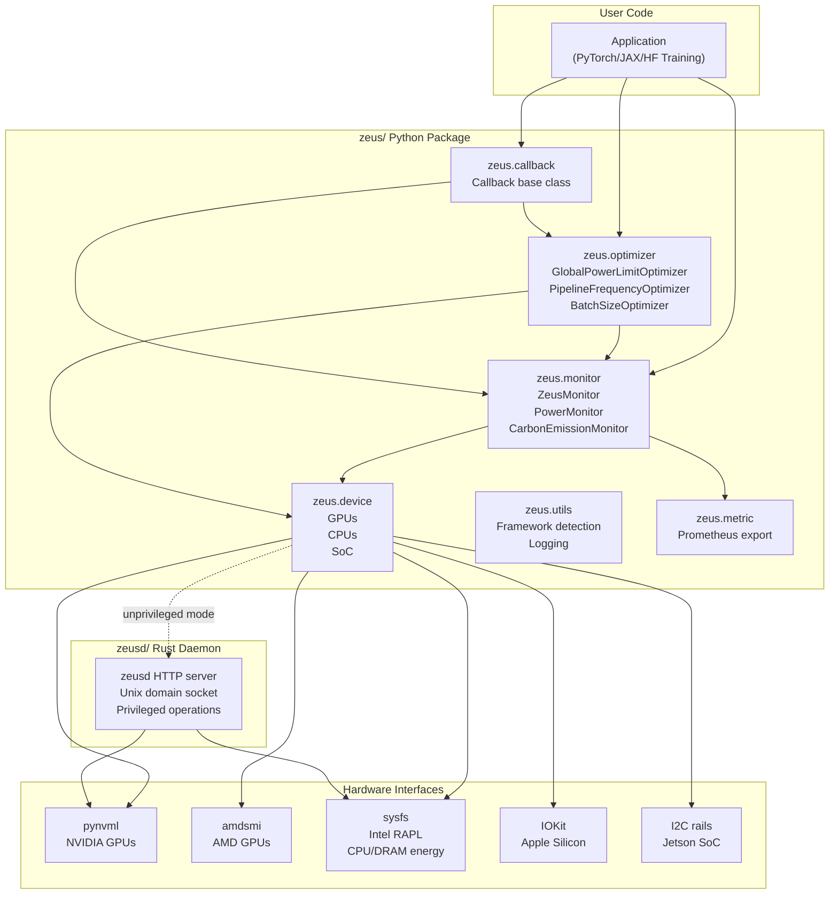
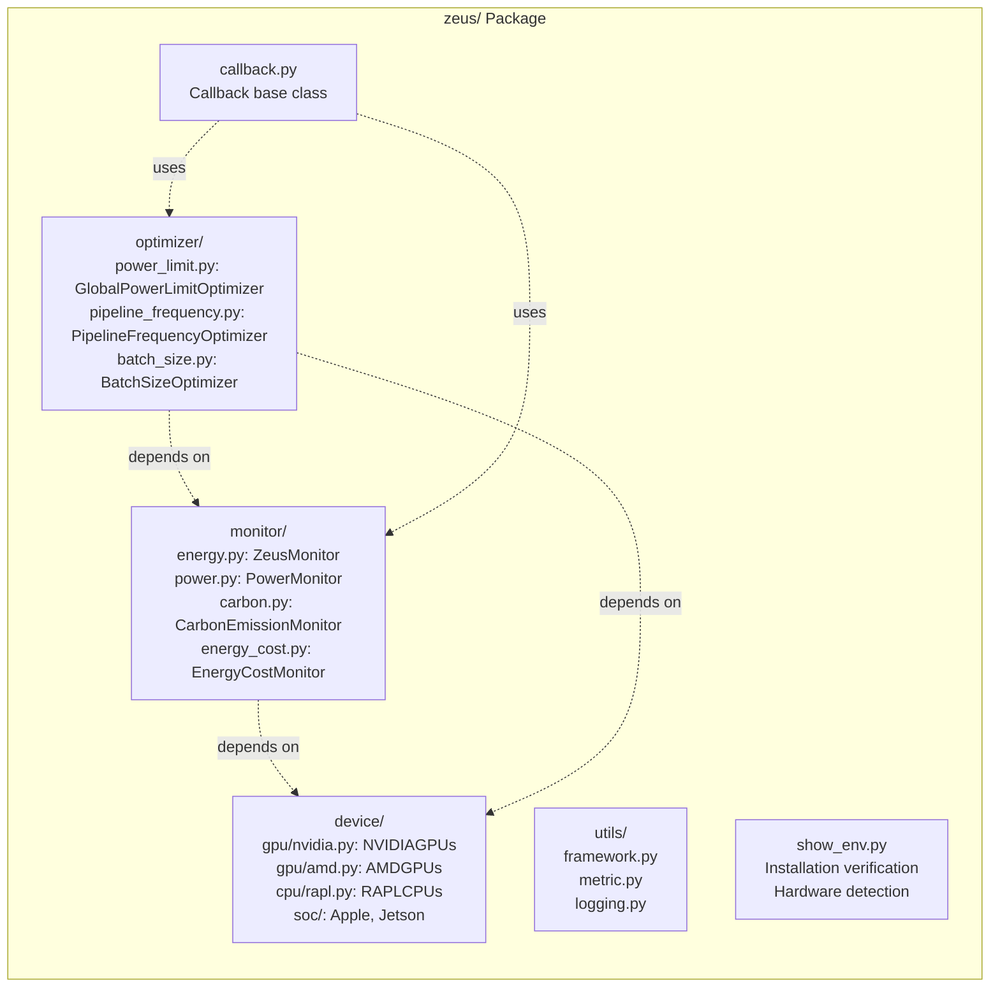
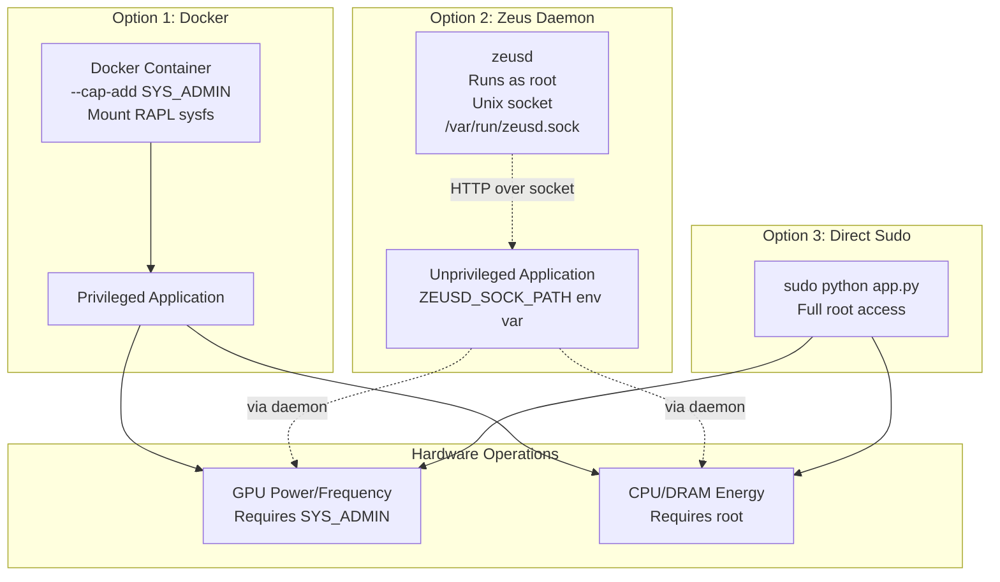

<!-- source: DeepWiki mcp.deepwiki.com · repo ml-energy/zeus · page 1 Overview · fetched 2026-10-21 -->

# Overview

<details>
<summary>Relevant source files</summary>

The following files were used as context for generating this wiki page:

- [README.md](README.md)
- [docs/getting_started/index.md](docs/getting_started/index.md)
- [docs/index.md](docs/index.md)
- [zeus/__init__.py](zeus/__init__.py)

</details>


## Purpose and Scope

This page provides a high-level introduction to the Zeus project, its mission, core capabilities, and system architecture. It serves as an entry point to understanding how Zeus components work together to measure and optimize deep learning energy consumption.

For installation and setup instructions, see [Getting Started](#2). For detailed documentation on specific capabilities, see [Energy Measurement](#4) and [Energy Optimization](#5).

**Sources**: [README.md:1-95](), [docs/index.md:1-54]()

---

## Project Mission

Zeus is a library for **measuring** and **optimizing** the energy consumption of deep learning workloads. It addresses the growing concern about the environmental and economic costs of training and deploying machine learning models by providing tools that make energy a first-class metric alongside accuracy and latency.

Zeus is part of [The ML.ENERGY Initiative](https://ml.energy), a broader effort to bring energy efficiency to the forefront of machine learning research and practice.

**Key Problems Addressed**:

| Problem | Zeus Solution |
|---------|---------------|
| Lack of visibility into energy consumption | Programmatic and CLI-based energy measurement for GPUs, CPUs, DRAM, and SoCs |
| Energy waste during training | Optimization algorithms that reduce energy while maintaining accuracy |
| Hardware diversity | Unified abstraction layer supporting NVIDIA, AMD, Intel, Apple, and Jetson platforms |
| Privileged operations | Zeus daemon (`zeusd`) for secure, unprivileged access to power management |

**Sources**: [README.md:15-27](), [docs/index.md:14-26]()

---

## Core Capabilities

Zeus provides two primary capabilities:

### Measurement

Zeus measures energy consumption and power draw across multiple hardware components:

- **GPUs**: NVIDIA (via NVML) and AMD (via AMDSMI)
- **CPUs**: Intel and AMD processors (via Intel RAPL interface)
- **DRAM**: Memory power consumption
- **SoCs**: Apple Silicon and NVIDIA Jetson platforms

Measurement is available through:
- Programmatic APIs (`ZeusMonitor`, `PowerMonitor`)
- Command-line tools (`zeus.monitor`)
- Framework integrations (PyTorch, JAX, HuggingFace)

For details, see [Energy Measurement](#4).

### Optimization

Zeus optimizes energy consumption through three main strategies:

- **Power Limit Optimization**: Dynamically adjusts GPU power caps to minimize energy-time cost
- **Frequency Optimization**: Sets per-stage GPU frequencies in pipeline-parallel training
- **Batch Size Optimization**: Selects energy-efficient batch sizes using multi-armed bandits

For details, see [Energy Optimization](#5).

**Sources**: [README.md:25-56](), [zeus/__init__.py:1-15]()

---

## System Architecture

The following diagram shows Zeus's high-level architecture, mapping natural language concepts to concrete code modules:

**Zeus Core Component Architecture**



**Architecture Layers**:

1. **User Code Layer**: Applications integrate Zeus through simple APIs
2. **Zeus Python Package**: Core monitoring and optimization logic
3. **Zeus Daemon (Optional)**: Privileged operations proxy for unprivileged applications
4. **Hardware Interfaces**: Low-level library bindings to vendor-specific APIs

**Sources**: [README.md:29-48](), [zeus/__init__.py:1-15]()

---

## Module Organization

The Zeus Python package is organized into six primary modules:

**Zeus Module Structure**



| Module | Primary Classes | Purpose |
|--------|----------------|---------|
| `monitor/` | `ZeusMonitor`, `PowerMonitor`, `CarbonEmissionMonitor`, `EnergyCostMonitor` | Energy and power measurement APIs |
| `optimizer/` | `GlobalPowerLimitOptimizer`, `PipelineFrequencyOptimizer`, `BatchSizeOptimizer` | Energy optimization strategies |
| `device/` | `GPUs`, `CPUs`, `SoC` | Hardware abstraction layer |
| `utils/` | Framework detection, logging, metrics | Utility functions |
| `callback.py` | `Callback` | Base class for training callbacks |
| `show_env.py` | N/A | CLI tool for environment verification |

**Sources**: [README.md:29-48](), [zeus/__init__.py:1-15]()

---

## Hardware Support

Zeus provides a unified interface across diverse hardware platforms through an abstraction layer:

**Hardware Abstraction Architecture**

```mermaid
graph TB
    subgraph "Unified Interfaces"
        GPU_IF["zeus.device.gpu.GPU<br/>Abstract base class"]
        CPU_IF["zeus.device.cpu.CPU<br/>Abstract base class"]
        SOC_IF["zeus.device.soc.SoC<br/>Abstract base class"]
    end
    
    subgraph "GPU Implementations"
        NVML["NVIDIAGPUs<br/>zeus.device.gpu.nvidia"]
        NVML_ZEUSD["ZeusdNVIDIAGPUs<br/>zeus.device.gpu.nvidia"]
        AMD["AMDGPUs<br/>zeus.device.gpu.amd"]
        EMPTY_GPU["EmptyGPUs<br/>zeus.device.gpu.common"]
    end
    
    subgraph "CPU Implementations"
        RAPL["RAPLCPUs<br/>zeus.device.cpu.rapl"]
        RAPL_ZEUSD["ZeusdRAPLCPUs<br/>zeus.device.cpu.rapl"]
        EMPTY_CPU["EmptyCPUs<br/>zeus.device.cpu.common"]
    end
    
    subgraph "SoC Implementations"
        APPLE["AppleNpuSoC<br/>zeus.device.soc.apple"]
        JETSON["JetsonSoC<br/>zeus.device.soc.jetson"]
        EMPTY_SOC["EmptySoC<br/>zeus.device.soc.common"]
    end
    
    GPU_IF -.implements.-> NVML
    GPU_IF -.implements.-> NVML_ZEUSD
    GPU_IF -.implements.-> AMD
    GPU_IF -.implements.-> EMPTY_GPU
    
    CPU_IF -.implements.-> RAPL
    CPU_IF -.implements.-> RAPL_ZEUSD
    CPU_IF -.implements.-> EMPTY_CPU
    
    SOC_IF -.implements.-> APPLE
    SOC_IF -.implements.-> JETSON
    SOC_IF -.implements.-> EMPTY_SOC
```



**Supported Platforms**:

| Hardware Type | Vendor/Platform | Implementation Class | Interface Used |
|---------------|----------------|---------------------|----------------|
| GPU | NVIDIA | `NVIDIAGPUs` | NVML (pynvml) |
| GPU | AMD | `AMDGPUs` | AMDSMI |
| CPU | Intel/AMD | `RAPLCPUs` | Intel RAPL (sysfs) |
| SoC | Apple Silicon | `AppleNpuSoC` | IOKit |
| SoC | NVIDIA Jetson | `JetsonSoC` | I2C power rails |

The `Empty*` classes implement the null object pattern, allowing Zeus to run gracefully when specific hardware is unavailable.

For detailed hardware abstraction documentation, see [Hardware Abstraction Layer](#6).

**Sources**: [README.md:29-48](), Diagram 5 from system diagrams

---

## Deployment Patterns

Zeus supports three deployment patterns to handle privileged operations:

**Deployment Architecture**



| Deployment | Privileges | Use Case | Documentation |
|------------|-----------|----------|---------------|
| **Docker** | `SYS_ADMIN` capability, mount RAPL | Container-based deployments | [Deployment Strategies](#2.3) |
| **Zeus Daemon** | Unprivileged app + privileged `zeusd` | Recommended for production | [Zeus Daemon](#7) |
| **Direct Sudo** | Full root access | Quick testing (discouraged) | [Deployment Strategies](#2.3) |

**Privilege Requirements**:

- **GPU Energy Measurement**: No special privileges on modern NVIDIA/AMD GPUs
- **GPU Power/Frequency Control**: Requires `SYS_ADMIN` capability or root
- **CPU/DRAM Energy Measurement**: Requires root access to RAPL sysfs interface

For detailed privilege management documentation, see [Privilege Management](#3.2).

**Sources**: [docs/getting_started/index.md:131-199](), Diagram 4 from system diagrams

---

## Integration Patterns

Zeus integrates with deep learning frameworks through multiple patterns:

**Framework Integration Architecture**

```mermaid
graph TB
    subgraph "Direct Integration"
        DIRECT_APP["Training Script"]
        ZM["ZeusMonitor.begin_window<br/>ZeusMonitor.end_window"]
        DIRECT_APP --> ZM
    end
    
    subgraph "Callback Integration"
        CB_APP["Training Script<br/>with Callbacks"]
        BASE_CB["zeus.callback.Callback<br/>on_step_begin<br/>on_step_end"]
        GPLO["GlobalPowerLimitOptimizer"]
        CB_APP --> BASE_CB
        BASE_CB --> GPLO
    end
    
    subgraph "HuggingFace Integration"
        HF_TRAINER["transformers.Trainer"]
        HF_CB["HFGlobalPowerLimitOptimizer<br/>extends TrainerCallback"]
        HF_TRAINER --> HF_CB
    end
    
    subgraph "Server Integration"
        PP_TRAINING["Pipeline Parallel<br/>Training"]
        PFO_SERVER["PipelineFrequencyOptimizer<br/>HTTP server"]
        PP_TRAINING -.HTTP requests.-> PFO_SERVER
    end
```



**Integration Methods**:

1. **Direct API**: Call `ZeusMonitor` methods explicitly in training code
2. **Callbacks**: Implement `zeus.callback.Callback` for framework-agnostic integration
3. **HuggingFace Adapter**: Use `HFGlobalPowerLimitOptimizer` with `transformers.Trainer`
4. **HTTP Server**: Pipeline parallel training queries `PipelineFrequencyOptimizer` server

For detailed integration documentation, see [Framework Integration](#9).

**Sources**: [README.md:49-65](), zeus/__init__.py, Diagram 1 from system diagrams

---

## Repository Organization

The Zeus repository is organized as follows:

```
zeus/
├── zeus/                 # Python package
│   ├── monitor/          # Energy measurement
│   ├── optimizer/        # Energy optimization
│   ├── device/           # Hardware abstraction
│   │   ├── gpu/          # GPU implementations
│   │   ├── cpu/          # CPU implementations
│   │   └── soc/          # SoC implementations
│   ├── utils/            # Utilities
│   ├── _legacy/          # Legacy research code
│   ├── callback.py       # Callback base class
│   ├── metric.py         # Prometheus metrics
│   └── show_env.py       # Environment verification
│
├── zeusd/                # Rust daemon (separate crate)
│   ├── src/
│   └── Cargo.toml
│
├── docker/               # Docker images
│   └── Dockerfile
│
├── examples/             # Usage examples
│
├── tests/                # Test suite
│
└── docs/                 # Documentation source
```

**Key Directories**:

| Directory | Content | Purpose |
|-----------|---------|---------|
| `zeus/` | Python package source | Core monitoring and optimization logic |
| `zeusd/` | Rust daemon source | Privileged operations proxy |
| `docker/` | Dockerfiles | Container deployment |
| `examples/` | Example scripts | Integration examples |
| `tests/` | Test suite | Pytest and Cargo tests |
| `docs/` | MkDocs source | Documentation website |

**Sources**: [README.md:29-48]()

---

## Research Foundation

Zeus is grounded in peer-reviewed academic research:

| Paper | Venue | Contribution |
|-------|-------|--------------|
| **Zeus** | NSDI 2023 | GPU power limit optimization, batch size optimization |
| **Perseus** | SOSP 2024 | Pipeline frequency optimization, energy bloat reduction |
| **Chase** | ICLR Workshop 2023 | Carbon-aware scheduling |
| **ML.ENERGY Benchmark** | NeurIPS 2025 | Standardized energy benchmarking |

For detailed research summaries, see [Research Background](#11).

**Sources**: [README.md:68-87](), [docs/index.md:38-49]()

---

## Next Steps

After understanding Zeus's high-level architecture, you may want to:

1. **Install Zeus**: Follow [Getting Started](#2) for installation instructions
2. **Measure Energy**: See [Energy Measurement](#4) to measure your workload's energy consumption
3. **Optimize Energy**: See [Energy Optimization](#5) to reduce energy consumption
4. **Understand Hardware Abstraction**: See [Hardware Abstraction Layer](#6) for platform-specific details
5. **Deploy in Production**: See [Zeus Daemon](#7) for secure deployment patterns

**Sources**: [docs/index.md:28-37]()

---

