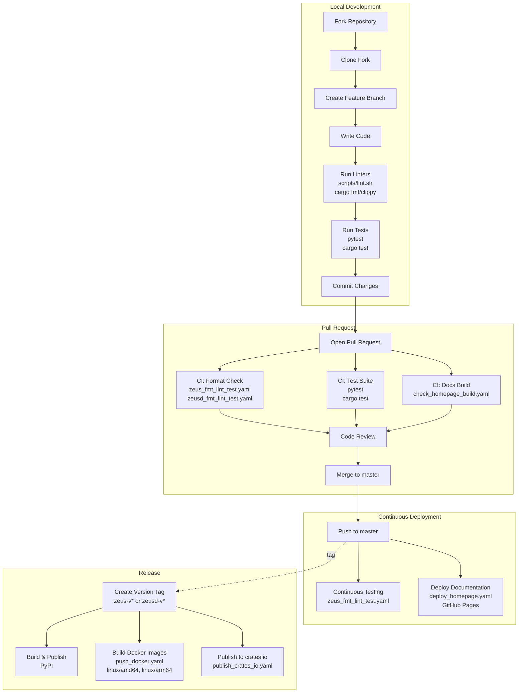
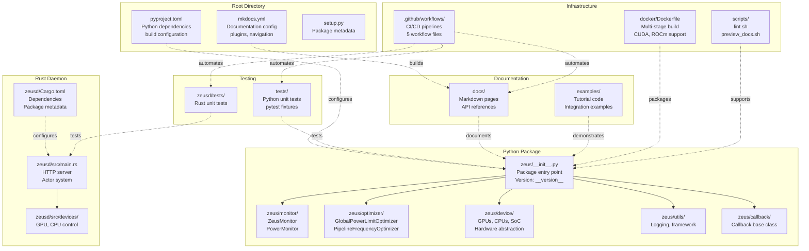
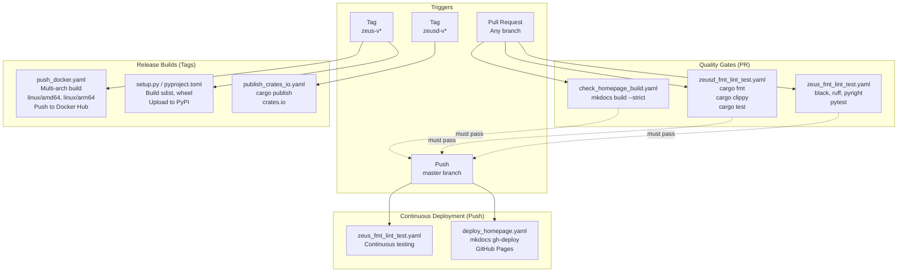
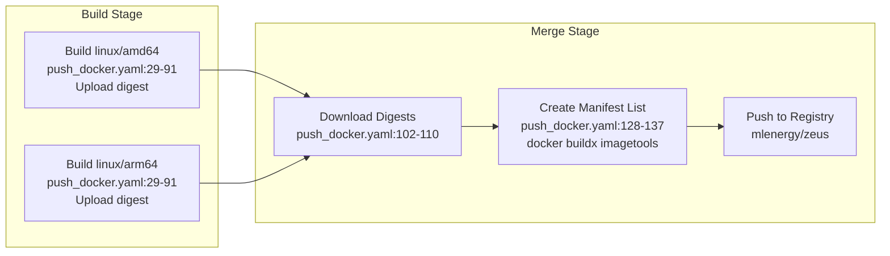

<!-- source: DeepWiki mcp.deepwiki.com · repo ml-energy/zeus · page 10 Development Guide · fetched 2026-10-21 -->

# Development Guide

<details>
<summary>Relevant source files</summary>

The following files were used as context for generating this wiki page:

- [.github/workflows/check_homepage_build.yaml](.github/workflows/check_homepage_build.yaml)
- [.github/workflows/deploy_homepage.yaml](.github/workflows/deploy_homepage.yaml)
- [.github/workflows/publish_crates_io.yaml](.github/workflows/publish_crates_io.yaml)
- [.github/workflows/push_docker.yaml](.github/workflows/push_docker.yaml)
- [.github/workflows/zeus_fmt_lint_test.yaml](.github/workflows/zeus_fmt_lint_test.yaml)
- [.github/workflows/zeusd_fmt_lint_test.yaml](.github/workflows/zeusd_fmt_lint_test.yaml)
- [scripts/preview_docs.sh](scripts/preview_docs.sh)
- [zeus/__init__.py](zeus/__init__.py)
- [zeus/device/common.py](zeus/device/common.py)

</details>


This guide provides an overview of the Zeus development workflow, including environment setup, code quality standards, testing strategies, and the CI/CD pipeline. It is intended for contributors working on the Zeus codebase.

For detailed information about specific aspects of development:
- Repository organization and file structure: see [Project Structure](#10.1)
- Testing methodology and test fixtures: see [Testing](#10.2)
- Linting tools and formatting standards: see [Code Quality](#10.3)
- GitHub Actions workflows and release automation: see [CI/CD Pipeline](#10.4)
- Documentation build system and deployment: see [Documentation System](#10.5)

## Overview

Zeus is a dual-language project with a Python package (`zeus/`) and a Rust daemon (`zeusd/`). The Python package provides the main API for energy measurement and optimization, while the Rust daemon handles privileged hardware operations. Both components have independent development workflows, testing strategies, and release cycles.

The development infrastructure emphasizes automation:
- Pull requests trigger code quality checks (formatting, linting, testing)
- Pushes to `master` trigger continuous testing and documentation deployment
- Version tags trigger automated releases to PyPI and crates.io
- Docker images are built for multiple architectures (amd64, arm64)

## Development Environment Setup

### Python Development

Zeus uses [`uv`](https://docs.astral.sh/uv/) for Python dependency management and virtual environment handling. Install development dependencies:

```bash
# Install uv
curl -LsSf https://astral.sh/uv/install.sh | sh

# Sync development environment
uv sync --extra dev --extra docs
```

The `dev` extra includes linting tools (`black`, `ruff`, `pyright`) and testing frameworks (`pytest`). The `docs` extra includes MkDocs Material and plugins for building documentation.

Sources: [.github/workflows/zeus_fmt_lint_test.yaml:40-46]()

### Rust Development

The `zeusd` daemon is built with Rust. Standard Rust tooling applies:

```bash
cd zeusd/

# Check formatting
cargo fmt --all --check

# Run linter
cargo clippy --all -- -D warnings

# Run tests
cargo test

# Build release binary
cargo build --release
```

Sources: [.github/workflows/zeusd_fmt_lint_test.yaml:44-51]()

## Development Workflow



**Development Workflow Diagram**

This diagram illustrates the complete development lifecycle from local changes to production releases. Local development emphasizes running linters and tests before committing. Pull requests trigger automated quality gates including format checks, test suites, and documentation builds. Merged changes automatically deploy documentation to GitHub Pages. Version tags trigger releases to PyPI (for Python), crates.io (for Rust), and Docker Hub (multi-architecture images).

Sources: [.github/workflows/zeus_fmt_lint_test.yaml](), [.github/workflows/zeusd_fmt_lint_test.yaml](), [.github/workflows/check_homepage_build.yaml](), [.github/workflows/deploy_homepage.yaml](), [.github/workflows/push_docker.yaml](), [.github/workflows/publish_crates_io.yaml]()

## Repository Architecture



**Repository Structure Diagram**

The repository is organized into distinct components: the Python package (`zeus/`) provides user-facing APIs organized by functionality (monitor, optimizer, device, utils, callback). The Rust daemon (`zeusd/`) implements a separate HTTP server for privileged operations. Testing infrastructure is split between Python (`tests/`) and Rust (`zeusd/tests/`) directories. Documentation lives in `docs/` with examples in `examples/`. Infrastructure code includes multi-stage Docker builds (`docker/Dockerfile`), GitHub Actions workflows (`.github/workflows/`), and utility scripts (`scripts/`). Configuration files at the root (`pyproject.toml`, `mkdocs.yml`, `Cargo.toml`) control builds and dependencies.

Sources: [zeus/__init__.py:1-12](), [.github/workflows/]()

## Code Quality Standards

Zeus enforces strict code quality through automated tooling:

### Python

| Tool | Purpose | Configuration |
|------|---------|---------------|
| `black` | Code formatting | `pyproject.toml` |
| `ruff` | Fast linting (Flake8, isort, etc.) | `pyproject.toml` |
| `pyright` | Static type checking | `pyproject.toml` |
| `pytest` | Unit and integration tests | `pyproject.toml` |

Run all Python checks locally:

```bash
uv run bash scripts/lint.sh
```

Sources: [.github/workflows/zeus_fmt_lint_test.yaml:47-48]()

### Rust

| Tool | Purpose |
|------|---------|
| `rustfmt` | Code formatting |
| `clippy` | Linting with `-D warnings` |
| `cargo test` | Unit tests |

Run Rust checks:

```bash
cd zeusd/
cargo fmt --all --check
cargo clippy --all -- -D warnings
cargo test
```

Sources: [.github/workflows/zeusd_fmt_lint_test.yaml:44-51]()

For more details on code quality tooling and configuration, see [Code Quality](#10.3).

## Testing Strategy

Zeus employs different testing strategies for Python and Rust components:

- **Python tests** (`tests/`) use `pytest` with fixtures for mocking hardware interfaces
- **Rust tests** (`zeusd/tests/`) use Cargo's built-in test framework
- **Integration tests** verify end-to-end functionality across components
- **Documentation tests** ensure code examples in docs remain functional

Test execution in CI:

```bash
# Python tests
uv run pytest

# Rust tests
cd zeusd/ && cargo test
```

For detailed information on test organization, fixtures, and coverage, see [Testing](#10.2).

Sources: [.github/workflows/zeus_fmt_lint_test.yaml:49-50](), [.github/workflows/zeusd_fmt_lint_test.yaml:49-51]()

## CI/CD Pipeline



**CI/CD Pipeline Architecture**

The CI/CD pipeline has three main trigger types. Pull requests execute quality gates: Python formatting/linting/testing (`zeus_fmt_lint_test.yaml`), Rust formatting/linting/testing (`zeusd_fmt_lint_test.yaml`), and documentation build verification (`check_homepage_build.yaml`). Pushes to `master` trigger continuous testing and deploy documentation to GitHub Pages via `deploy_homepage.yaml`. Version tags trigger release builds: `zeus-v*` tags build multi-architecture Docker images and publish to PyPI, while `zeusd-v*` tags publish to crates.io via `publish_crates_io.yaml`. All workflows use caching to optimize build times.

Sources: [.github/workflows/zeus_fmt_lint_test.yaml](), [.github/workflows/zeusd_fmt_lint_test.yaml](), [.github/workflows/check_homepage_build.yaml](), [.github/workflows/deploy_homepage.yaml](), [.github/workflows/push_docker.yaml](), [.github/workflows/publish_crates_io.yaml]()

### GitHub Actions Workflows

Zeus uses five main workflows:

| Workflow | Trigger | Purpose |
|----------|---------|---------|
| `zeus_fmt_lint_test.yaml` | PR, Push | Python code quality checks |
| `zeusd_fmt_lint_test.yaml` | PR, Push | Rust code quality checks |
| `check_homepage_build.yaml` | PR | Verify docs build without deploying |
| `deploy_homepage.yaml` | Push to `master` | Deploy docs to GitHub Pages |
| `push_docker.yaml` | Push to `master`, Tag `zeus-v*` | Build and push Docker images |
| `publish_crates_io.yaml` | Tag `zeusd-v*` | Publish Rust daemon to crates.io |

For detailed information on workflow implementation and configuration, see [CI/CD Pipeline](#10.4).

Sources: [.github/workflows/]()

## Release Process

Zeus has separate release processes for Python and Rust components:

### Python Package Release

1. Update version in [`zeus/__init__.py:14`]()
2. Commit and push to `master`
3. Create and push tag: `git tag zeus-v0.12.3 && git push origin zeus-v0.12.3`
4. GitHub Actions automatically:
   - Builds multi-architecture Docker images (amd64, arm64)
   - Publishes to Docker Hub (`mlenergy/zeus`)
   - Builds and uploads package to PyPI

Sources: [zeus/__init__.py:14](), [.github/workflows/push_docker.yaml:10-11]()

### Rust Daemon Release

1. Update version in `zeusd/Cargo.toml`
2. Commit and push to `master`
3. Create and push tag: `git tag zeusd-v0.2.0 && git push origin zeusd-v0.2.0`
4. GitHub Actions automatically publishes to crates.io

Sources: [.github/workflows/publish_crates_io.yaml:7-8]()

### Docker Image Build Process

The Docker build uses a multi-stage strategy defined in [`docker/Dockerfile`](). Key features:

- **Multi-architecture support**: `linux/amd64`, `linux/arm64`
- **Build caching**: Uses registry cache (`mlenergy/zeus:buildcache`)
- **Digest-based pushing**: Individual architecture builds upload digests
- **Manifest merging**: Separate job creates multi-arch manifest list

The workflow splits building and merging to optimize CI runtime:



**Multi-Architecture Docker Build Pipeline**

Sources: [.github/workflows/push_docker.yaml:29-141]()

## Documentation Development

Preview documentation locally:

```bash
bash scripts/preview_docs.sh
```

This serves the documentation at `localhost:7777` with live reloading enabled. The script checks for `mkdocs-material` installation and runs `mkdocs serve` with strict mode enabled.

The documentation system uses MkDocs Material with several plugins:
- `mkdocstrings`: Auto-generate API docs from Python docstrings
- `social`: Generate social preview cards
- `git-revision-date-localized`: Show last update times

For complete documentation system details, see [Documentation System](#10.5).

Sources: [scripts/preview_docs.sh:1-16](), [.github/workflows/deploy_homepage.yaml:42-47]()

## Quick Reference

Common development commands:

| Task | Command |
|------|---------|
| Install Python dev environment | `uv sync --extra dev` |
| Run Python linters | `uv run bash scripts/lint.sh` |
| Run Python tests | `uv run pytest` |
| Format Rust code | `cd zeusd/ && cargo fmt --all` |
| Run Rust linter | `cd zeusd/ && cargo clippy --all -- -D warnings` |
| Run Rust tests | `cd zeusd/ && cargo test` |
| Preview documentation | `bash scripts/preview_docs.sh` |
| Build documentation | `uv run mkdocs build --strict` |
| Build Docker image locally | `docker build -f docker/Dockerfile -t zeus:dev .` |

## Contributing Guidelines

When contributing to Zeus:

1. **Fork and branch**: Work in feature branches on your fork
2. **Run quality checks locally**: Execute linters and tests before pushing
3. **Write tests**: Add tests for new functionality
4. **Update documentation**: Keep docs synchronized with code changes
5. **Follow code style**: Adhere to formatting standards (black, rustfmt)
6. **Keep commits clean**: Write descriptive commit messages
7. **Monitor CI**: Ensure all GitHub Actions checks pass

Pull requests must pass all automated quality gates before merging. The CI system checks code formatting, linting, tests, and documentation builds for both Python and Rust components.

Sources: [.github/workflows/zeus_fmt_lint_test.yaml](), [.github/workflows/zeusd_fmt_lint_test.yaml](), [.github/workflows/check_homepage_build.yaml]()

---

