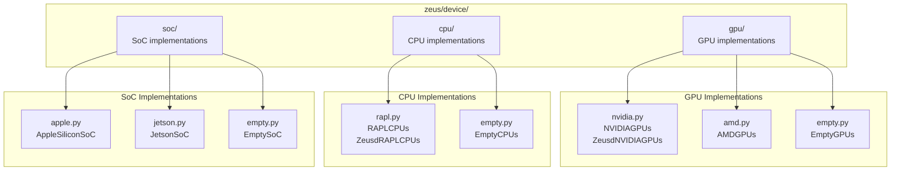
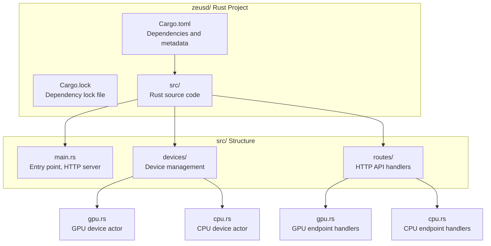
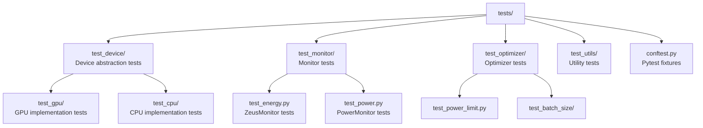

<!-- source: DeepWiki mcp.deepwiki.com · repo ml-energy/zeus · page 10.1 Project Structure · fetched 2026-10-21 -->

# Project Structure

Relevant source files

The following files were used as context for generating this wiki page:

- [README.md](README.md)
- [docs/getting_started/index.md](docs/getting_started/index.md)
- [docs/index.md](docs/index.md)
- [zeus/__init__.py](zeus/__init__.py)

This page provides a detailed walkthrough of the Zeus repository organization, documenting the purpose of each directory and major file. This guide is intended for contributors who want to understand the codebase layout before making changes. For information about the development workflow, testing, and CI/CD pipeline, see [Testing](#10.2), [Code Quality](#10.3), and [CI/CD Pipeline](#10.4). For information about the documentation build system, see [Documentation System](#10.5).

## Repository Overview

The Zeus repository is organized into several top-level directories, each serving a distinct purpose in the project's architecture. The repository contains both the Python package (`zeus/`) and the Rust daemon (`zeusd/`), along with supporting infrastructure for Docker deployment, examples, tests, and documentation.

```mermaid
graph TB
    subgraph "Repository Root"
        ZEUS["zeus/<br/>Python Package"]
        ZEUSD["zeusd/<br/>Rust Daemon"]
        DOCKER["docker/<br/>Deployment"]
        EXAMPLES["examples/<br/>Usage Samples"]
        TESTS["tests/<br/>Test Suite"]
        DOCS["docs/<br/>Documentation"]
        CONFIG["Configuration Files<br/>pyproject.toml, mkdocs.yml"]
    end
    
    ZEUS --> MON["monitor/"]
    ZEUS --> OPT["optimizer/"]
    ZEUS --> DEV["device/"]
    ZEUS --> UTILS["utils/"]
    ZEUS --> LEGACY["_legacy/"]
    
    ZEUSD --> ZEUSD_SRC["src/<br/>Rust source"]
    ZEUSD --> ZEUSD_CARGO["Cargo.toml"]
    
    DOCKER --> DOCKERFILE["Dockerfile"]
    DOCKER --> COMPOSE["docker-compose.yml"]
    
    TESTS --> TEST_DEVICE["test_device/"]
    TESTS --> TEST_MONITOR["test_monitor/"]
    TESTS --> TEST_OPT["test_optimizer/"]
    
    DOCS --> GETTING["getting_started/"]
    DOCS --> MEASURE["measure/"]
    DOCS --> OPTIMIZE["optimize/"]
```

**Sources:** [README.md:29-48](), [zeus/__init__.py:1-14]()

## Top-Level Directory Structure

The following table summarizes the purpose of each top-level directory:

| Directory | Purpose | Key Files |
|-----------|---------|-----------|
| `zeus/` | Main Python package containing all energy measurement and optimization functionality | `__init__.py`, `show_env.py`, `callback.py`, `metric.py` |
| `zeusd/` | Rust-based daemon for privileged GPU/CPU operations | `Cargo.toml`, `src/main.rs` |
| `docker/` | Docker deployment configurations | `Dockerfile`, `docker-compose.yml` |
| `examples/` | Working examples demonstrating Zeus usage | Various example scripts |
| `tests/` | Python test suite using pytest | Test modules for each package component |
| `docs/` | MkDocs documentation source | Markdown files, `mkdocs.yml` |

**Sources:** [README.md:29-48]()

## Zeus Python Package Structure

The `zeus/` directory contains the main Python package. The package is organized into several submodules, each with a specific responsibility in the Zeus architecture.

### Package Module Organization

```mermaid
graph TB
    INIT["zeus/__init__.py<br/>Package root"]
    
    subgraph "Core Modules"
        MON["monitor/<br/>Energy & power measurement"]
        OPT["optimizer/<br/>Energy optimization"]
        DEV["device/<br/>Hardware abstraction"]
        UTILS["utils/<br/>Utilities"]
    end
    
    subgraph "Integration"
        CB["callback.py<br/>Training callback base class"]
        METRIC["metric.py<br/>Prometheus metrics"]
        SHOW["show_env.py<br/>Environment verification CLI"]
    end
    
    subgraph "Legacy"
        LEGACY["_legacy/<br/>Research reproducibility"]
    end
    
    INIT --> MON
    INIT --> OPT
    INIT --> DEV
    INIT --> UTILS
    INIT --> CB
    INIT --> METRIC
    INIT --> SHOW
    INIT --> LEGACY
    
    MON --> MON_ENERGY["energy.py<br/>ZeusMonitor"]
    MON --> MON_POWER["power.py<br/>PowerMonitor"]
    MON --> MON_CARBON["carbon.py<br/>CarbonEmissionMonitor"]
    MON --> MON_COST["cost.py<br/>EnergyCostMonitor"]
    MON --> MON_TEMP["temperature.py<br/>TemperatureMonitor"]
    
    OPT --> OPT_PL["power_limit.py<br/>GlobalPowerLimitOptimizer"]
    OPT --> OPT_PF["pipeline_frequency.py<br/>PipelineFrequencyOptimizer"]
    OPT --> OPT_BS["batch_size/<br/>BatchSizeOptimizer"]
    
    DEV --> DEV_GPU["gpu/<br/>GPU abstraction"]
    DEV --> DEV_CPU["cpu/<br/>CPU abstraction"]
    DEV --> DEV_SOC["soc/<br/>SoC abstraction"]
```

**Sources:** [zeus/__init__.py:1-14](), [README.md:33-41]()

### Module Descriptions

#### zeus/monitor/

The `monitor` module provides programmatic and CLI-based energy and power measurement capabilities. It contains implementations for different monitoring strategies and external API integrations.

| File | Primary Class/Function | Purpose |
|------|------------------------|---------|
| `energy.py` | `ZeusMonitor` | Window-based energy measurement for GPUs, CPUs, DRAM, and SoCs |
| `power.py` | `PowerMonitor` | Continuous power polling with background process |
| `carbon.py` | `CarbonEmissionMonitor` | Carbon intensity tracking via ElectricityMaps API |
| `cost.py` | `EnergyCostMonitor` | Electricity cost tracking via OpenEI API |
| `temperature.py` | `TemperatureMonitor` | GPU temperature monitoring over time |

**Sources:** [README.md:34](), [zeus/__init__.py:4]()

#### zeus/optimizer/

The `optimizer` module contains implementations of energy optimization strategies based on Zeus research papers.

| File/Directory | Primary Class | Purpose |
|----------------|---------------|---------|
| `power_limit.py` | `GlobalPowerLimitOptimizer` | JIT profiling-based GPU power cap optimization |
| `pipeline_frequency.py` | `PipelineFrequencyOptimizer` | Per-stage frequency optimization for pipeline parallelism |
| `batch_size/` | `BatchSizeOptimizer` | Multi-armed bandit batch size selection |

**Sources:** [README.md:35](), [zeus/__init__.py:5]()

#### zeus/device/

The `device` module provides a hardware abstraction layer supporting multiple GPU vendors, CPU architectures, and SoC platforms. This layer enables Zeus to run on diverse hardware with a unified API.

**Sources:** [README.md:36](), [zeus/__init__.py:3]()

| Subdirectory | Key Files | Purpose |
|--------------|-----------|---------|
| `gpu/` | `nvidia.py`, `amd.py`, `common.py` | GPU abstraction with NVIDIA NVML and AMD AMDSMI support |
| `cpu/` | `rapl.py`, `common.py` | CPU energy measurement via Intel RAPL interface |
| `soc/` | `apple.py`, `jetson.py`, `common.py` | SoC support for Apple Silicon and NVIDIA Jetson |

Each subdirectory contains:
- Device-specific implementation classes (e.g., `NVIDIAGPUs`, `AMDGPUs`, `RAPLCPUs`)
- Daemon-mediated variants (e.g., `ZeusdNVIDIAGPUs`, `ZeusdRAPLCPUs`)
- Empty/stub implementations for graceful degradation (`EmptyGPUs`, `EmptyCPUs`, `EmptySoC`)
- Common abstract base classes defining the interface

**Sources:** [README.md:36]()

#### zeus/utils/

The `utils` module contains utility functions and classes used throughout Zeus, including framework detection, distributed training support, and logging configuration.

| File | Purpose |
|------|---------|
| `framework.py` | Framework detection (PyTorch, JAX) and synchronization utilities |
| `logging.py` | Zeus-wide logging configuration |
| `env.py` | Environment variable handling |
| `pydantic.py` | Pydantic model utilities for configuration |

**Sources:** [README.md:37](), [zeus/__init__.py:6]()

#### zeus/_legacy/

The `_legacy` module contains code from previous research papers, preserved for reproducibility. This includes the original Zeus (NSDI '23) and Chase implementations.

**Sources:** [README.md:38](), [zeus/__init__.py:11]()

#### Top-level Package Files

| File | Purpose |
|------|---------|
| `__init__.py` | Package initialization and version declaration |
| `callback.py` | Base `Callback` class for training integration |
| `metric.py` | Prometheus metric export support |
| `show_env.py` | CLI tool for environment verification and hardware detection |
| `exception.py` | Base exception classes |

**Sources:** [zeus/__init__.py:1-14]()

## Zeus Daemon Structure (zeusd/)

The `zeusd/` directory contains a Rust-based daemon that provides privileged access to GPU and CPU operations for unprivileged applications. This follows the principle of least privilege by separating privileged operations into a minimal service.

**Sources:** [README.md:43]()

The daemon uses an actor-based architecture where each device type (GPU, CPU) is managed by a dedicated actor that handles concurrent requests safely. Communication with the daemon occurs via HTTP over Unix domain sockets.

For detailed information about the daemon's architecture, API, and deployment, see [Daemon Architecture](#7.1), [HTTP API Reference](#7.2), and [Installing and Running zeusd](#7.3).

**Sources:** [README.md:43]()

## Docker Deployment Files (docker/)

The `docker/` directory contains files for containerized deployment of Zeus.

| File | Purpose |
|------|---------|
| `Dockerfile` | Multi-stage Docker image based on `nvidia/cuda:11.8.0-base-ubuntu22.04` with Miniconda, PyTorch, and Zeus |
| `docker-compose.yml` | Docker Compose configuration for convenient multi-container setups |

The Dockerfile includes:
- NVIDIA CUDA base image
- Miniconda 3 environment
- PyTorch and Torchvision
- Zeus repository clone at `/workspace/zeus`
- Necessary capabilities for privileged operations

**Sources:** [README.md:45](), [docs/getting_started/index.md:41-44]()

For deployment instructions, see [Deployment Strategies](#2.3).

## Examples Directory (examples/)

The `examples/` directory contains working code samples demonstrating various Zeus features and integration patterns. These examples serve as starting points for users integrating Zeus into their own projects.

Examples typically include:
- Energy measurement integration with training loops
- Optimizer usage patterns
- Framework-specific integrations (PyTorch, HuggingFace)
- CLI tool usage

**Sources:** [README.md:47](), [docs/index.md:36]()

## Test Suite (tests/)

The `tests/` directory contains the Python test suite organized by module:

The test structure mirrors the package structure in `zeus/`, with each module having a corresponding test directory or file. Tests use pytest and include fixtures for mocking hardware interactions.

**Sources:** [README.md:47]()

For more information about testing strategy and running tests, see [Testing](#10.2).

## Documentation Structure (docs/)

The `docs/` directory contains the MkDocs documentation source:

| Directory/File | Purpose |
|----------------|---------|
| `getting_started/` | Installation and setup guides |
| `measure/` | Energy measurement documentation |
| `optimize/` | Energy optimization documentation |
| `research_overview/` | Research paper summaries |
| `reference/` | Auto-generated API reference |
| `assets/` | Images, logos, and static files |
| `mkdocs.yml` | MkDocs configuration (in repository root) |

The documentation uses MkDocs Material theme with plugins for:
- Auto-generated API reference (`mkdocstrings`)
- Social card generation
- Code highlighting
- Mermaid diagram rendering

**Sources:** [README.md:47](), [docs/index.md:28-35]()

For detailed information about the documentation build system, see [Documentation System](#10.5).

## Configuration Files

The repository root contains several configuration files that define project metadata, dependencies, and build settings:

| File | Purpose |
|------|---------|
| `pyproject.toml` | Python package configuration, dependencies, and build settings |
| `mkdocs.yml` | Documentation site configuration |
| `.github/workflows/` | GitHub Actions CI/CD workflow definitions |
| `Cargo.toml` (in `zeusd/`) | Rust daemon configuration and dependencies |

**Sources:** [README.md:29-48]()

The `pyproject.toml` file defines:
- Package metadata (name, version, description)
- Core and optional dependencies
- Development dependencies
- Build system requirements (setuptools)
- Tool configurations (black, ruff, pyright)

For information about CI/CD workflows and release processes, see [CI/CD Pipeline](#10.4).

---

