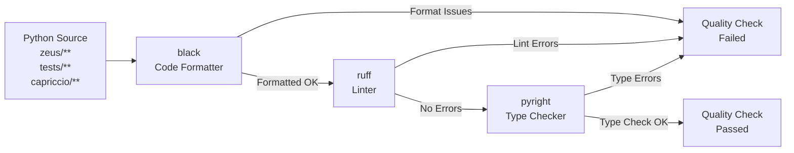
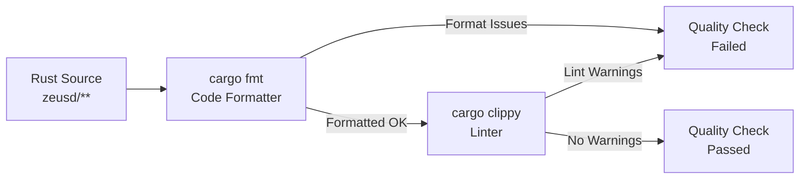
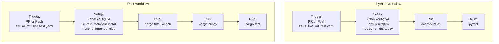
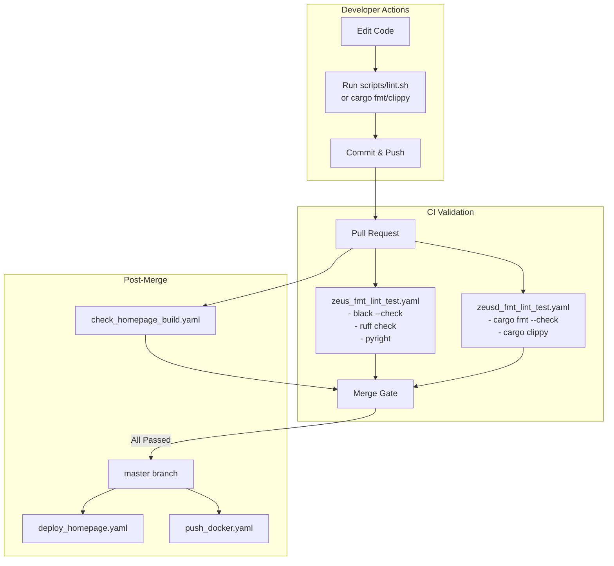

<!-- source: DeepWiki mcp.deepwiki.com · repo ml-energy/zeus · page 10.3 Code Quality · fetched 2026-10-21 -->

# Code Quality

<details>
<summary>Relevant source files</summary>

The following files were used as context for generating this wiki page:

- [.dockerignore](.dockerignore)
- [.github/workflows/check_homepage_build.yaml](.github/workflows/check_homepage_build.yaml)
- [.github/workflows/deploy_homepage.yaml](.github/workflows/deploy_homepage.yaml)
- [.github/workflows/publish_crates_io.yaml](.github/workflows/publish_crates_io.yaml)
- [.github/workflows/push_docker.yaml](.github/workflows/push_docker.yaml)
- [.github/workflows/zeus_fmt_lint_test.yaml](.github/workflows/zeus_fmt_lint_test.yaml)
- [.github/workflows/zeusd_fmt_lint_test.yaml](.github/workflows/zeusd_fmt_lint_test.yaml)
- [scripts/lint.sh](scripts/lint.sh)
- [scripts/preview_docs.sh](scripts/preview_docs.sh)
- [zeus/device/common.py](zeus/device/common.py)

</details>


Zeus maintains code quality through automated linting and formatting tools for both Python and Rust codebases. This page documents the tools used, their configuration, and how they integrate into the development workflow. For information about the testing strategy, see [Testing](#10.2). For information about the CI/CD pipeline that runs these checks, see [CI/CD Pipeline](#10.4).

## Overview

Zeus enforces code quality through three main mechanisms:

1. **Python Quality Tools**: `black` (formatting), `ruff` (linting), and `pyright` (type checking)
2. **Rust Quality Tools**: `cargo fmt` (formatting) and `cargo clippy` (linting)
3. **CI Enforcement**: Automated checks on all pull requests and pushes

These tools run automatically in GitHub Actions workflows and can be executed locally during development.

## Python Code Quality Tools

### Tool Pipeline



**Sources:** [scripts/lint.sh:1-13](), [.github/workflows/zeus_fmt_lint_test.yaml:1-51]()

### Black - Code Formatter

Black formats Python code to a consistent style. It runs in check mode in CI and format mode locally.

| Mode | Command | Usage |
|------|---------|-------|
| **Check** | `black --check zeus tests` | CI validation - fails if changes needed |
| **Format** | `black zeus tests` | Local development - applies formatting |

The formatter targets these directories:
- `zeus/` - Main package code
- `tests/` - Test suite
- `capriccio/` - Additional Python components (implicitly included via ruff)

**Configuration:** Black uses default settings with no custom configuration file.

**Sources:** [scripts/lint.sh:5-9]()

### Ruff - Linter

Ruff performs fast linting checks for common Python issues, following PEP 8 and additional best practices.

**Command:** `ruff check zeus`

Ruff examines:
- Code style violations
- Import ordering
- Unused variables and imports
- Complexity issues
- Common bug patterns

**Configuration:** Ruff configuration is specified in `pyproject.toml`.

**Sources:** [scripts/lint.sh:11]()

### Pyright - Type Checker

Pyright validates type annotations and performs static type checking.

**Command:** `pyright zeus`

Pyright checks:
- Type annotation correctness
- Type compatibility in assignments and function calls
- Generic type parameters
- Optional/None handling

**Scope:** Type checking applies only to the `zeus/` package, not tests.

**Configuration:** Pyright configuration is specified in `pyproject.toml`.

**Sources:** [scripts/lint.sh:12]()

## Rust Code Quality Tools



**Sources:** [.github/workflows/zeusd_fmt_lint_test.yaml:43-48]()

### Cargo Fmt - Code Formatter

Cargo fmt formats Rust code according to the Rust style guide.

**Command:** `cargo fmt --all --check`

The `--all` flag formats all workspace members, and `--check` mode verifies formatting without modifying files.

**Working Directory:** `zeusd/`

**Sources:** [.github/workflows/zeusd_fmt_lint_test.yaml:43-45]()

### Cargo Clippy - Linter

Clippy catches common mistakes and suggests idiomatic Rust patterns.

**Command:** `cargo clippy --all -- -D warnings`

The `-D warnings` flag treats all warnings as errors, enforcing zero-warning policy.

Clippy checks:
- Idiomatic Rust patterns
- Performance issues
- Common mistakes
- Style guidelines
- Suspicious patterns

**Working Directory:** `zeusd/`

**Sources:** [.github/workflows/zeusd_fmt_lint_test.yaml:46-48]()

## CI Integration

### Workflow Architecture



**Sources:** [.github/workflows/zeus_fmt_lint_test.yaml:1-51](), [.github/workflows/zeusd_fmt_lint_test.yaml:1-52]()

### Python Workflow Triggers

The Python quality checks run when:

**Pull Requests** modify:
- `.github/workflows/zeus_fmt_lint_test.yaml`
- `zeus/**`
- `tests/**`
- `capriccio/*.py`
- `examples/**`
- `setup.py`
- `scripts/lint.sh`
- `pyproject.toml`

**Pushes** to any branch modify the same paths.

**Concurrency Control:** The workflow group `${{ github.ref }}-zeus-lint-and-test` cancels in-progress jobs when new pushes arrive.

**Sources:** [.github/workflows/zeus_fmt_lint_test.yaml:5-30]()

### Rust Workflow Triggers

The Rust quality checks run when:

**Pull Requests** or **Pushes** modify:
- `.github/workflows/zeusd_fmt_lint_test.yaml`
- `zeusd/**`

**Concurrency Control:** The workflow group `${{ github.ref }}-zeusd-lint-and-test` cancels in-progress jobs.

**Sources:** [.github/workflows/zeusd_fmt_lint_test.yaml:5-18]()

### Workflow Execution Details

#### Python Workflow Steps

| Step | Action | Details |
|------|--------|---------|
| Checkout | `actions/checkout@v4` | Full repository checkout |
| Setup UV | `astral-sh/setup-uv@v6` | Python 3.9, cache enabled |
| Install | `uv sync --extra dev` | Install Zeus with dev dependencies |
| Lint | `uv run bash scripts/lint.sh` | Run black, ruff, pyright |
| Test | `uv run pytest` | Run test suite (see [Testing](#10.2)) |

**Sources:** [.github/workflows/zeus_fmt_lint_test.yaml:36-50]()

#### Rust Workflow Steps

| Step | Action | Details |
|------|--------|---------|
| Checkout | `actions/checkout@v4` | Sparse checkout of `zeusd/` only |
| Install Toolchain | `rustup toolchain install stable` | Minimal profile |
| Cache | `actions/cache@v4` | Cache cargo registry and build artifacts |
| Format Check | `cargo fmt --all --check` | Verify formatting |
| Lint | `cargo clippy --all -- -D warnings` | Check for warnings |
| Test | `cargo test` | Run test suite (see [Testing](#10.2)) |

**Cache Key:** `${{ github.event.repository.name }}-${{ runner.os }}-cargo-check-v2`

**Cached Paths:**
- `~/.cargo/bin/`
- `~/.cargo/registry/index/`
- `~/.cargo/registry/cache/`
- `~/.cargo/git/db/`
- `zeusd/target/`

**Sources:** [.github/workflows/zeusd_fmt_lint_test.yaml:23-51]()

## Local Development

### Running Python Checks Locally

```bash
# Install development dependencies
uv sync --extra dev

# Run all quality checks
uv run bash scripts/lint.sh

# Or run individual tools
uv run black zeus tests              # Format code
uv run black --check zeus tests      # Check formatting
uv run ruff check zeus               # Lint code
uv run pyright zeus                  # Type check
```

The `scripts/lint.sh` script automatically detects whether it's running in CI (via `$GITHUB_ACTION` environment variable) and adjusts black behavior accordingly:
- **CI Mode:** `black --check` (verify only)
- **Local Mode:** `black` (apply formatting)

**Sources:** [scripts/lint.sh:5-9](), [.github/workflows/zeus_fmt_lint_test.yaml:45-48]()

### Running Rust Checks Locally

```bash
# Navigate to Rust workspace
cd zeusd

# Check formatting
cargo fmt --all --check

# Apply formatting
cargo fmt --all

# Run linter
cargo clippy --all -- -D warnings

# Run tests
cargo test
```

**Sources:** [.github/workflows/zeusd_fmt_lint_test.yaml:43-50]()

## File Exclusions

The `.dockerignore` file prevents cache and temporary files from interfering with builds:

**Excluded Patterns:**
- `**/*.pyc`, `**/*.pyo` - Compiled Python files
- `**/__pycache__/` - Python cache directories
- `.cache/` - MkDocs cache
- `.ruff_cache/` - Ruff cache
- `.pytest_cache/` - Pytest cache
- `.git/` - Git repository data
- `docs/`, `site/` - Documentation build artifacts

These exclusions keep Docker images clean and prevent cache pollution in build contexts.

**Sources:** [.dockerignore:1-22]()

## Quality Check Integration Map



**Sources:** [.github/workflows/zeus_fmt_lint_test.yaml:1-51](), [.github/workflows/zeusd_fmt_lint_test.yaml:1-52](), [.github/workflows/check_homepage_build.yaml:1-47](), [.github/workflows/deploy_homepage.yaml:1-48](), [.github/workflows/push_docker.yaml:1-141]()

## Tool Version Requirements

| Tool | Minimum Version | Specified In |
|------|----------------|--------------|
| Python | 3.9 | `.github/workflows/zeus_fmt_lint_test.yaml` |
| UV | latest | `.github/workflows/zeus_fmt_lint_test.yaml` |
| Rust | stable | `.github/workflows/zeusd_fmt_lint_test.yaml` |
| Cargo | stable | `.github/workflows/zeusd_fmt_lint_test.yaml` |

**Sources:** [.github/workflows/zeus_fmt_lint_test.yaml:40-44](), [.github/workflows/zeusd_fmt_lint_test.yaml:32]()

## Best Practices

### For Python Development

1. **Run checks before committing:** Use `scripts/lint.sh` to catch issues early
2. **Let black handle formatting:** Don't manually format code - let black do it
3. **Address type errors:** Pyright errors indicate potential runtime issues
4. **Fix linting issues:** Ruff catches common mistakes and anti-patterns

### For Rust Development

1. **Format before committing:** Run `cargo fmt --all` regularly
2. **Enable clippy in IDE:** Many IDEs can show clippy warnings inline
3. **Treat warnings as errors:** Follow the CI policy locally with `-D warnings`
4. **Use stable toolchain:** Zeus targets the stable Rust release

### General Guidelines

- **Don't skip CI checks:** They catch issues that might not appear locally
- **Leverage caching:** UV and Cargo caching speeds up repeated runs
- **Keep dependencies updated:** Tool versions may change with security updates
- **Review tool output:** Error messages often suggest fixes

**Sources:** [scripts/lint.sh:1-13](), [.github/workflows/zeus_fmt_lint_test.yaml:1-51](), [.github/workflows/zeusd_fmt_lint_test.yaml:1-52]()

---

