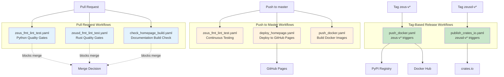
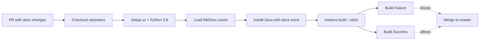
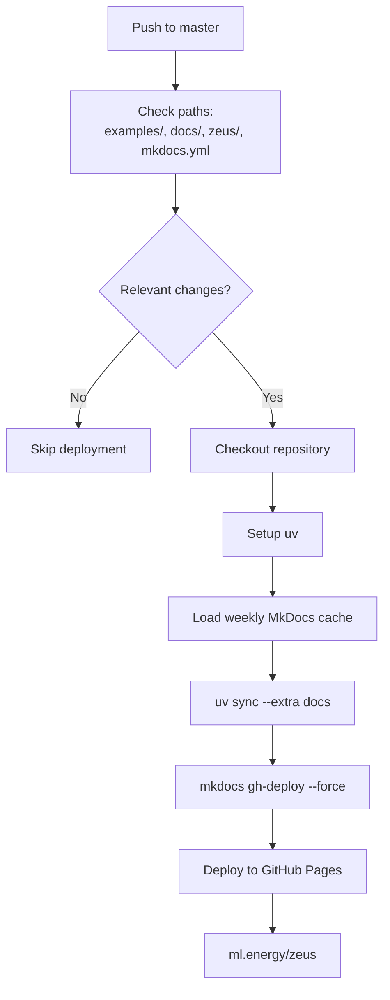
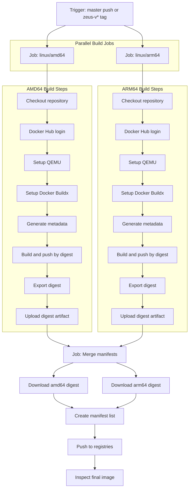
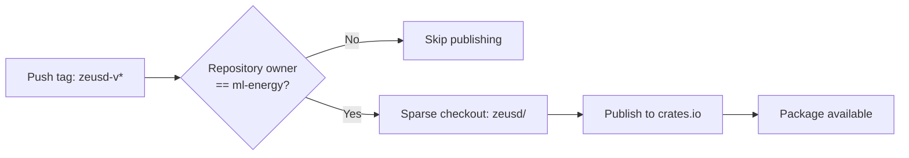

<!-- source: DeepWiki mcp.deepwiki.com · repo ml-energy/zeus · page 10.4 CI/CD Pipeline · fetched 2026-10-21 -->

# CI/CD Pipeline

<details>
<summary>Relevant source files</summary>

The following files were used as context for generating this wiki page:

- [.github/workflows/check_homepage_build.yaml](.github/workflows/check_homepage_build.yaml)
- [.github/workflows/deploy_homepage.yaml](.github/workflows/deploy_homepage.yaml)
- [.github/workflows/publish_crates_io.yaml](.github/workflows/publish_crates_io.yaml)
- [.github/workflows/push_docker.yaml](.github/workflows/push_docker.yaml)
- [.github/workflows/zeus_fmt_lint_test.yaml](.github/workflows/zeus_fmt_lint_test.yaml)
- [.github/workflows/zeusd_fmt_lint_test.yaml](.github/workflows/zeusd_fmt_lint_test.yaml)
- [scripts/preview_docs.sh](scripts/preview_docs.sh)
- [zeus/device/common.py](zeus/device/common.py)

</details>


## Purpose and Scope

This document describes Zeus's continuous integration and continuous deployment (CI/CD) infrastructure implemented using GitHub Actions. The pipeline enforces code quality standards, runs automated tests, builds multi-architecture Docker images, publishes packages to PyPI and crates.io, and deploys documentation to GitHub Pages.

Zeus maintains two independent codebases—the Python package (`zeus/`) and the Rust daemon (`zeusd/`)—with separate CI/CD workflows that share common quality enforcement patterns but have distinct release processes.

For information about the testing strategy and test fixtures, see [Testing](#10.2). For code formatting and linting tools, see [Code Quality](#10.3). For documentation build configuration, see [Documentation System](#10.5).

---

## Workflow Architecture

The CI/CD pipeline consists of seven GitHub Actions workflows organized by trigger type and target component:



**Sources:** [.github/workflows/zeus_fmt_lint_test.yaml](), [.github/workflows/zeusd_fmt_lint_test.yaml](), [.github/workflows/check_homepage_build.yaml](), [.github/workflows/deploy_homepage.yaml](), [.github/workflows/push_docker.yaml](), [.github/workflows/publish_crates_io.yaml]()

---

## Pull Request Quality Gates

### Python Package Quality Checks

The `zeus_fmt_lint_test.yaml` workflow enforces code quality for the Python package on all pull requests and pushes:

| Check | Tool | Configuration |
|-------|------|---------------|
| Format checking | `black`, `ruff` | `pyproject.toml` |
| Static type checking | `pyright` | `pyproject.toml` |
| Linting | `ruff` | `pyproject.toml` |
| Unit tests | `pytest` | `tests/` directory |

**Workflow Trigger Conditions:**

```yaml
on:
  pull_request:
    paths:
      - '.github/workflows/zeus_fmt_lint_test.yaml'
      - 'zeus/**'
      - 'tests/**'
      - 'capriccio/*.py'
      - 'examples/**'
      - 'setup.py'
      - 'scripts/lint.sh'
      - 'pyproject.toml'
```

The workflow only runs if changes affect Python code, configuration files, or the workflow definition itself. It uses `uv` for dependency management and caching.

**Job Steps:**

1. Checkout repository with `actions/checkout@v4`
2. Setup `uv` package manager with cache enabled
3. Install Zeus with dev dependencies: `uv sync --extra dev`
4. Run format and lint checks: `uv run bash scripts/lint.sh`
5. Run tests: `uv run pytest`

The workflow includes concurrency control to cancel in-progress jobs when new commits are pushed: `group: ${{ github.ref }}-zeus-lint-and-test` with `cancel-in-progress: true`.

**Sources:** [.github/workflows/zeus_fmt_lint_test.yaml:1-51]()

---

### Rust Daemon Quality Checks

The `zeusd_fmt_lint_test.yaml` workflow enforces quality for the Rust daemon:

| Check | Tool | Command |
|-------|------|---------|
| Format checking | `rustfmt` | `cargo fmt --all --check` |
| Linting | `clippy` | `cargo clippy --all -- -D warnings` |
| Unit tests | `cargo test` | `cargo test` |

**Workflow Configuration:**

```yaml
on:
  pull_request:
    paths:
      - '.github/workflows/zeusd_fmt_lint_test.yaml'
      - 'zeusd/**'
```

The workflow uses sparse checkout to clone only the `zeusd/` directory, optimizing CI performance. Cargo build artifacts are cached using `actions/cache@v4` with a cache key specific to the repository and OS.

**Cache Paths:**

- `~/.cargo/bin/`
- `~/.cargo/registry/index/`
- `~/.cargo/registry/cache/`
- `~/.cargo/git/db/`
- `zeusd/target/`

The workflow treats Clippy warnings as errors with the `-D warnings` flag, ensuring zero-warning builds.

**Sources:** [.github/workflows/zeusd_fmt_lint_test.yaml:1-52]()

---

### Documentation Build Verification

The `check_homepage_build.yaml` workflow validates documentation builds on pull requests:



The workflow triggers on changes to documentation-related paths:
- `examples/**`
- `docs/**`
- `zeus/**` (docstrings)
- `mkdocs.yml`
- `docker/Dockerfile`

**Build Configuration:**

The build uses `mkdocs build --verbose --strict` to fail on any warnings or errors. Social cards are generated during the build via `BUILD_SOCIAL_CARD=true` environment variable.

**Cache Strategy:**

The workflow caches MkDocs Material assets using a weekly cache key:

```yaml
cache_id=$(date --utc '+%V')
key: mkdocs-material-${{ env.cache_id }}
restore-keys: mkdocs-material-
```

This cache stores generated assets in `.cache/` to speed up subsequent builds.

**Sources:** [.github/workflows/check_homepage_build.yaml:1-47]()

---

## Continuous Integration on Master

### Continuous Testing

The `zeus_fmt_lint_test.yaml` workflow also runs on pushes to the `master` branch, providing continuous validation of merged code:

```yaml
on:
  push:
    paths:
      - '.github/workflows/zeus_fmt_lint_test.yaml'
      - 'zeus/**'
      - 'tests/**'
      - 'capriccio/*.py'
      - 'examples/**'
      - 'setup.py'
      - 'scripts/lint.sh'
      - 'pyproject.toml'
```

This ensures the main branch remains in a working state and catches integration issues that might not appear in isolated PR testing.

**Sources:** [.github/workflows/zeus_fmt_lint_test.yaml:16-25]()

---

### Documentation Deployment

The `deploy_homepage.yaml` workflow automatically deploys documentation to GitHub Pages on every push to master:



**Required Permissions:**

```yaml
permissions:
  contents: write
  pages: write
  id-token: write
```

The workflow requires `contents: write` to push to the `gh-pages` branch and `pages: write` to deploy to GitHub Pages.

**Environment Variables:**

- `SITE_ANALYTICS=google` - Enables Google Analytics integration
- `BUILD_SOCIAL_CARD=true` - Generates social preview cards for pages

The `mkdocs gh-deploy --force` command builds the site and force-pushes to the `gh-pages` branch, ensuring the deployed version always matches the current master.

**Repository Restriction:**

The workflow only runs when `github.repository_owner == 'ml-energy'`, preventing forks from attempting to deploy to the official documentation site.

**Sources:** [.github/workflows/deploy_homepage.yaml:1-48]()

---

## Release Workflows

### Docker Multi-Architecture Build

The `push_docker.yaml` workflow builds and publishes Docker images to Docker Hub on pushes to master and on version tags:



**Build Strategy:**

The workflow uses a two-stage build process:

1. **Parallel platform builds**: Each platform (amd64, arm64) builds independently and pushes images by digest
2. **Manifest merge**: A final job combines platform-specific images into a multi-architecture manifest

**Platform Matrix:**

```yaml
strategy:
  matrix:
    platform:
      - linux/amd64
      - linux/arm64
```

**Build Configuration:**

Images are built using `docker/build-push-action@v6` with the following configuration:

- **Context**: Repository root (`.`)
- **Dockerfile**: `docker/Dockerfile`
- **Cache**: `type=registry,ref=mlenergy/zeus:buildcache` (read and write)
- **Platforms**: Individual platform per job
- **Output**: `type=image,push-by-digest=true,name-canonical=true,push=true`

**Registry Configuration:**

Images are pushed to two registries:

1. **Primary**: `mlenergy/zeus`
2. **Mirror**: `symbioticlab/zeus`

**Tag Generation:**

Tags are generated using `docker/metadata-action@v5`:

- Branch pushes: Tagged as `master`
- Version tags: Extract version from `zeus-v*` pattern (e.g., `zeus-v1.2.3` → `1.2.3`)

**Manifest Creation:**

The merge job downloads digests for both platforms and creates a manifest list:

```bash
tags=$(jq -cr '.tags | map("-t " + .) | join(" ")' <<< "$DOCKER_METADATA_OUTPUT_JSON")
digests=$(find /tmp/digests -type f -name '*.digest' | xargs cat)
cmd="docker buildx imagetools create $tags"
for digest in $digests; do
  cmd="$cmd $REGISTRY_NAME@sha256:${digest#sha256:}"
done
eval $cmd
```

**Optimization:**

The workflow removes unnecessary files before building to maximize available disk space:

```yaml
- name: Remove unnecessary files
  run: |
    sudo rm -rf /usr/share/dotnet
    sudo rm -rf /opt/ghc
    sudo rm -rf "/usr/local/share/boost"
    sudo rm -rf "$AGENT_TOOLSDIRECTORY"
```

**Sources:** [.github/workflows/push_docker.yaml:1-141]()

---

### crates.io Publishing

The `publish_crates_io.yaml` workflow publishes the zeusd daemon to crates.io when a `zeusd-v*` tag is pushed:



**Workflow Configuration:**

```yaml
on:
  push:
    tags:
      - zeusd-v*
```

The workflow uses `katyo/publish-crates@v2` action with the following configuration:

- **Path**: `zeusd/` (sparse checkout used for efficiency)
- **Registry token**: `secrets.CRATES_IO_TOKEN`
- **Check repo**: `false` (skips Git repository validation)

The workflow only runs when `github.repository_owner == 'ml-energy'` to prevent unauthorized publishing from forks.

**Sources:** [.github/workflows/publish_crates_io.yaml:1-27]()

---

### PyPI Publishing

While not explicitly shown in the provided workflow files, Zeus publishes Python packages to PyPI when `zeus-v*` tags are pushed. This is inferred from the Docker workflow tag matching pattern and the repository structure.

The PyPI publishing workflow would typically:

1. Build source distribution (`sdist`) and wheel (`bdist_wheel`)
2. Upload to PyPI using `twine` or `pypa/gh-action-pypi-publish`
3. Tag the release in GitHub

---

## Workflow Triggers and Path Filters

All workflows use path-based filtering to avoid unnecessary runs:

| Workflow | Trigger Events | Path Filters |
|----------|----------------|--------------|
| `zeus_fmt_lint_test.yaml` | PR, push to master | `zeus/**`, `tests/**`, `capriccio/*.py`, `examples/**`, `setup.py`, `pyproject.toml` |
| `zeusd_fmt_lint_test.yaml` | PR, push to master | `zeusd/**` |
| `check_homepage_build.yaml` | PR | `examples/**`, `docs/**`, `zeus/**`, `mkdocs.yml`, `docker/Dockerfile` |
| `deploy_homepage.yaml` | Push to master | `examples/**`, `docs/**`, `zeus/**`, `mkdocs.yml`, `docker/Dockerfile` |
| `push_docker.yaml` | Push to master, `zeus-v*` tags | `capriccio/**`, `examples/**`, `zeus/**`, `docker/Dockerfile`, `setup.py`, `pyproject.toml` |
| `publish_crates_io.yaml` | `zeusd-v*` tags | N/A (always runs) |

Path filters prevent workflows from running when unrelated files change (e.g., documentation-only changes won't trigger Docker builds).

**Sources:** [.github/workflows/zeus_fmt_lint_test.yaml:7-25](), [.github/workflows/zeusd_fmt_lint_test.yaml:7-13](), [.github/workflows/check_homepage_build.yaml:8-14](), [.github/workflows/deploy_homepage.yaml:11-17](), [.github/workflows/push_docker.yaml:12-23]()

---

## Concurrency Control

Workflows use GitHub Actions concurrency groups to cancel in-progress jobs when new commits are pushed:

**Zeus Lint and Test:**

```yaml
concurrency:
  group: ${{ github.ref }}-zeus-lint-and-test
  cancel-in-progress: true
```

**Zeusd Lint and Test:**

```yaml
concurrency:
  group: ${{ github.ref }}-zeusd-lint-and-test
  cancel-in-progress: true
```

**Homepage Build Check:**

```yaml
concurrency:
  group: ${{ github.ref }}-check-homepage-build
  cancel-in-progress: true
```

This optimization saves CI resources by terminating outdated jobs when superseded by newer commits.

**Sources:** [.github/workflows/zeus_fmt_lint_test.yaml:28-30](), [.github/workflows/zeusd_fmt_lint_test.yaml:16-18](), [.github/workflows/check_homepage_build.yaml:17-19]()

---

## Dependency Management and Caching

### Python Dependencies with uv

Zeus workflows use `uv` for fast, reliable Python dependency management:

```yaml
- name: Setup uv
  uses: astral-sh/setup-uv@v6
  with:
    enable-cache: true
    python-version: "3.9"
    version: "latest"
```

The `enable-cache: true` option automatically caches the `uv` cache directory, significantly speeding up subsequent runs.

**Installation Commands:**

- Development dependencies: `uv sync --extra dev`
- Documentation dependencies: `uv sync --extra docs`

**Sources:** [.github/workflows/zeus_fmt_lint_test.yaml:39-44](), [.github/workflows/check_homepage_build.yaml:28-33](), [.github/workflows/deploy_homepage.yaml:29-34]()

---

### Rust Dependencies with Cargo

Rust workflows manually cache Cargo directories:

```yaml
- name: Cache dependencies
  uses: actions/cache@v4
  with:
    path: |
      ~/.cargo/bin/
      ~/.cargo/registry/index/
      ~/.cargo/registry/cache/
      ~/.cargo/git/db/
      zeusd/target/
    key: ${{ github.event.repository.name }}-${{ runner.os }}-cargo-check-v2
```

The cache key includes the repository name and OS, ensuring caches are isolated per environment.

**Sources:** [.github/workflows/zeusd_fmt_lint_test.yaml:33-42]()

---

### MkDocs Material Cache

Documentation workflows use weekly cache rotation for MkDocs Material assets:

```yaml
- run: echo "cache_id=$(date --utc '+%V')" >> $GITHUB_ENV
- uses: actions/cache@v4
  with:
    key: mkdocs-material-${{ env.cache_id }}
    path: .cache
    restore-keys: |
      mkdocs-material-
```

The `%V` format specifier returns the ISO week number, creating a new cache each week. The `restore-keys` fallback allows using previous week's cache if the current week's cache doesn't exist.

**Sources:** [.github/workflows/deploy_homepage.yaml:35-41](), [.github/workflows/check_homepage_build.yaml:34-40]()

---

## Security and Permissions

### Repository Ownership Checks

Production workflows (Docker publishing, crates.io publishing, documentation deployment) include repository ownership checks:

```yaml
if: github.repository_owner == 'ml-energy'
```

This prevents forks from publishing to official registries or deploying to the official documentation site.

**Sources:** [.github/workflows/deploy_homepage.yaml:25](), [.github/workflows/push_docker.yaml:30](), [.github/workflows/publish_crates_io.yaml:12]()

---

### Fork Protection

PR workflows check whether the PR originates from the same repository or a fork:

```yaml
if: ${{ github.event_name == 'push' || github.event.pull_request.head.repo.full_name != github.repository }}
```

This condition allows:
- All pushes to the repository
- PRs from the same repository
- External PRs from forks

The check prevents excessive CI usage from forks while still validating code quality for external contributions.

**Sources:** [.github/workflows/zeus_fmt_lint_test.yaml:34](), [.github/workflows/zeusd_fmt_lint_test.yaml:22]()

---

### GitHub Actions Permissions

Workflows use minimal required permissions following the principle of least privilege:

**Documentation Deployment:**

```yaml
permissions:
  contents: write  # Push to gh-pages branch
  pages: write     # Deploy to GitHub Pages
  id-token: write  # OIDC token for Pages
```

**Standard Workflows:**

```yaml
permissions:
  contents: read   # Read repository content
  actions: write   # Cancel in-progress workflows
```

**Sources:** [.github/workflows/deploy_homepage.yaml:2-5](), [.github/workflows/push_docker.yaml:2-4](), [.github/workflows/zeus_fmt_lint_test.yaml:2-3]()

---

## Local Development Support

### Preview Documentation Locally

The `scripts/preview_docs.sh` script allows developers to preview documentation changes locally before pushing:

```bash
#!/usr/bin/env bash
pip list | grep mkdocs-material 2>&1 >/dev/null
if [[ ! $? -eq 0 ]]; then
  echo "Run the following to install documentation build dependnecies:"
  echo "    pip install '.[docs]'"
  exit 1
fi
mkdocs serve -a localhost:7777 -w zeus --strict
```

The script:
1. Verifies `mkdocs-material` is installed
2. Starts a local server at `localhost:7777`
3. Watches the `zeus/` directory for changes
4. Uses `--strict` mode to catch errors

Developers can set `BUILD_SOCIAL_CARD=true` to debug social card generation.

**Sources:** [scripts/preview_docs.sh:1-16]()

---

## Summary of Artifacts

The CI/CD pipeline produces the following artifacts:

| Artifact | Trigger | Destination | Access |
|----------|---------|-------------|--------|
| Python package | `zeus-v*` tag | PyPI | `pip install zeus-ml` |
| Rust daemon binary | `zeusd-v*` tag | crates.io | `cargo install zeusd` |
| Docker image (amd64) | `zeus-v*` tag or master push | Docker Hub | `docker pull mlenergy/zeus:latest` |
| Docker image (arm64) | `zeus-v*` tag or master push | Docker Hub | `docker pull mlenergy/zeus:latest` |
| Documentation site | Master push | GitHub Pages | https://ml.energy/zeus |

All artifacts are automatically versioned based on Git tags, ensuring consistent version tracking across distribution channels.

---

