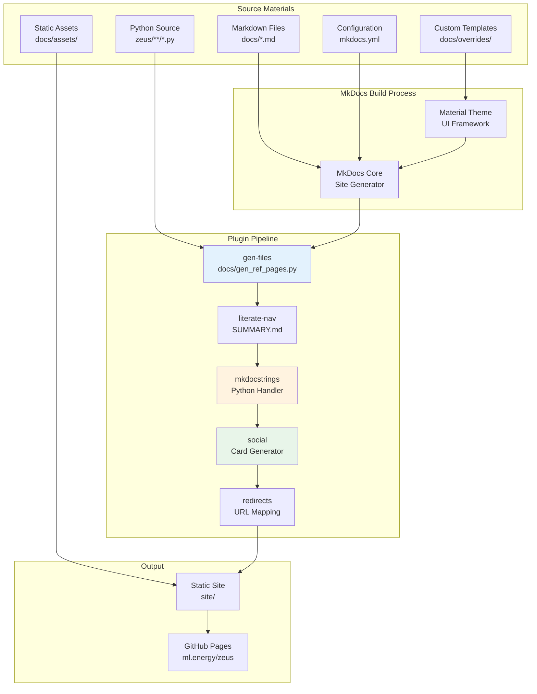
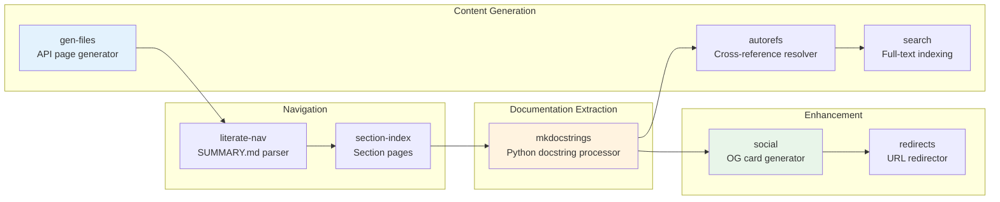
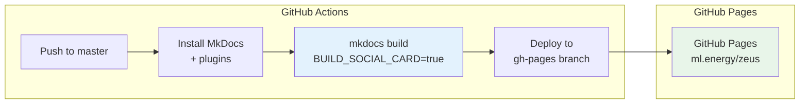

<!-- source: DeepWiki mcp.deepwiki.com · repo ml-energy/zeus · page 10.5 Documentation System · fetched 2026-10-21 -->

# Documentation System

<details>
<summary>Relevant source files</summary>

The following files were used as context for generating this wiki page:

- [docs/assets/img/og_image.png](docs/assets/img/og_image.png)
- [docs/overrides/main.html](docs/overrides/main.html)
- [mkdocs.yml](mkdocs.yml)

</details>


## Purpose and Scope

This document describes the Zeus documentation infrastructure built on MkDocs Material. It covers the static site generator configuration, plugin ecosystem, API reference generation, and deployment pipeline. For information about the CI/CD workflows that build and deploy the documentation, see [CI/CD Pipeline](#10.4). For the overall project structure including the `docs/` directory layout, see [Project Structure](#10.1).

---

## Documentation Build Architecture

The Zeus documentation system transforms source code and markdown files into a static website hosted at `https://ml.energy/zeus`. The build process is orchestrated by MkDocs with multiple plugins that generate, transform, and enhance content.



**Sources:** [mkdocs.yml:1-139]()

---

## Core Configuration Structure

The documentation system is configured through `mkdocs.yml`, which defines site metadata, theme settings, plugins, and navigation structure.

### Site Metadata

| Property | Value | Purpose |
|----------|-------|---------|
| `site_name` | Zeus Project | Browser title and header |
| `site_url` | https://ml.energy/zeus | Canonical URL for SEO |
| `repo_name` | ml-energy/zeus | GitHub repository link |
| `repo_url` | https://github.com/ml-energy/zeus | Repository URL |
| `edit_uri` | "" | Disables "Edit on GitHub" links |

**Sources:** [mkdocs.yml:1-10]()

### Theme Configuration

The Material theme is configured with custom features and styling:

```yaml
theme:
  name: material
  custom_dir: docs/overrides
  logo: assets/img/logo.svg
  favicon: assets/img/favicon.svg
  features:
    - content.code.copy
    - search.suggest
    - navigation.tabs
    - navigation.tabs.sticky
    - navigation.top
    - content.tooltips
    - announce.dismiss
  palette:
    - scheme: slate
      primary: zeus
      accent: zeus
```

The `custom_dir` points to [docs/overrides/](), which contains template overrides including a custom announcement banner in [docs/overrides/main.html:1-8]().

**Sources:** [mkdocs.yml:15-35]()

---

## Plugin Ecosystem

The documentation build process uses six plugins that execute in sequence. Each plugin transforms or generates content at different stages of the build.



### gen-files: API Reference Generation

The `gen-files` plugin executes [docs/gen_ref_pages.py]() to automatically generate API reference pages from Python source code. This script discovers all modules in the `zeus/` package and creates corresponding markdown files.

**Configuration:**
```yaml
plugins:
  - gen-files:
      scripts:
        - docs/gen_ref_pages.py
```

**Sources:** [mkdocs.yml:46-48]()

### literate-nav: Navigation from Markdown

The `literate-nav` plugin generates the navigation structure from a markdown file (`SUMMARY.md`) rather than requiring explicit YAML configuration. This is generated by the `gen-files` script.

**Configuration:**
```yaml
plugins:
  - literate-nav:
      nav_file: SUMMARY.md
```

**Sources:** [mkdocs.yml:49-50]()

### mkdocstrings: Python API Documentation

The `mkdocstrings` plugin extracts docstrings from Python code and renders them as formatted documentation. It supports cross-referencing to external projects like PyTorch and HuggingFace.

**Configuration:**
```yaml
plugins:
  - mkdocstrings:
      handlers:
        python:
          import:
            - https://pytorch.org/docs/stable/objects.inv
            - https://huggingface.co/docs/transformers/master/en/objects.inv
            - https://huggingface.co/docs/trl/main/en/objects.inv
          options:
            show_root_heading: true
            members_order: "source"
            filters: ["!Test"]
            separate_signature: true
            docstring_options:
              ignore_init_summary: true
```

The `import` section enables cross-references to external documentation. The `filters: ["!Test"]` excludes test classes from documentation.

**Sources:** [mkdocs.yml:52-66]()

### social: Social Card Generation

The `social` plugin generates Open Graph preview images for sharing on social media. It creates cards with custom branding using the specified layout options.

**Configuration:**
```yaml
plugins:
  - social:
      enabled: !ENV [BUILD_SOCIAL_CARD, false]
      cards_dir: assets/img/social
      cards_layout_options:
        background_color: "#f7e96d"
        color: "#231f20"
```

The `enabled` flag uses an environment variable to control generation (disabled by default for faster local builds).

**Sources:** [mkdocs.yml:40-45]()

### redirects: URL Management

The `redirects` plugin creates redirect rules for moved or renamed pages, maintaining backward compatibility with old URLs.

**Configuration:**
```yaml
plugins:
  - redirects:
      redirect_maps:
        'perseus/index.md': 'research_overview/perseus.md'
```

**Sources:** [mkdocs.yml:66-68]()

---

## Markdown Extensions

Zeus documentation uses numerous markdown extensions to enhance content formatting and presentation.

### Code and Syntax

| Extension | Purpose |
|-----------|---------|
| `pymdownx.superfences` | Fenced code blocks with custom fences for mermaid diagrams |
| `pymdownx.snippets` | Include external code snippets |
| `pymdownx.details` | Collapsible content blocks |
| `attr_list` | Add attributes to HTML elements |

### Mathematics

The `pymdownx.arithmatex` extension enables LaTeX math rendering using MathJax:

```yaml
markdown_extensions:
  - pymdownx.arithmatex:
      generic: true

extra_javascript:
  - assets/js/mathjax.js
  - https://polyfill.io/v3/polyfill.min.js?features=es6
  - https://cdn.jsdelivr.net/npm/mathjax@3/es5/tex-mml-chtml.js
```

**Sources:** [mkdocs.yml:71-102]()

### Mermaid Diagrams

Custom fence configuration enables mermaid diagram rendering:

```yaml
markdown_extensions:
  - pymdownx.superfences:
      custom_fences:
        - name: mermaid
          class: mermaid
          format: !!python/name:pymdownx.superfences.fence_code_format
```

**Sources:** [mkdocs.yml:87-91]()

---

## Navigation Structure

The navigation is defined in the `nav` section of the configuration file, organizing content into logical sections:

```yaml
nav:
  - Zeus: index.md
  - Getting Started: getting_started/index.md
  - Measuring Energy: measure/index.md
  - Optimizing Energy:
    - optimize/index.md
    - Power Limit Optimizer: optimize/power_limit_optimizer.md
    - Batch Size Optimizer: optimize/batch_size_optimizer.md
    - Pipeline Frequency Optimizer: optimize/pipeline_frequency_optimizer.md
  - Research Overview: 
    - research_overview/index.md
    - Zeus: research_overview/zeus.md
    - Perseus: research_overview/perseus.md
  - Source Code Reference: reference/
```

The `reference/` section is automatically populated by the `gen-files` and `literate-nav` plugins.

**Sources:** [mkdocs.yml:105-119]()

---

## Custom Styling and Assets

### CSS Customization

Two custom CSS files provide additional styling:

- `assets/css/custom.css`: General style overrides
- `assets/css/color.css`: Color scheme customization for the "zeus" palette

**Sources:** [mkdocs.yml:94-96]()

### Template Overrides

The [docs/overrides/main.html]() file extends the base Material theme template to add a custom announcement banner promoting the Zeus Slack workspace:

```html



Join the Zeus 
<span class="twemoji"><!-- SVG icon --></span>
<a href="https://join.slack.com/t/zeus-ml/shared_invite/...">Slack workspace</a>
to reach out to us!

```

**Sources:** [docs/overrides/main.html:1-8]()

### Social Media Integration

The `extra` section configures social media links and analytics:

```yaml
extra:
  analytics:
    provider: !ENV SITE_ANALYTICS
    property: G-T3W21TQ7FJ
  social:
    - name: Zeus GitHub repository
      icon: fontawesome/brands/github
      link: https://github.com/ml-energy/zeus
    - name: Zeus Docker Hub registry
      icon: fontawesome/brands/docker
      link: https://hub.docker.com/r/mlenergy/zeus
    - name: Zeus Slack workspace
      icon: fontawesome/brands/slack
      link: https://join.slack.com/t/zeus-ml/shared_invite/...
```

**Sources:** [mkdocs.yml:125-139]()

---

## Build and Deployment Process

### Local Development

To build the documentation locally:

```bash
# Install dependencies
pip install mkdocs-material mkdocstrings[python] ...

# Serve with live reload
mkdocs serve

# Build static site
mkdocs build
```

The built site is generated in the `site/` directory.

### GitHub Pages Deployment

The documentation is automatically deployed to GitHub Pages when changes are pushed to the master branch. The CI/CD workflow (see [CI/CD Pipeline](#10.4)) executes:

1. Install MkDocs and plugins
2. Run `mkdocs build` with `BUILD_SOCIAL_CARD=true` for production builds
3. Deploy `site/` directory to the `gh-pages` branch
4. GitHub Pages serves the content at `https://ml.energy/zeus`



**Sources:** Based on [mkdocs.yml:1-139]() and Diagram 6 from high-level architecture

---

## File and Directory Structure

The documentation system uses the following file organization:

| Path | Purpose |
|------|---------|
| `mkdocs.yml` | Main configuration file |
| `docs/` | Documentation source files |
| `docs/overrides/` | Custom theme templates |
| `docs/assets/` | Static assets (images, CSS, JS) |
| `docs/gen_ref_pages.py` | API reference generator script |
| `site/` | Generated static site (git-ignored) |

### Excluded Files

The `exclude_docs` directive prevents certain files from being processed:

```yaml
exclude_docs: |
  gen_ref_pages.py
```

This ensures the generator script itself doesn't appear in the documentation.

**Sources:** [mkdocs.yml:121-122]()

---

## Key Configuration Patterns

### Environment-Based Settings

Several settings use environment variables for flexible configuration:

```yaml
# Analytics (optional)
analytics:
  provider: !ENV SITE_ANALYTICS
  
# Social card generation (disabled for local builds)
social:
  enabled: !ENV [BUILD_SOCIAL_CARD, false]
```

This allows different behavior in development vs. production environments without modifying the configuration file.

**Sources:** [mkdocs.yml:40-45](), [mkdocs.yml:126-128]()

### External Documentation Cross-References

The `mkdocstrings` configuration imports object inventories from external projects, enabling links like `torch.Tensor` or `transformers.Trainer` to resolve to external documentation:

```yaml
mkdocstrings:
  handlers:
    python:
      import:
        - https://pytorch.org/docs/stable/objects.inv
        - https://huggingface.co/docs/transformers/master/en/objects.inv
        - https://huggingface.co/docs/trl/main/en/objects.inv
```

**Sources:** [mkdocs.yml:55-58]()

---

## Summary

The Zeus documentation system leverages MkDocs Material with a plugin-driven architecture to:

1. **Generate API references** automatically from Python source code
2. **Render docstrings** with cross-references to external libraries
3. **Create social media cards** for better sharing
4. **Support advanced markdown** including math equations and diagrams
5. **Deploy automatically** to GitHub Pages on every push

This infrastructure ensures comprehensive, maintainable documentation that stays synchronized with the codebase.

---

