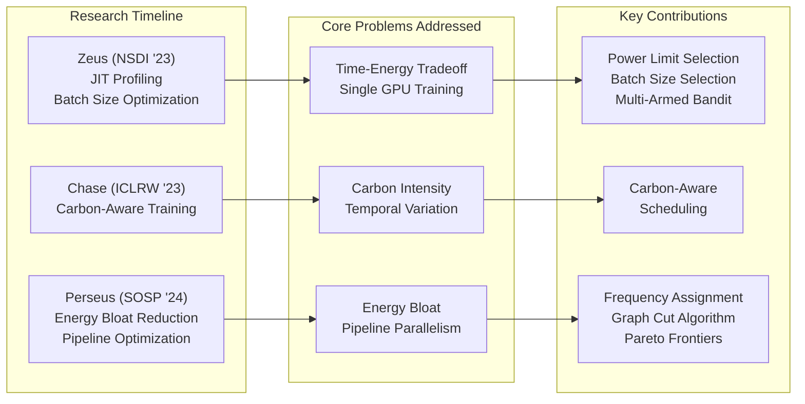
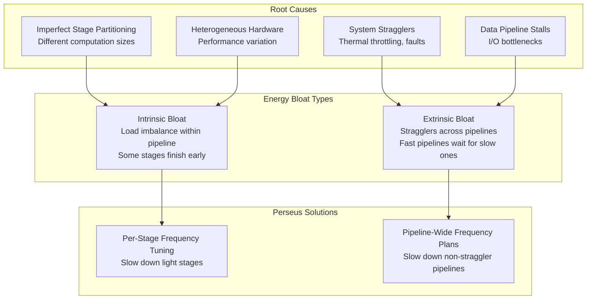
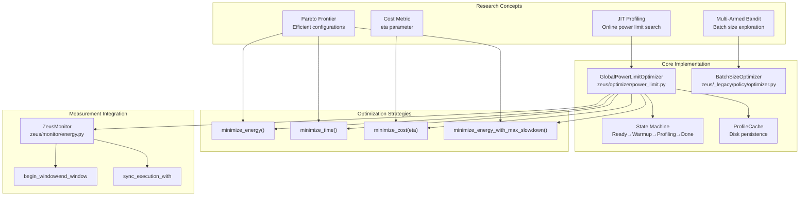
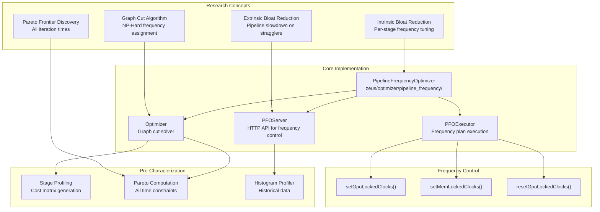
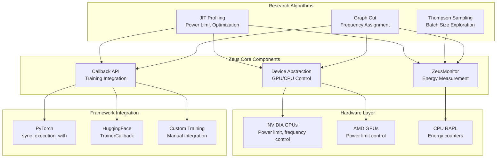

<!-- source: DeepWiki mcp.deepwiki.com · repo ml-energy/zeus · page 11 Research Background · fetched 2026-10-21 -->

# Research Background

Relevant source files

The following files were used as context for generating this wiki page:

- [docs/research_overview/index.md](docs/research_overview/index.md)
- [docs/research_overview/perseus.md](docs/research_overview/perseus.md)
- [docs/research_overview/zeus.md](docs/research_overview/zeus.md)

## Purpose and Scope

This document provides an overview of the academic research that forms the foundation of the Zeus framework. Zeus is built on multiple peer-reviewed publications that introduced novel techniques for optimizing energy consumption in deep learning training. Understanding these research contributions is essential for comprehending the design decisions and optimization strategies implemented in the codebase.

For detailed implementation guides on the optimization techniques, see [Energy Optimization](#5). For information on energy measurement capabilities, see [Energy Measurement](#4).

**Sources:** docs/research_overview/index.md, docs/research_overview/zeus.md, docs/research_overview/perseus.md

---

## Research Evolution and Timeline

Zeus emerged from a sequence of research papers that progressively addressed different aspects of energy efficiency in deep learning training. The framework implements techniques from multiple publications, each contributing distinct optimization strategies.

**Sources:** docs/research_overview/index.md:1-9, docs/research_overview/zeus.md:1-12, docs/research_overview/perseus.md:1-12

---

## Zeus (NSDI '23): Foundational Concepts

The original Zeus paper established the fundamental observation that DNN training exhibits a **time-energy tradeoff** when varying two key knobs: GPU power limit and batch size. This research introduced the concept of navigating the Pareto frontier of (time, energy) configurations to find optimal training parameters.

### Key Research Findings

| Finding | Description | Implementation Impact |
|---------|-------------|----------------------|
| **Energy Inefficiency** | Default training configurations waste 30-50% energy | Motivates automatic optimization |
| **Time-Energy Tradeoff** | Reducing energy often increases training time | User-defined cost metric $\eta$ |
| **Recurring Jobs** | Production training jobs recur frequently | Enables online profiling across runs |
| **GPU Power Limit** | Capping power reduces energy with minimal time impact | JIT profiling of power limits |
| **Batch Size Impact** | Larger batches are more energy-efficient up to a point | Multi-armed bandit exploration |

### Cost Metric Definition

Zeus introduced a parameterized cost function to quantify the time-energy tradeoff:

$$
\text{Cost} = \eta \cdot \text{Energy} + (1 - \eta) \cdot \text{MaxPower} \cdot \text{Time}
$$

where $\eta \in [0, 1]$ represents user preference: $\eta = 0$ minimizes time, $\eta = 1$ minimizes energy, and intermediate values balance both objectives.

**Sources:** docs/research_overview/zeus.md:27-98

---

## Perseus (SOSP '24): Energy Bloat Taxonomy

Perseus extended Zeus to address energy inefficiency in large-scale pipeline-parallel training. The paper identified two independent sources of **energy bloat**—wasted energy that does not contribute to training throughput—and proposed techniques to eliminate both.

### Energy Bloat Categories

### Pareto Frontier Characterization

Perseus pre-computes the **iteration time-energy Pareto frontier** for pipeline training by solving a graph cut optimization problem. Each point on the frontier represents a GPU frequency plan (per-stage frequency assignments) that minimizes energy for a given iteration time constraint.

**Sources:** docs/research_overview/perseus.md:44-86

---

## Research Concepts Mapped to Code Entities

The following diagrams map research concepts to their concrete implementations in the Zeus codebase.

### Zeus (NSDI '23) Implementation Map

**Key Files:**
- `zeus/optimizer/power_limit.py`: `GlobalPowerLimitOptimizer` implements JIT profiling algorithm from Zeus paper
- `zeus/_legacy/policy/optimizer.py`: `BatchSizeOptimizer` base class and Thompson Sampling implementation
- `zeus/monitor/energy.py`: `ZeusMonitor` provides energy measurement for optimization
- `zeus/optimizer/power_limit.py:100-150`: State machine transitions (Ready → Warmup → Profiling → Done)

**Sources:** docs/research_overview/zeus.md:100-122, zeus/optimizer/power_limit.py (implied from diagram context)

### Perseus (SOSP '24) Implementation Map

**Key Files:**
- `zeus/optimizer/pipeline_frequency/`: Root directory for Perseus implementation
- `zeus/optimizer/pipeline_frequency/server/`: PFO server for distributed frequency control
- `zeus/optimizer/pipeline_frequency/optimizer.py`: Graph cut algorithm implementation
- `zeus/optimizer/pipeline_frequency/common.py`: Frequency plan data structures
- `zeus/device/gpu/nvidia.py`: GPU frequency control methods (`setGpuLockedClocks`, `setMemLockedClocks`)

**Sources:** docs/research_overview/perseus.md:62-89

---

## Optimization Algorithm Summary

The table below summarizes the key algorithms from the research papers and their implementation status in Zeus.

| Algorithm | Paper | Purpose | Implementation | Complexity |
|-----------|-------|---------|----------------|------------|
| **JIT Profiling** | Zeus (NSDI '23) | Find optimal power limit via online measurement | `GlobalPowerLimitOptimizer` | O(k) iterations, k power limits |
| **Thompson Sampling** | Zeus (NSDI '23) | Multi-armed bandit for batch size exploration | `ZeusBatchSizeOptimizer` | O(log T) regret over T rounds |
| **Graph Cut** | Perseus (SOSP '24) | Assign frequencies to pipeline stages | `Optimizer.optimize()` | Approximate solution, NP-Hard |
| **Pareto Discovery** | Perseus (SOSP '24) | Enumerate all efficient time-energy pairs | `Optimizer.optimize_all()` | O(T × S × F²), T times, S stages, F frequencies |
| **Wraparound Tracking** | Implementation detail | Handle RAPL counter overflow | `RAPLCPUs` | Background polling process |

**Sources:** docs/research_overview/zeus.md:100-141, docs/research_overview/perseus.md:62-86

---

## Research Reproducibility

Both research papers provide mechanisms for reproducibility and extension within the Zeus codebase.

### Zeus Simulator

The Zeus paper includes a trace-driven simulator that allows researchers to evaluate custom optimization policies without access to physical GPUs. The simulator operates on pre-collected training traces from 6 DNNs across 4 GPU architectures.

**Abstract Interfaces:**
- `zeus._legacy.policy.BatchSizeOptimizer`: Base class for batch size optimization policies
- `zeus._legacy.policy.PowerLimitOptimizer`: Base class for power limit optimization policies
- `zeus._legacy.simulate.Simulator`: Trace-driven simulation engine

**Location:** `examples/research_reproducibility/zeus_nsdi23/`

### Perseus Integration

Perseus is implemented as the `PipelineFrequencyOptimizer` and is in active development. The implementation includes:

- Graph cut-based frequency optimizer
- HTTP server for distributed control
- Stage profiling and cost matrix generation
- Pareto frontier computation

**Location:** `zeus/optimizer/pipeline_frequency/`

**Sources:** docs/research_overview/zeus.md:126-141, docs/research_overview/perseus.md:87-91

---

## Integration with Zeus Architecture

The research contributions integrate with Zeus's broader architecture through well-defined interfaces:

**Key Integration Points:**
- **Measurement:** All optimizers use `ZeusMonitor` for energy measurement with framework synchronization
- **Control:** Optimizers modify GPU state through the device abstraction layer
- **Training Loop:** Callback API provides hooks for `on_step_begin()` and `on_step_end()` events
- **State Persistence:** Profile caches persist measurements to disk for recurring jobs

**Sources:** Derived from overall system architecture

---

## Research Metrics and Evaluation

The research papers introduced specific metrics for evaluating energy optimization, which are reflected in Zeus's measurement and optimization APIs.

### Zeus Metrics

| Metric | Definition | Purpose |
|--------|------------|---------|
| **TTA** | Time To Accuracy | Training time to reach target validation metric |
| **ETA** | Energy To Accuracy | Energy consumed to reach target validation metric |
| **Cost** | $\eta \cdot \text{Energy} + (1-\eta) \cdot \text{MaxPower} \cdot \text{Time}$ | User-defined tradeoff metric |
| **Normalized Cost** | Cost relative to baseline configuration | Quantify improvement percentage |

### Perseus Metrics

| Metric | Definition | Purpose |
|--------|------------|---------|
| **Iteration Time** | End-to-end pipeline execution time | Performance constraint |
| **Iteration Energy** | Total energy for one pipeline iteration | Optimization objective |
| **Energy Bloat** | Wasted energy not contributing to throughput | Quantify inefficiency |
| **Slowdown** | Relative increase in iteration time | Constraint for optimization |

**Sources:** docs/research_overview/zeus.md:117, docs/research_overview/perseus.md:20-24

---

## Future Research Directions

The Zeus framework continues to evolve with ongoing research. Current areas of development include:

1. **Carbon-Aware Training**: Integrating temporal carbon intensity variation (Chase, ICLRW '23)
2. **Multi-Objective Optimization**: Joint optimization of energy, time, and carbon
3. **Distributed Training**: Extending Perseus to fully-sharded data parallelism
4. **Automated Pipeline Partitioning**: Optimal pipeline stage assignment to minimize intrinsic bloat
5. **Hardware Heterogeneity**: Optimizing across mixed GPU generations and vendors

These research directions will continue to expand Zeus's capabilities and improve its energy optimization effectiveness.

**Sources:** docs/research_overview/index.md:1-9

---

