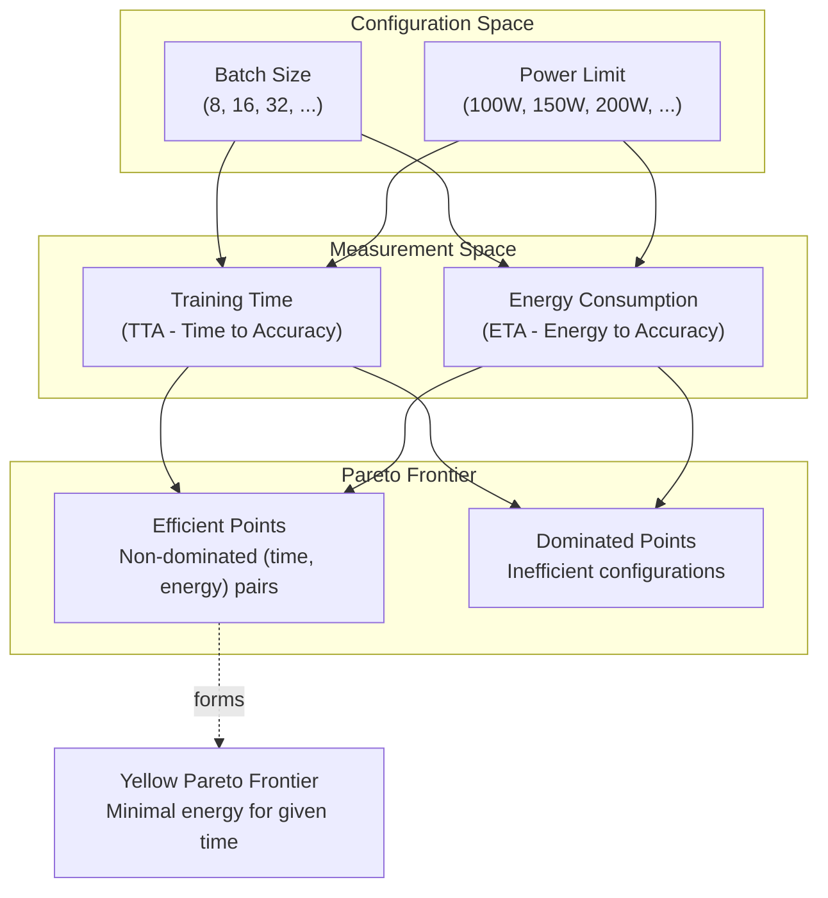
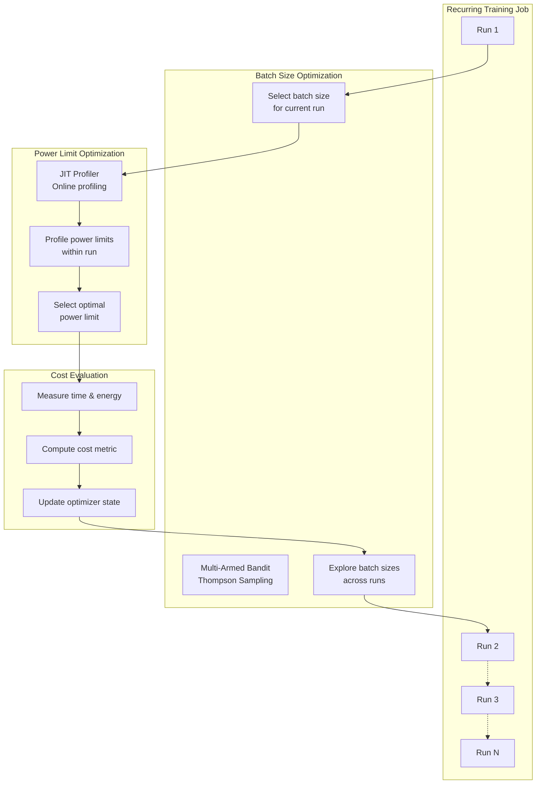
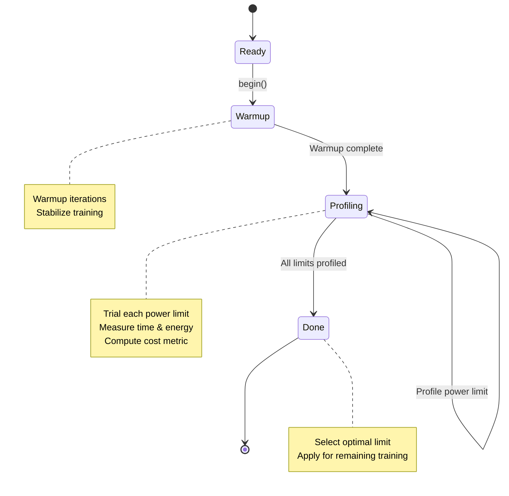
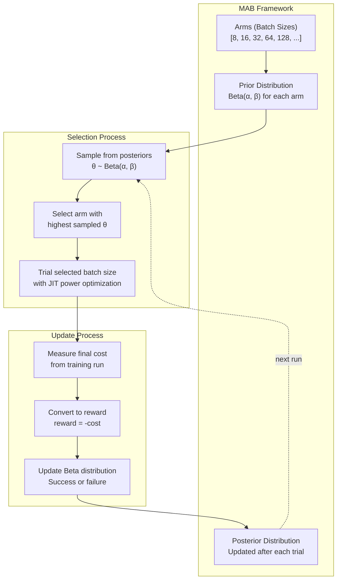
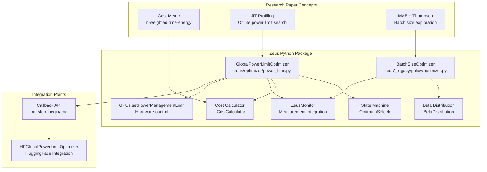
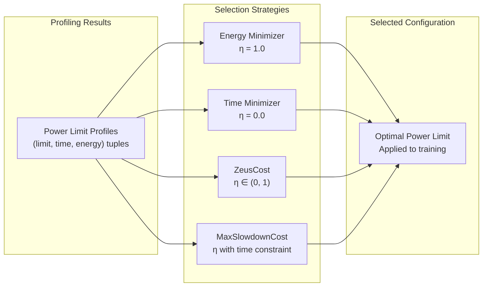
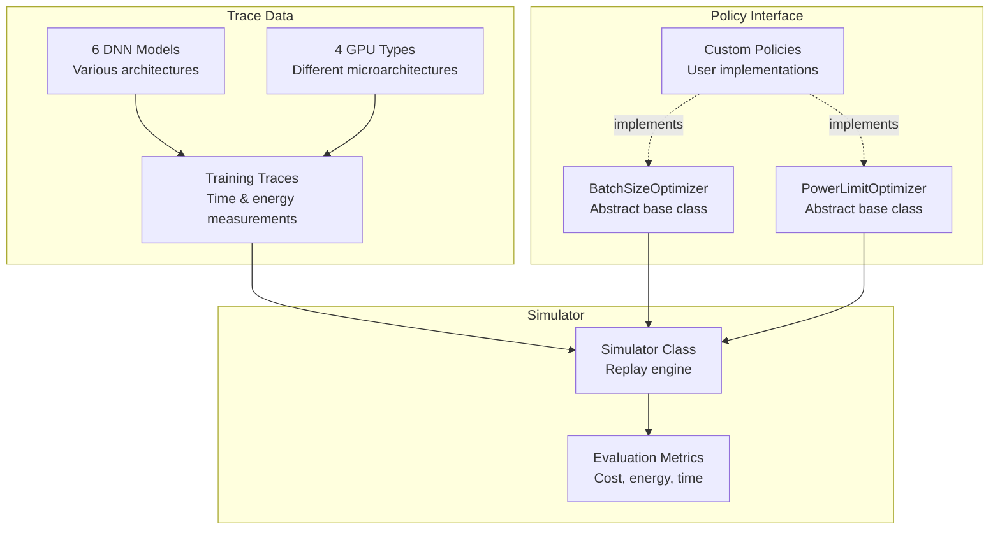

<!-- source: DeepWiki mcp.deepwiki.com · repo ml-energy/zeus · page 11.1 Zeus: Energy Optimization for DNN Training · fetched 2026-10-21 -->

# Zeus: Energy Optimization for DNN Training

Relevant source files

The following files were used as context for generating this wiki page:

- [docs/research_overview/index.md](docs/research_overview/index.md)
- [docs/research_overview/perseus.md](docs/research_overview/perseus.md)
- [docs/research_overview/zeus.md](docs/research_overview/zeus.md)

## Purpose and Scope

This page summarizes the Zeus research paper (NSDI '23) that forms the foundation of Zeus's energy optimization capabilities. The paper introduces the core concepts of time-energy tradeoffs in DNN training, the cost metric for navigating this tradeoff, and the two-level optimization approach for finding optimal batch sizes and GPU power limits.

For implementation details of the optimizers, see [Power Limit Optimizer](#5.1) and [Batch Size Optimizer](#5.3). For energy measurement methodology, see [Energy Measurement](#4). For the Perseus paper on reducing energy bloat in pipeline-parallel training, see [Perseus: Removing Energy Bloat](#11.2).

**Sources:** docs/research_overview/zeus.md:1-24, docs/research_overview/index.md:1-9

---

## Problem Statement: Energy in DNN Training

DNN training is increasingly resource- and energy-intensive. GPUs consume approximately 70% of server power during training, and at extreme scales, training GPT-3 once consumes 1,287 MWh. However, existing optimization techniques primarily target latency and throughput, often ignoring energy efficiency.

The Zeus paper argues that **energy should be considered as a third optimization dimension** alongside time and throughput.

**Key Observation:** Common practices in DNN training can lead to energy inefficiency. Training the same DNN with different batch sizes and GPU power limits reveals significant energy savings opportunities—choosing optimal configurations can reduce energy consumption substantially compared to default settings.

**Sources:** docs/research_overview/zeus.md:27-42

---

## Time-Energy Tradeoff

The central discovery of the Zeus paper is a **fundamental tradeoff between training time and energy consumption**. This tradeoff manifests through the configuration space of batch sizes and GPU power limits.

### Pareto Frontier of Configurations

**Sources:** docs/research_overview/zeus.md:56-82

### Configuration Impact

| Configuration | Impact on Time | Impact on Energy |
|--------------|----------------|------------------|
| Larger batch size | Generally faster (better GPU utilization) | Higher energy per iteration, but fewer iterations |
| Smaller batch size | Slower (more iterations needed) | Lower energy per iteration, but more iterations |
| Higher power limit | Faster GPU computation | Higher power draw |
| Lower power limit | Slower GPU computation | Lower power draw |

The optimal configuration depends on the user's preference for trading time versus energy.

**Sources:** docs/research_overview/zeus.md:43-82

---

## Cost Metric: Navigating the Tradeoff

To allow users to express their time-energy preference, Zeus defines a **cost metric**:

$$
\textrm{Cost} = \eta \cdot \textrm{Energy} + (1 - \eta) \cdot \textrm{MaxPower} \cdot \textrm{Time}
$$

where:
- **η** ∈ [0, 1]: User-defined tradeoff parameter
- **Energy**: Total energy consumed (Joules)
- **Time**: Training time (seconds)
- **MaxPower**: Maximum possible GPU power limit (Watts, a constant for unit normalization)

### Tradeoff Parameter Interpretation

| η value | Optimization Goal | Use Case |
|---------|------------------|----------|
| η → 0 | Minimize time (maximize performance) | Production jobs with tight deadlines |
| η = 0.5 | Balance time and energy | General training workloads |
| η → 1 | Minimize energy (maximize efficiency) | Exploratory jobs, research experiments |

**Sources:** docs/research_overview/zeus.md:84-98

---

## Two-Level Optimization Approach

Zeus addresses the challenge of finding optimal (batch size, power limit) configurations without exhaustive profiling, which would be prohibitively expensive. The key insight is that **DNN training jobs often recur** in production GPU clusters, allowing optimization across job recurrences.

The optimization consists of two levels:

1. **Batch Size Level**: Optimized across recurring runs using Multi-Armed Bandit (MAB) with Thompson Sampling
2. **Power Limit Level**: Optimized within each run using Just-In-Time (JIT) profiling

**Sources:** docs/research_overview/zeus.md:100-112

---

## Power Limit Optimization: JIT Profiling

The JIT profiler finds the optimal GPU power limit for a given batch size through online profiling during the training run. This avoids the need for expensive offline profiling.

### JIT Profiling Process

### State Machine Transitions

1. **Ready**: Optimizer initialized with configuration
2. **Warmup**: Run warmup iterations to stabilize training dynamics
3. **Profiling**: Trial each power limit from the exploration space
   - Measure training time and energy consumption
   - Compute cost using the user's η parameter
   - Track results for each power limit
4. **Done**: Select power limit with minimum cost and apply for remainder of training

### Implementation Mapping

| Research Concept | Zeus Implementation |
|-----------------|---------------------|
| JIT Profiler | `GlobalPowerLimitOptimizer` class |
| State Machine | `_OptimumSelector.state` attribute |
| Cost Computation | `_CostCalculator.compute()` method |
| Power Limit Control | `GPUs.setPowerManagementLimit()` |
| Profile Persistence | Disk-based profile cache |

**Sources:** docs/research_overview/zeus.md:110-111

---

## Batch Size Optimization: Multi-Armed Bandit

Batch size optimization occurs across multiple recurring training runs. Zeus models this as a Multi-Armed Bandit (MAB) problem where each "arm" represents a batch size, and the "reward" is the negative cost metric.

### Thompson Sampling Algorithm

### Thompson Sampling Mechanics

1. **Initialization**: Each batch size arm starts with a Beta(1, 1) prior distribution
2. **Sampling**: For each run, sample a value θ from each arm's Beta distribution
3. **Selection**: Select the batch size with the highest sampled θ value
4. **Trial**: Train with selected batch size, using JIT profiling for power limit
5. **Update**: Based on cost relative to best-seen cost, update the Beta distribution:
   - Success: Increment α (reward parameter)
   - Failure: Increment β (penalty parameter)

### Convergence Properties

Thompson Sampling provides:
- **Exploration**: Maintains uncertainty about suboptimal arms
- **Exploitation**: Increasingly selects arms with good historical performance
- **Regret Bounds**: Logarithmic regret guarantees for convergence to optimal arm

**Sources:** docs/research_overview/zeus.md:110-112

---

## Implementation in Zeus

The research concepts are directly implemented in Zeus's optimizer components:

### Code Entity Mapping

| Research Component | File Path | Key Classes/Functions |
|-------------------|-----------|----------------------|
| Global Power Limit Optimizer | `zeus/optimizer/power_limit.py` | `GlobalPowerLimitOptimizer` |
| Optimum Selection | `zeus/optimizer/power_limit.py` | `_OptimumSelector`, `_CostCalculator` |
| Batch Size Optimizer | `zeus/_legacy/policy/optimizer.py` | `BatchSizeOptimizer` (legacy) |
| Thompson Sampling | `zeus/_legacy/policy/optimizer.py` | `BetaDistribution` |
| Power Limit Control | `zeus/device/gpu/nvidia.py`, `zeus/device/gpu/amd.py` | `setPowerManagementLimit()` |
| Energy Measurement | `zeus/monitor/energy.py` | `ZeusMonitor` |

**Sources:** docs/research_overview/zeus.md:1-142

---

## Optimum Selection Strategies

Zeus implements multiple strategies for selecting the optimal power limit from the Pareto frontier, corresponding to different values or interpretations of the cost metric:

### Strategy Descriptions

| Strategy | Formula | Use Case |
|----------|---------|----------|
| `MinEnergy` | argmin(energy) | Minimize energy regardless of time impact |
| `MinTime` | argmin(time) | Minimize time regardless of energy impact |
| `ZeusCost` | argmin(η·E + (1-η)·P_max·T) | Balance time and energy with η parameter |
| `MaxSlowdownCost` | argmin(η·E + (1-η)·P_max·T) subject to time ≤ (1+β)·T_min | Energy optimization with bounded slowdown |

**Sources:** docs/research_overview/zeus.md:84-98

---

## Research Reproducibility

The Zeus paper includes a trace-driven simulator for reproducibility and experimentation. The simulator allows researchers to implement custom optimization policies and evaluate them against prerecorded training traces.

### Simulator Architecture

### Abstract Interfaces

The simulator defines two abstract classes:

- **`BatchSizeOptimizer`**: Interface for batch size optimization policies
  - Located in `zeus._legacy.policy.interface`
  - Method: `predict()` - selects batch size for current run
  
- **`PowerLimitOptimizer`**: Interface for power limit optimization policies  
  - Located in `zeus._legacy.policy.interface`
  - Method: `predict()` - selects power limit given batch size

### Extending the Simulator

Users can implement custom policies by:

1. Subclassing `BatchSizeOptimizer` and/or `PowerLimitOptimizer`
2. Implementing the `predict()` method with custom logic
3. Passing policy instances to the `Simulator` constructor
4. Running simulation with provided training traces

Example policies are available in `zeus._legacy.policy.optimizer`.

**Sources:** docs/research_overview/zeus.md:126-142

---

## Key Takeaways

1. **Energy as a First-Class Metric**: The Zeus paper establishes energy as an essential optimization dimension alongside time and throughput

2. **Time-Energy Tradeoff**: A fundamental tradeoff exists between training time and energy consumption, mediated by batch size and GPU power limit

3. **Cost Metric**: The η-weighted cost metric provides a principled way for users to express time-energy preferences

4. **Two-Level Optimization**: Batch size optimization occurs across runs (MAB), while power limit optimization occurs within runs (JIT profiling)

5. **Recurring Job Model**: Zeus exploits the recurrence of training jobs in production to amortize exploration cost

6. **Practical Implementation**: The research concepts are directly implemented in `GlobalPowerLimitOptimizer` and related components

**Sources:** docs/research_overview/zeus.md:1-142, docs/research_overview/index.md:1-9

---

