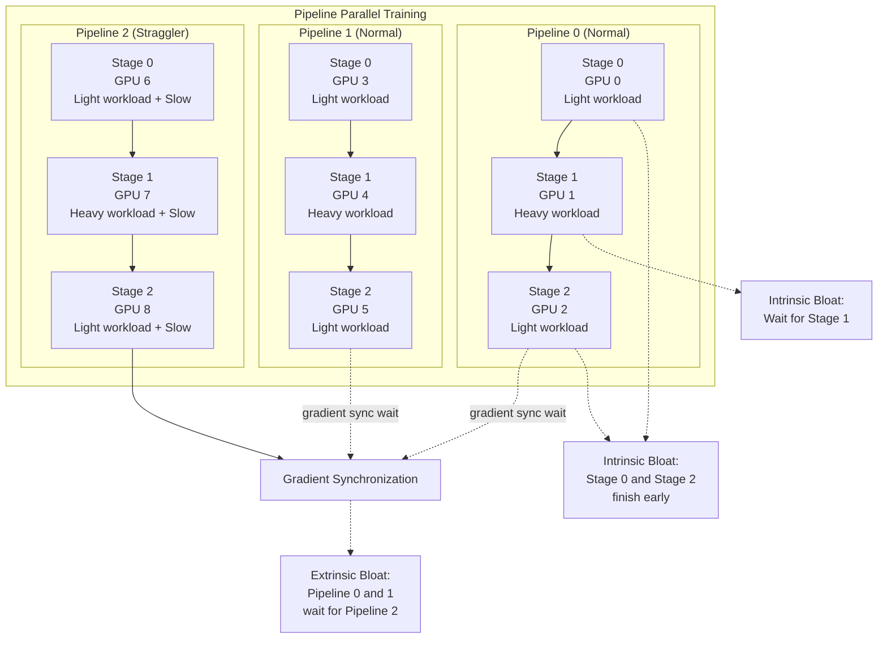
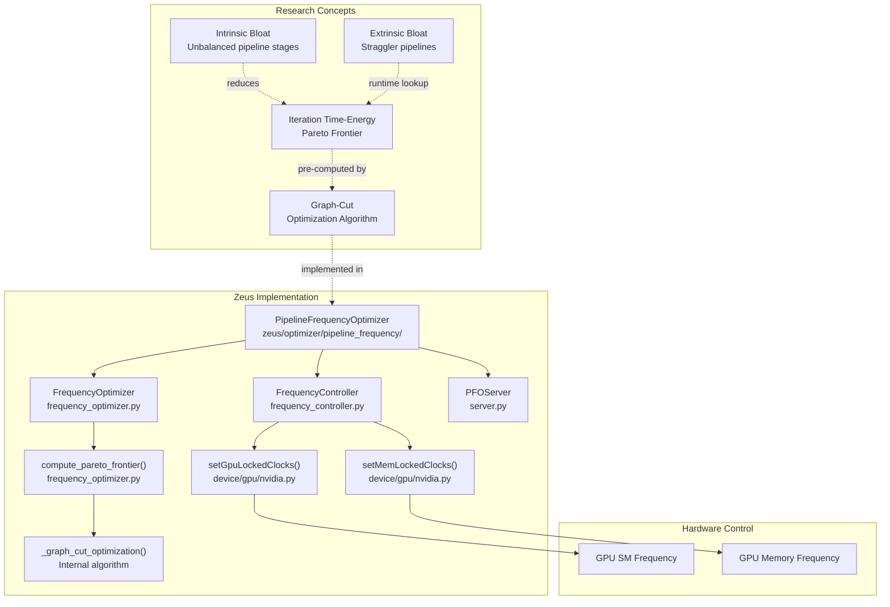
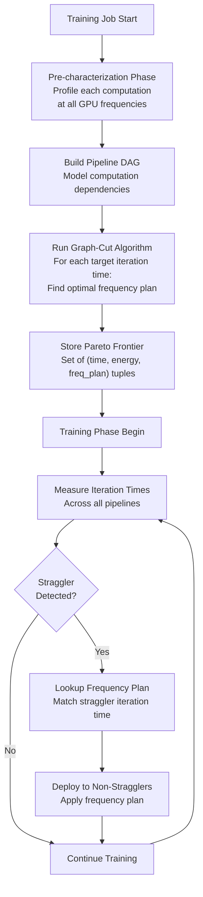

<!-- source: DeepWiki mcp.deepwiki.com · repo ml-energy/zeus · page 11.2 Perseus: Removing Energy Bloat · fetched 2026-10-21 -->

# Perseus: Removing Energy Bloat

Relevant source files

The following files were used as context for generating this wiki page:

- [docs/research_overview/index.md](docs/research_overview/index.md)
- [docs/research_overview/perseus.md](docs/research_overview/perseus.md)
- [docs/research_overview/zeus.md](docs/research_overview/zeus.md)

This document summarizes the research contributions of the Perseus paper (SOSP '24), which identifies and eliminates energy wastage in large-scale distributed model training. Perseus introduces the concept of **energy bloat** — energy consumed during training that does not contribute to end-to-end throughput — and presents a graph-cut based optimization algorithm to reduce it.

For the practical implementation of Perseus's techniques in Zeus, see [Pipeline Frequency Optimizer](#5.2). For the foundational Zeus research on time-energy tradeoffs, see [Zeus: Energy Optimization for DNN Training](#11.1).

---

## The Energy Bottleneck in Large-Scale Training

As model sizes grow exponentially, energy availability has become a primary constraint in datacenter capacity for AI workloads. Perseus addresses this by identifying that not all energy consumed during training directly contributes to training throughput. Energy consumed while GPUs wait for other GPUs to complete their work is wasted and can be eliminated through intelligent slowdowns.

The core insight is: **if a computation is running at an unnecessarily fast speed, it wastes energy**.

**Sources:** [docs/research_overview/perseus.md:29-42]()

---

## Energy Bloat Taxonomy

Perseus identifies two independent sources of energy bloat in distributed training pipelines:

### Intrinsic Bloat

**Definition:** Energy wasted when pipeline stages have imbalanced workloads.

In pipeline parallel training, model layers are distributed across multiple GPUs. However, workload cannot be perfectly balanced — some GPUs have more computation (larger layers, more parameters) and take longer to complete their assigned work. GPUs with lighter workloads finish early but must wait for the slowest GPU before proceeding to the next pipeline stage.

**Key observation:** Since pipeline throughput is bounded by the slowest stage, faster stages running at full speed waste energy without improving end-to-end iteration time.

### Extrinsic Bloat

**Definition:** Energy wasted when non-straggler pipelines run at full speed while waiting for straggler pipelines.

In large-scale training with thousands of GPUs, stragglers emerge due to:
- Hardware/software faults
- Thermal and power throttling
- Network congestion
- Data pipeline stalls

When gradient synchronization requires all data parallel replicas to complete, every pipeline must wait for the slowest (straggler) pipeline. Non-straggler pipelines running at full speed during this wait period waste energy.

**Sources:** [docs/research_overview/perseus.md:44-61]()

---

## Energy Bloat Manifestation

**Intrinsic bloat** occurs within each pipeline when stages with lighter workloads wait for heavier stages. **Extrinsic bloat** occurs across pipelines when faster pipelines wait for straggler pipelines at gradient synchronization barriers.

**Sources:** [docs/research_overview/perseus.md:49-61]()

---

## The Iteration Time-Energy Pareto Frontier

Perseus eliminates energy bloat by pre-computing the **iteration time-energy Pareto frontier** for the training pipeline. Each point on this frontier represents a GPU frequency assignment plan that:

1. Minimizes intrinsic bloat (optimal frequency assignment within the pipeline)
2. Achieves a specific target iteration time

### Characterization Process

| Step | Action | Purpose |
|------|--------|---------|
| 1 | Model pipeline as DAG | Represent computation dependencies |
| 2 | Profile each node at all frequencies | Measure time and energy for each computation at each GPU frequency |
| 3 | Run graph-cut algorithm | Find frequency assignments on Pareto frontier |
| 4 | Store frontier | Enable runtime lookup for extrinsic bloat reduction |

### Runtime Operation

When a straggler pipeline emerges:
1. Measure straggler pipeline's iteration time
2. Look up frequency plan on the Pareto frontier matching that iteration time
3. Deploy the plan to all non-straggler pipelines
4. Reduce extrinsic bloat while maintaining low intrinsic bloat

**Sources:** [docs/research_overview/perseus.md:62-74]()

---

## Graph-Cut Optimization Algorithm

### The Optimization Problem

Given a pipeline DAG where:
- Each node represents a computation (forward/backward pass of a layer)
- Each node can run at different GPU frequencies
- Each frequency choice has associated time and energy costs
- Edges represent data dependencies

**Objective:** Assign frequencies to minimize total energy while meeting an iteration time constraint.

**Classification:** NP-Hard (reduction from the 0-1 knapsack problem)

### Perseus's Approximation Algorithm

Perseus uses a graph-cut based algorithm that produces high-quality approximate solutions efficiently. The algorithm:

1. **Models the problem as min-cut:** Constructs a flow network where cuts correspond to frequency assignments
2. **Enforces time constraints:** Uses capacity constraints to ensure critical path timing requirements
3. **Minimizes energy:** Cut capacity represents energy consumption
4. **Iterates over time budgets:** Sweeps iteration time targets to construct the full Pareto frontier

The algorithm runs during a one-time pre-characterization phase, not during training.

**Sources:** [docs/research_overview/perseus.md:67-85]()

---

## Perseus Architecture in Zeus

**Sources:** [docs/research_overview/perseus.md:88-91]()

---

## Perseus Optimization Flow

### Phase Breakdown

| Phase | Duration | Description |
|-------|----------|-------------|
| **Pre-characterization** | One-time upfront | Profile all computations, build DAG, run graph-cut algorithm, store Pareto frontier |
| **Training - Normal** | Per iteration | All pipelines run at optimal (lowest intrinsic bloat) frequency plan |
| **Training - Straggler** | Per iteration | Non-straggler pipelines look up and deploy frequency plan matching straggler's time |

**Sources:** [docs/research_overview/perseus.md:62-85]()

---

## Energy Savings Results

Perseus achieves significant energy savings on large-scale training workloads:

| Model | Configuration | Energy Reduction | Throughput Impact |
|-------|---------------|------------------|-------------------|
| GPT-3 | 96 GPUs | Up to 30% | Minimal loss |
| Various | Pipeline parallelism | 15-30% | < 1% slowdown |

**Key result:** Energy reduction without hardware modification or significant throughput degradation.

The effectiveness comes from:
1. **Intrinsic bloat reduction:** Slowing down light stages without affecting pipeline throughput
2. **Extrinsic bloat reduction:** Slowing down all non-straggler pipelines to match straggler speed
3. **No hardware changes:** Uses existing GPU frequency control mechanisms

**Sources:** [docs/research_overview/perseus.md:24-25]()

---

## Implementation in Zeus

Perseus is implemented in Zeus as the **Pipeline Frequency Optimizer (PFO)**. The implementation provides:

### Core Components

| Component | Module | Purpose |
|-----------|--------|---------|
| `FrequencyOptimizer` | `zeus/optimizer/pipeline_frequency/frequency_optimizer.py` | Implements graph-cut algorithm and Pareto frontier computation |
| `FrequencyController` | `zeus/optimizer/pipeline_frequency/frequency_controller.py` | Controls GPU SM and memory frequencies via NVML |
| `PFOServer` | `zeus/optimizer/pipeline_frequency/server.py` | HTTP API for distributed frequency coordination |

### Integration Points

The PFO integrates with training pipelines through:
- **HTTP server:** Allows pipeline stages to query optimal frequencies
- **Distributed coordination:** Coordinates frequency changes across multiple nodes
- **NVML interface:** Uses `setGpuLockedClocks()` and `setMemLockedClocks()` for frequency control

For detailed implementation documentation, see [Pipeline Frequency Optimizer](#5.2).

**Sources:** [docs/research_overview/perseus.md:88-91]()

---

## Research Publication

**Perseus: Removing Energy Bloat from Large Model Training**  
SOSP '24

- [Paper](https://dl.acm.org/doi/10.1145/3694715.3695970)
- [ArXiv](https://arxiv.org/abs/2312.06902)

**Sources:** [docs/research_overview/perseus.md:1-12](), [docs/research_overview/index.md:8]()