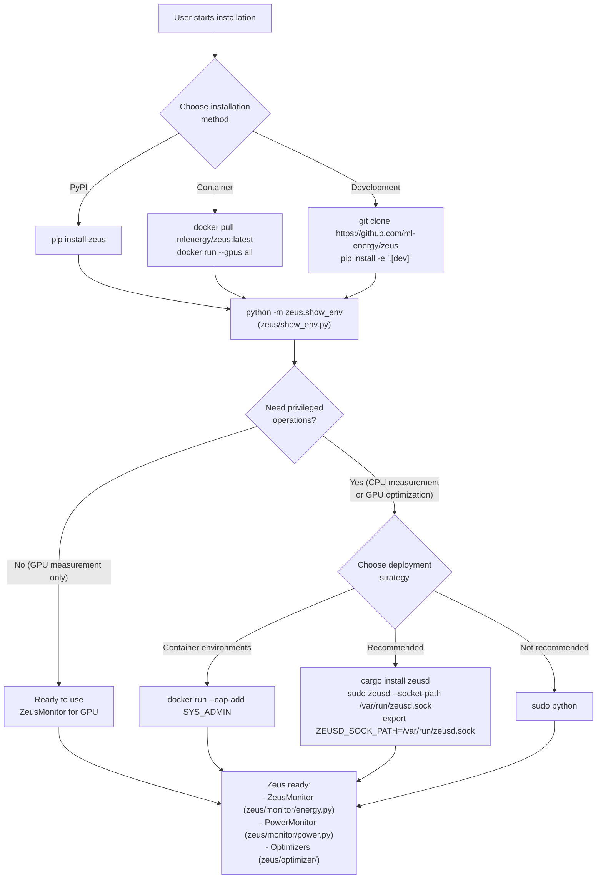
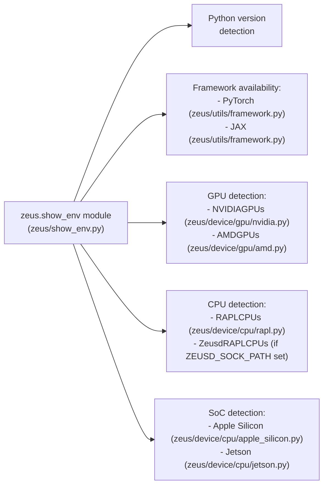
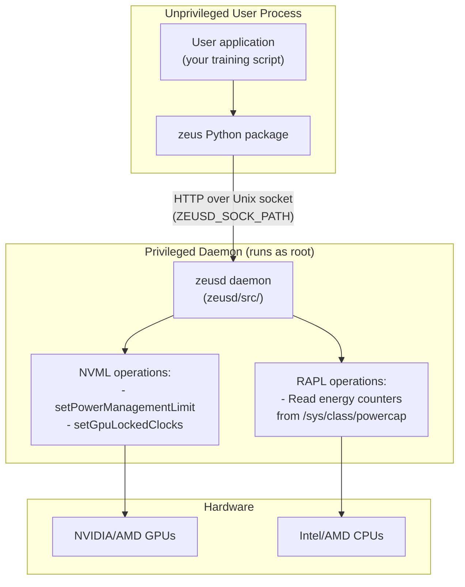

<!-- source: DeepWiki mcp.deepwiki.com · repo ml-energy/zeus · page 2 Getting Started · fetched 2026-10-21 -->

# Getting Started

<details>
<summary>Relevant source files</summary>

The following files were used as context for generating this wiki page:

- [.github/workflows/publish_pypi.yaml](.github/workflows/publish_pypi.yaml)
- [README.md](README.md)
- [docs/getting_started/index.md](docs/getting_started/index.md)
- [docs/index.md](docs/index.md)
- [zeus/monitor/__main__.py](zeus/monitor/__main__.py)

</details>


This page guides users through installing Zeus, verifying the installation, and understanding deployment strategies for privileged operations. After completing these steps, users can begin measuring energy (see [Energy Measurement](#4)) or optimizing energy consumption (see [Energy Optimization](#5)).

For detailed instructions on specific topics, see:
- [Installation Methods](#2.1) - Comprehensive installation options including pip, Docker, and source builds
- [Environment Verification](#2.2) - Using `zeus.show_env` to detect hardware and validate the installation
- [Deployment Strategies](#2.3) - Choosing between Docker, zeusd daemon, or sudo for privileged operations

## Zeus Components Overview

Zeus consists of two main components that users must understand during setup:

| Component | Language | Purpose | Installation Method | Privileges Required |
|-----------|----------|---------|---------------------|---------------------|
| **zeus** (Python package) | Python | Energy measurement and optimization APIs | pip, Docker, or source | None for GPU energy measurement |
| **zeusd** (Zeus daemon) | Rust | Privileged operations proxy (optional) | cargo or Docker | root or SYS_ADMIN |

The Python package (`zeus/`) contains all core functionality including monitors ([zeus/monitor/]()), optimizers ([zeus/optimizer/]()), and device abstractions ([zeus/device/]()). The Rust daemon (`zeusd/`) is optional but recommended for production deployments requiring CPU energy measurement or GPU configuration changes.

Sources: [README.md:29-48](), [docs/getting_started/index.md:1-7]()

## Installation and Setup Workflow

The following diagram shows the standard workflow for getting Zeus operational, mapping user actions to specific code modules and commands:



Sources: [docs/getting_started/index.md:6-28](), [docs/getting_started/index.md:131-199]()

## Installation Methods Summary

Zeus supports three primary installation methods, each suited for different use cases:

### pip Installation (Standard)

The simplest method installs the Zeus Python package from PyPI:

```sh
pip install zeus
```

This provides immediate access to the `zeus` module with all measurement and optimization functionality. After installation, the package is available at the standard Python site-packages location.

**Use case**: Production deployments, notebook environments, standard Python applications.

Sources: [docs/getting_started/index.md:8-14](), [.github/workflows/publish_pypi.yaml:1-26]()

### Docker Installation (Isolated)

Pre-built Docker images on Docker Hub include Zeus with all dependencies:

```sh
docker run -it \
    --gpus all \
    --cap-add SYS_ADMIN \
    --ipc host \
    -v /sys/class/powercap/intel-rapl:/zeus_sys/class/powercap/intel-rapl \
    mlenergy/zeus:latest \
    bash
```

The image is based on `nvidia/cuda:11.8.0-base-ubuntu22.04` with Miniconda, PyTorch, and a copy of the Zeus repository at `/workspace/zeus`.

**Use case**: Containerized deployments, reproducible environments, systems with complex dependency conflicts.

Sources: [docs/getting_started/index.md:27-84](), [README.md:58-61]()

### Source Installation (Development)

For development or customization, install from the GitHub repository:

```sh
git clone https://github.com/ml-energy/zeus.git
cd zeus
pip install -e '.[dev]'
```

The editable installation (`-e`) allows code changes to take effect immediately without reinstallation. The `[dev]` extra includes testing and linting dependencies.

**Use case**: Contributing to Zeus, customizing behavior, debugging issues.

Sources: [docs/getting_started/index.md:16-25]()

For comprehensive installation instructions including architecture-specific Docker builds and troubleshooting, see [Installation Methods](#2.1).

## Environment Verification

After installation, verify that Zeus correctly detects the Python environment, ML frameworks, and available hardware using the `zeus.show_env` module:

```sh
python -m zeus.show_env
```

This command executes [zeus/show_env.py]() which performs the following checks:



The output displays:
- Python version
- Zeus package version
- PyTorch and JAX availability and versions
- Detected GPUs with model names
- CPU RAPL interface availability and socket topology
- SoC platform detection (if applicable)

Example output for a system with NVIDIA GPUs and Intel RAPL CPUs is shown in [docs/getting_started/index.md:86-129](). For detailed interpretation of the output and troubleshooting detection issues, see [Environment Verification](#2.2).

Sources: [docs/getting_started/index.md:86-129](), [README.md:40]()

## Privilege Management Overview

Zeus requires elevated privileges for two specific operations:

| Operation | Required Privilege | Affected Components |
|-----------|-------------------|---------------------|
| CPU/DRAM energy measurement via RAPL | `root` | `RAPLCPUs` ([zeus/device/cpu/rapl.py]()) |
| GPU power limit / frequency changes | `SYS_ADMIN` or `root` | `GlobalPowerLimitOptimizer` ([zeus/optimizer/power_limit.py]()), `PipelineFrequencyOptimizer` ([zeus/optimizer/pipeline_frequency.py]()) |

**Note**: Modern NVIDIA GPUs (Volta and newer) allow unprivileged energy reading, so basic `ZeusMonitor` GPU measurement requires no special privileges.

The following table compares deployment strategies:

| Strategy | Privileges | Pros | Cons | Recommended For |
|----------|-----------|------|------|-----------------|
| **Docker with `--cap-add SYS_ADMIN`** | Container has `SYS_ADMIN` | Simple setup, works with Kubernetes | Grants broad capabilities to entire container | Containerized deployments |
| **zeusd daemon** | Daemon runs as `root`, app is unprivileged | Least-privilege design, minimal attack surface | Requires deploying separate service | Production systems |
| **sudo** | Application runs as `root` | No additional setup | Entire application runs with root privileges | Development only |

### Zeus Daemon Architecture

The recommended approach uses `zeusd`, a minimal Rust daemon that exposes a REST API over Unix domain sockets:



To deploy zeusd:

```sh
# Install zeusd from crates.io
cargo install zeusd

# Run daemon with root privileges
sudo zeusd --socket-path /var/run/zeusd.sock --socket-permissions 666

# Configure application to use daemon
export ZEUSD_SOCK_PATH=/var/run/zeusd.sock
```

The daemon listens on a Unix domain socket (default: `/var/run/zeusd.sock`) and applications communicate via HTTP requests. The `ZEUSD_SOCK_PATH` environment variable tells Zeus to use daemon-based implementations (`ZeusdNVIDIAGPUs`, `ZeusdRAPLCPUs`) instead of direct hardware access.

For comprehensive deployment instructions, security considerations, and API reference, see [Deployment Strategies](#2.3) and [Zeus Daemon](#7).

Sources: [docs/getting_started/index.md:131-199](), [README.md:43]()

## Verification Checklist

Before proceeding to measurement or optimization, verify the following:

1. **Python package installed**: `python -c "import zeus; print(zeus.__version__)"`
2. **Hardware detected**: `python -m zeus.show_env` shows expected GPUs and CPUs
3. **Privileges configured** (if needed):
   - For Docker: `--cap-add SYS_ADMIN` and RAPL mount present
   - For zeusd: Daemon running and `ZEUSD_SOCK_PATH` set
   - For sudo: User can run `sudo python`

## Quick Start Examples

After successful installation and verification, try these basic operations:

### Measure GPU Energy

```python
from zeus.monitor import ZeusMonitor

monitor = ZeusMonitor(gpu_indices=[0])
monitor.begin_window("training")

# Your training code here

measurement = monitor.end_window("training")
print(f"GPU energy: {measurement.total_energy} J")
```

This uses `ZeusMonitor` from [zeus/monitor/energy.py]() to measure energy consumption of GPU 0 during a training window.

### CLI Energy Measurement

```sh
# Start measurement, CTRL+C to stop
python -m zeus.monitor energy --gpu-indices 0 1
```

This invokes [zeus/monitor/__main__.py]() which provides CLI-based energy and power monitoring.

For comprehensive measurement APIs and optimization strategies, see [Energy Measurement](#4) and [Energy Optimization](#5).

Sources: [zeus/monitor/__main__.py:1-120](), [docs/getting_started/index.md:200-204]()

## Next Steps

After completing setup:

1. **Explore measurement capabilities**: See [Energy Measurement](#4) for `ZeusMonitor`, `PowerMonitor`, `CarbonEmissionMonitor`, and `EnergyCostMonitor`
2. **Learn optimization strategies**: See [Energy Optimization](#5) for `GlobalPowerLimitOptimizer`, `PipelineFrequencyOptimizer`, and `BatchSizeOptimizer`
3. **Understand hardware abstraction**: See [Hardware Abstraction Layer](#6) for multi-vendor GPU support, CPU RAPL, and SoC platforms
4. **Integrate with frameworks**: See [Framework Integration](#9) for PyTorch, HuggingFace, and custom callback implementations

Sources: [docs/index.md:28-36](), [README.md:50-56]()

---

