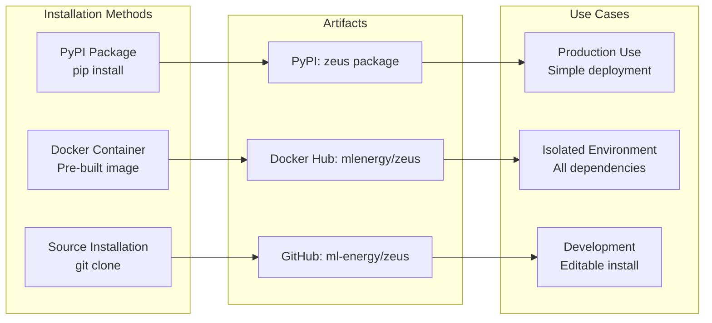
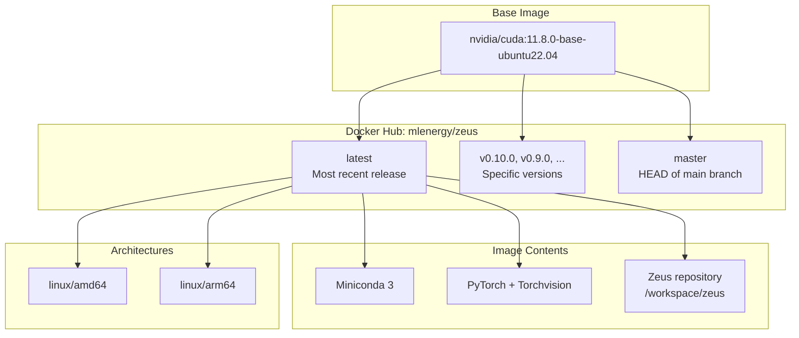
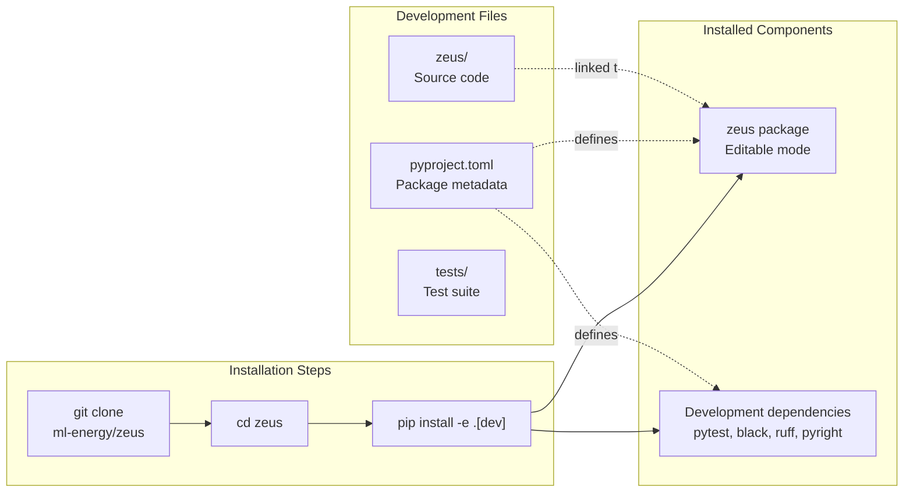
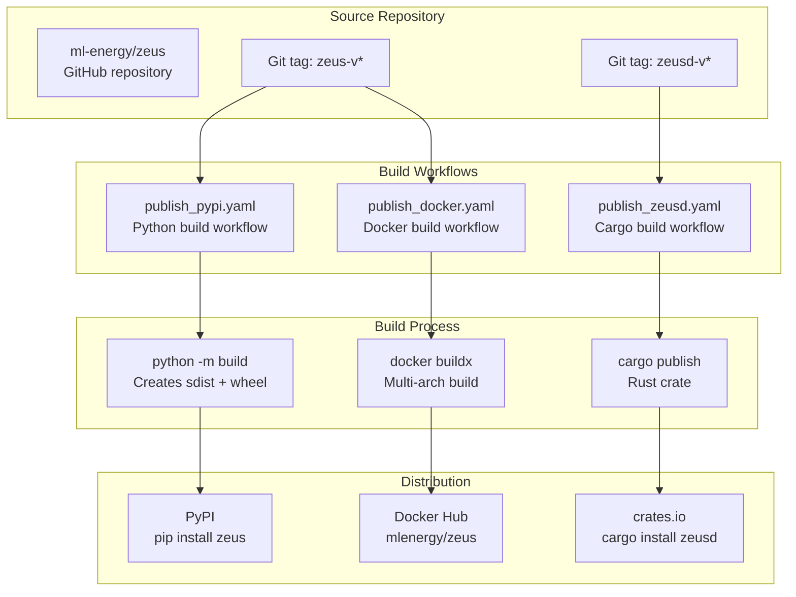

<!-- source: DeepWiki mcp.deepwiki.com · repo ml-energy/zeus · page 2.1 Installation Methods · fetched 2026-10-21 -->

# Installation Methods

<details>
<summary>Relevant source files</summary>

The following files were used as context for generating this wiki page:

- [.github/workflows/publish_pypi.yaml](.github/workflows/publish_pypi.yaml)
- [README.md](README.md)
- [docs/getting_started/index.md](docs/getting_started/index.md)
- [docs/index.md](docs/index.md)
- [zeus/monitor/__main__.py](zeus/monitor/__main__.py)

</details>


This page details the various methods for installing Zeus and its components. Zeus can be installed as a Python package via PyPI, used through Docker containers, or built from source for development. The Zeus daemon (`zeusd`) is installed separately as a Rust crate when privileged GPU operations are needed.

For verifying your installation after setup, see [Environment Verification](#2.2). For understanding when and how to deploy Zeus with different privilege models, see [Deployment Strategies](#2.3). For detailed instructions on installing and running the Zeus daemon specifically, see [Installing and Running zeusd](#7.3).

## Installation Overview

Zeus provides three primary installation paths for the Python package, each suited to different use cases:



**Sources:** [README.md:50-62](), [docs/getting_started/index.md:6-25]()

## Installing from PyPI

The simplest installation method is via the Python Package Index (PyPI). This installs the Zeus Python package and its required dependencies.

### Basic Installation

```sh
pip install zeus
```

This command installs the latest stable release of Zeus from PyPI. The package includes the core `zeus` module with monitoring, optimization, device abstraction, and utility components.

### Version-Specific Installation

To install a specific version:

```sh
pip install zeus==0.10.0
```

To upgrade to the latest version:

```sh
pip install --upgrade zeus
```

### Dependencies

The PyPI package includes the following core dependencies (automatically installed):

| Dependency | Purpose |
|-----------|---------|
| `pynvml` | NVIDIA GPU monitoring via NVML |
| `pandas` | Data manipulation for profiling results |
| `lowtime` | High-resolution timing utilities |
| `typer` | CLI framework |
| `rich` | Terminal output formatting |

**Sources:** [docs/getting_started/index.md:8-14](), [README.md:50-57]()

## Installing via Docker

Zeus provides official Docker images that include all dependencies, the Zeus package, and a complete ML environment. This is the recommended approach for users who want a fully configured environment or need to run Zeus in containerized deployments.

### Docker Image Architecture



**Sources:** [docs/getting_started/index.md:27-84](), [README.md:58-61]()

### Pulling Pre-built Images

Pre-built images are available on [Docker Hub](https://hub.docker.com/r/mlenergy/zeus):

```sh
# Pull the latest release
docker pull mlenergy/zeus:latest

# Pull a specific version
docker pull mlenergy/zeus:v0.10.0

# Pull the master branch (latest development)
docker pull mlenergy/zeus:master
```

| Tag | Description | Update Frequency |
|-----|-------------|------------------|
| `latest` | Most recent versioned release | On new releases |
| `v*` (e.g., `v0.10.0`) | Specific version tags | Immutable |
| `master` | HEAD commit of master branch | On every push to master |

### Running the Docker Container

Basic command to run Zeus in Docker:

```sh
docker run -it \
    --gpus all \
    --cap-add SYS_ADMIN \
    --ipc host \
    -v /sys/class/powercap/intel-rapl:/zeus_sys/class/powercap/intel-rapl \
    mlenergy/zeus:latest \
    bash
```

**Container Configuration:**

| Flag | Purpose |
|------|---------|
| `--gpus all` | Exposes all GPUs to the container (requires NVIDIA Container Toolkit) |
| `--cap-add SYS_ADMIN` | Grants Linux capability needed to modify GPU power limits and frequencies |
| `--ipc host` | Shares host IPC namespace (required for PyTorch DataLoader shared memory) |
| `-v /sys/class/powercap/intel-rapl:/zeus_sys/class/powercap/intel-rapl` | Mounts Intel RAPL sysfs interface for CPU/DRAM energy measurement |

For details on privilege requirements and alternatives, see [Deployment Strategies](#2.3).

**Sources:** [docs/getting_started/index.md:46-64](), [docs/getting_started/index.md:66-73]()

### Building Docker Images Locally

To build the Zeus Docker image from source:

```sh
git clone https://github.com/ml-energy/zeus.git
cd zeus
docker build -t mlenergy/zeus:master \
    --build-arg TARGETARCH=amd64 \
    -f docker/Dockerfile .
```

The `TARGETARCH` argument must be set to match your platform:

| Architecture | TARGETARCH Value |
|--------------|------------------|
| x86-64 systems | `amd64` |
| ARM64 systems (e.g., Apple Silicon via Rosetta, ARM servers) | `arm64` |

The Dockerfile is located at [docker/Dockerfile]() and defines the complete image build process, including base image selection, dependency installation, and Zeus repository setup.

**Sources:** [docs/getting_started/index.md:75-83](), [README.md:58-61]()

## Installing from Source

Source installation is recommended for development, debugging, or when you need the latest unreleased features. This method provides an editable installation that reflects changes to the source code immediately.

### Development Installation Process



**Sources:** [docs/getting_started/index.md:16-25]()

### Step-by-Step Instructions

1. **Clone the repository:**
   ```sh
   git clone https://github.com/ml-energy/zeus.git
   cd zeus
   ```

2. **Install in editable mode with development dependencies:**
   ```sh
   pip install -e '.[dev]'
   ```

The `-e` flag creates an editable installation, meaning changes to the source files in `zeus/` are immediately reflected without reinstalling. The `[dev]` extra installs additional dependencies needed for development:

| Development Tool | Purpose |
|-----------------|---------|
| `pytest` | Running test suite |
| `black` | Code formatting |
| `ruff` | Fast Python linting |
| `pyright` | Static type checking |
| `mkdocs-material` | Documentation building |
| `mkdocstrings[python]` | API reference generation |

For more information on the development workflow, including testing and code quality tools, see [Development Guide](#10).

**Sources:** [docs/getting_started/index.md:16-25](), [README.md:29-48]()

## Installing the Zeus Daemon

The Zeus daemon (`zeusd`) is a separate Rust-based component that provides privileged access to GPU and CPU power management operations. It is optional but recommended when you need to modify GPU power limits or frequencies without running your entire application with elevated privileges.

### Quick Installation

```sh
cargo install zeusd
```

This installs `zeusd` from [crates.io](https://crates.io/crates/zeusd), the Rust package registry.

### When to Install zeusd

Install the Zeus daemon if:

1. You want to use power optimization features (e.g., [`GlobalPowerLimitOptimizer`][zeus.optimizer.power_limit.GlobalPowerLimitOptimizer], [`PipelineFrequencyOptimizer`][zeus.optimizer.pipeline_frequency.PipelineFrequencyOptimizer])
2. You need CPU/DRAM energy measurement via Intel RAPL
3. You prefer not to run your application with `root` privileges or in a Docker container with `SYS_ADMIN` capability

For complete installation instructions, configuration options, and deployment best practices, see [Installing and Running zeusd](#7.3). For architectural details, see [Daemon Architecture](#7.1).

**Sources:** [docs/getting_started/index.md:149-172](), [README.md:43]()

## Package Release Pipeline

The following diagram shows how Zeus packages are built and published to their respective registries:



**Sources:** [.github/workflows/publish_pypi.yaml](), [README.md:58-76]()

### Release Triggers

| Component | Git Tag Pattern | Registry | Workflow File |
|-----------|----------------|----------|---------------|
| Zeus Python Package | `zeus-v*` | PyPI | `.github/workflows/publish_pypi.yaml` |
| Zeus Docker Image | `zeus-v*` | Docker Hub | `.github/workflows/publish_docker.yaml` |
| Zeus Daemon (zeusd) | `zeusd-v*` | crates.io | `.github/workflows/publish_zeusd.yaml` |

The PyPI publishing workflow [.github/workflows/publish_pypi.yaml:1-26]() is triggered when a tag matching `zeus-v*` is pushed. It builds both source distributions and wheels using the `build` package, then publishes to PyPI using trusted publishing (OIDC authentication).

**Sources:** [.github/workflows/publish_pypi.yaml:1-26](), [README.md:29-48]()

## Installation Summary Table

| Method | Command | Best For | Dependencies Included |
|--------|---------|----------|----------------------|
| **PyPI** | `pip install zeus` | Production deployments, simple setup | Core Python dependencies only |
| **Docker** | `docker pull mlenergy/zeus:latest` | Isolated environments, reproducible setups | Complete ML stack (PyTorch, Zeus, CUDA) |
| **Source** | `pip install -e '.[dev]'` | Development, debugging, latest features | Configurable (core, dev, docs) |
| **zeusd** | `cargo install zeusd` | Privileged GPU/CPU operations | Rust runtime only |

Each installation method provides the same core Zeus functionality, but differs in deployment complexity, dependency management, and update mechanisms. Choose based on your use case, privilege requirements, and infrastructure constraints.

**Sources:** [docs/getting_started/index.md:6-84](), [README.md:50-76]()

---

