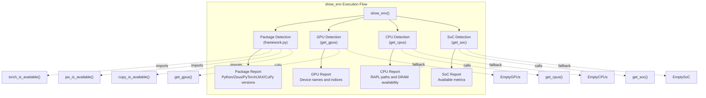
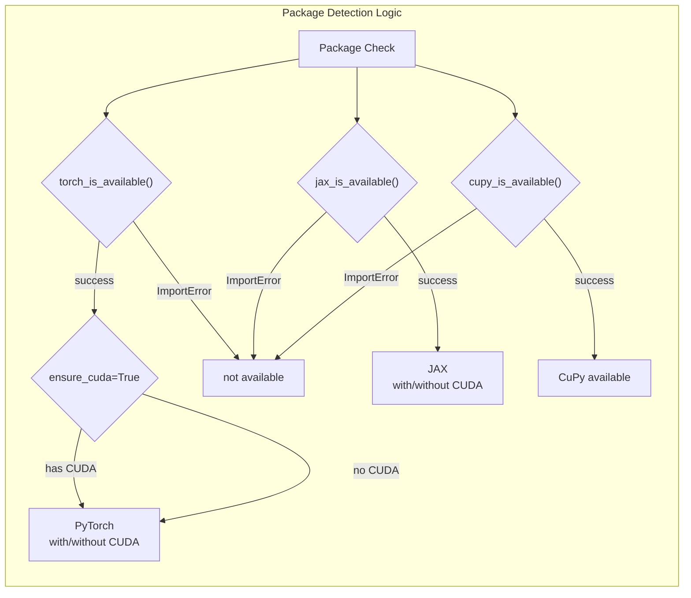
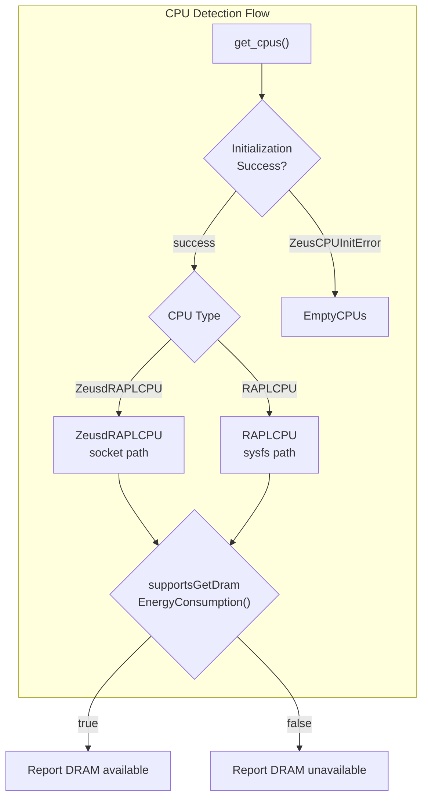
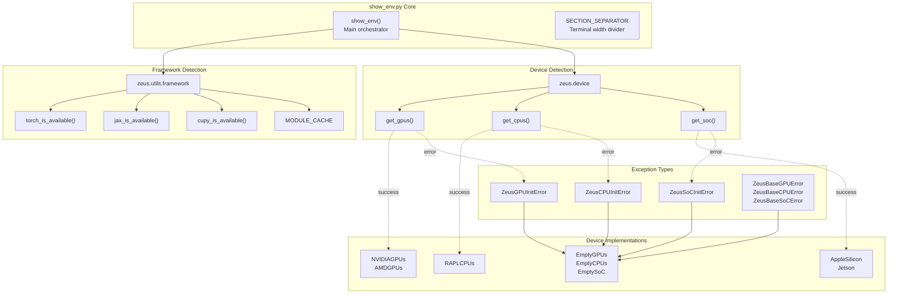

<!-- source: DeepWiki mcp.deepwiki.com · repo ml-energy/zeus · page 2.2 Environment Verification · fetched 2026-10-21 -->

# Environment Verification

<details>
<summary>Relevant source files</summary>

The following files were used as context for generating this wiki page:

- [README.md](README.md)
- [docs/getting_started/index.md](docs/getting_started/index.md)
- [docs/index.md](docs/index.md)
- [zeus/monitor/carbon.py](zeus/monitor/carbon.py)
- [zeus/monitor/price.py](zeus/monitor/price.py)
- [zeus/show_env.py](zeus/show_env.py)
- [zeus/utils/framework.py](zeus/utils/framework.py)

</details>


## Purpose and Scope

This page documents the environment verification functionality in Zeus, which validates the installation and detects available hardware resources. Environment verification is performed by the `zeus.show_env` command-line utility, which checks for the presence of deep learning frameworks, GPU/CPU/SoC devices, and required libraries.

For installation procedures, see [Installation Methods](#2.1). For configuration of privileged operations after installation, see [Deployment Strategies](#2.3).

## Overview

Environment verification serves three primary purposes:

1. **Installation Validation**: Confirms that Zeus and its dependencies are correctly installed
2. **Hardware Detection**: Identifies available GPUs (NVIDIA/AMD), CPUs (Intel/AMD RAPL), and SoCs (Apple Silicon/Jetson)
3. **Framework Compatibility**: Verifies deep learning framework availability (PyTorch, JAX, CuPy) and CUDA support

The verification process is non-intrusive and does not modify any system configuration. It provides diagnostic information to help troubleshoot setup issues before attempting energy measurement or optimization.

## Running Environment Verification

Execute the verification command after installing Zeus:

```bash
python -m zeus.show_env
```

Alternative invocation:

```python
from zeus.show_env import show_env
show_env()
```

The command requires no arguments and runs completely autonomously. It produces a formatted report divided into sections separated by horizontal lines.

**Sources:** [zeus/show_env.py:177-178](), [docs/getting_started/index.md:86-129]()

## Verification Architecture

The `show_env()` function orchestrates multiple detection subsystems to produce a comprehensive environment report.



**Sources:** [zeus/show_env.py:31-175]()

## Output Report Structure

The verification report consists of four major sections, each preceded by logging output and followed by a summary of detected resources.

### Package Availability Section

Reports Python version and availability of Zeus, PyTorch, JAX, and CuPy packages. For each ML framework, CUDA support status is explicitly indicated.



**Example output:**

```console
## Package availability and versions

Logging output:
[2024-09-09 16:40:14,495] [zeus.utils.framework] PyTorch with CUDA support is available.
[2024-09-09 16:40:14,496] [zeus.utils.framework] JAX is not available

Detected:
  Python version: 3.9.19
  Zeus: 0.10.0
  PyTorch: 2.4.1+cu121 (with CUDA support)
  JAX: not available
  CuPy: not available
```

The detection logic uses `lru_cache` decorators to avoid redundant imports. Framework modules are stored in `MODULE_CACHE` dictionary for reuse.

**Sources:** [zeus/show_env.py:33-82](), [zeus/utils/framework.py:15-73]()

### GPU Availability Section

Reports detected GPUs from all supported vendors (NVIDIA via NVML, AMD via AMDSMI). Each GPU is identified by its framework-visible index and model name.

| Detection Path | Success Condition | Error Handling |
|----------------|-------------------|----------------|
| `get_gpus()` | Returns `NVIDIAGPUs` or `AMDGPUs` | Catches `ZeusGPUInitError` |
| Exception handling | - | Falls back to `EmptyGPUs()` |
| Empty check | `len(gpus) > 0` | Displays "No GPUs available" |

**Example output:**

```console
## Device availability

Logging output:
[2024-09-09 16:40:14,512] [zeus.device.gpu.nvidia] pynvml is available and initialized.

Detected:
  GPU 0: NVIDIA A40
```

The GPU detection respects `CUDA_VISIBLE_DEVICES` when set. The indices reported correspond to the framework's view of devices, not physical device ordering.

**Sources:** [zeus/show_env.py:84-101]()

### CPU Availability Section

Reports Intel/AMD CPU packages accessible via RAPL (Running Average Power Limit) interface. For each CPU package, shows:

- CPU energy measurement capability
- DRAM energy measurement capability (if available)
- Access method (direct sysfs or via `zeusd`)



**Example output with direct RAPL access:**

```console
## CPU availability

Logging output:
[2024-09-09 16:40:14,519] [zeus.device.cpu.rapl] RAPL is available.
[2024-09-09 16:40:14,519] [RaplWraparoundTracker] Monitoring wrap around of /sys/class/powercap/intel-rapl/intel-rapl:0/energy_uj

Detected:
  CPU 0:
    CPU measurements available (/sys/class/powercap/intel-rapl/intel-rapl:0)
    DRAM measurements available (/sys/class/powercap/intel-rapl/intel-rapl:0/intel-rapl:0:0)
  CPU 1:
    CPU measurements available (/sys/class/powercap/intel-rapl/intel-rapl:1)
    DRAM measurements available (/sys/class/powercap/intel-rapl/intel-rapl:1/intel-rapl:1:0)
```

**Example output with zeusd daemon:**

```console
## CPU availability

Logging output:
[2025-07-25 16:40:40,396] [zeus.device.cpu.rapl] RAPL directory (/sys/class/powercap/intel-rapl) is available.

Detected:
  CPU 0:
    CPU measurements available (Zeusd at /var/run/zeusd.sock)
    DRAM measurements available (Zeusd at /var/run/zeusd.sock)
  CPU 1:
    CPU measurements available (Zeusd at /var/run/zeusd.sock)
    DRAM measurements available (Zeusd at /var/run/zeusd.sock)
```

The distinction between `RAPLCPU` and `ZeusdRAPLCPU` indicates whether privileged operations are handled directly (requires root/SYS_ADMIN) or via the Zeus daemon.

**Sources:** [zeus/show_env.py:103-138](), [docs/getting_started/index.md:175-193]()

### SoC Availability Section

Reports System-on-Chip platforms for non-traditional compute environments. Supported platforms:

| SoC Platform | Implementation Class | Metrics Reported |
|--------------|---------------------|------------------|
| Apple Silicon | `AppleSilicon` | Available IOKit metrics |
| NVIDIA Jetson | `Jetson` | Available I2C power rail metrics |
| None detected | `EmptySoC` | "No SoC available" |

**Example output for Apple Silicon:**

```console
## SoC availability

Logging output:

Detected:
  Apple Silicon SoC available.
  Available metrics: cpu_power, gpu_power, ane_power
```

**Special case handling:** If the system is detected as Apple Silicon (Darwin OS + arm64/aarch64 architecture) but `AppleSilicon` was not initialized, a warning message suggests installing Zeus with the `apple` extra dependency:

```
This appears to be an Apple Silicon device, but it wasn't picked up by Zeus.
Have you installed Zeus with the `apple` extra?

    pip install 'zeus[apple]'
```

**Sources:** [zeus/show_env.py:140-173]()

## Implementation Details

### Module Organization

The `show_env` module coordinates several specialized detection modules:



**Sources:** [zeus/show_env.py:1-26]()

### Error Handling Strategy

The verification process uses a graceful degradation pattern. Each detection subsystem is wrapped in try-except blocks that catch initialization errors and fall back to "Empty" implementations:

| Error Type | Caught At | Fallback | Impact |
|------------|-----------|----------|--------|
| `ZeusGPUInitError` | GPU detection | `EmptyGPUs()` | Reports "No GPUs available" |
| `ZeusBaseGPUError` | GPU detection | `EmptyGPUs()` | Reports error message + "No GPUs available" |
| `ZeusCPUInitError` | CPU detection | `EmptyCPUs()` | Reports "No CPUs available" |
| `ZeusBaseCPUError` | CPU detection | `EmptyCPUs()` | Reports error message + "No CPUs available" |
| `ZeusSoCInitError` | SoC detection | `EmptySoC()` | Reports "No SoC available" |
| `ZeusBaseSoCError` | SoC detection | `EmptySoC()` | Reports error message + "No SoC available" |

This design ensures that `show_env` always produces a complete report, even when some hardware detection fails. Users can diagnose specific issues without the entire verification process aborting.

**Sources:** [zeus/show_env.py:88-94](), [zeus/show_env.py:107-113](), [zeus/show_env.py:145-151]()

### RAPL CPU Detection Variants

The CPU detection logic distinguishes between two access patterns for Intel RAPL:

```python
# Direct sysfs access (requires root or mounted in container)
isinstance(cpu, RAPLCPU)
# Reports: /sys/class/powercap/intel-rapl/intel-rapl:X

# Access via zeusd daemon (unprivileged)
isinstance(cpu, ZeusdRAPLCPU)
# Reports: Zeusd at /var/run/zeusd.sock
```

The distinction is made explicit in the output to help users understand their privilege configuration. Direct access requires root or the `SYS_ADMIN` capability, while zeusd access works for unprivileged users when the daemon is running.

**Sources:** [zeus/show_env.py:115-135](), [zeus/device/cpu/rapl.py:136]()

## Interpreting Verification Results

### Successful Verification

All sections should report available resources. Minimum viable configuration for Zeus functionality:

- ✅ Python 3.8+
- ✅ Zeus package installed
- ✅ At least one framework (PyTorch/JAX) with CUDA support
- ✅ At least one GPU detected
- ⚠️ CPU/SoC detection optional (only needed for CPU/DRAM energy measurement)

### Common Issues and Resolutions

| Symptom | Likely Cause | Resolution |
|---------|--------------|------------|
| "PyTorch without CUDA support" | CPU-only PyTorch installed | Install PyTorch with CUDA: `pip install torch --index-url https://download.pytorch.org/whl/cu118` |
| "No GPUs available" | NVIDIA drivers not installed or CUDA_VISIBLE_DEVICES excludes all GPUs | Install drivers; check `nvidia-smi`; verify CUDA_VISIBLE_DEVICES |
| "No CPUs available" | RAPL sysfs not accessible | Run with `sudo` or deploy zeusd; in Docker, mount `/sys/class/powercap` |
| CPU reports "Zeusd at..." | ZEUSD_SOCK_PATH environment variable set | Expected behavior when using zeusd; verify daemon is running |
| SoC warning on Apple Silicon | `zeus[apple]` extra not installed | Reinstall: `pip install 'zeus[apple]'` |

### Framework Cache Behavior

The `MODULE_CACHE` dictionary in `zeus.utils.framework` stores imported modules after first detection. This avoids repeated imports but has implications:

1. Framework availability is checked **once per process**
2. Changing environment variables (e.g., `CUDA_VISIBLE_DEVICES`) after import has no effect
3. Must restart Python process to re-detect frameworks

**Sources:** [zeus/utils/framework.py:12](), [zeus/utils/framework.py:26]()

## Integration with Zeus Workflow

Environment verification is a prerequisite step before:

1. **Energy Measurement** ([ZeusMonitor](#4.1)): Confirms target devices are accessible
2. **Energy Optimization** ([Power Limit Optimizer](#5.1), [Pipeline Frequency Optimizer](#5.2)): Verifies required privileges for configuration changes
3. **Distributed Training**: Validates framework support for multi-device operations

The detection logic used by `show_env` is identical to the initialization logic used by `ZeusMonitor` and optimizers. If `show_env` reports devices successfully, those devices will be available to Zeus's measurement and optimization components.

**Sources:** [zeus/show_env.py:88-100](), [zeus/monitor/energy.py]() (imported by reference)

---

