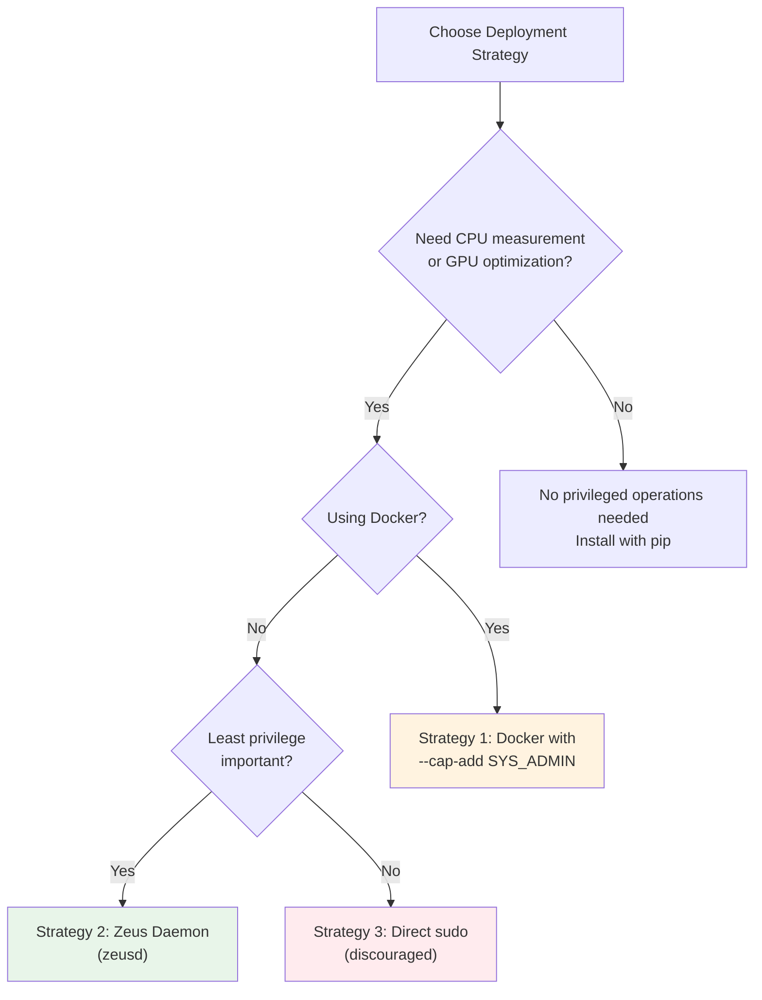
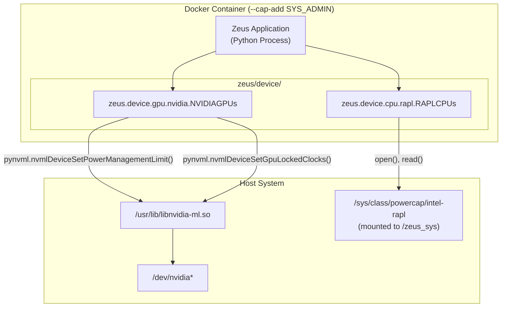
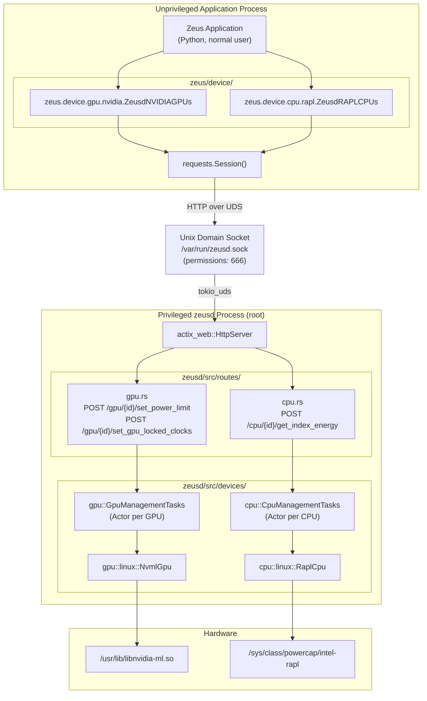
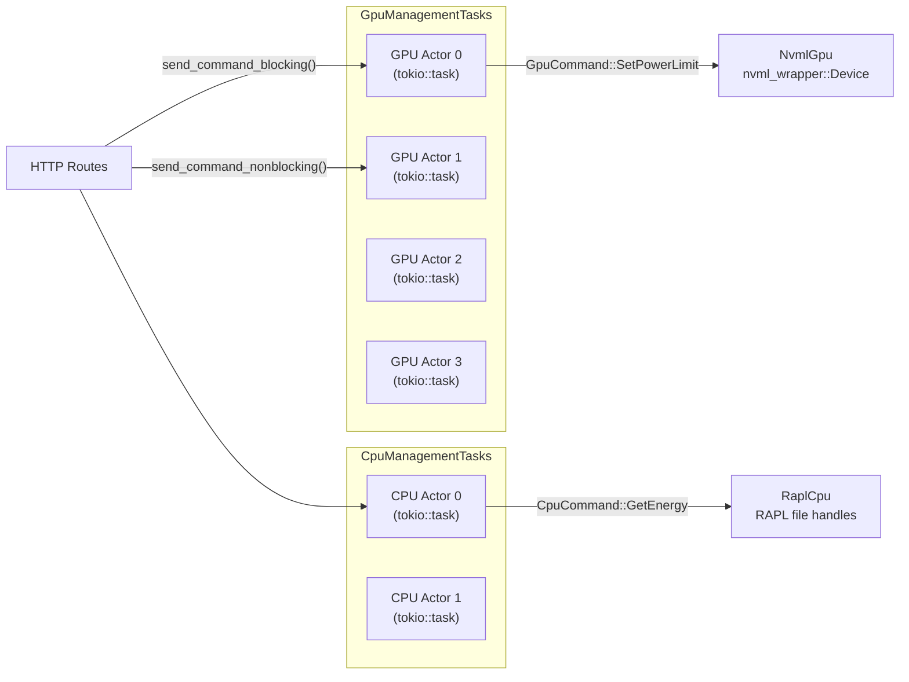
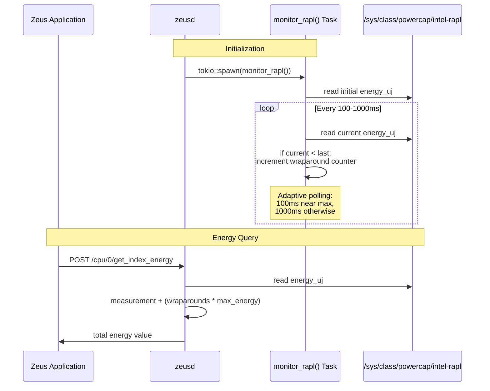
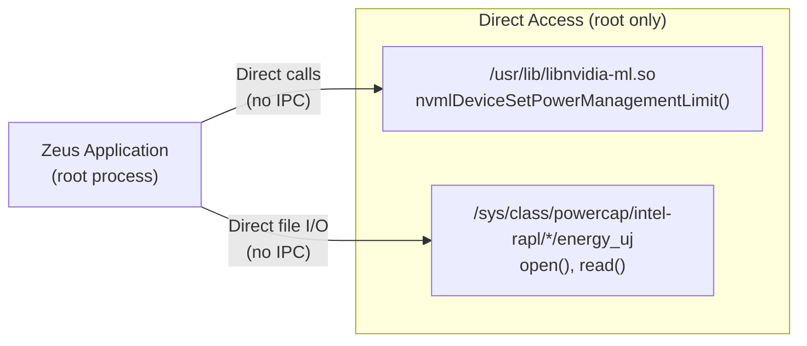
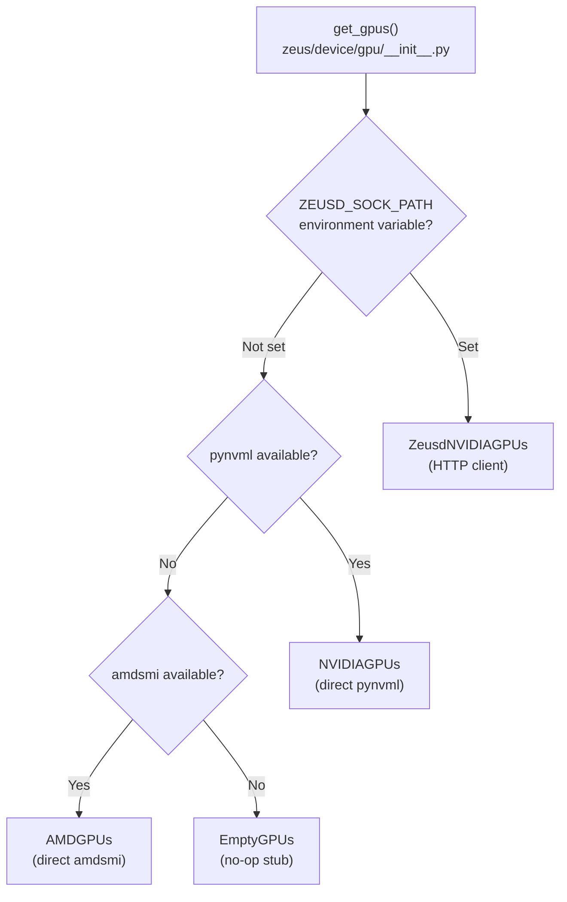
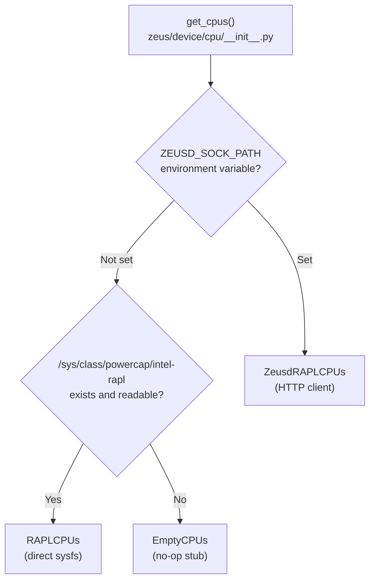

<!-- source: DeepWiki mcp.deepwiki.com · repo ml-energy/zeus · page 2.3 Deployment Strategies · fetched 2026-10-21 -->

# Deployment Strategies

<details>
<summary>Relevant source files</summary>

The following files were used as context for generating this wiki page:

- [README.md](README.md)
- [docs/getting_started/index.md](docs/getting_started/index.md)
- [docs/index.md](docs/index.md)
- [zeusd/src/devices/cpu/linux.rs](zeusd/src/devices/cpu/linux.rs)
- [zeusd/src/devices/gpu/linux.rs](zeusd/src/devices/gpu/linux.rs)
- [zeusd/src/routes/gpu.rs](zeusd/src/routes/gpu.rs)
- [zeusd/tests/cpu.rs](zeusd/tests/cpu.rs)
- [zeusd/tests/gpu.rs](zeusd/tests/gpu.rs)
- [zeusd/tests/helpers/mod.rs](zeusd/tests/helpers/mod.rs)

</details>


This document describes the three deployment strategies for Zeus, each providing different approaches to handling privileged operations required for CPU energy measurement and GPU power/frequency configuration. The choice of deployment strategy depends on your security requirements, infrastructure constraints, and use case.

For information about installation methods (pip, Docker images, from source), see [Installation Methods](#2.1). For verification of your Zeus installation after deployment, see [Environment Verification](#2.2).

## Overview

Zeus requires elevated system privileges for two categories of operations:

1. **CPU/DRAM energy measurement**: Reading Intel RAPL (Running Average Power Limit) counters through the `/sys/class/powercap/intel-rapl` interface requires `root` privileges due to [CVE-2020-8694](https://www.cve.org/CVERecord?id=CVE-2020-8694).

2. **GPU power and frequency control**: Setting GPU power limits and locked clocks via NVML (NVIDIA Management Library) requires the `SYS_ADMIN` Linux capability.

Zeus offers three deployment strategies to handle these privileged operations, each with different security and operational characteristics.

**Sources:** [docs/getting_started/index.md:131-199](), [README.md:58-65]()

## Deployment Strategy Decision Tree



**Sources:** [docs/getting_started/index.md:131-149]()

## Strategy 1: Docker with Linux Capabilities

This strategy grants the `SYS_ADMIN` capability to the entire Docker container and mounts the RAPL sysfs interface. It is the simplest deployment approach when using containers.

### Architecture



**Sources:** [docs/getting_started/index.md:28-65](), [zeus/device/gpu/nvidia.py](), [zeus/device/cpu/rapl.py]()

### Docker Run Command

```bash
docker run -it \
    --gpus all \
    --cap-add SYS_ADMIN \
    --ipc host \
    -v /sys/class/powercap/intel-rapl:/zeus_sys/class/powercap/intel-rapl \
    mlenergy/zeus:latest \
    bash
```

**Sources:** [docs/getting_started/index.md:48-56]()

### Configuration Details

| Component | Purpose | Details |
|-----------|---------|---------|
| `--gpus all` | GPU access | Mounts NVIDIA GPUs into container via NVIDIA Container Toolkit |
| `--cap-add SYS_ADMIN` | GPU configuration | Grants capability to call `nvmlDeviceSetPowerManagementLimit()` and clock APIs |
| `-v /sys/class/powercap/intel-rapl:/zeus_sys/class/powercap/intel-rapl` | CPU energy | Mounts RAPL interface (Docker blocks it by default); Zeus detects `/zeus_sys` prefix |
| `--ipc host` | PyTorch DataLoader | Provides shared memory for multi-process data loading |

**Sources:** [docs/getting_started/index.md:48-64](), [docker/Dockerfile]()

### Advantages and Limitations

**Advantages:**
- Simplest setup for containerized environments
- Works with Kubernetes Pods via `securityContext.capabilities.add`
- Single container includes all dependencies

**Limitations:**
- Grants broad `SYS_ADMIN` capability to entire application
- Not suitable for multi-tenant environments
- Container-level privilege escalation possible

**Sources:** [docs/getting_started/index.md:141-148]()

## Strategy 2: Zeus Daemon (zeusd) [RECOMMENDED]

The Zeus daemon (`zeusd`) is a minimal privileged service that exposes a REST API over Unix domain sockets. Unprivileged applications communicate with `zeusd` to perform privileged operations, following the principle of least privilege.

### Architecture



**Sources:** [zeusd/src/main.rs](), [zeusd/src/routes/gpu.rs:1-127](), [zeusd/src/routes/cpu.rs](), [zeus/device/gpu/nvidia.py](), [zeus/device/cpu/rapl.py]()

### Installation and Deployment

#### Installing zeusd

```bash
# Install from crates.io
cargo install zeusd

# Or build from source
git clone https://github.com/ml-energy/zeus.git
cd zeus/zeusd
cargo build --release
```

**Sources:** [docs/getting_started/index.md:156-166]()

#### Running zeusd

```bash
sudo zeusd \
    --socket-path /var/run/zeusd.sock \
    --socket-permissions 666
```

| Flag | Purpose | Details |
|------|---------|---------|
| `--socket-path` | IPC location | Unix domain socket path for HTTP communication |
| `--socket-permissions` | Access control | File permissions in octal notation; `666` allows all users read/write access |

**Sources:** [docs/getting_started/index.md:158-169]()

#### Configuring Zeus Application

Set the `ZEUSD_SOCK_PATH` environment variable to allow Zeus to discover and communicate with the daemon:

```bash
export ZEUSD_SOCK_PATH=/var/run/zeusd.sock
python your_training_script.py
```

Zeus automatically detects this environment variable in [zeus/device/gpu/nvidia.py]() and [zeus/device/cpu/rapl.py]() and instantiates `ZeusdNVIDIAGPUs` or `ZeusdRAPLCPUs` instead of the direct implementations.

**Sources:** [docs/getting_started/index.md:171-193]()

### HTTP API Routes

The daemon exposes the following REST API endpoints over the Unix domain socket:

#### GPU Management Routes

```
POST /gpu/{gpu_id}/set_persistence_mode
POST /gpu/{gpu_id}/set_power_limit
POST /gpu/{gpu_id}/set_gpu_locked_clocks
POST /gpu/{gpu_id}/reset_gpu_locked_clocks
POST /gpu/{gpu_id}/set_mem_locked_clocks
POST /gpu/{gpu_id}/reset_mem_locked_clocks
```

Each route accepts JSON payloads with a `block` field to control blocking vs. non-blocking execution. For example, `set_power_limit` expects:

```json
{
  "power_limit_mw": 250000,
  "block": true
}
```

**Sources:** [zeusd/src/routes/gpu.rs:82-126]()

#### CPU Energy Measurement Routes

```
POST /cpu/{cpu_id}/get_index_energy
GET  /cpu/{cpu_id}/supports_dram_energy
```

The `get_index_energy` route accepts:

```json
{
  "cpu": true,
  "dram": true
}
```

And returns:

```json
{
  "cpu_energy_uj": 12345678,
  "dram_energy_uj": 3456789
}
```

**Sources:** [zeusd/src/routes/cpu.rs](), [zeusd/tests/cpu.rs:1-176]()

### Actor-Based Concurrency Model

The daemon uses Rust's Tokio runtime with an actor pattern to manage each device independently:



Each actor receives commands via `tokio::sync::mpsc` channels and executes them sequentially, ensuring thread-safe access to NVML and RAPL resources without explicit locking.

**Sources:** [zeusd/src/devices/gpu/mod.rs](), [zeusd/src/devices/cpu/mod.rs]()

### RAPL Wraparound Monitoring

For CPU energy measurement, `zeusd` spawns background tasks to monitor RAPL counter wraparounds (the counters are 32-bit and overflow frequently at high power draws):



The adaptive polling frequency (100ms vs 1000ms) prevents missed wraparounds while minimizing overhead. This implementation is in [zeusd/src/devices/cpu/linux.rs:223-248]().

**Sources:** [zeusd/src/devices/cpu/linux.rs:20-248]()

### Advantages and Limitations

**Advantages:**
- Minimal privileged surface area (only daemon runs as root)
- Applications run as normal users
- Multi-tenant safe
- Can be deployed once per node, used by multiple applications
- Follows principle of least privilege

**Limitations:**
- Requires separate daemon installation and management
- Additional IPC overhead (typically <1ms per request)
- Requires system administrator to deploy daemon

**Sources:** [docs/getting_started/index.md:149-155]()

## Strategy 3: Direct Sudo Access

This strategy runs the entire Zeus application with `sudo` (as root). This approach is **not recommended** except for quick testing or when other options are unavailable.

### Usage

```bash
sudo python your_training_script.py
```

Zeus will directly access NVML and RAPL interfaces without requiring the daemon or Docker capabilities.

**Sources:** [docs/getting_started/index.md:195-199]()

### File System Access Pattern



**Sources:** [zeus/device/gpu/nvidia.py](), [zeus/device/cpu/rapl.py]()

### Advantages and Limitations

**Advantages:**
- No additional setup required
- No IPC overhead
- Useful for quick experiments

**Limitations:**
- Entire application runs as root
- Violates principle of least privilege
- Security risk in production environments
- Not suitable for shared systems
- Can interfere with other applications' GPU/CPU settings

**Sources:** [docs/getting_started/index.md:195-199]()

## Deployment Strategy Comparison

| Aspect | Docker + Capabilities | Zeus Daemon (zeusd) | Direct Sudo |
|--------|----------------------|---------------------|-------------|
| **Privilege Level** | Container-wide `SYS_ADMIN` | Daemon only | Application-wide root |
| **Setup Complexity** | Low (one command) | Medium (daemon + env var) | Very Low (just sudo) |
| **Security** | Medium | High (least privilege) | Low |
| **Multi-Tenant** | No | Yes | No |
| **IPC Overhead** | None | ~0.5-1ms per request | None |
| **Suitable For** | Single-app containers | Production, shared systems | Testing only |
| **Container Support** | Yes (native) | Yes (via mounted socket) | Yes |
| **Kubernetes Support** | Yes (securityContext) | Yes (DaemonSet) | No |
| **Recommended** | Containerized environments | Production bare-metal | Not recommended |

**Sources:** [docs/getting_started/index.md:131-199]()

## Implementation Details: Device Abstraction

Zeus implements device abstraction to transparently switch between direct access and daemon-mediated access:

### GPU Device Selection



The factory function `get_gpus()` checks for `ZEUSD_SOCK_PATH` first, falling back to direct access if unavailable.

**Sources:** [zeus/device/gpu/__init__.py]()

### CPU Device Selection



**Sources:** [zeus/device/cpu/__init__.py](), [zeus/device/cpu/rapl.py]()

## Verification

After deploying with any strategy, verify the setup using `zeus.show_env`:

```bash
# For Docker strategy
docker run --gpus all --cap-add SYS_ADMIN \
    -v /sys/class/powercap/intel-rapl:/zeus_sys/class/powercap/intel-rapl \
    mlenergy/zeus:latest python -m zeus.show_env

# For zeusd strategy
ZEUSD_SOCK_PATH=/var/run/zeusd.sock python -m zeus.show_env

# For sudo strategy
sudo python -m zeus.show_env
```

The output shows detected GPUs and CPUs with their access method. For the daemon strategy, you should see output like:

```
CPU 0:
  CPU measurements available (Zeusd at /var/run/zeusd.sock)
  DRAM measurements available (Zeusd at /var/run/zeusd.sock)
```

**Sources:** [docs/getting_started/index.md:86-193](), [zeus/show_env.py]()

---

