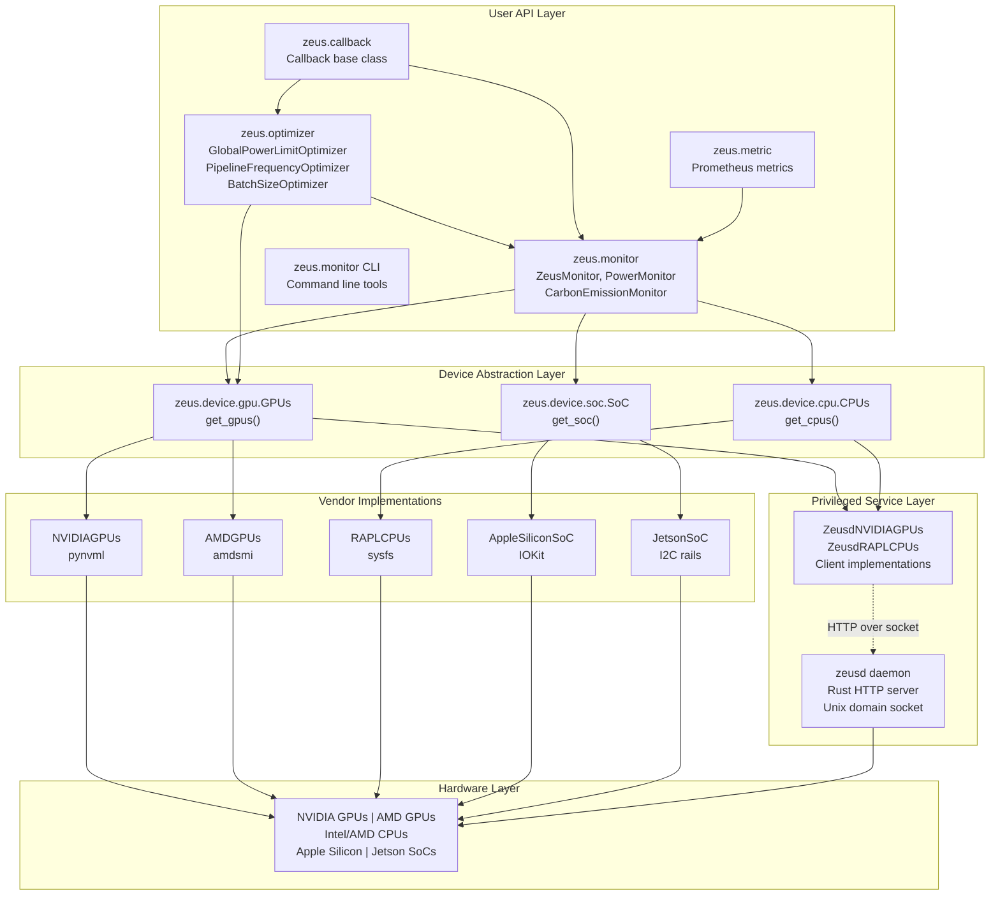
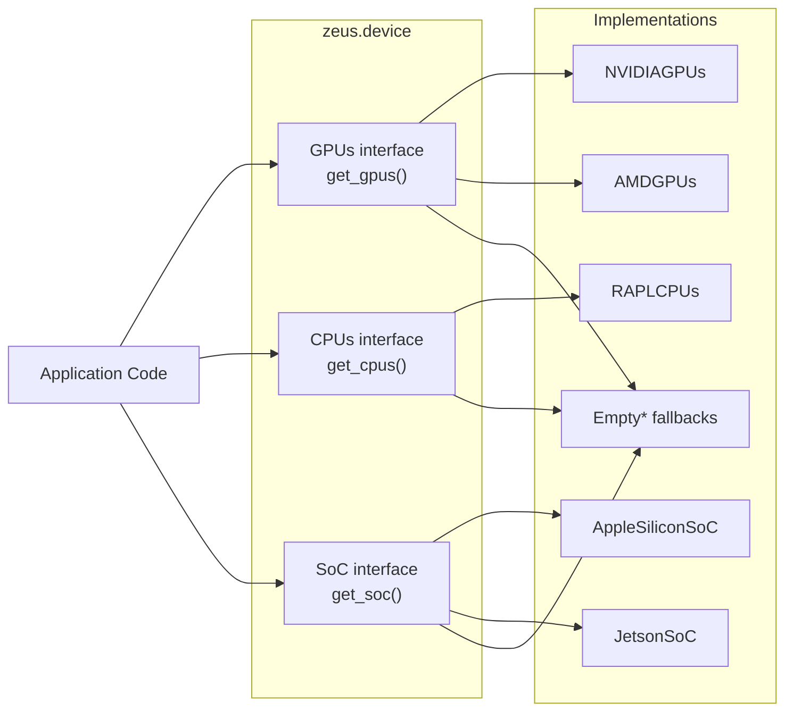
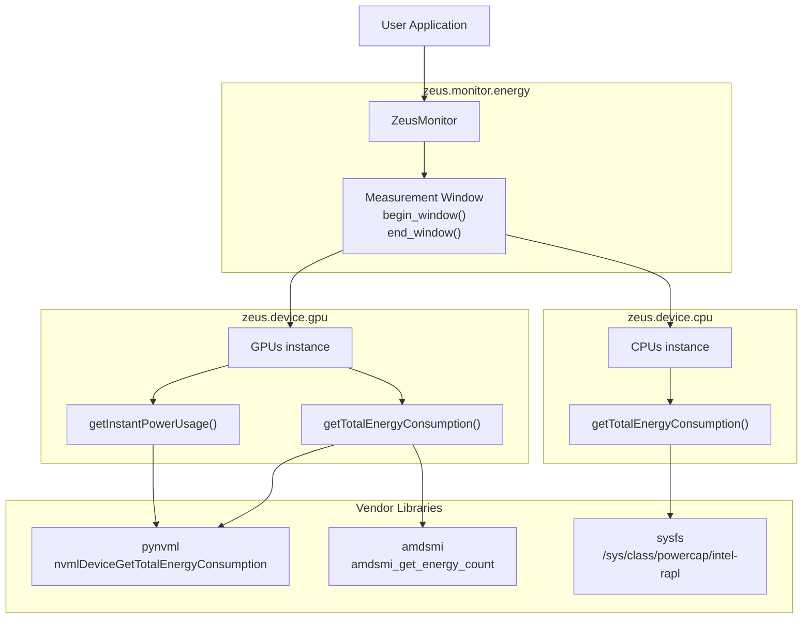
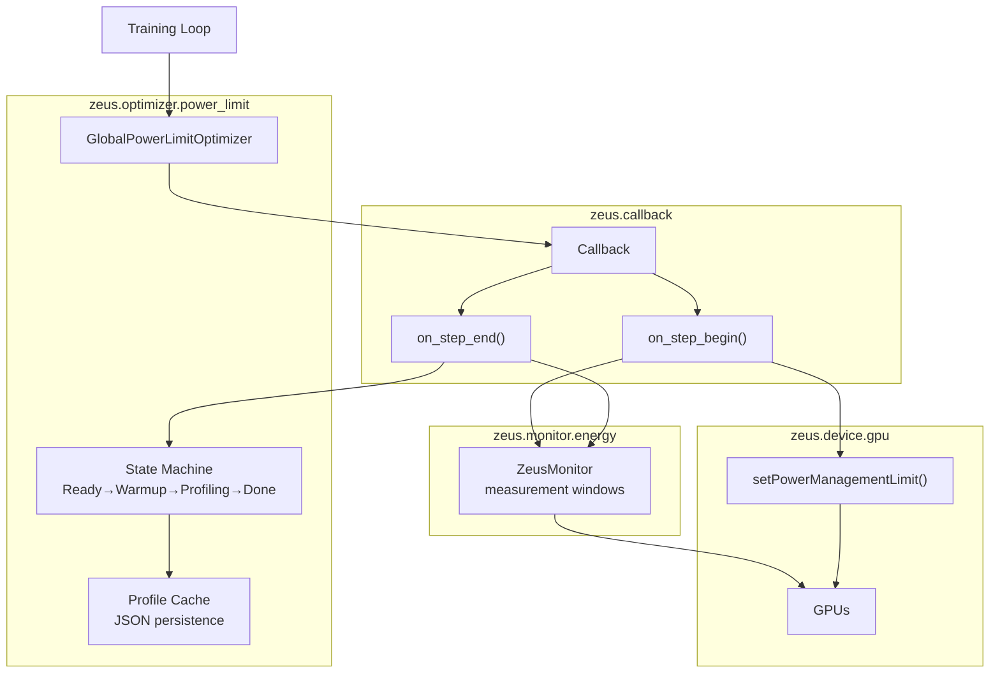
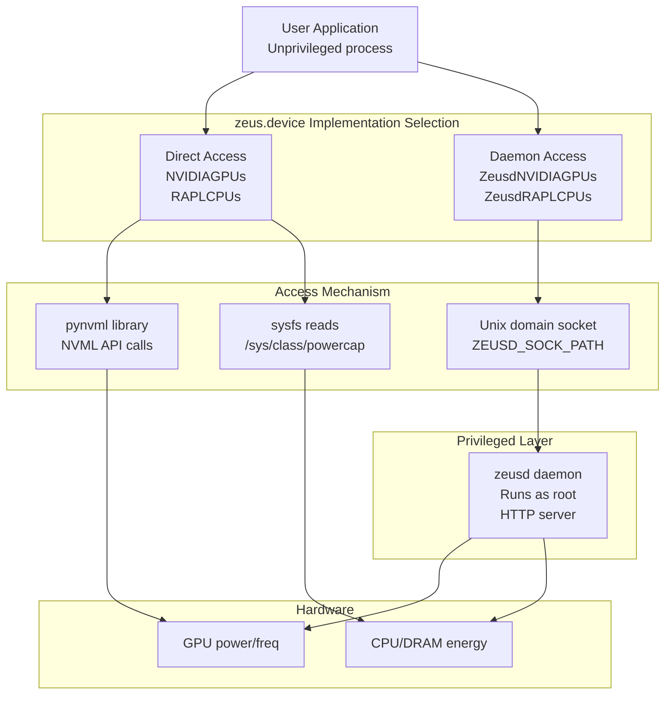
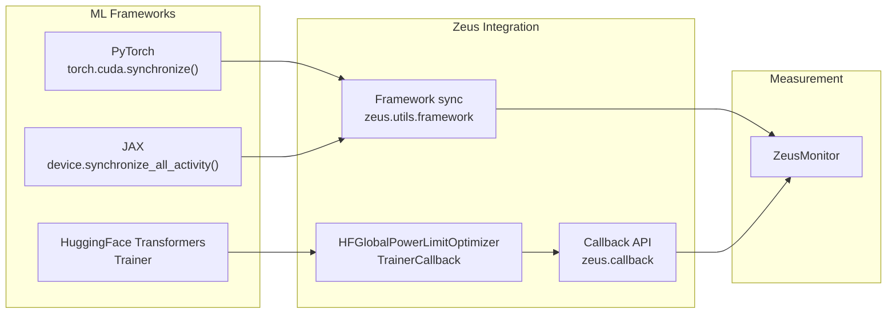
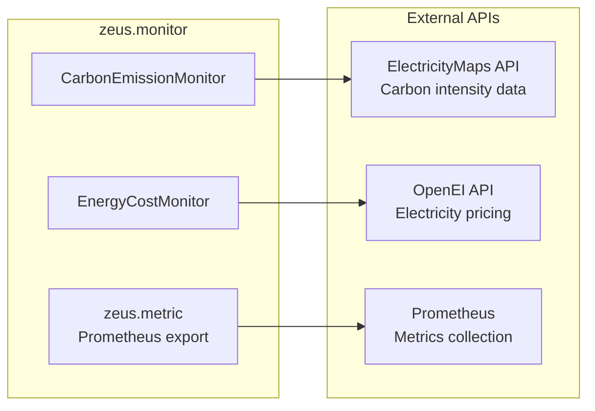

<!-- source: DeepWiki mcp.deepwiki.com · repo ml-energy/zeus · page 3 Core Architecture · fetched 2026-10-21 -->

# Core Architecture

Relevant source files

The following files were used as context for generating this wiki page:

- [README.md](README.md)
- [docs/getting_started/index.md](docs/getting_started/index.md)
- [docs/index.md](docs/index.md)
- [zeus/__init__.py](zeus/__init__.py)

## Purpose and Scope

This document explains Zeus's high-level system architecture and how its major components are organized. It covers the layered architecture of the Zeus Python package, the role of the Zeus daemon (`zeusd`), and how these components interact to provide energy measurement and optimization capabilities for deep learning workloads.

For detailed information about the directory structure and module contents, see [Module Organization](#3.1). For information about how Zeus handles privileged operations, see [Privilege Management](#3.2).

---

## Architectural Overview

Zeus follows a layered architecture with three primary layers: the **User API Layer**, the **Device Abstraction Layer**, and the **Hardware Layer**. A separate **Privileged Service Layer** (`zeusd`) handles operations requiring elevated permissions.

**Diagram 1: Zeus Layered Architecture**

Sources: [README.md:29-48](), [zeus/__init__.py:1-14](), [docs/getting_started/index.md:132-199]()

---

## Core Subsystems

Zeus is organized into distinct subsystems, each with a well-defined responsibility. The primary subsystems reside in the `zeus/` Python package directory.

### Measurement Subsystem

The `zeus.monitor` module provides programmatic and CLI-based energy and power measurement capabilities.

| Component | Purpose | Key Classes |
|-----------|---------|-------------|
| `zeus.monitor.energy` | Window-based energy measurement | `ZeusMonitor` |
| `zeus.monitor.power` | Continuous power polling | `PowerMonitor` |
| `zeus.monitor.carbon` | Carbon emission tracking | `CarbonEmissionMonitor` |
| `zeus.monitor.cost` | Energy cost tracking | `EnergyCostMonitor` |
| `zeus.monitor.temperature` | GPU temperature monitoring | `TemperatureMonitor` |

Detailed documentation of these components is in [Energy Measurement](#4).

### Optimization Subsystem

The `zeus.optimizer` module contains algorithms for reducing energy consumption during training.

| Optimizer | Strategy | Target |
|-----------|----------|--------|
| `GlobalPowerLimitOptimizer` | JIT profiling with state machine | GPU power caps |
| `PipelineFrequencyOptimizer` | Graph-cut algorithm | Pipeline stage frequencies |
| `BatchSizeOptimizer` | Multi-armed bandit | Training batch size |

Detailed documentation of these components is in [Energy Optimization](#5).

### Device Abstraction Subsystem

The `zeus.device` module provides a unified interface to heterogeneous hardware.

**Diagram 2: Device Abstraction Layer**

The device abstraction layer uses factory functions (`get_gpus()`, `get_cpus()`, `get_soc()`) to instantiate the appropriate implementation based on runtime hardware detection. When hardware is unavailable, the layer falls back to no-op `Empty*` implementations that implement the same interfaces.

Detailed documentation is in [Hardware Abstraction Layer](#6).

Sources: [zeus/__init__.py:1-14](), [README.md:32-41]()

---

## Component Interaction Patterns

Zeus components interact through well-defined interfaces and patterns.

### Measurement Flow

**Diagram 3: Energy Measurement Data Flow**

The measurement flow follows this pattern:

1. User creates a `ZeusMonitor` instance targeting specific GPU and CPU indices
2. User calls `begin_window()` to start a measurement window
3. `ZeusMonitor` queries `GPUs` and `CPUs` for baseline energy counters
4. Device managers call vendor-specific APIs (NVML, AMDSMI, RAPL)
5. User calls `end_window()` to complete the measurement
6. `ZeusMonitor` calculates energy delta and returns `Measurement` object

### Optimization Flow

**Diagram 4: Power Limit Optimization Flow**

The optimization flow uses the callback pattern:

1. User instantiates an optimizer (e.g., `GlobalPowerLimitOptimizer`)
2. Optimizer implements the `Callback` interface
3. Training loop invokes `on_step_begin()` before each iteration
4. Optimizer sets GPU power limits via `GPUs.setPowerManagementLimit()`
5. Optimizer starts energy measurement via `ZeusMonitor`
6. Training loop invokes `on_step_end()` after each iteration
7. Optimizer ends measurement and updates state machine
8. After profiling completes, optimizer persists profile to disk

Sources: [zeus/__init__.py:1-14](), [README.md:32-41]()

---

## Privileged Operations Architecture

Zeus handles privileged hardware operations (GPU power/frequency configuration, CPU energy reading) through three deployment patterns. The architecture supports both privileged direct access and unprivileged access via the Zeus daemon.

**Diagram 5: Privileged Operations Handling**

The selection between direct and daemon access is automatic:

- If `ZEUSD_SOCK_PATH` environment variable is set, Zeus instantiates `ZeusdNVIDIAGPUs` and `ZeusdRAPLCPUs`
- Otherwise, Zeus attempts direct access via `NVIDIAGPUs` and `RAPLCPUs`
- If direct access fails due to permissions, appropriate exceptions are raised

This architecture is detailed in [Privilege Management](#3.2) and [Zeus Daemon (zeusd)](#7).

Sources: [docs/getting_started/index.md:132-199](), [README.md:43]()

---

## External Integrations

Zeus integrates with external services and frameworks to provide enhanced functionality.

### Framework Integration

**Diagram 6: Framework Integration Points**

Zeus provides framework-specific adapters:

- **Framework synchronization**: `zeus.utils.framework` provides `sync_execution()` to ensure accurate measurements in async execution environments
- **HuggingFace Trainer**: `HFGlobalPowerLimitOptimizer` implements `TrainerCallback` for seamless integration
- **Generic callbacks**: `zeus.callback.Callback` base class for custom integrations

### External Services

**Diagram 7: External Service Integrations**

- **Carbon tracking**: `CarbonEmissionMonitor` queries ElectricityMaps API for real-time carbon intensity
- **Cost tracking**: `EnergyCostMonitor` queries OpenEI API for electricity pricing data
- **Metrics export**: `zeus.metric` exports power and energy metrics to Prometheus

Sources: [zeus/__init__.py:1-14](), [README.md:32-41]()

---

## Module Structure Summary

The Zeus codebase is organized into these primary modules:

| Module Path | Purpose | Key Entry Points |
|-------------|---------|------------------|
| `zeus.monitor` | Energy/power measurement | `ZeusMonitor`, `PowerMonitor` |
| `zeus.optimizer` | Energy optimization algorithms | `GlobalPowerLimitOptimizer`, `PipelineFrequencyOptimizer` |
| `zeus.device` | Hardware abstraction | `get_gpus()`, `get_cpus()`, `get_soc()` |
| `zeus.callback` | Training integration | `Callback` base class |
| `zeus.metric` | Metrics export | Prometheus integration |
| `zeus.utils` | Utility functions | Framework sync, logging |
| `zeus._legacy` | Legacy code | Research reproducibility |
| `zeus.show_env` | Environment verification | `python -m zeus.show_env` |
| `zeusd/` (Rust) | Privileged daemon | HTTP server |

For a detailed walkthrough of the directory structure and module contents, see [Module Organization](#3.1).

Sources: [README.md:29-48](), [zeus/__init__.py:1-14]()

---

## Design Principles

Zeus's architecture follows these core design principles:

1. **Hardware abstraction**: Unified interfaces hide vendor-specific details
2. **Least privilege**: Privileged operations isolated in optional daemon
3. **Fail-safe defaults**: Graceful degradation via `Empty*` implementations
4. **Extensibility**: Callback and plugin patterns for custom integrations
5. **Zero-overhead**: Measurement uses hardware counters when available
6. **Framework agnostic**: Compatible with PyTorch, JAX, and other frameworks

These principles enable Zeus to run on diverse hardware configurations while maintaining a simple, consistent API for end users.

Sources: [README.md:1-95](), [docs/getting_started/index.md:1-204](), [docs/index.md:1-54]()

---

