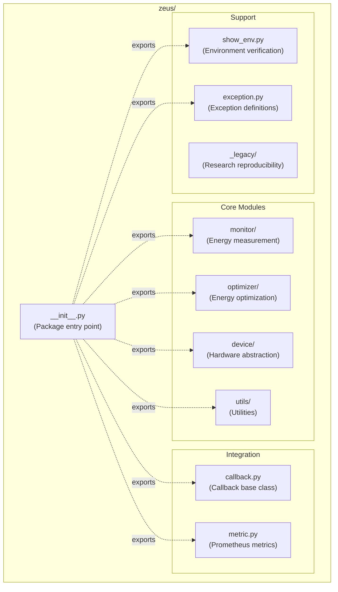
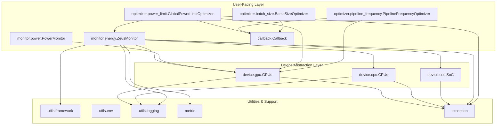
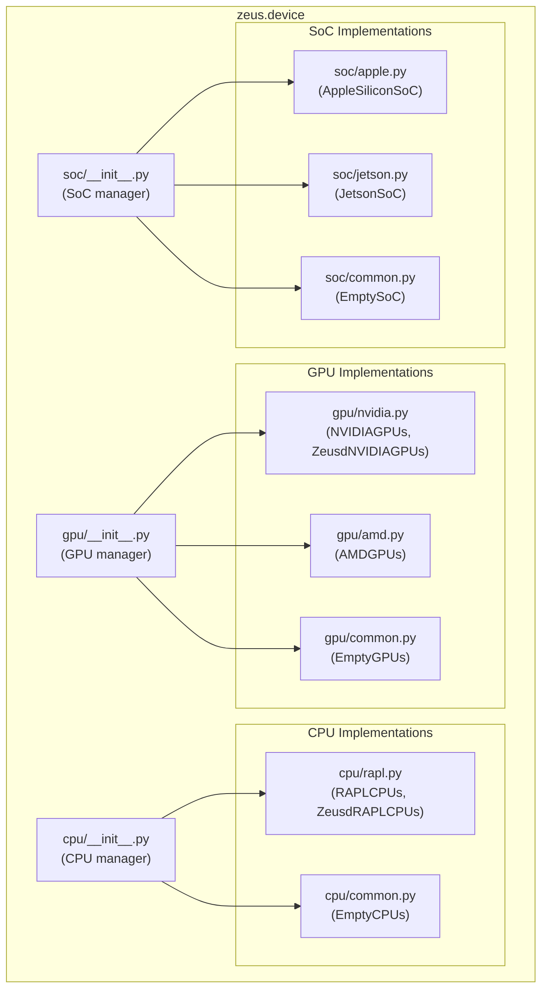
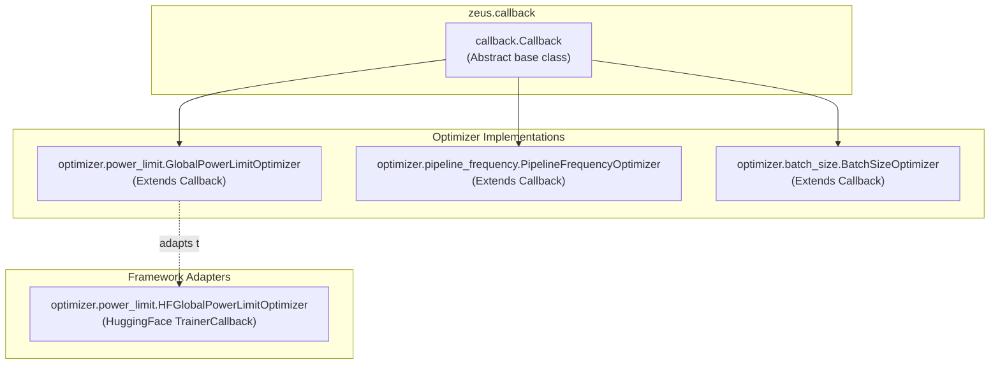
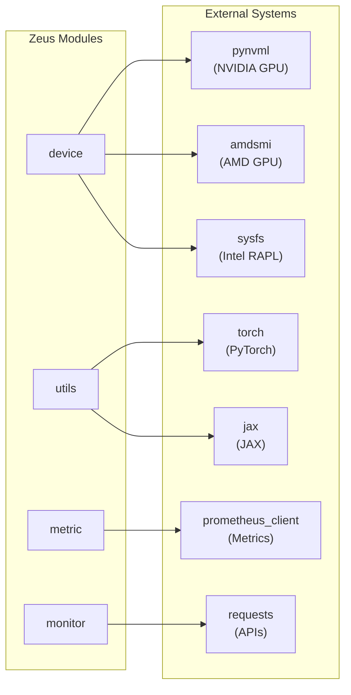

<!-- source: DeepWiki mcp.deepwiki.com · repo ml-energy/zeus · page 3.1 Module Organization · fetched 2026-10-21 -->

# Module Organization

Relevant source files

The following files were used as context for generating this wiki page:

- [README.md](README.md)
- [docs/getting_started/index.md](docs/getting_started/index.md)
- [docs/index.md](docs/index.md)
- [zeus/__init__.py](zeus/__init__.py)

This page documents the structure of the `zeus` Python package, explaining the purpose of each module and their interdependencies. For information about the privileged operations and deployment patterns, see [Privilege Management](#3.2). For details on specific hardware implementations, see the Hardware Abstraction Layer section ([GPU Support](#6.1), [CPU Support](#6.2), [SoC Support](#6.3)).

## Package Structure Overview

The Zeus Python package is organized into six primary modules that work together to provide energy measurement and optimization capabilities. The package follows a layered architecture where higher-level user-facing components depend on lower-level abstraction and utility modules.

**Zeus Package Directory Structure**

**Sources:** [README.md:29-48](), [zeus/__init__.py:1-15]()

## Module Dependency Graph

The following diagram illustrates the dependency relationships between Zeus modules. Lower-level modules provide abstractions that higher-level modules build upon.

**Zeus Module Dependencies**

**Sources:** [zeus/__init__.py:1-15](), [README.md:29-48]()

## Core Modules

### `zeus.monitor`

The `monitor` module provides tools for measuring energy consumption and power draw during deep learning workloads. It contains both programmatic APIs and command-line interfaces.

| Component | Purpose |
|-----------|---------|
| `monitor.energy.ZeusMonitor` | Window-based energy measurement for GPUs, CPUs, DRAM, and SoCs |
| `monitor.power.PowerMonitor` | Continuous power polling with background process |
| `monitor.energy.CarbonEmissionMonitor` | Carbon-aware measurement with ElectricityMaps API |
| `monitor.energy.EnergyCostMonitor` | Cost-aware measurement with OpenEI API |
| `monitor.temperature.TemperatureMonitor` | GPU temperature tracking over time |

The monitor module depends on the device abstraction layer to access hardware energy counters and power interfaces. See [Energy Measurement](#4) for detailed documentation.

**Sources:** [README.md:34](), [zeus/__init__.py:4]()

### `zeus.optimizer`

The `optimizer` module contains energy optimization strategies that automatically tune training parameters to minimize energy consumption while respecting performance constraints.

| Component | Purpose |
|-----------|---------|
| `optimizer.power_limit.GlobalPowerLimitOptimizer` | GPU power capping with JIT profiling |
| `optimizer.pipeline_frequency.PipelineFrequencyOptimizer` | Pipeline stage frequency optimization |
| `optimizer.batch_size.BatchSizeOptimizer` | Batch size selection via multi-armed bandit |

All optimizers integrate with training frameworks through the callback interface and depend on the device layer for hardware control. See [Energy Optimization](#5) for detailed documentation.

**Sources:** [README.md:35](), [zeus/__init__.py:5]()

### `zeus.device`

The `device` module provides a unified abstraction layer over diverse hardware platforms, isolating hardware-specific details from higher-level components.

**Device Module Structure**

The device module implements the Strategy pattern with runtime selection based on available hardware. Each implementation provides methods for energy measurement and power/frequency control. See [Hardware Abstraction Layer](#6) for detailed documentation.

**Sources:** [README.md:36](), [zeus/__init__.py:3]()

### `zeus.utils`

The `utils` module contains shared utility functions and classes used throughout the codebase.

| Component | Purpose |
|-----------|---------|
| `utils.framework` | Framework detection (PyTorch, JAX, CuPy) and synchronization |
| `utils.env` | Environment variable handling and configuration |
| `utils.logging` | Standardized logging utilities |
| `utils.pynvml` | Wrapper around NVML calls with error handling |

**Sources:** [README.md:37](), [zeus/__init__.py:6]()

### `zeus.callback`

The `callback` module defines the base class for training callbacks that enable optimizer integration with ML frameworks.

**Callback Architecture**

The `Callback` base class defines hooks for training lifecycle events (`on_step_begin`, `on_step_end`, etc.) that optimizers implement to profile and adjust configurations. See [Custom Callbacks](#9.3) for usage details.

**Sources:** [README.md:41](), [zeus/__init__.py:7]()

### `zeus.metric`

The `metric` module provides integration with Prometheus for exporting power and energy metrics. It defines standard metric types and export mechanisms for monitoring dashboards.

**Sources:** [README.md:39](), [zeus/__init__.py:9]()

## Support Components

### `zeus.show_env`

The `show_env` module provides the `python -m zeus.show_env` command-line tool for verifying Zeus installation and detecting available hardware. This diagnostic utility checks:

- Python version and installed packages (Zeus, PyTorch, JAX)
- GPU availability and models (NVIDIA, AMD)
- CPU energy measurement support (Intel RAPL)
- SoC platform detection (Apple Silicon, Jetson)

See [Environment Verification](#2.2) for usage details.

**Sources:** [README.md:40](), [zeus/__init__.py:10](), [docs/getting_started/index.md:86-129]()

### `zeus.exception`

The `exception` module defines Zeus-specific exception classes that provide structured error handling throughout the codebase.

**Sources:** [zeus/__init__.py:8]()

### `zeus._legacy`

The `_legacy` module contains older implementations preserved for research reproducibility. These components are not recommended for new projects but are maintained to ensure published research results remain reproducible.

**Sources:** [README.md:38](), [zeus/__init__.py:11]()

## Module Access Patterns

The following table summarizes the intended access patterns for each module:

| Module | Primary Access Point | Typical Usage |
|--------|---------------------|---------------|
| `monitor` | `from zeus.monitor import ZeusMonitor` | Energy measurement in training scripts |
| `optimizer` | `from zeus.optimizer.power_limit import GlobalPowerLimitOptimizer` | Automatic energy optimization |
| `device` | `from zeus.device import get_gpus, get_cpus` | Direct hardware access (advanced) |
| `utils` | `from zeus.utils.framework import sync_execution` | Framework synchronization |
| `callback` | `from zeus.callback import Callback` | Custom optimizer implementation |
| `metric` | `from zeus.metric import ZeusDataType` | Prometheus integration |
| `show_env` | `python -m zeus.show_env` | Installation verification |

**Sources:** [zeus/__init__.py:1-15]()

## Integration Points

Zeus modules integrate with external systems and frameworks through well-defined interfaces:

**External Integration Architecture**

The device layer wraps vendor-specific libraries (pynvml, amdsmi) to provide a consistent interface. The monitor module uses HTTP clients for external APIs (ElectricityMaps, OpenEI). The utils module detects and synchronizes with ML frameworks. The metric module exports to Prometheus for observability.

**Sources:** [zeus/__init__.py:1-15](), [README.md:29-48]()

---

