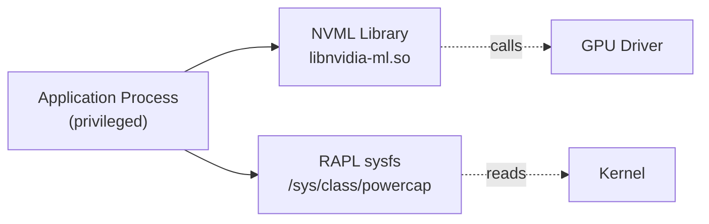
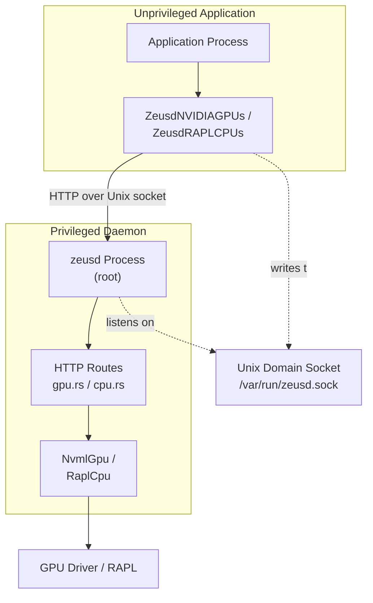
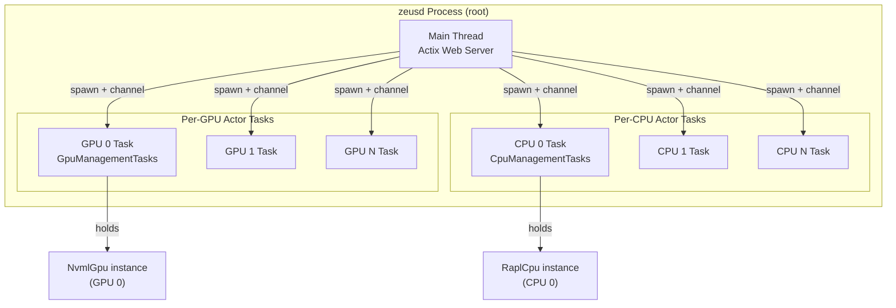
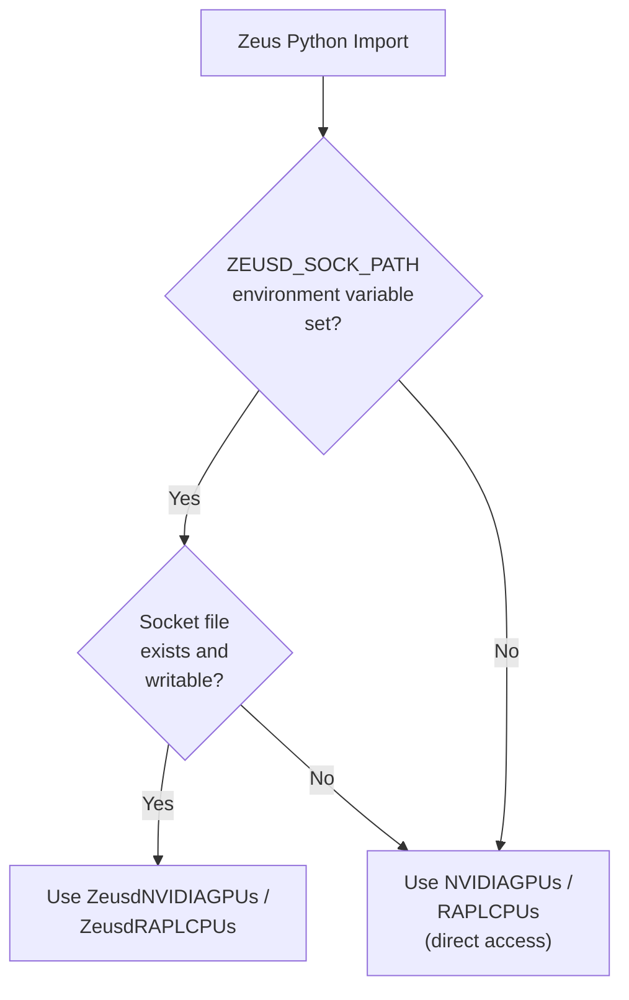
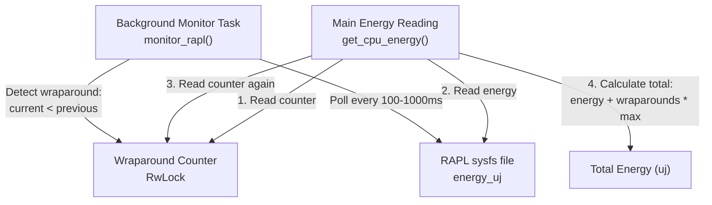

<!-- source: DeepWiki mcp.deepwiki.com · repo ml-energy/zeus · page 3.2 Privilege Management · fetched 2026-10-21 -->

# Privilege Management

<details>
<summary>Relevant source files</summary>

The following files were used as context for generating this wiki page:

- [README.md](README.md)
- [docs/getting_started/index.md](docs/getting_started/index.md)
- [docs/index.md](docs/index.md)
- [zeusd/src/devices/cpu/linux.rs](zeusd/src/devices/cpu/linux.rs)
- [zeusd/src/devices/gpu/linux.rs](zeusd/src/devices/gpu/linux.rs)
- [zeusd/src/routes/gpu.rs](zeusd/src/routes/gpu.rs)
- [zeusd/tests/cpu.rs](zeusd/tests/cpu.rs)
- [zeusd/tests/gpu.rs](zeusd/tests/gpu.rs)
- [zeusd/tests/helpers/mod.rs](zeusd/tests/helpers/mod.rs)

</details>


## Purpose and Scope

This document describes how Zeus handles privileged operations required for GPU configuration and CPU energy measurement. It covers the three deployment patterns available (direct access, Docker capabilities, and the Zeus daemon), when privileges are needed, and how the daemon architecture enables least-privilege execution.

For details on the Zeus daemon's implementation and API, see [Zeus Daemon (zeusd)](#7).  
For GPU and CPU hardware abstraction interfaces, see [Hardware Abstraction Layer](#6).

---

## Operations Requiring Elevated Privileges

Zeus requires elevated system privileges for two categories of operations:

| Operation Category | Hardware | Required Privilege | Reason |
|-------------------|----------|-------------------|---------|
| **GPU Configuration** | NVIDIA GPUs | `SYS_ADMIN` capability or `root` | NVML methods for power limit and frequency control require elevated privileges |
| **GPU Configuration** | AMD GPUs | `SYS_ADMIN` capability or `root` | AMDSMI methods for power limit and frequency control require elevated privileges |
| **CPU Energy Measurement** | Intel/AMD CPUs | `root` | Intel RAPL interface (`/sys/class/powercap/intel-rapl`) is restricted due to [CVE-2020-8694](https://www.cve.org/CVERecord?id=CVE-2020-8694) |
| **DRAM Energy Measurement** | Intel/AMD CPUs | `root` | RAPL DRAM subpackage requires same privileges as CPU measurement |

**Note**: GPU energy **reading** (via NVML/AMDSMI) does **not** require elevated privileges on modern GPUs (NVIDIA Volta+ and AMD MI-series).

Sources: [docs/getting_started/index.md:136-140](), [docs/getting_started/index.md:59-61](), [zeusd/src/devices/cpu/linux.rs:18]()

---

## Access Patterns

Zeus supports two fundamental access patterns for privileged operations:

### Direct Access Pattern



**Direct Access Pattern: Privileged application directly accesses hardware interfaces**

In this pattern, the application itself runs with elevated privileges and directly calls NVML/AMDSMI APIs or reads RAPL sysfs files. This is simple but violates the principle of least privilege.

Sources: [docs/getting_started/index.md:195-198]()

### Daemon-Mediated Access Pattern



**Daemon-Mediated Access Pattern: Unprivileged application communicates with privileged daemon**

In this pattern, a small privileged daemon (`zeusd`) handles hardware access, and unprivileged applications send requests via HTTP over a Unix domain socket. This follows the principle of least privilege by minimizing the privileged code surface.

Sources: [docs/getting_started/index.md:149-154](), [zeusd/src/routes/gpu.rs](), [zeusd/src/devices/gpu/linux.rs]()

---

## Deployment Options

Zeus supports three deployment patterns, each with different privilege management approaches:

### Option 1: Docker Container with SYS_ADMIN Capability

```bash
docker run -it \
    --gpus all \
    --cap-add SYS_ADMIN \
    -v /sys/class/powercap/intel-rapl:/zeus_sys/class/powercap/intel-rapl \
    mlenergy/zeus:latest
```

**Configuration requirements:**
- `--cap-add SYS_ADMIN`: Grants the container the Linux `SYS_ADMIN` capability, allowing GPU configuration
- `-v /sys/class/powercap/intel-rapl:...`: Mounts RAPL sysfs directory (Docker blocks it by default)
- Inside container, processes run as `root` by default, allowing RAPL access

**Pros:**
- Simple setup, no additional services required
- All Zeus functionality works out-of-the-box

**Cons:**
- Grants broad `SYS_ADMIN` capability to entire container
- All processes in container have elevated privileges

Sources: [docs/getting_started/index.md:48-64](), [docs/getting_started/index.md:141-148]()

### Option 2: Zeus Daemon (zeusd)

```bash
# Install zeusd
cargo install zeusd

# Run daemon with root privileges
sudo zeusd \
    --socket-path /var/run/zeusd.sock \
    --socket-permissions 666

# Set environment variable for applications
export ZEUSD_SOCK_PATH=/var/run/zeusd.sock
```

**Configuration requirements:**
- `zeusd` runs as `root` or with `SYS_ADMIN` capability
- Socket path specified via `--socket-path`
- Socket permissions set to allow application write access (e.g., `666`)
- Applications set `ZEUSD_SOCK_PATH` environment variable

**Pros:**
- Least-privilege design: only daemon needs privileges
- Minimal privileged code surface (Rust daemon)
- Multiple unprivileged applications can share one daemon

**Cons:**
- Requires separate daemon setup and management
- Additional complexity in deployment

Sources: [docs/getting_started/index.md:149-172]()

### Option 3: Direct sudo

```bash
sudo python train.py
```

**Configuration requirements:**
- Run application with `sudo`
- Application has full `root` privileges

**Pros:**
- Simplest setup (no additional configuration)

**Cons:**
- Grants excessive privileges to entire application
- Violates principle of least privilege
- Security risk if application has vulnerabilities

Sources: [docs/getting_started/index.md:195-198]()

### Comparison Table

| Aspect | Docker + SYS_ADMIN | zeusd Daemon | Direct sudo |
|--------|-------------------|--------------|-------------|
| **Privilege Scope** | Container-wide | Daemon only | Application-wide |
| **Setup Complexity** | Medium | High | Low |
| **Security** | Medium | High (least privilege) | Low |
| **Recommended Use** | Development, testing | Production | Last resort |
| **Multi-user Support** | No | Yes | No |

Sources: [docs/getting_started/index.md:131-199]()

---

## Zeus Daemon Architecture

The Zeus daemon (`zeusd`) is a Rust-based HTTP server that provides a minimal interface for privileged operations.

### Process Model



**zeusd Process Model: Main server thread spawns actor tasks for each device**

The daemon uses an actor model where:
- Main thread runs the Actix Web HTTP server
- One actor task per GPU, each holding an `NvmlGpu` instance
- One actor task per CPU, each holding an `RaplCpu` instance
- Requests are forwarded to the appropriate actor via channels

This design ensures thread-safe access to NVML/RAPL interfaces, which are not inherently thread-safe.

Sources: [zeusd/tests/helpers/mod.rs:206-221](), [zeusd/src/devices/gpu/linux.rs:13-16](), [zeusd/src/devices/cpu/linux.rs:24-29]()

### HTTP API Structure

The daemon exposes HTTP endpoints over a Unix domain socket:

**GPU Endpoints** (in [zeusd/src/routes/gpu.rs]()):

| Endpoint | Method | Payload Fields | NVML Method |
|----------|--------|----------------|-------------|
| `/gpu/{gpu_id}/set_persistence_mode` | POST | `enabled: bool`, `block: bool` | `set_persistent()` |
| `/gpu/{gpu_id}/set_power_limit` | POST | `power_limit_mw: u32`, `block: bool` | `set_power_management_limit()` |
| `/gpu/{gpu_id}/set_gpu_locked_clocks` | POST | `min_clock_mhz: u32`, `max_clock_mhz: u32`, `block: bool` | `set_gpu_locked_clocks()` |
| `/gpu/{gpu_id}/reset_gpu_locked_clocks` | POST | `block: bool` | `reset_gpu_locked_clocks()` |
| `/gpu/{gpu_id}/set_mem_locked_clocks` | POST | `min_clock_mhz: u32`, `max_clock_mhz: u32`, `block: bool` | `set_mem_locked_clocks()` |
| `/gpu/{gpu_id}/reset_mem_locked_clocks` | POST | `block: bool` | `reset_mem_locked_clocks()` |

**CPU Endpoints** (see [Zeus Daemon (zeusd)](#7) for full details):

| Endpoint | Method | Payload Fields | Purpose |
|----------|--------|----------------|---------|
| `/cpu/{cpu_id}/get_index_energy` | POST | `cpu: bool`, `dram: bool` | Read CPU/DRAM energy counters |
| `/cpu/{cpu_id}/supports_dram_energy` | GET | - | Check if DRAM measurement available |

**Common Parameters:**
- `block: bool` - If `true`, request blocks until operation completes. If `false`, request returns immediately and operation is queued.

Sources: [zeusd/src/routes/gpu.rs:82-126](), [zeusd/tests/gpu.rs](), [zeusd/tests/cpu.rs]()

### Request Flow Diagram

```mermaid
sequenceDiagram
    participant App as "Application<br/>(unprivileged)"
    participant Client as "ZeusdNVIDIAGPUs"
    participant Socket as "Unix Socket<br/>/var/run/zeusd.sock"
    participant Server as "Actix Web<br/>(zeusd main)"
    participant Handler as "set_power_limit_handler"
    participant Actor as "GpuManagementTasks"
    participant Device as "NvmlGpu"
    
    App->>Client: set_power_management_limit(250_000)
    Client->>Socket: POST /gpu/0/set_power_limit<br/>{"power_limit_mw": 250000, "block": true}
    Socket->>Server: HTTP Request
    Server->>Handler: Route to handler
    Handler->>Actor: send_command_blocking(gpu_id, cmd)
    Actor->>Device: set_power_management_limit(250_000)
    Device->>Actor: Result
    Actor->>Handler: Result
    Handler->>Server: HTTP 200 / 400
    Server->>Socket: HTTP Response
    Socket->>Client: Response
    Client->>App: Result
```

**Request Flow: Application to daemon communication for GPU power limit setting**

For blocking requests (`block: true`):
1. Handler awaits response from actor task
2. Returns HTTP 200 on success, 400 on error

For non-blocking requests (`block: false`):
1. Handler queues command and returns immediately
2. Always returns HTTP 200 (errors are logged but not reported)

Sources: [zeusd/src/routes/gpu.rs:58-77](), [zeusd/tests/gpu.rs:175-193]()

---

## Python Client Integration

Zeus Python package automatically detects and uses `zeusd` when available.

### Environment Variable Detection



**Environment Variable Detection: Zeus selects daemon or direct access based on ZEUSD_SOCK_PATH**

The Python package checks the `ZEUSD_SOCK_PATH` environment variable at import time to determine whether to use daemon-mediated or direct access.

Sources: [docs/getting_started/index.md:171-193]()

### Device Class Selection

Zeus uses different device class implementations based on privilege availability:

| Device Type | Direct Access Class | Daemon-Mediated Class | Selection Criteria |
|-------------|-------------------|---------------------|-------------------|
| NVIDIA GPU | `NVIDIAGPUs` | `ZeusdNVIDIAGPUs` | `ZEUSD_SOCK_PATH` set |
| AMD GPU | `AMDGPUs` | `ZeusdAMDGPUs` | `ZEUSD_SOCK_PATH` set |
| CPU (RAPL) | `RAPLCPUs` | `ZeusdRAPLCPUs` | `ZEUSD_SOCK_PATH` set |

Both class variants implement the same abstract interface (`GPU` / `CPU`), so application code remains unchanged regardless of which implementation is used.

Sources: [README.md:33-42]()

### HTTP Communication Pattern

The daemon-mediated classes (`ZeusdNVIDIAGPUs`, `ZeusdRAPLCPUs`) communicate with `zeusd` using HTTP over Unix domain sockets:

```python
# Pseudocode showing communication pattern
import requests
import json

socket_path = os.environ['ZEUSD_SOCK_PATH']

# Example: Set power limit for GPU 0
session = requests.Session()
session.mount('http+unix://', UnixAdapter())

response = session.post(
    f'http+unix://{socket_path}/gpu/0/set_power_limit',
    json={
        'power_limit_mw': 250000,
        'block': True
    }
)

if response.status_code != 200:
    raise ZeusdError(response.text)
```

The `block` parameter controls whether the call should wait for completion:
- `block=True`: Waits for operation to complete, reports errors
- `block=False`: Returns immediately, errors are logged by daemon but not raised

Sources: [zeusd/tests/helpers/mod.rs:223-340](), [zeusd/tests/gpu.rs:175-193]()

---

## Permission Model

### Unix Socket Permissions

The daemon creates a Unix domain socket with configurable permissions:

```bash
sudo zeusd \
    --socket-path /var/run/zeusd.sock \
    --socket-permissions 666
```

**Permission String Format:** Standard UNIX octal permissions (e.g., `666` = rw-rw-rw-)

**Typical Configurations:**

| Permission | Octal | Who Can Access | Use Case |
|------------|-------|----------------|----------|
| `rw-rw-rw-` | `666` | All users | Multi-user systems, development |
| `rw-rw----` | `660` | Owner + group | Restrict to specific user group |
| `rw-------` | `600` | Owner only | Single-user, maximum security |

Applications need **write** permission to communicate with the daemon.

Sources: [docs/getting_started/index.md:158-169]()

### Security Considerations

**Daemon Security:**
- `zeusd` runs as `root` or with `SYS_ADMIN` capability
- Minimal code surface (~1500 lines of Rust)
- No external dependencies beyond NVML/RAPL
- Stateless request handling (no persistent state)
- Input validation on all endpoints

**Socket Security:**
- Unix domain sockets are filesystem objects
- Standard file permissions apply
- No network exposure (local IPC only)
- Automatically cleaned up when daemon stops

**Application Security:**
- Applications run without elevated privileges
- Cannot directly access GPU configuration or RAPL
- Can only request operations via defined API
- Failed operations logged by daemon, don't crash application

Sources: [zeusd/src/routes/gpu.rs:28-80](), [docs/getting_started/index.md:149-154]()

### RAPL Wraparound Monitoring

CPU energy measurement via RAPL requires special handling because RAPL counters wrap around when they reach their maximum value. The daemon implements background monitoring to track wraparounds:



**RAPL Wraparound Monitoring: Background task detects counter wraparounds**

The monitoring pattern:
1. Background task polls RAPL counter every 100-1000ms (adaptive based on energy consumption rate)
2. When `current_energy < previous_energy`, increment wraparound counter
3. Main thread reads wraparound counter before and after reading energy
4. If wraparound occurred during read, re-read energy to avoid incorrect values

This ensures accurate energy measurements even when counters wrap around, which can happen frequently under high load (maximum range is typically ~256 Joules).

Sources: [zeusd/src/devices/cpu/linux.rs:223-248](), [zeusd/src/devices/cpu/linux.rs:129-159]()

---

## Verification

After setting up privilege management, verify the configuration using `zeus.show_env`:

```bash
# With zeusd
ZEUSD_SOCK_PATH=/var/run/zeusd.sock python -m zeus.show_env
```

**Expected output indicators:**

```
## GPU availability
[zeus.device.gpu.nvidia] Using Zeusd at /var/run/zeusd.sock for GPU management

## CPU availability
[zeus.device.cpu.rapl] RAPL directory is available
  CPU 0:
    CPU measurements available (Zeusd at /var/run/zeusd.sock)
    DRAM measurements available (Zeusd at /var/run/zeusd.sock)
```

The presence of "Using Zeusd" or "Zeusd at" in the output confirms daemon-mediated access is being used.

Sources: [docs/getting_started/index.md:173-193]()

---

