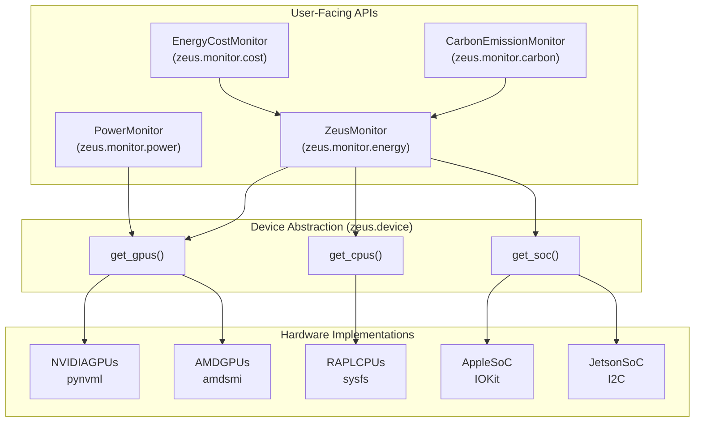
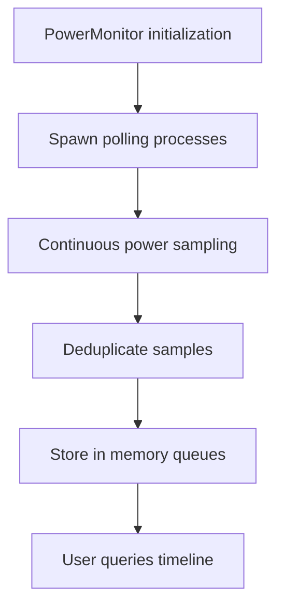
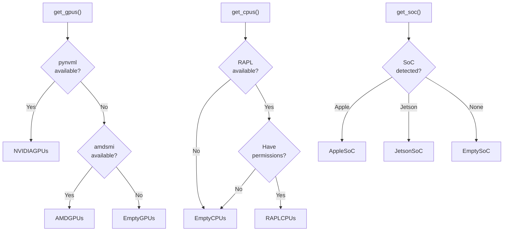
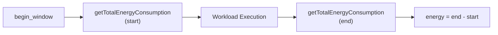
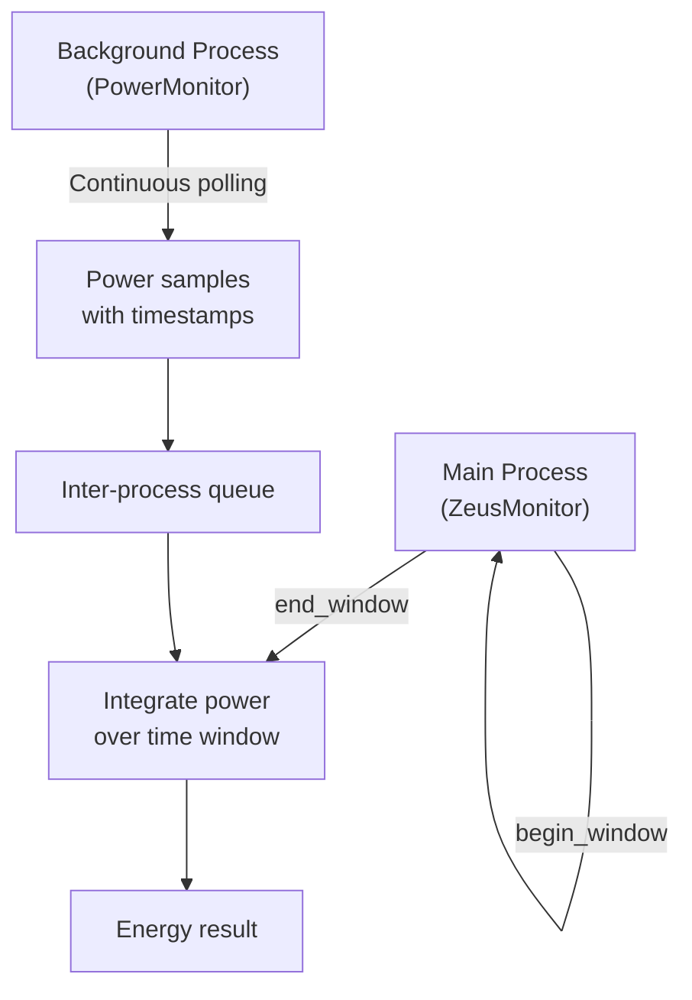
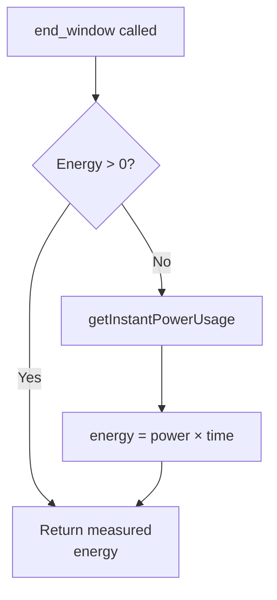
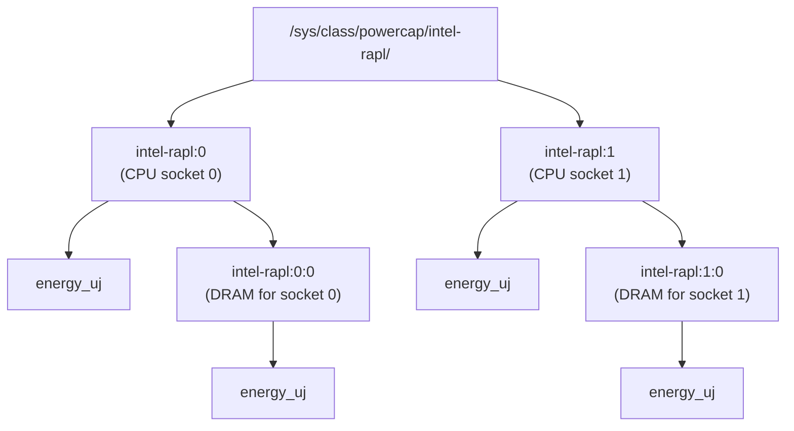
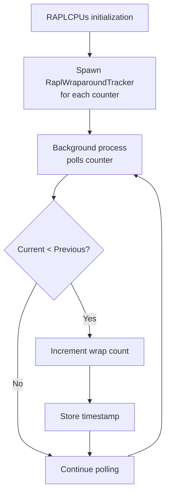
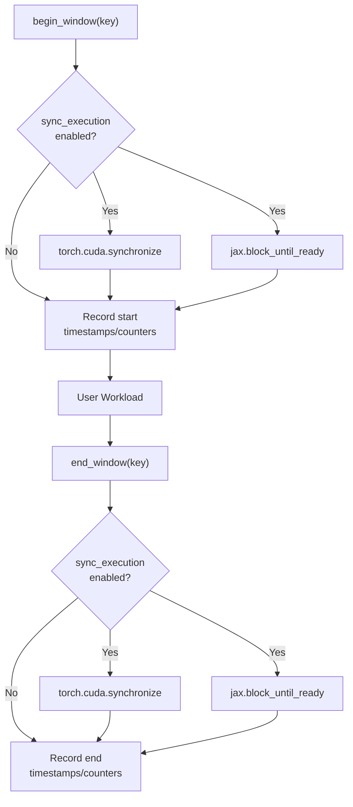
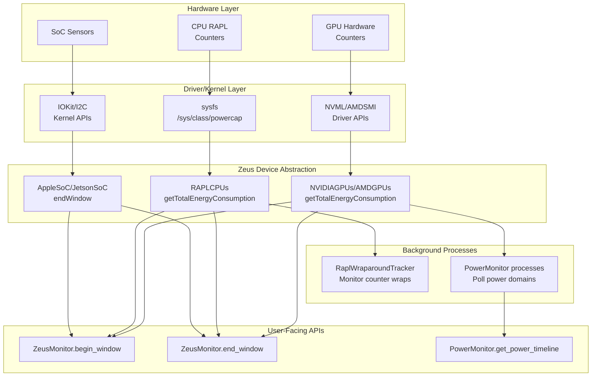

<!-- source: DeepWiki mcp.deepwiki.com · repo ml-energy/zeus · page 4 Energy Measurement · fetched 2026-10-21 -->

# Energy Measurement

<details>
<summary>Relevant source files</summary>

The following files were used as context for generating this wiki page:

- [README.md](README.md)
- [docs/getting_started/index.md](docs/getting_started/index.md)
- [docs/index.md](docs/index.md)
- [docs/measure/index.md](docs/measure/index.md)
- [docs/optimize/index.md](docs/optimize/index.md)
- [zeus/monitor/energy.py](zeus/monitor/energy.py)
- [zeus/monitor/power.py](zeus/monitor/power.py)

</details>


This page provides an overview of Zeus's energy and power measurement capabilities, including the architecture, supported hardware, and measurement strategies. For detailed information about specific measurement tools, see:

- [ZeusMonitor](#4.1) - Window-based energy measurement
- [PowerMonitor](#4.2) - Continuous power polling
- [Temperature Monitoring](#4.3) - GPU temperature tracking
- [Carbon & Cost Tracking](#4.4) - Carbon emissions and electricity cost monitoring

For information about energy optimization (using measurement results to reduce energy consumption), see [Energy Optimization](#5).

## Measurement Architecture

Zeus provides a layered architecture for energy measurement that abstracts hardware differences across vendors while providing flexible measurement APIs for different use cases.



**Sources:** [zeus/monitor/energy.py:1-489](), [zeus/monitor/power.py:1-594](), [zeus/device/__init__.py](), Diagram 2 from high-level systems overview

The architecture consists of three layers:

| Layer | Purpose | Key Components |
|-------|---------|----------------|
| **User-Facing APIs** | Provide measurement interfaces for different use cases | `ZeusMonitor`, `PowerMonitor`, `CarbonEmissionMonitor`, `EnergyCostMonitor` |
| **Device Abstraction** | Unify access to different hardware types | `get_gpus()`, `get_cpus()`, `get_soc()` |
| **Hardware Implementations** | Vendor-specific measurement backends | `NVIDIAGPUs`, `AMDGPUs`, `RAPLCPUs`, `AppleSoC`, `JetsonSoC` |

**Sources:** [zeus/monitor/energy.py:90-148](), [zeus/device/gpu/common.py](), [zeus/device/cpu/common.py](), [docs/measure/index.md:1-376]()

## Measurement Paradigms

Zeus supports two complementary measurement paradigms, each suited for different scenarios.

### Window-Based Measurement

Window-based measurement captures energy consumption over a defined code block. This is the primary approach for measuring specific operations (e.g., training epochs, inference batches).


The [`ZeusMonitor`][zeus.monitor.energy.ZeusMonitor] class implements window-based measurement with the following workflow:

1. **`begin_window(key)`** - Records start time and energy counters for all monitored devices
2. **User code execution** - Target computation runs
3. **`end_window(key)`** - Records end time and energy counters, computes deltas

Windows can be nested or overlapping as long as they have unique keys. The returned [`Measurement`][zeus.monitor.energy.Measurement] object contains time and energy for GPUs, CPUs, DRAM, and SoCs.

**Sources:** [zeus/monitor/energy.py:90-148](), [zeus/monitor/energy.py:273-322](), [zeus/monitor/energy.py:324-457](), [docs/measure/index.md:14-45]()

### Continuous Power Polling

Continuous polling measures instantaneous power draw over time, allowing timeline-based analysis and energy integration over arbitrary intervals.



The [`PowerMonitor`][zeus.monitor.power.PowerMonitor] class spawns separate processes for each supported power domain:

- **`DEVICE_INSTANT`** - Instantaneous device power
- **`DEVICE_AVERAGE`** - Windowed average device power (1 second window)
- **`MEMORY_AVERAGE`** - Windowed average memory power (Hopper+ GPUs)

Each process polls at a configurable rate (auto-detected or user-specified), deduplicates samples, and stores them in per-domain queues.

**Sources:** [zeus/monitor/power.py:143-262](), [zeus/monitor/power.py:488-594](), [docs/measure/index.md:65-77]()

## Hardware Support Matrix

Zeus supports energy measurement across multiple hardware platforms with varying capabilities.

| Hardware Type | Vendor | Measurement Method | Supported Metrics | Requirements |
|---------------|--------|-------------------|-------------------|--------------|
| **GPU** | NVIDIA | NVML API | Energy, Power (instant/average) | Volta+ for direct energy counters |
| **GPU** | AMD | AMDSMI API | Energy, Power | ROCm 6.1+ |
| **CPU** | Intel/AMD | RAPL sysfs | CPU energy, DRAM energy | Root/SYS_ADMIN privileges |
| **SoC** | Apple Silicon | IOKit API | CPU, GPU, DRAM, ANE | macOS with `zeus-apple-silicon` package |
| **SoC** | NVIDIA Jetson | I2C rails | CPU, GPU, total | Linux on Jetson hardware |

**Sources:** [zeus/device/gpu/nvidia.py](), [zeus/device/gpu/amd.py](), [zeus/device/cpu/rapl.py](), [docs/measure/index.md:98-189]()

### Device Detection and Initialization

Zeus provides factory functions for automatic hardware detection:



The `Empty*` classes implement the null object pattern, allowing code to run without errors when hardware is unavailable. This enables graceful degradation across different deployment environments.

**Sources:** [zeus/device/__init__.py](), [zeus/device/gpu/common.py](), [zeus/device/cpu/common.py](), [zeus/monitor/energy.py:184-211]()

## Measurement Strategies

Zeus employs different strategies for energy measurement based on hardware capabilities.

### Direct Energy Counters

Modern GPUs (Volta and newer) provide hardware energy counters that can be queried directly:



This method calls `nvmlDeviceGetTotalEnergyConsumption()` (NVIDIA) or `amdsmi.amdsmi_get_energy_count()` (AMD) to read hardware counters directly, providing high accuracy with minimal overhead.

**Sources:** [zeus/monitor/energy.py:296-302](), [zeus/monitor/energy.py:390-395](), [zeus/device/gpu/nvidia.py]()

### Power Polling for Legacy GPUs

Pre-Volta NVIDIA GPUs lack direct energy counters. Zeus spawns a background process to poll power readings and integrate them to compute energy:



The integration uses the area-under-curve calculation with sklearn's `auc` function to compute energy from the power timeline.

**Sources:** [zeus/monitor/energy.py:251-262](), [zeus/monitor/energy.py:410-421](), [zeus/monitor/power.py:398-432]()

### Instant Power Approximation

When a measurement window is very short (shorter than the energy counter update period), the counter may report zero energy consumption. The `approx_instant_energy` option addresses this:



This approximation multiplies instantaneous power by window duration, providing a better estimate than zero for very short operations.

**Sources:** [zeus/monitor/energy.py:154-174](), [zeus/monitor/energy.py:358-360](), [zeus/monitor/energy.py:423-438]()

## CPU and DRAM Measurement

CPU and DRAM energy measurement uses Intel's Running Average Power Limit (RAPL) interface, exposed through the Linux sysfs filesystem.

### RAPL Interface Structure



Each CPU socket (powerzone) exposes an `energy_uj` file containing a monotonically increasing energy counter in microjoules. DRAM measurements are available as sub-packages within each socket.

**Sources:** [zeus/device/cpu/rapl.py](), [docs/measure/index.md:130-133]()

### Wraparound Tracking

RAPL counters are limited-width and wrap around to zero periodically. Zeus handles this by spawning a background process per counter to detect and track wraparounds:



When reading energy, Zeus combines the current counter value with the accumulated wrap count to compute total energy consumption since initialization.

**Sources:** [zeus/device/cpu/rapl.py:40-103](), [zeus/device/cpu/rapl.py:136-256]()

## Framework Synchronization

Deep learning frameworks dispatch GPU operations asynchronously. To ensure accurate measurements, Zeus synchronizes the CPU and GPU before taking measurements:



The `sync_execution_with` parameter in [`ZeusMonitor`][zeus.monitor.energy.ZeusMonitor] (defaults to `"torch"`) determines which framework's synchronization primitive to use. The [`sync_execution`][zeus.utils.framework.sync_execution] function in `zeus.utils.framework` handles the framework-specific calls.

**Sources:** [zeus/monitor/energy.py:156-178](), [zeus/monitor/energy.py:288-290](), [zeus/monitor/energy.py:362-364](), [zeus/utils/framework.py]()

## Measurement Data Structures

Zeus uses two primary data structures to represent measurement results.

### Measurement Object

The [`Measurement`][zeus.monitor.energy.Measurement] dataclass returned by [`end_window`][zeus.monitor.energy.ZeusMonitor.end_window] contains:

| Field | Type | Description |
|-------|------|-------------|
| `time` | `float` | Elapsed time in seconds |
| `gpu_energy` | `dict[int, float]` | GPU energy in Joules, indexed by GPU index |
| `cpu_energy` | `dict[int, float] \| None` | CPU energy in Joules, indexed by CPU index |
| `dram_energy` | `dict[int, float] \| None` | DRAM energy in Joules, indexed by CPU index |
| `soc_energy` | `SoCMeasurement \| None` | SoC metrics (Apple Silicon or Jetson) |

The `total_energy` property sums all GPU energy values. For CPU/DRAM/SoC measurements, users must access the specific fields.

**Sources:** [zeus/monitor/energy.py:24-57]()

### MeasurementState Object

Internally, [`ZeusMonitor`][zeus.monitor.energy.ZeusMonitor] maintains a dictionary mapping window keys to [`MeasurementState`][zeus.monitor.energy.MeasurementState] objects:

```python
# zeus/monitor/energy.py:249
self.measurement_states: dict[str, MeasurementState] = {}
```

Each [`MeasurementState`][zeus.monitor.energy.MeasurementState] stores the initial timestamp and energy counter values at the start of a window. When [`end_window`][zeus.monitor.energy.ZeusMonitor.end_window] is called, the state is retrieved, current values are read, and deltas are computed.

**Sources:** [zeus/monitor/energy.py:60-88](), [zeus/monitor/energy.py:249](), [zeus/monitor/energy.py:316-321]()

## Data Collection Pipeline

The complete data flow from hardware to user involves multiple layers:



**Sources:** [zeus/monitor/energy.py:90-489](), [zeus/monitor/power.py:143-594](), [zeus/device/](), Diagram 2 from high-level systems overview

## Privilege Requirements

Different measurement operations have different privilege requirements:

| Operation | Hardware | Privilege Required | Notes |
|-----------|----------|-------------------|-------|
| GPU energy read | NVIDIA (Volta+) | None | Direct counter access |
| GPU energy read | NVIDIA (Pre-Volta) | None | Via power polling |
| GPU energy read | AMD | None | Direct counter access |
| CPU/DRAM energy read | Intel/AMD RAPL | `root` or `SYS_ADMIN` | Due to CVE-2020-8694 |
| SoC energy read | Apple Silicon | None | Via IOKit |
| SoC energy read | Jetson | None | Via I2C |
| GPU power/freq write | NVIDIA/AMD | `root` or `SYS_ADMIN` | Required for optimization |

For privileged operations, Zeus supports three deployment patterns:
1. **Docker with capabilities** - Grant `SYS_ADMIN` to container
2. **Zeus daemon (`zeusd`)** - Run privileged daemon, communicate via Unix socket
3. **Direct sudo** - Run entire application as root (discouraged)

See [Privilege Management](#3.2) for details.

**Sources:** [docs/getting_started/index.md:131-199](), [docs/measure/index.md:98-107]()

## Related Pages

- [ZeusMonitor](#4.1) - Detailed documentation of window-based measurement
- [PowerMonitor](#4.2) - Detailed documentation of continuous power polling
- [Hardware Abstraction Layer](#6) - How Zeus abstracts hardware differences
- [Zeus Daemon](#7) - Privileged operation handling via daemon

---

