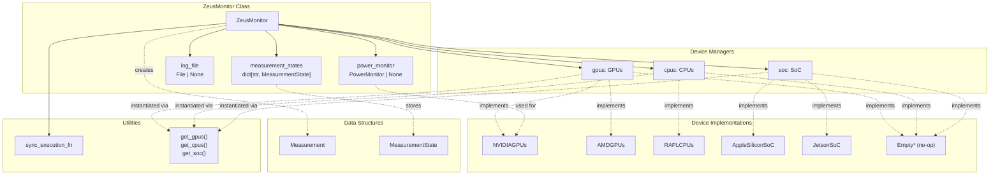
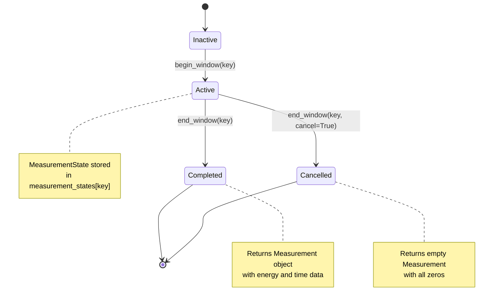
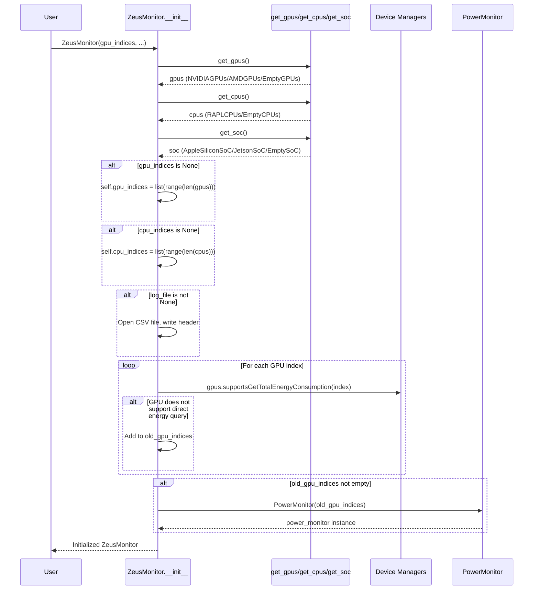
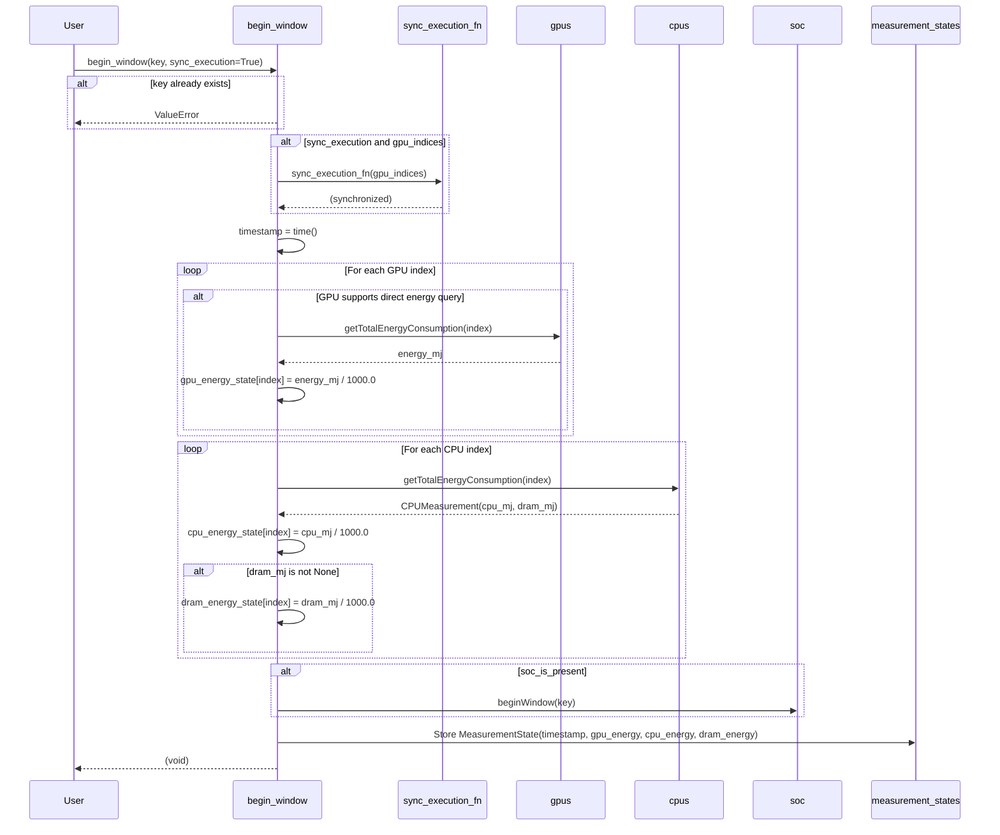
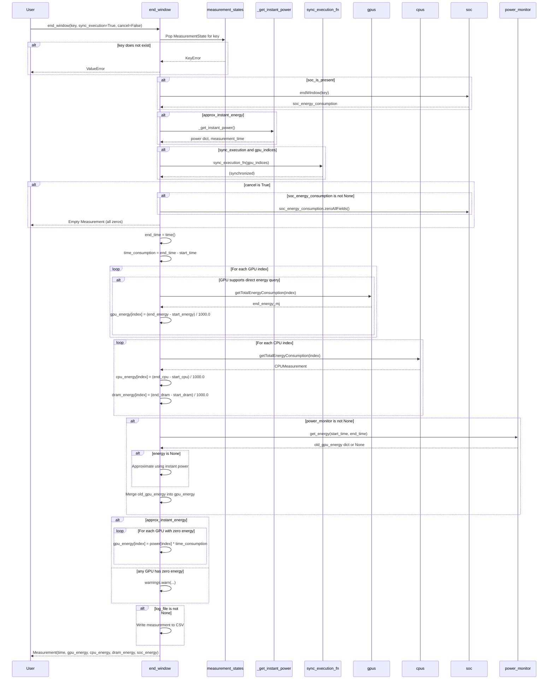
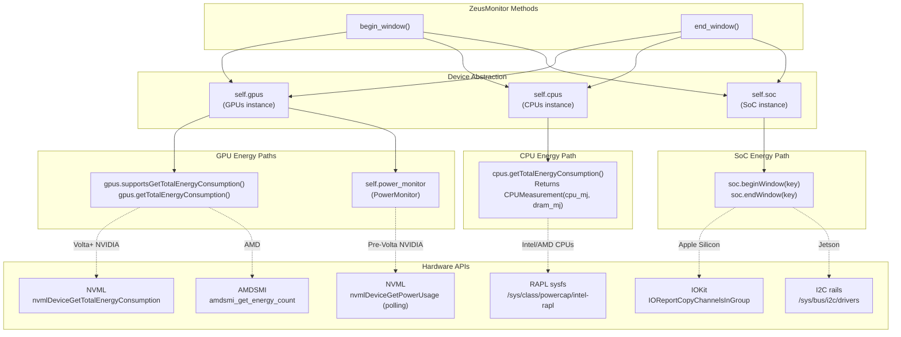
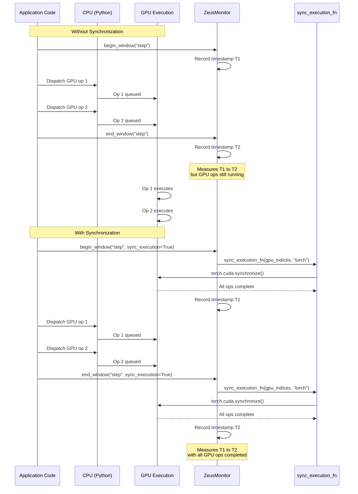
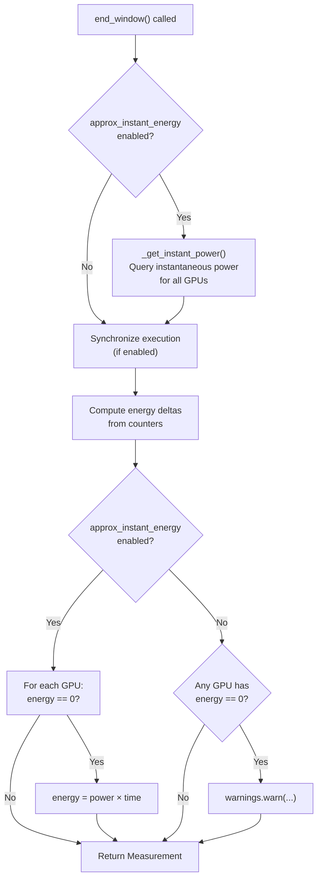
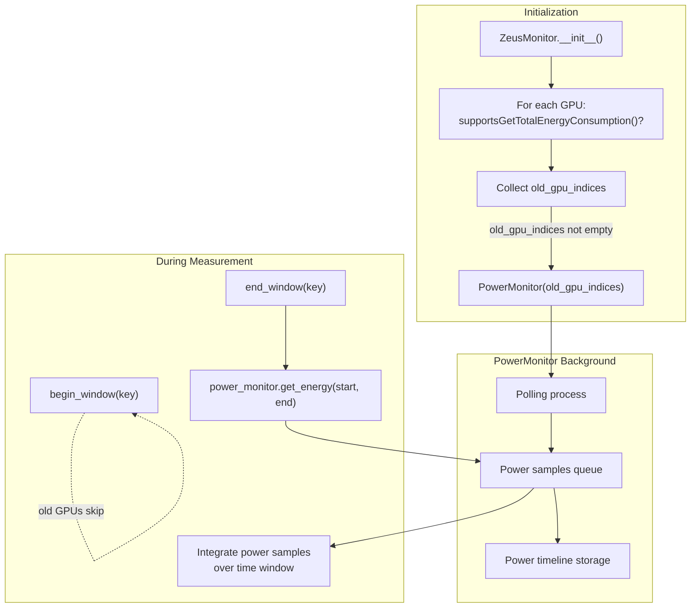
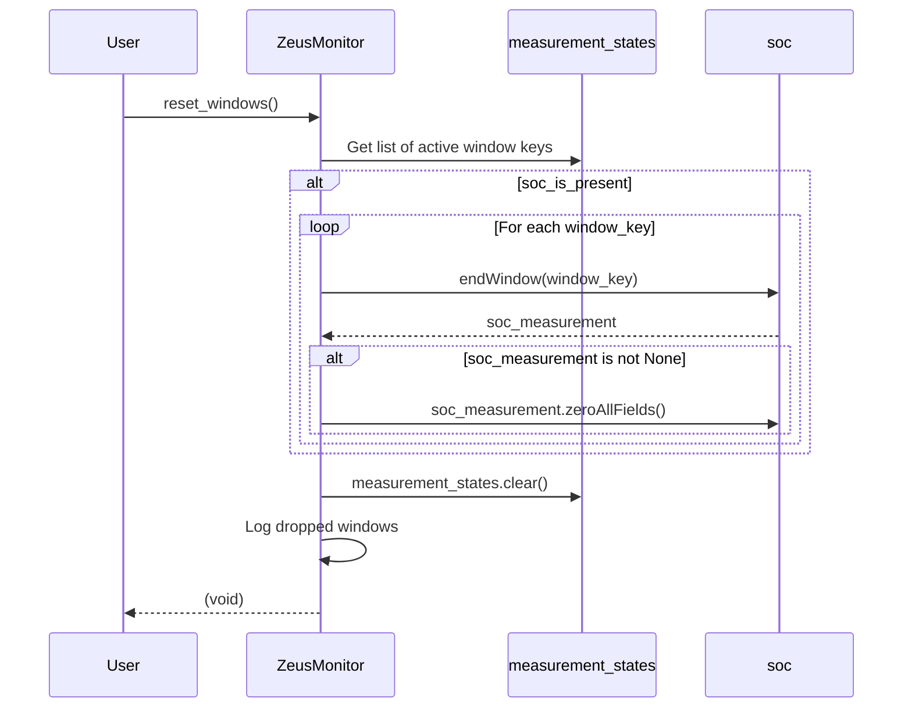

<!-- source: DeepWiki mcp.deepwiki.com · repo ml-energy/zeus · page 4.1 ZeusMonitor · fetched 2026-10-21 -->

# ZeusMonitor

<details>
<summary>Relevant source files</summary>

The following files were used as context for generating this wiki page:

- [docs/measure/index.md](docs/measure/index.md)
- [docs/optimize/index.md](docs/optimize/index.md)
- [zeus/monitor/energy.py](zeus/monitor/energy.py)
- [zeus/monitor/power.py](zeus/monitor/power.py)

</details>


`ZeusMonitor` is the primary API for window-based energy and time measurement in Zeus. It provides a simple interface for measuring GPU, CPU, DRAM, and SoC energy consumption within defined code blocks (measurement windows). This monitor is designed for instrumenting training loops, profiling specific operations, and tracking energy consumption across heterogeneous hardware.

For continuous power polling and timeline-based measurements, see [PowerMonitor](#4.2). For monitoring energy costs and carbon emissions, see [Carbon & Cost Tracking](#4.4).

**Sources:** [zeus/monitor/energy.py:1-489](), [docs/measure/index.md:1-376]()

## Purpose and Scope

`ZeusMonitor` measures **energy consumption and elapsed time** for arbitrary Python code blocks through named measurement windows. It supports:

- **Multi-device measurement**: Simultaneous monitoring of multiple GPUs, CPUs, and SoCs
- **Concurrent windows**: Multiple overlapping or nested measurement windows
- **Heterogeneous hardware**: Different GPU types (NVIDIA, AMD), CPU architectures, and SoC platforms
- **Framework synchronization**: Automatic CPU-GPU synchronization for PyTorch, JAX, and CuPy
- **Flexible logging**: Optional CSV logging of measurements

The monitor abstracts hardware differences through Zeus's device abstraction layer (see [Hardware Abstraction Layer](#6)).

**Sources:** [zeus/monitor/energy.py:90-148](), [docs/measure/index.md:14-64]()

## Architecture Overview



**Architecture Overview**

The `ZeusMonitor` class coordinates energy measurement across multiple hardware types through device manager instances (`gpus`, `cpus`, `soc`). It maintains active measurement windows in the `measurement_states` dictionary and optionally logs results to a CSV file. For GPUs older than Volta that don't support direct energy counters, it internally instantiates a `PowerMonitor` for power polling.

**Sources:** [zeus/monitor/energy.py:90-262]()

## Measurement Window Concept

Measurement windows define code blocks whose energy consumption and execution time should be measured. Windows are identified by unique string keys.



**Measurement Window Lifecycle**

### Window Operations

| Operation | Method | Description |
|-----------|--------|-------------|
| Start window | `begin_window(key)` | Records timestamp and initial energy counters |
| End window | `end_window(key)` | Calculates elapsed time and energy consumption |
| Cancel window | `end_window(key, cancel=True)` | Discards measurement, returns empty result |
| Reset all | `reset_windows()` | Cancels all active windows |

Windows can be **nested** or **overlapping** as long as each has a unique key. The monitor tracks each window independently.

**Sources:** [zeus/monitor/energy.py:273-322](), [zeus/monitor/energy.py:324-457](), [zeus/monitor/energy.py:459-488]()

## Initialization and Configuration

```python
# Class signature
ZeusMonitor(
    gpu_indices: list[int] | None = None,
    cpu_indices: list[int] | None = None,
    approx_instant_energy: bool = False,
    log_file: str | Path | None = None,
    sync_execution_with: Literal["torch", "jax", "cupy"] = "torch"
)
```

### Configuration Parameters

| Parameter | Type | Default | Description |
|-----------|------|---------|-------------|
| `gpu_indices` | `list[int] \| None` | `None` | GPUs to monitor (respects `CUDA_VISIBLE_DEVICES`). If `None`, monitors all available GPUs |
| `cpu_indices` | `list[int] \| None` | `None` | CPU packages to monitor. If `None`, monitors all RAPL powerzones |
| `approx_instant_energy` | `bool` | `False` | Approximate zero-energy windows using instantaneous power |
| `log_file` | `str \| Path \| None` | `None` | Path to CSV log file. If `None`, logging is disabled |
| `sync_execution_with` | `"torch" \| "jax" \| "cupy"` | `"torch"` | Framework for CPU-GPU synchronization |

### Initialization Flow



**Initialization Process**

The constructor attempts to initialize device managers for GPUs, CPUs, and SoCs. If initialization fails (e.g., no hardware available, permission denied), it falls back to `Empty*` implementations that return no-op results. For pre-Volta GPUs that don't support direct energy counters, it creates a `PowerMonitor` for background power polling.

**Sources:** [zeus/monitor/energy.py:150-262]()

## Measurement Workflow

### Begin Window



**Begin Window Process**

`begin_window` optionally synchronizes execution, captures the current timestamp, and queries energy counters from all monitored devices. It stores this initial state in `measurement_states[key]` for later comparison in `end_window`.

**Sources:** [zeus/monitor/energy.py:273-322]()

### End Window



**End Window Process**

`end_window` retrieves the initial state, optionally synchronizes execution, and queries energy counters again. It computes energy deltas for each device and returns a `Measurement` object. For old GPUs using `PowerMonitor`, it integrates power samples over the time window. The `approx_instant_energy` flag enables approximation for very short windows where energy counters might not update.

**Sources:** [zeus/monitor/energy.py:324-457]()

## Data Structures

### Measurement

```python
@dataclass
class Measurement:
    time: float                           # Elapsed time (seconds)
    gpu_energy: dict[int, float]          # GPU index -> energy (Joules)
    cpu_energy: dict[int, float] | None   # CPU index -> energy (Joules)
    dram_energy: dict[int, float] | None  # CPU index -> DRAM energy (Joules)
    soc_energy: SoCMeasurement | None     # SoC energy metrics (if present)
    
    @cached_property
    def total_energy(self) -> float:      # Sum of GPU energies
        return sum(self.gpu_energy.values())
```

**Measurement Structure**

The `Measurement` dataclass holds the result of a completed measurement window. The `total_energy` property currently sums only GPU energies for backward compatibility, though CPU, DRAM, and SoC measurements are also available.

| Field | Type | Description |
|-------|------|-------------|
| `time` | `float` | Elapsed time in seconds |
| `gpu_energy` | `dict[int, float]` | Per-GPU energy in Joules (indices from DL framework perspective) |
| `cpu_energy` | `dict[int, float] \| None` | Per-CPU-package energy in Joules (RAPL powerzone indices) |
| `dram_energy` | `dict[int, float] \| None` | Per-CPU DRAM energy in Joules (from RAPL sub-packages) |
| `soc_energy` | `SoCMeasurement \| None` | SoC subsystem energies in millijoules (Apple Silicon, Jetson) |

**Sources:** [zeus/monitor/energy.py:24-57]()

### MeasurementState

```python
@dataclass
class MeasurementState:
    time: float                           # Start timestamp
    gpu_energy: dict[int, float]          # Initial GPU energy counters (J)
    cpu_energy: dict[int, float] | None   # Initial CPU energy counters (J)
    dram_energy: dict[int, float] | None  # Initial DRAM energy counters (J)
```

**MeasurementState Structure**

`MeasurementState` stores the initial state when `begin_window` is called. This is an internal structure stored in `measurement_states` and not directly exposed to users.

**Sources:** [zeus/monitor/energy.py:59-88]()

## Hardware Integration



**Hardware Integration Architecture**

`ZeusMonitor` uses device manager instances (`gpus`, `cpus`, `soc`) obtained through factory functions. These managers abstract vendor-specific APIs:

- **NVIDIA GPUs (Volta+)**: Direct energy counters via `nvmlDeviceGetTotalEnergyConsumption`
- **NVIDIA GPUs (Pre-Volta)**: Power polling via `PowerMonitor` with `nvmlDeviceGetPowerUsage`
- **AMD GPUs**: Energy counters via `amdsmi_get_energy_count`
- **CPUs**: RAPL sysfs interface for Intel/AMD processors
- **Apple Silicon**: IOKit API for on-chip subsystems
- **Jetson**: I2C power rails for SoC components

The `Empty*` implementations (e.g., `EmptyGPUs`) provide no-op fallbacks when hardware is unavailable.

**Sources:** [zeus/monitor/energy.py:184-221](), [zeus/monitor/energy.py:294-310](), [zeus/monitor/energy.py:389-408]()

## Synchronization Mechanisms

Deep learning frameworks dispatch GPU operations asynchronously. Without synchronization, measurement windows may not capture the intended computations.



**Synchronization Behavior**

The `sync_execution` parameter (default `True`) in `begin_window` and `end_window` controls whether to synchronize CPU and GPU execution. When enabled, `ZeusMonitor` calls `sync_execution_fn` from `zeus.utils.framework`, which invokes the appropriate synchronization primitive:

| Framework | Synchronization Method |
|-----------|------------------------|
| PyTorch | `torch.cuda.synchronize()` |
| JAX | `jax.block_until_ready()` |
| CuPy | `cupy.cuda.Stream.null.synchronize()` |

The framework is specified via the `sync_execution_with` parameter in the constructor.

**Sources:** [zeus/monitor/energy.py:273-290](), [zeus/monitor/energy.py:362-364](), [docs/measure/index.md:79-96]()

## Special Features

### Approximate Instant Energy

When a measurement window is very short (shorter than the GPU's energy counter update period), the energy delta may be zero. The `approx_instant_energy` option approximates energy as:

```
energy ≈ instant_power × time_consumption
```



**Approximate Instant Energy Logic**

This feature is particularly useful for very short operations like single forward/backward passes in profiling scenarios. The warning emitted when `approx_instant_energy` is disabled helps identify measurement windows that are too short for accurate energy measurement.

**Sources:** [zeus/monitor/energy.py:352-360](), [zeus/monitor/energy.py:423-438]()

### PowerMonitor Integration

For GPUs that don't support direct energy counters (pre-Volta architectures), `ZeusMonitor` automatically instantiates a `PowerMonitor` to poll power usage in the background.



**PowerMonitor Integration Flow**

During initialization, `ZeusMonitor` identifies GPUs lacking direct energy counter support and creates a `PowerMonitor` for them. The `PowerMonitor` spawns a background process that continuously polls `nvmlDeviceGetPowerUsage` and maintains a timeline of power samples. When `end_window` is called, `ZeusMonitor` retrieves power samples for the measurement window and integrates them to compute energy.

**Sources:** [zeus/monitor/energy.py:251-262](), [zeus/monitor/energy.py:410-421]()

### CSV Logging

When `log_file` is specified, `ZeusMonitor` writes measurement results to a CSV file.

**CSV Format:**

```
start_time,window_name,elapsed_time,gpu0_energy,gpu1_energy,...
1692748485.123,step_1,2.456,150.2,148.9
1692748487.580,step_2,2.457,151.1,149.3
```

| Column | Description |
|--------|-------------|
| `start_time` | Unix timestamp when window began |
| `window_name` | Key passed to `begin_window` |
| `elapsed_time` | Duration in seconds |
| `gpu{N}_energy` | Energy consumed by GPU N in Joules |

The CSV is flushed after each measurement to ensure data is written even if the process crashes.

**Sources:** [zeus/monitor/energy.py:227-237](), [zeus/monitor/energy.py:442-449]()

### Reset Windows

The `reset_windows()` method cancels all active measurement windows, clearing their state without returning measurements. This is useful for error recovery or resetting the monitor between experiments.



**Reset Windows Process**

This method ensures proper cleanup of SoC measurement windows before clearing the `measurement_states` dictionary. It logs the names of dropped windows for debugging purposes.

**Sources:** [zeus/monitor/energy.py:459-488]()

## Usage Examples

### Basic Usage

```python
from zeus.monitor import ZeusMonitor

if __name__ == "__main__":
    # Monitor all available GPUs
    monitor = ZeusMonitor()
    
    # Begin measurement window
    monitor.begin_window("training_epoch")
    
    # ... training code ...
    
    # End measurement and get results
    result = monitor.end_window("training_epoch")
    print(f"Time: {result.time:.2f}s")
    print(f"Total GPU energy: {result.total_energy:.2f}J")
    for gpu_idx, energy in result.gpu_energy.items():
        print(f"  GPU {gpu_idx}: {energy:.2f}J")
```

**Sources:** [zeus/monitor/energy.py:116-143](), [docs/measure/index.md:22-45]()

### Multi-Device Monitoring

```python
# Monitor specific GPUs and CPUs
monitor = ZeusMonitor(
    gpu_indices=[0, 1],
    cpu_indices=[0]
)

monitor.begin_window("iteration")
# ... computation ...
result = monitor.end_window("iteration")

# Access different energy components
print(f"GPU energy: {result.gpu_energy}")     # {0: 150.2, 1: 148.9}
print(f"CPU energy: {result.cpu_energy}")     # {0: 45.3}
print(f"DRAM energy: {result.dram_energy}")   # {0: 12.1} or None
```

**Sources:** [zeus/monitor/energy.py:150-180](), [docs/measure/index.md:100-107]()

### Nested Windows

```python
monitor = ZeusMonitor()

monitor.begin_window("epoch")
for batch_idx, (x, y) in enumerate(dataloader):
    monitor.begin_window(f"batch_{batch_idx}")
    
    # Forward + backward
    loss = model(x, y)
    loss.backward()
    
    batch_result = monitor.end_window(f"batch_{batch_idx}")
    print(f"Batch {batch_idx}: {batch_result.total_energy:.2f}J")

epoch_result = monitor.end_window("epoch")
print(f"Epoch total: {epoch_result.total_energy:.2f}J")
```

**Sources:** [zeus/monitor/energy.py:90-99](), [docs/measure/index.md:22-44]()

### Short Window Approximation

```python
# Enable approximation for very short operations
monitor = ZeusMonitor(approx_instant_energy=True)

for i in range(1000):
    monitor.begin_window(f"op_{i}")
    
    # Very short operation (e.g., single forward pass)
    output = model(input_tensor)
    
    result = monitor.end_window(f"op_{i}")
    # Energy will be approximated if counter didn't update
```

**Sources:** [zeus/monitor/energy.py:169-174](), [zeus/monitor/energy.py:423-438]()

### CSV Logging

```python
# Enable CSV logging
monitor = ZeusMonitor(
    gpu_indices=[0, 1],
    log_file="measurements.csv"
)

for step in range(num_steps):
    monitor.begin_window(f"step_{step}")
    train_step()
    result = monitor.end_window(f"step_{step}")
    # Results automatically written to measurements.csv
```

**Sources:** [zeus/monitor/energy.py:175](), [zeus/monitor/energy.py:227-237]()

### Framework Synchronization

```python
# For PyTorch (default)
monitor = ZeusMonitor(sync_execution_with="torch")

# For JAX
monitor = ZeusMonitor(sync_execution_with="jax")

# For CuPy
monitor = ZeusMonitor(sync_execution_with="cupy")

# Disable synchronization for specific windows
monitor.begin_window("async_op", sync_execution=False)
# ... dispatch operations ...
monitor.end_window("async_op", sync_execution=False)
```

**Sources:** [zeus/monitor/energy.py:156](), [zeus/monitor/energy.py:273-290](), [docs/measure/index.md:79-96]()

### Cancelled Measurements

```python
monitor = ZeusMonitor()

monitor.begin_window("might_fail")
try:
    risky_operation()
    result = monitor.end_window("might_fail")
except Exception as e:
    # Cancel the measurement window
    result = monitor.end_window("might_fail", cancel=True)
    # result.total_energy == 0.0, not logged to CSV
    print(f"Operation failed: {e}")
```

**Sources:** [zeus/monitor/energy.py:336-379]()

## Implementation Details

### CUDA_VISIBLE_DEVICES Handling

`ZeusMonitor` respects the `CUDA_VISIBLE_DEVICES` environment variable. GPU indices are interpreted relative to the visible devices:

```
# Shell: export CUDA_VISIBLE_DEVICES=2,3,5
# Python:
monitor = ZeusMonitor(gpu_indices=[0, 1])  # Monitors physical GPUs 2 and 3
```

The device abstraction layer (see [GPU Support](#6.1)) handles the translation between framework-visible indices and physical device indices.

**Sources:** [zeus/monitor/energy.py:90-96](), [zeus/monitor/energy.py:163-166](), [docs/measure/index.md:57-59]()

### Multiprocessing Safety

On pre-Volta GPUs, `ZeusMonitor` spawns a `PowerMonitor` subprocess. This requires the module to be import-safe:

```python
# CORRECT: Guard instantiation
if __name__ == "__main__":
    monitor = ZeusMonitor()

# INCORRECT: Global instantiation
# monitor = ZeusMonitor()  # May cause fork bomb on old GPUs
```

**Sources:** [zeus/monitor/energy.py:106-112](), [docs/measure/index.md:51-55]()

### Error Handling

| Exception | Condition | Source |
|-----------|-----------|--------|
| `ValueError` | Duplicate window key in `begin_window` | [zeus/monitor/energy.py:285-286]() |
| `ValueError` | Non-existent window key in `end_window` | [zeus/monitor/energy.py:344-345]() |
| `RuntimeError` | CPU measurement requested but no permissions | [zeus/monitor/energy.py:196-202]() |
| `ZeusGPUInitError` | GPU initialization fails | [zeus/monitor/energy.py:187-188]() |
| `ZeusCPUInitError` | CPU initialization fails | [zeus/monitor/energy.py:193-194]() |
| `ZeusSoCInitError` | SoC initialization fails | [zeus/monitor/energy.py:210-211]() |

The monitor gracefully degrades to `Empty*` implementations when hardware is unavailable, except when CPU monitoring is explicitly requested without proper permissions.

**Sources:** [zeus/monitor/energy.py:184-211](), [zeus/monitor/energy.py:285-286](), [zeus/monitor/energy.py:344-345]()

---

