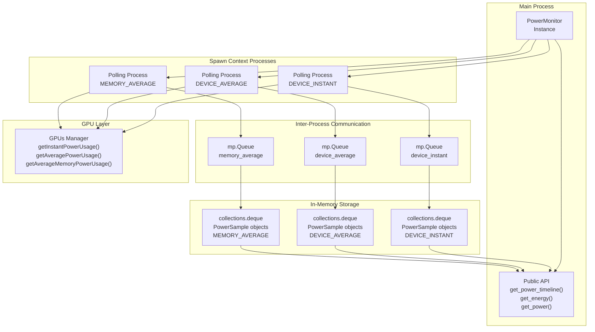
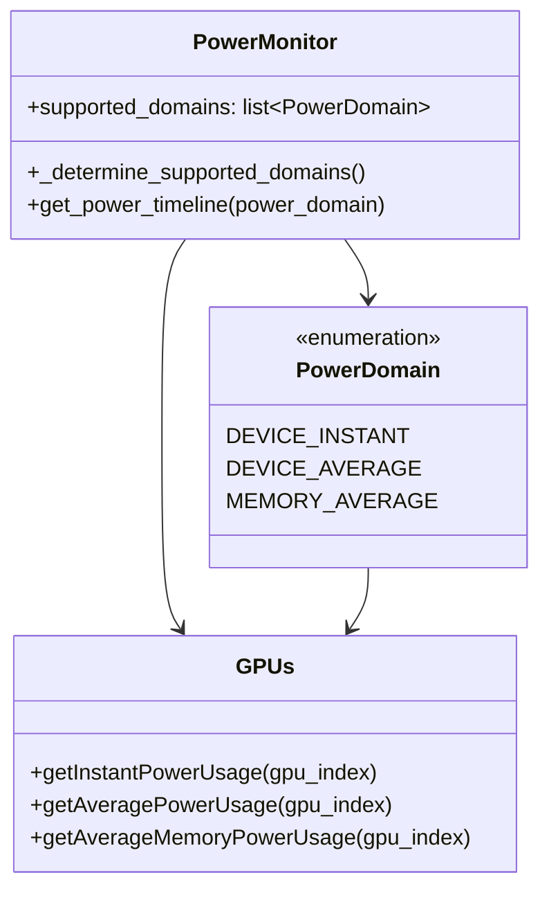
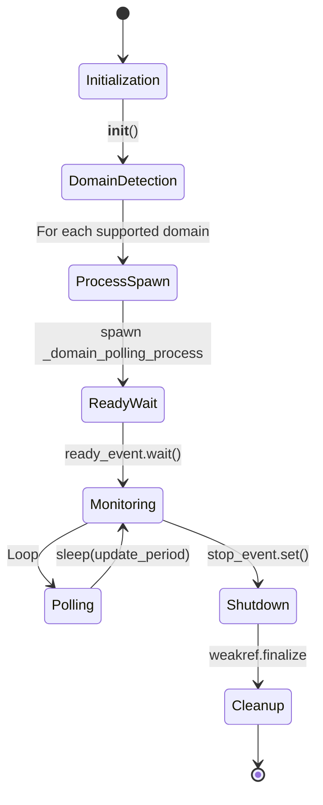
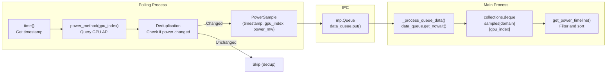
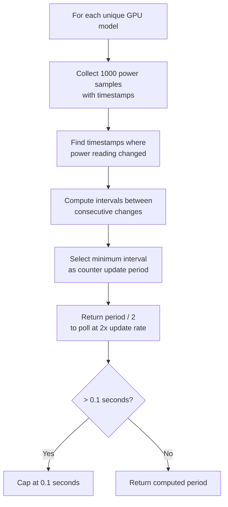
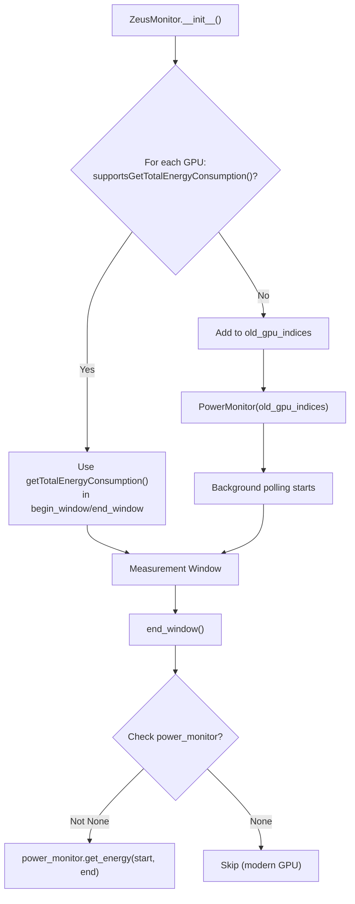
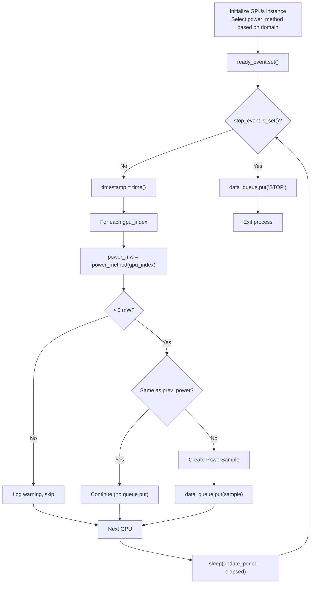

<!-- source: DeepWiki mcp.deepwiki.com · repo ml-energy/zeus · page 4.2 PowerMonitor · fetched 2026-10-21 -->

# PowerMonitor

<details>
<summary>Relevant source files</summary>

The following files were used as context for generating this wiki page:

- [docs/measure/index.md](docs/measure/index.md)
- [docs/optimize/index.md](docs/optimize/index.md)
- [zeus/monitor/energy.py](zeus/monitor/energy.py)
- [zeus/monitor/power.py](zeus/monitor/power.py)

</details>


The `PowerMonitor` class provides continuous power polling for GPUs with support for multiple power domains and timeline-based energy integration. Unlike [`ZeusMonitor`](#4.1) which measures energy over discrete windows, `PowerMonitor` runs background processes that continuously collect power samples, enabling detailed power consumption analysis over time.

For window-based energy measurement of GPUs, CPUs, DRAM, and SoCs, see [`ZeusMonitor`](#4.1). For carbon-aware and cost-aware monitoring, see [Carbon & Cost Tracking](#4.4).

## Overview

`PowerMonitor` spawns dedicated background processes that poll GPU power consumption APIs at regular intervals. It collects timestamped power samples across multiple power domains and stores them in memory for later retrieval. The monitor supports querying power timelines for specific time windows and computing energy consumption by integrating power over time.

**Key Characteristics:**

| Aspect | Description |
|--------|-------------|
| **Measurement Style** | Continuous background polling |
| **Granularity** | Millisecond-level timestamped samples |
| **Use Case** | Detailed power profiling, timeline export |
| **Overhead** | Separate processes per power domain |
| **Hardware Support** | NVIDIA and AMD GPUs (via device abstraction) |

**PowerMonitor System Architecture**



Sources: [zeus/monitor/power.py:143-261](), [zeus/monitor/power.py:488-594]()

## Power Domains

`PowerMonitor` supports three distinct power measurement domains, each with different update characteristics and availability depending on GPU architecture.

**Power Domain Enumeration**



Sources: [zeus/monitor/power.py:101-107]()

### Domain Descriptions

| Domain | Enum Value | GPU Method | Description | Availability |
|--------|-----------|------------|-------------|--------------|
| **Device Instant** | `DEVICE_INSTANT` | `getInstantPowerUsage()` | Instantaneous power consumption at query time | All NVIDIA/AMD GPUs |
| **Device Average** | `DEVICE_AVERAGE` | `getAveragePowerUsage()` | Windowed average power over ~1 second | Most GPUs |
| **Memory Average** | `MEMORY_AVERAGE` | `getAverageMemoryPowerUsage()` | Windowed average memory power | Hopper (H100) or newer |

At initialization, `PowerMonitor` automatically detects which domains are supported by the current GPUs using `_determine_supported_domains()` [zeus/monitor/power.py:263-289](). It attempts to query each power method on the first GPU (assuming homogeneous GPUs) and catches `ZeusGPUNotSupportedError` to determine availability.

Sources: [zeus/monitor/power.py:263-289](), [docs/measure/index.md:65-77]()

## Architecture and Design

### Process Model

`PowerMonitor` uses Python's `multiprocessing` module with the `spawn` context to create isolated background processes. Each supported power domain gets its own dedicated polling process.

**Process Lifecycle**



Sources: [zeus/monitor/power.py:227-261]()

The process spawning occurs in the constructor:

```python
# From zeus/monitor/power.py:227-244
ctx = mp.get_context("spawn")
for domain in self.supported_domains:
    self.data_queues[domain] = ctx.Queue()
    self.ready_events[domain] = ctx.Event()
    self.stop_events[domain] = ctx.Event()
    self.processes[domain] = ctx.Process(
        target=_domain_polling_process,
        kwargs=dict(
            power_domain=domain,
            gpu_indices=self.gpu_indices,
            data_queue=self.data_queues[domain],
            ready_event=self.ready_events[domain],
            stop_event=self.stop_events[domain],
            update_period=update_period,
        ),
        daemon=True,
        name=f"zeus-power-monitor-{domain.value}",
    )
```

Each process is managed through:
- **Data Queue** (`mp.Queue`): Unbounded queue for transmitting `PowerSample` objects from polling process to main process
- **Ready Event** (`mp.Event`): Signals when polling process has initialized and is ready to collect samples
- **Stop Event** (`mp.Event`): Signals polling process to terminate gracefully

Sources: [zeus/monitor/power.py:205-244]()

### Data Collection Pipeline

**Power Sample Flow**



Sources: [zeus/monitor/power.py:488-594](), [zeus/monitor/power.py:296-314]()

#### PowerSample Data Structure

Each power measurement is represented as a `PowerSample` dataclass:

```python
# From zeus/monitor/power.py:109-116
@dataclass
class PowerSample:
    """A single power measurement sample."""
    timestamp: float        # Unix timestamp from time.time()
    gpu_index: int         # GPU index from gpu_indices
    power_mw: float        # Power in milliwatts
```

Sources: [zeus/monitor/power.py:109-116]()

#### Deduplication Strategy

To reduce memory consumption and queue overhead, the polling process implements per-GPU deduplication. Power samples are only transmitted when the power value changes:

```python
# From zeus/monitor/power.py:538-542
# Deduplication: only send if power changed
if gpu_index in prev_power and prev_power[gpu_index] == power_mw:
    continue

prev_power[gpu_index] = power_mw
```

This is particularly important for `DEVICE_INSTANT` which may report the same value across multiple consecutive polls if the GPU's power state hasn't changed.

Sources: [zeus/monitor/power.py:513-542]()

### Update Period and Auto-Inference

The `update_period` parameter controls how frequently the polling processes query the GPU power APIs. If not specified, `PowerMonitor` automatically infers an appropriate period by probing the GPU's counter update characteristics.

**Update Period Inference Algorithm**



Sources: [zeus/monitor/power.py:28-98]()

The rationale for halving the period is to ensure the polling process captures at least two samples per counter update cycle, preventing missed updates. The implementation is in `infer_counter_update_period()` [zeus/monitor/power.py:28-68]() and `_infer_counter_update_period_single()` [zeus/monitor/power.py:71-98]().

**Warning**: Setting `update_period` too low (< 0.05 seconds) can cause NVML to return `NotSupported` errors or zero values. The implementation logs warnings when encountering these issues [zeus/monitor/power.py:529-536](), [zeus/monitor/power.py:552-566]().

Sources: [zeus/monitor/power.py:28-98](), [zeus/monitor/power.py:194-202]()

## API Reference

### Initialization

```python
PowerMonitor(
    gpu_indices: list[int] | None = None,
    update_period: float | None = None,
    max_samples_per_gpu: int | None = None,
)
```

**Parameters:**

| Parameter | Type | Default | Description |
|-----------|------|---------|-------------|
| `gpu_indices` | `list[int] \| None` | `None` | GPU indices to monitor. If `None`, monitors all GPUs. Empty list raises `ValueError`. |
| `update_period` | `float \| None` | `None` | Polling interval in seconds. If `None`, auto-inferred via `infer_counter_update_period()`. |
| `max_samples_per_gpu` | `int \| None` | `None` | Maximum samples to retain per GPU per domain. If `None`, unlimited (unbounded deque). |

Sources: [zeus/monitor/power.py:163-204]()

### Timeline Queries

#### get_power_timeline

```python
def get_power_timeline(
    self,
    power_domain: PowerDomain | Literal["device_instant", "device_average", "memory_average"],
    gpu_index: int | None = None,
    start_time: float | None = None,
    end_time: float | None = None,
) -> dict[int, list[tuple[float, float]]]
```

Returns timestamped power samples for a specific power domain and time window.

**Parameters:**

| Parameter | Type | Description |
|-----------|------|-------------|
| `power_domain` | `PowerDomain \| str` | Power domain to query. Accepts enum or string literal. |
| `gpu_index` | `int \| None` | Specific GPU to query, or `None` for all monitored GPUs. |
| `start_time` | `float \| None` | Unix timestamp filter (from `time.time()`). Samples before this are excluded. |
| `end_time` | `float \| None` | Unix timestamp filter. Samples after this are excluded. |

**Returns:** Dictionary mapping GPU indices to lists of `(timestamp, power_watts)` tuples, sorted by timestamp.

**Example:**

```python
monitor = PowerMonitor(gpu_indices=[0, 1])
# ... run workload ...
timeline = monitor.get_power_timeline(
    power_domain=PowerDomain.DEVICE_INSTANT,
    gpu_index=0,
    start_time=start,
    end_time=end
)
# timeline[0] = [(t0, p0), (t1, p1), ...]
```

Sources: [zeus/monitor/power.py:316-372]()

#### get_all_power_timelines

```python
def get_all_power_timelines(
    self,
    gpu_index: int | None = None,
    start_time: float | None = None,
    end_time: float | None = None,
) -> dict[str, dict[int, list[tuple[float, float]]]]
```

Returns power timelines for all supported domains, organized by domain name.

**Returns:** Dictionary with power domain names as keys (e.g., `"device_instant"`) and timeline dictionaries as values.

Sources: [zeus/monitor/power.py:374-396]()

### Energy Calculation

#### get_energy

```python
def get_energy(
    self,
    start_time: float,
    end_time: float
) -> dict[int, float] | None
```

Computes energy consumption by integrating `DEVICE_INSTANT` power over the time window using the trapezoidal rule (via `sklearn.metrics.auc`).

**Parameters:**

| Parameter | Type | Description |
|-----------|------|-------------|
| `start_time` | `float` | Start of measurement interval (from `time.time()`). |
| `end_time` | `float` | End of measurement interval. |

**Returns:** Dictionary mapping GPU indices to energy in Joules, or `None` if no power samples are available.

**Implementation:**

```python
# From zeus/monitor/power.py:419-428
for gpu_idx, timeline in timelines.items():
    if not timeline or len(timeline) < 2:
        energy_result[gpu_idx] = 0.0
        continue
    
    timestamps = [t[0] for t in timeline]
    powers = [t[1] for t in timeline]
    
    energy_result[gpu_idx] = float(auc(timestamps, powers))
```

This method is used internally by `ZeusMonitor` for GPUs that don't support direct energy counters [zeus/monitor/energy.py:410-421]().

Sources: [zeus/monitor/power.py:398-432]()

#### get_power

```python
def get_power(
    self,
    time: float | None = None
) -> dict[int, float] | None
```

Returns instantaneous power at a specific time point using `DEVICE_INSTANT` samples.

**Parameters:**

| Parameter | Type | Description |
|-----------|------|-------------|
| `time` | `float \| None` | Unix timestamp to query. If `None`, returns the most recent sample. |

**Returns:** Dictionary mapping GPU indices to power in Watts, or `None` if no samples exist.

**Time Point Selection:**
- If `time` is `None`: Returns latest sample [zeus/monitor/power.py:461-464]()
- If `time` is specified: Uses `bisect.bisect_left()` to find the closest sample [zeus/monitor/power.py:466-483]()

Sources: [zeus/monitor/power.py:434-485]()

### Cleanup

#### stop

```python
def stop(self) -> None
```

Explicitly stops all polling processes and performs cleanup. Normally not required as cleanup is automatic via `weakref.finalize()` [zeus/monitor/power.py:249-251](), but can be called for deterministic shutdown.

The cleanup implementation [zeus/monitor/power.py:118-141]() performs:
1. Signal all processes via `stop_event.set()`
2. Wait for graceful termination (2 second timeout)
3. Escalate to `terminate()` if needed (1 second timeout)
4. Force kill with `kill()` as last resort (1 second timeout)

Sources: [zeus/monitor/power.py:291-294](), [zeus/monitor/power.py:118-141]()

## Integration with ZeusMonitor

`ZeusMonitor` uses `PowerMonitor` internally for GPUs that don't support direct energy counter queries (pre-Volta NVIDIA architectures). This provides a fallback mechanism for older hardware.

**Conditional PowerMonitor Initialization**



Sources: [zeus/monitor/energy.py:252-262]()

The integration logic in `ZeusMonitor`:

```python
# From zeus/monitor/energy.py:252-262
old_gpu_indices = [
    gpu_index
    for gpu_index in self.gpu_indices
    if not self.gpus.supportsGetTotalEnergyConsumption(gpu_index)
]
if old_gpu_indices:
    self.power_monitor = PowerMonitor(
        gpu_indices=old_gpu_indices, update_period=None
    )
else:
    self.power_monitor = None
```

During `end_window()`, if a `PowerMonitor` instance exists, energy is retrieved via `get_energy()` [zeus/monitor/energy.py:410-421]():

```python
# From zeus/monitor/energy.py:410-421
if self.power_monitor is not None:
    energy = self.power_monitor.get_energy(start_time, end_time)
    # Fallback to instant power if no samples
    if energy is None:
        energy = {}
        for gpu_index in self.power_monitor.gpu_indices:
            energy[gpu_index] = power[gpu_index] * (
                time_consumption - power_measurement_time
            )
    gpu_energy_consumption |= energy
```

Sources: [zeus/monitor/energy.py:252-262](), [zeus/monitor/energy.py:410-421]()

## Configuration and Best Practices

### Update Period Selection

**Recommended Values:**

| Scenario | Update Period | Rationale |
|----------|---------------|-----------|
| **Auto (Default)** | `None` | Let `infer_counter_update_period()` determine optimal value |
| **High-frequency profiling** | `0.05 - 0.1 s` | Balance between granularity and API stability |
| **Low-overhead monitoring** | `0.5 - 1.0 s` | Reduce CPU usage and queue size |
| **Maximum detail** | `< 0.05 s` | Risk of NVML errors, not recommended |

Sources: [zeus/monitor/power.py:194-202]()

### Memory Management

The `max_samples_per_gpu` parameter controls the `maxlen` of the `collections.deque` used for sample storage [zeus/monitor/power.py:222-224]():

```python
for gpu_idx in self.gpu_indices:
    self.samples[domain][gpu_idx] = collections.deque(
        maxlen=max_samples_per_gpu  # None = unbounded
    )
```

**Memory Estimation:**

```
Memory per GPU per domain ≈ max_samples * sizeof(PowerSample)
                           ≈ max_samples * 24 bytes
                           
Example: 10,000 samples × 3 domains × 8 GPUs × 24 bytes ≈ 5.5 MB
```

For long-running monitors or memory-constrained environments, set an appropriate `max_samples_per_gpu` limit.

Sources: [zeus/monitor/power.py:217-224]()

### Homogeneous GPU Requirement

`PowerMonitor` assumes all monitored GPUs are of the same model. This is enforced via `get_gpus(ensure_homogeneous=True)` [zeus/monitor/power.py:183](), [zeus/monitor/power.py:266](), [zeus/monitor/power.py:499]().

**Rationale:** Power domain support detection is performed once on the first GPU [zeus/monitor/power.py:273-276](). Heterogeneous GPUs may have different capabilities, leading to incorrect domain support assumptions.

If monitoring heterogeneous GPUs, instantiate separate `PowerMonitor` instances per GPU model.

Sources: [zeus/monitor/power.py:183](), [zeus/monitor/power.py:153-154]()

## Implementation Details

### Multiprocessing Context

`PowerMonitor` uses the `spawn` context explicitly [zeus/monitor/power.py:227]():

```python
ctx = mp.get_context("spawn")
```

**Reason:** The `spawn` context creates a fresh Python interpreter process without inheriting unnecessary state from the parent process. This is safer than `fork` when using complex libraries (NVML, AMDSMI) that maintain internal state.

**Consequence:** Users must protect `PowerMonitor` instantiation with `if __name__ == "__main__":` guard when used as a global variable [zeus/monitor/power.py:157-160]().

Sources: [zeus/monitor/power.py:227](), [zeus/monitor/power.py:157-160]()

### Polling Process Implementation

The `_domain_polling_process()` function [zeus/monitor/power.py:488-594]() runs in each spawned process and implements the core polling loop:

**Polling Loop Structure**



Sources: [zeus/monitor/power.py:488-594]()

### Error Handling

The polling process implements defensive error handling:

1. **Zero/Negative Power Values**: Logged as warnings and skipped [zeus/monitor/power.py:528-536]()
2. **ZeusGPUNotSupportedError**: Tracked with counter; warning logged after 10 occurrences [zeus/monitor/power.py:552-566]()
3. **Other Exceptions**: Logged with full traceback and re-raised [zeus/monitor/power.py:567-574]()

These errors typically indicate polling frequency is too high for the GPU/driver combination.

Sources: [zeus/monitor/power.py:528-574]()

### Queue Processing

The main process retrieves samples from queues on-demand via `_process_queue_data()` [zeus/monitor/power.py:296-309]() and `_process_all_queue_data()` [zeus/monitor/power.py:311-314]():

```python
# From zeus/monitor/power.py:301-309
while True:
    try:
        sample = self.data_queues[domain].get_nowait()
        if sample == "STOP":
            break
        assert isinstance(sample, PowerSample)
        self.samples[domain][sample.gpu_index].append(sample)
    except Empty:
        break
```

This lazy processing model reduces synchronization overhead between processes. Samples are only processed when the user calls a query method like `get_power_timeline()` or `get_power()`.

Sources: [zeus/monitor/power.py:296-314]()

## Usage Examples

### Basic Power Timeline

```python
from zeus.monitor.power import PowerMonitor, PowerDomain
from time import time, sleep

if __name__ == "__main__":
    monitor = PowerMonitor(gpu_indices=[0, 1])
    
    start = time()
    # Run workload
    sleep(5)
    end = time()
    
    # Get device instant power timeline for GPU 0
    timeline = monitor.get_power_timeline(
        PowerDomain.DEVICE_INSTANT,
        gpu_index=0,
        start_time=start,
        end_time=end
    )
    
    for timestamp, power_watts in timeline[0]:
        print(f"{timestamp}: {power_watts:.2f} W")
    
    monitor.stop()
```

Sources: [zeus/monitor/power.py:143-161]()

### Energy Calculation

```python
from zeus.monitor.power import PowerMonitor
from time import time, sleep

if __name__ == "__main__":
    monitor = PowerMonitor(gpu_indices=[0])
    
    start = time()
    # Run workload
    sleep(10)
    end = time()
    
    energy = monitor.get_energy(start, end)
    print(f"GPU 0 consumed {energy[0]:.2f} Joules")
    
    monitor.stop()
```

Sources: [zeus/monitor/power.py:398-432]()

### All Power Domains

```python
from zeus.monitor.power import PowerMonitor
from time import time, sleep

if __name__ == "__main__":
    monitor = PowerMonitor(gpu_indices=[0])
    
    start = time()
    # Run workload
    sleep(5)
    end = time()
    
    all_timelines = monitor.get_all_power_timelines(
        start_time=start,
        end_time=end
    )
    
    for domain_name, gpu_timelines in all_timelines.items():
        print(f"\n{domain_name}:")
        for gpu_idx, timeline in gpu_timelines.items():
            print(f"  GPU {gpu_idx}: {len(timeline)} samples")
    
    monitor.stop()
```

Sources: [zeus/monitor/power.py:374-396]()

---

