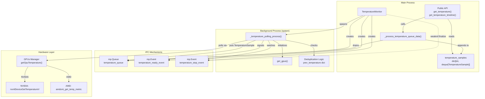
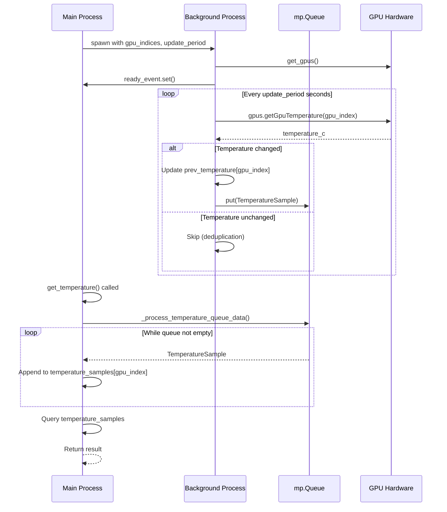
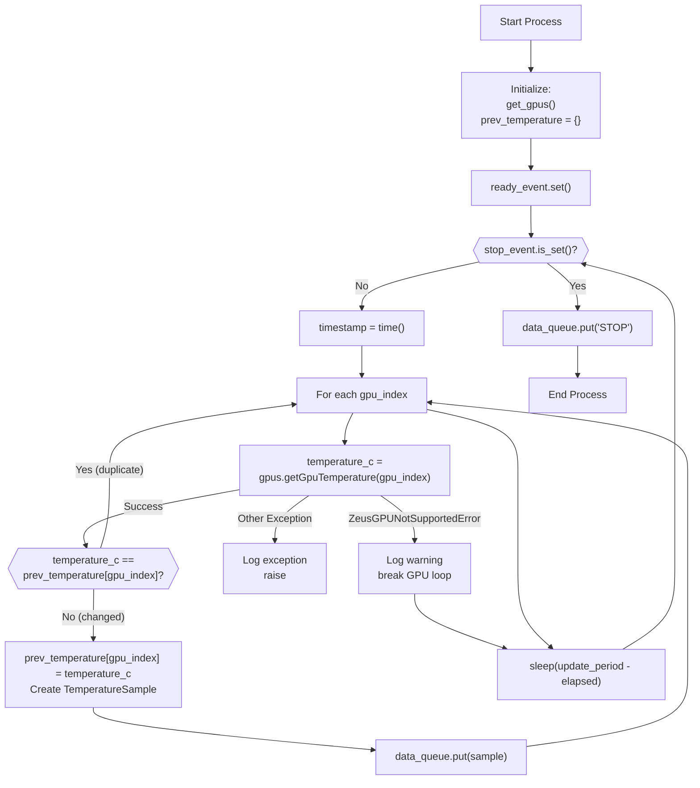

<!-- source: DeepWiki mcp.deepwiki.com · repo ml-energy/zeus · page 4.3 Temperature Monitoring · fetched 2026-10-21 -->

# Temperature Monitoring

<details>
<summary>Relevant source files</summary>

The following files were used as context for generating this wiki page:

- [zeus/device/gpu/amd.py](zeus/device/gpu/amd.py)
- [zeus/device/gpu/common.py](zeus/device/gpu/common.py)
- [zeus/device/gpu/nvidia.py](zeus/device/gpu/nvidia.py)
- [zeus/monitor/__init__.py](zeus/monitor/__init__.py)
- [zeus/monitor/temperature.py](zeus/monitor/temperature.py)

</details>


## Purpose and Scope

This page documents Zeus's temperature monitoring capabilities for tracking GPU temperature over time. The `TemperatureMonitor` class provides continuous background monitoring with deduplication, timeline export, and point-in-time queries. For energy and power measurement, see [ZeusMonitor](#4.1) and [PowerMonitor](#4.2).

---

## Overview

The `TemperatureMonitor` class [zeus/monitor/temperature.py:53-256]() enables continuous GPU temperature tracking with the following features:

| Feature | Description |
|---------|-------------|
| **Background Monitoring** | Spawns a separate process to continuously poll GPU temperature |
| **Deduplication** | Only records temperature samples when values change |
| **Timeline Export** | Export complete temperature history with time filtering |
| **Point-in-Time Queries** | Query temperature at specific timestamps |
| **Multi-GPU Support** | Track multiple GPUs simultaneously |
| **Memory Management** | Configurable sample buffer size per GPU |

The monitor operates independently of energy measurement systems and is designed for applications where thermal behavior analysis is needed alongside energy optimization.

Sources: [zeus/monitor/temperature.py:1-334](), [zeus/monitor/__init__.py:1-15]()

---

## System Architecture



**Diagram: TemperatureMonitor System Architecture**

The architecture separates monitoring concerns across processes:

1. **Main Process**: Hosts the `TemperatureMonitor` instance, stores samples, and provides query APIs
2. **Background Process**: Continuously polls GPU temperature using `_temperature_polling_process`
3. **IPC Layer**: Multiprocessing primitives for communication and synchronization
4. **Hardware Layer**: Vendor-specific temperature APIs

Sources: [zeus/monitor/temperature.py:53-145](), [zeus/monitor/temperature.py:258-334]()

---

## Core Components

### TemperatureMonitor Class

The main interface for temperature monitoring [zeus/monitor/temperature.py:53-256]():

```python
class TemperatureMonitor:
    def __init__(
        self,
        gpu_indices: list[int] | None = None,
        update_period: float = 1.0,
        max_samples_per_gpu: int | None = None,
    )
```

| Parameter | Type | Default | Description |
|-----------|------|---------|-------------|
| `gpu_indices` | `list[int] \| None` | `None` | GPU indices to monitor. `None` monitors all GPUs |
| `update_period` | `float` | `1.0` | Polling interval in seconds |
| `max_samples_per_gpu` | `int \| None` | `None` | Maximum samples per GPU. `None` for unlimited |

**Initialization Sequence** [zeus/monitor/temperature.py:88-144]():

1. Validates `gpu_indices` is not empty if provided
2. Calls `get_gpus(ensure_homogeneous=True)` to obtain GPU manager
3. Configures GPU indices (defaults to all GPUs)
4. Creates `collections.deque` per GPU with optional `maxlen`
5. Spawns background process using `mp.get_context("spawn")`
6. Creates IPC primitives: `Queue`, two `Event` objects
7. Registers cleanup via `weakref.finalize`
8. Waits for background process ready signal (10s timeout)

Sources: [zeus/monitor/temperature.py:72-145]()

### TemperatureSample Dataclass

Container for individual temperature readings [zeus/monitor/temperature.py:44-51]():

```python
@dataclass
class TemperatureSample:
    timestamp: float        # Unix timestamp
    gpu_index: int         # GPU device index
    temperature_c: int     # Temperature in Celsius
```

Sources: [zeus/monitor/temperature.py:44-51]()

---

## Data Flow and Deduplication



**Diagram: Temperature Data Flow with Deduplication**

**Deduplication Logic** [zeus/monitor/temperature.py:270-291]():

The background process maintains a `prev_temperature` dictionary mapping GPU indices to their last recorded temperature. Before queuing a new sample, it checks:

```python
if (gpu_index in prev_temperature 
    and prev_temperature[gpu_index] == temperature_c):
    continue  # Skip duplicate
```

This reduces memory usage and queue overhead since GPU temperature changes slowly compared to power consumption.

Sources: [zeus/monitor/temperature.py:258-334]()

---

## Public API Methods

### stop()

Terminates the background monitoring process [zeus/monitor/temperature.py:146-149]():

```python
def stop(self) -> None:
    """Stop the monitoring process."""
```

Invokes the `weakref.finalize` cleanup function, which:
1. Sets `temperature_stop_event` to signal termination
2. Waits for graceful shutdown (2s timeout)
3. Escalates to `terminate()` then `kill()` if necessary

Sources: [zeus/monitor/temperature.py:146-149](), [zeus/monitor/temperature.py:25-42]()

### get_temperature_timeline()

Retrieves temperature history with optional filtering [zeus/monitor/temperature.py:166-209]():

```python
def get_temperature_timeline(
    self,
    gpu_index: int | None = None,
    start_time: float | None = None,
    end_time: float | None = None,
) -> dict[int, list[tuple[float, int]]]
```

| Parameter | Description |
|-----------|-------------|
| `gpu_index` | Specific GPU index or `None` for all GPUs |
| `start_time` | Unix timestamp filter (inclusive) |
| `end_time` | Unix timestamp filter (inclusive) |
| **Returns** | Dict mapping GPU index → list of `(timestamp, temperature_c)` tuples |

**Implementation Details** [zeus/monitor/temperature.py:183-209]():

1. Calls `_process_temperature_queue_data()` to drain pending samples from queue
2. Determines target GPUs (single or all)
3. Iterates through `temperature_samples[gpu_idx]` deque
4. Applies time range filters if provided
5. Sorts timeline by timestamp (ensures chronological order)

Sources: [zeus/monitor/temperature.py:166-209]()

### get_temperature()

Queries temperature at a specific time point [zeus/monitor/temperature.py:211-255]():

```python
def get_temperature(
    self, 
    time: float | None = None
) -> dict[int, int] | None
```

| Parameter | Description |
|-----------|-------------|
| `time` | Unix timestamp or `None` for most recent |
| **Returns** | Dict mapping GPU index → temperature in Celsius, or `None` if no samples |

**Time-Point Resolution** [zeus/monitor/temperature.py:231-253]():

- If `time=None`: Returns most recent sample (`samples[-1]`)
- If `time` specified: Uses `bisect.bisect_left()` for binary search
  - Finds closest sample by comparing distances to adjacent samples
  - Handles edge cases: before first sample, after last sample

Sources: [zeus/monitor/temperature.py:211-255]()

---

## Background Polling Process

### Process Function

The `_temperature_polling_process` function [zeus/monitor/temperature.py:258-334]() implements the polling loop:



**Diagram: Background Polling Process Flow**

**Key Implementation Details:**

1. **GPU Initialization** [zeus/monitor/temperature.py:268](): Calls `get_gpus()` within the child process to avoid pickling GPU objects across process boundaries

2. **Error Handling** [zeus/monitor/temperature.py:301-315]():
   - `ZeusGPUNotSupportedError`: Logs warning and breaks GPU loop (no retry)
   - Other exceptions: Logs full traceback and re-raises

3. **Timing Control** [zeus/monitor/temperature.py:318-321](): Calculates sleep duration as `update_period - elapsed` to maintain consistent polling intervals

4. **Graceful Shutdown** [zeus/monitor/temperature.py:332-333](): Always sends `"STOP"` sentinel to queue, signaling end of data stream

Sources: [zeus/monitor/temperature.py:258-334]()

---

## Hardware-Specific Temperature APIs

### NVIDIA GPU Temperature

NVIDIA GPUs use the NVML library [zeus/device/gpu/nvidia.py:280-286]():

```python
def getGpuTemperature(self) -> int:
    """Return the current GPU temperature. Units: Celsius."""
    temperature = pynvml.nvmlDeviceGetTemperatureV(
        self.handle, pynvml.NVML_TEMPERATURE_GPU
    )
    return temperature
```

**Temperature Sensor**: Uses `NVML_TEMPERATURE_GPU` which reads the GPU die temperature sensor.

Sources: [zeus/device/gpu/nvidia.py:280-286]()

### AMD GPU Temperature

AMD GPUs use the AMDSMI library [zeus/device/gpu/amd.py:310-321]():

```python
def getGpuTemperature(self) -> int:
    """Return the current GPU temperature. Units: Celsius.
    
    We use the hotspot temperature (as opposed to edge) as we believe 
    it to be more representative of the GPU core's temperature under load.
    """
    return amdsmi.amdsmi_get_temp_metric(
        self.handle,
        amdsmi.AmdSmiTemperatureType.HOTSPOT,
        amdsmi.AmdSmiTemperatureMetric.CURRENT,
    )
```

**Temperature Sensor**: Uses `AmdSmiTemperatureType.HOTSPOT` instead of edge temperature for better representation of core temperature under load.

Sources: [zeus/device/gpu/amd.py:310-321]()

### Abstract Interface

Both implementations satisfy the abstract `GPU` interface [zeus/device/gpu/common.py:124-127]():

```python
@abc.abstractmethod
def getGpuTemperature(self) -> int:
    """Return the current GPU temperature. Units: Celsius."""
    pass
```

Sources: [zeus/device/gpu/common.py:124-127]()

---

## Usage Example

```python
from zeus.monitor import TemperatureMonitor
from time import sleep

# Initialize monitor for GPUs 0 and 1
# Poll every 0.5 seconds, keep last 1000 samples per GPU
monitor = TemperatureMonitor(
    gpu_indices=[0, 1],
    update_period=0.5,
    max_samples_per_gpu=1000
)

# Run workload
run_training_workload()

# Query current temperature
current_temp = monitor.get_temperature()
print(f"Current temperatures: {current_temp}")
# Output: {0: 65, 1: 67}

# Get temperature at specific time
import time
query_time = time.time() - 30.0  # 30 seconds ago
historical_temp = monitor.get_temperature(time=query_time)
print(f"Temperatures 30s ago: {historical_temp}")

# Export timeline for GPU 0 from last minute
end_time = time.time()
start_time = end_time - 60.0
timeline = monitor.get_temperature_timeline(
    gpu_index=0,
    start_time=start_time,
    end_time=end_time
)
# timeline[0] = [(timestamp1, temp1), (timestamp2, temp2), ...]

# Stop monitoring
monitor.stop()
```

Sources: [zeus/monitor/temperature.py:53-256]()

---

## Memory Management

### Sample Buffer Limits

The `max_samples_per_gpu` parameter controls memory usage [zeus/monitor/temperature.py:105-109]():

```python
self.temperature_samples: dict[int, collections.deque[TemperatureSample]] = {}
for gpu_idx in self.gpu_indices:
    self.temperature_samples[gpu_idx] = collections.deque(
        maxlen=max_samples_per_gpu
    )
```

**Behavior**:
- `maxlen=None` (default): Unlimited sample retention
- `maxlen=N`: FIFO eviction when exceeding N samples per GPU

**Memory Estimation**:

Each `TemperatureSample` contains:
- `timestamp` (float): 8 bytes
- `gpu_index` (int): 28 bytes (Python integer object overhead)
- `temperature_c` (int): 28 bytes

Total per sample: ~64 bytes + deque overhead

For 4 GPUs with `max_samples_per_gpu=10000`:
- Memory usage: ~2.5 MB (excluding deque overhead)

Sources: [zeus/monitor/temperature.py:105-109]()

---

## Process Safety and Cleanup

### Multiprocessing Context

Zeus uses `spawn` context [zeus/monitor/temperature.py:112]() to avoid forking issues:

```python
ctx = mp.get_context("spawn")
```

This ensures:
- Clean process state (no inherited file descriptors)
- Safe CUDA context handling
- Compatibility with macOS and Windows

### Cleanup Mechanism

Cleanup uses `weakref.finalize` [zeus/monitor/temperature.py:131-136]() for automatic resource management:

```python
self._finalizer = weakref.finalize(
    self,
    _cleanup_temperature_process,
    self.temperature_stop_event,
    self.temperature_process,
)
```

The `_cleanup_temperature_process` function [zeus/monitor/temperature.py:25-42]() implements graceful shutdown:

1. **Signal**: Set `stop_event` to request termination
2. **Wait**: Join with 2s timeout
3. **Terminate**: Call `terminate()` if still alive, wait 1s
4. **Kill**: Force kill if still alive, wait 1s

This ensures the background process always stops, even during interpreter shutdown.

Sources: [zeus/monitor/temperature.py:25-42](), [zeus/monitor/temperature.py:131-136]()

---

## Limitations and Considerations

| Limitation | Description | Workaround |
|------------|-------------|------------|
| **Homogeneous GPUs Required** | Constructor calls `get_gpus(ensure_homogeneous=True)` | Use separate monitors for heterogeneous systems |
| **No Global Instance** | Spawning processes from global variables causes issues | Instantiate within `if __name__ == "__main__"` block |
| **Temperature Resolution** | Limited by vendor API granularity (1°C) | No workaround, hardware limitation |
| **Polling Overhead** | Background process consumes CPU | Increase `update_period` for long-running monitors |
| **Deduplication Gaps** | If temperature oscillates between two values, all samples recorded | Expected behavior for accurate tracking |

Sources: [zeus/monitor/temperature.py:61-69](), [zeus/monitor/temperature.py:92]()

---

## Integration with Energy Monitoring

Temperature monitoring is complementary to energy measurement but operates independently:

| Monitor | Purpose | Data Source | Update Rate |
|---------|---------|-------------|-------------|
| [`ZeusMonitor`](#4.1) | Window-based energy measurement | `getTotalEnergyConsumption()` | On-demand (begin/end window) |
| [`PowerMonitor`](#4.2) | Continuous power timeline | `getInstantPowerUsage()` | ~100ms (configurable) |
| `TemperatureMonitor` | Continuous temperature timeline | `getGpuTemperature()` | 1s (configurable) |

**Use Case**: Correlate temperature spikes with energy consumption patterns during training to identify thermal throttling or inefficient power states.

Sources: [zeus/monitor/__init__.py:1-15]()

---

