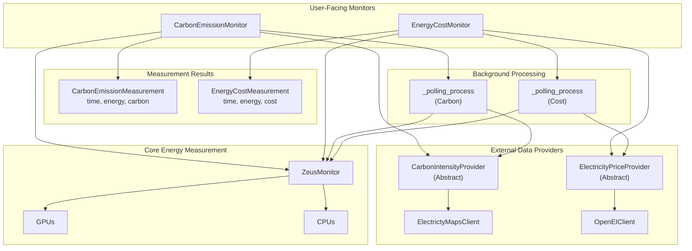
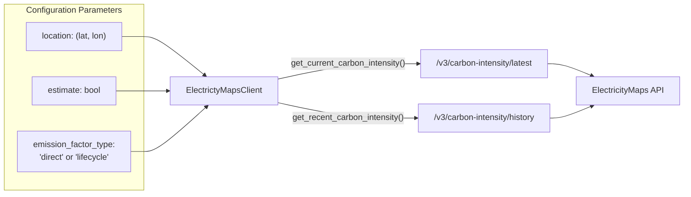
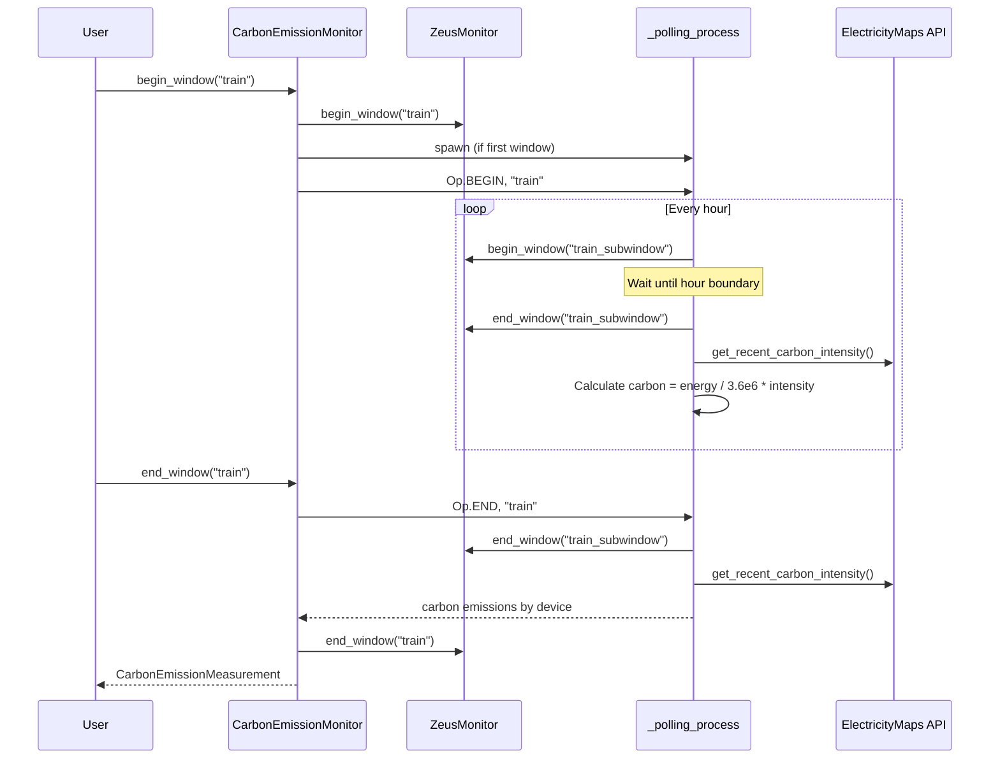
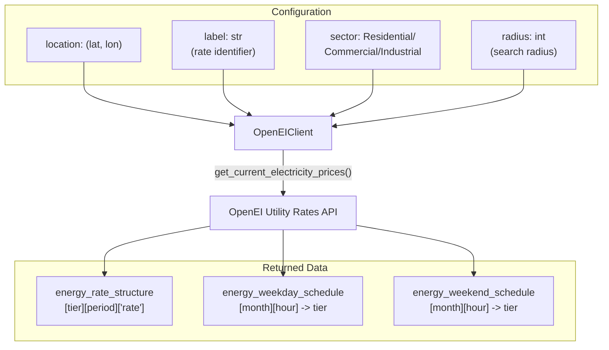
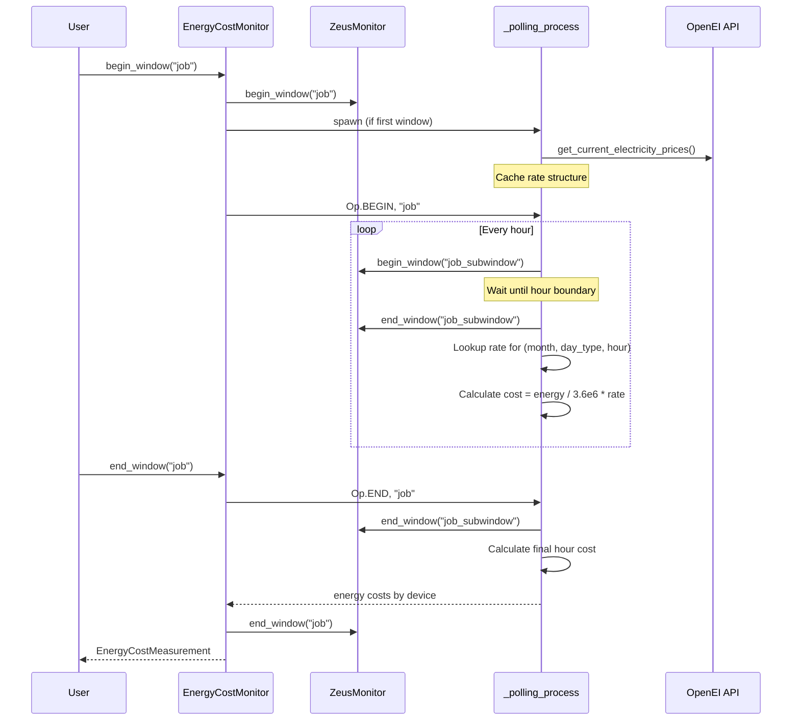
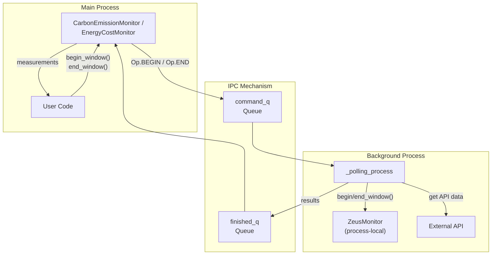

<!-- source: DeepWiki mcp.deepwiki.com · repo ml-energy/zeus · page 4.4 Carbon & Cost Tracking · fetched 2026-10-21 -->

# Carbon & Cost Tracking

<details>
<summary>Relevant source files</summary>

The following files were used as context for generating this wiki page:

- [examples/carbon_emission_monitor/README.md](examples/carbon_emission_monitor/README.md)
- [tests/monitor/carbon_history_files/carbon_history_file1](tests/monitor/carbon_history_files/carbon_history_file1)
- [tests/monitor/carbon_history_files/carbon_history_file2](tests/monitor/carbon_history_files/carbon_history_file2)
- [zeus/monitor/carbon.py](zeus/monitor/carbon.py)
- [zeus/monitor/price.py](zeus/monitor/price.py)
- [zeus/show_env.py](zeus/show_env.py)
- [zeus/utils/framework.py](zeus/utils/framework.py)

</details>


## Purpose and Scope

This page documents Zeus's carbon emission and electricity cost tracking capabilities. These monitors extend the basic energy measurement functionality (see [ZeusMonitor](#4.1)) by integrating external APIs to calculate the carbon footprint and monetary cost of ML workloads. 

For basic energy measurement without carbon/cost tracking, see [ZeusMonitor](#4.1). For power-based measurements, see [PowerMonitor](#4.2).

## Overview

Zeus provides two specialized monitors that augment energy measurements with real-world impact metrics:

- **`CarbonEmissionMonitor`**: Measures carbon emissions (gCO2eq) by combining energy consumption with carbon intensity data from electricity grids
- **`EnergyCostMonitor`**: Calculates electricity costs ($) using time-of-use pricing structures

Both monitors wrap [`ZeusMonitor`][zeus.monitor.energy.ZeusMonitor] for hardware energy measurements and use a multi-process polling architecture to track time-varying carbon intensity and electricity prices.

Sources: [zeus/monitor/carbon.py:204-220](), [zeus/monitor/price.py:222-232]()

## Architecture Overview



**System Architecture**: Both monitors follow a similar pattern: they wrap `ZeusMonitor` for energy measurements, spawn a background polling process to track time-varying external data (carbon intensity or electricity prices), and aggregate measurements over time. The polling processes periodically fetch energy measurements and multiply them by the appropriate carbon intensity or electricity rate for each time window.

Sources: [zeus/monitor/carbon.py:204-334](), [zeus/monitor/price.py:222-347]()

## Carbon Intensity Tracking

### CarbonIntensityProvider Interface

The abstract [`CarbonIntensityProvider`][zeus.monitor.carbon.CarbonIntensityProvider] class defines the interface for fetching carbon intensity data:

| Method | Return Type | Description |
|--------|-------------|-------------|
| `get_current_carbon_intensity()` | `float` | Fetches current carbon intensity (gCO2eq/kWh) |
| `get_recent_carbon_intensity()` | `dict[datetime, float]` | Fetches historical carbon intensity values |
| `update_period` | `timedelta` | How long each carbon intensity value remains current |
| `history_length` | `int` | Number of historical values available |

Sources: [zeus/monitor/carbon.py:40-63]()

### ElectricityMaps Integration

[`ElectrictyMapsClient`][zeus.monitor.carbon.ElectrictyMapsClient] implements carbon intensity tracking using the ElectricityMaps API:



**Configuration Parameters**:
- **`location`**: Tuple of `(latitude, longitude)` coordinates
- **`estimate`**: Whether to use estimated values when real data is unavailable (recommended: `True`)
- **`emission_factor_type`**: `"direct"` (operational emissions only) or `"lifecycle"` (including manufacturing)

The API returns carbon intensity values for the past 24 hours, with hourly granularity. Each value includes a timestamp, carbon intensity, and whether it was estimated.

Sources: [zeus/monitor/carbon.py:66-158]()

### CarbonEmissionMonitor

The [`CarbonEmissionMonitor`][zeus.monitor.carbon.CarbonEmissionMonitor] class provides window-based carbon emission tracking:

```python
# Initialize with carbon intensity provider
monitor = CarbonEmissionMonitor(
    carbon_intensity_provider=ElectrictyMapsClient(
        location=(33.7490, -84.3880),  # Atlanta, GA
        estimate=True,
        emission_factor_type="lifecycle"
    ),
    gpu_indices=[0, 1],
    cpu_indices=None  # All CPUs
)

# Measure a training epoch
monitor.begin_window("epoch_1")
train_one_epoch()
result = monitor.end_window("epoch_1")

# Result contains:
# - time: seconds elapsed
# - gpu_energy: {gpu_id: Joules}
# - gpu_carbon_emission: {gpu_id: gCO2eq}
# - cpu_energy, cpu_carbon_emission, dram_energy, dram_carbon_emission
```

**Measurement Result**: [`CarbonEmissionMeasurement`][zeus.monitor.carbon.CarbonEmissionMeasurement] dataclass with fields:
- `time`: Elapsed time in seconds
- `gpu_energy`: Per-GPU energy consumption (Joules)
- `gpu_carbon_emission`: Per-GPU carbon emissions (gCO2eq)
- `cpu_energy`, `cpu_carbon_emission`: Per-CPU package values (optional)
- `dram_energy`, `dram_carbon_emission`: Per-DRAM values (optional)

Sources: [zeus/monitor/carbon.py:204-334](), [zeus/monitor/carbon.py:160-194]()

### Carbon Measurement Process



**Polling Process Algorithm**:
1. Spawned when first window begins, terminates when last window ends
2. Subdivides each window into hourly subwindows aligned to hour boundaries
3. At each hour boundary:
   - Ends the current subwindow and measures energy
   - Fetches recent carbon intensity values from API
   - Calculates carbon: `energy_joules / 3.6e6 * carbon_intensity_gco2_per_kwh`
   - Accumulates per-device carbon emissions
4. When window ends, returns accumulated carbon emissions

The division by 3.6e6 converts Joules to kWh: 1 kWh = 3,600,000 Joules.

Sources: [zeus/monitor/carbon.py:336-457]()

## Electricity Cost Tracking

### ElectricityPriceProvider Interface

The abstract [`ElectricityPriceProvider`][zeus.monitor.price.ElectricityPriceProvider] class defines the interface for fetching electricity pricing data:

| Method | Return Type | Description |
|--------|-------------|-------------|
| `get_current_electricity_prices()` | `dict[str, list]` | Fetches current rate structure and schedules |

Sources: [zeus/monitor/price.py:53-59]()

### OpenEI Integration

[`OpenEIClient`][zeus.monitor.price.OpenEIClient] implements electricity pricing using the OpenEI Utility Rates API:



**Configuration Parameters**:
- **`location`**: Tuple of `(latitude, longitude)` coordinates
- **`label`**: Unique identifier for a specific utility rate plan (e.g., `"5ed4aa7f5457a33b2d4c6450"`)
- **`sector`**: `"Residential"`, `"Commercial"`, `"Industrial"`, or `"Lighting"`
- **`radius`**: Search radius in miles from location

**Rate Structure**: OpenEI returns time-of-use pricing with three components:
1. **Energy Rate Structure**: Maps tiers to per-kWh rates
2. **Weekday Schedule**: Maps (month, hour) to pricing tier
3. **Weekend Schedule**: Maps (month, hour) to pricing tier

Sources: [zeus/monitor/price.py:62-176]()

### EnergyCostMonitor

The [`EnergyCostMonitor`][zeus.monitor.price.EnergyCostMonitor] class provides window-based electricity cost tracking:

```python
# Initialize with price provider
monitor = EnergyCostMonitor(
    electricity_price_provider=OpenEIClient(
        location=(33.7490, -84.3880),
        label="5ed4aa7f5457a33b2d4c6450",
        sector="Residential"
    ),
    gpu_indices=[0, 1],
    cpu_indices=None
)

# Measure training cost
monitor.begin_window("training")
train_model()
result = monitor.end_window("training")

# Result contains:
# - time: seconds elapsed
# - gpu_energy: {gpu_id: Joules}
# - gpu_energy_cost: {gpu_id: dollars}
# - cpu_energy, cpu_energy_cost, dram_energy, dram_energy_cost
```

**Measurement Result**: [`EnergyCostMeasurement`][zeus.monitor.price.EnergyCostMeasurement] dataclass with fields:
- `time`: Elapsed time in seconds
- `gpu_energy`: Per-GPU energy consumption (Joules)
- `gpu_energy_cost`: Per-GPU electricity cost (USD)
- `cpu_energy`, `cpu_energy_cost`: Per-CPU package values (optional)
- `dram_energy`, `dram_energy_cost`: Per-DRAM values (optional)

Sources: [zeus/monitor/price.py:222-347](), [zeus/monitor/price.py:178-212]()

### Cost Calculation Process



**Cost Calculation Algorithm**:
1. Fetch rate structure once at process start
2. For each hourly subwindow:
   - Extract month (0-11), day_type (weekday/weekend), hour (0-23)
   - Look up pricing tier from appropriate schedule
   - Look up rate from rate structure: `rate = energy_rate_structure[tier][0]['rate']`
   - Calculate cost: `cost = (energy_joules / 3.6e6) * rate_dollars_per_kwh`
3. Accumulate per-device costs across all hours

Sources: [zeus/monitor/price.py:350-482]()

## Implementation Details

### Multi-Process Architecture

Both monitors use a similar multi-process design for continuous tracking:



**Process Management**:
- Spawned when first measurement window begins using `multiprocessing.spawn`
- Terminates when last active window ends
- Uses two queues for bidirectional communication:
  - `command_q`: Main process sends `Op.BEGIN` and `Op.END` commands with window keys
  - `finished_q`: Polling process returns accumulated carbon/cost values

**Why Multi-Process?**: The polling process must run continuously to segment energy measurements into hourly windows aligned with carbon intensity/price data updates. A separate process avoids blocking user code and simplifies concurrent window management.

Sources: [zeus/monitor/carbon.py:252-256](), [zeus/monitor/price.py:266-269]()

### Time-Based Energy Aggregation

Both monitors track energy consumption on an hourly basis to align with external API data granularity:

| Data Structure | Purpose | Type |
|----------------|---------|------|
| `energy_measurements` | Stores per-hour energy by device | `defaultdict[key][datetime][device_str] = float` |
| `gpu_carbon_emissions` / `gpu_energy_cost` | Accumulated carbon/cost per GPU | `defaultdict[key][gpu_id] = float` |
| `cpu_carbon_emissions` / `cpu_energy_cost` | Accumulated carbon/cost per CPU | `defaultdict[key][cpu_id] = float` |
| `dram_carbon_emissions` / `dram_energy_cost` | Accumulated carbon/cost per DRAM | `defaultdict[key][dram_id] = float` |

**Aggregation Flow**:
1. `_update_energy_measurements()`: Called at hour boundaries to end subwindow and store energy by device
2. `_update_carbon_emissions()` / `_update_energy_costs()`: Multiplies stored energy by carbon intensity or price rate
3. Device keys are formatted as `"gpu_{index}"`, `"cpu_{index}"`, `"dram_{index}"` for unified handling

Sources: [zeus/monitor/carbon.py:360-400](), [zeus/monitor/price.py:380-432]()

### Multi-Window Support

Both monitors support multiple concurrent measurement windows:

```python
monitor = CarbonEmissionMonitor(carbon_intensity_provider=provider)

# Start multiple overlapping windows
monitor.begin_window("training")
for epoch in range(10):
    monitor.begin_window(f"epoch_{epoch}")
    train_one_epoch()
    result = monitor.end_window(f"epoch_{epoch}")
monitor.end_window("training")
```

**Implementation**:
- Each window maintains separate energy and carbon/cost accumulators in the polling process
- Window keys are tracked in a `set` to detect duplicates and manage lifecycle
- The polling process only terminates when `len(keys) == 0`

Sources: [zeus/monitor/carbon.py:257-292](), [zeus/monitor/price.py:271-306]()

### Synchronization

Both monitors inherit synchronization behavior from [`ZeusMonitor`][zeus.monitor.energy.ZeusMonitor]:

**Framework Synchronization**: The `sync_execution_with` parameter (default: `"torch"`) ensures GPU kernels finish before measurements:
- PyTorch: Calls `torch.cuda.synchronize(device)` for each GPU
- JAX: Uses `jax.device_put` with `block_until_ready`
- CuPy: Calls `cupy.cuda.Device(device).synchronize()`

**Distributed Training**: Both monitors work in distributed settings, with each rank measuring its own devices independently. To aggregate results across ranks, users must manually collect and sum measurements.

Sources: [zeus/monitor/carbon.py:226-248](), [zeus/monitor/price.py:239-262]()

## Usage Patterns

### Basic Carbon Tracking

```python
from zeus.monitor.carbon import CarbonEmissionMonitor, ElectrictyMapsClient

# Configure provider
provider = ElectrictyMapsClient(
    location=(37.7749, -122.4194),  # San Francisco
    estimate=True,
    emission_factor_type="lifecycle"
)

# Create monitor
monitor = CarbonEmissionMonitor(
    carbon_intensity_provider=provider,
    gpu_indices=[0, 1]
)

# Measure workload
monitor.begin_window("training")
train_model()
result = monitor.end_window("training")

print(f"Time: {result.time:.2f}s")
print(f"Total energy: {sum(result.gpu_energy.values()):.2f}J")
print(f"Total carbon: {sum(result.gpu_carbon_emission.values()):.2f}gCO2eq")
```

Sources: [examples/carbon_emission_monitor/README.md:1-31]()

### Basic Cost Tracking

```python
from zeus.monitor.price import EnergyCostMonitor, OpenEIClient

# Configure provider
provider = OpenEIClient(
    location=(33.7490, -84.3880),  # Atlanta
    label="utility_rate_id",
    sector="Commercial"
)

# Create monitor
monitor = EnergyCostMonitor(
    electricity_price_provider=provider,
    gpu_indices=[0, 1, 2, 3]
)

# Measure workload
monitor.begin_window("job")
run_training_job()
result = monitor.end_window("job")

print(f"Total cost: ${sum(result.gpu_energy_cost.values()):.4f}")
```

Sources: [zeus/monitor/price.py:222-347]()

### Error Handling

Both monitors raise specific exceptions for API failures:

| Exception | Raised When | Module |
|-----------|-------------|--------|
| `ZeusCarbonIntensityHTTPError` | HTTP request to ElectricityMaps fails | carbon |
| `ZeusCarbonIntensityNotFoundError` | Carbon intensity data unavailable for location | carbon |
| `ZeusElectricityPriceHTTPError` | HTTP request to OpenEI fails | price |
| `ZeusElectricityPriceNotFoundError` | Pricing data unavailable for location/label | price |

Sources: [zeus/monitor/carbon.py:24-38](), [zeus/monitor/price.py:37-50]()

---

