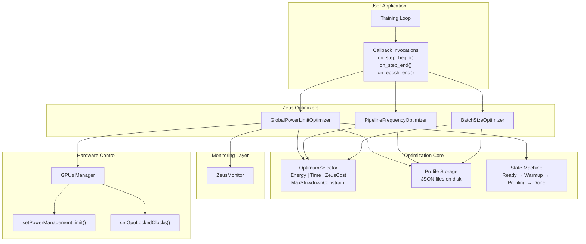
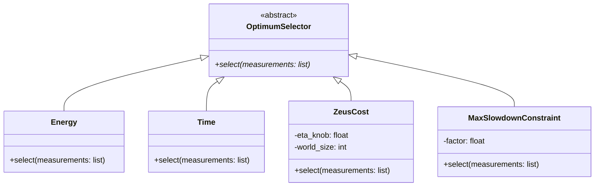
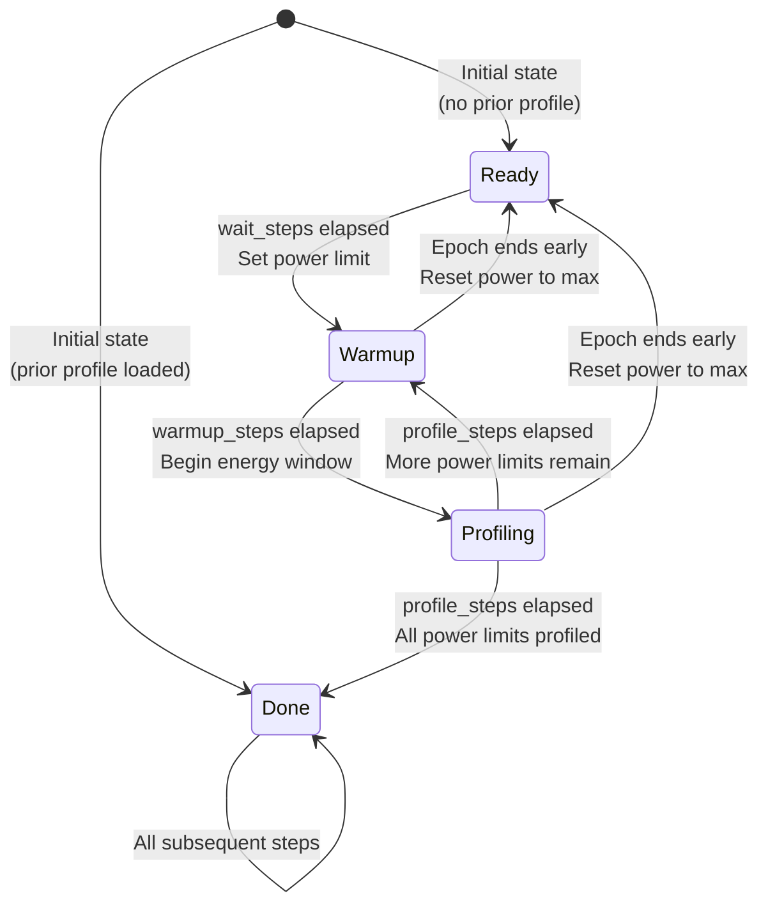
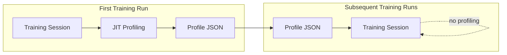
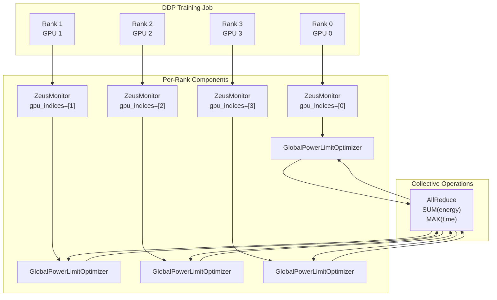

<!-- source: DeepWiki mcp.deepwiki.com · repo ml-energy/zeus · page 5 Energy Optimization · fetched 2026-10-21 -->

# Energy Optimization

<details>
<summary>Relevant source files</summary>

The following files were used as context for generating this wiki page:

- [README.md](README.md)
- [docs/getting_started/index.md](docs/getting_started/index.md)
- [docs/index.md](docs/index.md)
- [pyproject.toml](pyproject.toml)
- [tests/optimizer/test_power_limit_optimizer.py](tests/optimizer/test_power_limit_optimizer.py)
- [tests/test_monitor.py](tests/test_monitor.py)
- [zeus/optimizer/power_limit.py](zeus/optimizer/power_limit.py)

</details>


## Purpose and Scope

This document provides an overview of Zeus's energy optimization capabilities and the three main optimizers available in the framework. Zeus optimizes energy consumption by controlling hardware knobs and workload parameters during deep learning training. For detailed information about energy and power measurement, see [Energy Measurement](#4).

The three optimizers covered by this section are:

- [Power Limit Optimizer](#5.1): Controls GPU power limits to reduce energy consumption
- [Pipeline Frequency Optimizer](#5.2): Assigns optimal frequencies to pipeline stages in distributed training
- [Batch Size Optimizer](#5.3): Selects batch sizes that balance throughput and energy efficiency

## Optimization Philosophy

Zeus's optimization approach is rooted in the observation that deep learning training involves a fundamental **time-energy tradeoff**: lowering power consumption typically increases training time, and vice versa. Different applications have different priorities—some may prioritize minimizing total energy, others may prioritize minimizing time, and many need a balance between the two.

All Zeus optimizers support multiple objective functions that allow users to express their preferences along this tradeoff spectrum. The optimizers also support **just-in-time (JIT) profiling**, which means they profile the workload during training to find optimal configurations without requiring separate profiling runs.

Sources: [README.md:25-26](), [docs/index.md:24](), [zeus/optimizer/power_limit.py:1-21]()

## Optimizer Architecture



**Zeus Optimizer Integration Architecture**: Optimizers integrate with training loops through callback hooks (`on_step_begin`, `on_step_end`, `on_epoch_end`). They use `ZeusMonitor` for energy measurements, implement state machines for JIT profiling, persist profiles to disk, and control GPU hardware through the `GPUs` manager.

Sources: [zeus/optimizer/power_limit.py:201-354](), [zeus/callback.py]()

## Optimum Selection Strategies

All Zeus optimizers support pluggable selection strategies for choosing optimal configurations from profiling results. These strategies are implemented as subclasses of the `OptimumSelector` abstract base class.

### Available Selectors

| Selector Class | Objective | Use Case |
|----------------|-----------|----------|
| `Energy` | Minimize total energy consumption | Applications where energy cost or carbon footprint is the primary concern |
| `Time` | Minimize training time | Deadline-driven training where time is critical |
| `ZeusCost` | Minimize η-weighted cost: `η × Energy + (1-η) × MaxPower × Time` | Flexible tradeoff between time and energy (η ∈ [0,1]) |
| `MaxSlowdownConstraint` | Minimize power while keeping slowdown ≤ factor × fastest time | Bounded-slowdown scenarios (e.g., "no more than 10% slower") |

### Selector Implementation



**OptimumSelector Class Hierarchy**: All selection strategies implement the `select()` method that takes profiling measurements and returns an optimal configuration. Concrete implementations encode different optimization objectives.

Sources: [zeus/optimizer/power_limit.py:41-139]()

### Zeus Cost Function

The `ZeusCost` selector implements a linear cost function that balances time and energy:

```
Cost = η × Energy + (1 - η) × MaxPower × Time
```

Where:
- `η ∈ [0, 1]` is the eta knob that controls the time-energy tradeoff
- `η = 1.0`: Pure energy minimization
- `η = 0.0`: Pure time minimization  
- `η = 0.5`: Equal weight to time and energy (default)
- `MaxPower`: Maximum power limit across all profiled configurations

The `MaxPower × Time` term represents the theoretical energy that would be consumed at maximum power, normalizing time and energy to comparable units.

Sources: [zeus/optimizer/power_limit.py:71-108](), [zeus/utils/metric.py]()

## Integration with Training Frameworks

Zeus optimizers integrate with training loops through two primary mechanisms:

### Callback API

The `Callback` base class defines lifecycle hooks that optimizers implement:

```mermaid
sequenceDiagram
    participant App as "Training Loop"
    participant Opt as "Optimizer"
    participant Mon as "ZeusMonitor"
    participant GPU as "GPU Hardware"
    
    App->>Opt: on_epoch_begin()
    loop Each Step
        App->>Opt: on_step_begin()
        Opt->>Mon: begin_window(name)
        Opt->>GPU: setPowerManagementLimit(...)
        App->>App: forward/backward pass
        App->>Opt: on_step_end()
        Opt->>Mon: end_window(name)
    end
    App->>Opt: on_epoch_end()
    Note over Opt: State transitions<br/>Profile persistence
```

**Callback Lifecycle**: Optimizers hook into training epochs and steps to control when profiling begins/ends and when hardware configurations change. The state machine advances during these callbacks.

Sources: [zeus/optimizer/power_limit.py:355-456](), [zeus/callback.py]()

### HuggingFace Trainer Integration

Zeus provides wrapper classes that adapt optimizers to the HuggingFace `TrainerCallback` interface:

- `HFGlobalPowerLimitOptimizer`: Wraps `GlobalPowerLimitOptimizer` for HuggingFace Trainer
- Constructor signatures match exactly to provide consistent API

The wrappers translate HuggingFace callback signatures to Zeus callback signatures internally.

Sources: [zeus/optimizer/power_limit.py:507-578](), [tests/optimizer/test_power_limit_optimizer.py:290-297]()

## Overview of Zeus Optimizers

### GlobalPowerLimitOptimizer

The power limit optimizer reduces GPU energy consumption by capping the maximum power draw of each GPU. Modern NVIDIA GPUs expose a power management limit that can be configured via NVML.

**Key Characteristics:**
- **Hardware Knob:** GPU power limit (Watts)
- **Profiling Strategy:** JIT profiling with state machine (Ready → Warmup → Profiling → Done)
- **Search Space:** Power limits from minimum to maximum supported by GPU, with configurable stride
- **State Persistence:** Profiles saved to JSON for reuse across training runs
- **Distributed Support:** AllReduce aggregation across all GPUs for global optimization

**Use Cases:**
- Training on consumer GPUs with thermal constraints
- Reducing energy costs in cloud environments
- Meeting carbon emission budgets

For detailed documentation, see [Power Limit Optimizer](#5.1).

Sources: [zeus/optimizer/power_limit.py:201-490](), [README.md:72]()

### PipelineFrequencyOptimizer

The pipeline frequency optimizer assigns optimal GPU and memory frequencies to each stage in a pipeline-parallel distributed training job. Different pipeline stages have different computational characteristics, and frequency scaling allows fine-grained energy optimization.

**Key Characteristics:**
- **Hardware Knob:** Per-GPU core and memory frequency (MHz)
- **Profiling Strategy:** Pre-characterization of Pareto frontiers + graph-cut optimization
- **Search Space:** Supported frequency pairs for each GPU
- **Architecture:** HTTP server exposing REST API for distributed coordination
- **Optimization Algorithm:** Min-cut graph algorithm to assign frequencies minimizing total cost

**Use Cases:**
- Large model training with pipeline parallelism (e.g., GPT, Megatron-LM)
- Heterogeneous GPU clusters with mixed generations
- Energy-constrained HPC environments

For detailed documentation, see [Pipeline Frequency Optimizer](#5.2).

Sources: [README.md:74](), [pyproject.toml:44-45]()

### BatchSizeOptimizer

The batch size optimizer explores the batch size hyperparameter space to find configurations that maximize throughput per joule. Batch size significantly impacts both training time and energy efficiency due to GPU utilization and memory hierarchy effects.

**Key Characteristics:**
- **Workload Knob:** Training batch size
- **Profiling Strategy:** Multi-armed bandit with Thompson sampling
- **Search Space:** User-defined batch size candidates
- **Architecture:** Optional server for distributed coordination
- **Exploration Strategy:** Balances exploration of new batch sizes with exploitation of known good ones

**Use Cases:**
- Hyperparameter tuning with energy awareness
- Training on GPUs with varying memory capacities
- Cost-optimized cloud training

For detailed documentation, see [Batch Size Optimizer](#5.3).

Sources: [README.md:73](), [pyproject.toml:46-47]()

## State Machine and Profiling

The `GlobalPowerLimitOptimizer` implements a state machine to manage JIT profiling:



**State Machine Transitions**: The optimizer progresses through warmup and profiling phases for each power limit. Epoch boundaries can interrupt profiling, causing resets. Once all power limits are profiled, the optimizer enters the `Done` state and applies the optimal configuration.

### State Definitions

| State | Purpose | Next State(s) |
|-------|---------|---------------|
| `Ready` | Waiting to profile next power limit | `Warmup` |
| `Warmup` | GPU warming up at new power limit (not measuring) | `Profiling` or `Ready` (if interrupted) |
| `Profiling` | Actively measuring energy/time | `Warmup`, `Done`, or `Ready` (if interrupted) |
| `Done` | Profiling complete, optimal power limit set | `Done` (terminal state) |

Sources: [zeus/optimizer/power_limit.py:141-185](), [zeus/optimizer/power_limit.py:355-456]()

## Profile Persistence

Optimizers support saving and loading profiling results to/from disk:



**Profile Reuse Pattern**: First training run performs JIT profiling and saves results to JSON. Subsequent runs with the same `profile_path` load the saved profile and skip profiling entirely, applying the optimal configuration immediately.

### Profile File Format

Profiles are stored as JSON with the `PowerLimitMeasurement` schema:

```json
{
  "measurements": [
    {
      "power_limit": 300,
      "energy": 12345.67,
      "time": 42.0
    },
    {
      "power_limit": 275,
      "energy": 11234.56,
      "time": 45.3
    }
  ]
}
```

Sources: [zeus/optimizer/power_limit.py:187-199](), [zeus/optimizer/power_limit.py:477-489]()

## Distributed Training Support

The `GlobalPowerLimitOptimizer` is designed for distributed data-parallel training:

### Architecture Pattern



**Distributed Optimization Pattern**: Each rank monitors one GPU and runs its own optimizer instance. When profiling completes, ranks perform AllReduce to aggregate energy (SUM) and time (MAX) measurements before selecting the globally optimal power limit.

### Usage Pattern

Each process should monitor exactly one GPU (typically the local rank):

```python
# Each process monitors its assigned GPU
local_rank = torch.distributed.get_rank()
monitor = ZeusMonitor(gpu_indices=[local_rank])
optimizer = GlobalPowerLimitOptimizer(monitor, ...)
```

The optimizer automatically detects distributed training and performs collective operations internally.

Sources: [zeus/optimizer/power_limit.py:206-221](), [zeus/optimizer/power_limit.py:419-429](), [zeus/utils/framework.py]()

## Privilege Requirements

Energy optimization requires elevated privileges to modify GPU hardware configurations:

| Operation | Required Privilege | Optimizer |
|-----------|-------------------|-----------|
| Set GPU power limit | `SYS_ADMIN` capability or root | `GlobalPowerLimitOptimizer` |
| Set GPU frequency | `SYS_ADMIN` capability or root | `PipelineFrequencyOptimizer` |
| Set memory frequency | `SYS_ADMIN` capability or root | `PipelineFrequencyOptimizer` |

For deployment options and privilege management strategies, see [Deployment Strategies](#2.3) and [Privilege Management](#3.2).

Sources: [zeus/optimizer/power_limit.py:296-305](), [docs/getting_started/index.md:136-140]()

## Choosing an Optimizer

The choice of optimizer depends on your training setup and optimization goals:

| Training Setup | Recommended Optimizer | Rationale |
|----------------|----------------------|-----------|
| Single-GPU or data-parallel | `GlobalPowerLimitOptimizer` | Simple, effective, broad GPU support |
| Pipeline-parallel (e.g., Megatron-LM) | `PipelineFrequencyOptimizer` | Exploits stage-specific characteristics |
| Hyperparameter tuning phase | `BatchSizeOptimizer` | Jointly optimizes batch size and energy |
| Limited to specific power budget | `GlobalPowerLimitOptimizer` with `MaxSlowdownConstraint` | Guarantees bounded slowdown |
| Minimize carbon footprint | Any optimizer with `Energy` selector | Direct energy minimization |
| Meet training deadline | Any optimizer with `Time` selector or high η in `ZeusCost` | Time prioritization |

### Optimizer Compatibility

| Feature | `GlobalPowerLimitOptimizer` | `PipelineFrequencyOptimizer` | `BatchSizeOptimizer` |
|---------|----------------------------|------------------------------|---------------------|
| NVIDIA GPUs | ✓ | ✓ | ✓ |
| AMD GPUs | ✗ (no power limit API) | ✗ | ✓ |
| Data-parallel training | ✓ | ✗ | ✓ |
| Pipeline-parallel training | ✗ | ✓ | ✗ |
| HuggingFace Trainer | ✓ (via `HFGlobalPowerLimitOptimizer`) | ✗ | ✗ |
| Custom training loops | ✓ | ✓ | ✓ |

Sources: [README.md:72-74](), [zeus/optimizer/power_limit.py:1-21]()

---

