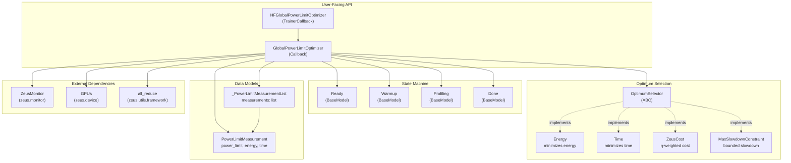
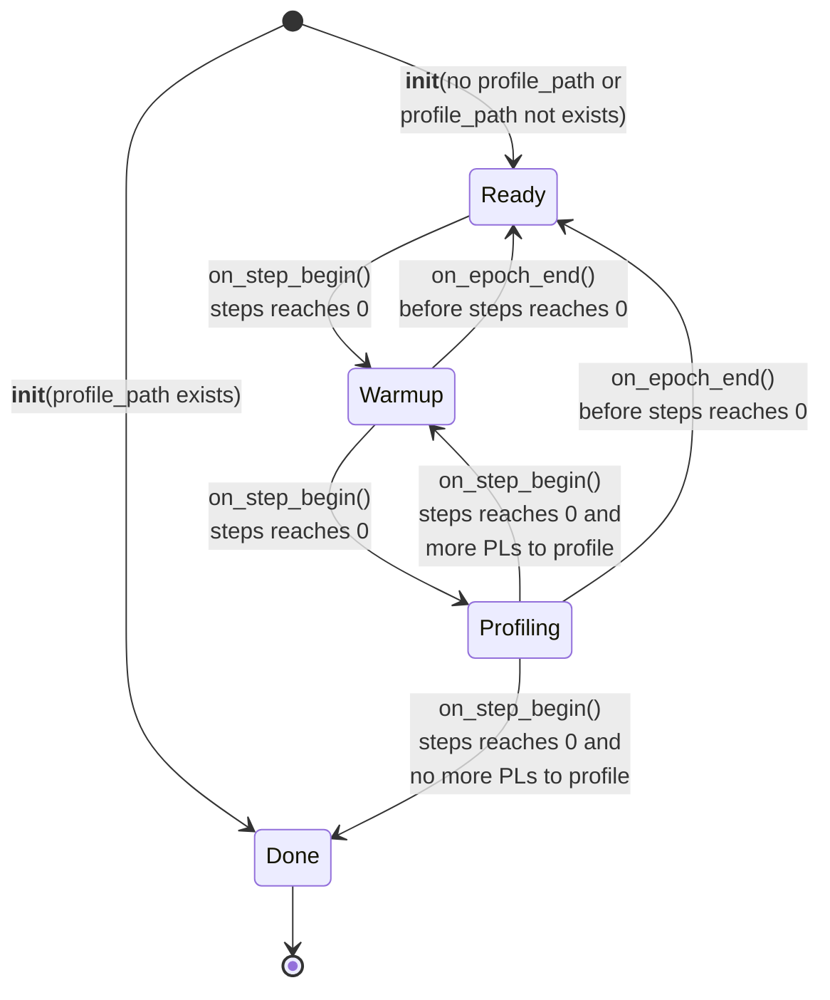
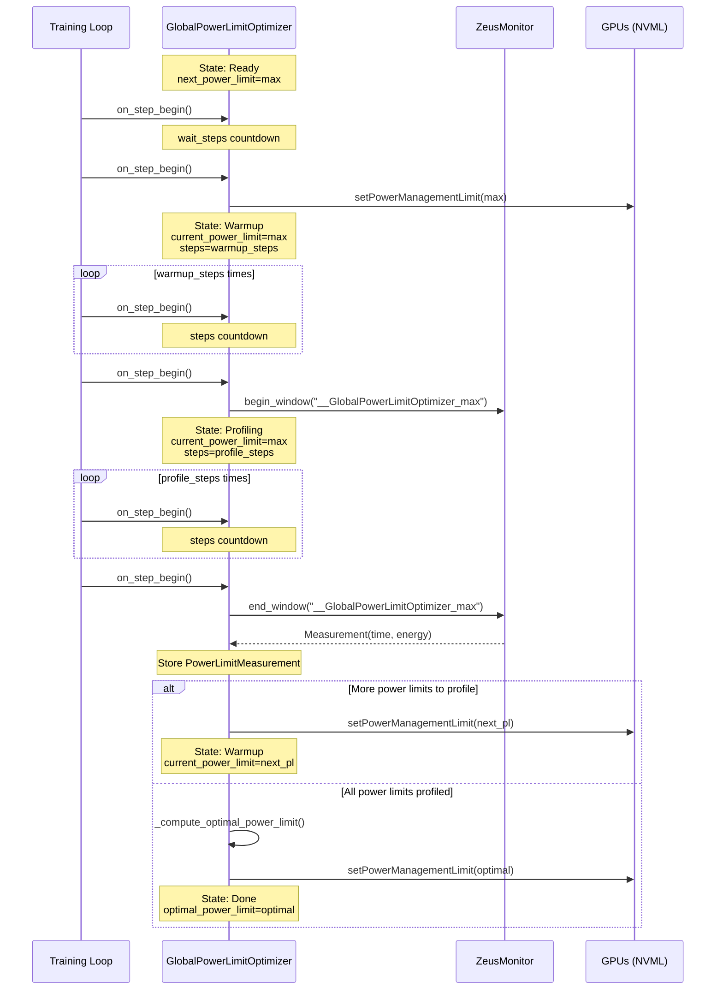
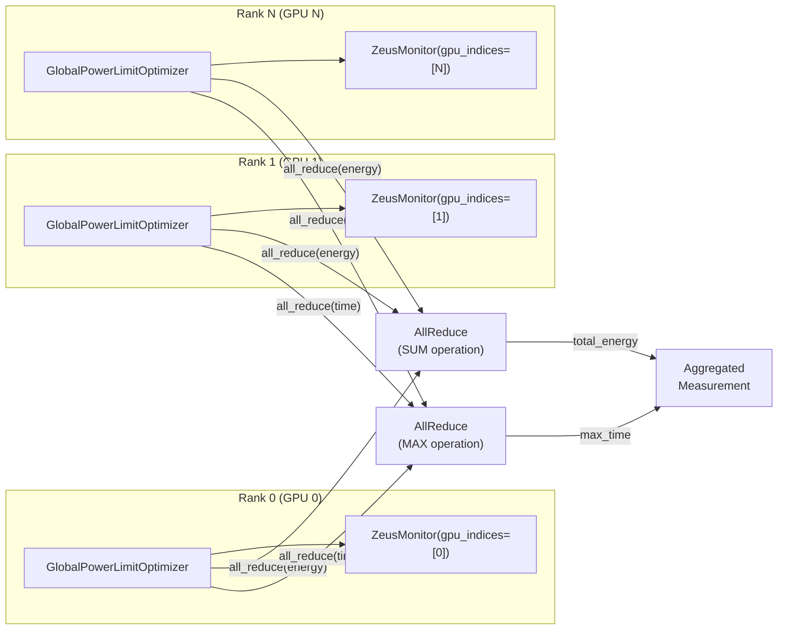
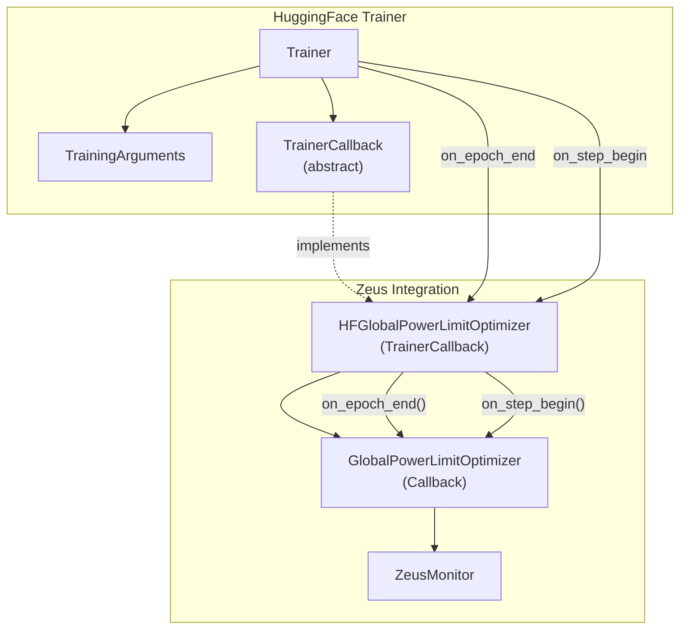

<!-- source: DeepWiki mcp.deepwiki.com · repo ml-energy/zeus · page 5.1 Power Limit Optimizer · fetched 2026-10-21 -->

# Power Limit Optimizer

<details>
<summary>Relevant source files</summary>

The following files were used as context for generating this wiki page:

- [pyproject.toml](pyproject.toml)
- [tests/optimizer/test_power_limit_optimizer.py](tests/optimizer/test_power_limit_optimizer.py)
- [tests/test_monitor.py](tests/test_monitor.py)
- [zeus/optimizer/power_limit.py](zeus/optimizer/power_limit.py)

</details>


## Purpose and Scope

This document describes Zeus's **Power Limit Optimizer**, which automatically determines the optimal GPU power limit for deep learning training workloads. The optimizer uses Just-In-Time (JIT) profiling to measure training time and energy consumption at different power limits, then selects the optimal power cap based on configurable optimization objectives (minimize energy, minimize time, or balance both).

The Power Limit Optimizer is implemented in [`zeus/optimizer/power_limit.py`](). For batch size optimization, see [Batch Size Optimizer](#5.3). For pipeline stage frequency optimization, see [Pipeline Frequency Optimizer](#5.2).

**Sources:** [zeus/optimizer/power_limit.py:1-21]()

---

## Architecture Overview

The Power Limit Optimizer consists of several key components that work together to profile and optimize GPU power limits during training.



**Component Responsibilities:**

| Component | Code Entity | Responsibility |
|-----------|-------------|----------------|
| Main Optimizer | `GlobalPowerLimitOptimizer` | Orchestrates JIT profiling, manages state transitions, controls GPU power limits |
| HF Wrapper | `HFGlobalPowerLimitOptimizer` | Adapts `GlobalPowerLimitOptimizer` to HuggingFace `TrainerCallback` interface |
| State Classes | `Ready`, `Warmup`, `Profiling`, `Done` | Pydantic models representing profiler states |
| Optimum Selectors | `Energy`, `Time`, `ZeusCost`, `MaxSlowdownConstraint` | Concrete strategies for selecting optimal power limit from measurements |
| Measurement | `PowerLimitMeasurement` | POD storing power limit, energy, and time for one profiling run |
| Persistence | `_PowerLimitMeasurementList` | Proxy for JSON serialization/deserialization of profiling results |

**Sources:** [zeus/optimizer/power_limit.py:1-578](), [pyproject.toml:44-46]()

---

## State Machine

The optimizer implements a state machine to manage the JIT profiling process. Each state represents a distinct phase of the profiling lifecycle.



**State Descriptions:**

| State | Class | Purpose | Attributes |
|-------|-------|---------|------------|
| **Ready** | `Ready(BaseModel)` | Waiting to start profiling next power limit | `next_power_limit: PositiveInt`<br/>`steps: PositiveInt` |
| **Warmup** | `Warmup(BaseModel)` | Warming up GPU at current power limit before measurement | `current_power_limit: PositiveInt`<br/>`steps: PositiveInt` |
| **Profiling** | `Profiling(BaseModel)` | Actively measuring time and energy at current power limit | `current_power_limit: PositiveInt`<br/>`steps: PositiveInt` |
| **Done** | `Done(BaseModel)` | Finished profiling all power limits; optimal power limit selected | `optimal_power_limit: PositiveInt` |

**State Transitions:**

- **Ready → Warmup**: Triggered by `on_step_begin()` when the wait/ready step counter reaches zero. Sets GPU to the next power limit to profile.
- **Warmup → Profiling**: Triggered by `on_step_begin()` after warmup steps complete. Calls `monitor.begin_window()` to start energy measurement.
- **Profiling → Warmup**: After profiling steps complete, if more power limits remain. Calls `monitor.end_window()` to record measurement.
- **Profiling → Done**: After profiling steps complete, if all power limits profiled. Computes optimal power limit using `OptimumSelector`.
- **Warmup/Profiling → Ready**: If `on_epoch_end()` is called before profiling completes, the current power limit is re-profiled in the next epoch.

**Sources:** [zeus/optimizer/power_limit.py:141-185](), [zeus/optimizer/power_limit.py:355-456]()

---

## JIT Profiling Process

The GlobalPowerLimitOptimizer performs Just-In-Time profiling by iterating through a range of power limits during training. For each power limit, it collects time and energy measurements over multiple training steps.



**Profiling Algorithm:**

1. **Power Limit Range Determination** ([zeus/optimizer/power_limit.py:288-294]()):
   - Queries `getPowerManagementLimitConstraints()` for each GPU
   - Generates power limits from max to min in steps of `pl_step` (default 25W)
   - Example: For constraints (100W, 300W) with step=25W: [300, 275, 250, ..., 125, 100]

2. **Warmup Phase** ([zeus/optimizer/power_limit.py:388-391]()):
   - Runs `warmup_steps` iterations (default 10) at the new power limit
   - Allows GPU state to stabilize after power limit change
   - No measurements taken during warmup

3. **Profiling Phase** ([zeus/optimizer/power_limit.py:400-429]()):
   - Calls `monitor.begin_window()` with a unique window name
   - Runs `profile_steps` iterations (default 40)
   - Calls `monitor.end_window()` to obtain `Measurement`
   - In distributed training, performs AllReduce to aggregate measurements across GPUs

4. **Epoch Interruption Handling** ([zeus/optimizer/power_limit.py:360-373]()):
   - If epoch ends during warmup/profiling, transitions back to `Ready` state
   - Resets power limit to maximum
   - Re-profiles the interrupted power limit in the next epoch

**Sources:** [zeus/optimizer/power_limit.py:224-354](), [zeus/optimizer/power_limit.py:378-456]()

---

## Optimum Selection Strategies

After profiling all power limits, the optimizer selects the optimal power limit using an `OptimumSelector` strategy. Zeus provides four built-in strategies:

| Strategy | Class | Selection Criterion | Use Case |
|----------|-------|---------------------|----------|
| **Energy** | `Energy` | `min(energy)` | Minimize energy consumption, time not critical |
| **Time** | `Time` | `min(time)` | Minimize training time, energy not critical |
| **Zeus Cost** | `ZeusCost` | `min(η·E + (1-η)·P_max·T)` | Balance time and energy with tunable η knob |
| **Max Slowdown** | `MaxSlowdownConstraint` | `min(PL)` where `time ≤ factor × min(time)` | Minimize power subject to maximum slowdown constraint |

### Energy Strategy

```python
class Energy(OptimumSelector):
    def select(self, measurements: list[PowerLimitMeasurement]) -> int:
        return min(measurements, key=lambda x: x.energy).power_limit
```

Selects the power limit that consumed the least total energy. Ignores training time.

**Sources:** [zeus/optimizer/power_limit.py:49-54]()

### Time Strategy

```python
class Time(OptimumSelector):
    def select(self, measurements: list[PowerLimitMeasurement]) -> int:
        return min(measurements, key=lambda x: x.time).power_limit
```

Selects the power limit that resulted in the shortest training time. Note: May not always select the maximum power limit due to measurement noise, which can actually be beneficial (similar time with lower power).

**Sources:** [zeus/optimizer/power_limit.py:57-68]()

### Zeus Cost Strategy

```python
class ZeusCost(OptimumSelector):
    def __init__(self, eta_knob: float, world_size: int = 1) -> None:
        self.eta_knob = eta_knob
        self.world_size = world_size
    
    def select(self, measurements: list[PowerLimitMeasurement]) -> int:
        max_power = max(measurement.power_limit for measurement in measurements) * self.world_size
        zeus_cost_map = {
            measurement.power_limit: zeus_cost(
                energy=measurement.energy,
                time=measurement.time,
                eta_knob=self.eta_knob,
                max_power=max_power,
            )
            for measurement in measurements
        }
        return min(zeus_cost_map, key=lambda x: zeus_cost_map[x])
```

Computes a weighted cost function: **Cost = η·Energy + (1-η)·MaxPower·Time**

- **η = 0.0**: Minimize time (equivalent to `Time` strategy)
- **η = 1.0**: Minimize energy (equivalent to `Energy` strategy)  
- **η = 0.5**: Equal weighting (default)
- `world_size` accounts for multi-GPU training when computing `max_power`

**Sources:** [zeus/optimizer/power_limit.py:71-107](), [zeus/utils/metric.py]()

### Max Slowdown Constraint Strategy

```python
class MaxSlowdownConstraint(OptimumSelector):
    def __init__(self, factor: float) -> None:
        self.factor = factor  # >= 1.0
    
    def select(self, measurements: list[PowerLimitMeasurement]) -> int:
        max_power = max(measurement.power_limit for measurement in measurements)
        shortest_time = next(
            measurement.time
            for measurement in measurements
            if measurement.power_limit == max_power
        )
        feasible_power_limits = []
        for measurement in measurements:
            if measurement.time <= self.factor * shortest_time:
                feasible_power_limits.append(measurement.power_limit)
        return min(feasible_power_limits)
```

Selects the minimum power limit that keeps training time within `factor × min(time)`. Example: `factor=1.1` means "select the lowest power limit that increases training time by at most 10%".

**Sources:** [zeus/optimizer/power_limit.py:110-138]()

---

## Distributed Training Support

The `GlobalPowerLimitOptimizer` supports distributed data parallelism with one process per GPU.



**Distributed Training Requirements:**

1. **One Process Per GPU** ([zeus/optimizer/power_limit.py:206-221]()):
   - Each `ZeusMonitor` instance monitors exactly one GPU
   - Typically `monitor = ZeusMonitor(gpu_indices=[local_rank])`
   - Matches `torch.cuda.current_device()` in PyTorch

2. **Energy Aggregation** ([zeus/optimizer/power_limit.py:419-427]()):
   - Energy is summed across all GPUs using `all_reduce(..., operation="sum")`
   - Each GPU measures its own energy consumption
   - Total energy = sum of all GPU energies

3. **Time Synchronization** ([zeus/optimizer/power_limit.py:427]()):
   - Time is synchronized using `all_reduce([measurement.time], operation="max")`
   - Takes the maximum time across all processes
   - Accounts for potential stragglers

4. **Unified Power Limit Selection** ([zeus/optimizer/power_limit.py:418-441]()):
   - All ranks independently compute the same optimal power limit
   - Each rank sets its own GPU to the optimal power limit
   - No explicit synchronization needed (deterministic selection)

**Warning**: If `len(monitor.gpu_indices) > 1` in distributed training, the optimizer logs a warning ([zeus/optimizer/power_limit.py:278-285]()) since AllReduce is already performed internally.

**Sources:** [zeus/optimizer/power_limit.py:206-221](), [zeus/optimizer/power_limit.py:418-441](), [zeus/utils/framework.py]()

---

## Profile Persistence

The optimizer can save and load profiling results to/from disk, enabling profile reuse across training runs.

**JSON Profile Format:**

```json
{
    "measurements": [
        {
            "power_limit": 300,
            "energy": 1234.56,
            "time": 45.67
        },
        {
            "power_limit": 275,
            "energy": 1189.23,
            "time": 47.12
        }
    ]
}
```

**Profile Path Behavior** ([zeus/optimizer/power_limit.py:314-353]()):

| `profile_path` Value | Behavior |
|---------------------|----------|
| `None` | JIT profile without saving. Optimal power limit used for current run only. |
| Non-existing file path | Perform JIT profiling and save results to the file. Enables reuse in future runs. |
| Existing file path | Load saved profile, skip profiling entirely. Immediately set optimal power limit. |

**Loading Saved Profile** ([zeus/optimizer/power_limit.py:335-350]()):
```python
self.measurements = _PowerLimitMeasurementList.parse_file(
    self.profile_path,
).measurements
optimal_power_limit = self._compute_optimal_power_limit()
self.state = Done(optimal_power_limit=optimal_power_limit)
self._set_power_limit(self.state.optimal_power_limit)
```

**Saving Profile** ([zeus/optimizer/power_limit.py:477-489]()):
```python
def _save_profile(self) -> None:
    with self.profile_path.open("w", encoding="utf-8") as f:
        f.write(
            _PowerLimitMeasurementList(measurements=self.measurements).json(
                indent=4
            ),
        )
```

**Use Cases:**
- **Development**: Profile once, reuse across multiple debugging runs
- **Hyperparameter Tuning**: Same model/hardware configuration, different hyperparameters
- **Reproducibility**: Consistent power limit selection across experiment replicas

**Sources:** [zeus/optimizer/power_limit.py:195-199](), [zeus/optimizer/power_limit.py:314-353](), [zeus/optimizer/power_limit.py:477-489]()

---

## HuggingFace Integration

`HFGlobalPowerLimitOptimizer` wraps `GlobalPowerLimitOptimizer` to integrate with HuggingFace Transformers' `TrainerCallback` interface.



**Implementation** ([zeus/optimizer/power_limit.py:507-578]()):

```python
class HFGlobalPowerLimitOptimizer(TrainerCallback):
    def __init__(
        self,
        monitor: ZeusMonitor,
        optimum_selector: OptimumSelector | None = None,
        wait_steps: int = 1,
        warmup_steps: int = 10,
        profile_steps: int = 40,
        pl_step: int = 25,
        profile_path: str | Path | None = None,
    ) -> None:
        self.optimizer = GlobalPowerLimitOptimizer(
            monitor=monitor,
            optimum_selector=optimum_selector,
            wait_steps=wait_steps,
            warmup_steps=warmup_steps,
            profile_steps=profile_steps,
            pl_step=pl_step,
            profile_path=profile_path,
        )
    
    def on_epoch_end(self, args, state, control, model, **kwargs) -> None:
        self.optimizer.on_epoch_end()
    
    def on_step_begin(self, args, state, control, model, **kwargs) -> None:
        self.optimizer.on_step_begin()
```

**Usage Example:**

```python
from zeus.monitor import ZeusMonitor
from zeus.optimizer.power_limit import HFGlobalPowerLimitOptimizer
from transformers import Trainer, TrainingArguments

monitor = ZeusMonitor(gpu_indices=[torch.cuda.current_device()])
plo = HFGlobalPowerLimitOptimizer(monitor, profile_path="profile.json")

trainer = Trainer(
    model=model,
    args=training_args,
    train_dataset=train_dataset,
    callbacks=[plo],
)
trainer.train()
```

**Constructor Signature Equivalence** ([tests/optimizer/test_power_limit_optimizer.py:290-297]()):
The test suite verifies that `HFGlobalPowerLimitOptimizer.__init__` and `GlobalPowerLimitOptimizer.__init__` have identical signatures, ensuring API consistency.

**Sources:** [zeus/optimizer/power_limit.py:507-578](), [tests/optimizer/test_power_limit_optimizer.py:290-297]()

---

## Configuration Parameters

The `GlobalPowerLimitOptimizer` constructor accepts the following parameters:

| Parameter | Type | Default | Description |
|-----------|------|---------|-------------|
| `monitor` | `ZeusMonitor` | Required | Energy monitor instance. GPU indices are taken from `monitor.gpu_indices`. |
| `optimum_selector` | `OptimumSelector \| None` | `ZeusCost(η=0.5)` | Strategy for selecting optimal power limit from measurements. |
| `wait_steps` | `int` | `1` | Number of initial steps to skip before profiling. Useful for CUDA warmup (e.g., `cudnn.benchmark=True`). |
| `warmup_steps` | `int` | `10` | Number of warmup iterations at each power limit before measurement begins. |
| `profile_steps` | `int` | `40` | Number of profiling iterations for each power limit. More steps = more accurate measurements. |
| `pl_step` | `int` | `25` | Step size between power limits to explore, in Watts. Smaller values = finer granularity, more profiling time. |
| `profile_path` | `str \| Path \| None` | `None` | Path for profile persistence. `None` = no save/load, existing path = load only, non-existing path = profile and save. |

**Parameter Validation** ([zeus/optimizer/power_limit.py:251-259]()):
- `wait_steps >= 0`
- `warmup_steps >= 0`
- `profile_steps > 0`
- `pl_step > 0`

**Internal Conversions:**
- Power limits internally stored in milliWatts (mW) for NVML API compatibility
- User-facing values in Watts (W) for clarity
- Conversion: `pl_step * 1000` ([zeus/optimizer/power_limit.py:268]())

**Privileges Required** ([zeus/optimizer/power_limit.py:296-305]()):
The optimizer calls `setPowerManagementLimit()` and `setPersistenceMode()`, which require `SYS_ADMIN` capability or root access. See [Deployment Strategies](#2.3) for privilege management options.

**Sources:** [zeus/optimizer/power_limit.py:224-272](), [zeus/optimizer/power_limit.py:296-305]()

---

## Example Usage

**Basic Usage:**

```python
from zeus.monitor import ZeusMonitor
from zeus.optimizer.power_limit import GlobalPowerLimitOptimizer, ZeusCost

# Initialize monitor for current GPU
monitor = ZeusMonitor(gpu_indices=[torch.cuda.current_device()])

# Create optimizer with default ZeusCost strategy (η=0.5)
plo = GlobalPowerLimitOptimizer(
    monitor=monitor,
    wait_steps=5,
    warmup_steps=10,
    profile_steps=40,
    pl_step=25,
    profile_path="my_model_profile.json"
)

# Training loop
for epoch in range(num_epochs):
    plo.on_epoch_begin()
    for batch in train_loader:
        plo.on_step_begin()
        # ... training code ...
        plo.on_step_end()
    plo.on_epoch_end()
```

**Custom Optimum Selector:**

```python
from zeus.optimizer.power_limit import Energy, MaxSlowdownConstraint

# Minimize energy
plo = GlobalPowerLimitOptimizer(monitor, optimum_selector=Energy())

# Minimize power subject to max 20% slowdown
plo = GlobalPowerLimitOptimizer(
    monitor,
    optimum_selector=MaxSlowdownConstraint(factor=1.2)
)
```

**Sources:** [zeus/optimizer/power_limit.py:218-221](), [tests/optimizer/test_power_limit_optimizer.py:98-186]()

---

