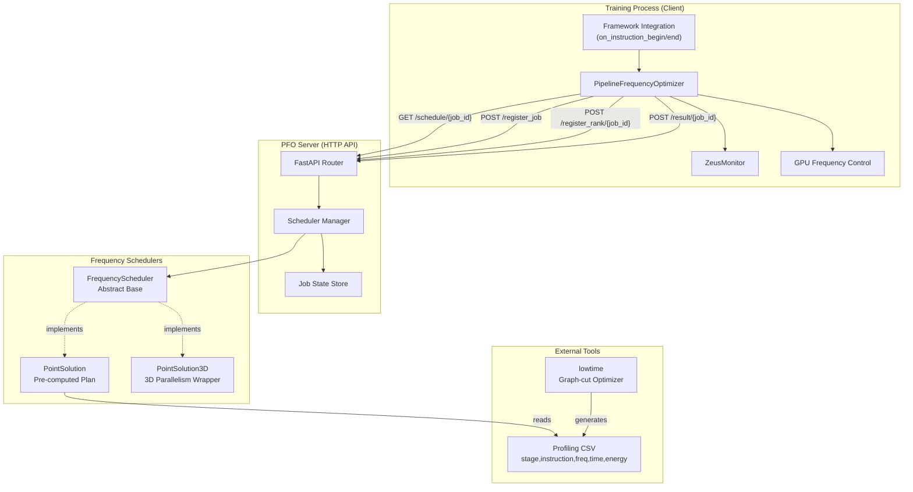
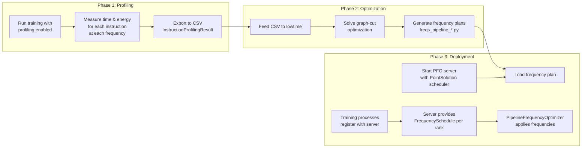
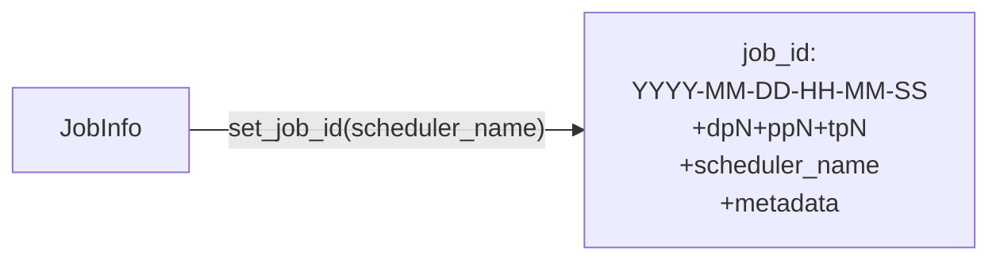
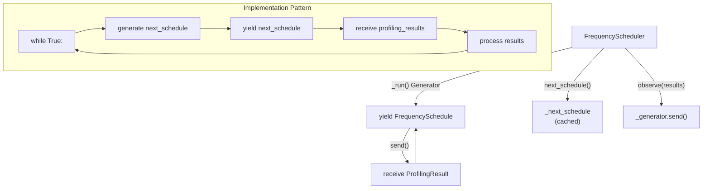
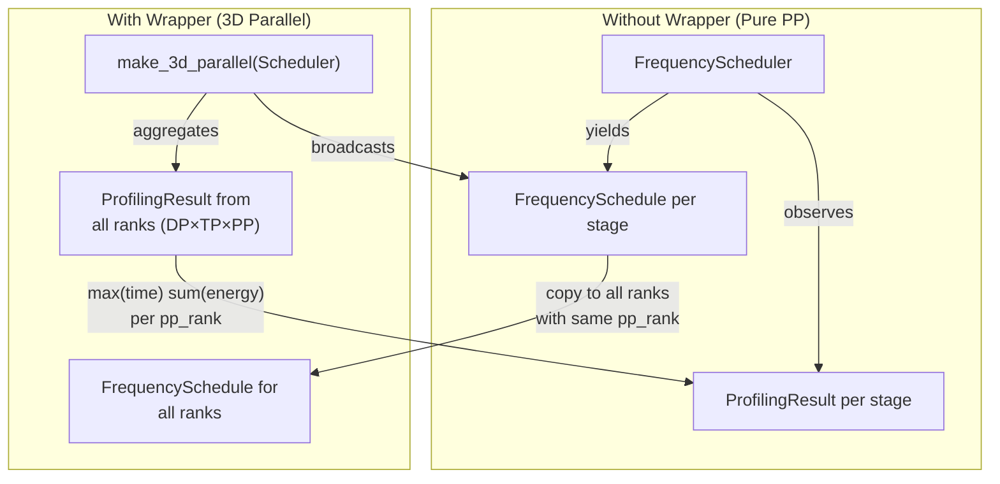
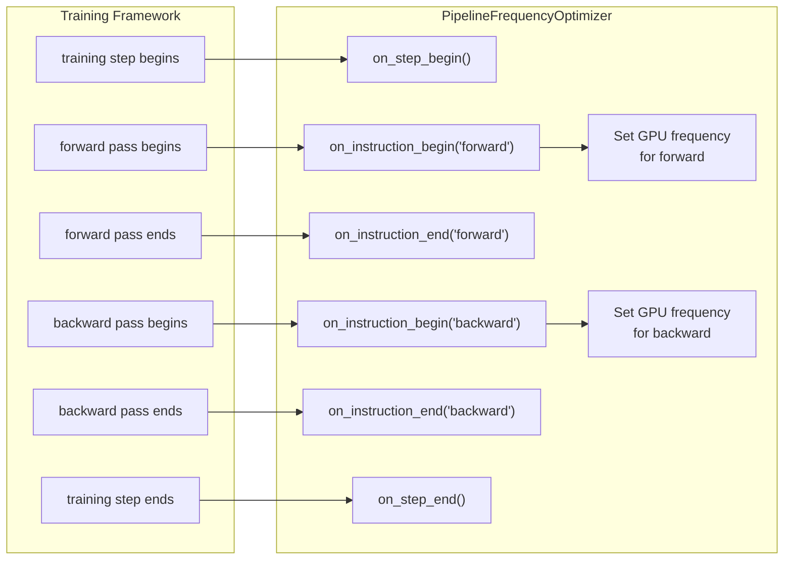

<!-- source: DeepWiki mcp.deepwiki.com · repo ml-energy/zeus · page 5.2 Pipeline Frequency Optimizer · fetched 2026-10-21 -->

# Pipeline Frequency Optimizer

<details>
<summary>Relevant source files</summary>

The following files were used as context for generating this wiki page:

- [docs/optimize/pipeline_frequency_optimizer.md](docs/optimize/pipeline_frequency_optimizer.md)
- [zeus/optimizer/pipeline_frequency/common.py](zeus/optimizer/pipeline_frequency/common.py)
- [zeus/optimizer/pipeline_frequency/server/scheduler.py](zeus/optimizer/pipeline_frequency/server/scheduler.py)

</details>


## Purpose and Scope

This document describes the Pipeline Frequency Optimizer (PFO), a component of Zeus that optimizes energy consumption in pipeline-parallel training of large models. The PFO exploits the observation that pipeline stages are inherently imbalanced and uses per-stage GPU frequency scaling to minimize energy consumption while maintaining training throughput.

For general power limit optimization, see [Power Limit Optimizer](#5.1). For batch size optimization, see [Batch Size Optimizer](#5.3).

**Sources:** [docs/optimize/pipeline_frequency_optimizer.md:1-13]()

---

## Core Concept

### Pipeline Imbalance Problem

Pipeline parallel training splits a model into stages across multiple GPUs. Due to architectural asymmetries (e.g., embedding layers, language model heads), achieving perfectly balanced stages is nearly impossible. Imbalanced stages lead to idle time where faster stages wait for slower stages.

### Frequency Scaling as Optimization

The PFO leverages GPU frequency scaling to reduce energy consumption during these imbalances. By lowering the frequency of faster stages (which would otherwise idle), the PFO reduces power consumption without affecting the critical path. The optimization problem is formulated as a graph-cut algorithm that finds the Pareto-optimal frequency assignment across all pipeline stages.

### Pareto Frontiers and Graph-Cut

The PFO relies on pre-computed Pareto frontiers—profiles of time and energy consumption for each instruction (forward/backward) at each frequency. Using these profiles, an external tool called `lowtime` solves a graph-cut optimization problem to generate frequency plans that minimize energy or a weighted combination of energy and time.

**Sources:** [docs/optimize/pipeline_frequency_optimizer.md:3-8](), [docs/optimize/pipeline_frequency_optimizer.md:58-63]()

---

## Architecture Overview

The PFO follows a client-server architecture where training processes (clients) communicate with a centralized PFO server via HTTP over Unix sockets.



**Diagram: PFO System Architecture**

The architecture consists of three main components:

1. **Client (`PipelineFrequencyOptimizer`)**: Integrated into the training framework, monitors instruction execution, and sets GPU frequencies
2. **Server (FastAPI application)**: Manages frequency schedules for multiple jobs and ranks
3. **Schedulers (`FrequencyScheduler`)**: Implement policies for determining frequency assignments

**Sources:** [docs/optimize/pipeline_frequency_optimizer.md:76-84](), [zeus/optimizer/pipeline_frequency/common.py:15-19](), [zeus/optimizer/pipeline_frequency/server/scheduler.py:23-42]()

---

## Workflow

The PFO operates in three phases: profiling, optimization, and deployment.



**Diagram: PFO Three-Phase Workflow**

### Phase 1: Profiling

Training runs with profiling enabled to measure the time and energy consumption of forward and backward passes at different GPU frequencies. The profiling data is exported to a CSV file with columns: `stage`, `instruction`, `frequency`, `time`, `energy`.

**Key Classes:**
- `InstructionProfilingResult`: Serializes profiling data to CSV format
- `OfflineProfilingResult`: Per-rank profiling data structure

### Phase 2: Optimization

The `lowtime` tool (external to Zeus) reads the profiling CSV and solves a graph-cut optimization problem to generate Pareto-optimal frequency plans. Each plan is saved as a Python file (`freqs_pipeline_%05d.py`) containing a list of `(instruction, frequency)` tuples for each rank.

### Phase 3: Deployment

1. The PFO server starts with the `PointSolution` scheduler and the path to the chosen frequency plan
2. Training processes instantiate `PipelineFrequencyOptimizer` and register with the server
3. The server provides each rank with its `FrequencySchedule`
4. During training, `PipelineFrequencyOptimizer` automatically sets GPU frequencies according to the schedule

**Sources:** [docs/optimize/pipeline_frequency_optimizer.md:17-21](), [docs/optimize/pipeline_frequency_optimizer.md:29-56](), [docs/optimize/pipeline_frequency_optimizer.md:64-84]()

---

## Data Models

The PFO uses Pydantic models for type-safe communication between clients and server.

### Core Models

| Model | Purpose | Key Fields |
|-------|---------|------------|
| `JobInfo` | Describes a training job | `job_id`, `pp_degree`, `dp_degree`, `tp_degree`, `world_size` |
| `RankInfo` | Per-rank hardware information | `rank`, `dp_rank`, `pp_rank`, `tp_rank`, `available_frequencies` |
| `FrequencySchedule` | Frequency assignment for one iteration | `rank`, `frequencies: list[tuple[str, int]]` |
| `ProfilingResult` | Online profiling measurements | `rank`, `iter_time`, `iter_energy`, `time_breakdown`, `energy_breakdown` |
| `OfflineProfilingResult` | Offline profiling measurements | `rank`, `forward_time`, `forward_energy`, `backward_time`, `backward_energy` |

### Job Identification



**Diagram: Job ID Generation**

The `job_id` uniquely identifies a training job and is generated from the timestamp, parallelism degrees, scheduler name, and optional metadata. This allows the server to manage multiple concurrent jobs.

**Sources:** [zeus/optimizer/pipeline_frequency/common.py:73-121](), [zeus/optimizer/pipeline_frequency/common.py:123-139](), [zeus/optimizer/pipeline_frequency/common.py:141-171]()

---

## API Endpoints

The PFO server exposes a REST API for client-server communication.

| Endpoint | Method | Purpose |
|----------|--------|---------|
| `/info` | GET | Retrieve server configuration |
| `/register_job` | POST | Register a new training job, receive `job_id` |
| `/register_rank/{job_id}` | POST | Register a rank with rank info |
| `/schedule/{job_id}` | GET | Retrieve frequency schedule for all ranks |
| `/result/{job_id}` | POST | Submit profiling results (for online schedulers) |

**URL Constants:**

```python
GET_SERVER_INFO_URL = "/info"
REGISTER_JOB_URL = "/register_job"
REGISTER_RANK_URL = "/register_rank/{job_id}"
GET_FREQUENCY_SCHEDULE_URL = "/schedule/{job_id}"
REPORT_PROFILING_RESULT_URL = "/result/{job_id}"
```

**Sources:** [zeus/optimizer/pipeline_frequency/common.py:15-19]()

---

## Server Configuration

The PFO server is configured via environment variables using the `PFOServerSettings` class.

| Environment Variable | Default | Description |
|---------------------|---------|-------------|
| `ZEUS_PFO_SCHEDULER` | `PointSolution` | Scheduler class name (auto-prefixed with module path) |
| `ZEUS_PFO_SCHEDULER_ARGS` | `{}` | JSON dict of scheduler constructor arguments |
| `ZEUS_PFO_LOG_LEVEL` | `DEBUG` | Logging level |
| `ZEUS_PFO_DUMP_DATA` | `True` | Whether to dump state to filesystem |
| `ZEUS_PFO_DUMP_DIR` | `./dump` | Directory for dumping state |
| `ZEUS_PFO_MAX_JOB_IDLE_TIME` | `604800` | Max idle time (seconds) before job cleanup |

**Starting the Server:**

```bash
ZEUS_PFO_SCHEDULER_ARGS='{"solution_path": "path/to/freqs_pipeline_%05d.py"}' \
    uvicorn zeus.optimizer.pipeline_frequency.server.router:app --port 7787
```

**Sources:** [zeus/optimizer/pipeline_frequency/common.py:22-71](), [docs/optimize/pipeline_frequency_optimizer.md:76-84]()

---

## Frequency Schedulers

### `FrequencyScheduler` Interface

The `FrequencyScheduler` abstract base class defines the interface for implementing scheduling policies.



**Diagram: FrequencyScheduler Generator Pattern**

The scheduler uses a generator-based approach where the `_run()` method yields schedules and receives profiling results through the same `yield` statement. This allows the scheduler logic to be expressed linearly without maintaining explicit state machines.

**Key Methods:**
- `_run() -> Generator[list[FrequencySchedule], list[ProfilingResult], None]`: Generator that yields schedules and receives results
- `next_schedule() -> list[FrequencySchedule]`: Returns the next schedule (cached)
- `observe(profiling_results: list[ProfilingResult])`: Ingests profiling results and advances the generator

**Sources:** [zeus/optimizer/pipeline_frequency/server/scheduler.py:23-102]()

---

### `PointSolution` Scheduler

The `PointSolution` scheduler runs a pre-computed frequency plan generated by `lowtime`.

**Constructor Arguments:**
- `solution_path: str`: Path to the frequency plan Python file

**Behavior:**
1. Reads the frequency plan from the file (expected format: `list[list[tuple[str, int]]]`)
2. Validates that the number of ranks matches the training job
3. Yields the same schedule indefinitely (stateless)

```python
# Example frequency plan file content
[
    [("forward", 1740), ("backward", 1500)],  # Rank 0
    [("forward", 1650), ("backward", 1650)],  # Rank 1
    [("forward", 1710), ("backward", 1600)],  # Rank 2
    [("forward", 1740), ("backward", 1740)],  # Rank 3
]
```

**Sources:** [zeus/optimizer/pipeline_frequency/server/scheduler.py:235-276]()

---

### 3D Parallelism Support

The `make_3d_parallel` wrapper transforms a pure pipeline-parallel scheduler into one that handles data and tensor parallelism.



**Diagram: 3D Parallelism Wrapper**

**Key Transformations:**

1. **Job Info Projection**: Transforms `JobInfo` to appear as pure pipeline parallelism:
   - `dp_degree = 1`, `tp_degree = 1`
   - `world_size = pp_degree`
   - New rank is given by `pp_rank`

2. **Result Aggregation** (`observe`):
   - Groups results by `pp_rank`
   - For time metrics: takes `max` across ranks (pipeline is bounded by slowest rank)
   - For energy metrics: takes `sum` across ranks (total energy consumption)

3. **Schedule Broadcasting** (`next_schedule`):
   - Retrieves per-stage schedule from wrapped scheduler
   - Copies schedule to all ranks with the same `pp_rank`

**Usage:**

```python
PointSolution3D = make_3d_parallel(PointSolution)
```

**Sources:** [zeus/optimizer/pipeline_frequency/server/scheduler.py:104-232](), [zeus/optimizer/pipeline_frequency/server/scheduler.py:278]()

---

## Client Integration

### `PipelineFrequencyOptimizer` Class

The client-side optimizer integrates with training frameworks through callback methods.



**Diagram: PipelineFrequencyOptimizer Integration Points**

### Integration Requirements

For integration with a training framework, the following is required:

1. **Concrete Forward/Backward Regions**: The framework must have identifiable code regions where forward and backward passes exclusively occur
2. **Callback Insertion Points**: Ability to insert callbacks before and after these regions
3. **Zeus Dependency**: Add `zeus[pfo]` to the framework's dependencies

### Integration Steps

1. **Instantiate the optimizer:**
   ```python
   from zeus.optimizer.pipeline_frequency.optimizer import PipelineFrequencyOptimizer
   opt = PipelineFrequencyOptimizer(...)
   ```

2. **Wrap training step:**
   ```python
   opt.on_step_begin()
   # ... training step ...
   opt.on_step_end()
   ```

3. **Wrap forward pass:**
   ```python
   opt.on_instruction_begin("forward")
   # ... forward computation ...
   opt.on_instruction_end("forward")
   ```

4. **Wrap backward pass:**
   ```python
   opt.on_instruction_begin("backward")
   # ... backward computation ...
   opt.on_instruction_end("backward")
   ```

**Sources:** [docs/optimize/pipeline_frequency_optimizer.md:86-105]()

---

## Profiling Data Format

### Offline Profiling CSV

The profiling CSV must contain measurements for each instruction at each frequency for each pipeline stage.

**Required Columns:**

| Column | Type | Description |
|--------|------|-------------|
| `stage` | int | Pipeline stage index (0-indexed) |
| `instruction` | str | Either `"forward"` or `"backward"` |
| `frequency` | int | GPU frequency in MHz |
| `time` | float | Average execution time in seconds |
| `energy` | float | Average energy consumption in Joules |

**Optional Columns:**

| Column | Type | Description |
|--------|------|-------------|
| `rank` | int | Global rank (for 3D parallelism) |
| `dp_rank` | int | Data parallel rank |
| `pp_rank` | int | Pipeline parallel rank |
| `tp_rank` | int | Tensor parallel rank |

**Example CSV:**

```csv
stage,instruction,frequency,time,energy
0,forward,1740,0.0937,28.494
0,forward,1725,0.0939,28.434
0,backward,1740,0.2453,69.569
0,backward,1725,0.2454,69.255
1,forward,1740,0.1021,32.150
...
```

**Exporting Profiling Data:**

```python
from zeus.optimizer.pipeline_frequency.common import InstructionProfilingResult

results = InstructionProfilingResult(__root__=[...])
results.to_csv("profiling_results.csv")
```

**Sources:** [docs/optimize/pipeline_frequency_optimizer.md:31-47](), [zeus/optimizer/pipeline_frequency/common.py:197-228]()

---

## P2P Blocking Power

In addition to instruction profiling, the optimizer needs the power consumption during P2P blocking (when a GPU waits for data from a neighboring stage).

**Profiling Script:**

Zeus provides a reference script for profiling P2P blocking power:
[examples/pipeline_frequency_optimizer/profile_p2p.py]()

This measurement captures the idle power consumption of the GPU while blocked on pipeline communication, which is essential for accurate energy modeling.

**Sources:** [docs/optimize/pipeline_frequency_optimizer.md:54-55]()

---

## State Persistence

The PFO server can persist scheduler state for inspection and debugging.

### Persistence Methods

The following helper functions in `common.py` support state serialization:

| Function | Purpose |
|----------|---------|
| `save_prof(data, directory, schedule_num)` | Save profiling results for a schedule |
| `load_prof(directory, schedule_num)` | Load profiling results |
| `save_sched(data, directory, schedule_num)` | Save frequency schedules |
| `load_sched(directory, schedule_num)` | Load frequency schedules |
| `save_ranks(data, directory)` | Save rank information |
| `load_ranks(directory)` | Load rank information |

**File Format:**

- Profiling results: `{dump_dir}/{schedule_num}.prof.json`
- Frequency schedules: `{dump_dir}/{schedule_num}.sched.json`
- Rank info: `{dump_dir}/ranks.json`

**Configuration:**

```bash
ZEUS_PFO_DUMP_DATA=true \
ZEUS_PFO_DUMP_DIR=/path/to/dumps \
    uvicorn zeus.optimizer.pipeline_frequency.server.router:app
```

**Sources:** [zeus/optimizer/pipeline_frequency/common.py:231-278](), [zeus/optimizer/pipeline_frequency/common.py:42-44]()

---

## Reference Integration: Merak

Zeus provides a reference integration with [Merak](https://github.com/ml-energy/merak-zeus), a large model training framework supporting 3D parallelism.

**Key Features:**
- Automatic profiling of forward/backward passes at all frequencies
- Integration with `PipelineEngine` for callback insertion
- Example training scripts for GPT-3, BERT, and Wide-ResNet
- Support for automatic model tracing and partitioning

**Profiling in Merak:**

See [Merak's `profile` function](https://github.com/ml-energy/merak-zeus/blob/40eb07f80b3b3c2905bde303b02a6f707193f083/Merak/merak_trainer.py#L620)() for a reference implementation of offline profiling that measures time and energy for each instruction at each frequency.

**Sources:** [docs/optimize/pipeline_frequency_optimizer.md:23-28](), [docs/optimize/pipeline_frequency_optimizer.md:110-112]()

---

## Summary of Key Files

| File | Purpose |
|------|---------|
| `zeus/optimizer/pipeline_frequency/optimizer.py` | Client-side `PipelineFrequencyOptimizer` class |
| `zeus/optimizer/pipeline_frequency/common.py` | Shared data models and API constants |
| `zeus/optimizer/pipeline_frequency/server/scheduler.py` | Scheduler interface and implementations |
| `zeus/optimizer/pipeline_frequency/server/router.py` | FastAPI application and endpoints |
| `examples/pipeline_frequency_optimizer/` | Example scripts and profiling tools |

**Sources:** [docs/optimize/pipeline_frequency_optimizer.md:1-113](), [zeus/optimizer/pipeline_frequency/common.py:1-295](), [zeus/optimizer/pipeline_frequency/server/scheduler.py:1-279]()

---

