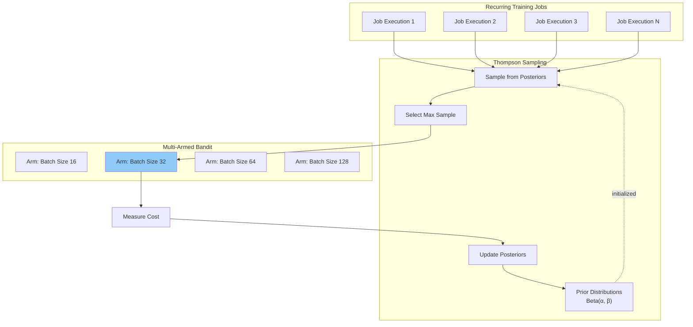
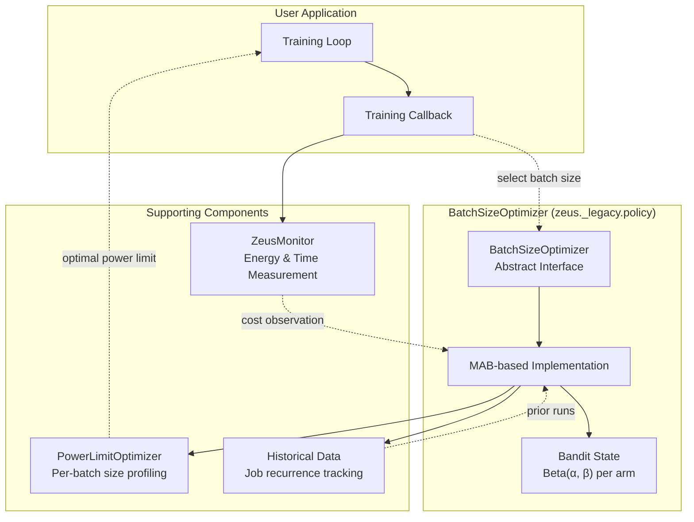
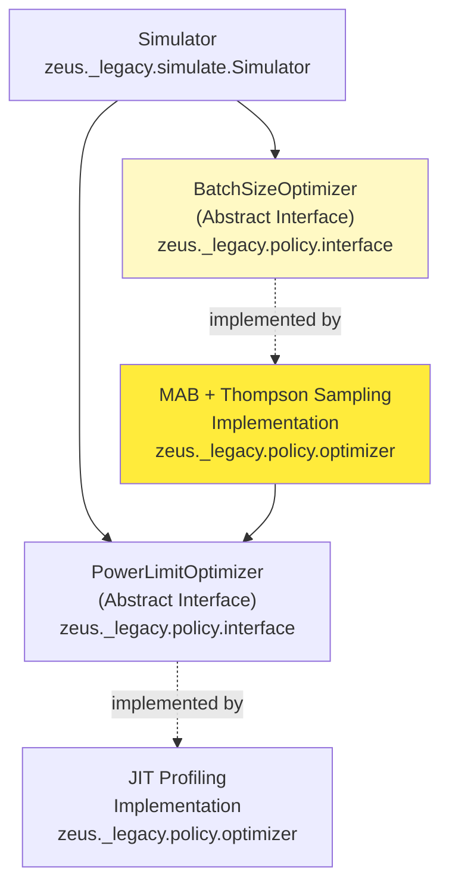
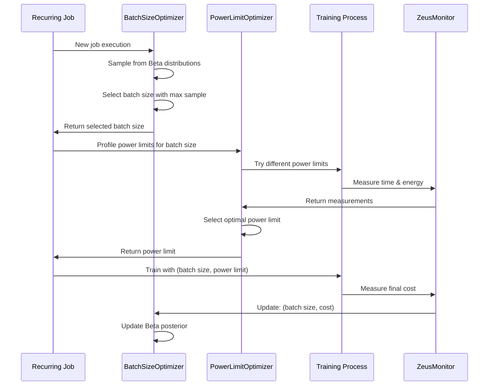
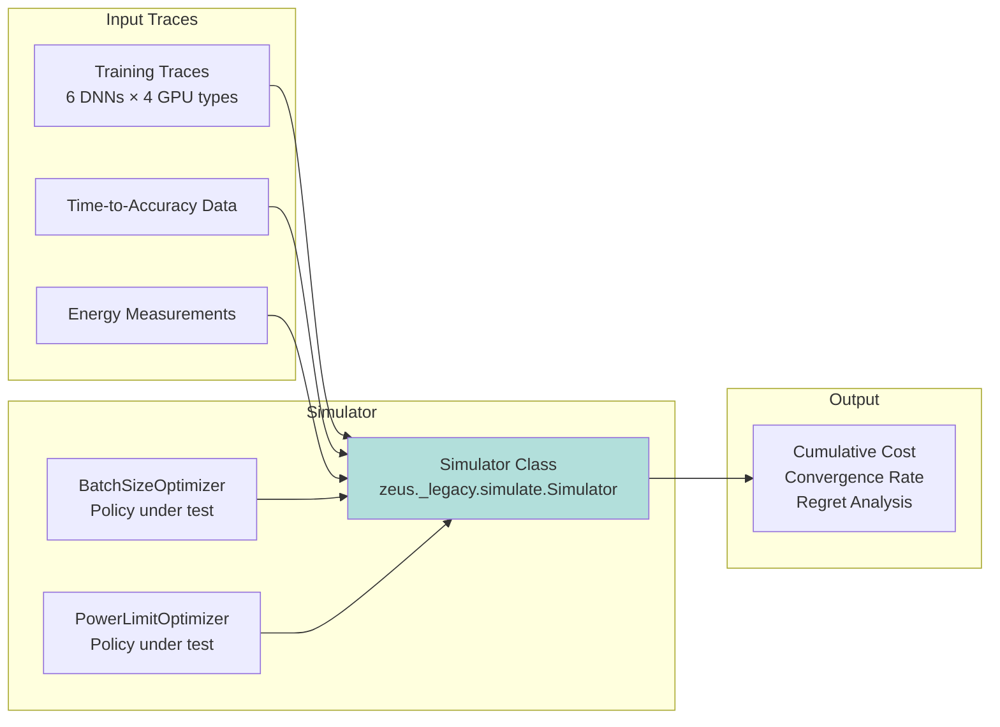

<!-- source: DeepWiki mcp.deepwiki.com · repo ml-energy/zeus · page 5.3 Batch Size Optimizer · fetched 2026-10-21 -->

# Batch Size Optimizer

<details>
<summary>Relevant source files</summary>

The following files were used as context for generating this wiki page:

- [README.md](README.md)
- [docs/getting_started/index.md](docs/getting_started/index.md)
- [docs/index.md](docs/index.md)
- [docs/research_overview/index.md](docs/research_overview/index.md)
- [docs/research_overview/perseus.md](docs/research_overview/perseus.md)
- [docs/research_overview/zeus.md](docs/research_overview/zeus.md)

</details>


## Purpose and Scope

The Batch Size Optimizer implements a multi-armed bandit (MAB) algorithm with Thompson sampling to automatically find the optimal training batch size that minimizes a user-defined cost function trading off energy consumption and training time. It operates across recurring training job executions, learning from previous runs to make increasingly better batch size selections.

For GPU power limit optimization during a single training run, see [Power Limit Optimizer](#5.1). For pipeline-level frequency optimization, see [Pipeline Frequency Optimizer](#5.2).

**Sources:** [docs/research_overview/zeus.md:86-112](), [README.md:69-74](), [docs/research_overview/index.md]()

---

## Motivation

Training the same DNN model multiple times with different batch sizes reveals significant variation in both training time and energy consumption. The challenge is that the relationship between batch size and the time-energy tradeoff is non-trivial:

- **Larger batch sizes** typically enable better GPU utilization and faster training, but may require more iterations to converge to the same accuracy
- **Smaller batch sizes** may take longer per epoch but can converge in fewer epochs
- **Energy consumption** depends on both the total training time and the power draw characteristics at different batch sizes

Since DNN training jobs often recur in production environments (e.g., daily model retraining, hyperparameter sweeps, continual learning pipelines), Zeus can explore the batch size space across multiple job executions and learn which batch size minimizes the user's cost objective without requiring exhaustive upfront profiling.

**Sources:** [docs/research_overview/zeus.md:39-55](), [docs/research_overview/zeus.md:100-112]()

---

## Cost Objective

The Batch Size Optimizer minimizes a cost function that allows users to express their preference for trading off training time against energy consumption:

$$
\text{Cost} = \eta \cdot \text{Energy} + (1 - \eta) \cdot \text{MaxPower} \cdot \text{Time}
$$

Where:
- $\eta \in [0, 1]$ is the user-specified tradeoff parameter
- $\eta = 1$: Minimize energy consumption only
- $\eta = 0$: Minimize training time only  
- $\eta = 0.5$: Balance time and energy equally
- $\text{MaxPower}$ is the GPU's maximum power limit (a constant for unit normalization)

**Sources:** [docs/research_overview/zeus.md:86-97]()

---

## Multi-Armed Bandit Framework

### Overview

The batch size optimization problem is formulated as a **multi-armed bandit (MAB)** problem:

- Each **arm** represents a discrete batch size option
- Pulling an arm (selecting a batch size) results in a **reward** (negative cost)
- The goal is to maximize cumulative reward (minimize cumulative cost) across recurring job executions
- The algorithm must balance **exploration** (trying different batch sizes) with **exploitation** (using known good batch sizes)



**Diagram: Multi-Armed Bandit Framework for Batch Size Optimization**

**Sources:** [docs/research_overview/zeus.md:108-112]()

---

## Thompson Sampling Algorithm

Zeus uses **Thompson Sampling**, a Bayesian approach to the MAB problem that maintains probability distributions over the expected reward of each arm.

### Algorithm Details

For each batch size arm $i$, the algorithm maintains a **Beta distribution** $\text{Beta}(\alpha_i, \beta_i)$ representing beliefs about the arm's reward probability:

1. **Initialization**: Start with uniform priors $\text{Beta}(1, 1)$ for all arms
2. **Sampling**: For each new job execution, sample a value $\theta_i \sim \text{Beta}(\alpha_i, \beta_i)$ from each arm's posterior
3. **Selection**: Choose the batch size corresponding to $\arg\max_i \theta_i$
4. **Observation**: Train with the selected batch size and observe the actual cost
5. **Update**: Update the posterior distribution based on whether the cost was better or worse than expected

### Reward Normalization

Since costs vary significantly across different batch sizes, Zeus normalizes rewards to $[0, 1]$ using:

$$
\text{Reward} = \frac{\text{Cost}_\text{max} - \text{Cost}_\text{observed}}{\text{Cost}_\text{max} - \text{Cost}_\text{min}}
$$

Where $\text{Cost}_\text{max}$ and $\text{Cost}_\text{min}$ are tracked across all observations.

**Sources:** [docs/research_overview/zeus.md:108-112]()

---

## System Architecture

### Component Interaction



**Diagram: Batch Size Optimizer System Integration**

**Sources:** [docs/research_overview/zeus.md:108-112](), [docs/research_overview/zeus.md:135-141]()

---

## Code Organization

The Batch Size Optimizer is implemented in the Zeus legacy module, preserved for research reproducibility:

| Component | Location | Purpose |
|-----------|----------|---------|
| Abstract interface | `zeus._legacy.policy.interface` | Defines `BatchSizeOptimizer` base class |
| MAB implementation | `zeus._legacy.policy.optimizer` | Concrete Thompson sampling implementation |
| Simulation framework | `zeus._legacy.simulate` | Trace-driven simulator for evaluation |
| Training traces | `examples/research_reproducibility/zeus_nsdi23/trace` | Pre-collected profiling data |

### Class Hierarchy



**Diagram: Batch Size Optimizer Code Structure**

**Sources:** [docs/research_overview/zeus.md:128-141]()

---

## Integration Pattern

### Optimizer Invocation Sequence

The batch size optimizer follows a two-stage optimization pattern:

1. **Batch Size Selection**: `BatchSizeOptimizer` selects which batch size to use for the current training run
2. **Power Limit Selection**: For the chosen batch size, `PowerLimitOptimizer` determines the optimal GPU power limit via JIT profiling



**Diagram: Two-Stage Optimization Sequence**

**Sources:** [docs/research_overview/zeus.md:135-141]()

---

## Configuration Parameters

### Batch Size Space

The optimizer requires specification of the discrete batch size search space:

| Parameter | Type | Description |
|-----------|------|-------------|
| `batch_sizes` | `List[int]` | List of candidate batch sizes to explore |
| `eta` | `float` | Cost tradeoff parameter ($\eta \in [0, 1]$) |
| `seed` | `Optional[int]` | Random seed for reproducibility |

### Example Configuration

```python
# Define the batch size search space
batch_sizes = [16, 32, 64, 128, 256]

# Create batch size optimizer with eta=0.5 (balanced tradeoff)
bs_optimizer = create_batch_size_optimizer(
    batch_sizes=batch_sizes,
    eta=0.5,
    seed=42
)

# For each recurring job execution
for job_run in recurring_jobs:
    # Select batch size
    selected_bs = bs_optimizer.select_batch_size(job_id=job_run.id)
    
    # Train with selected batch size
    cost = train_job(batch_size=selected_bs)
    
    # Update optimizer with observed cost
    bs_optimizer.observe(job_id=job_run.id, batch_size=selected_bs, cost=cost)
```

**Sources:** [docs/research_overview/zeus.md:86-97]()

---

## Convergence Behavior

### Exploration vs. Exploitation

Thompson Sampling naturally balances exploration and exploitation:

- **Early iterations**: High uncertainty → posteriors spread out → exploration of different batch sizes
- **Later iterations**: Accumulated evidence → posteriors concentrate → exploitation of best batch size
- **Adaptation**: If workload characteristics change (data drift), the algorithm re-explores

### Expected Performance

From the Zeus NSDI'23 paper evaluation:

- Converges to near-optimal batch size within **~10-20 job recurrences**
- Achieves **>90% of optimal cost** savings without exhaustive profiling
- Adapts to data distribution drift by continuing to explore

**Sources:** [docs/research_overview/zeus.md:100-112]()

---

## Trace-Driven Simulation

### Research Reproducibility

Zeus provides a trace-driven simulator for evaluating batch size optimization policies without running actual training:



**Diagram: Trace-Driven Simulation Framework**

The simulator accepts custom `BatchSizeOptimizer` and `PowerLimitOptimizer` implementations, enabling researchers to develop and evaluate new policies using real training data.

**Sources:** [docs/research_overview/zeus.md:126-141]()

---

## Extension Points

### Custom Policy Implementation

Users can implement custom batch size optimization policies by subclassing the abstract interface:

```python
# zeus._legacy.policy.interface defines:
class BatchSizeOptimizer(ABC):
    @abstractmethod
    def select_batch_size(self, job_id: str) -> int:
        """Select batch size for next job execution."""
        pass
    
    @abstractmethod
    def observe(self, job_id: str, batch_size: int, cost: float) -> None:
        """Update policy with observed cost."""
        pass
```

Custom implementations can use alternative exploration strategies:

- **ε-greedy**: Simple exploration with fixed probability
- **Upper Confidence Bound (UCB)**: Optimistic selection based on confidence intervals
- **Contextual bandits**: Incorporate job-specific features (e.g., dataset size, hardware)
- **Bayesian optimization**: Model cost as Gaussian process

**Sources:** [docs/research_overview/zeus.md:131-141]()

---

## Limitations and Considerations

### Discrete Batch Size Space

The optimizer selects from a predefined discrete set of batch sizes. Continuous batch size optimization would require:

- Gradient-free optimization methods (e.g., Bayesian optimization)
- Memory constraints for valid batch sizes
- Interaction with model architecture (e.g., batch normalization)

### Job Recurrence Assumption

The MAB approach requires multiple executions of the same (or similar) training job to learn effectively:

- **One-off jobs**: No learning opportunity; default batch size recommended
- **Few recurrences (<5)**: High exploration overhead; may not converge
- **Many recurrences (>20)**: Significant cumulative cost savings

### Workload Drift

If the training workload changes significantly (different dataset, model architecture, hardware):

- Accumulated bandit state may become stale
- The optimizer will eventually adapt through continued exploration
- Consider resetting the optimizer state for major changes

**Sources:** [docs/research_overview/zeus.md:100-112]()

---

## Related Work

The Batch Size Optimizer is one component of Zeus's energy optimization system:

- [Power Limit Optimizer](#5.1): JIT profiling to find optimal GPU power cap within each training run
- [Pipeline Frequency Optimizer](#5.2): Per-stage frequency optimization for pipeline-parallel training using graph-cut algorithms
- [ZeusMonitor](#4.1): Measures energy and time for cost calculation

**Sources:** [README.md:32-48]()

---

