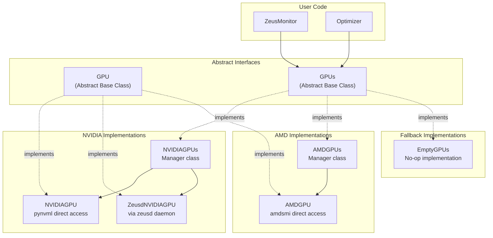
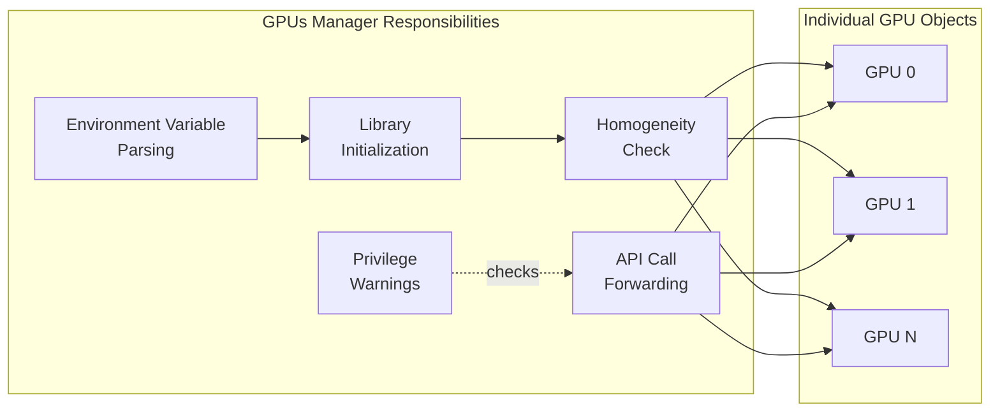
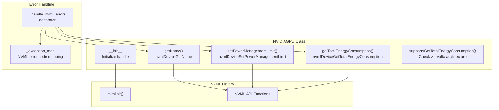
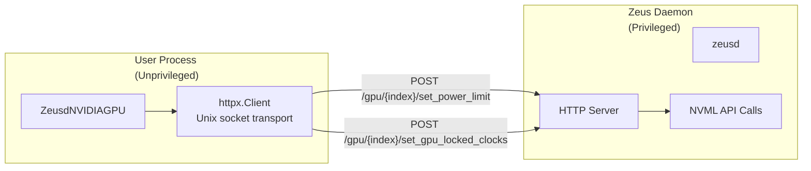
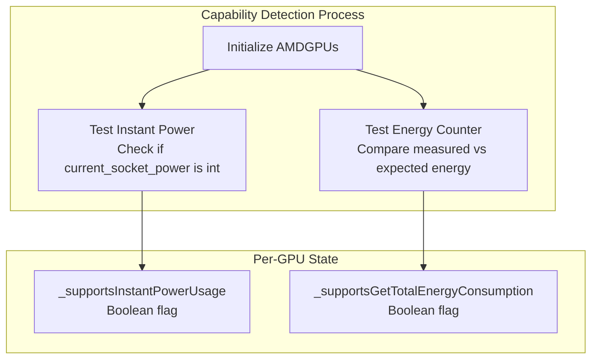
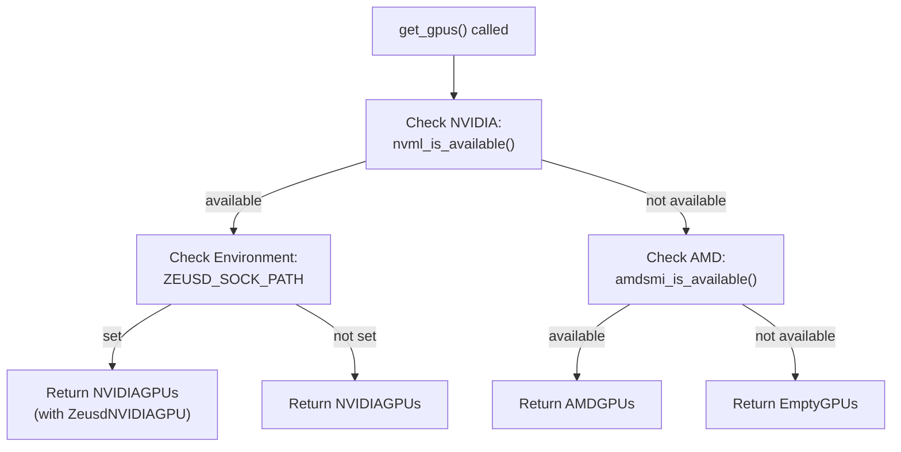

<!-- source: DeepWiki mcp.deepwiki.com · repo ml-energy/zeus · page 6 Hardware Abstraction Layer · fetched 2026-10-21 -->

# Hardware Abstraction Layer

<details>
<summary>Relevant source files</summary>

The following files were used as context for generating this wiki page:

- [README.md](README.md)
- [docs/getting_started/index.md](docs/getting_started/index.md)
- [docs/index.md](docs/index.md)
- [zeus/device/gpu/amd.py](zeus/device/gpu/amd.py)
- [zeus/device/gpu/common.py](zeus/device/gpu/common.py)
- [zeus/device/gpu/nvidia.py](zeus/device/gpu/nvidia.py)
- [zeus/monitor/__init__.py](zeus/monitor/__init__.py)
- [zeus/monitor/temperature.py](zeus/monitor/temperature.py)

</details>


The Hardware Abstraction Layer (HAL) provides a unified interface for interacting with diverse hardware devices across multiple vendors and platforms. This layer enables Zeus to support NVIDIA GPUs, AMD GPUs, Intel/AMD CPUs, Apple Silicon, and NVIDIA Jetson devices through a consistent API, while handling vendor-specific quirks and capabilities transparently.

For information about specific hardware implementations, see:
- GPU support: [GPU Support](#6.1)
- CPU support: [CPU Support](#6.2)
- SoC support: [SoC Support](#6.3)

For information about the Zeus daemon that provides privileged access to hardware, see [Zeus Daemon](#7).

## Architecture Overview

Zeus's hardware abstraction strategy uses abstract base classes to define interfaces and concrete implementations for each vendor. The architecture follows three key principles:

1. **Vendor Neutrality**: User-facing code interacts with abstract interfaces, never directly with vendor libraries
2. **Graceful Degradation**: Empty implementations allow Zeus to run even when hardware is unavailable
3. **Privilege Abstraction**: Daemon-based implementations separate privileged operations from user code

### Hardware Abstraction Hierarchy



**Hardware Abstraction Hierarchy**

Sources: [zeus/device/gpu/common.py:16-128](), [zeus/device/gpu/nvidia.py:69-287](), [zeus/device/gpu/amd.py:93-322]()

## Core Abstract Interfaces

### GPU Abstract Base Class

The `GPU` class defines the interface that all GPU implementations must follow. Each method corresponds to a specific hardware capability or configuration operation.

| Category | Methods | Purpose |
|----------|---------|---------|
| **Identification** | `getName()` | Query GPU model name |
| **Power Management** | `getPowerManagementLimitConstraints()`<br/>`setPowerManagementLimit()`<br/>`resetPowerManagementLimit()` | Query and control power limits |
| **Clock Management** | `getSupportedMemoryClocks()`<br/>`setMemoryLockedClocks()`<br/>`resetMemoryLockedClocks()`<br/>`getSupportedGraphicsClocks()`<br/>`setGpuLockedClocks()`<br/>`resetGpuLockedClocks()` | Query and control clock frequencies |
| **Energy Measurement** | `supportsGetTotalEnergyConsumption()`<br/>`getTotalEnergyConsumption()`<br/>`getAveragePowerUsage()`<br/>`getInstantPowerUsage()`<br/>`getAverageMemoryPowerUsage()` | Read power and energy metrics |
| **Temperature** | `getGpuTemperature()` | Read thermal metrics |
| **Persistence** | `setPersistenceMode()` | Control driver persistence |

Sources: [zeus/device/gpu/common.py:16-128]()

### GPUs Manager Abstract Base Class

The `GPUs` class manages collections of GPU objects and handles:

1. **Vendor-specific environment variables** (e.g., `CUDA_VISIBLE_DEVICES`, `HIP_VISIBLE_DEVICES`)
2. **GPU initialization** and library setup
3. **Homogeneity checks** to ensure all GPUs are the same model
4. **API forwarding** to individual GPU objects
5. **Privilege warnings** for operations requiring `SYS_ADMIN`



**GPUs Manager Class Responsibilities**

Sources: [zeus/device/gpu/common.py:130-284]()

## Vendor-Specific Implementations

### NVIDIA GPU Implementation

NVIDIA GPUs are managed through the NVML (NVIDIA Management Library) via the `pynvml` Python bindings. Zeus provides two implementation variants:

#### Direct NVML Access (`NVIDIAGPU`)



**NVIDIAGPU Implementation Architecture**

The `NVIDIAGPU` class implements direct access to NVML functions:
- Uses `pynvml.nvmlDeviceGetHandleByIndex()` to obtain device handles
- Wraps all NVML calls with `_handle_nvml_errors` decorator for consistent exception handling
- Maps NVML error codes to Zeus exception types via `_exception_map` dictionary
- Implements architecture-specific logic (e.g., Grace Hopper power scope handling)

Sources: [zeus/device/gpu/nvidia.py:69-287](), [zeus/device/gpu/nvidia.py:54-66](), [zeus/device/gpu/nvidia.py:95-116]()

#### Daemon-Mediated Access (`ZeusdNVIDIAGPU`)

For operations requiring `SYS_ADMIN` privileges, Zeus provides `ZeusdNVIDIAGPU`, which communicates with the Zeus daemon over HTTP via Unix domain socket:



**ZeusdNVIDIAGPU Daemon Communication**

Key characteristics:
- Inherits from `NVIDIAGPU` and overrides privileged methods only
- Uses `httpx.Client` with Unix domain socket transport
- Supports non-blocking setters via `block` parameter
- Falls back to NVML for read-only operations (no daemon needed)

Sources: [zeus/device/gpu/nvidia.py:289-397]()

#### NVIDIAGPUs Manager

The `NVIDIAGPUs` class handles initialization and GPU discovery:

1. **Environment variable handling**: Respects `CUDA_VISIBLE_DEVICES` for GPU visibility
2. **MIG detection**: Raises error if MIG devices are detected (not supported by NVML)
3. **Daemon detection**: Automatically uses `ZeusdNVIDIAGPU` if `ZEUSD_SOCK_PATH` is set
4. **Validation**: Ensures socket path exists and is writable

```python
# Automatic daemon detection logic
if (sock_path := os.environ.get("ZEUSD_SOCK_PATH")) is not None:
    # Use ZeusdNVIDIAGPU for all GPUs
    self._gpus = [ZeusdNVIDIAGPU(gpu_num, sock_path) for gpu_num in visible_indices]
else:
    # Use direct NVIDIAGPU
    self._gpus = [NVIDIAGPU(gpu_num) for gpu_num in visible_indices]
```

Sources: [zeus/device/gpu/nvidia.py:399-484](), [zeus/device/gpu/nvidia.py:441-479]()

### AMD GPU Implementation

AMD GPUs are managed through the AMD SMI library (`amdsmi`). The implementation includes several workarounds for ROCm-specific issues.

#### Capability Detection

AMD GPUs have varying support for different features. The `AMDGPUs` manager class performs runtime capability detection:



**AMD GPU Capability Detection**

The energy counter validation is particularly important due to a known issue with some AMD GPUs where `amdsmi_get_energy_count()` returns inaccurate values. The detection compares measured energy over a 0.5-second window against expected energy based on power readings:

```python
# Energy counter validation logic
wait_time = 0.5  # seconds
powers = [gpu.getAveragePowerUsage() for gpu in self._gpus]
initial_energies = [gpu.getTotalEnergyConsumption() for gpu in self._gpus]
time.sleep(wait_time)
final_energies = [gpu.getTotalEnergyConsumption() for gpu in self._gpus]
measured_energies = [final - initial for final, initial in zip(final_energies, initial_energies)]
expected_energies = [power * wait_time for power in powers]

for gpu, measured_energy, expected_energy in zip(self._gpus, measured_energies, expected_energies):
    # Loose bound to rule out very obvious counter problems
    if 0.1 < measured_energy / expected_energy < 10:
        gpu._supportsGetTotalEnergyConsumption = True
    else:
        gpu._supportsGetTotalEnergyConsumption = False
```

Sources: [zeus/device/gpu/amd.py:324-420](), [zeus/device/gpu/amd.py:379-415]()

#### ROCm Workarounds

The AMD implementation includes several workarounds for ROCm API issues:

| Issue | Workaround | Location |
|-------|------------|----------|
| `libamd_smi.so` not found | Suppress stdout during import, catch `OSError` | [zeus/device/gpu/amd.py:11-17]() |
| Version mismatch | Catch `AttributeError` and provide guidance | [zeus/device/gpu/amd.py:56-62]() |
| Missing `ROCM_PATH` | Check environment variable and warn user | [zeus/device/gpu/amd.py:52-55]() |
| Energy counter API change | Support both old (`power` key) and new (`energy_accumulator` key) API | [zeus/device/gpu/amd.py:299-307]() |

Sources: [zeus/device/gpu/amd.py:41-77](), [zeus/device/gpu/amd.py:299-308]()

#### Error Handling

Like NVIDIA, AMD implementation uses a decorator pattern for error handling:

```python
@_handle_amdsmi_errors
def getInstantPowerUsage(self) -> int:
    """Return the current power draw of the GPU. Units: mW."""
    if not self._supportsInstantPowerUsage:
        raise gpu_common.ZeusGPUNotSupportedError(
            "Instant power usage is not supported on this AMD GPU. "
            "This is because amdsmi.amdsmi_get_power_info does not return a valid 'current_socket_power'. "
            "Please use `getAveragePowerUsage` instead."
        )
    return int(amdsmi.amdsmi_get_power_info(self.handle)["current_socket_power"]) * 1000
```

The `_handle_amdsmi_errors` decorator maps AMD SMI error codes to Zeus exceptions using the `_exception_map` dictionary.

Sources: [zeus/device/gpu/amd.py:79-91](), [zeus/device/gpu/amd.py:105-126](), [zeus/device/gpu/amd.py:263-276]()

#### Environment Variable Handling

AMDGPUs supports both `HIP_VISIBLE_DEVICES` and `CUDA_VISIBLE_DEVICES` for GPU visibility control:

```python
if (visible_device := os.environ.get("HIP_VISIBLE_DEVICES")) is not None or (
    visible_device := os.environ.get("CUDA_VISIBLE_DEVICES")
) is not None:
    if not visible_device:
        raise gpu_common.ZeusGPUInitError(
            "HIP_VISIBLE_DEVICES or CUDA_VISIBLE_DEVICES is set but empty. "
            "You can use either one for AMD GPUs, but it should either be unset "
            "or a comma-separated list of GPU indices."
        )
    visible_indices = [int(idx) for idx in visible_device.split(",")]
else:
    visible_indices = list(range(len(amdsmi.amdsmi_get_processor_handles())))
```

Sources: [zeus/device/gpu/amd.py:361-375]()

## Exception Hierarchy

Zeus defines a comprehensive exception hierarchy that maps vendor-specific errors to common exception types:

```mermaid
graph TB
    ZEUSBASEERROR["ZeusBaseGPUError"]
    
    ZEUSBASEERROR --> INIT["ZeusGPUInitError"]
    ZEUSBASEERROR --> INVALIDARG["ZeusGPUInvalidArgError"]
    ZEUSBASEERROR --> NOTSUPPORTED["ZeusGPUNotSupportedError"]
    ZEUSBASEERROR --> NOPERM["ZeusGPUNoPermissionError"]
    ZEUSBASEERROR --> NOTFOUND["ZeusGPUNotFoundError"]
    ZEUSBASEERROR --> TIMEOUT["ZeusGPUTimeoutError"]
    ZEUSBASEERROR --> DRIVERNOTLOADED["ZeusGPUDriverNotLoadedError"]
    ZEUSBASEERROR --> MEMORY["ZeusGPUMemoryError"]
    ZEUSBASEERROR --> UNKNOWN["ZeusGPUUnknownError"]
    ZEUSBASEERROR --> HETEROGENEOUS["ZeusGPUHeterogeneousError"]
```



**Zeus GPU Exception Hierarchy**

Each vendor maps their error codes to these common exceptions:

```python
# NVIDIA error mapping example
_exception_map = {
    pynvml.NVML_ERROR_UNINITIALIZED: gpu_common.ZeusGPUInitError,
    pynvml.NVML_ERROR_INVALID_ARGUMENT: gpu_common.ZeusGPUInvalidArgError,
    pynvml.NVML_ERROR_NOT_SUPPORTED: gpu_common.ZeusGPUNotSupportedError,
    pynvml.NVML_ERROR_NO_PERMISSION: gpu_common.ZeusGPUNoPermissionError,
    # ... more mappings
}

# AMD error mapping example
_exception_map = {
    1: gpu_common.ZeusGPUInvalidArgError,  # AMDSMI_STATUS_INVAL
    2: gpu_common.ZeusGPUNotSupportedError,  # AMDSMI_STATUS_NOT_SUPPORTED
    8: gpu_common.ZeusGPUTimeoutError,  # AMDSMI_STATUS_TIMEOUT
    # ... more mappings
}
```

Sources: [zeus/device/gpu/common.py:403-569](), [zeus/device/gpu/nvidia.py:95-116](), [zeus/device/gpu/amd.py:105-126]()

## Graceful Degradation with EmptyGPUs

The `EmptyGPUs` class implements the null object pattern, allowing Zeus to run even when no GPUs are available. This is particularly useful for:

1. **Testing** without GPU hardware
2. **CPU-only measurements** where GPU monitoring isn't needed
3. **Documentation generation** that imports Zeus modules

```python
class EmptyGPUs(GPUs):
    """Empty collection of GPUs representing no hardware available."""
    
    def __init__(self, ensure_homogeneous: bool = False) -> None:
        """Initialize with no GPUs."""
        pass
    
    @property
    def gpus(self) -> Sequence["GPU"]:
        """Return an empty list as no GPUs are being tracked."""
        return []
    
    def __len__(self) -> int:
        """Return 0, indicating no GPUs are being tracked."""
        return 0
    
    def getName(self, gpu_index: int) -> str:
        """Raise a ValueError as no GPUs are available."""
        raise ValueError("No GPUs available.")
```

All GPU methods in `EmptyGPUs` raise `ValueError` when called, providing clear feedback that hardware is unavailable.

Sources: [zeus/device/gpu/common.py:286-401]()

## Device Detection and Initialization

Zeus provides automatic device detection through a centralized `get_gpus()` function (implementation not shown in provided files but referenced). The detection process follows this pattern:



**GPU Detection Flow**

Sources: [zeus/device/gpu/nvidia.py:23-52](), [zeus/device/gpu/amd.py:41-77]()

## Usage in Higher-Level Components

The hardware abstraction layer is used throughout Zeus. Here's how `TemperatureMonitor` uses the GPU abstraction:

```python
def _temperature_polling_process(
    gpu_indices: list[int],
    data_queue: mp.Queue,
    ready_event: EventClass,
    stop_event: EventClass,
    update_period: float,
) -> None:
    """Polling process for GPU temperature with deduplication."""
    # Get GPUs using the abstraction layer
    gpus = get_gpus()
    
    # Track previous temperature values for deduplication
    prev_temperature: dict[int, int] = {}
    
    # Signal that this process is ready to start monitoring
    ready_event.set()
    
    # Start polling loop
    while not stop_event.is_set():
        timestamp = time()
        
        for gpu_index in gpu_indices:
            try:
                # Use abstract interface - works for any GPU vendor
                temperature_c = gpus.getGpuTemperature(gpu_index)
                
                # ... process temperature data
            except ZeusGPUNotSupportedError as e:
                logger.warning("GPU %d temperature reading not supported: %s", gpu_index, e)
                break
```

The abstraction allows the same code to work across NVIDIA, AMD, and other GPU vendors without modification.

Sources: [zeus/monitor/temperature.py:258-334]()

## Non-Blocking Setters

Some GPU implementations support non-blocking configuration changes, which is particularly important for energy optimization scenarios where multiple GPUs need configuration changes simultaneously:

```python
@property
@abc.abstractmethod
def supports_nonblocking_setters(self) -> bool:
    """Return True if the GPU object supports non-blocking configuration setters."""
    return False
```

Currently:
- `NVIDIAGPU`: Returns `False` (blocking operations only)
- `ZeusdNVIDIAGPU`: Returns `True` (daemon handles async operations)
- `AMDGPU`: Returns `False` (blocking operations only)

When supported, methods like `setPowerManagementLimit()` accept a `block` parameter:

```python
def setPowerManagementLimit(self, power_limit_mw: int, block: bool = True) -> None:
    """Set the GPU's power management limit. Unit: mW.
    
    Args:
        power_limit_mw: Power limit in milliwatts
        block: If True, wait for operation to complete. If False, return immediately.
    """
    resp = self._client.post(
        self._url_prefix + "/set_power_limit",
        json=dict(power_limit_mw=power_limit_mw, block=block),
    )
```

Sources: [zeus/device/gpu/common.py:28-31](), [zeus/device/gpu/nvidia.py:318-331](), [zeus/device/gpu/amd.py:143-146]()

---

