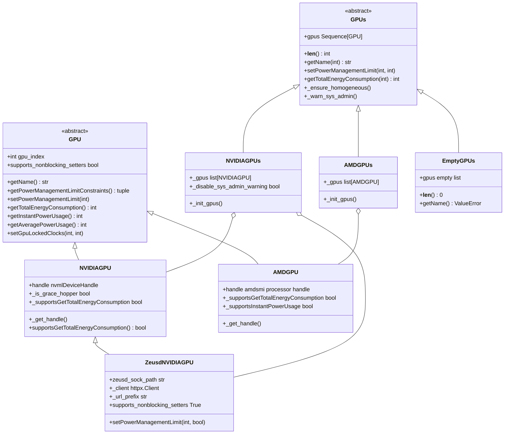
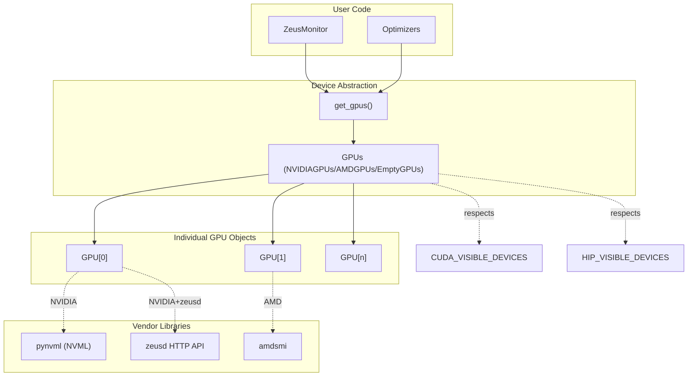
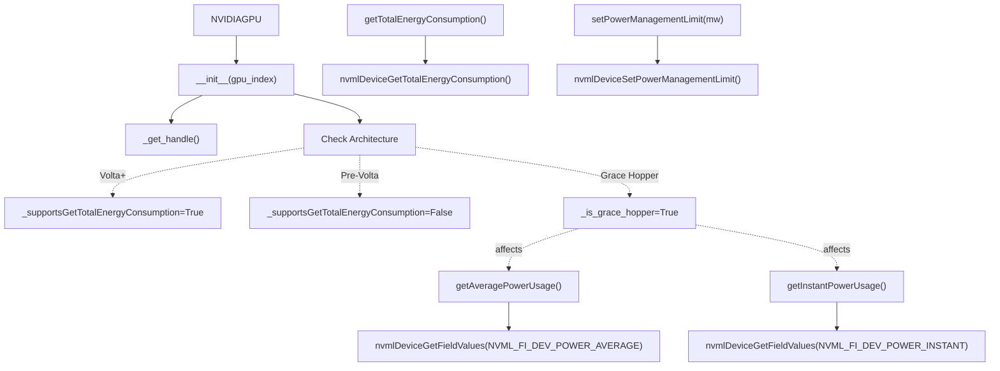
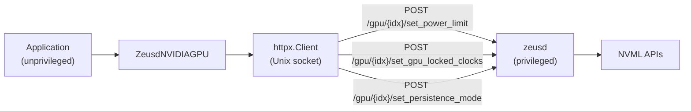
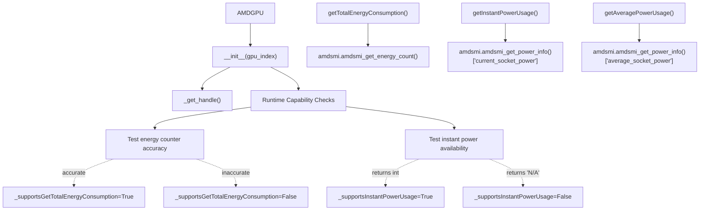
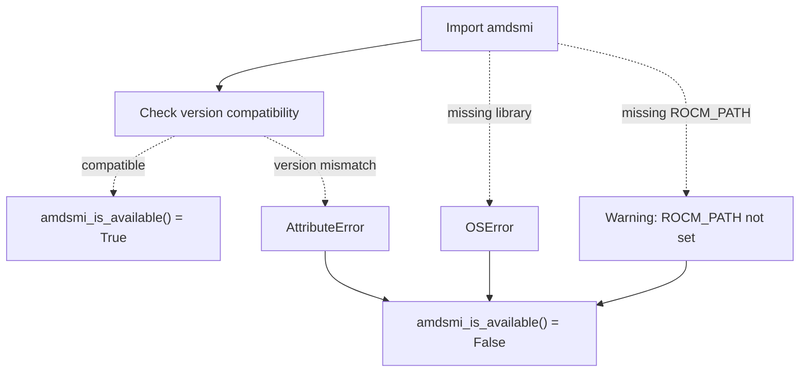
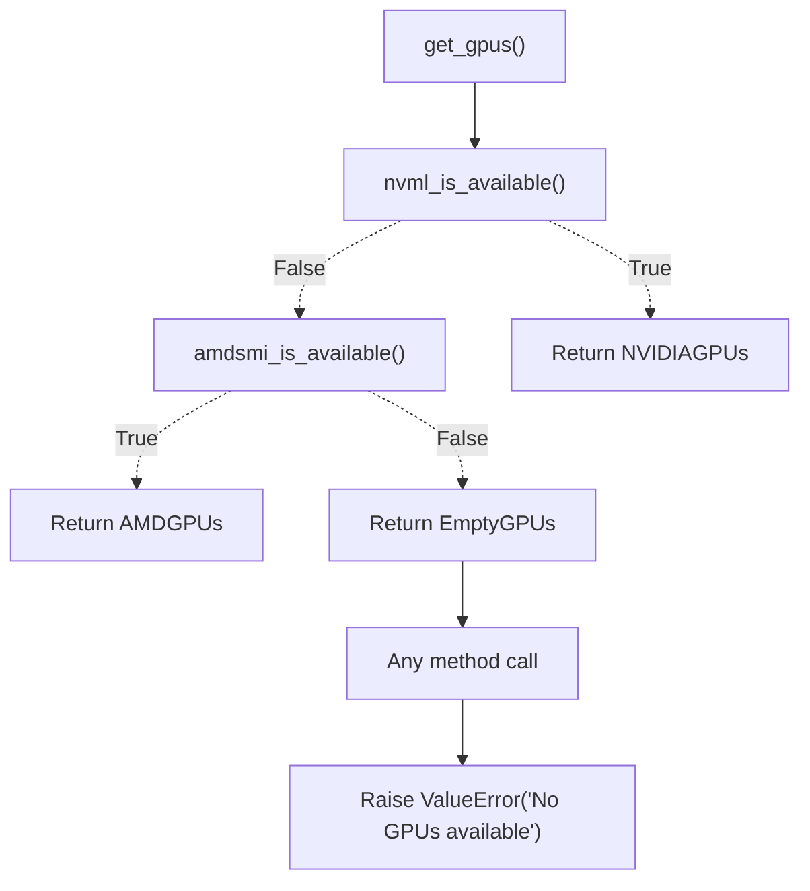
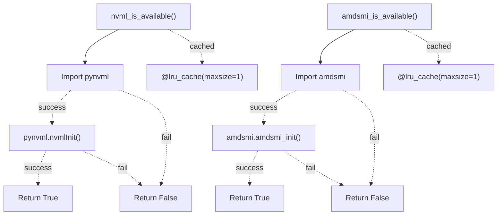

<!-- source: DeepWiki mcp.deepwiki.com · repo ml-energy/zeus · page 6.1 GPU Support · fetched 2026-10-21 -->

# GPU Support

<details>
<summary>Relevant source files</summary>

The following files were used as context for generating this wiki page:

- [zeus/device/gpu/amd.py](zeus/device/gpu/amd.py)
- [zeus/device/gpu/common.py](zeus/device/gpu/common.py)
- [zeus/device/gpu/nvidia.py](zeus/device/gpu/nvidia.py)
- [zeus/monitor/__init__.py](zeus/monitor/__init__.py)
- [zeus/monitor/temperature.py](zeus/monitor/temperature.py)

</details>


This page documents Zeus's GPU abstraction layer, which provides a unified interface for interacting with GPUs from different vendors. The abstraction enables Zeus to measure energy consumption and control GPU settings across NVIDIA and AMD hardware using vendor-specific libraries (NVML for NVIDIA, AMDSMI for AMD) while presenting a consistent API to higher-level components.

For CPU power monitoring, see [CPU Support](#6.2). For SoC platforms like Apple Silicon and Jetson, see [SoC Support](#6.3). For privilege management and the Zeus daemon, see [Privilege Management](#3.2) and [Zeus Daemon](#7).

## Architecture Overview

Zeus's GPU support is structured in three layers: abstract interfaces, vendor-specific implementations, and manager classes that handle device enumeration and homogeneity enforcement.

### Class Hierarchy



Sources: [zeus/device/gpu/common.py:16-128](), [zeus/device/gpu/common.py:130-284](), [zeus/device/gpu/nvidia.py:69-287](), [zeus/device/gpu/nvidia.py:289-397](), [zeus/device/gpu/amd.py:93-322]()

### Component Interaction



Sources: [zeus/device/__init__.py](), [zeus/device/gpu/nvidia.py:399-484](), [zeus/device/gpu/amd.py:324-419]()

## Abstract GPU Interface

The [`GPU`][zeus.device.gpu.common.GPU] abstract base class defines the interface that all GPU implementations must provide. It includes methods for power management, energy measurement, clock control, and temperature monitoring.

### Core Interface Methods

| Method Category | Methods | Purpose |
|----------------|---------|---------|
| **Identification** | `getName()` | Get GPU model name |
| **Power Limits** | `getPowerManagementLimitConstraints()`<br>`setPowerManagementLimit()`<br>`resetPowerManagementLimit()` | Query and control power caps |
| **Clock Control** | `getSupportedMemoryClocks()`<br>`setMemoryLockedClocks()`<br>`resetMemoryLockedClocks()`<br>`getSupportedGraphicsClocks()`<br>`setGpuLockedClocks()`<br>`resetGpuLockedClocks()` | Control GPU and memory frequencies |
| **Power Measurement** | `getAveragePowerUsage()`<br>`getInstantPowerUsage()`<br>`getAverageMemoryPowerUsage()` | Real-time power monitoring |
| **Energy Measurement** | `supportsGetTotalEnergyConsumption()`<br>`getTotalEnergyConsumption()` | Cumulative energy counters |
| **Temperature** | `getGpuTemperature()` | Temperature monitoring |
| **Persistence** | `setPersistenceMode()` | NVIDIA-specific driver mode |

Sources: [zeus/device/gpu/common.py:16-128]()

### GPUs Manager Class

The [`GPUs`][zeus.device.gpu.common.GPUs] abstract class manages collections of GPU objects. It provides:

- **Device enumeration**: Creates individual `GPU` objects based on detected hardware
- **Homogeneity enforcement**: Ensures all GPUs have the same model name via `_ensure_homogeneous()`
- **Environment variable handling**: Respects `CUDA_VISIBLE_DEVICES` and `HIP_VISIBLE_DEVICES`
- **Index mapping**: Translates user indices to physical GPU indices
- **Privilege warnings**: Alerts users when operations require `SYS_ADMIN` via `_warn_sys_admin()`

Sources: [zeus/device/gpu/common.py:130-284]()

## NVIDIA GPU Support

NVIDIA GPU support is implemented through the [`pynvml`](https://pypi.org/project/nvidia-ml-py/) library, which wraps NVIDIA's NVML (NVIDIA Management Library). Zeus provides two implementations:

- **`NVIDIAGPU`**: Direct NVML access for privileged processes
- **`ZeusdNVIDIAGPU`**: HTTP-based access through the Zeus daemon for unprivileged processes

### NVIDIAGPU Implementation



Sources: [zeus/device/gpu/nvidia.py:69-287]()

#### Key Features

**Architecture Detection**: The implementation detects GPU architecture at initialization to determine feature support:

- **Volta or newer** (compute capability 7.0+): Supports `getTotalEnergyConsumption()` using `nvmlDeviceGetTotalEnergyConsumption()` [zeus/device/gpu/nvidia.py:263-273]()
- **Pre-Volta**: Energy measurement requires power polling and integration over time
- **Grace Hopper**: Special handling for superchip modules using `NVML_POWER_SCOPE_MODULE` instead of `NVML_POWER_SCOPE_GPU` [zeus/device/gpu/nvidia.py:78-93](), [zeus/device/gpu/nvidia.py:212-237]()

**Error Handling**: All NVML calls are wrapped with `@_handle_nvml_errors` decorator that maps NVML error codes to Zeus exception types [zeus/device/gpu/nvidia.py:54-66](), [zeus/device/gpu/nvidia.py:95-116]()

Sources: [zeus/device/gpu/nvidia.py:69-287]()

### ZeusdNVIDIAGPU Implementation

For unprivileged applications, [`ZeusdNVIDIAGPU`][zeus.device.gpu.nvidia.ZeusdNVIDIAGPU] sends privileged operations to the Zeus daemon via HTTP over Unix domain sockets:



Sources: [zeus/device/gpu/nvidia.py:289-397]()

**Non-blocking Operations**: `ZeusdNVIDIAGPU` supports non-blocking setters via the `block` parameter. When `block=False`, the daemon queues the operation and returns immediately [zeus/device/gpu/nvidia.py:318-321](), [zeus/device/gpu/nvidia.py:323-331]()

**Automatic Detection**: `NVIDIAGPUs` automatically uses `ZeusdNVIDIAGPU` if `ZEUSD_SOCK_PATH` environment variable is set [zeus/device/gpu/nvidia.py:460-474]()

Sources: [zeus/device/gpu/nvidia.py:289-397]()

### NVIDIAGPUs Manager

The [`NVIDIAGPUs`][zeus.device.gpu.nvidia.NVIDIAGPUs] class manages NVIDIA GPU initialization and handles `CUDA_VISIBLE_DEVICES`:

```python
# Example: CUDA_VISIBLE_DEVICES=0,2
# Physical GPUs: 0, 1, 2, 3
# Visible indices: [0, 2]
# Zeus indices: 0 -> physical 0, 1 -> physical 2
```

**MIG Detection**: Raises `ZeusGPUInitError` if `CUDA_VISIBLE_DEVICES` contains MIG devices, as NVML doesn't support per-slice power measurement [zeus/device/gpu/nvidia.py:449-455]()

**Initialization Flow**:
1. Parse `CUDA_VISIBLE_DEVICES` or enumerate all GPUs
2. Check for `ZEUSD_SOCK_PATH` and validate socket
3. Create `ZeusdNVIDIAGPU` or `NVIDIAGPU` instances
4. Optionally enforce homogeneity

Sources: [zeus/device/gpu/nvidia.py:399-484]()

## AMD GPU Support

AMD GPU support uses the [`amdsmi`](https://github.com/ROCm/amdsmi) library (ROCm 6.1+). The implementation includes workarounds for known ROCm issues.

### AMDGPU Implementation



Sources: [zeus/device/gpu/amd.py:93-322]()

### Known AMD Issues and Workarounds

**Energy Counter Accuracy**: Some AMD GPUs have broken energy counters (see [ROCm issue #38](https://github.com/ROCm/amdsmi/issues/38)). Zeus validates energy counters at initialization by comparing measured energy against expected energy from power readings [zeus/device/gpu/amd.py:386-414]():

```python
# Simplified validation logic
wait_time = 0.5  # seconds
initial_energy = getTotalEnergyConsumption()
power = getAveragePowerUsage()
sleep(wait_time)
final_energy = getTotalEnergyConsumption()
measured_energy = final_energy - initial_energy
expected_energy = power * wait_time

# Accept if within 10x bounds
if 0.1 < measured_energy / expected_energy < 10:
    _supportsGetTotalEnergyConsumption = True
else:
    _supportsGetTotalEnergyConsumption = False
```

**Instant Power Availability**: The `current_socket_power` field may return `"N/A"` on some GPUs. Zeus checks the return type at initialization [zeus/device/gpu/amd.py:380-384]()

**API Version Changes**: Zeus handles both old and new `amdsmi_get_energy_count` APIs (pre/post 6.2.1) [zeus/device/gpu/amd.py:299-306]()

Sources: [zeus/device/gpu/amd.py:324-419]()

### AMDGPUs Manager

The [`AMDGPUs`][zeus.device.gpu.amd.AMDGPUs] class handles AMD-specific environment variables:

**Environment Variable Precedence**:
1. `HIP_VISIBLE_DEVICES` (AMD-specific)
2. `CUDA_VISIBLE_DEVICES` (fallback for compatibility)
3. All GPUs if neither is set

[zeus/device/gpu/amd.py:362-374]()

**ROCM_PATH Validation**: Checks `ROCM_PATH` environment variable if `amdsmi` import fails [zeus/device/gpu/amd.py:52-55]()

**Import Error Handling**: The module gracefully handles various import failures (missing library, version mismatch) using a `MockAMDSMI` class [zeus/device/gpu/amd.py:11-33](), [zeus/device/gpu/amd.py:41-76]()

Sources: [zeus/device/gpu/amd.py:324-419]()

## Architecture-Specific Handling

### NVIDIA Grace Hopper

Grace Hopper superchips require special power measurement scope:

| Standard GPU | Grace Hopper |
|-------------|--------------|
| `NVML_POWER_SCOPE_GPU` | `NVML_POWER_SCOPE_MODULE` |

The module-level scope includes both GPU and CPU power [zeus/device/gpu/nvidia.py:78-93](), [zeus/device/gpu/nvidia.py:212-237]()

### NVIDIA Volta+ Architecture

GPUs with compute capability 7.0 or higher (Volta, Turing, Ampere, Hopper, etc.) support hardware energy counters via `nvmlDeviceGetTotalEnergyConsumption()`. Pre-Volta GPUs must use power polling [zeus/device/gpu/nvidia.py:263-273]()

### AMD ROCm Version Compatibility

Zeus requires ROCm 6.1+ and validates version compatibility at import:



Sources: [zeus/device/gpu/amd.py:41-76]()

## Empty GPU Pattern

The [`EmptyGPUs`][zeus.device.gpu.common.EmptyGPUs] class implements the null object pattern for scenarios where no GPUs are available. All methods raise `ValueError` with descriptive messages [zeus/device/gpu/common.py:286-401]()

### Usage Pattern



This pattern allows higher-level code to function without explicit GPU availability checks, with errors only occurring when GPU operations are actually attempted.

Sources: [zeus/device/gpu/common.py:286-401]()

## Error Handling and Exception Mapping

Zeus maps vendor-specific error codes to standardized exception types defined in [`zeus.device.gpu.common`][zeus.device.gpu.common]:

### Exception Hierarchy

All GPU exceptions inherit from `ZeusBaseGPUError`:

| Exception Class | Meaning | NVML Code | AMDSMI Code |
|----------------|---------|-----------|-------------|
| `ZeusGPUInitError` | Initialization failed | `NVML_ERROR_UNINITIALIZED` | `AMDSMI_STATUS_NOT_INIT` |
| `ZeusGPUInvalidArgError` | Invalid argument | `NVML_ERROR_INVALID_ARGUMENT` | `AMDSMI_STATUS_INVAL` |
| `ZeusGPUNotSupportedError` | Operation not supported | `NVML_ERROR_NOT_SUPPORTED` | `AMDSMI_STATUS_NOT_SUPPORTED` |
| `ZeusGPUNoPermissionError` | Permission denied | `NVML_ERROR_NO_PERMISSION` | `AMDSMI_STATUS_NO_PERM` |
| `ZeusGPUNotFoundError` | GPU not found | `NVML_ERROR_NOT_FOUND` | `AMDSMI_STATUS_NOT_FOUND` |
| `ZeusGPUTimeoutError` | Operation timeout | `NVML_ERROR_TIMEOUT` | `AMDSMI_STATUS_TIMEOUT` |
| `ZeusGPUDriverNotLoadedError` | Driver not loaded | `NVML_ERROR_DRIVER_NOT_LOADED` | `AMDSMI_NO_DRV` |
| `ZeusGPUMemoryError` | Out of memory | `NVML_ERROR_MEMORY` | `AMDSMI_STATUS_OUT_OF_RESOURCES` |

Complete mappings: [zeus/device/gpu/nvidia.py:95-116](), [zeus/device/gpu/amd.py:105-126]()

### Error Wrapping Decorators

Both implementations use decorators to automatically catch and translate vendor exceptions:

- **NVIDIA**: `@_handle_nvml_errors` wraps methods to catch `pynvml.NVMLError` [zeus/device/gpu/nvidia.py:54-66]()
- **AMD**: `@_handle_amdsmi_errors` wraps methods to catch `amdsmi.AmdSmiLibraryException` [zeus/device/gpu/amd.py:79-90]()

Sources: [zeus/device/gpu/common.py:403-569](), [zeus/device/gpu/nvidia.py:54-116](), [zeus/device/gpu/amd.py:79-126]()

## Environment Variables

### CUDA_VISIBLE_DEVICES

Controls which NVIDIA GPUs are visible to the application:

```python
# System has GPUs: 0, 1, 2, 3
# CUDA_VISIBLE_DEVICES=1,3

gpus = NVIDIAGPUs()
len(gpus)  # Returns 2
gpus.getName(0)  # Physical GPU 1
gpus.getName(1)  # Physical GPU 3
```

**Validation**:
- Must be non-empty if set [zeus/device/gpu/nvidia.py:443-448]()
- Cannot contain MIG device notation [zeus/device/gpu/nvidia.py:449-455]()

Sources: [zeus/device/gpu/nvidia.py:442-458]()

### HIP_VISIBLE_DEVICES

AMD-specific GPU visibility control:

```python
# System has GPUs: 0, 1, 2, 3
# HIP_VISIBLE_DEVICES=0,2

gpus = AMDGPUs()
len(gpus)  # Returns 2
gpus.getName(0)  # Physical GPU 0
gpus.getName(1)  # Physical GPU 2
```

If `HIP_VISIBLE_DEVICES` is not set but `CUDA_VISIBLE_DEVICES` is, AMD GPUs honor `CUDA_VISIBLE_DEVICES` [zeus/device/gpu/amd.py:362-374]()

Sources: [zeus/device/gpu/amd.py:362-374]()

### ZEUSD_SOCK_PATH

When set, `NVIDIAGPUs` automatically uses `ZeusdNVIDIAGPU` for privileged operations:

```python
# Environment: ZEUSD_SOCK_PATH=/var/run/zeusd.sock
gpus = NVIDIAGPUs()
# All GPU objects are ZeusdNVIDIAGPU instances
# supports_nonblocking_setters returns True
gpus.setPowerManagementLimit(0, 250000, _block=False)
```

The path is validated at initialization [zeus/device/gpu/nvidia.py:461-474]()

Sources: [zeus/device/gpu/nvidia.py:460-478]()

## GPU Detection and Initialization

### Library Availability Functions

Zeus provides cached detection functions to check library availability:



Sources: [zeus/device/gpu/nvidia.py:23-51](), [zeus/device/gpu/amd.py:41-76]()

### Initialization Sequence

Both `NVIDIAGPUs` and `AMDGPUs` follow similar initialization patterns:

1. **Library initialization**: Call vendor init function (`nvmlInit()` or `amdsmi_init()`)
2. **Parse environment variables**: Determine visible GPU indices
3. **Create GPU objects**: Instantiate individual GPU objects for each visible device
4. **Capability detection**: Test hardware capabilities (energy counters, power modes)
5. **Homogeneity check**: Optionally verify all GPUs have same model name
6. **Cleanup registration**: Register shutdown handlers (`nvmlShutdown()` or `amdsmi_shut_down()`)

Sources: [zeus/device/gpu/nvidia.py:416-434](), [zeus/device/gpu/amd.py:339-355]()

## Integration with Higher-Level Components

GPU objects are typically accessed through the `get_gpus()` function, which automatically selects the appropriate implementation:

```python
from zeus.device import get_gpus

# Automatically returns NVIDIAGPUs, AMDGPUs, or EmptyGPUs
gpus = get_gpus(ensure_homogeneous=True)

# Use unified interface
energy_start = gpus.getTotalEnergyConsumption(gpu_index=0)
# ... training code ...
energy_end = gpus.getTotalEnergyConsumption(gpu_index=0)
energy_consumed = energy_end - energy_start
```

This abstraction is used throughout Zeus by:

- **ZeusMonitor**: For energy and power measurement [zeus/monitor/energy.py]()
- **PowerMonitor**: For continuous power polling [zeus/monitor/power.py]()
- **TemperatureMonitor**: For GPU temperature tracking [zeus/monitor/temperature.py:92-92]()
- **Optimizers**: For power limit and frequency control [zeus/optimizer/]()

Sources: [zeus/device/__init__.py](), [zeus/monitor/energy.py](), [zeus/optimizer/]()

---

