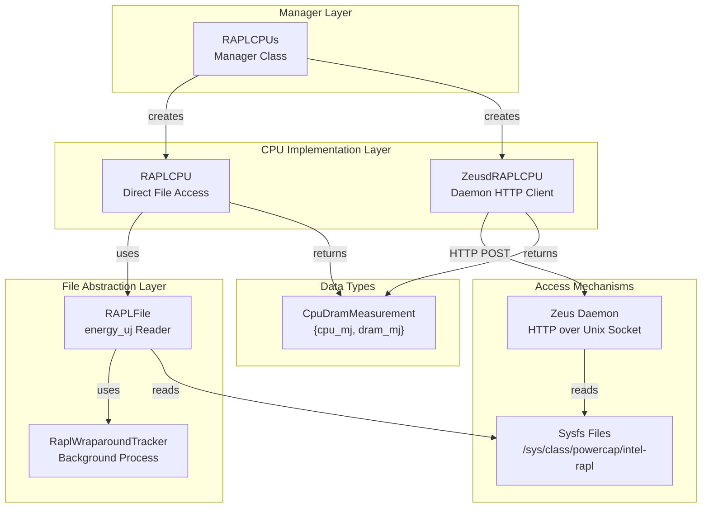
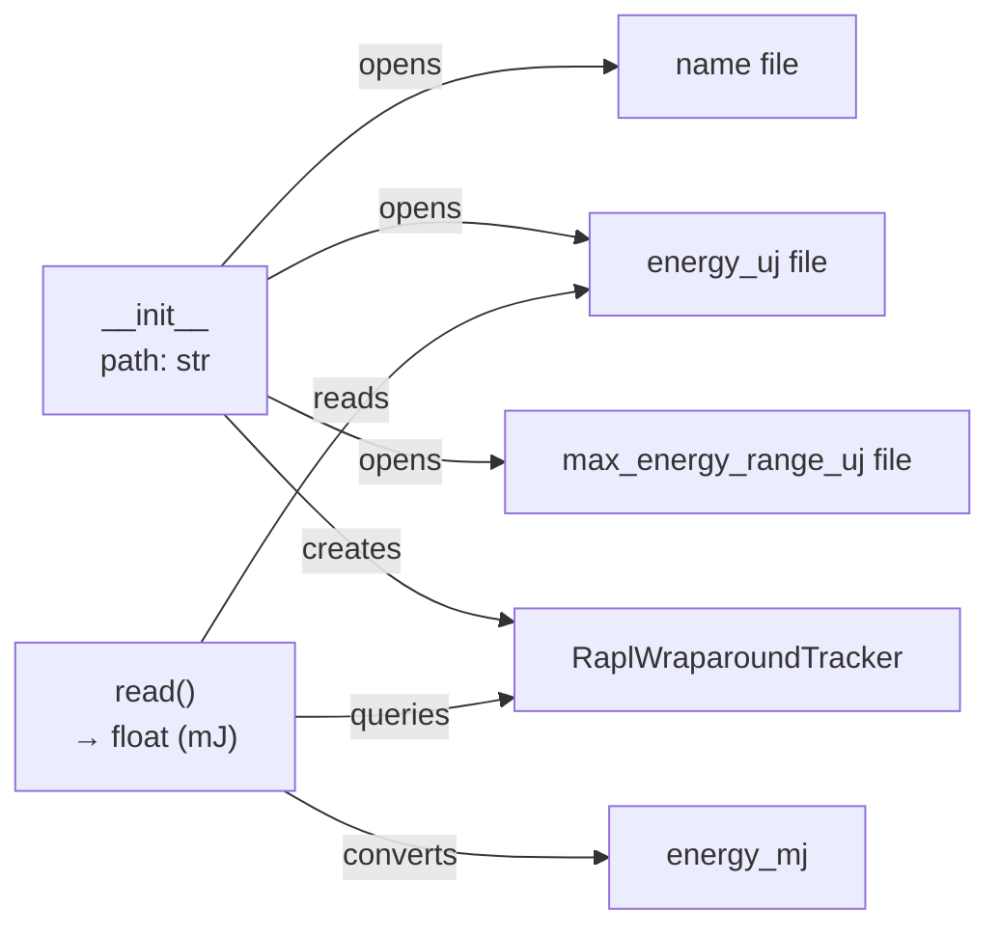
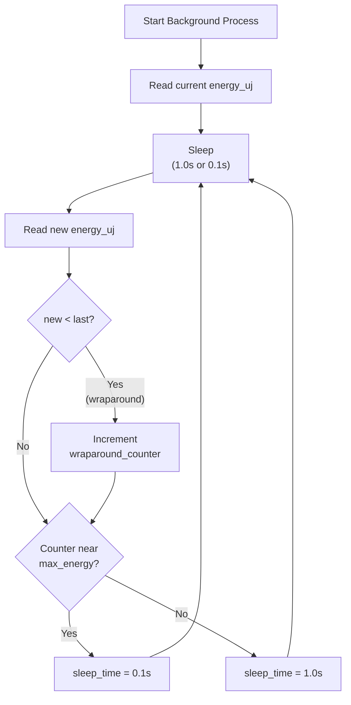
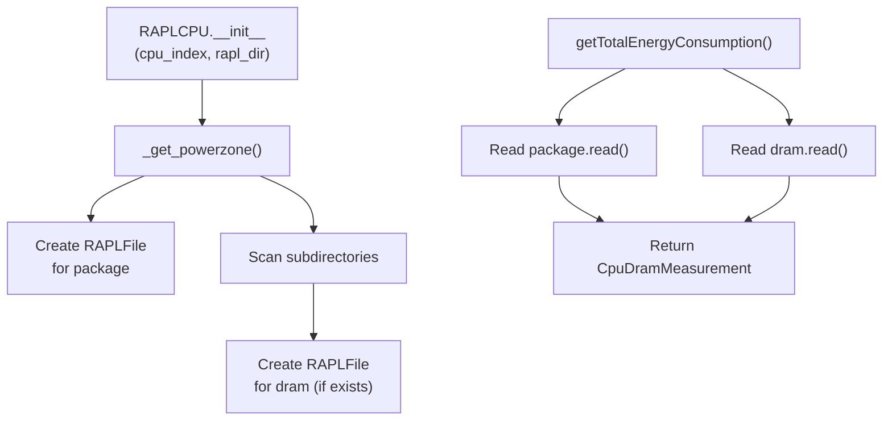
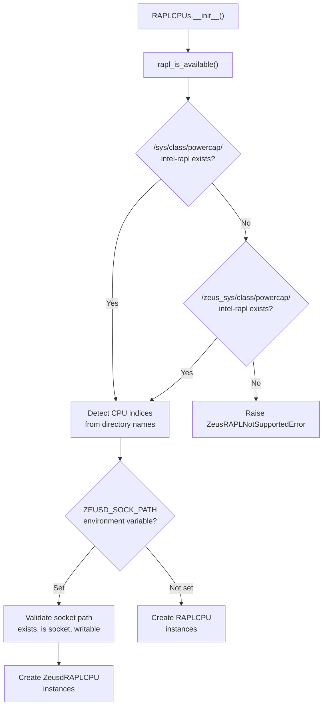
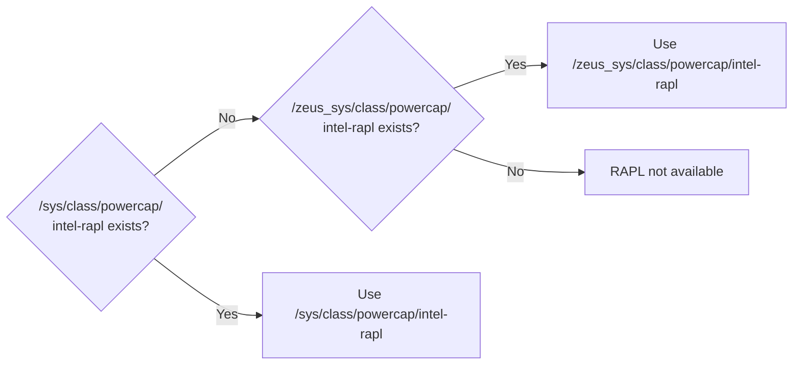

<!-- source: DeepWiki mcp.deepwiki.com · repo ml-energy/zeus · page 6.2 CPU Support · fetched 2026-10-21 -->

# CPU Support

<details>
<summary>Relevant source files</summary>

The following files were used as context for generating this wiki page:

- [tests/device/cpu/test_rapl.py](tests/device/cpu/test_rapl.py)
- [zeus/callback.py](zeus/callback.py)
- [zeus/device/cpu/rapl.py](zeus/device/cpu/rapl.py)
- [zeus/optimizer/pipeline_frequency/optimizer.py](zeus/optimizer/pipeline_frequency/optimizer.py)
- [zeus/utils/testing.py](zeus/utils/testing.py)

</details>


This document describes Zeus's CPU power monitoring implementation via RAPL (Running Average Power Limit). It covers the architecture for reading CPU and DRAM energy consumption, wraparound tracking for overflow handling, and both direct and daemon-mediated access patterns.

For GPU power monitoring, see [GPU Support](#6.1). For the Zeus daemon architecture that enables unprivileged CPU monitoring, see [Zeus Daemon (zeusd)](#7).

---

## RAPL Technology Overview

RAPL (Running Average Power Limit) is an Intel technology that provides energy consumption monitoring at the processor and memory subsystem level. Zeus accesses RAPL through the Linux powercap interface exposed via sysfs.

### Power Domains

RAPL organizes components into power domains, each with independent monitoring:

| Power Domain | Description | RAPL Name |
|--------------|-------------|-----------|
| Package | Entire CPU chip including all cores and integrated units | `package` |
| DRAM | Memory subsystem | `dram` |
| Cores | CPU cores (not currently used by Zeus) | `core` |
| Uncore | Integrated GPU and other non-core components | `uncore` |

Zeus primarily monitors the **package** domain for total CPU energy and optionally monitors the **DRAM** domain when available. Each domain exposes an `energy_uj` file containing accumulated energy in microjoules.

**Sources:** [zeus/device/cpu/rapl.py:1-12]()

---

## System Architecture



**Class Hierarchy**

The CPU support implementation follows a three-tier architecture:

1. **Manager Layer**: `RAPLCPUs` discovers and manages all available CPU sockets
2. **CPU Layer**: `RAPLCPU` or `ZeusdRAPLCPU` represents individual CPU sockets
3. **File Layer**: `RAPLFile` handles reading individual energy counter files

**Sources:** [zeus/device/cpu/rapl.py:173-398]()

---

## Core Components

### RAPLFile Class

`RAPLFile` manages a single energy counter file and tracks wraparounds. Each RAPL power domain (package, DRAM) has its own `RAPLFile` instance.



**Key Attributes:**
- `path`: Directory containing RAPL files (e.g., `/sys/class/powercap/intel-rapl/intel-rapl:0`)
- `energy_uj_path`: Path to the energy counter file
- `name`: Power domain name (`package`, `dram`, etc.)
- `max_energy_range_uj`: Maximum counter value before wraparound
- `wraparound_tracker`: Background process monitoring counter overflow

**Energy Calculation:**

The `read()` method computes total energy accounting for wraparounds:

```
energy_mj = (current_energy_uj + num_wraparounds * max_energy_range_uj) / 1000.0
```

**Sources:** [zeus/device/cpu/rapl.py:173-228]()

---

## Wraparound Tracking

RAPL energy counters are 32-bit values that wrap around to zero when exceeding `max_energy_range_uj`. Zeus uses a background process to detect and count wraparounds.

### Wraparound Detection Process



### Implementation Details

**Process Spawning:**

`RaplWraparoundTracker` spawns a separate process using `multiprocessing.spawn` context to avoid fork-safety issues. The process shares a `Value('i', 0)` counter with the parent.

```
context = mp.get_context("spawn")
wraparound_counter = context.Value("i", 0)
process = context.Process(target=_polling_process, args=(...))
```

**Adaptive Polling:**

The background process dynamically adjusts its polling frequency:
- **Normal**: 1.0 second sleep when counter is far from maximum
- **Fast**: 0.1 second sleep when counter approaches `max_energy_range_uj`

This ensures wraparounds are never missed even at high power consumption (up to 1000W assumed).

**Thread Safety:**

The shared counter is accessed with a lock:
```python
with wraparound_counter.get_lock():
    return wraparound_counter.value
```

**Sources:** [zeus/device/cpu/rapl.py:48-131]()

---

## CPU Implementation Classes

### RAPLCPU: Direct File Access

`RAPLCPU` reads RAPL files directly, requiring root privileges or `CAP_SYS_ADMIN` capability.



**Directory Structure:**

Each CPU socket has a directory structure like:
```
/sys/class/powercap/intel-rapl/
├── intel-rapl:0/              # Socket 0 (package)
│   ├── name                   # "package-0"
│   ├── energy_uj              # Package energy counter
│   ├── max_energy_range_uj    # Maximum counter value
│   └── intel-rapl:0:0/        # DRAM subpackage
│       ├── name               # "dram"
│       ├── energy_uj          # DRAM energy counter
│       └── max_energy_range_uj
├── intel-rapl:1/              # Socket 1 (package)
│   └── ...
```

**Sources:** [zeus/device/cpu/rapl.py:230-272]()

### ZeusdRAPLCPU: Daemon-Mediated Access

`ZeusdRAPLCPU` communicates with the Zeus daemon via HTTP over a Unix domain socket, enabling unprivileged access.

**HTTP API Endpoints:**

| Endpoint | Method | Purpose |
|----------|--------|---------|
| `/cpu/{cpu_index}/supports_dram_energy` | GET | Query if DRAM monitoring is available |
| `/cpu/{cpu_index}/get_index_energy` | POST | Read CPU and DRAM energy counters |

**Request Example:**
```json
POST /cpu/0/get_index_energy
{
  "cpu": true,
  "dram": true
}
```

**Response Example:**
```json
{
  "cpu_energy_uj": 123456789,
  "dram_energy_uj": 45678901
}
```

**Implementation Differences:**

Unlike `RAPLCPU`, `ZeusdRAPLCPU`:
- Does not directly instantiate `RAPLFile` objects
- Does not manage `RaplWraparoundTracker` (handled by daemon)
- Uses `httpx.Client` with Unix domain socket transport
- Caches DRAM availability during initialization

**Sources:** [zeus/device/cpu/rapl.py:274-345]()

---

## RAPLCPUs Manager

`RAPLCPUs` discovers all available CPU sockets and instantiates the appropriate implementation class based on environment configuration.

### Initialization Flow



**CPU Index Detection:**

The manager scans for directories matching `intel-rapl:*` and extracts numeric indices:

```python
for dir in sorted(glob(f"{rapl_dir}/intel-rapl:*"), key=lambda d: int(d.split(":")[1])):
    parts = dir.split(":")
    if len(parts) > 1 and parts[1].isdigit():
        cpu_indices.append(int(parts[1]))
```

**Environment-Based Selection:**

| Condition | Implementation | Privileges Required |
|-----------|----------------|---------------------|
| `ZEUSD_SOCK_PATH` set | `ZeusdRAPLCPU` | None (daemon handles privileges) |
| `ZEUSD_SOCK_PATH` not set | `RAPLCPU` | Root or `CAP_SYS_ADMIN` |

**Sources:** [zeus/device/cpu/rapl.py:347-398]()

---

## Container Detection

Zeus automatically detects containerized environments and uses an alternative RAPL directory path.

### Path Selection Logic



**Directory Constants:**

```python
RAPL_DIR = "/sys/class/powercap/intel-rapl"
CONTAINER_RAPL_DIR = "/zeus_sys/class/powercap/intel-rapl"
```

**Container Setup:**

When running in Docker, mount the host's powercap directory:
```bash
docker run -v /sys/class/powercap:/zeus_sys/class/powercap:ro ...
```

This allows read-only access to RAPL counters without granting full `SYS_ADMIN` capability.

**Sources:** [zeus/device/cpu/rapl.py:36-41](), [zeus/device/cpu/rapl.py:133-147](), [zeus/device/cpu/rapl.py:352-356]()

---

## Exception Handling

Zeus defines specific exception classes for CPU-related errors:

### Exception Hierarchy

| Exception | Raised When | Parent Class |
|-----------|-------------|--------------|
| `ZeusRAPLNotSupportedError` | RAPL interface not found on system | `ZeusBaseCPUError` |
| `ZeusRAPLFileInitError` | Failed to initialize RAPL file (missing name, energy, or max_energy files) | `ZeusBaseCPUError` |
| `ZeusCPUNoPermissionError` | Insufficient privileges to read RAPL files | `ZeusBaseCPUError` |
| `ZeusCPUNotFoundError` | CPU index not found | `ZeusBaseCPUError` |
| `ZeusdError` | Daemon communication failure | (specific to daemon) |

### Permission Error Handling

When `RAPLFile` encounters a `PermissionError` reading `energy_uj`:

```python
except PermissionError as err:
    raise cpu_common.ZeusCPUNoPermissionError(
        "Can't read file due to permission error; RAPL requires root privileges. "
        "Refer to https://ml.energy/zeus/getting_started/#system-privileges for more details."
    ) from err
```

The error message directs users to deployment documentation explaining privilege options.

**Sources:** [zeus/device/cpu/rapl.py:149-171](), [zeus/device/cpu/rapl.py:194-198]()

---

## Usage Pattern

### Standard Usage

```python
from zeus.device.cpu.rapl import RAPLCPUs

# Initialize manager (auto-detects all CPU sockets)
cpus = RAPLCPUs()

# Get list of CPU objects
for cpu in cpus.cpus:
    # Read energy consumption
    measurement = cpu.getTotalEnergyConsumption()
    print(f"CPU energy: {measurement.cpu_mj} mJ")
    
    # Check if DRAM monitoring is available
    if cpu.supportsGetDramEnergyConsumption():
        print(f"DRAM energy: {measurement.dram_mj} mJ")
```

### Daemon-Based Usage

```python
import os

# Set environment variable before importing
os.environ["ZEUSD_SOCK_PATH"] = "/var/run/zeusd.sock"

from zeus.device.cpu.rapl import RAPLCPUs

# Automatically uses ZeusdRAPLCPU implementation
cpus = RAPLCPUs()  # No privileges required

# Same API as direct access
measurement = cpus.cpus[0].getTotalEnergyConsumption()
```

### Measurement Data Structure

Both implementations return `CpuDramMeasurement` objects:

```python
@dataclass
class CpuDramMeasurement:
    cpu_mj: float           # CPU package energy in millijoules
    dram_mj: float | None   # DRAM energy in millijoules (None if unavailable)
```

**Sources:** [zeus/device/cpu/rapl.py:347-398](), [zeus/device/cpu/common.py]()

---

## Integration with ZeusMonitor

`RAPLCPUs` integrates with the broader Zeus monitoring system through the CPUs interface. When users create a `ZeusMonitor` with `cpu_indices` specified, it internally instantiates `RAPLCPUs` (or falls back to `EmptyCPUs` if unavailable).

For details on how CPU monitoring fits into the overall energy measurement architecture, see [ZeusMonitor](#4.1).

**Sources:** [zeus/device/cpu/rapl.py:347-398]()

---

