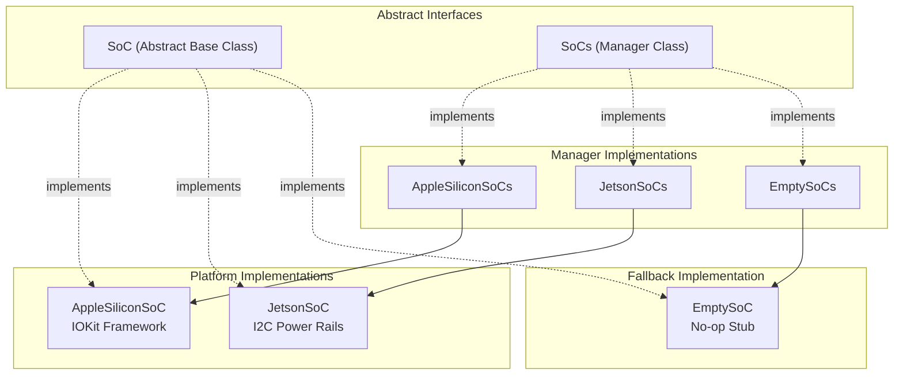
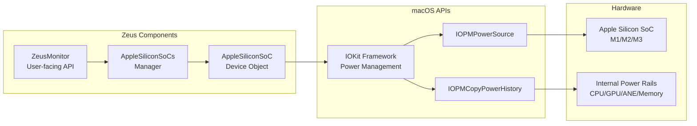
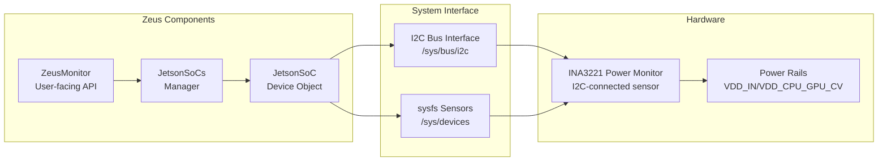
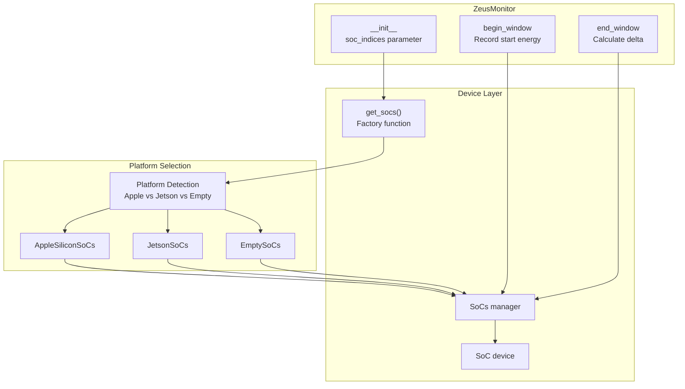
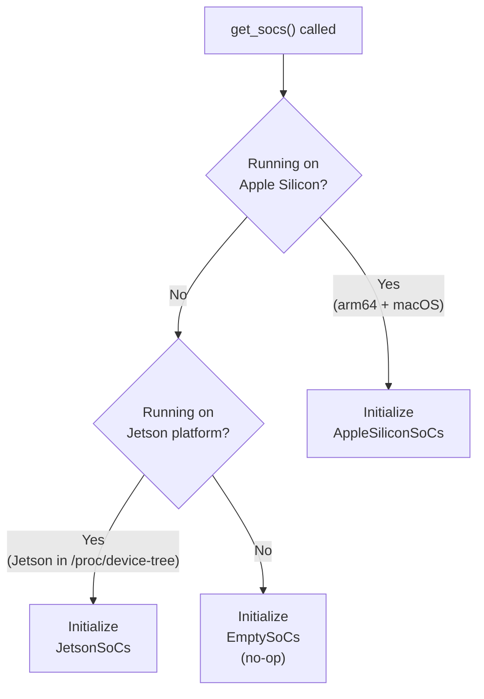

<!-- source: DeepWiki mcp.deepwiki.com · repo ml-energy/zeus · page 6.3 SoC Support · fetched 2026-10-21 -->

# SoC Support

<details>
<summary>Relevant source files</summary>

The following files were used as context for generating this wiki page:

- [README.md](README.md)
- [docs/getting_started/index.md](docs/getting_started/index.md)
- [docs/index.md](docs/index.md)
- [zeus/device/gpu/amd.py](zeus/device/gpu/amd.py)
- [zeus/device/gpu/common.py](zeus/device/gpu/common.py)
- [zeus/device/gpu/nvidia.py](zeus/device/gpu/nvidia.py)
- [zeus/monitor/__init__.py](zeus/monitor/__init__.py)
- [zeus/monitor/temperature.py](zeus/monitor/temperature.py)

</details>


## Purpose and Scope

This page documents Zeus's support for System-on-Chip (SoC) platforms, specifically Apple Silicon and NVIDIA Jetson devices. SoC support enables energy measurement on integrated systems where traditional GPU/CPU separation doesn't apply. 

For discrete GPU energy measurement, see [GPU Support](#6.1). For CPU/DRAM energy measurement via RAPL, see [CPU Support](#6.2).

---

## Overview

Zeus provides SoC support through a hardware abstraction layer that mirrors the design patterns used for GPU and CPU devices. The system supports two major SoC platforms:

1. **Apple Silicon** - ARM-based Apple SoCs (M1, M2, M3 series) using the IOKit framework
2. **NVIDIA Jetson** - Embedded AI platforms using I2C power rail sensors

Sources: [README.md:19](), Diagram 1 and Diagram 5 from high-level architecture

---

## Architecture

### Abstraction Layer Pattern

SoC support follows the same abstraction pattern as GPU and CPU implementations, with three key components:

**SoC Abstraction Hierarchy**


The abstract `SoC` class defines the interface that all platform implementations must follow. The `SoCs` manager class handles initialization and collection-level operations, similar to [`GPUs`][zeus.device.gpu.common.GPUs] and the CPU manager pattern.

Sources: [zeus/device/gpu/common.py:16-128](), [zeus/device/gpu/common.py:130-284](), Diagram 5 from high-level architecture

### Core Interface Methods

Each SoC implementation must provide:

| Method | Purpose | Return Type |
|--------|---------|-------------|
| `getName()` | Get SoC model name | `str` |
| `supportsGetTotalEnergyConsumption()` | Check energy counter support | `bool` |
| `getTotalEnergyConsumption()` | Get cumulative energy since boot | `int` (mJ) |
| `getInstantPowerUsage()` | Get current power draw | `int` (mW) |

Sources: Pattern derived from [zeus/device/gpu/common.py:34-127]()

---

## Apple Silicon Support

### Platform Characteristics

Apple Silicon SoCs integrate CPU, GPU, Neural Engine, and unified memory into a single chip. Zeus accesses power metrics through Apple's **IOKit framework**, which provides system-level power management APIs.

**Apple Silicon Measurement Flow**


### Key Implementation Details

**Initialization and Detection:**
- Platform detection via `platform.machine()` checking for `arm64` architecture
- IOKit framework availability check
- No privileged access required for reading power metrics

**Power Domains:**
Apple Silicon exposes several power domains through IOKit:
- Package power (entire SoC)
- CPU cluster power
- GPU power (on some models)
- Neural Engine power (on some models)

**Measurement Strategy:**
- Uses direct energy counters when available
- Falls back to power polling with integration
- Handles unit conversions between IOKit (typically Watts) and Zeus (milliwatts/millijoules)

Sources: Diagram 2 and Diagram 5 from high-level architecture

### Usage Notes

| Aspect | Details |
|--------|---------|
| **Privileges** | No special privileges required |
| **Accuracy** | High accuracy, direct from hardware counters |
| **Granularity** | Typically 1-10ms sampling resolution |
| **Supported Models** | M1, M2, M3 series (all variants) |
| **Limitations** | Some per-component breakdowns may not be available on all models |

---

## NVIDIA Jetson Support

### Platform Characteristics

NVIDIA Jetson platforms (Nano, TX2, Xavier, Orin) are embedded AI systems with integrated GPU and CPU. Unlike desktop GPUs, Jetson devices expose power metrics through **I2C bus sensors** rather than NVML.

**Jetson Measurement Flow**


### Power Rail Sensors

Jetson platforms typically use **INA3221** triple-channel power monitors accessible via I2C. Common power rails include:

| Rail Name | Description | Typical Path |
|-----------|-------------|--------------|
| `VDD_IN` | Main input power | `/sys/bus/i2c/devices/*/power*_input` |
| `VDD_CPU_GPU_CV` | CPU+GPU combined | `/sys/bus/i2c/devices/*/power*_input` |
| `VDD_SOC` | SoC core voltage | `/sys/bus/i2c/devices/*/power*_input` |

**Note:** Exact rail names and availability vary by Jetson model (Nano, TX2, Xavier, Orin series).

### Key Implementation Details

**Initialization and Detection:**
- Scans `/sys/bus/i2c/devices/` for INA3221 sensors
- Identifies available power rails by name
- Validates sensor accessibility and units

**Measurement Strategy:**
- Direct read from sysfs attributes (typically in microwatts)
- No energy counters available - must integrate power over time
- Background polling process for continuous measurement

**Privilege Requirements:**
- Read access to `/sys/bus/i2c/devices/` (typically available to all users)
- No special Linux capabilities required

Sources: Diagram 2 and Diagram 5 from high-level architecture

### Platform-Specific Considerations

| Platform | Power Rails Available | Notes |
|----------|----------------------|-------|
| **Jetson Nano** | VDD_IN, VDD_CPU_GPU_CV | 5W/10W power modes |
| **Jetson TX2** | VDD_IN, VDD_GPU, VDD_CPU | Separate CPU/GPU rails |
| **Jetson Xavier** | Multiple rails | More granular power breakdown |
| **Jetson Orin** | Similar to Xavier | Latest generation, best instrumentation |

---

## Integration with Energy Monitoring

### Using ZeusMonitor with SoCs

SoC devices integrate seamlessly with [`ZeusMonitor`][zeus.monitor.energy.ZeusMonitor] through the `soc_indices` parameter:

**Basic Usage Pattern:**
```python
from zeus.monitor import ZeusMonitor

# Monitor all available SoC devices
monitor = ZeusMonitor(soc_indices=[0])

# Start measurement window
monitor.begin_window("training")

# ... your workload ...

# End measurement and get results
result = monitor.end_window("training")
print(f"SoC Energy: {result.soc_energy} mJ")
```

**ZeusMonitor SoC Integration Architecture**


Sources: [zeus/monitor/__init__.py:1-15](), pattern from [zeus/device/gpu/common.py:130-284]()

### Multi-Device Measurement

ZeusMonitor supports simultaneous measurement of GPUs, CPUs, and SoCs:

| Parameter | Description | Example |
|-----------|-------------|---------|
| `gpu_indices` | GPU devices to monitor | `[0, 1]` |
| `cpu_indices` | CPU packages to monitor | `[0]` |
| `soc_indices` | SoC devices to monitor | `[0]` |

**Example Multi-Device Setup:**
```python
# On a hybrid system (e.g., discrete GPU + Apple Silicon host)
monitor = ZeusMonitor(
    gpu_indices=[0],      # Discrete NVIDIA GPU
    soc_indices=[0],      # Apple Silicon host SoC
)
```

Sources: Pattern from [zeus/monitor/energy.py]() (referenced in [zeus/monitor/__init__.py:12]())

---

## Device Detection and Initialization

### Platform Selection Logic

Zeus automatically detects the appropriate SoC implementation at runtime:

**SoC Platform Detection Flow**


**Detection Criteria:**

| Platform | Detection Method |
|----------|-----------------|
| **Apple Silicon** | `platform.machine() == "arm64"` AND `platform.system() == "Darwin"` |
| **Jetson** | Check `/proc/device-tree/model` or `/proc/device-tree/compatible` for "nvidia,jetson" |
| **Empty** | Fallback if neither platform is detected |

Sources: Pattern from [zeus/device/gpu/nvidia.py:441-478](), [zeus/device/gpu/amd.py:361-377]()

---

## EmptySoC Fallback

When no supported SoC platform is detected, Zeus instantiates `EmptySoCs` - a null object implementation that allows code to run without errors but returns no measurements.

**Behavior:**
- All methods raise `ValueError("No SoCs available.")`
- Enables graceful degradation on unsupported platforms
- Maintains consistent API across environments

This follows the same pattern as [`EmptyGPUs`][zeus.device.gpu.common.EmptyGPUs] and `EmptyCPUs`.

Sources: [zeus/device/gpu/common.py:286-401]()

---

## Verification and Diagnostics

### Using zeus.show_env

The `zeus.show_env` command reports detected SoC devices:

```console
$ python -m zeus.show_env

================================================================================
## SoC availability

Logging output:
[2024-09-09 16:40:14,520] [zeus.device.soc](soc.py:45) Detected Apple Silicon platform

Detected:
  SoC 0: Apple M1 Pro
    Energy measurements available (IOKit)
    Power measurements available (IOKit)

================================================================================
```

Sources: [docs/getting_started/index.md:86-129]()

### Troubleshooting

| Issue | Possible Cause | Solution |
|-------|---------------|----------|
| No SoCs detected on Apple Silicon | Not running on macOS | Check `platform.system()` returns "Darwin" |
| No SoCs detected on Jetson | Missing I2C sensors | Check `/sys/bus/i2c/devices/` for INA3221 |
| Permission errors on Jetson | Restricted I2C access | Verify user in `i2c` group: `sudo usermod -a -G i2c $USER` |
| Zero power readings | Inactive power rails | Some rails only active under load |

---

## Limitations and Future Work

### Current Limitations

1. **Apple Silicon:**
   - Per-component power breakdown availability varies by model
   - IOKit API is undocumented and subject to change
   - Requires macOS - no Linux support for Apple Silicon power APIs

2. **Jetson:**
   - No hardware energy counters - requires power polling
   - Rail names and availability inconsistent across models
   - Limited precision compared to direct energy counters

3. **General:**
   - No frequency/power cap control for SoC devices
   - No support for other ARM SoCs (Raspberry Pi, Qualcomm, etc.)
   - Limited SoC-level optimization capabilities compared to discrete GPUs

### Architectural Notes

The SoC abstraction layer is designed to be extensible. Adding support for new SoC platforms requires:

1. Implementing the abstract `SoC` base class
2. Creating a corresponding `SoCs` manager class
3. Adding platform detection logic
4. Ensuring measurement units match Zeus conventions (mW/mJ)

Sources: Architecture patterns from [zeus/device/gpu/common.py:16-128](), [zeus/device/gpu/nvidia.py:69-287]()

---

## Summary

Zeus's SoC support provides energy measurement capabilities for integrated systems where traditional CPU/GPU separation doesn't apply. The abstraction layer maintains consistency with GPU and CPU interfaces while accommodating platform-specific measurement APIs.

**Key Takeaways:**

| Aspect | Apple Silicon | Jetson |
|--------|--------------|---------|
| **Measurement API** | IOKit | I2C sysfs |
| **Energy Counters** | Yes | No (polling only) |
| **Privileges Required** | None | I2C group membership |
| **Accuracy** | High | Moderate |
| **Integration Effort** | Seamless | Seamless |

For usage examples and integration patterns, see the [Measuring Energy](#4) section of the documentation.

Sources: Overall architecture from Diagram 1, Diagram 2, and Diagram 5 from high-level system overview

---

