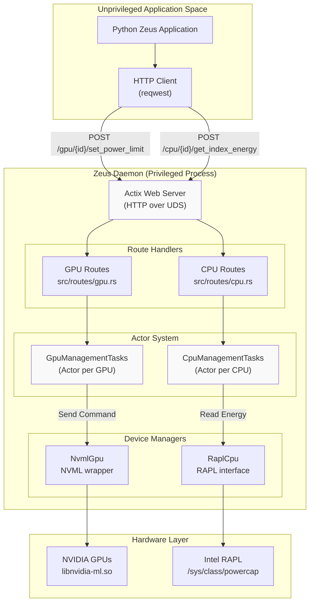
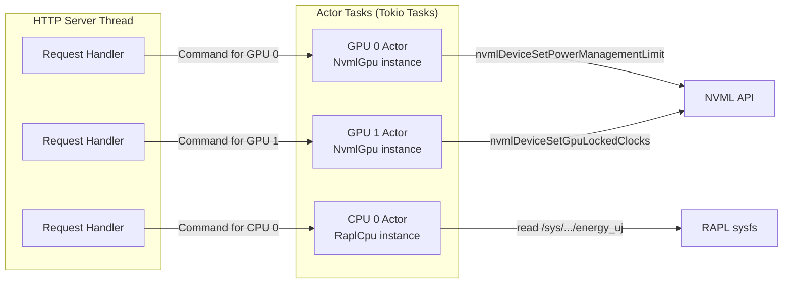
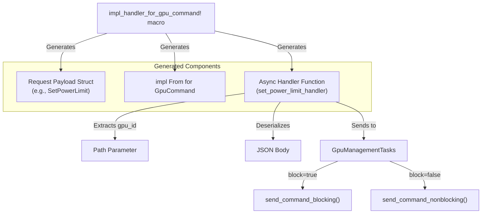
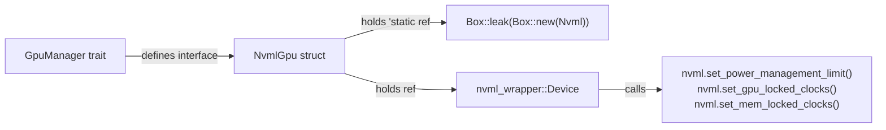
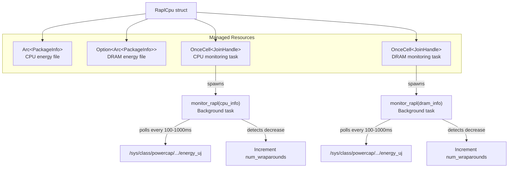
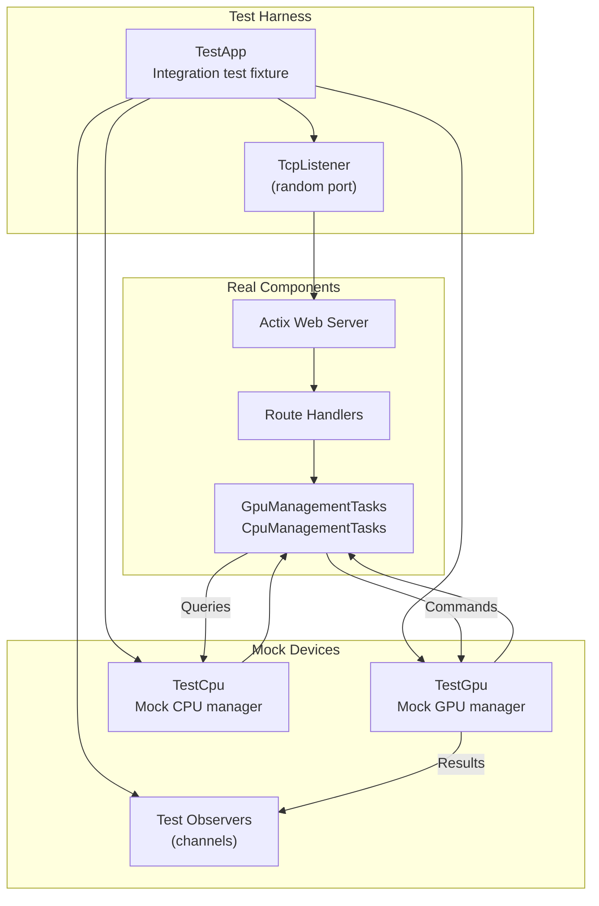

<!-- source: DeepWiki mcp.deepwiki.com · repo ml-energy/zeus · page 7 Zeus Daemon (zeusd) · fetched 2026-10-21 -->

# Zeus Daemon (zeusd)

<details>
<summary>Relevant source files</summary>

The following files were used as context for generating this wiki page:

- [README.md](README.md)
- [docs/getting_started/index.md](docs/getting_started/index.md)
- [docs/index.md](docs/index.md)
- [zeusd/src/devices/cpu/linux.rs](zeusd/src/devices/cpu/linux.rs)
- [zeusd/src/devices/gpu/linux.rs](zeusd/src/devices/gpu/linux.rs)
- [zeusd/src/routes/gpu.rs](zeusd/src/routes/gpu.rs)
- [zeusd/tests/cpu.rs](zeusd/tests/cpu.rs)
- [zeusd/tests/gpu.rs](zeusd/tests/gpu.rs)
- [zeusd/tests/helpers/mod.rs](zeusd/tests/helpers/mod.rs)

</details>


## Purpose and Scope

The Zeus daemon (`zeusd`) is a privileged service process that mediates access to hardware management operations that normally require root or `SYS_ADMIN` capabilities. It enables unprivileged applications to perform GPU configuration changes (power limits, frequency settings) and CPU/DRAM energy measurements without running as root.

This page documents the daemon's internal architecture, implementation, HTTP API, and deployment model. For guidance on choosing between deployment strategies (Docker, daemon, or sudo), see [Deployment Strategies](#2.3). For details on how the Python Zeus package communicates with `zeusd`, see [Privilege Management](#3.2).

---

## System Architecture

### High-Level Design

The daemon is implemented in Rust and follows an actor-based concurrency model. It exposes an HTTP API over a Unix domain socket, eliminating network exposure while providing a familiar REST interface.



**Sources:** [zeusd/src/routes/gpu.rs:1-127](), [zeusd/src/devices/gpu/linux.rs:1-102](), [zeusd/src/devices/cpu/linux.rs:1-249](), [docs/getting_started/index.md:149-194]()

### Multi-Process Actor Model

Each GPU and CPU is managed by a dedicated actor task that processes commands sequentially. This design ensures thread-safety when calling NVML/RAPL APIs and provides natural serialization of configuration changes.



**Sources:** [zeusd/tests/helpers/mod.rs:197-209](), [zeusd/tests/helpers/mod.rs:211-221]()

---

## HTTP API Reference

### GPU Management Endpoints

All GPU endpoints follow the pattern `POST /gpu/{gpu_id}/{operation}` and accept JSON payloads. Each request includes a `block` field that controls whether the operation waits for completion.

| Endpoint | Payload Fields | Description |
|----------|---------------|-------------|
| `/gpu/{gpu_id}/set_persistence_mode` | `enabled: bool`<br/>`block: bool` | Enable or disable persistence mode to keep GPU initialized |
| `/gpu/{gpu_id}/set_power_limit` | `power_limit_mw: u32`<br/>`block: bool` | Set GPU power limit in milliwatts |
| `/gpu/{gpu_id}/set_gpu_locked_clocks` | `min_clock_mhz: u32`<br/>`max_clock_mhz: u32`<br/>`block: bool` | Lock GPU core frequency to a range |
| `/gpu/{gpu_id}/reset_gpu_locked_clocks` | `block: bool` | Reset GPU core frequency to default |
| `/gpu/{gpu_id}/set_mem_locked_clocks` | `min_clock_mhz: u32`<br/>`max_clock_mhz: u32`<br/>`block: bool` | Lock GPU memory frequency to a range |
| `/gpu/{gpu_id}/reset_mem_locked_clocks` | `block: bool` | Reset GPU memory frequency to default |

**Example Request:**

```json
POST /gpu/0/set_power_limit
{
  "power_limit_mw": 250000,
  "block": true
}
```

**Sources:** [zeusd/src/routes/gpu.rs:82-116](), [zeusd/tests/gpu.rs:1-776]()

### CPU Energy Measurement Endpoints

CPU endpoints provide access to Intel RAPL energy counters with wraparound tracking.

| Endpoint | Method | Payload/Query | Response | Description |
|----------|--------|---------------|----------|-------------|
| `/cpu/{cpu_id}/get_index_energy` | POST | `cpu: bool`<br/>`dram: bool` | `cpu_energy_uj: Option<u64>`<br/>`dram_energy_uj: Option<u64>` | Read CPU and/or DRAM energy counter |
| `/cpu/{cpu_id}/supports_dram_energy` | GET | None | `dram_available: bool` | Check if DRAM measurement is available |

**Example Request/Response:**

```json
POST /cpu/0/get_index_energy
{
  "cpu": true,
  "dram": true
}

Response:
{
  "cpu_energy_uj": 123456789,
  "dram_energy_uj": 45678901
}
```

**Sources:** [zeusd/tests/cpu.rs:1-176]()

---

## Component Implementation

### Route Handler Generation

The daemon uses a macro-based approach to generate consistent route handlers with minimal boilerplate. The `impl_handler_for_gpu_command!` macro generates request payload structs, command conversion logic, and async handlers with structured logging.



**Key Implementation:** [zeusd/src/routes/gpu.rs:28-80]()

The macro invocation is concise:

```rust
impl_handler_for_gpu_command!(
    set_power_limit,
    post("/{gpu_id}/set_power_limit"),
    power_limit_mw: u32,
);
```

This generates the `SetPowerLimit` struct, conversion to `GpuCommand::SetPowerLimit`, and the `set_power_limit_handler` async function with automatic instrumentation.

**Sources:** [zeusd/src/routes/gpu.rs:28-127]()

### Device Managers

Device managers implement the `GpuManager` and `CpuManager` traits, providing a uniform interface over vendor-specific libraries.

#### NvmlGpu Implementation

The `NvmlGpu` struct wraps an NVML `Device` handle and implements methods for GPU configuration. It uses a leaked static reference to the NVML instance to satisfy Rust's lifetime requirements.



**Key Methods:**
- `device_count()`: Returns number of available GPUs via `Nvml::device_count()`
- `set_persistence_mode()`: Calls `device.set_persistent()`
- `set_power_management_limit()`: Calls `device.set_power_management_limit()`
- `set_gpu_locked_clocks()`: Calls `device.set_gpu_locked_clocks()`
- `set_mem_locked_clocks()`: Calls `device.set_mem_locked_clocks()`

**Sources:** [zeusd/src/devices/gpu/linux.rs:13-101]()

#### RaplCpu Implementation

The `RaplCpu` struct manages Intel RAPL energy measurements with automatic wraparound tracking. It spawns background tasks to monitor RAPL counters and detect wraparounds.



**Wraparound Tracking Logic:**

The RAPL counters are limited in range (typically ~262 seconds at 400W). Background tasks detect when the counter decreases (indicating wraparound) and increment a wraparound counter stored in `PackageInfo::num_wraparounds`.

When reading energy:
```
total_energy = current_reading + (num_wraparounds * max_energy_range)
```

The polling interval adapts based on remaining counter range to ensure wraparounds are never missed.

**Sources:** [zeusd/src/devices/cpu/linux.rs:24-203](), [zeusd/src/devices/cpu/linux.rs:223-248]()

---

## Request Processing Flow

### Blocking vs Non-blocking Operations

Each GPU command includes a `block` field that determines whether the HTTP handler waits for the operation to complete.

```mermaid
sequenceDiagram
    participant Client
    participant Handler as "Route Handler"
    participant Tasks as "GpuManagementTasks"
    participant Actor as "GPU Actor"
    participant NVML as "NVML Library"
    
    Note over Client,NVML: Non-blocking Request (block: false)
    Client->>Handler: POST /gpu/0/set_power_limit<br/>{power_limit_mw: 250000, block: false}
    Handler->>Tasks: send_command_nonblocking(0, SetPowerLimit{...})
    Tasks-->>Handler: Ok (immediately)
    Handler-->>Client: 200 OK
    Tasks->>Actor: Queue command
    Actor->>NVML: nvmlDeviceSetPowerManagementLimit()
    
    Note over Client,NVML: Blocking Request (block: true)
    Client->>Handler: POST /gpu/0/set_power_limit<br/>{power_limit_mw: 250000, block: true}
    Handler->>Tasks: send_command_blocking(0, SetPowerLimit{...})
    Tasks->>Actor: Send command
    Actor->>NVML: nvmlDeviceSetPowerManagementLimit()
    NVML-->>Actor: Result
    Actor-->>Tasks: Result
    Tasks-->>Handler: Result
    Handler-->>Client: 200 OK (or 400 on error)
```

**Implementation Details:**

Non-blocking requests return immediately after queueing the command, allowing high throughput. Blocking requests wait for the actor to execute the command and return the result, enabling error detection but with higher latency.

**Sources:** [zeusd/src/routes/gpu.rs:58-77]()

### Error Handling and Validation

Route handlers perform minimal validation (JSON deserialization, GPU index bounds). Device managers perform hardware validation (e.g., power limit ranges) and return NVML/IO errors. These errors propagate through the actor system and are serialized as HTTP error responses.

**Common Error Cases:**

| Error Type | HTTP Status | Example Cause |
|------------|-------------|---------------|
| Invalid JSON payload | 400 Bad Request | Missing required field, type mismatch |
| Invalid GPU/CPU index | 400 Bad Request | Index >= device count |
| NVML error | 400 Bad Request | Power limit out of range |
| Actor communication failure | 500 Internal Server Error | Management task terminated |

**Sources:** [zeusd/tests/gpu.rs:228-314](), [zeusd/tests/cpu.rs:86-157]()

---

## Installation and Deployment

### Installation via Cargo

The daemon is published on crates.io and can be installed with:

```bash
cargo install zeusd
```

This builds the `zeusd` binary and places it in `~/.cargo/bin/`.

**Sources:** [docs/getting_started/index.md:156-166]()

### Running the Daemon

The daemon must run with `root` or equivalent privileges. It accepts command-line arguments for socket configuration:

```bash
sudo zeusd \
    --socket-path /var/run/zeusd.sock \
    --socket-permissions 666
```

**Command-Line Arguments:**

| Argument | Type | Description |
|----------|------|-------------|
| `--socket-path` | Path | Unix domain socket path where the server listens |
| `--socket-permissions` | Octal | UNIX file permissions for the socket (e.g., 666 for rw-rw-rw-) |

The socket permissions must grant write access to unprivileged users who need to communicate with the daemon.

**Sources:** [docs/getting_started/index.md:156-172]()

### Client Configuration

Python applications discover the daemon via the `ZEUSD_SOCK_PATH` environment variable:

```bash
export ZEUSD_SOCK_PATH=/var/run/zeusd.sock
python -m zeus.show_env
```

The Zeus Python package will automatically use the daemon for privileged operations when this variable is set.

**Example Output:**

```
## CPU availability

Logging output:
[2025-07-25 16:40:40,396] [zeus.device.cpu.rapl](rapl.py:137) RAPL directory (/sys/class/powercap/intel-rapl) is available.

Detected:
  CPU 0:
    CPU measurements available (Zeusd at /var/run/zeusd.sock)
    DRAM measurements available (Zeusd at /var/run/zeusd.sock)
```

**Sources:** [docs/getting_started/index.md:171-194]()

---

## Security Model

### Principle of Least Privilege

The daemon implements a minimal attack surface by:

1. **Limited API scope**: Only exposes GPU configuration and CPU energy reading, not general system access
2. **No network exposure**: Unix domain socket prevents remote access
3. **Per-device actors**: Isolates operations to prevent cross-device interference
4. **Explicit privilege separation**: Unprivileged applications cannot escalate privileges

This design follows the principle of least privilege: the daemon has exactly the permissions needed for its function, and applications have no direct access to privileged operations.

**Sources:** [docs/getting_started/index.md:149-154]()

### Comparison with Alternatives

| Deployment | Privileges | Attack Surface | Complexity |
|------------|------------|----------------|------------|
| Direct sudo | Full root for application | Entire application codebase | Low |
| Docker SYS_ADMIN | SYS_ADMIN for container | Entire container | Medium |
| Zeus daemon | Root only for daemon | ~2000 lines of Rust code | Medium |

The daemon approach limits privileged code to the smallest possible surface area while maintaining usability.

**Sources:** [docs/getting_started/index.md:132-199]()

---

## Testing Architecture

The daemon includes comprehensive integration tests that use mock GPU and CPU managers to validate behavior without requiring actual hardware.

### Test Infrastructure



**Key Components:**

- `TestGpu`: Mock implementation of `GpuManager` that sends operations to channels instead of calling NVML
- `TestCpu`: Mock implementation of `CpuManager` that reads injected values from channels
- `TestApp`: Fixture that starts the server over TCP (easier than Unix sockets for testing) with mock devices
- Observers: Channel receivers that allow tests to inspect what operations were performed

**Sources:** [zeusd/tests/helpers/mod.rs:1-340]()

### Test Coverage

The test suite validates:

1. **Single operations**: Each API endpoint with valid payloads
2. **Multiple operations**: Sequential requests to different GPUs/CPUs
3. **Bulk operations**: Concurrent non-blocking requests
4. **Error cases**: Invalid payloads, out-of-range parameters, invalid device indices
5. **Blocking behavior**: Synchronization guarantees for blocking requests

Example test structure:

```rust
#[tokio::test]
async fn test_set_power_limit_single() {
    let mut app = TestApp::start().await;
    
    let resp = app.send(
        0,  // gpu_id
        SetPowerLimit {
            power_limit_mw: 100_000,
            block: true,
        },
    ).await.expect("Failed to send request");
    
    assert_eq!(resp.status(), 200);
    let history = app.power_limit_history_for_gpu(0);
    assert_eq!(history, vec![100_000]);
}
```

**Sources:** [zeusd/tests/gpu.rs:175-193](), [zeusd/tests/cpu.rs:9-83]()

---

## Summary

The Zeus daemon provides a secure, efficient mechanism for unprivileged applications to perform GPU configuration and CPU energy measurements. Its actor-based architecture ensures thread-safety and serialization, while the HTTP-over-Unix-socket API provides a familiar interface with no network exposure. The macro-based route generation and comprehensive test suite ensure maintainability and correctness.

**Key Design Decisions:**

- **Rust implementation**: Memory safety and zero-cost abstractions
- **Actor model**: Serialized access to hardware APIs
- **Unix domain socket**: Security through lack of network exposure
- **Blocking/non-blocking operations**: Flexibility for different use cases
- **Background wraparound tracking**: Reliable CPU energy measurement without user intervention

**Sources:** [README.md:43-44](), [docs/getting_started/index.md:149-199](), [zeusd/src/routes/gpu.rs:1-127](), [zeusd/src/devices/gpu/linux.rs:1-102](), [zeusd/src/devices/cpu/linux.rs:1-249]()

---

