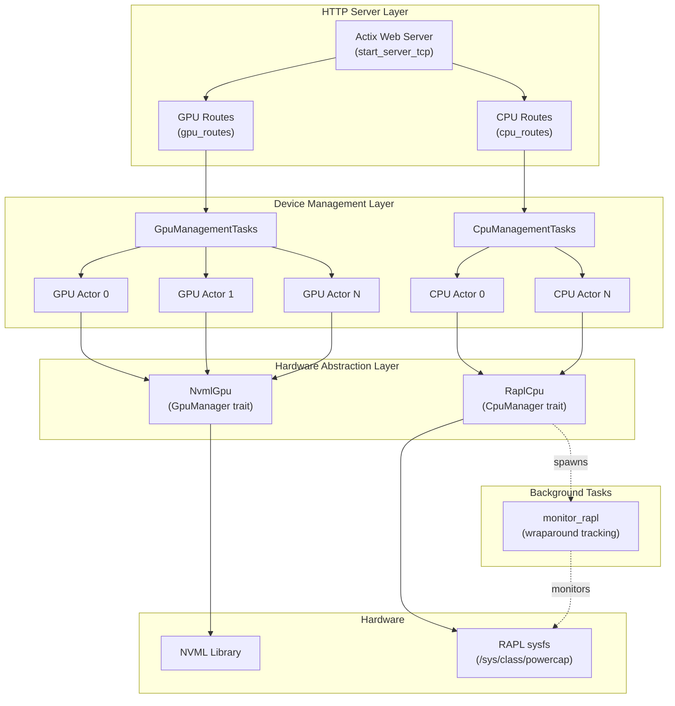
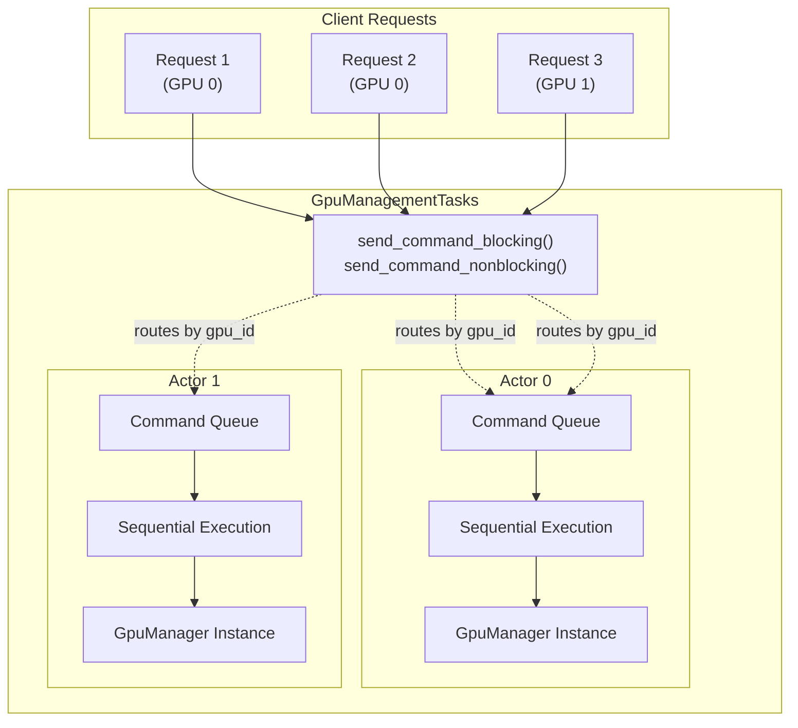
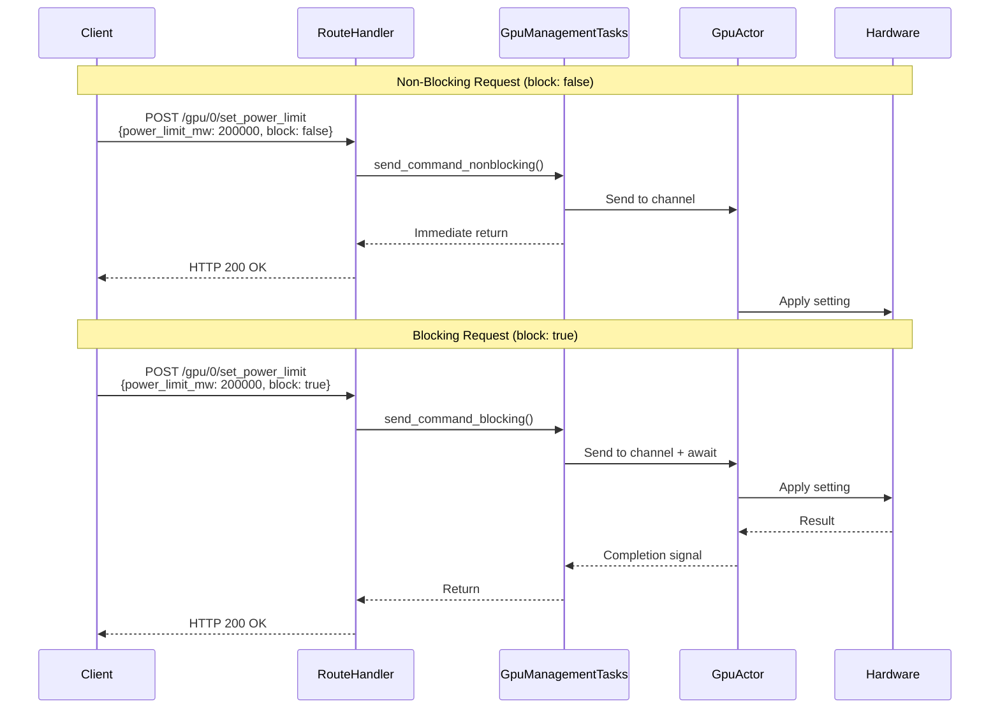
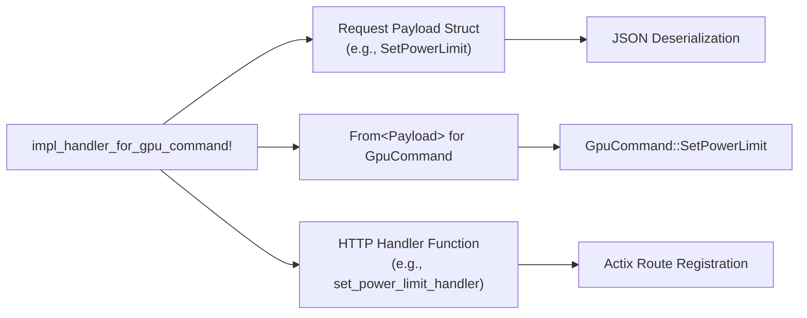
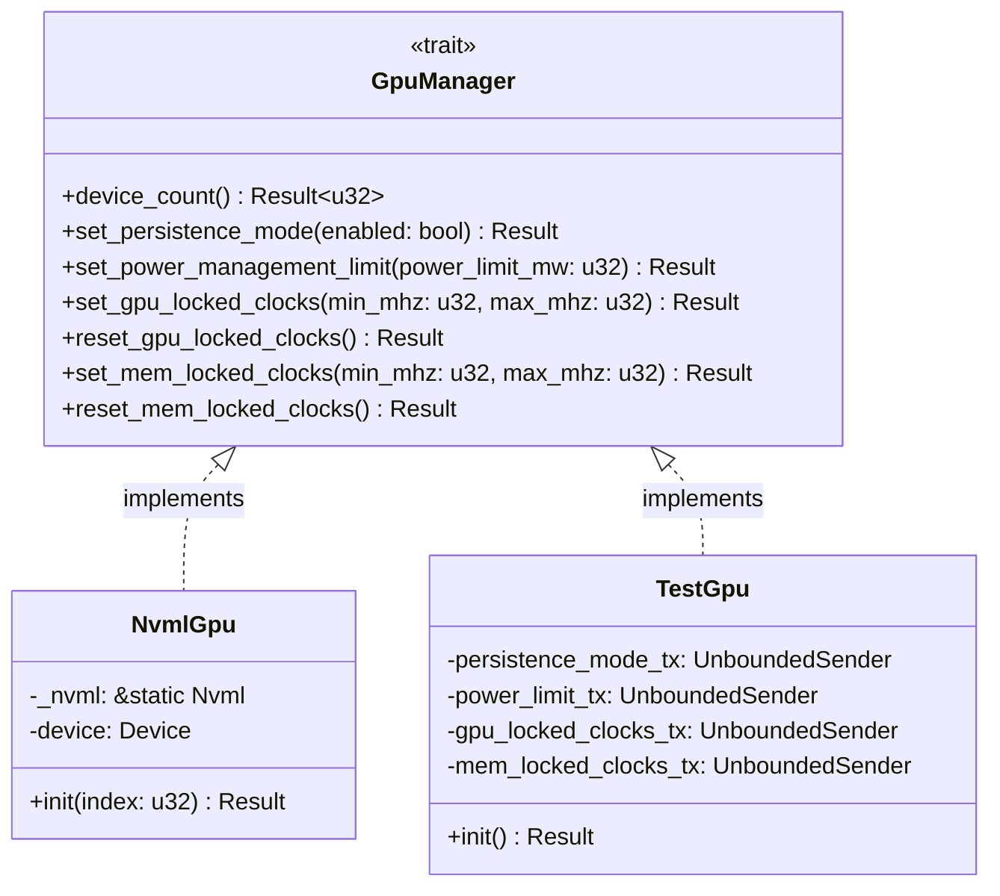
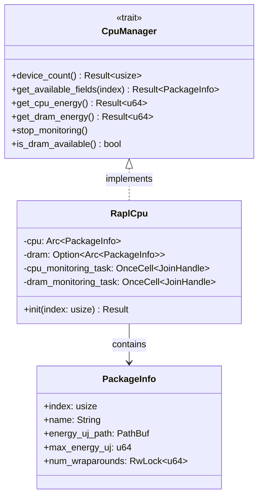
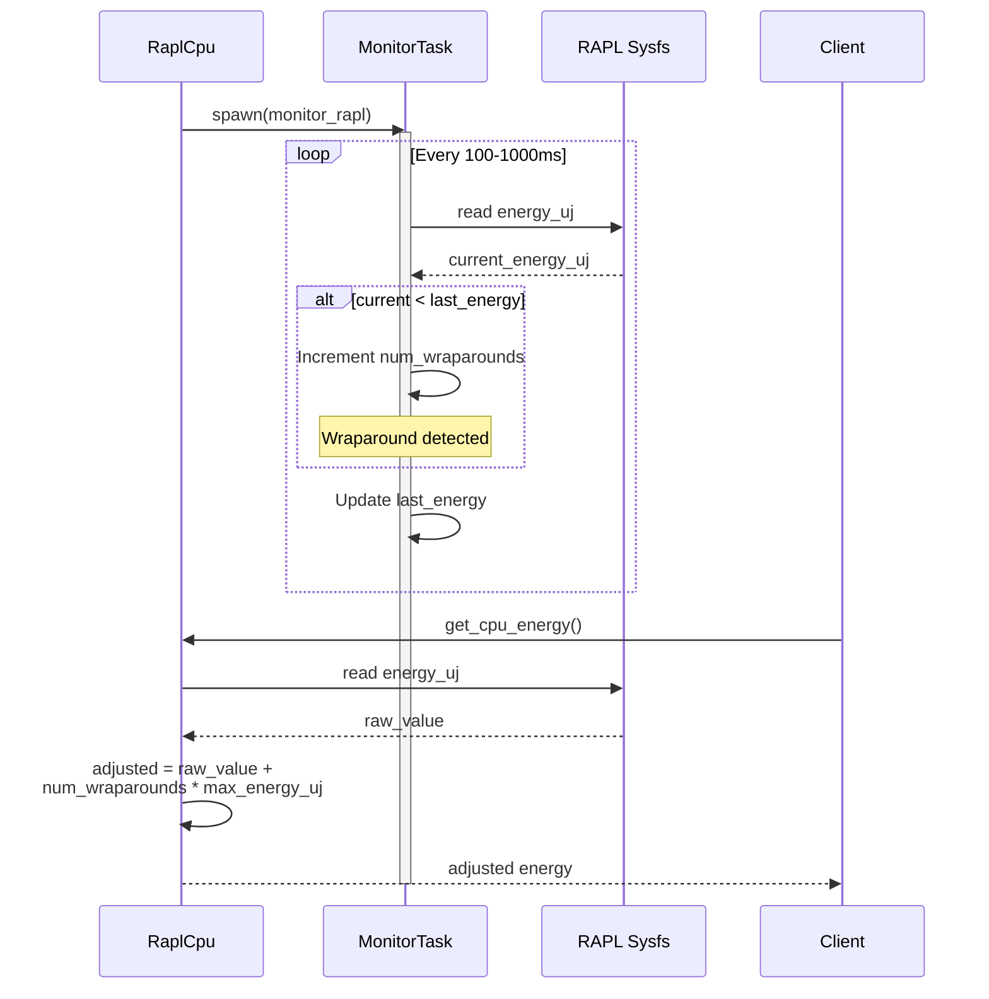
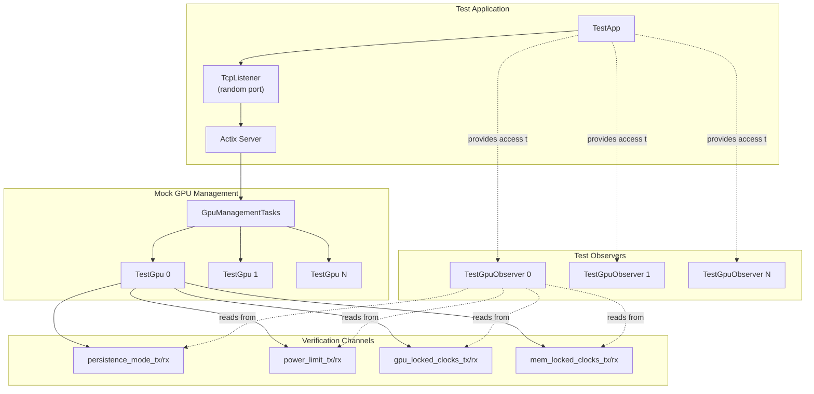
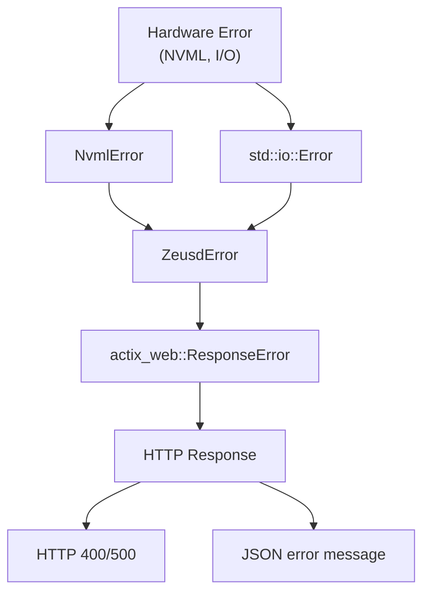

<!-- source: DeepWiki mcp.deepwiki.com · repo ml-energy/zeus · page 7.1 Daemon Architecture · fetched 2026-10-21 -->

# Daemon Architecture

<details>
<summary>Relevant source files</summary>

The following files were used as context for generating this wiki page:

- [zeusd/src/devices/cpu/linux.rs](zeusd/src/devices/cpu/linux.rs)
- [zeusd/src/devices/gpu/linux.rs](zeusd/src/devices/gpu/linux.rs)
- [zeusd/src/routes/gpu.rs](zeusd/src/routes/gpu.rs)
- [zeusd/tests/cpu.rs](zeusd/tests/cpu.rs)
- [zeusd/tests/gpu.rs](zeusd/tests/gpu.rs)
- [zeusd/tests/helpers/mod.rs](zeusd/tests/helpers/mod.rs)

</details>


## Purpose and Scope

This document describes the internal architecture of the Zeus daemon (`zeusd`), a Rust-based privileged service that provides secure access to GPU and CPU power management operations. The architecture implements an actor-based concurrency model with dedicated management tasks for each hardware device.

For information about the HTTP API endpoints exposed by the daemon, see [HTTP API Reference](#7.2). For installation and deployment instructions, see [Installing and Running zeusd](#7.3). For the overall privilege management strategy in Zeus, see [Privilege Management](#3.2).

**Sources:** High-level architecture diagrams, [zeusd/src/routes/gpu.rs](), [zeusd/tests/helpers/mod.rs]()

---

## Core Design Principles

The Zeus daemon is built on three fundamental design principles:

| Principle | Implementation | Rationale |
|-----------|----------------|-----------|
| **Minimal Privileged Surface** | Single Rust binary with focused responsibilities | Reduce attack surface for root-level operations |
| **Concurrent Device Management** | One actor per hardware device | Prevent device contention and enable parallel operations |
| **Asynchronous I/O** | Actix-web framework with Tokio runtime | Support high request throughput without blocking |

The daemon is implemented in Rust for memory safety guarantees and zero-cost abstractions, critical for a service running with elevated privileges. All hardware operations are isolated within dedicated management tasks that communicate via message passing.

**Sources:** [zeusd/src/routes/gpu.rs:1-10](), [zeusd/tests/helpers/mod.rs:1-29]()

---

## System Component Overview



**System Component Overview**

The daemon consists of four main layers:

1. **HTTP Server Layer**: Actix-web based REST API server with route handlers
2. **Device Management Layer**: Actor-based tasks managing individual hardware devices
3. **Hardware Abstraction Layer**: Trait-based interfaces to vendor libraries
4. **Background Tasks**: Asynchronous monitoring for counter wraparound

**Sources:** [zeusd/src/routes/gpu.rs:119-126](), [zeusd/tests/helpers/mod.rs:197-221](), [zeusd/src/devices/gpu/linux.rs:42-56](), [zeusd/src/devices/cpu/linux.rs:68-92]()

---

## Actor-Based Device Management

### Architecture

Each hardware device (GPU or CPU) is managed by a dedicated actor that processes commands sequentially. This design prevents race conditions when multiple clients attempt to modify device settings concurrently.



**Actor-Based Device Management**

The `GpuManagementTasks` structure maintains a vector of channel senders, one per GPU. When a request arrives, it is routed to the appropriate actor based on the `gpu_id` path parameter. Commands to the same device are serialized, while commands to different devices execute concurrently.

**Sources:** [zeusd/tests/helpers/mod.rs:197-209](), [zeusd/src/routes/gpu.rs:58-77]()

### Command Types

The system supports multiple GPU command types, all following a consistent pattern:

| Command Variant | Purpose | Fields |
|-----------------|---------|--------|
| `SetPersistenceMode` | Enable/disable GPU persistence mode | `enabled: bool` |
| `SetPowerLimit` | Configure GPU power cap | `power_limit_mw: u32` |
| `SetGpuLockedClocks` | Lock GPU core frequency | `min_clock_mhz: u32`<br/>`max_clock_mhz: u32` |
| `ResetGpuLockedClocks` | Unlock GPU core frequency | None |
| `SetMemLockedClocks` | Lock GPU memory frequency | `min_clock_mhz: u32`<br/>`max_clock_mhz: u32` |
| `ResetMemLockedClocks` | Unlock GPU memory frequency | None |

Each command is represented as a variant in the `GpuCommand` enum and converted from HTTP request payloads using the `From` trait.

**Sources:** [zeusd/src/routes/gpu.rs:82-116](), [zeusd/tests/gpu.rs:5-8]()

---

## Request Processing Flow

### Blocking vs Non-Blocking Requests

All requests include a `block` field that determines the synchronization behavior:



**Request Processing: Blocking vs Non-Blocking**

- **Non-blocking (`block: false`)**: The HTTP handler returns immediately after queuing the command. Useful for bulk operations where immediate feedback is not required.
- **Blocking (`block: true`)**: The HTTP handler waits for command completion. Ensures the operation has been applied before returning.

**Sources:** [zeusd/src/routes/gpu.rs:58-77](), [zeusd/tests/gpu.rs:126-172]()

### Macro-Generated Handlers

The daemon uses a declarative macro to eliminate boilerplate in route handler definitions:



**Macro-Generated Handler Architecture**

The `impl_handler_for_gpu_command!` macro at [zeusd/src/routes/gpu.rs:28-80]() generates three components:

1. A request payload struct with fields specific to the command plus a `block` field
2. A `From` implementation to convert the payload to a `GpuCommand` variant
3. An Actix-web handler function with proper instrumentation

Example invocation:
```rust
impl_handler_for_gpu_command!(
    set_power_limit,
    post("/{gpu_id}/set_power_limit"),
    power_limit_mw: u32,
);
```

This generates `SetPowerLimit` struct, `From<SetPowerLimit> for GpuCommand`, and `set_power_limit_handler` function.

**Sources:** [zeusd/src/routes/gpu.rs:28-126]()

---

## Hardware Abstraction Traits

### GpuManager Trait

The `GpuManager` trait defines the interface for GPU operations, enabling platform-specific implementations:



**GpuManager Trait Hierarchy**

The production implementation `NvmlGpu` at [zeusd/src/devices/gpu/linux.rs:13-101]() wraps NVIDIA's NVML library. The test implementation `TestGpu` at [zeusd/tests/helpers/mod.rs:32-123]() uses channels to record operations for verification.

**Sources:** [zeusd/src/devices/gpu/linux.rs:13-101](), [zeusd/tests/helpers/mod.rs:32-123]()

### CpuManager Trait

The `CpuManager` trait provides CPU energy measurement capabilities:



**CpuManager Trait Hierarchy**

The `RaplCpu` implementation at [zeusd/src/devices/cpu/linux.rs:24-203]() reads from RAPL sysfs files. Each `PackageInfo` represents a power domain (CPU package or DRAM) and tracks wraparound events.

**Sources:** [zeusd/src/devices/cpu/linux.rs:24-203](), [zeusd/tests/helpers/mod.rs:125-195]()

---

## Background Monitoring Tasks

### RAPL Counter Wraparound Tracking

RAPL energy counters are limited in size and can wrap around during operation. The daemon spawns background monitoring tasks to detect and count these wraparound events:



**RAPL Counter Wraparound Monitoring**

The `monitor_rapl` function at [zeusd/src/devices/cpu/linux.rs:223-248]() continuously polls RAPL counters to detect wraparounds. The monitoring task adjusts its polling interval based on current energy levels:

- **100ms polling**: When counter is close to maximum (within `RAPL_COUNTER_MAX_INCREASE` of `max_energy_uj`)
- **1000ms polling**: When counter has room before wraparound

This adaptive polling minimizes CPU usage while ensuring no wraparounds are missed.

**Sources:** [zeusd/src/devices/cpu/linux.rs:223-248](), [zeusd/src/devices/cpu/linux.rs:129-159]()

### Task Lifecycle Management

Background monitoring tasks are lazily initialized and tracked using `OnceCell`:

| Component | Type | Purpose |
|-----------|------|---------|
| `cpu_monitoring_task` | `OnceCell<JoinHandle<Result<(), ZeusdError>>>` | Tracks CPU package monitoring task |
| `dram_monitoring_task` | `OnceCell<JoinHandle<Result<(), ZeusdError>>>` | Tracks DRAM monitoring task |

Tasks are spawned on first energy measurement request and can be stopped via `stop_monitoring()`, which aborts the task handles.

**Sources:** [zeusd/src/devices/cpu/linux.rs:24-41](), [zeusd/src/devices/cpu/linux.rs:191-198]()

---

## Test Infrastructure

### Mock Device Architecture

The test suite implements mock devices that record operations for verification:



**Mock Device Test Architecture**

Each `TestGpu` at [zeusd/tests/helpers/mod.rs:32-70]() implements the `GpuManager` trait by sending operations to unbounded channels. The corresponding `TestGpuObserver` at [zeusd/tests/helpers/mod.rs:40-70]() receives from these channels, allowing tests to verify that operations were applied in the correct order.

Example test pattern:
```rust
let mut app = TestApp::start().await;
app.send(0, SetPowerLimit { power_limit_mw: 100_000, block: true }).await;
let history = app.power_limit_history_for_gpu(0);
assert_eq!(history, vec![100_000]);
```

**Sources:** [zeusd/tests/helpers/mod.rs:32-123](), [zeusd/tests/helpers/mod.rs:268-339](), [zeusd/tests/gpu.rs:12-31]()

### Integration Test Structure

Integration tests verify the complete request flow from HTTP to hardware abstraction:

| Test Category | Test File | Verifies |
|---------------|-----------|----------|
| Single device operations | [zeusd/tests/gpu.rs:12-31]() | Basic command execution |
| Multiple device operations | [zeusd/tests/gpu.rs:33-63]() | Correct routing by GPU ID |
| Invalid requests | [zeusd/tests/gpu.rs:66-123]() | JSON validation and error handling |
| Concurrent operations | [zeusd/tests/gpu.rs:126-172]() | Non-blocking request handling |
| Error propagation | [zeusd/tests/gpu.rs:228-276]() | Hardware error responses |

Tests use `tokio::task::JoinSet` to spawn concurrent requests and verify that non-blocking requests complete in any order while blocking requests enforce sequencing.

**Sources:** [zeusd/tests/gpu.rs](), [zeusd/tests/cpu.rs](), [zeusd/tests/helpers/mod.rs:266-339]()

---

## Concurrency and Thread Safety

### Message Passing vs Shared State

The daemon minimizes shared mutable state through message passing:

| Access Pattern | Implementation | Rationale |
|----------------|----------------|-----------|
| GPU/CPU commands | Message channels (MPSC) | Serialize access per device |
| RAPL wraparound counts | `Arc<RwLock<u64>>` | Shared read access, rare writes |
| NVML instances | Static lifetime (`Box::leak`) | Thread-safe library initialization |

The `GpuManagementTasks` structure contains only channel senders, which are `Send + Sync`. All mutable device state is isolated within actor tasks.

**Sources:** [zeusd/src/devices/gpu/linux.rs:31-39](), [zeusd/src/devices/cpu/linux.rs:223-248](), [zeusd/tests/helpers/mod.rs:47-70]()

### Error Handling Strategy

Errors propagate through the type system using `Result<T, ZeusdError>`:



**Error Handling Flow**

The `ZeusdError` enum wraps all error types and implements `actix_web::ResponseError` for automatic HTTP error responses. Hardware errors (invalid power limits, non-existent GPUs) return HTTP 400, while internal errors return HTTP 500.

**Sources:** [zeusd/tests/gpu.rs:228-260](), [zeusd/tests/cpu.rs:86-157]()

---

