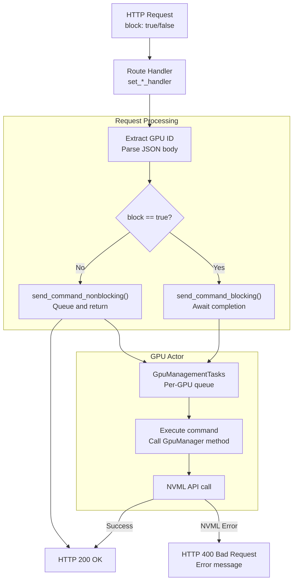

<!-- source: DeepWiki mcp.deepwiki.com · repo ml-energy/zeus · page 7.2 HTTP API Reference · fetched 2026-10-21 -->

# HTTP API Reference

<details>
<summary>Relevant source files</summary>

The following files were used as context for generating this wiki page:

- [zeusd/src/devices/cpu/linux.rs](zeusd/src/devices/cpu/linux.rs)
- [zeusd/src/devices/gpu/linux.rs](zeusd/src/devices/gpu/linux.rs)
- [zeusd/src/routes/gpu.rs](zeusd/src/routes/gpu.rs)
- [zeusd/tests/cpu.rs](zeusd/tests/cpu.rs)
- [zeusd/tests/gpu.rs](zeusd/tests/gpu.rs)
- [zeusd/tests/helpers/mod.rs](zeusd/tests/helpers/mod.rs)

</details>


This document provides a complete reference for the Zeus daemon's HTTP REST API. The zeusd daemon exposes privileged GPU and CPU operations through a REST interface over Unix domain sockets or TCP. For information about the daemon's internal architecture and design, see [Daemon Architecture](#7.1). For installation and configuration instructions, see [Installing and Running zeusd](#7.3).

## Overview

The zeusd HTTP API provides endpoints for:
- **GPU Management**: Setting power limits, frequency locks, and persistence mode for NVIDIA GPUs
- **CPU Monitoring**: Reading RAPL energy counters for CPU and DRAM

All endpoints follow a consistent pattern with JSON request/response bodies. GPU configuration endpoints support both blocking and non-blocking operation modes to accommodate different use cases.

---

## API Architecture

The following diagram shows the high-level organization of API routes and their mapping to hardware operations:

```mermaid
graph TB
    subgraph "HTTP API Server"
        BASE[/"Base URL<br/>/"]
        
        subgraph "GPU Routes"
            GPU_BASE["/gpu"]
            SET_PERSIST["/gpu/{gpu_id}/set_persistence_mode"]
            SET_POWER["/gpu/{gpu_id}/set_power_limit"]
            SET_GPU_CLK["/gpu/{gpu_id}/set_gpu_locked_clocks"]
            RESET_GPU_CLK["/gpu/{gpu_id}/reset_gpu_locked_clocks"]
            SET_MEM_CLK["/gpu/{gpu_id}/set_mem_locked_clocks"]
            RESET_MEM_CLK["/gpu/{gpu_id}/reset_mem_locked_clocks"]
        end
        
        subgraph "CPU Routes"
            CPU_BASE["/cpu"]
            GET_ENERGY["/cpu/{cpu_id}/get_index_energy"]
            SUPPORTS_DRAM["/cpu/{cpu_id}/supports_dram_energy"]
        end
    end
    
    subgraph "Backend Handlers"
        GPU_MGR["GpuManagementTasks<br/>Actor System"]
        CPU_MGR["CpuManagementTasks<br/>Actor System"]
    end
    
    subgraph "Hardware Layer"
        NVML["NVML Library<br/>NvmlGpu"]
        RAPL["RAPL sysfs<br/>RaplCpu"]
    end
    
    BASE --> GPU_BASE
    BASE --> CPU_BASE
    
    GPU_BASE --> SET_PERSIST
    GPU_BASE --> SET_POWER
    GPU_BASE --> SET_GPU_CLK
    GPU_BASE --> RESET_GPU_CLK
    GPU_BASE --> SET_MEM_CLK
    GPU_BASE --> RESET_MEM_CLK
    
    CPU_BASE --> GET_ENERGY
    CPU_BASE --> SUPPORTS_DRAM
    
    SET_PERSIST --> GPU_MGR
    SET_POWER --> GPU_MGR
    SET_GPU_CLK --> GPU_MGR
    RESET_GPU_CLK --> GPU_MGR
    SET_MEM_CLK --> GPU_MGR
    RESET_MEM_CLK --> GPU_MGR
    
    GET_ENERGY --> CPU_MGR
    SUPPORTS_DRAM --> CPU_MGR
    
    GPU_MGR --> NVML
    CPU_MGR --> RAPL
```

Sources: [zeusd/src/routes/gpu.rs:1-127](), [zeusd/tests/helpers/mod.rs:223-265]()

---

## Connection Details

### Base URL

The daemon listens on a Unix domain socket by default:
- **Socket Path**: `/var/run/zeusd.sock` (configurable at startup)
- **Protocol**: HTTP over Unix domain socket

For testing, the daemon can also bind to TCP:
- **TCP Address**: `127.0.0.1:<port>` (test mode only)

### Request Format

All requests use:
- **Method**: `POST` for mutations, `GET` for queries
- **Content-Type**: `application/json`
- **Body**: JSON payload

---

## GPU Endpoints

All GPU endpoints share a common request pattern with a `block` field that controls execution mode.

### Common Request Pattern

The blocking behavior diagram illustrates how the daemon processes requests:



Sources: [zeusd/src/routes/gpu.rs:28-80](), [zeusd/tests/gpu.rs:126-172]()

### Endpoint Summary

| Endpoint | Method | Purpose |
|----------|--------|---------|
| `/gpu/{gpu_id}/set_persistence_mode` | POST | Enable/disable persistence mode |
| `/gpu/{gpu_id}/set_power_limit` | POST | Set GPU power limit in milliwatts |
| `/gpu/{gpu_id}/set_gpu_locked_clocks` | POST | Lock GPU core frequency range |
| `/gpu/{gpu_id}/reset_gpu_locked_clocks` | POST | Reset GPU core frequency to default |
| `/gpu/{gpu_id}/set_mem_locked_clocks` | POST | Lock GPU memory frequency range |
| `/gpu/{gpu_id}/reset_mem_locked_clocks` | POST | Reset GPU memory frequency to default |

Sources: [zeusd/src/routes/gpu.rs:82-126]()

---

### Set Persistence Mode

**Endpoint**: `POST /gpu/{gpu_id}/set_persistence_mode`

Enables or disables NVIDIA persistence mode, which keeps the driver loaded even when no clients are connected.

**Path Parameters**:
- `gpu_id` (integer): GPU index (0-based)

**Request Body**:
```json
{
  "enabled": true,
  "block": true
}
```

**Fields**:
| Field | Type | Required | Description |
|-------|------|----------|-------------|
| `enabled` | boolean | Yes | `true` to enable persistence mode, `false` to disable |
| `block` | boolean | Yes | `true` to wait for completion, `false` to return immediately |

**Response**:
- **Success**: `200 OK` with empty body
- **Error**: `400 Bad Request` with error message

**Example Request**:
```bash
curl -X POST \
  --unix-socket /var/run/zeusd.sock \
  http://localhost/gpu/0/set_persistence_mode \
  -H "Content-Type: application/json" \
  -d '{"enabled": true, "block": true}'
```

Sources: [zeusd/src/routes/gpu.rs:82-86](), [zeusd/tests/gpu.rs:12-31]()

---

### Set Power Limit

**Endpoint**: `POST /gpu/{gpu_id}/set_power_limit`

Sets the GPU power management limit. The limit is enforced by the GPU hardware.

**Path Parameters**:
- `gpu_id` (integer): GPU index (0-based)

**Request Body**:
```json
{
  "power_limit_mw": 250000,
  "block": true
}
```

**Fields**:
| Field | Type | Required | Description |
|-------|------|----------|-------------|
| `power_limit_mw` | u32 | Yes | Power limit in milliwatts (e.g., 250000 = 250W) |
| `block` | boolean | Yes | `true` to wait for completion, `false` to return immediately |

**Response**:
- **Success**: `200 OK` with empty body
- **Error**: `400 Bad Request` if power limit is outside the valid range

**Valid Range**: The power limit must be within the GPU's supported range. Attempting to set an invalid limit will return an NVML error.

**Example Request**:
```bash
curl -X POST \
  --unix-socket /var/run/zeusd.sock \
  http://localhost/gpu/0/set_power_limit \
  -H "Content-Type: application/json" \
  -d '{"power_limit_mw": 250000, "block": true}'
```

Sources: [zeusd/src/routes/gpu.rs:88-92](), [zeusd/tests/gpu.rs:175-193](), [zeusd/src/devices/gpu/linux.rs:64-66]()

---

### Set GPU Locked Clocks

**Endpoint**: `POST /gpu/{gpu_id}/set_gpu_locked_clocks`

Locks the GPU core frequency to a specified range. This restricts the GPU to operate only within the given frequency bounds.

**Path Parameters**:
- `gpu_id` (integer): GPU index (0-based)

**Request Body**:
```json
{
  "min_clock_mhz": 1000,
  "max_clock_mhz": 1500,
  "block": true
}
```

**Fields**:
| Field | Type | Required | Description |
|-------|------|----------|-------------|
| `min_clock_mhz` | u32 | Yes | Minimum GPU core frequency in MHz |
| `max_clock_mhz` | u32 | Yes | Maximum GPU core frequency in MHz |
| `block` | boolean | Yes | `true` to wait for completion, `false` to return immediately |

**Response**:
- **Success**: `200 OK` with empty body
- **Error**: `400 Bad Request` if frequency range is invalid

**Example Request**:
```bash
curl -X POST \
  --unix-socket /var/run/zeusd.sock \
  http://localhost/gpu/0/set_gpu_locked_clocks \
  -H "Content-Type: application/json" \
  -d '{"min_clock_mhz": 1000, "max_clock_mhz": 1500, "block": true}'
```

Sources: [zeusd/src/routes/gpu.rs:94-99](), [zeusd/tests/gpu.rs:370-389](), [zeusd/src/devices/gpu/linux.rs:69-79]()

---

### Reset GPU Locked Clocks

**Endpoint**: `POST /gpu/{gpu_id}/reset_gpu_locked_clocks`

Resets GPU core frequency locking to the default behavior (automatic frequency scaling).

**Path Parameters**:
- `gpu_id` (integer): GPU index (0-based)

**Request Body**:
```json
{
  "block": true
}
```

**Fields**:
| Field | Type | Required | Description |
|-------|------|----------|-------------|
| `block` | boolean | Yes | `true` to wait for completion, `false` to return immediately |

**Response**:
- **Success**: `200 OK` with empty body
- **Error**: `400 Bad Request` on invalid GPU ID

**Example Request**:
```bash
curl -X POST \
  --unix-socket /var/run/zeusd.sock \
  http://localhost/gpu/0/reset_gpu_locked_clocks \
  -H "Content-Type: application/json" \
  -d '{"block": true}'
```

Sources: [zeusd/src/routes/gpu.rs:101-104](), [zeusd/tests/gpu.rs:413-419](), [zeusd/src/devices/gpu/linux.rs:82-84]()

---

### Set Memory Locked Clocks

**Endpoint**: `POST /gpu/{gpu_id}/set_mem_locked_clocks`

Locks the GPU memory frequency to a specified range.

**Path Parameters**:
- `gpu_id` (integer): GPU index (0-based)

**Request Body**:
```json
{
  "min_clock_mhz": 5000,
  "max_clock_mhz": 6000,
  "block": true
}
```

**Fields**:
| Field | Type | Required | Description |
|-------|------|----------|-------------|
| `min_clock_mhz` | u32 | Yes | Minimum GPU memory frequency in MHz |
| `max_clock_mhz` | u32 | Yes | Maximum GPU memory frequency in MHz |
| `block` | boolean | Yes | `true` to wait for completion, `false` to return immediately |

**Response**:
- **Success**: `200 OK` with empty body
- **Error**: `400 Bad Request` if frequency range is invalid

**Example Request**:
```bash
curl -X POST \
  --unix-socket /var/run/zeusd.sock \
  http://localhost/gpu/0/set_mem_locked_clocks \
  -H "Content-Type: application/json" \
  -d '{"min_clock_mhz": 5000, "max_clock_mhz": 6000, "block": true}'
```

Sources: [zeusd/src/routes/gpu.rs:106-111](), [zeusd/tests/gpu.rs:574-593](), [zeusd/src/devices/gpu/linux.rs:87-95]()

---

### Reset Memory Locked Clocks

**Endpoint**: `POST /gpu/{gpu_id}/reset_mem_locked_clocks`

Resets GPU memory frequency locking to the default behavior.

**Path Parameters**:
- `gpu_id` (integer): GPU index (0-based)

**Request Body**:
```json
{
  "block": true
}
```

**Fields**:
| Field | Type | Required | Description |
|-------|------|----------|-------------|
| `block` | boolean | Yes | `true` to wait for completion, `false` to return immediately |

**Response**:
- **Success**: `200 OK` with empty body
- **Error**: `400 Bad Request` on invalid GPU ID

**Example Request**:
```bash
curl -X POST \
  --unix-socket /var/run/zeusd.sock \
  http://localhost/gpu/0/reset_mem_locked_clocks \
  -H "Content-Type: application/json" \
  -d '{"block": true}'
```

Sources: [zeusd/src/routes/gpu.rs:113-116](), [zeusd/tests/gpu.rs:616-623](), [zeusd/src/devices/gpu/linux.rs:97-100]()

---

## CPU Endpoints

CPU endpoints provide read-only access to RAPL energy counters. Unlike GPU endpoints, these do not support blocking behavior as they return immediately with the current counter values.

### Endpoint Summary

| Endpoint | Method | Purpose |
|----------|--------|---------|
| `/cpu/{cpu_id}/get_index_energy` | POST | Read CPU and/or DRAM energy counters |
| `/cpu/{cpu_id}/supports_dram_energy` | GET | Check if DRAM energy measurement is available |

---

### Get CPU Energy

**Endpoint**: `POST /cpu/{cpu_id}/get_index_energy`

Retrieves the current RAPL energy counter values for CPU package and/or DRAM.

**Path Parameters**:
- `cpu_id` (integer): CPU package index (0-based)

**Request Body**:
```json
{
  "cpu": true,
  "dram": true
}
```

**Fields**:
| Field | Type | Required | Description |
|-------|------|----------|-------------|
| `cpu` | boolean | Yes | `true` to include CPU package energy |
| `dram` | boolean | Yes | `true` to include DRAM energy |

**Response Body** (`200 OK`):
```json
{
  "cpu_energy_uj": 1234567890,
  "dram_energy_uj": 987654321
}
```

**Response Fields**:
| Field | Type | Description |
|-------|------|-------------|
| `cpu_energy_uj` | u64 or null | CPU package energy in microjoules, or `null` if not requested |
| `dram_energy_uj` | u64 or null | DRAM energy in microjoules, or `null` if not requested or unavailable |

**Energy Counter Behavior**:
- Energy values are cumulative since the daemon started monitoring
- The daemon automatically tracks RAPL counter wraparounds in the background
- Returned values include wraparound corrections to provide monotonically increasing counters

**Example Request**:
```bash
curl -X POST \
  --unix-socket /var/run/zeusd.sock \
  http://localhost/cpu/0/get_index_energy \
  -H "Content-Type: application/json" \
  -d '{"cpu": true, "dram": true}'
```

**Example Response**:
```json
{
  "cpu_energy_uj": 123456789012,
  "dram_energy_uj": 45678901234
}
```

Sources: [zeusd/tests/cpu.rs:9-32](), [zeusd/tests/helpers/mod.rs:264](), [zeusd/src/devices/cpu/linux.rs:129-159]()

---

### Check DRAM Support

**Endpoint**: `GET /cpu/{cpu_id}/supports_dram_energy`

Queries whether DRAM energy measurement is available for the specified CPU package.

**Path Parameters**:
- `cpu_id` (integer): CPU package index (0-based)

**Request Body**: None (GET request)

**Response Body** (`200 OK`):
```json
{
  "dram_available": true
}
```

**Response Fields**:
| Field | Type | Description |
|-------|------|-------------|
| `dram_available` | boolean | `true` if DRAM energy measurement is supported |

**Note**: Not all CPU packages expose DRAM energy counters through RAPL. This endpoint allows clients to determine availability before requesting DRAM measurements.

**Example Request**:
```bash
curl -X GET \
  --unix-socket /var/run/zeusd.sock \
  http://localhost/cpu/0/supports_dram_energy
```

**Example Response**:
```json
{
  "dram_available": true
}
```

Sources: [zeusd/tests/cpu.rs:159-175](), [zeusd/src/devices/cpu/linux.rs:200-202]()

---

## Error Handling

The daemon returns standard HTTP status codes with JSON error bodies.

### HTTP Status Codes

| Code | Meaning | When Returned |
|------|---------|---------------|
| `200` | Success | Operation completed successfully |
| `400` | Bad Request | Invalid parameters, malformed JSON, or hardware operation failed |
| `404` | Not Found | Invalid endpoint |
| `500` | Internal Server Error | Unexpected daemon error |

### Error Response Format

Error responses include a descriptive message in the body:

```json
{
  "error": "NVML error: InvalidArg"
}
```

### Common Error Scenarios

**Invalid GPU/CPU ID**:
```bash
POST /gpu/99/set_power_limit
# Response: 400 Bad Request
```

**Missing Required Fields**:
```json
{
  "enabled": true
  // Missing "block" field
}
# Response: 400 Bad Request
# Body: "missing field `block`"
```

**Invalid Field Types**:
```json
{
  "enabled": "true",  // Should be boolean, not string
  "block": true
}
# Response: 400 Bad Request
# Body: "invalid type: string, expected bool"
```

**Hardware Operation Failure** (e.g., power limit out of range):
```json
{
  "power_limit_mw": 999999,
  "block": true
}
# Response: 400 Bad Request
# Body: "NVML error: InvalidArg"
```

Sources: [zeusd/tests/gpu.rs:66-123](), [zeusd/tests/gpu.rs:228-260](), [zeusd/tests/cpu.rs:86-157]()

---

## Request Flow Diagram

The following diagram shows how requests are processed from HTTP reception to hardware interaction:

```mermaid
sequenceDiagram
    participant Client
    participant ActixWeb["Actix Web<br/>HTTP Server"]
    participant Handler["Route Handler<br/>*_handler()"]
    participant Tasks["GpuManagementTasks<br/>or CpuManagementTasks"]
    participant Actor["Device Actor<br/>Per-device task"]
    participant Hardware["Hardware<br/>NVML/RAPL"]
    
    Client->>ActixWeb: POST /gpu/0/set_power_limit<br/>{"power_limit_mw": 250000, "block": true}
    ActixWeb->>Handler: Route to handler
    Handler->>Handler: Extract gpu_id from path<br/>Parse JSON body
    Handler->>Handler: Convert to GpuCommand
    
    alt Blocking Request
        Handler->>Tasks: send_command_blocking(gpu_id, command)
        Tasks->>Actor: Send command via channel
        Actor->>Hardware: device.set_power_management_limit(250000)
        Hardware-->>Actor: Result<(), ZeusdError>
        Actor-->>Tasks: Result
        Tasks-->>Handler: Result
        Handler-->>Client: HTTP 200 OK or 400 Bad Request
    else Non-blocking Request
        Handler->>Tasks: send_command_nonblocking(gpu_id, command)
        Tasks->>Actor: Queue command
        Handler-->>Client: HTTP 200 OK immediately
        Actor->>Hardware: device.set_power_management_limit(250000)
        Note over Actor,Hardware: Executes asynchronously
    end
```

Sources: [zeusd/src/routes/gpu.rs:48-77](), [zeusd/tests/gpu.rs:175-193]()

---

## Implementation Details

### Route Registration

All routes are registered with the Actix web server through the `gpu_routes()` and similar functions:

```rust
// zeusd/src/routes/gpu.rs
pub fn gpu_routes(cfg: &mut web::ServiceConfig) {
    cfg.service(set_persistence_mode_handler)
        .service(set_power_limit_handler)
        .service(set_gpu_locked_clocks_handler)
        .service(reset_gpu_locked_clocks_handler)
        .service(set_mem_locked_clocks_handler)
        .service(reset_mem_locked_clocks_handler);
}
```

Sources: [zeusd/src/routes/gpu.rs:118-126]()

### Handler Generation Macro

GPU endpoint handlers are generated using the `impl_handler_for_gpu_command!` macro, which creates:
1. A request payload struct matching the API specification
2. Conversion from the payload to `GpuCommand` enum variants
3. A handler function that processes the request

This macro-based approach ensures consistency across all GPU endpoints and reduces code duplication.

Sources: [zeusd/src/routes/gpu.rs:11-80]()

### Actor-Based Command Processing

Commands are processed by per-device actor tasks managed by `GpuManagementTasks` or `CpuManagementTasks`. Each device has a dedicated task with a command queue, ensuring:
- **Sequential execution**: Commands for the same device execute in order
- **Parallel execution**: Commands for different devices execute concurrently
- **Error isolation**: Failures in one device don't affect others

Sources: [zeusd/src/routes/gpu.rs:58-77](), [zeusd/tests/helpers/mod.rs:197-221]()

---

## Testing

The zeusd HTTP API is extensively tested using integration tests that mock hardware interactions. Test coverage includes:

- **Single requests**: Basic functionality for each endpoint
- **Multiple requests**: Sequential operations on multiple devices
- **Bulk requests**: Concurrent non-blocking requests
- **Invalid requests**: Malformed payloads, invalid parameters, out-of-range values
- **Blocking behavior**: Verification that blocking requests wait for completion

Test utilities provide a `TestApp` that starts a test server with mock GPU/CPU implementations, allowing comprehensive testing without actual hardware.

Sources: [zeusd/tests/gpu.rs:1-776](), [zeusd/tests/cpu.rs:1-176](), [zeusd/tests/helpers/mod.rs:1-340]()

---

