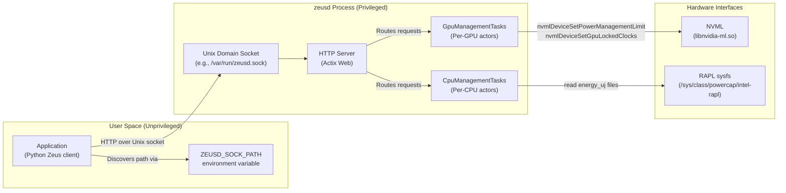
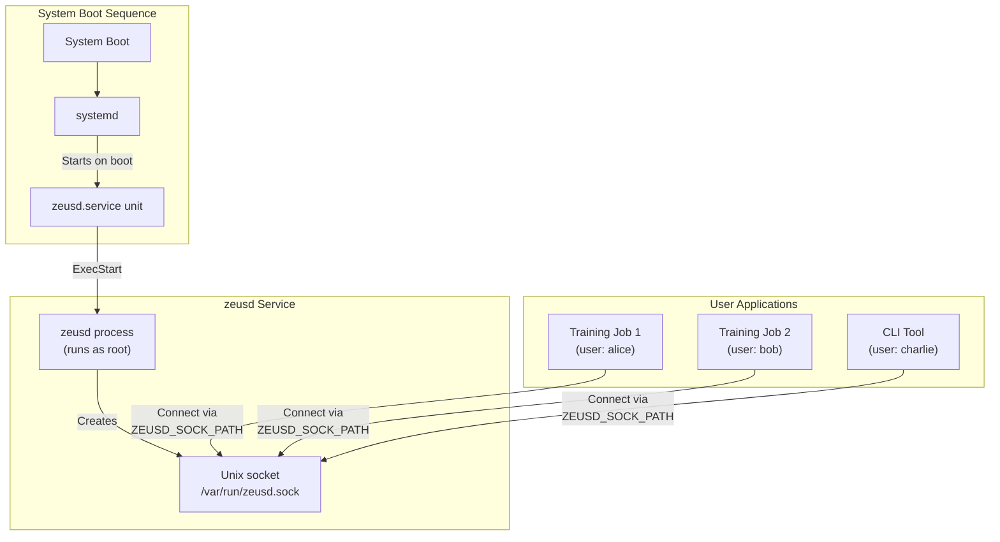
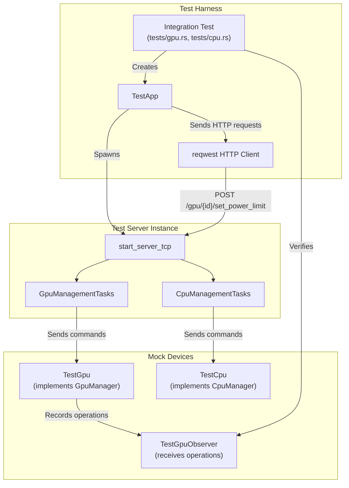

<!-- source: DeepWiki mcp.deepwiki.com · repo ml-energy/zeus · page 7.3 Installing and Running zeusd · fetched 2026-10-21 -->

# Installing and Running zeusd

<details>
<summary>Relevant source files</summary>

The following files were used as context for generating this wiki page:

- [README.md](README.md)
- [docs/getting_started/index.md](docs/getting_started/index.md)
- [docs/index.md](docs/index.md)
- [zeusd/src/devices/cpu/linux.rs](zeusd/src/devices/cpu/linux.rs)
- [zeusd/src/devices/gpu/linux.rs](zeusd/src/devices/gpu/linux.rs)
- [zeusd/src/routes/gpu.rs](zeusd/src/routes/gpu.rs)
- [zeusd/tests/cpu.rs](zeusd/tests/cpu.rs)
- [zeusd/tests/gpu.rs](zeusd/tests/gpu.rs)
- [zeusd/tests/helpers/mod.rs](zeusd/tests/helpers/mod.rs)

</details>


This page provides installation instructions and deployment guidance for the Zeus daemon (`zeusd`). The Zeus daemon is a privileged service that enables unprivileged applications to perform GPU power management and CPU/DRAM energy measurement.

For information about the daemon's internal architecture and design, see [Daemon Architecture](#7.1). For API endpoint specifications, see [HTTP API Reference](#7.2). For general deployment strategy considerations, see [Deployment Strategies](#2.3).

---

## Purpose and Scope

The Zeus daemon (`zeusd`) solves the privilege escalation problem inherent in GPU power management and CPU energy measurement:

| Operation | Required Privilege | Why `zeusd` is Needed |
|-----------|-------------------|----------------------|
| GPU power limit changes | `SYS_ADMIN` capability or `root` | NVML requires elevated privileges for `nvmlDeviceSetPowerManagementLimit` |
| GPU frequency locking | `SYS_ADMIN` capability or `root` | NVML requires elevated privileges for `nvmlDeviceSetGpuLockedClocks` |
| CPU/DRAM energy reading | `root` | RAPL sysfs interface requires root access due to [CVE-2020-8694](https://www.cve.org/CVERecord?id=CVE-2020-8694) |

By running `zeusd` as a privileged service, unprivileged user applications can request these operations via a Unix domain socket, following the [principle of least privilege](https://en.wikipedia.org/wiki/Principle_of_least_privilege).

---

## Prerequisites

Before installing `zeusd`, ensure the following are available:

- **Rust toolchain** (version 1.70 or later)
- **NVIDIA GPUs** (optional): For GPU management features
- **Intel or AMD CPUs with RAPL** (optional): For CPU/DRAM energy measurement
- **Root or sudo access**: Required to run the daemon with elevated privileges

Install Rust using [rustup](https://rustup.rs/):

```sh
curl --proto '=https' --tlsv1.2 -sSf https://sh.rustup.rs | sh
```

Sources: [docs/getting_started/index.md:149-199]()

---

## Installation Methods

### Via Cargo (Recommended)

The simplest installation method uses Cargo, Rust's package manager. The `zeusd` crate is published to [crates.io](https://crates.io/crates/zeusd):

```sh
cargo install zeusd
```

This installs the `zeusd` binary to `~/.cargo/bin/zeusd` (or `$CARGO_HOME/bin/zeusd` if `CARGO_HOME` is set).

### From Source

For development or to install unreleased versions:

```sh
# Clone the repository
git clone https://github.com/ml-energy/zeus.git
cd zeus/zeusd

# Build and install
cargo install --path .
```

To build without installing:

```sh
cargo build --release
# Binary will be at target/release/zeusd
```

Sources: [README.md:43-48](), [docs/getting_started/index.md:159-160]()

---

## Running zeusd

### Basic Execution

The daemon must run with elevated privileges to access NVML and RAPL interfaces:

```sh
sudo zeusd \
    --socket-path /var/run/zeusd.sock \
    --socket-permissions 666
```

### Command-Line Options

| Option | Type | Default | Description |
|--------|------|---------|-------------|
| `--socket-path` | String | Required | Unix domain socket path where `zeusd` listens for connections |
| `--socket-permissions` | Octal | `660` | UNIX file permissions for the socket (e.g., `666` for read/write for all users) |
| `--worker-threads` | Integer | Number of CPU cores | Number of Tokio worker threads for async runtime |

**Socket Permissions**: The permission value is interpreted as [UNIX octal notation](https://en.wikipedia.org/wiki/File-system_permissions#Numeric_notation). Common values:

- `660`: Owner and group can read/write (default, more secure)
- `666`: All users can read/write (convenient for multi-user systems)
- `600`: Only owner can read/write (most restrictive)

Applications require **write** access to the socket to send requests to `zeusd`.

Sources: [docs/getting_started/index.md:162-169](), [zeusd/tests/helpers/mod.rs:284-287]()

---

## Daemon Architecture Overview

The following diagram shows how `zeusd` fits into the system architecture:

**zeusd Communication Flow**



Sources: [zeusd/src/routes/gpu.rs:1-127](), [zeusd/src/devices/gpu/linux.rs:1-102](), [zeusd/src/devices/cpu/linux.rs:1-249]()

---

## Client Configuration

After starting `zeusd`, client applications need to know the socket path. This is configured via the `ZEUSD_SOCK_PATH` environment variable.

### Setting the Environment Variable

**For a single command:**

```sh
ZEUSD_SOCK_PATH=/var/run/zeusd.sock python -m zeus.show_env
```

**For the current shell session:**

```sh
export ZEUSD_SOCK_PATH=/var/run/zeusd.sock
```

**System-wide (in `/etc/environment`):**

```sh
echo "ZEUSD_SOCK_PATH=/var/run/zeusd.sock" | sudo tee -a /etc/environment
```

**In Python code:**

```python
import os
os.environ["ZEUSD_SOCK_PATH"] = "/var/run/zeusd.sock"
```

### Client Detection Logic

When a Zeus Python client (e.g., `ZeusMonitor`, `GlobalPowerLimitOptimizer`) initializes, it checks for privileged operations:

1. **Direct access**: Try to access NVML/RAPL directly (requires running as root)
2. **Via zeusd**: If `ZEUSD_SOCK_PATH` is set, connect to the daemon
3. **Fallback**: Disable privileged features (measurement-only mode)

Sources: [docs/getting_started/index.md:171-193]()

---

## Verification

After starting `zeusd`, verify that it is working correctly:

```console
$ ZEUSD_SOCK_PATH=/var/run/zeusd.sock python -m zeus.show_env
================================================================================

[2024-09-09 16:40:14,512] [zeus.device.gpu.nvidia](nvidia.py:46) pynvml is available and initialized.

GPU availability:
  GPU 0: NVIDIA A40

================================================================================

[2024-09-09 16:40:14,519] [zeus.device.cpu.rapl](rapl.py:136) RAPL is available.

CPU availability:
  CPU 0:
    CPU measurements available (Zeusd at /var/run/zeusd.sock)
    DRAM measurements available (Zeusd at /var/run/zeusd.sock)
  CPU 1:
    CPU measurements available (Zeusd at /var/run/zeusd.sock)
    DRAM measurements available (Zeusd at /var/run/zeusd.sock)

================================================================================
```

The key indicators are:
- CPU/DRAM measurements show **"(Zeusd at /var/run/zeusd.sock)"** instead of direct sysfs paths
- No permission errors are logged

Sources: [docs/getting_started/index.md:174-193]()

---

## Production Deployment with systemd

For production environments, running `zeusd` as a systemd service ensures automatic startup and proper lifecycle management.

**zeusd Production Deployment Architecture**



### systemd Service Unit

Create `/etc/systemd/system/zeusd.service`:

```ini
[Unit]
Description=Zeus Daemon for GPU/CPU Power Management
After=network.target

[Service]
Type=simple
ExecStart=/root/.cargo/bin/zeusd --socket-path /var/run/zeusd.sock --socket-permissions 666
Restart=on-failure
RestartSec=5s
User=root
StandardOutput=journal
StandardError=journal

[Install]
WantedBy=multi-user.target
```

### Enable and Start the Service

```sh
# Reload systemd configuration
sudo systemctl daemon-reload

# Enable zeusd to start on boot
sudo systemctl enable zeusd

# Start zeusd immediately
sudo systemctl start zeusd

# Check service status
sudo systemctl status zeusd
```

### View Logs

```sh
# View recent logs
sudo journalctl -u zeusd -n 50

# Follow logs in real-time
sudo journalctl -u zeusd -f
```

Sources: [zeusd/src/devices/gpu/linux.rs:18-29](), [zeusd/src/devices/cpu/linux.rs:18-19]()

---

## Testing the Daemon

The `zeusd` test suite validates the daemon's behavior using mock GPU and CPU devices. These tests demonstrate the expected communication patterns.

**zeusd Test Architecture**



### Running Tests

```sh
# Run all tests
cd zeusd
cargo test

# Run GPU tests only
cargo test --test gpu

# Run CPU tests only  
cargo test --test cpu

# Run with detailed logging
TEST_LOG=1 cargo test
```

### Key Test Files

| File | Purpose |
|------|---------|
| [zeusd/tests/gpu.rs:1-776]() | Tests for GPU power management endpoints |
| [zeusd/tests/cpu.rs:1-176]() | Tests for CPU/DRAM energy measurement endpoints |
| [zeusd/tests/helpers/mod.rs:1-340]() | Test utilities: `TestApp`, `TestGpu`, `TestCpu` |

Sources: [zeusd/tests/helpers/mod.rs:19-339](), [zeusd/tests/gpu.rs:1-776](), [zeusd/tests/cpu.rs:1-176]()

---

## Troubleshooting

### Common Issues

| Issue | Symptom | Solution |
|-------|---------|----------|
| **Socket permission denied** | `PermissionError: [Errno 13] Permission denied` from Python client | Verify socket permissions with `ls -l /var/run/zeusd.sock`. Set `--socket-permissions 666` when starting `zeusd` |
| **Socket not found** | `FileNotFoundError: [Errno 2] No such file or directory` | Ensure `zeusd` is running: `sudo systemctl status zeusd`. Verify `ZEUSD_SOCK_PATH` matches `--socket-path` |
| **NVML not initialized** | `Error initializing NVML` in logs | Install NVIDIA drivers. Verify with `nvidia-smi`. On some systems, use `libnvidia-ml.so.1` |
| **RAPL not accessible** | `RAPL not available` in logs | Ensure `/sys/class/powercap/intel-rapl` exists and is readable by root. May require kernel module `intel_rapl_common` |
| **Connection refused** | Client hangs or times out | Check if `zeusd` is running: `ps aux | grep zeusd`. Verify socket exists: `ls -l /var/run/zeusd.sock` |
| **Multiple GPUs not detected** | Only GPU 0 visible | Verify all GPUs are visible via `nvidia-smi`. Check `zeusd` logs for GPU initialization errors |

### Diagnostic Commands

```sh
# Check if zeusd is running
ps aux | grep zeusd

# Check socket existence and permissions
ls -l /var/run/zeusd.sock

# Test GPU access (requires NVIDIA drivers)
nvidia-smi

# Test RAPL access (requires root)
sudo cat /sys/class/powercap/intel-rapl/intel-rapl:0/energy_uj

# Check systemd service status
sudo systemctl status zeusd

# View recent logs
sudo journalctl -u zeusd -n 100

# Test connection from Python
ZEUSD_SOCK_PATH=/var/run/zeusd.sock python -m zeus.show_env
```

### Debug Logging

To enable verbose logging during development, `zeusd` uses the `RUST_LOG` environment variable:

```sh
# Run with debug-level logging
sudo RUST_LOG=debug zeusd --socket-path /tmp/zeusd.sock --socket-permissions 666

# Run with trace-level logging (very verbose)
sudo RUST_LOG=trace zeusd --socket-path /tmp/zeusd.sock --socket-permissions 666
```

Sources: [zeusd/src/devices/gpu/linux.rs:18-29](), [zeusd/src/devices/cpu/linux.rs:73-91](), [docs/getting_started/index.md:149-199]()

---

## Security Considerations

Running `zeusd` with root privileges requires careful security considerations:

### Minimizing Attack Surface

1. **Socket Permissions**: Use `--socket-permissions 660` instead of `666` when possible. Create a dedicated group for Zeus users:

```sh
sudo groupadd zeus-users
sudo usermod -a -G zeus-users alice
sudo usermod -a -G zeus-users bob

# Run zeusd with group ownership
sudo zeusd --socket-path /var/run/zeusd.sock --socket-permissions 660
sudo chown root:zeus-users /var/run/zeusd.sock
```

2. **Network Isolation**: The daemon only listens on a Unix domain socket (local IPC), not on network interfaces. This prevents remote attacks.

3. **Limited API Surface**: The daemon exposes only a minimal set of operations (see [HTTP API Reference](#7.2) for the complete list):
   - GPU power limit changes
   - GPU frequency locking
   - CPU/DRAM energy reading

4. **Input Validation**: All API requests are validated at the route handler level before being forwarded to hardware interfaces.

### Audit Logging

All operations are logged via the `tracing` crate. Enable structured logging for audit trails:

```sh
sudo RUST_LOG=info zeusd --socket-path /var/run/zeusd.sock
```

Log entries include:
- Timestamp
- GPU/CPU index
- Operation type (e.g., `set_power_limit`, `set_gpu_locked_clocks`)
- Operation parameters
- Success/failure status

Sources: [zeusd/src/routes/gpu.rs:48-77](), [zeusd/tests/helpers/mod.rs:23-29]()

---

## Performance Considerations

### Worker Threads

By default, `zeusd` uses a Tokio async runtime with worker threads equal to the number of CPU cores. For high-throughput scenarios with many concurrent requests, consider tuning this:

```sh
# Use 8 worker threads
sudo zeusd --socket-path /var/run/zeusd.sock --worker-threads 8
```

### Request Modes

The daemon supports two request modes (see [HTTP API Reference](#7.2) for details):

| Mode | Behavior | Use Case |
|------|----------|----------|
| **Blocking** (`block: true`) | Wait for operation to complete before returning HTTP 200 | Critical settings that must complete before training continues |
| **Non-blocking** (`block: false`) | Return HTTP 200 immediately, operation queued | Bulk operations, non-critical settings |

Non-blocking mode provides higher throughput but operations may execute out-of-order.

### Socket Buffer Sizes

For systems with many concurrent clients, tune the Unix socket buffer sizes:

```sh
# Increase socket buffer sizes (Linux)
sudo sysctl -w net.core.wmem_max=8388608
sudo sysctl -w net.core.rmem_max=8388608
```

Sources: [zeusd/tests/helpers/mod.rs:284-287](), [zeusd/src/routes/gpu.rs:63-77]()

---

## Next Steps

After successfully installing and running `zeusd`:

- Review the [Daemon Architecture](#7.1) to understand the internal design
- Explore the [HTTP API Reference](#7.2) for available endpoints
- See [GPU Support](#6.1) and [CPU Support](#6.2) for hardware abstraction details
- Learn about [Power Limit Optimizer](#5.1) and [Pipeline Frequency Optimizer](#5.2), which rely on `zeusd`

---

