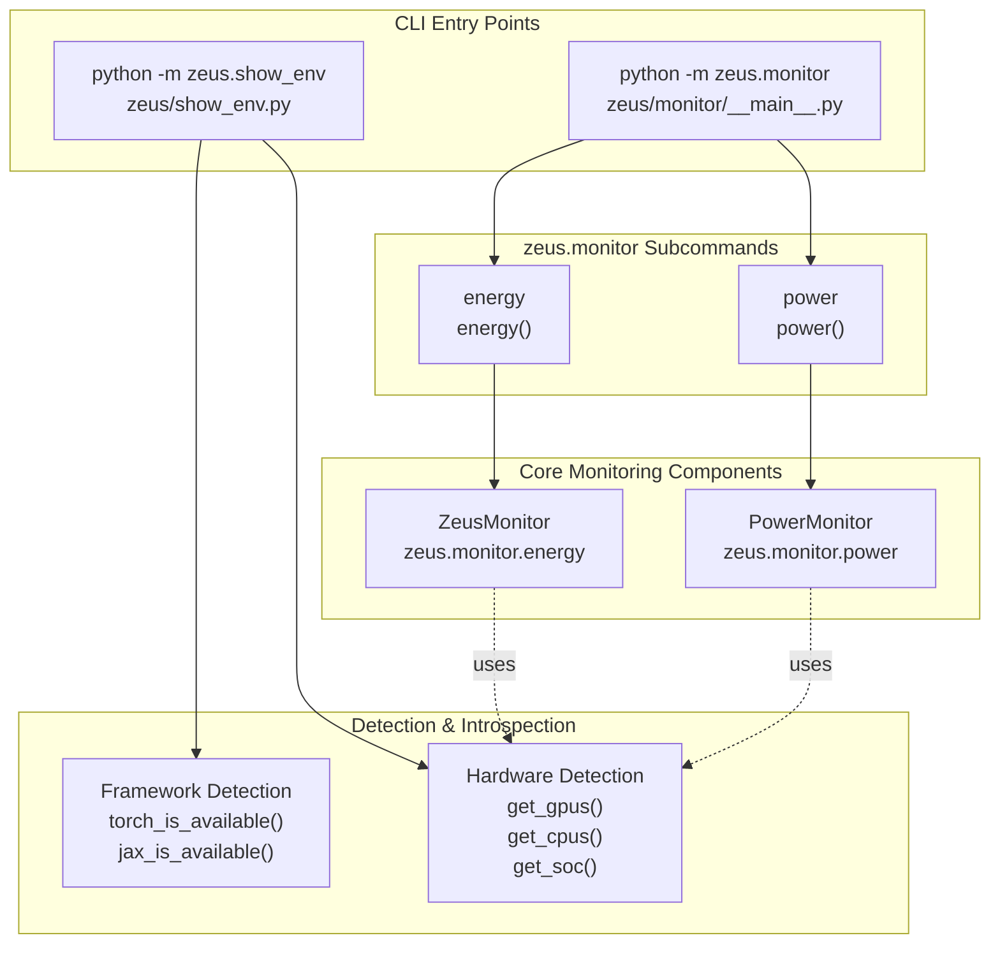
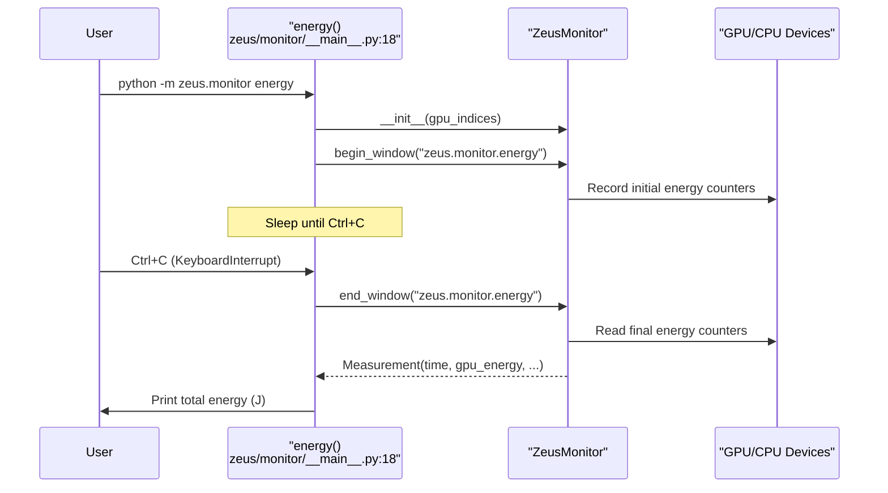
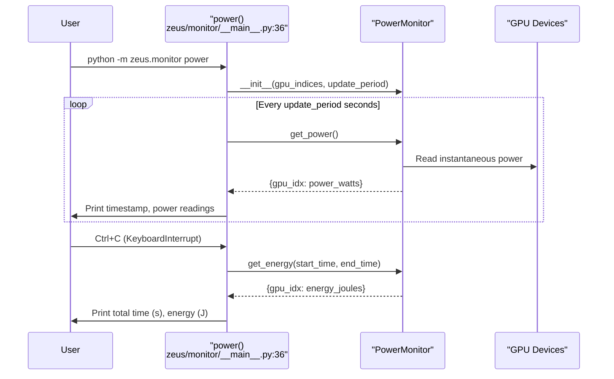
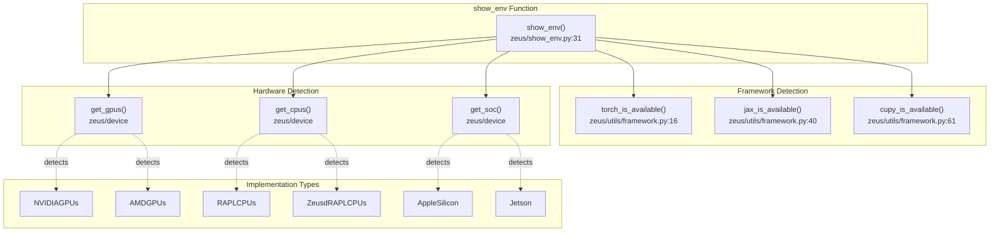
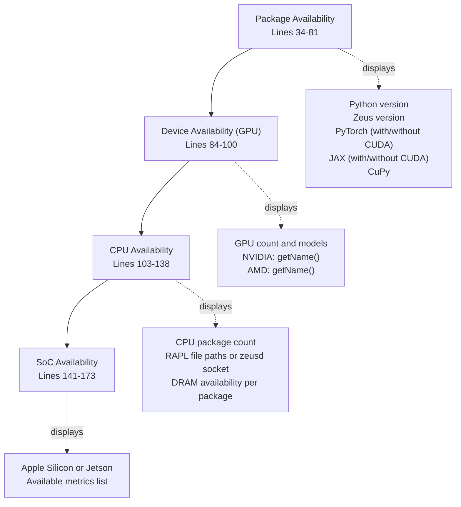

<!-- source: DeepWiki mcp.deepwiki.com · repo ml-energy/zeus · page 8 CLI Tools · fetched 2026-10-21 -->

# CLI Tools

<details>
<summary>Relevant source files</summary>

The following files were used as context for generating this wiki page:

- [.github/workflows/publish_pypi.yaml](.github/workflows/publish_pypi.yaml)
- [zeus/monitor/__main__.py](zeus/monitor/__main__.py)
- [zeus/monitor/carbon.py](zeus/monitor/carbon.py)
- [zeus/monitor/price.py](zeus/monitor/price.py)
- [zeus/show_env.py](zeus/show_env.py)
- [zeus/utils/framework.py](zeus/utils/framework.py)

</details>


Zeus provides command-line utilities for energy monitoring, power measurement, and environment diagnostics. These tools enable standalone usage of Zeus's measurement capabilities without writing Python code, making them useful for quick measurements, system verification, and integration into shell scripts or CI/CD pipelines.

This page provides an overview of Zeus's CLI tools. For detailed documentation on specific commands, see:
- [zeus.monitor Command](#8.1) - Energy and power measurement utilities
- [zeus.show_env Command](#8.2) - Environment and hardware detection

## Available Commands

Zeus includes two main CLI tools accessible through Python's module execution syntax:

| Command | Purpose | Entry Point |
|---------|---------|-------------|
| `python -m zeus.monitor` | Measure GPU energy consumption and power draw | [zeus/monitor/\_\_main\_\_.py:68-119]() |
| `python -m zeus.show_env` | Display environment information and detected hardware | [zeus/show_env.py:177-178]() |

Both commands integrate directly with Zeus's core monitoring infrastructure and require no additional configuration beyond Zeus installation and hardware availability.

## Command Architecture Overview



**Sources:** [zeus/monitor/\_\_main\_\_.py:1-120](), [zeus/show_env.py:1-179]()

The CLI tools operate as thin wrappers around Zeus's core Python APIs, providing argument parsing and formatted output for command-line usage.

## zeus.monitor: Energy and Power Measurement

The `zeus.monitor` command provides two operational modes for GPU measurement:

**Energy Mode (`energy` subcommand):**
- Starts a measurement window using `ZeusMonitor`
- Runs until interrupted with Ctrl+C
- Reports total energy consumed in Joules

**Power Mode (`power` subcommand):**
- Continuously polls GPU power draw using `PowerMonitor`
- Displays timestamped power readings at specified intervals
- Reports total energy on exit

### Energy Measurement Flow



**Sources:** [zeus/monitor/\_\_main\_\_.py:18-34]()

### Power Monitoring Flow



**Sources:** [zeus/monitor/\_\_main\_\_.py:36-66]()

The `power` subcommand integrates power samples over time to compute total energy, making it suitable for monitoring workloads with varying power consumption patterns.

## zeus.show_env: Environment Diagnostics

The `zeus.show_env` command performs comprehensive environment introspection and hardware detection, displaying:

1. **Package Availability**: Python version, Zeus version, ML framework versions (PyTorch, JAX, CuPy) with CUDA support detection
2. **GPU Availability**: Number of GPUs and model names for NVIDIA and AMD devices
3. **CPU Availability**: RAPL CPU packages with DRAM measurement support indicators
4. **SoC Availability**: Apple Silicon and NVIDIA Jetson detection with available metrics

### Detection Architecture



**Sources:** [zeus/show_env.py:31-175](), [zeus/utils/framework.py:15-74]()

### Output Format

The command produces four main sections separated by horizontal dividers:



**Sources:** [zeus/show_env.py:31-175]()

Each section includes "Logging output:" followed by "Detected:" with structured results. The tool handles exceptions gracefully, displaying error messages for initialization failures while continuing to probe other components.

### CPU Detection Details

CPU detection distinguishes between direct RAPL access and daemon-mediated access:

| CPU Type | Detection | Output |
|----------|-----------|--------|
| `RAPLCPU` | Direct sysfs access | Shows RAPL file path: [zeus/show_env.py:125]() |
| `ZeusdRAPLCPU` | Via zeusd daemon | Shows socket path: [zeus/show_env.py:119]() |
| DRAM support | `supportsGetDramEnergyConsumption()` | Indicates per-package availability: [zeus/show_env.py:120-133]() |

**Sources:** [zeus/show_env.py:106-138]()

### SoC Detection with Platform Warnings

For SoC devices, the tool provides platform-specific guidance. On Apple Silicon systems where the `AppleSilicon` class was not instantiated (typically due to missing dependencies), it displays an installation hint:

```
This appears to be an Apple Silicon device, but it wasn't picked up by Zeus.
Have you installed Zeus with the `apple` extra?

    pip install 'zeus[apple]'
```

**Sources:** [zeus/show_env.py:164-171]()

This detection uses `platform.system() == "Darwin"` and `platform.machine() in ["arm64", "aarch64"]` to identify Apple Silicon hardware even when the IOKit bindings are unavailable.

## Integration with Core APIs

Both CLI tools directly instantiate core Zeus classes without intermediate layers:

| CLI Tool | Core API | Configuration |
|----------|----------|---------------|
| `zeus.monitor energy` | `ZeusMonitor(gpu_indices)` | Single window named "zeus.monitor.energy" |
| `zeus.monitor power` | `PowerMonitor(gpu_indices, update_period)` | Continuous polling with configurable interval |
| `zeus.show_env` | `get_gpus()`, `get_cpus()`, `get_soc()` | Automatic detection with Empty* fallbacks |

The CLI layer handles:
- Argument parsing via `argparse`: [zeus/monitor/\_\_main\_\_.py:69-111]()
- Output formatting via `rich.print()`: [zeus/monitor/\_\_main\_\_.py:33, 59-65]()
- Signal handling for Ctrl+C interrupts: [zeus/monitor/\_\_main\_\_.py:30-33, 60-65]()
- Terminal width detection for separators: [zeus/show_env.py:28]()

**Sources:** [zeus/monitor/\_\_main\_\_.py:18-66](), [zeus/show_env.py:31-175]()

## Usage Patterns

### Standalone Measurement

The CLI tools can be used without any Python code:

```bash
# Measure energy of a GPU workload
python -m zeus.monitor energy --gpu-indices 0 1 &
MONITOR_PID=$!
./run_training.sh
kill -INT $MONITOR_PID

# Monitor power draw in real-time
python -m zeus.monitor power --gpu-indices 0 --update-period 0.5

# Verify Zeus installation and hardware
python -m zeus.show_env
```

### Shell Script Integration

The structured output enables parsing in shell scripts:

```bash
# Check if GPUs are available before running workload
if python -m zeus.show_env | grep -q "No GPUs available"; then
    echo "No GPUs detected"
    exit 1
fi
```

### CI/CD Health Checks

The `zeus.show_env` command serves as a health check in automated environments, verifying that Zeus can detect the expected hardware before running experiments.

**Sources:** [zeus/monitor/\_\_main\_\_.py:68-119](), [zeus/show_env.py:177-178]()

---

