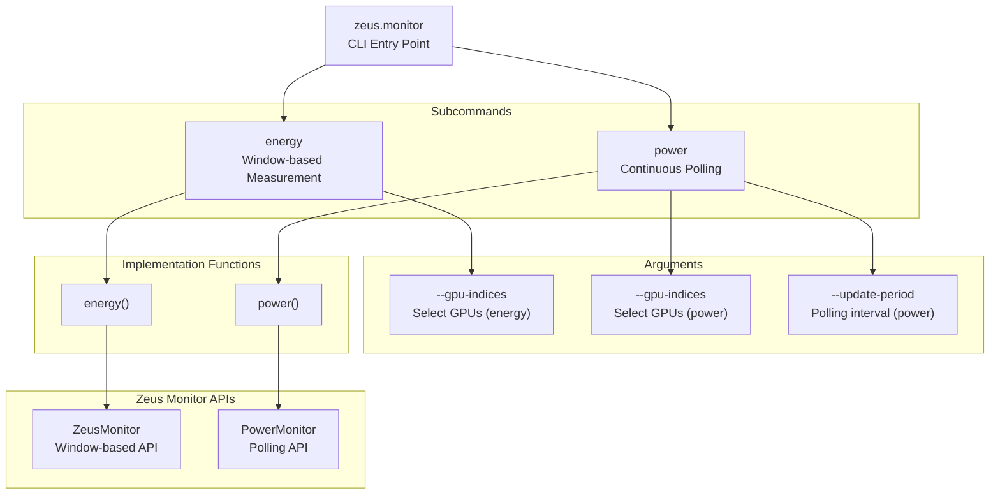
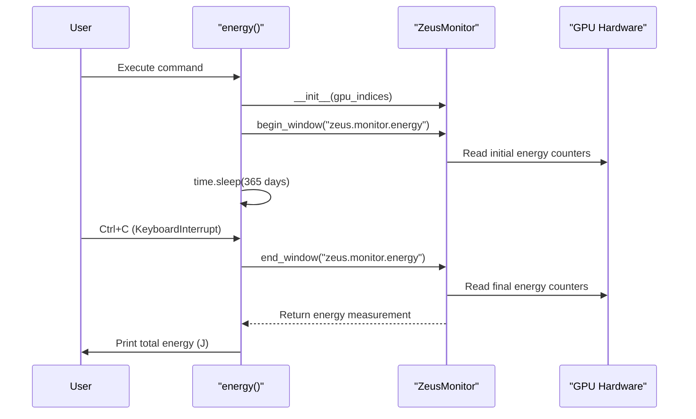
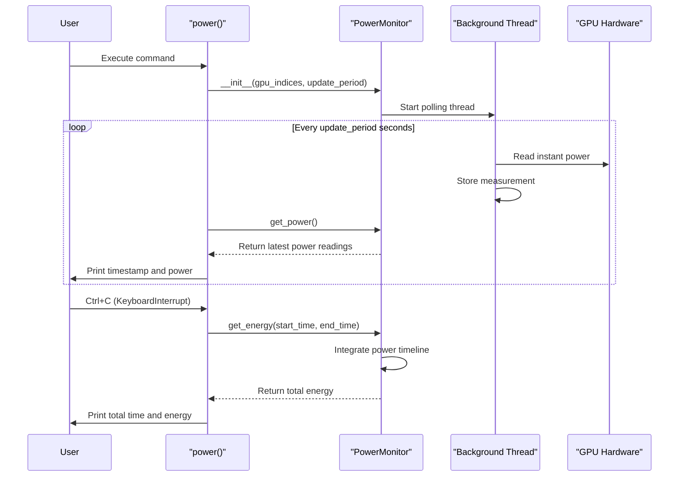
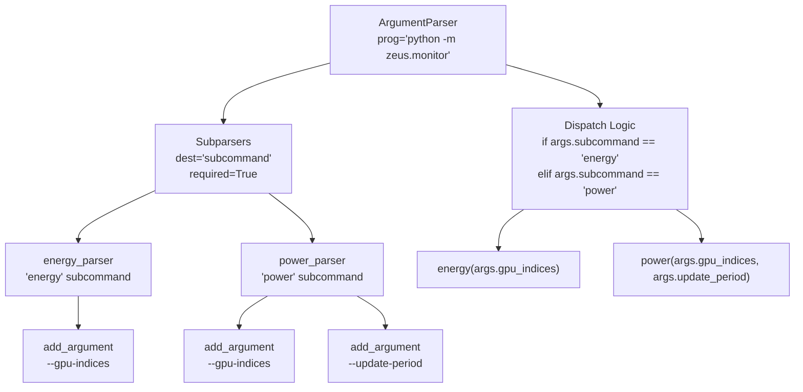

<!-- source: DeepWiki mcp.deepwiki.com · repo ml-energy/zeus · page 8.1 zeus.monitor Command · fetched 2026-10-21 -->

# zeus.monitor Command

<details>
<summary>Relevant source files</summary>

The following files were used as context for generating this wiki page:

- [.github/workflows/publish_pypi.yaml](.github/workflows/publish_pypi.yaml)
- [zeus/monitor/__main__.py](zeus/monitor/__main__.py)

</details>


## Purpose and Scope

The `zeus.monitor` command is a command-line interface (CLI) tool for measuring GPU energy consumption and monitoring real-time power draw. This page documents the CLI tool's usage, command-line arguments, and implementation details.

For programmatic energy measurement APIs, see [ZeusMonitor](#4.1) and [PowerMonitor](#4.2). For environment detection and hardware verification, see [zeus.show_env Command](#8.2).

## Overview

The `zeus.monitor` CLI provides two distinct monitoring modes through subcommands:

1. **`energy`** - Window-based energy measurement that runs until interrupted, reporting total energy consumption
2. **`power`** - Continuous power polling with timestamped readings and integrated energy calculation on exit

The CLI is implemented as a Python module that can be invoked with `python -m zeus.monitor` and serves as a convenient wrapper around Zeus's programmatic monitoring APIs.

**Sources:** [zeus/monitor/__main__.py:1-10]()

## Command Structure

The following diagram illustrates the CLI's command structure and component dependencies:



**Sources:** [zeus/monitor/__main__.py:68-119]()

## Installation and Usage

The CLI is available immediately after installing Zeus:

```bash
# Via pip
pip install zeus-ml

# Run the CLI
python -m zeus.monitor <subcommand> [options]
```

Both subcommands accept Ctrl+C (KeyboardInterrupt) to gracefully terminate monitoring and display results.

**Sources:** [zeus/monitor/__main__.py:1-4]()

## Subcommands

### Energy Subcommand

The `energy` subcommand performs window-based energy measurement using [ZeusMonitor](#4.1). It begins a measurement window and runs indefinitely until interrupted, then reports total energy consumption.

#### Usage

```bash
python -m zeus.monitor energy [--gpu-indices GPU_INDICES ...]
```

#### Arguments

| Argument | Type | Required | Default | Description |
|----------|------|----------|---------|-------------|
| `--gpu-indices` | int (list) | No | All GPUs | Indices of GPUs to monitor |

#### Example Output

```
Total energy (J): Measurement(time=120.5, gpu={"GPU0": 12500.3, "GPU1": 12480.1})
```

#### Implementation Flow



The implementation creates a measurement window that persists until user interruption. The large sleep duration (365 days) effectively makes it run indefinitely until Ctrl+C.

**Sources:** [zeus/monitor/__main__.py:18-34]()

### Power Subcommand

The `power` subcommand performs continuous power polling using [PowerMonitor](#4.2). It displays timestamped power readings at regular intervals and calculates integrated energy consumption on exit.

#### Usage

```bash
python -m zeus.monitor power [--gpu-indices GPU_INDICES ...] [--update-period SECONDS]
```

#### Arguments

| Argument | Type | Required | Default | Description |
|----------|------|----------|---------|-------------|
| `--gpu-indices` | int (list) | No | All GPUs | Indices of GPUs to monitor |
| `--update-period` | float | No | 1.0 | Time between power measurements in seconds |

#### Example Output

```
2024-01-15 10:30:00 {'GPU0': 250.5, 'GPU1': 248.3}
2024-01-15 10:30:01 {'GPU0': 252.1, 'GPU1': 249.7}
...
Total time (s): 120.5
Total energy (J): {'GPU0': 30060.5, 'GPU1': 29964.1}
```

#### Implementation Flow



The `power` subcommand runs an infinite loop that sleeps for `update_period` seconds between power readings. PowerMonitor maintains a background thread that continuously polls GPU power, allowing the CLI to retrieve and display the latest measurements.

**Sources:** [zeus/monitor/__main__.py:36-66]()

## Command-Line Argument Parsing

The CLI uses Python's `argparse` module with subparsers to handle the two distinct monitoring modes:



### Argument Details

Both subcommands share the `--gpu-indices` argument:
- Accepts multiple space-separated integers
- Optional (defaults to monitoring all available GPUs)
- Example: `--gpu-indices 0 2 4` monitors GPUs 0, 2, and 4

The `power` subcommand additionally accepts `--update-period`:
- Float value in seconds
- Controls the sleep duration between power readings
- Default: 1.0 second
- Note: Actual measurement frequency is determined by PowerMonitor's internal polling

**Sources:** [zeus/monitor/__main__.py:68-119]()

## Implementation Details

### Module Entry Point

The CLI is implemented as a Python module with `__name__ == "__main__"` guard, allowing invocation via `python -m zeus.monitor`:

[zeus/monitor/__main__.py:68]()

### Helper Functions

#### `map_gpu_index_to_name()`

A local helper function in the `power()` implementation that transforms GPU indices to human-readable names:

```python
def map_gpu_index_to_name(measurements: dict[int, float]) -> dict[str, float]:
    return {f"GPU{k}": v for k, v in measurements.items()}
```

This function converts `{0: 250.5, 1: 248.3}` to `{'GPU0': 250.5, 'GPU1': 248.3}` for display purposes.

**Sources:** [zeus/monitor/__main__.py:50-51]()

### Signal Handling

Both subcommands use try-except blocks to catch `KeyboardInterrupt` (Ctrl+C):

- **Energy mode**: Ends the measurement window and prints final energy
- **Power mode**: Stops polling, computes integrated energy, and prints summary

This allows users to gracefully terminate monitoring at any time and still receive measurement results.

**Sources:** [zeus/monitor/__main__.py:27-34](), [zeus/monitor/__main__.py:53-65]()

### Relationship to Monitor APIs

The CLI serves as a thin wrapper around Zeus's programmatic monitoring APIs:

| CLI Subcommand | API Class | Monitoring Mode | Use Case |
|----------------|-----------|-----------------|----------|
| `energy` | `ZeusMonitor` | Window-based | One-time measurement of a discrete workload |
| `power` | `PowerMonitor` | Continuous polling | Timeline-based monitoring with multiple readings |

Both APIs are documented in detail in their respective pages: [ZeusMonitor](#4.1) and [PowerMonitor](#4.2).

**Sources:** [zeus/monitor/__main__.py:14-15]()

## Use Cases

### Energy Measurement

The `energy` subcommand is suitable for:

- Measuring total energy consumption of a long-running process
- Benchmarking energy usage of specific workloads
- Recording overnight training runs
- Collecting data for power profiling

Example workflow:
```bash
# Start monitoring before launching training
python -m zeus.monitor energy --gpu-indices 0 1 &
MONITOR_PID=$!

# Run your workload
python train.py

# Stop monitoring
kill -INT $MONITOR_PID
```

### Power Monitoring

The `power` subcommand is suitable for:

- Observing real-time power consumption patterns
- Debugging power spikes or anomalies
- Validating power limit configurations
- Creating power consumption timelines

Example workflow:
```bash
# Monitor with 0.5 second updates
python -m zeus.monitor power --gpu-indices 0 --update-period 0.5

# Run until desired duration, then Ctrl+C
```

**Sources:** [zeus/monitor/__main__.py:1-4]()

## Comparison with Other Tools

| Feature | zeus.monitor energy | zeus.monitor power | nvidia-smi dmon | nvidia-smi pmon |
|---------|---------------------|--------------------|--------------------|-----------------|
| Energy measurement | ✓ (total) | ✓ (integrated) | ✗ | ✗ |
| Power monitoring | ✗ | ✓ (timestamped) | ✓ | ✗ |
| Multi-GPU | ✓ | ✓ | ✓ | ✓ |
| CPU support | ✓ (via ZeusMonitor) | ✗ | ✗ | ✗ |
| Programmatic API | ✓ (via Zeus) | ✓ (via Zeus) | ✗ | ✗ |

**Sources:** [zeus/monitor/__main__.py:1-4]()

---

