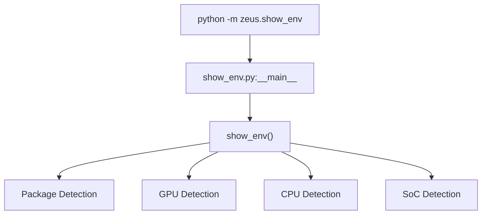
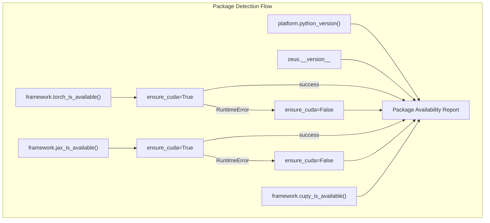
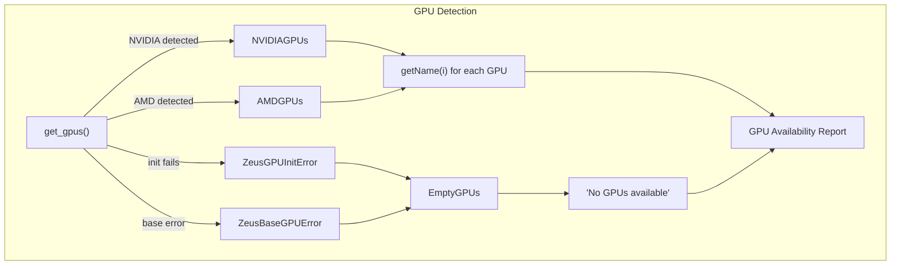
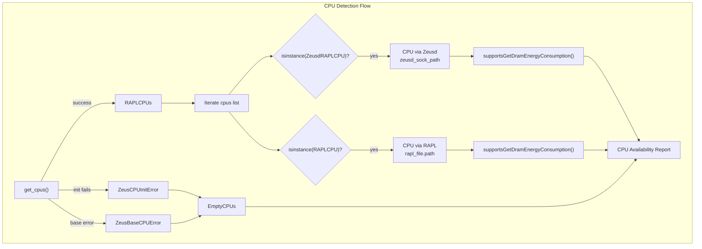
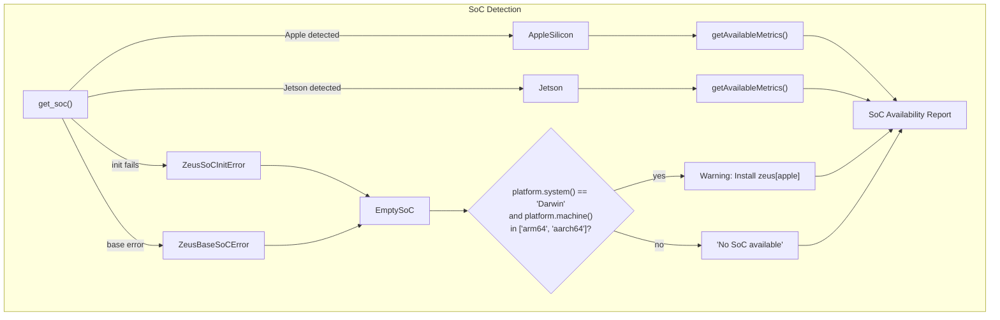
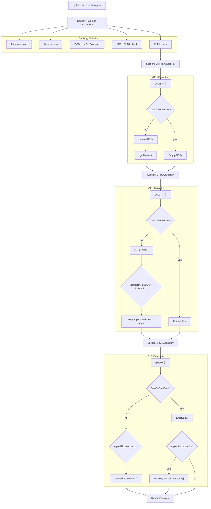

<!-- source: DeepWiki mcp.deepwiki.com · repo ml-energy/zeus · page 8.2 zeus.show_env Command · fetched 2026-10-21 -->

# zeus.show_env Command

<details>
<summary>Relevant source files</summary>

The following files were used as context for generating this wiki page:

- [zeus/monitor/carbon.py](zeus/monitor/carbon.py)
- [zeus/monitor/price.py](zeus/monitor/price.py)
- [zeus/show_env.py](zeus/show_env.py)
- [zeus/utils/framework.py](zeus/utils/framework.py)

</details>


## Purpose and Scope

The `zeus.show_env` command is a diagnostic CLI tool that performs comprehensive environment introspection to verify Zeus installation and detect available hardware. It reports Python version, ML framework availability, and hardware device detection (GPUs, CPUs, SoCs). For guidance on using this command during initial setup, see [Environment Verification](#2.2). For detailed information about hardware support, see [GPU Support](#6.1), [CPU Support](#6.2), and [SoC Support](#6.3).

## Overview

The `show_env()` function in [zeus/show_env.py:31-175]() provides a comprehensive environment report by:

1. Detecting Python version and ML framework availability (PyTorch, JAX, CuPy) with CUDA support status
2. Identifying available GPUs through the unified device abstraction layer
3. Detecting CPU power measurement capabilities via RAPL
4. Identifying SoC platforms (Apple Silicon, NVIDIA Jetson)

The command is executed via:
```bash
python -m zeus.show_env
```

## Command Entry Point



**Sources:** [zeus/show_env.py:177-178]()

## Detection Components

### Python and Package Detection

The command begins by detecting the Python runtime version and ML framework availability. Framework detection uses the `zeus.utils.framework` module which caches imports and checks for CUDA support.



**Detection Logic:**

| Framework | Detection Method | CUDA Check | Cache Location |
|-----------|-----------------|------------|----------------|
| PyTorch | `torch_is_available()` | `torch.cuda.is_available()` | `MODULE_CACHE["torch"]` |
| JAX | `jax_is_available()` | `jax.devices("gpu")` | `MODULE_CACHE["jax"]` |
| CuPy | `cupy_is_available()` | N/A | `MODULE_CACHE["cupy"]` |

The framework detection attempts CUDA support first, then falls back to non-CUDA detection if a `RuntimeError` is raised [zeus/show_env.py:40-79]().

**Sources:** [zeus/show_env.py:34-81](), [zeus/utils/framework.py:15-73]()

### GPU Detection

GPU detection uses the unified device abstraction layer through `get_gpus()`, which automatically selects the appropriate GPU backend (NVIDIA or AMD) and handles initialization errors gracefully.



The detection handles three error scenarios [zeus/show_env.py:88-100]():

1. **`ZeusGPUInitError`**: Expected when no GPUs are present or drivers unavailable
2. **`ZeusBaseGPUError`**: Unexpected errors during GPU initialization
3. **Success**: GPU objects returned with accessible `getName()` method

**Sources:** [zeus/show_env.py:83-100](), [zeus/device/gpu/common.py]()

### CPU Detection

CPU detection focuses on Intel RAPL power measurement capabilities. The system supports both direct RAPL access and daemon-mediated access through `zeusd`.



**CPU Implementation Types:**

| Type | Access Method | Energy Source | DRAM Source |
|------|--------------|---------------|-------------|
| `ZeusdRAPLCPU` | HTTP via Unix socket | zeusd daemon | zeusd daemon |
| `RAPLCPU` | Direct sysfs | `rapl_file.path` | `dram.path` |

For each detected CPU, the report includes [zeus/show_env.py:118-133]():
- CPU index
- Access method (direct RAPL or via zeusd)
- File path or socket path
- DRAM measurement availability

**Sources:** [zeus/show_env.py:102-138](), [zeus/device/cpu/rapl.py]()

### SoC Detection

SoC detection identifies Apple Silicon and NVIDIA Jetson platforms, reporting available energy metrics for each.



**Apple Silicon Detection:**

If no SoC is detected but the platform appears to be Apple Silicon (Darwin OS with arm64/aarch64 architecture), a special warning is displayed suggesting installation of the `apple` extra [zeus/show_env.py:166-171]():

```
This appears to be an Apple Silicon device, but it wasn't picked up by Zeus.
Have you installed Zeus with the `apple` extra?

    pip install 'zeus[apple]'
```

**Sources:** [zeus/show_env.py:140-172](), [zeus/device/soc/apple.py](), [zeus/device/soc/jetson.py]()

## Output Format

The command outputs a structured report divided by section separators (full terminal width). Each section follows this pattern:

```
----------------------------------------------------------------
## Section Title

Logging output:
[Framework detection logs appear here]

Detected:
  [Formatted detection results]
```

**Section Structure:**

| Section | Information Displayed |
|---------|---------------------|
| Package availability and versions | Python version, Zeus version, PyTorch/JAX/CuPy availability with CUDA support status |
| Device availability | GPU count and model names for each detected GPU |
| CPU availability | CPU count, measurement method (RAPL/zeusd), file paths, DRAM support |
| SoC availability | SoC platform type and available metrics |

The section separator is generated dynamically based on terminal width [zeus/show_env.py:28]():
```python
SECTION_SEPARATOR = "-" * shutil.get_terminal_size().columns
```

**Sources:** [zeus/show_env.py:28-174]()

## Complete Detection Flowchart



**Sources:** [zeus/show_env.py:31-175]()

## Code Entity Mapping

The following table maps high-level concepts to concrete code entities used in `show_env.py`:

| Concept | Code Entity | Location |
|---------|-------------|----------|
| Framework detection | `framework.torch_is_available()` | [zeus/utils/framework.py:16-36]() |
| Framework detection | `framework.jax_is_available()` | [zeus/utils/framework.py:40-57]() |
| Framework detection | `framework.cupy_is_available()` | [zeus/utils/framework.py:61-73]() |
| GPU detection | `get_gpus()` | [zeus/device/__init__.py]() |
| GPU abstraction | `EmptyGPUs` | [zeus/device/gpu/common.py]() |
| GPU method | `getName(index)` | GPU interface |
| CPU detection | `get_cpus()` | [zeus/device/__init__.py]() |
| CPU abstraction | `RAPLCPUs` | [zeus/device/cpu/__init__.py]() |
| CPU abstraction | `EmptyCPUs` | [zeus/device/cpu/common.py]() |
| Direct RAPL | `RAPLCPU` | [zeus/device/cpu/rapl.py]() |
| Daemon RAPL | `ZeusdRAPLCPU` | [zeus/device/cpu/rapl.py]() |
| RAPL file path | `rapl_file.path` | [zeus/device/cpu/rapl.py]() |
| DRAM support | `supportsGetDramEnergyConsumption()` | CPU interface |
| SoC detection | `get_soc()` | [zeus/device/__init__.py]() |
| Apple SoC | `AppleSilicon` | [zeus/device/soc/apple.py]() |
| Jetson SoC | `Jetson` | [zeus/device/soc/jetson.py]() |
| SoC abstraction | `EmptySoC` | [zeus/device/soc/common.py]() |
| SoC metrics | `getAvailableMetrics()` | SoC interface |
| Error handling | `ZeusGPUInitError` | [zeus/device/gpu/common.py]() |
| Error handling | `ZeusCPUInitError` | [zeus/device/cpu/common.py]() |
| Error handling | `ZeusSoCInitError` | [zeus/device/soc/common.py]() |
| Error handling | `ZeusBaseGPUError` | [zeus/device/exception.py]() |
| Error handling | `ZeusBaseCPUError` | [zeus/device/exception.py]() |
| Error handling | `ZeusBaseSoCError` | [zeus/device/exception.py]() |

**Sources:** [zeus/show_env.py:15-25]()

## Example Output

A typical successful detection on a system with NVIDIA GPUs and RAPL CPUs:

```
----------------------------------------------------------------
## Package availability and versions

Logging output:
[INFO] PyTorch with CUDA support is available.
[INFO] JAX with CUDA support is available.
[INFO] CuPy is available.

Detected:
  Python version: 3.10.12
  Zeus: 0.10.0
  PyTorch: 2.1.0+cu121 (with CUDA support)
  JAX: 0.4.20 (with CUDA support)
  CuPy: 12.3.0

----------------------------------------------------------------
## Device availability

Logging output:
[INFO] NVIDIA GPUs detected.

Detected:
  GPU 0: NVIDIA A100-SXM4-40GB
  GPU 1: NVIDIA A100-SXM4-40GB

----------------------------------------------------------------
## CPU availability

Logging output:
[INFO] RAPL CPU power measurement available.

Detected:
  CPU 0:
    CPU measurements available (/sys/class/powercap/intel-rapl:0/energy_uj)
    DRAM measurements available (/sys/class/powercap/intel-rapl:0:2/energy_uj)

----------------------------------------------------------------
## SoC availability

Logging output:

Detected:
  No SoC available.

----------------------------------------------------------------
```

**Sources:** [zeus/show_env.py:31-174]()

---

