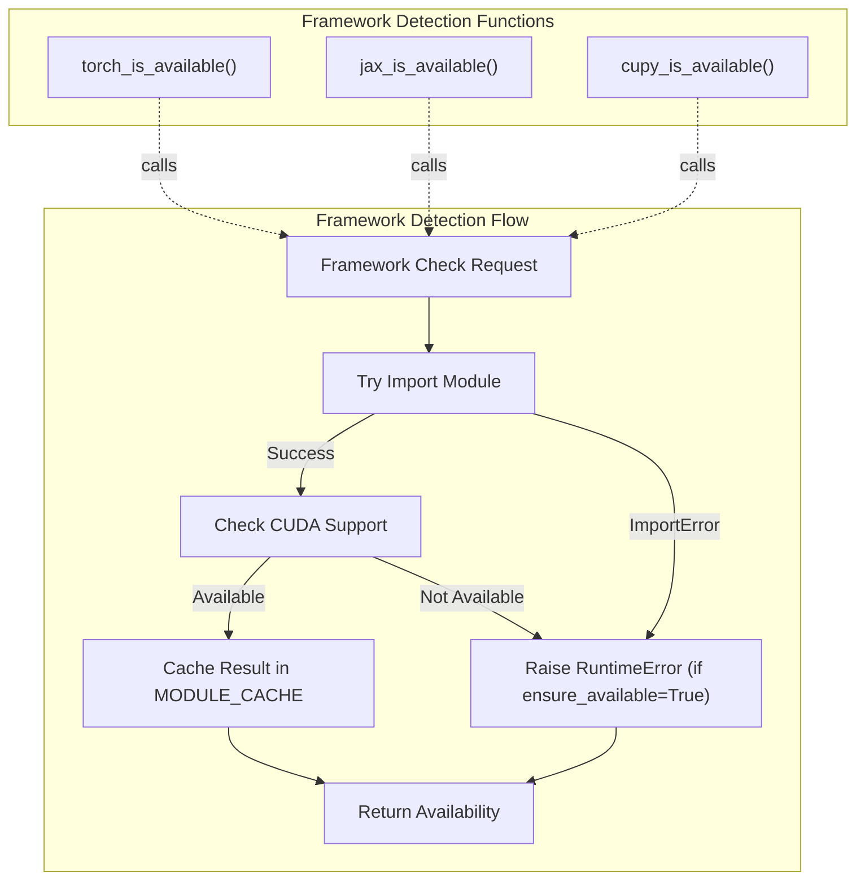
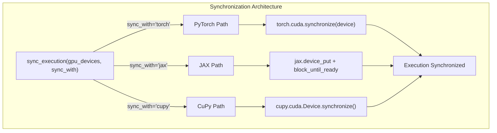
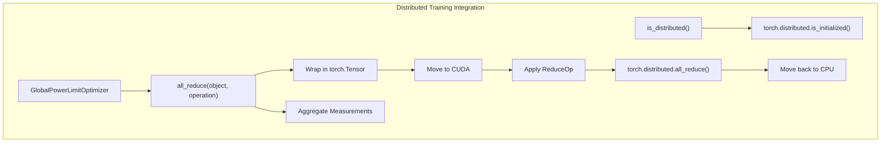
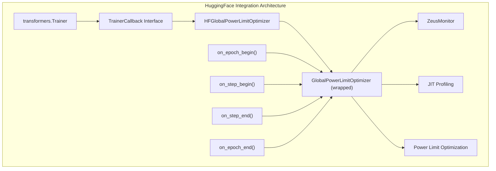
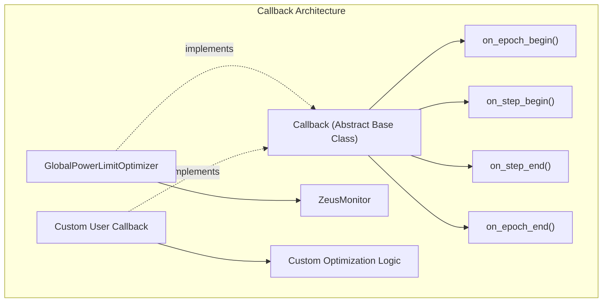

<!-- source: DeepWiki mcp.deepwiki.com · repo ml-energy/zeus · page 9 Framework Integration · fetched 2026-10-21 -->

# Framework Integration

<details>
<summary>Relevant source files</summary>

The following files were used as context for generating this wiki page:

- [pyproject.toml](pyproject.toml)
- [tests/optimizer/test_power_limit_optimizer.py](tests/optimizer/test_power_limit_optimizer.py)
- [tests/test_monitor.py](tests/test_monitor.py)
- [zeus/monitor/carbon.py](zeus/monitor/carbon.py)
- [zeus/monitor/price.py](zeus/monitor/price.py)
- [zeus/optimizer/power_limit.py](zeus/optimizer/power_limit.py)
- [zeus/show_env.py](zeus/show_env.py)
- [zeus/utils/framework.py](zeus/utils/framework.py)

</details>


This document explains how Zeus integrates with popular ML frameworks to enable energy measurement and optimization during training. Zeus provides framework-agnostic APIs that automatically detect and synchronize with PyTorch, JAX, or CuPy when available.

For information about the underlying energy measurement APIs, see [Energy Measurement](#4). For details on energy optimization strategies, see [Energy Optimization](#5).

## Overview

Zeus supports integration with three primary frameworks:

| Framework | Capability | Key Components |
|-----------|-----------|----------------|
| **PyTorch** | Full support with distributed training | `sync_execution`, `all_reduce`, `is_distributed` |
| **JAX** | GPU synchronization support | `sync_execution` with JAX devices |
| **CuPy** | Direct CUDA API access | `sync_execution` with CuPy streams |
| **HuggingFace** | Native Trainer callback | `HFGlobalPowerLimitOptimizer` |

All framework integrations are optional and detected at runtime. Zeus will function with whatever frameworks are available in the environment.

Sources: [pyproject.toml:23-34](), [zeus/utils/framework.py:1-188]()

## Framework Detection

Zeus detects available frameworks at runtime using cached availability checks. The detection logic ensures that both the framework and its CUDA support are properly configured.



**Framework Detection Functions**

The framework detection functions are located in [zeus/utils/framework.py:15-73]():

- **`torch_is_available(ensure_available, ensure_cuda)`**: Checks PyTorch availability and optionally verifies CUDA support. Uses `@lru_cache` for efficient repeated calls.
- **`jax_is_available(ensure_available, ensure_cuda)`**: Checks JAX availability by attempting to access GPU devices with `jax.devices("gpu")`.
- **`cupy_is_available(ensure_available)`**: Checks CuPy availability for direct CUDA API access.

All detected modules are cached in `MODULE_CACHE` dictionary for reuse throughout Zeus components.

Sources: [zeus/utils/framework.py:15-73](), [zeus/show_env.py:40-79]()

## Execution Synchronization

Zeus provides `sync_execution()` to ensure accurate energy measurements by blocking until all asynchronous GPU computations complete. This is critical because modern ML frameworks dispatch GPU operations asynchronously.



**Synchronization Behavior by Framework**

| Framework | Mechanism | Notes |
|-----------|-----------|-------|
| **PyTorch** | `torch.cuda.synchronize(device)` | Called per GPU device |
| **JAX** | `jax.device_put()` + `block_until_ready()` | Synchronizes GPU devices + CPU device 0 |
| **CuPy** | `cupy.cuda.Device(device).synchronize()` | Direct CUDA stream synchronization |

The implementation is in [zeus/utils/framework.py:76-132](). JAX requires special handling because it asynchronously executes both CPU and GPU operations, necessitating synchronization of all JAX devices including the default CPU device.

Sources: [zeus/utils/framework.py:76-132]()

## PyTorch Integration

Zeus integrates seamlessly with PyTorch training loops through the `ZeusMonitor` API. PyTorch support includes automatic CUDA device synchronization and distributed training primitives.

### Basic Usage with ZeusMonitor

```python
from zeus.monitor import ZeusMonitor

monitor = ZeusMonitor(gpu_indices=[0, 1])

for epoch in range(num_epochs):
    for batch in dataloader:
        monitor.begin_window("iteration", sync_execution=True)
        
        # Training step
        loss = model(batch)
        loss.backward()
        optimizer.step()
        
        measurement = monitor.end_window("iteration", sync_execution=True)
        print(f"Energy: {sum(measurement.gpu_energy.values())} J")
```

The `sync_execution=True` parameter ensures that `torch.cuda.synchronize()` is called before and after measurements to capture all GPU work dispatched during the window.

### Distributed Training Support

Zeus provides distributed primitives that automatically detect and integrate with PyTorch's distributed backend:



**Distributed Functions** ([zeus/utils/framework.py:135-187]()):

- **`is_distributed()`**: Returns `True` if `torch.distributed` is initialized
- **`all_reduce(object, operation)`**: Performs `SUM` or `MAX` reduction across all ranks
  - Wraps Python lists in `torch.Tensor` for distributed operations
  - Returns reduced values as Python lists
  - Falls back to identity operation if not distributed

### GlobalPowerLimitOptimizer with Distributed Training

The `GlobalPowerLimitOptimizer` uses distributed primitives to aggregate energy measurements across all GPUs in a distributed training job:

```python
# Each process monitors its local GPU
monitor = ZeusMonitor(gpu_indices=[local_rank])

plo = GlobalPowerLimitOptimizer(
    monitor,
    optimum_selector=ZeusCost(eta_knob=0.5, world_size=world_size),
    profile_steps=40
)

# Internally, PLO uses all_reduce to aggregate measurements
# See zeus/optimizer/power_limit.py:419-428
```

The aggregation logic in [zeus/optimizer/power_limit.py:419-428]() performs:
- **Energy**: SUM reduction to get total energy across all GPUs
- **Time**: MAX reduction to get the slowest GPU's time

Sources: [zeus/utils/framework.py:135-187](), [zeus/optimizer/power_limit.py:201-490](), [tests/optimizer/test_power_limit_optimizer.py:98-113]()

## HuggingFace Integration

Zeus provides `HFGlobalPowerLimitOptimizer`, a native HuggingFace `TrainerCallback` that enables energy optimization during training with the HuggingFace Trainer API.



**Implementation Details**

`HFGlobalPowerLimitOptimizer` is a thin wrapper around `GlobalPowerLimitOptimizer` that implements the HuggingFace `TrainerCallback` interface. The class is defined in [zeus/optimizer/power_limit.py:507-577]().

Key characteristics:
- **Signature equivalence**: Constructor parameters exactly match `GlobalPowerLimitOptimizer` (verified by test in [tests/optimizer/test_power_limit_optimizer.py:290-297]())
- **Callback forwarding**: Trainer events are forwarded to the wrapped optimizer
- **Conditional import**: Only imported if `transformers` is available, avoiding hard dependency

### Usage Example

```python
from transformers import Trainer, TrainingArguments
from zeus.monitor import ZeusMonitor
from zeus.optimizer.power_limit import HFGlobalPowerLimitOptimizer

# Initialize monitor for local GPU
monitor = ZeusMonitor(gpu_indices=[trainer_args.local_rank])

# Create optimizer callback
plo_callback = HFGlobalPowerLimitOptimizer(
    monitor=monitor,
    warmup_steps=10,
    profile_steps=40,
    pl_step=25,
    profile_path="power_limit_profile.json"
)

# Add to Trainer
trainer = Trainer(
    model=model,
    args=training_args,
    train_dataset=train_dataset,
    callbacks=[plo_callback]
)

trainer.train()
```

### Callback Event Mapping

The HuggingFace `TrainerCallback` events map to Zeus optimizer lifecycle methods:

| HuggingFace Event | Zeus Optimizer Method | Purpose |
|-------------------|----------------------|---------|
| `on_epoch_begin()` | `on_epoch_begin()` | Reset epoch-level state |
| `on_step_begin()` | `on_step_begin()` | Start profiling window, update state machine |
| `on_step_end()` | `on_step_end()` | Record measurements |
| `on_epoch_end()` | `on_epoch_end()` | Handle epoch interruptions during profiling |

Event forwarding implementation: [zeus/optimizer/power_limit.py:557-577]()

Sources: [zeus/optimizer/power_limit.py:507-577](), [tests/optimizer/test_power_limit_optimizer.py:290-297]()

## Custom Callbacks

Zeus provides a `Callback` base class for implementing custom energy-aware training callbacks. This allows users to build their own integration logic for any training framework.



**Callback Base Class**

The `Callback` class is referenced in [zeus/optimizer/power_limit.py:29]() and provides four lifecycle hooks:

- **`on_epoch_begin()`**: Called at the start of each training epoch
- **`on_step_begin()`**: Called before each training step
- **`on_step_end()`**: Called after each training step
- **`on_epoch_end()`**: Called at the end of each training epoch

### Implementing a Custom Callback

```python
from zeus.callback import Callback
from zeus.monitor import ZeusMonitor

class EnergyThresholdCallback(Callback):
    """Stop training if energy consumption exceeds threshold."""
    
    def __init__(self, monitor: ZeusMonitor, max_energy_j: float):
        self.monitor = monitor
        self.max_energy_j = max_energy_j
        self.total_energy = 0.0
        
    def on_step_begin(self) -> None:
        self.monitor.begin_window("step")
        
    def on_step_end(self) -> None:
        measurement = self.monitor.end_window("step")
        step_energy = sum(measurement.gpu_energy.values())
        self.total_energy += step_energy
        
        if self.total_energy > self.max_energy_j:
            raise RuntimeError(f"Energy threshold exceeded: {self.total_energy}J")
```

### Integration with Training Loops

Custom callbacks integrate with standard training patterns:

```python
callback = EnergyThresholdCallback(monitor, max_energy_j=10000.0)

for epoch in range(num_epochs):
    callback.on_epoch_begin()
    
    for batch in dataloader:
        callback.on_step_begin()
        
        # Training step
        loss = model(batch)
        loss.backward()
        optimizer.step()
        
        callback.on_step_end()
    
    callback.on_epoch_end()
```

**Callback Design Pattern**

`GlobalPowerLimitOptimizer` demonstrates the callback pattern:
- Maintains internal state machine ([zeus/optimizer/power_limit.py:141-185]())
- Uses `ZeusMonitor` to measure energy during profiling
- Transitions between `Ready`, `Warmup`, `Profiling`, and `Done` states
- Handles interruptions gracefully (e.g., epoch end during profiling)

Sources: [zeus/optimizer/power_limit.py:29](), [zeus/optimizer/power_limit.py:201-490]()

## JAX and CuPy Support

Zeus provides basic integration with JAX and CuPy for frameworks beyond PyTorch.

### JAX Integration

JAX support focuses on execution synchronization since JAX asynchronously executes both CPU and GPU operations.

**Synchronization Mechanism** ([zeus/utils/framework.py:116-124]()):
```python
# JAX synchronization synchronizes GPU devices AND CPU device 0
futures = [
    jax.device_put(0.0, device=jax.devices("gpu")[device]) + 0
    for device in gpu_devices
]
futures.append(jax.device_put(0.0, device=jax.devices("cpu")[0]) + 0)
jax.block_until_ready(futures)
```

This workaround is necessary because JAX lacks a direct synchronization API (tracking issue: https://github.com/google/jax/issues/4335).

**Limitations**:
- Distributed training support is not yet implemented ([zeus/utils/framework.py:173-174]())
- `all_reduce()` will raise `NotImplementedError` for multi-device JAX setups

### CuPy Integration

CuPy provides independent CUDA API access without requiring a specific ML framework.

**Synchronization** ([zeus/utils/framework.py:126-130]()):
```python
for device in gpu_devices:
    cupy.cuda.Device(device).synchronize()
```

CuPy is useful when:
- Using custom CUDA kernels
- Working with non-PyTorch/JAX frameworks
- Requiring direct control over CUDA streams

### Usage with ZeusMonitor

Both JAX and CuPy can be used with `ZeusMonitor` by specifying the `sync_execution_with` parameter:

```python
# JAX integration
monitor = ZeusMonitor(gpu_indices=[0], sync_execution_with="jax")

# CuPy integration  
monitor = ZeusMonitor(gpu_indices=[0], sync_execution_with="cupy")
```

The monitor will automatically use the appropriate synchronization mechanism when `sync_execution=True` is set in `begin_window()` and `end_window()`.

Sources: [zeus/utils/framework.py:76-132](), [zeus/monitor/carbon.py:226-242](), [zeus/monitor/price.py:239-255]()

## Framework Availability in Deployment

Zeus gracefully handles missing frameworks by detecting availability at runtime. The `show_env` command provides a comprehensive view of detected frameworks:

```bash
$ python -m zeus.show_env

## Package availability and versions

Logging output:

Detected:
  Python version: 3.10.0
  Zeus: 0.9.0
  PyTorch: 2.0.0 (with CUDA support)
  JAX: 0.4.13 (with CUDA support)
  CuPy: 12.1.0
```

The detection logic is implemented in [zeus/show_env.py:31-82]() and demonstrates Zeus's philosophy of optional dependencies: the core library functions regardless of which ML frameworks are installed.

Sources: [zeus/show_env.py:31-82](), [pyproject.toml:23-34]()

---

