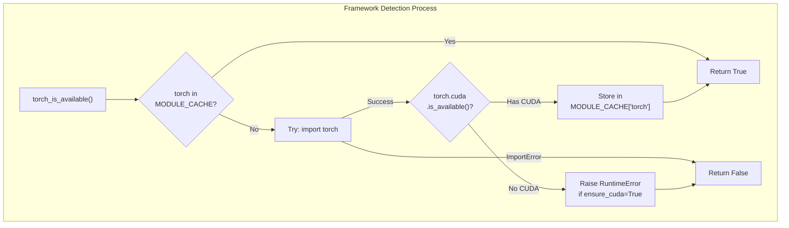
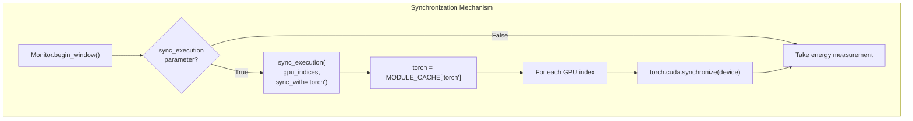
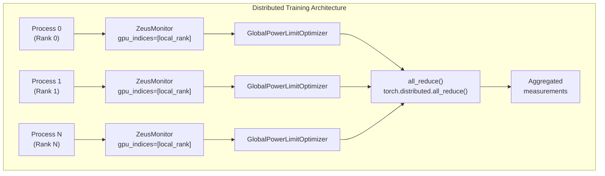
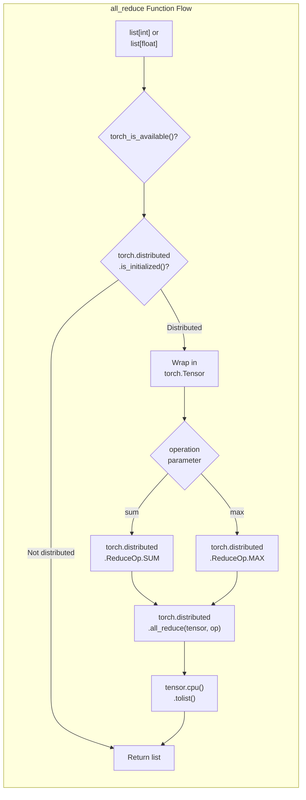

<!-- source: DeepWiki mcp.deepwiki.com · repo ml-energy/zeus · page 9.1 PyTorch Integration · fetched 2026-10-21 -->

# PyTorch Integration

<details>
<summary>Relevant source files</summary>

The following files were used as context for generating this wiki page:

- [pyproject.toml](pyproject.toml)
- [tests/optimizer/test_power_limit_optimizer.py](tests/optimizer/test_power_limit_optimizer.py)
- [tests/test_monitor.py](tests/test_monitor.py)
- [zeus/monitor/carbon.py](zeus/monitor/carbon.py)
- [zeus/monitor/price.py](zeus/monitor/price.py)
- [zeus/optimizer/power_limit.py](zeus/optimizer/power_limit.py)
- [zeus/show_env.py](zeus/show_env.py)
- [zeus/utils/framework.py](zeus/utils/framework.py)

</details>


Zeus provides native integration with PyTorch to ensure accurate energy measurements and support distributed training workloads. This integration handles asynchronous GPU execution, distributed all-reduce operations, and automatic detection of PyTorch availability.

For integration with HuggingFace Transformers (which uses PyTorch), see [HuggingFace Integration](#9.2). For information about custom training callbacks that work with any framework, see [Custom Callbacks](#9.3).

## Overview

PyTorch executes GPU operations asynchronously, meaning that Python code continues while GPU kernels are still running. This creates a challenge for accurate energy measurement: if measurements are taken immediately after dispatching work to the GPU, they will not capture the energy consumed by that work. Zeus's PyTorch integration solves this by synchronizing GPU execution at measurement boundaries.

The integration consists of three main components:

| Component | Purpose | Key Functions |
|-----------|---------|---------------|
| Framework Detection | Verify PyTorch availability and CUDA support | `torch_is_available()` |
| Execution Synchronization | Block until GPU computations complete | `sync_execution()` |
| Distributed Support | Aggregate measurements across GPUs | `all_reduce()`, `is_distributed()` |

**Sources:** [zeus/utils/framework.py:1-188]()

## Framework Detection and Caching

Zeus automatically detects PyTorch availability and caches the module to avoid repeated imports. The detection process checks both for PyTorch's presence and CUDA support.



**Diagram: PyTorch Detection and Caching Flow**

The `torch_is_available()` function uses `@lru_cache` to memoize results and stores the imported module in `MODULE_CACHE` for reuse across Zeus components. This avoids the overhead of repeated imports and availability checks.

**Sources:** [zeus/utils/framework.py:15-36]()

## Execution Synchronization

The core of PyTorch integration is the `sync_execution()` function, which ensures all GPU operations complete before energy measurements are taken. This function is called automatically by `ZeusMonitor` when `sync_execution=True` (the default).



**Diagram: Execution Synchronization Flow in ZeusMonitor**

The synchronization works as follows:

1. **Per-GPU Synchronization**: `torch.cuda.synchronize(device)` is called for each GPU being monitored
2. **Blocking Behavior**: The function blocks until all CUDA operations on the specified device complete
3. **Framework Selection**: The `sync_with` parameter defaults to `"torch"` but also supports `"jax"` and `"cupy"`

Here's how `ZeusMonitor` uses synchronization:

```python
# In ZeusMonitor.begin_window()
if sync_execution:
    sync_execution(
        self.gpu_indices,
        sync_with=self.sync_execution_with
    )

# In ZeusMonitor.end_window()
if sync_execution:
    sync_execution(
        self.gpu_indices,
        sync_with=self.sync_execution_with
    )
```

**Sources:** [zeus/utils/framework.py:76-132](), [zeus/monitor/energy.py]() (referenced but not in provided files)

### When to Disable Synchronization

In some scenarios, you may want to disable synchronization:

- **Testing**: When using `ReplayZeusMonitor` that reads from logs
- **Performance Profiling**: When you want to measure dispatch overhead separately
- **Manual Control**: When you handle synchronization yourself at a different granularity

Example:
```python
monitor.begin_window("window", sync_execution=False)
# ... dispatch work ...
monitor.end_window("window", sync_execution=False)
```

**Sources:** [tests/test_monitor.py:343-367]()

## Distributed Training Support

Zeus provides robust support for PyTorch's distributed training via `torch.distributed`. This is critical for the `GlobalPowerLimitOptimizer`, which needs to aggregate energy measurements across all GPUs in a training job.



**Diagram: Distributed Training with GlobalPowerLimitOptimizer**

### Architecture Requirements

For distributed training with Zeus:

1. **One Process Per GPU**: Each process controls exactly one GPU (typical with `torchrun` or `torch.distributed.launch`)
2. **One Monitor Per Process**: Each `ZeusMonitor` tracks only the local GPU (not all GPUs)
3. **Automatic Aggregation**: `GlobalPowerLimitOptimizer` performs all-reduce internally

```python
# Example distributed setup
import torch.distributed as dist

# Initialize distributed training
dist.init_process_group(backend="nccl")
local_rank = dist.get_rank()
torch.cuda.set_device(local_rank)

# Create monitor for this process's GPU only
monitor = ZeusMonitor(gpu_indices=[local_rank])

# Create optimizer - it will handle all-reduce internally
plo = GlobalPowerLimitOptimizer(monitor)
```

**Sources:** [zeus/optimizer/power_limit.py:206-221]()

### All-Reduce Implementation

The `all_reduce()` function wraps `torch.distributed.all_reduce()` to aggregate measurements across processes:



**Diagram: All-Reduce Operation Flow**

The function supports two reduction operations:

| Operation | Usage in Zeus | Example |
|-----------|---------------|---------|
| `sum` | Aggregate total energy across all GPUs | Energy measurements |
| `max` | Find maximum time across all GPUs | Time measurements |

**Sources:** [zeus/utils/framework.py:135-176]()

### GlobalPowerLimitOptimizer Integration

The `GlobalPowerLimitOptimizer` uses `all_reduce` to aggregate measurements when profiling power limits in distributed settings:

```python
# From GlobalPowerLimitOptimizer.on_step_begin()
self.measurements.append(
    PowerLimitMeasurement(
        power_limit=self.state.current_power_limit // 1000,
        energy=sum(
            all_reduce(
                list(measurement.gpu_energy.values()), 
                operation="sum"
            )
        ),
        time=max(all_reduce([measurement.time], operation="max")),
    )
)
```

This aggregates:
- **Total energy** across all GPUs (sum operation)
- **Maximum time** across all processes (max operation, since slowest process determines training time)

**Sources:** [zeus/optimizer/power_limit.py:419-428]()

## Code Entity Reference

The following table maps conceptual components to concrete code entities:

| Concept | Code Entity | Location |
|---------|-------------|----------|
| Framework detection | `torch_is_available(ensure_available, ensure_cuda)` | [zeus/utils/framework.py:16-36]() |
| Module caching | `MODULE_CACHE` dict | [zeus/utils/framework.py:12]() |
| GPU synchronization | `sync_execution(gpu_devices, sync_with)` | [zeus/utils/framework.py:76-132]() |
| Distributed check | `is_distributed()` | [zeus/utils/framework.py:179-187]() |
| All-reduce wrapper | `all_reduce(object, operation)` | [zeus/utils/framework.py:135-176]() |
| Monitor sync parameter | `ZeusMonitor(sync_execution_with="torch")` | [zeus/monitor/carbon.py:226]() |
| Distributed optimizer | `GlobalPowerLimitOptimizer` | [zeus/optimizer/power_limit.py:201-489]() |

**Sources:** [zeus/utils/framework.py:1-188](), [zeus/optimizer/power_limit.py:1-578](), [zeus/monitor/carbon.py:220-248]()

## Usage Patterns

### Basic Single-GPU Training

```python
from zeus.monitor import ZeusMonitor

# Zeus auto-detects PyTorch and uses it for synchronization
monitor = ZeusMonitor(gpu_indices=[0])

# Training loop
for epoch in range(num_epochs):
    monitor.begin_window("epoch")
    for batch in dataloader:
        # Forward, backward, optimizer step
        loss = model(batch)
        loss.backward()
        optimizer.step()
    measurement = monitor.end_window("epoch")
    # sync_execution=True by default, so torch.cuda.synchronize() is called
```

### Distributed Training

```python
import torch
import torch.distributed as dist
from zeus.monitor import ZeusMonitor
from zeus.optimizer.power_limit import GlobalPowerLimitOptimizer

# Setup distributed
dist.init_process_group(backend="nccl")
local_rank = dist.get_rank()
torch.cuda.set_device(local_rank)

# Each process monitors only its GPU
monitor = ZeusMonitor(gpu_indices=[local_rank])

# Optimizer automatically aggregates measurements
plo = GlobalPowerLimitOptimizer(monitor)

# Training loop with callbacks
for epoch in range(num_epochs):
    plo.on_epoch_begin()
    for step, batch in enumerate(dataloader):
        plo.on_step_begin()
        # ... training step ...
        plo.on_step_end()
    plo.on_epoch_end()
```

**Sources:** [zeus/optimizer/power_limit.py:218-221](), [tests/optimizer/test_power_limit_optimizer.py:98-113]()

### Disabling Synchronization for Performance

When using Zeus for performance profiling (not just energy), you may want to disable synchronization to measure dispatch overhead:

```python
monitor = ZeusMonitor(gpu_indices=[0])

# Measure dispatch time (without waiting for GPU completion)
monitor.begin_window("dispatch", sync_execution=False)
model(batch)
monitor.end_window("dispatch", sync_execution=False)

# Measure execution time (including GPU completion)
monitor.begin_window("execution", sync_execution=True)
model(batch)
monitor.end_window("execution", sync_execution=True)
```

**Sources:** [tests/test_monitor.py:343-397]()

## Integration with Other Monitors

All Zeus monitors that measure energy support PyTorch integration through the `sync_execution_with` parameter:

| Monitor | Default Framework | Purpose |
|---------|------------------|---------|
| `ZeusMonitor` | `"torch"` | GPU/CPU energy measurement |
| `CarbonEmissionMonitor` | `"torch"` | Carbon-aware energy measurement |
| `EnergyCostMonitor` | `"torch"` | Cost-aware energy measurement |

Example with `CarbonEmissionMonitor`:

```python
from zeus.monitor.carbon import CarbonEmissionMonitor, ElectrictyMapsClient

provider = ElectrictyMapsClient(location=(37.7749, -122.4194))
monitor = CarbonEmissionMonitor(
    carbon_intensity_provider=provider,
    gpu_indices=[0],
    sync_execution_with="torch"  # Use PyTorch for synchronization
)
```

**Sources:** [zeus/monitor/carbon.py:220-248](), [zeus/monitor/price.py:233-262]()

## Limitations and Considerations

### Single CPU Device in JAX

The `sync_execution()` function includes special handling for JAX, which runs asynchronously on both CPU and GPU. For PyTorch, only GPU devices need synchronization since PyTorch runs CPU operations synchronously.

**Sources:** [zeus/utils/framework.py:82-96]()

### Device Partitioning

Zeus assumes integer device indices correspond to whole physical devices. If using advanced device partitioning (e.g., JAX's `--xla_force_host_platform_device_count`), you should handle synchronization manually at the appropriate granularity.

**Sources:** [zeus/utils/framework.py:98-103]()

### CUDA_VISIBLE_DEVICES

Zeus respects `CUDA_VISIBLE_DEVICES`. When this environment variable is set, GPU indices passed to Zeus are interpreted from PyTorch's perspective (after applying the visibility mask).

**Sources:** [tests/test_monitor.py:98-104]()

---

