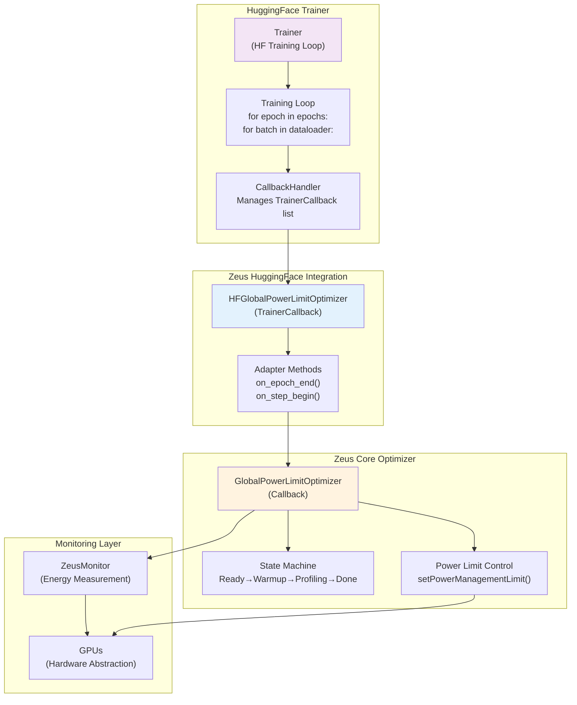
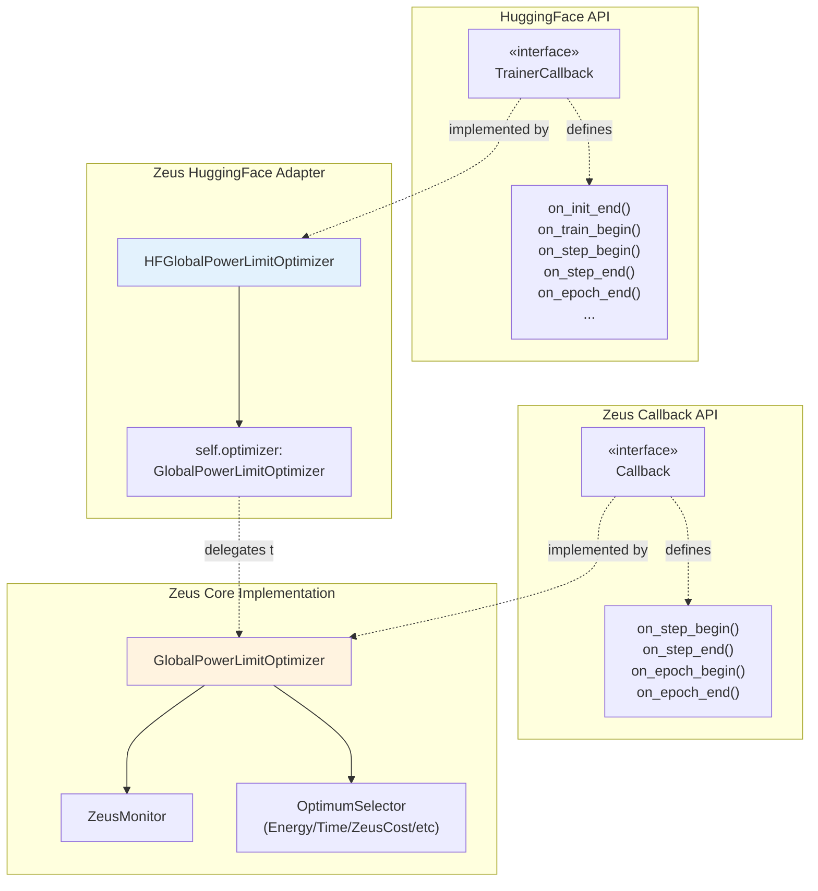
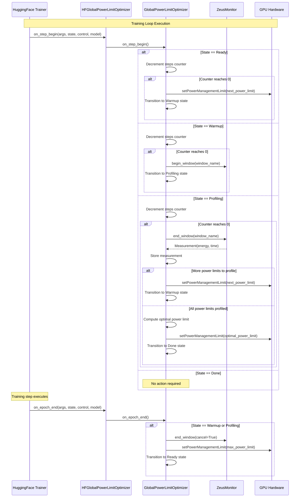
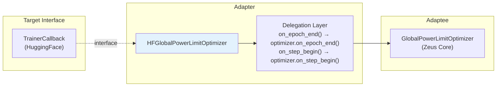

<!-- source: DeepWiki mcp.deepwiki.com · repo ml-energy/zeus · page 9.2 HuggingFace Integration · fetched 2026-10-21 -->

# HuggingFace Integration

<details>
<summary>Relevant source files</summary>

The following files were used as context for generating this wiki page:

- [examples/carbon_emission_monitor/README.md](examples/carbon_emission_monitor/README.md)
- [pyproject.toml](pyproject.toml)
- [tests/monitor/carbon_history_files/carbon_history_file1](tests/monitor/carbon_history_files/carbon_history_file1)
- [tests/monitor/carbon_history_files/carbon_history_file2](tests/monitor/carbon_history_files/carbon_history_file2)
- [tests/optimizer/test_power_limit_optimizer.py](tests/optimizer/test_power_limit_optimizer.py)
- [tests/test_monitor.py](tests/test_monitor.py)
- [zeus/optimizer/power_limit.py](zeus/optimizer/power_limit.py)

</details>


This page documents Zeus's integration with HuggingFace Transformers, specifically the adapter that allows Zeus optimizers to work seamlessly with HuggingFace's `Trainer` API. This integration enables energy-efficient training of transformer models using Zeus's power limit optimization capabilities.

For general information about Zeus's power limit optimization strategy, see [Power Limit Optimizer](#5.1). For custom callback implementations, see [Custom Callbacks](#9.3). For PyTorch-specific integration patterns, see [PyTorch Integration](#9.1).

## Overview

Zeus provides `HFGlobalPowerLimitOptimizer`, a wrapper class that adapts Zeus's power limit optimizer to work with HuggingFace's `TrainerCallback` interface. This allows users to optimize GPU power limits during training with minimal code changes to existing HuggingFace training scripts.

The integration works by:
- Implementing HuggingFace's `TrainerCallback` protocol
- Delegating to the underlying `GlobalPowerLimitOptimizer`
- Maintaining the same configuration options as the base optimizer
- Supporting all features of the base optimizer (JIT profiling, state persistence, distributed training)

Sources: [zeus/optimizer/power_limit.py:19-21](), [zeus/optimizer/power_limit.py:507-578]()

## Architecture

### Integration Layer

The following diagram illustrates how `HFGlobalPowerLimitOptimizer` acts as an adapter between HuggingFace's training infrastructure and Zeus's optimization components:



**Architecture Components:**
- **HuggingFace Trainer**: The standard HuggingFace training loop that manages datasets, model updates, and callbacks
- **HFGlobalPowerLimitOptimizer**: Adapter class that translates HuggingFace callback events to Zeus callback events
- **GlobalPowerLimitOptimizer**: Core Zeus optimizer implementing JIT profiling and power limit selection
- **ZeusMonitor**: Energy measurement system used by the optimizer to profile power limits

Sources: [zeus/optimizer/power_limit.py:507-556](), [zeus/optimizer/power_limit.py:201-223]()

### Class Relationships



Sources: [zeus/optimizer/power_limit.py:492-505](), [zeus/optimizer/power_limit.py:507-556](), [zeus/callback.py:1-30]()

## HFGlobalPowerLimitOptimizer Class

### Class Definition

`HFGlobalPowerLimitOptimizer` is defined in [zeus/optimizer/power_limit.py:507-578](). It serves as a thin wrapper around `GlobalPowerLimitOptimizer`, adapting it to work with HuggingFace's callback system.

| Property | Description |
|----------|-------------|
| **Base Class** | `TrainerCallback` (from `transformers.trainer_callback`) |
| **Composition** | Contains an instance of `GlobalPowerLimitOptimizer` |
| **Import Handling** | Conditionally imports HuggingFace dependencies to avoid hard requirements |
| **Signature Equivalence** | Constructor signature matches `GlobalPowerLimitOptimizer` exactly |

Sources: [zeus/optimizer/power_limit.py:507-556]()

### Constructor Parameters

The constructor accepts the same parameters as `GlobalPowerLimitOptimizer`:

| Parameter | Type | Description |
|-----------|------|-------------|
| `monitor` | `ZeusMonitor` | Monitor instance for profiling GPU energy and time |
| `optimum_selector` | `OptimumSelector \| None` | Strategy for selecting optimal power limit (default: `ZeusCost` with η=0.5) |
| `wait_steps` | `int` | Steps to wait before profiling starts (default: 1) |
| `warmup_steps` | `int` | Warmup iterations per power limit (default: 10) |
| `profile_steps` | `int` | Profile iterations per power limit (default: 40) |
| `pl_step` | `int` | Stride between power limits in Watts (default: 25) |
| `profile_path` | `str \| Path \| None` | Path for saving/loading profile data (default: None) |

Sources: [zeus/optimizer/power_limit.py:515-541]()

### Dependency Handling

The class implements conditional import logic to avoid requiring HuggingFace Transformers as a hard dependency:

```python
# From zeus/optimizer/power_limit.py:492-505
try:
    from transformers.trainer_callback import TrainerCallback
    transformers_available = True
except ModuleNotFoundError:
    transformers_available = False
    TrainerCallback = object  # Fallback base class
```

At runtime, the constructor checks for availability:

```python
# From zeus/optimizer/power_limit.py:542-545
if not transformers_available:
    raise ImportError(
        "The transformers package is not installed. ..."
    )
```

Sources: [zeus/optimizer/power_limit.py:492-505](), [zeus/optimizer/power_limit.py:542-545]()

## Callback Method Mapping

The adapter implements two key callback methods from HuggingFace's `TrainerCallback` interface and delegates them to the underlying `GlobalPowerLimitOptimizer`:

### Method Invocation Flow



Sources: [zeus/optimizer/power_limit.py:557-577](), [zeus/optimizer/power_limit.py:378-456]()

### Callback Method Details

#### on_step_begin

```python
# From zeus/optimizer/power_limit.py:568-577
def on_step_begin(
    self,
    args: TrainingArguments,
    state: TrainerState,
    control: TrainerControl,
    model: PreTrainedModel,
    **kwargs,
) -> None:
    """Mark the beginning of a training step."""
    self.optimizer.on_step_begin()
```

This method is invoked at the start of each training step. It delegates to the underlying optimizer's state machine, which manages:
- Transitioning between profiling states (Ready → Warmup → Profiling → Done)
- Setting appropriate power limits for each state
- Beginning measurement windows during profiling

Sources: [zeus/optimizer/power_limit.py:568-577](), [zeus/optimizer/power_limit.py:378-456]()

#### on_epoch_end

```python
# From zeus/optimizer/power_limit.py:557-566
def on_epoch_end(
    self,
    args: TrainingArguments,
    state: TrainerState,
    control: TrainerControl,
    model: PreTrainedModel,
    **kwargs,
) -> None:
    """Mark the end of a training epoch."""
    self.optimizer.on_epoch_end()
```

This method is invoked at the end of each training epoch. It handles interruptions to profiling cycles, resetting the state machine to ensure clean boundaries between epochs.

Sources: [zeus/optimizer/power_limit.py:557-566](), [zeus/optimizer/power_limit.py:355-377]()

## Usage Guide

### Basic Integration

To integrate Zeus power limit optimization into a HuggingFace training script:

1. **Create a ZeusMonitor instance** to track the GPUs being used for training:

```python
from zeus.monitor import ZeusMonitor

# Monitor the GPU assigned to this process
monitor = ZeusMonitor(gpu_indices=[local_rank])
```

2. **Instantiate HFGlobalPowerLimitOptimizer** with desired configuration:

```python
from zeus.optimizer.power_limit import HFGlobalPowerLimitOptimizer

plo = HFGlobalPowerLimitOptimizer(
    monitor=monitor,
    wait_steps=1,
    warmup_steps=10,
    profile_steps=40,
    pl_step=25,
    profile_path="power_limit_profile.json"
)
```

3. **Add the optimizer to the Trainer's callback list**:

```python
from transformers import Trainer, TrainingArguments

training_args = TrainingArguments(...)
trainer = Trainer(
    model=model,
    args=training_args,
    train_dataset=train_dataset,
    callbacks=[plo]  # Add Zeus optimizer
)
```

4. **Run training normally**:

```python
trainer.train()
```

Sources: [zeus/optimizer/power_limit.py:507-556](), [examples/carbon_emission_monitor/README.md:1-31]()

### Distributed Training

For distributed data parallel training with multiple GPUs:

- Each process should create its own `ZeusMonitor` instance monitoring only one GPU (typically matching the local rank)
- The optimizer performs an all-reduce operation internally to aggregate measurements across all GPUs
- All processes will converge to the same optimal power limit

```python
import torch.distributed as dist

# In distributed training
local_rank = dist.get_rank()
monitor = ZeusMonitor(gpu_indices=[local_rank])

plo = HFGlobalPowerLimitOptimizer(monitor=monitor)
```

Sources: [zeus/optimizer/power_limit.py:206-221](), [zeus/optimizer/power_limit.py:278-285]()

### Configuration Options

The following table summarizes common configuration patterns:

| Use Case | Configuration |
|----------|---------------|
| **Minimize Energy** | `optimum_selector=Energy()` |
| **Minimize Time** | `optimum_selector=Time()` |
| **Balanced (default)** | `optimum_selector=ZeusCost(eta_knob=0.5)` |
| **Energy-focused** | `optimum_selector=ZeusCost(eta_knob=0.9)` |
| **Time-focused** | `optimum_selector=ZeusCost(eta_knob=0.1)` |
| **Max Slowdown** | `optimum_selector=MaxSlowdownConstraint(factor=1.1)` |
| **Reuse Profile** | Set `profile_path` to existing JSON file |
| **Save Profile** | Set `profile_path` to new JSON file path |

Sources: [zeus/optimizer/power_limit.py:41-139]()

### Profile Persistence

The optimizer supports three modes for profile handling:

| Mode | Configuration | Behavior |
|------|---------------|----------|
| **JIT Profiling** | `profile_path=None` | Profile each training run, don't save |
| **Save Profile** | `profile_path="new_file.json"` | Profile and save results to file |
| **Load Profile** | `profile_path="existing_file.json"` | Skip profiling, use saved results |

When loading from an existing profile, the optimizer immediately enters the `Done` state and sets the optimal power limit without any profiling overhead.

Sources: [zeus/optimizer/power_limit.py:314-351](), [zeus/optimizer/power_limit.py:477-489]()

## Implementation Notes

### Signature Equivalence

The constructor of `HFGlobalPowerLimitOptimizer` is intentionally kept identical to `GlobalPowerLimitOptimizer`. This equivalence is verified by a unit test:

```python
# From tests/optimizer/test_power_limit_optimizer.py:290-297
def test_HFGPLO_signature_equivalence() -> None:
    """Ensure that the constructor signatures are equivalent."""
    gplo_signature = inspect.signature(GlobalPowerLimitOptimizer.__init__)
    hfgplo_signature = inspect.signature(HFGlobalPowerLimitOptimizer.__init__)
    
    assert gplo_signature == hfgplo_signature
```

This ensures that any configuration valid for the base optimizer is also valid for the HuggingFace adapter.

Sources: [tests/optimizer/test_power_limit_optimizer.py:290-297]()

### Adapter Pattern

The implementation follows the classic adapter pattern:



This design allows Zeus to maintain a clean separation between its core optimization logic and framework-specific integration code.

Sources: [zeus/optimizer/power_limit.py:507-578]()

### Type Checking

The implementation uses `TYPE_CHECKING` to handle type annotations without introducing runtime dependencies:

```python
# From zeus/optimizer/power_limit.py:38-39, 492-496
from typing import TYPE_CHECKING

if TYPE_CHECKING:
    from transformers.training_args import TrainingArguments
    from transformers.trainer_callback import TrainerState, TrainerControl
    from transformers.modeling_utils import PreTrainedModel
```

This allows the code to provide proper type hints for IDEs and type checkers while avoiding import errors when HuggingFace Transformers is not installed.

Sources: [zeus/optimizer/power_limit.py:38-39](), [zeus/optimizer/power_limit.py:492-496]()

---

