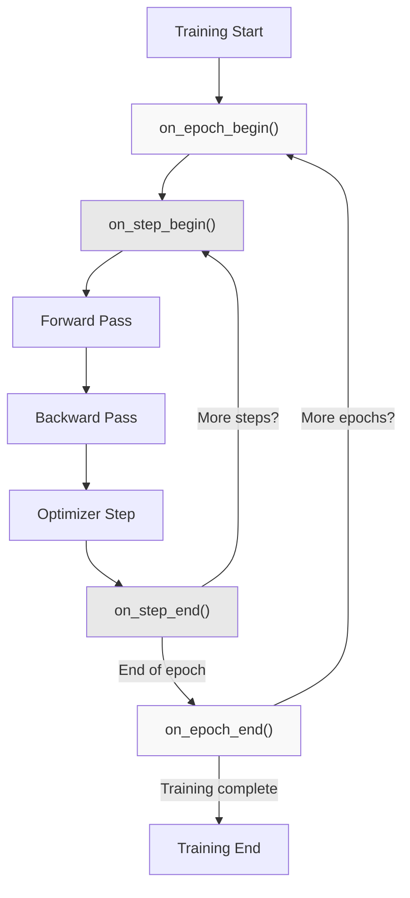
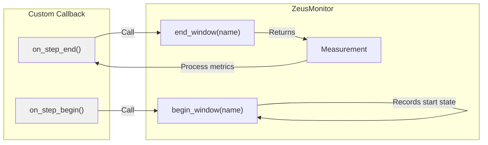
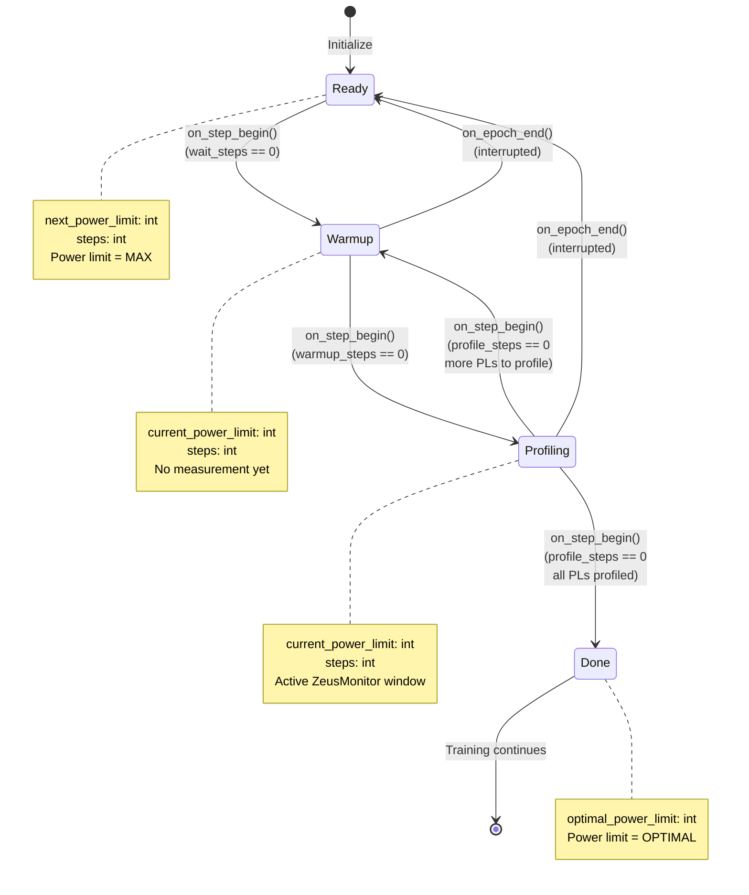
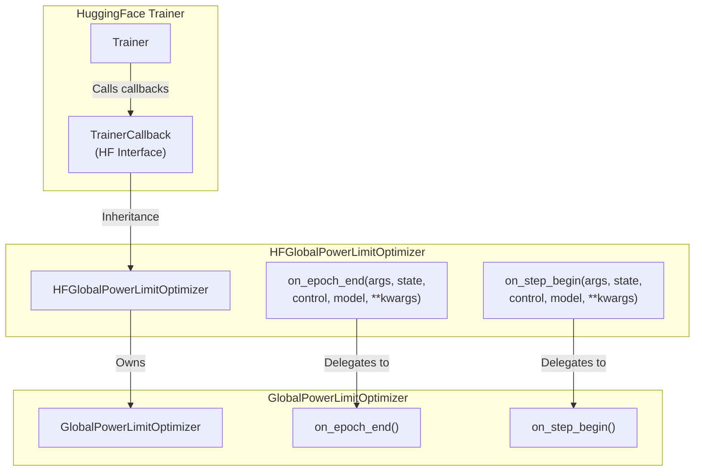

<!-- source: DeepWiki mcp.deepwiki.com · repo ml-energy/zeus · page 9.3 Custom Callbacks · fetched 2026-10-21 -->

# Custom Callbacks

<details>
<summary>Relevant source files</summary>

The following files were used as context for generating this wiki page:

- [pyproject.toml](pyproject.toml)
- [tests/optimizer/test_power_limit_optimizer.py](tests/optimizer/test_power_limit_optimizer.py)
- [tests/test_monitor.py](tests/test_monitor.py)
- [zeus/__init__.py](zeus/__init__.py)
- [zeus/optimizer/power_limit.py](zeus/optimizer/power_limit.py)

</details>


This page documents the `Callback` base class and how to implement custom energy-aware training callbacks in Zeus. For integration with PyTorch training loops, see [PyTorch Integration](#9.1). For HuggingFace Trainer integration, see [HuggingFace Integration](#9.2).

## Purpose and Scope

The Zeus callback system provides a standardized interface for hooking into training loops to perform energy measurements and optimizations. Callbacks allow Zeus optimizers like `GlobalPowerLimitOptimizer` to intercept training events (epoch boundaries, step boundaries) without requiring modifications to the training loop code itself. This page covers:

- The `Callback` base class interface
- Callback lifecycle and execution order
- Implementing custom energy-aware callbacks
- Integration patterns with `ZeusMonitor` and Zeus optimizers

## Callback Base Class

The `Callback` base class defines four lifecycle methods that correspond to training events:

| Method | Called When | Typical Use Cases |
|--------|-------------|-------------------|
| `on_epoch_begin()` | Start of each training epoch | Initialize epoch-level state, reset counters |
| `on_epoch_end()` | End of each training epoch | Handle interrupted profiling, aggregate epoch metrics |
| `on_step_begin()` | Start of each training step | Begin energy measurement windows, adjust hardware settings |
| `on_step_end()` | End of each training step | End energy measurement windows, collect metrics |

**Sources:** [zeus/optimizer/power_limit.py:29](), [zeus/optimizer/power_limit.py:201]()

## Callback Lifecycle

The following diagram shows the callback execution flow within a typical training loop:



**Sources:** [tests/optimizer/test_power_limit_optimizer.py:98-113]()

## Implementing Custom Callbacks

### Basic Callback Structure

To create a custom callback, subclass `Callback` and override the lifecycle methods you need:

```python
from zeus.callback import Callback

class MyCustomCallback(Callback):
    def on_epoch_begin(self) -> None:
        """Called at the start of each epoch."""
        pass
    
    def on_epoch_end(self) -> None:
        """Called at the end of each epoch."""
        pass
    
    def on_step_begin(self) -> None:
        """Called at the start of each training step."""
        pass
    
    def on_step_end(self) -> None:
        """Called at the end of each training step."""
        pass
```

All lifecycle methods are optional; only override the ones you need. Methods that are not overridden default to no-op behavior.

**Sources:** [zeus/optimizer/power_limit.py:201](), [zeus/optimizer/power_limit.py:355-456]()

### Integration with ZeusMonitor

Callbacks typically integrate with `ZeusMonitor` to perform energy measurements. The following diagram shows the integration pattern:



Common pattern:

```python
class EnergyTrackingCallback(Callback):
    def __init__(self, monitor: ZeusMonitor):
        self.monitor = monitor
        
    def on_step_begin(self) -> None:
        self.monitor.begin_window("training_step")
    
    def on_step_end(self) -> None:
        measurement = self.monitor.end_window("training_step")
        # Process measurement.gpu_energy, measurement.time, etc.
```

**Sources:** [zeus/optimizer/power_limit.py:224-265](), [zeus/optimizer/power_limit.py:404-412]()

## Real-World Example: GlobalPowerLimitOptimizer

The `GlobalPowerLimitOptimizer` is a complete example of a callback implementation that performs JIT power limit profiling. The following diagram shows its state machine and callback integration:



### Key Implementation Details

| Component | Purpose | Implementation Location |
|-----------|---------|-------------------------|
| State classes | Track profiling state | [zeus/optimizer/power_limit.py:141-184]() |
| `on_step_begin()` | State transitions, start/continue profiling | [zeus/optimizer/power_limit.py:378-455]() |
| `on_epoch_end()` | Handle interrupted profiling | [zeus/optimizer/power_limit.py:355-376]() |
| `_set_power_limit()` | Apply hardware configuration | [zeus/optimizer/power_limit.py:457-469]() |
| Energy measurement | Via `monitor.begin_window()` / `end_window()` | [zeus/optimizer/power_limit.py:404-412]() |

**Sources:** [zeus/optimizer/power_limit.py:201-490]()

### State Machine Behavior

The `GlobalPowerLimitOptimizer` demonstrates advanced callback usage with state management:

1. **Ready State**: Waiting to begin profiling next power limit
   - Decrements `steps` counter on each `on_step_begin()`
   - Transitions to `Warmup` when counter reaches zero
   - Sets power limit to next value to profile

2. **Warmup State**: Warming up for current power limit
   - Allows system to stabilize before measurement
   - Transitions to `Profiling` when warmup completes
   - Can be interrupted by epoch boundary, returns to `Ready`

3. **Profiling State**: Active energy measurement
   - Calls `monitor.begin_window()` when entering
   - Calls `monitor.end_window()` when exiting
   - Stores measurements for later analysis
   - Transitions to next power limit or `Done`

4. **Done State**: All profiling complete
   - Optimal power limit computed and applied
   - No more state transitions
   - Callbacks become no-ops

**Sources:** [zeus/optimizer/power_limit.py:312-353](), [zeus/optimizer/power_limit.py:378-455]()

## HuggingFace Adapter Pattern

Zeus provides an adapter pattern for HuggingFace Trainer callbacks. The `HFGlobalPowerLimitOptimizer` wraps `GlobalPowerLimitOptimizer` to match HuggingFace's callback signature:



The adapter accepts HuggingFace's callback signature but delegates to the Zeus callback internally:

**Sources:** [zeus/optimizer/power_limit.py:507-577]()

## Best Practices

### State Management

When implementing stateful callbacks:

1. **Use well-defined state classes**: Define explicit state objects (like `Ready`, `Warmup`, `Profiling`, `Done`) rather than managing multiple boolean flags
2. **Handle interruptions**: Implement logic in `on_epoch_end()` to gracefully handle interrupted profiling or measurement windows
3. **Persist state**: For long-running profiling, save state to disk to recover from crashes

**Sources:** [zeus/optimizer/power_limit.py:141-184](), [zeus/optimizer/power_limit.py:355-376]()

### Energy Measurement Windows

When using `ZeusMonitor` in callbacks:

1. **Name windows uniquely**: Use descriptive, unique names for measurement windows to avoid conflicts
2. **Cancel interrupted windows**: If a window is interrupted (e.g., epoch ends mid-profiling), call `end_window(name, cancel=True)` to clean up
3. **Sync execution**: Consider using `sync_execution=True` in `begin_window()` for accurate measurements in async execution environments

**Sources:** [zeus/optimizer/power_limit.py:368-371](), [zeus/optimizer/power_limit.py:404-412]()

### Distributed Training

For distributed training scenarios:

1. **One callback instance per process**: Each process should have its own callback instance managing its local GPU
2. **Aggregate measurements**: Use `all_reduce()` from `zeus.utils.framework` to aggregate energy/time measurements across processes
3. **Coordinate state transitions**: Ensure all processes transition states together, especially for optimizers that modify hardware settings

**Sources:** [zeus/optimizer/power_limit.py:206-221](), [zeus/optimizer/power_limit.py:419-428]()

### Hardware Configuration

When callbacks modify hardware settings (power limits, frequencies):

1. **Check permissions**: Verify SYS_ADMIN capability or zeusd availability before attempting hardware modifications
2. **Restore on exit**: Use `atexit` to restore original settings when training completes or crashes
3. **Skip redundant calls**: Check current hardware state before issuing configuration commands to avoid unnecessary overhead

**Sources:** [zeus/optimizer/power_limit.py:296-305](), [zeus/optimizer/power_limit.py:353](), [zeus/optimizer/power_limit.py:457-469]()

## Testing Custom Callbacks

The test suite demonstrates callback testing patterns:

```python
def training_loop(
    callback: Callback,
    train_loader: Iterable,
    num_epochs: int
) -> None:
    """Simulate a training loop with callback."""
    for epoch in range(num_epochs):
        callback.on_epoch_begin()
        for step, batch in enumerate(train_loader):
            callback.on_step_begin()
            # ... training logic ...
            callback.on_step_end()
        callback.on_epoch_end()
```

Key testing considerations:

1. **Mock hardware APIs**: Use `pytest-mock` to mock NVML/AMDSMI calls
2. **Simulate interruptions**: Test epoch-boundary interruptions during profiling/measurement
3. **Verify state transitions**: Assert expected state after each callback invocation
4. **Check measurement windows**: Verify `ZeusMonitor` methods called with correct arguments

**Sources:** [tests/optimizer/test_power_limit_optimizer.py:98-113](), [tests/optimizer/test_power_limit_optimizer.py:116-228]()

---

