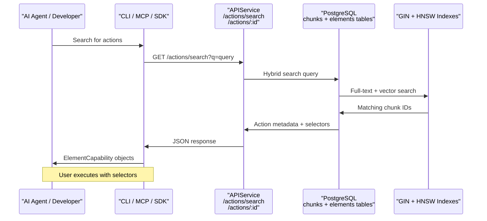
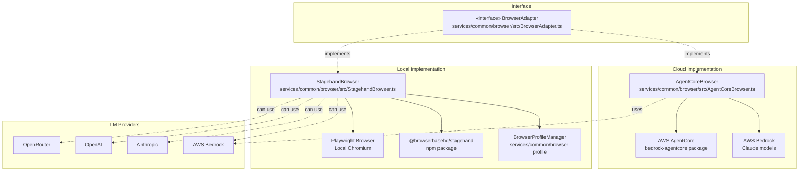
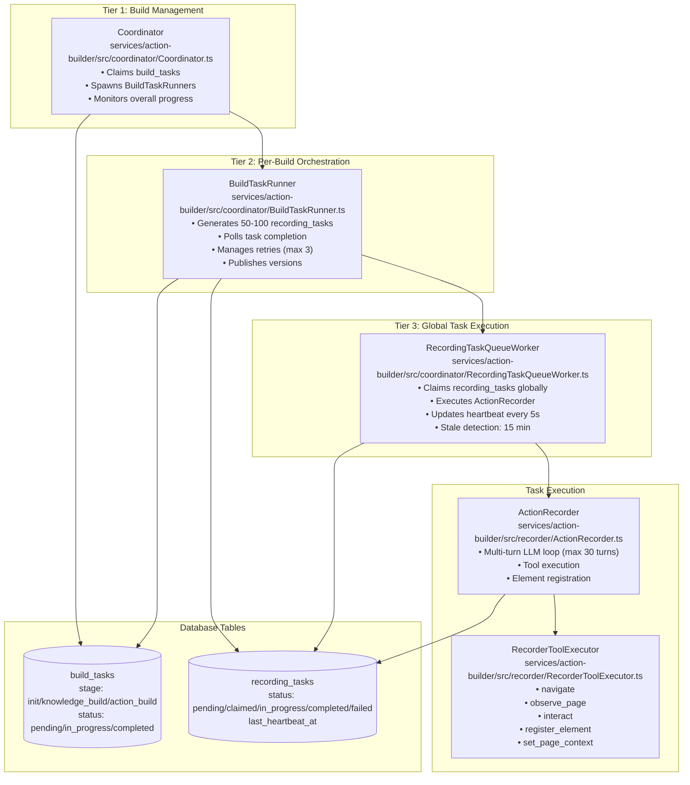
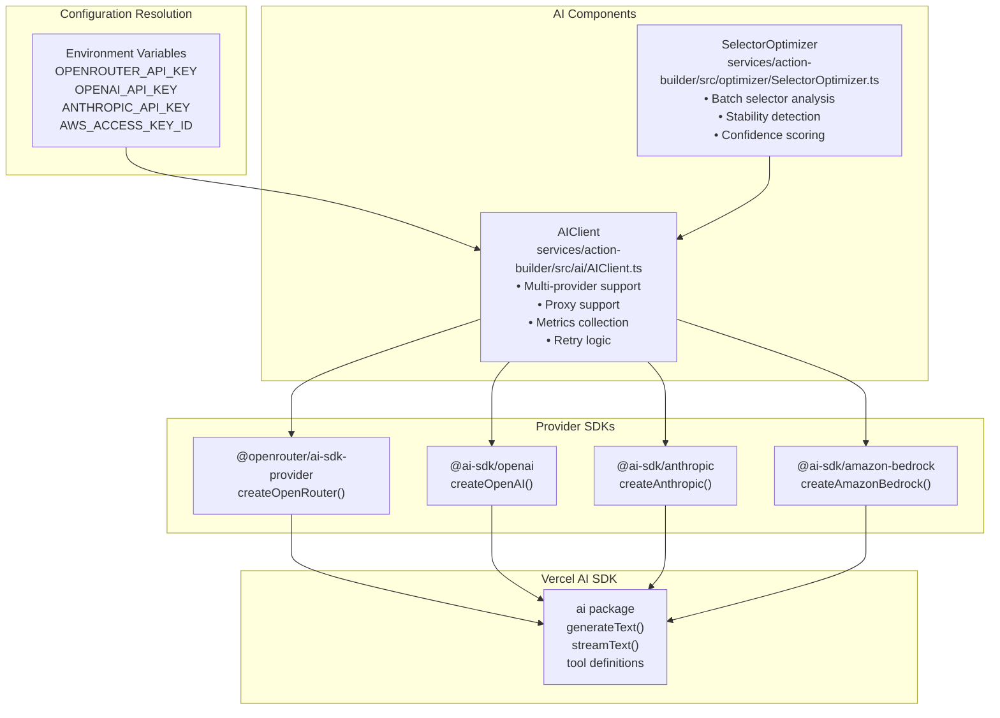
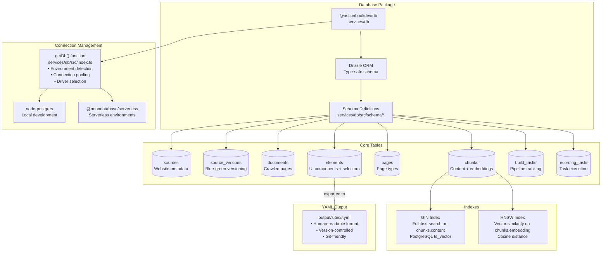
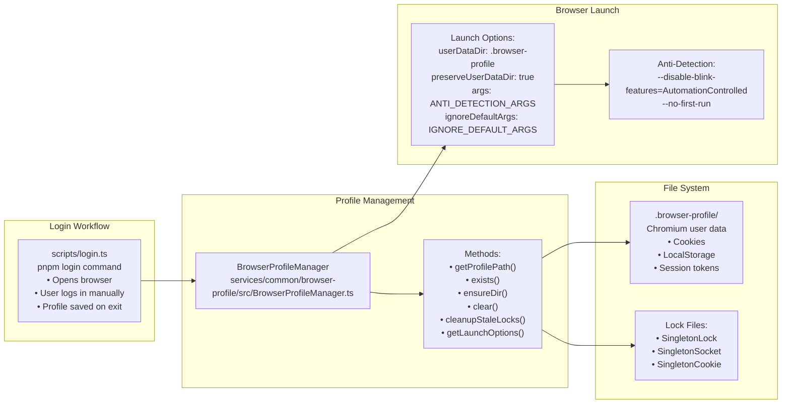
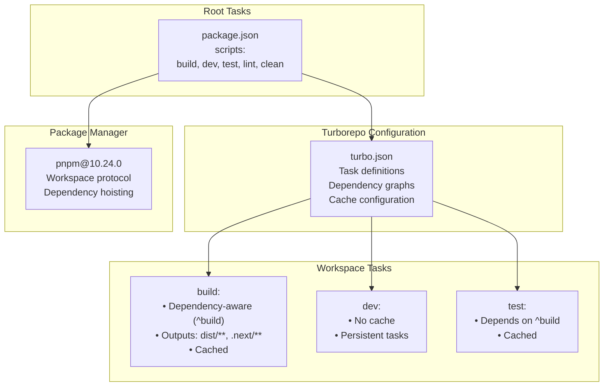

<!-- source: DeepWiki mcp.deepwiki.com · repo actionbook/actionbook · page 1.2 Architecture Overview · fetched 2026-10-27 -->

# Architecture Overview

<details>
<summary>Relevant source files</summary>

The following files were used as context for generating this wiki page:

- [.gitignore](.gitignore)
- [.prettierignore](.prettierignore)
- [.prettierrc.json](.prettierrc.json)
- [CLAUDE.md](CLAUDE.md)
- [README.md](README.md)
- [mcp-servers.json](mcp-servers.json)
- [package.json](package.json)
- [pnpm-lock.yaml](pnpm-lock.yaml)
- [pnpm-workspace.yaml](pnpm-workspace.yaml)
- [services/action-builder/.nvmrc](services/action-builder/.nvmrc)
- [services/action-builder/scripts/login.ts](services/action-builder/scripts/login.ts)
- [services/action-builder/src/optimizer/SelectorOptimizer.ts](services/action-builder/src/optimizer/SelectorOptimizer.ts)
- [services/common/browser-profile/package.json](services/common/browser-profile/package.json)
- [services/common/browser-profile/src/BrowserProfileManager.ts](services/common/browser-profile/src/BrowserProfileManager.ts)
- [turbo.json](turbo.json)

</details>


## Purpose and Scope

This document provides a high-level technical overview of the Actionbook system architecture, including its major components, their interactions, and the data flow between them. It explains the monorepo structure, published packages, internal services, and how different layers communicate.

For installation and basic usage, see [Getting Started](#1.1). For detailed information about each user interface (CLI, MCP Server, SDK), see [User Interfaces](#2). For implementation details of individual services, see [Core Services](#3).

## System Overview

Actionbook is a multi-layered system designed to provide AI agents with verified website action manuals. The architecture separates concerns into distinct layers: user-facing interfaces for consumption, core services for data generation, browser automation for discovery, task orchestration for pipeline management, and a hybrid data layer for storage and retrieval.

The system operates in two modes:

1. **Query Mode**: Users (AI agents, developers) query pre-built action manuals via CLI, MCP Server, or SDK
2. **Build Mode**: Background services crawl websites, discover capabilities, and generate action manuals

Sources: [README.md:1-48](), Diagram 1 from provided diagrams

## Monorepo Structure

Actionbook uses a pnpm workspace monorepo organized into four main categories:

| Category | Path | Purpose |
|----------|------|---------|
| Published Packages | `packages/*` | User-facing npm packages (CLI, SDK, MCP) |
| Services | `services/*` | Backend services and shared infrastructure |
| Playground | `playground/*` | Example integrations and demos |
| Evaluation | `eval/` | Testing and evaluation framework |

### Published Packages

```
packages/
├── cli/              # @actionbookdev/cli - Command-line interface
├── js-sdk/           # @actionbookdev/sdk - JavaScript SDK with tool definitions
├── mcp/              # @actionbookdev/mcp - MCP Server implementation
└── tools-ai-sdk/     # @actionbookdev/tools-ai-sdk - Vercel AI SDK integration
```

### Internal Packages

```
services/
├── common/
│   ├── browser/            # @actionbookdev/browser - Browser abstraction layer
│   └── browser-profile/    # @actionbookdev/browser-profile - Profile management
└── db/                     # @actionbookdev/db - Database schema and client
```

### Services

```
services/
├── action-builder/      # Action recording and element discovery
├── playbook-builder/    # Documentation and page discovery
├── knowledge-builder/   # Content extraction and embedding generation
└── api-service/         # REST API for queries (not shown in provided files)
```

Sources: [README.md:701-741](), [pnpm-workspace.yaml:1-7](), [CLAUDE.md:28-42]()

## Component Architecture

The following diagram shows the major components and their actual package/service names as they appear in the codebase:

```mermaid
graph TB
    subgraph "User Interfaces (packages)"
        CLI["@actionbookdev/cli<br/>packages/cli"]
        MCP["@actionbookdev/mcp<br/>packages/mcp"]
        SDK["@actionbookdev/sdk<br/>packages/js-sdk"]
        ToolsAI["@actionbookdev/tools-ai-sdk<br/>packages/tools-ai-sdk"]
    end
    
    subgraph "Core Services (services)"
        APIService["api-service<br/>REST endpoints"]
        ActionBuilder["action-builder<br/>ActionRecorder<br/>RecorderToolExecutor"]
        PlaybookBuilder["playbook-builder<br/>PlaybookTaskController"]
        KnowledgeBuilder["knowledge-builder<br/>Crawler & embeddings"]
    end
    
    subgraph "Browser Automation (services/common/browser)"
        BrowserAdapter["BrowserAdapter<br/>(interface)"]
        StagehandBrowser["StagehandBrowser<br/>Playwright + Stagehand"]
        AgentCoreBrowser["AgentCoreBrowser<br/>AWS AgentCore"]
    end
    
    subgraph "Task Orchestration (services/action-builder)"
        Coordinator["Coordinator<br/>Build manager"]
        BuildTaskRunner["BuildTaskRunner<br/>Per-build orchestrator"]
        QueueWorker["RecordingTaskQueueWorker<br/>Global task consumer"]
    end
    
    subgraph "Shared Infrastructure (services)"
        DB["@actionbookdev/db<br/>Drizzle ORM + PostgreSQL"]
        BrowserProfile["@actionbookdev/browser-profile<br/>BrowserProfileManager"]
        AIClient["AIClient<br/>Multi-provider LLM client"]
        SelectorOptimizer["SelectorOptimizer<br/>LLM-based analysis"]
    end
    
    subgraph "Data Storage"
        PostgreSQL[("PostgreSQL<br/>sources, pages, elements<br/>build_tasks, recording_tasks<br/>chunks with embeddings")]
        YAMLFiles["YAML Files<br/>output/sites/"]
    end
    
    CLI --> SDK
    MCP --> SDK
    ToolsAI --> SDK
    SDK --> APIService
    CLI --> StagehandBrowser
    
    APIService --> DB
    
    ActionBuilder --> BuildTaskRunner
    ActionBuilder --> QueueWorker
    ActionBuilder --> AIClient
    ActionBuilder --> SelectorOptimizer
    
    PlaybookBuilder --> DB
    PlaybookBuilder --> AIClient
    
    KnowledgeBuilder --> DB
    KnowledgeBuilder --> BrowserProfile
    
    Coordinator --> BuildTaskRunner
    BuildTaskRunner --> QueueWorker
    
    QueueWorker --> BrowserAdapter
    BrowserAdapter <|-- StagehandBrowser
    BrowserAdapter <|-- AgentCoreBrowser
    
    StagehandBrowser --> BrowserProfile
    AgentCoreBrowser --> BrowserProfile
    
    DB --> PostgreSQL
    ActionBuilder --> YAMLFiles
    
    BuildTaskRunner --> DB
    QueueWorker --> DB
```

**Key Design Decisions:**

1. **Package Separation**: `@actionbookdev/sdk` is dependency-free and provides core types; other packages depend on it
2. **Browser Abstraction**: `BrowserAdapter` interface enables multiple implementations (local Playwright vs. cloud AWS)
3. **Task Orchestration Split**: `BuildTaskRunner` manages per-build coordination while `RecordingTaskQueueWorker` provides global task execution
4. **Dual Persistence**: Action manuals stored in both PostgreSQL (queryable) and YAML files (human-readable)

Sources: [README.md:87-93](), [CLAUDE.md:28-67](), Diagram 1 and Diagram 6 from provided diagrams

## Data Flow Architecture

### Query Flow (User → API → Database)



### Build Flow (Service → Browser → Database)

```mermaid
sequenceDiagram
    participant Coord as "Coordinator"
    participant BTR as "BuildTaskRunner"
    participant QW as "RecordingTaskQueueWorker"
    participant Browser as "BrowserAdapter<br/>(Stagehand/AgentCore)"
    participant Tools as "RecorderToolExecutor<br/>navigate/observe/register"
    participant AI as "AIClient<br/>Multi-provider LLM"
    participant DB as "PostgreSQL<br/>build_tasks/recording_tasks"
    participant Opt as "SelectorOptimizer"
    
    Coord->>DB: Claim build_task
    Coord->>BTR: Spawn runner
    BTR->>DB: Generate recording_tasks
    
    loop For each recording task
        QW->>DB: Claim recording_task
        QW->>Browser: Initialize session
        QW->>Tools: Execute tools
        Tools->>Browser: navigate(), observe()
        Browser->>AI: LLM observation
        AI->>Tools: Discovered elements
        Tools->>DB: Register elements
    end
    
    BTR->>DB: Check task completion
    BTR->>Opt: Optimize selectors
    Opt->>AI: Batch analysis
    AI->>Opt: Stability scores
    BTR->>DB: Update with optimized selectors
    BTR->>DB: Publish version
```

Sources: Diagram 2 and Diagram 3 from provided diagrams

## Browser Automation Layer

The browser automation layer provides a unified interface for two different browser execution environments:



**Key Methods in BrowserAdapter:**

- `initialize()`: Setup browser session
- `navigate(url)`: Navigate to URL with validation
- `observe(instruction)`: AI-powered element discovery
- `act(action)`: Execute interactions (click, type, etc.)
- `getPageInfo()`: Extract page metadata
- `cleanup()`: Cleanup resources

**StagehandBrowser Features:**

- Local Playwright browser execution
- Multi-LLM provider support (OpenRouter, OpenAI, Anthropic, Bedrock)
- Persistent browser profiles via `BrowserProfileManager`
- Anti-detection arguments for stable automation

**AgentCoreBrowser Features:**

- AWS cloud-based browser service
- Bedrock Claude integration for vision
- No local Chromium installation required

Sources: [services/common/browser-profile/src/BrowserProfileManager.ts:1-239](), Diagram 4 from provided diagrams

## Task Orchestration Pipeline

The build pipeline uses a three-tier orchestration model:



**Pipeline Stages:**

1. **Init**: Build task created, ready for knowledge building
2. **Knowledge Build**: `knowledge-builder` crawls pages and generates embeddings
3. **Action Build**: `action-builder` discovers elements and records actions

**Failure Handling:**

- **Heartbeat Monitoring**: Tasks update `last_heartbeat_at` every 5 seconds
- **Stale Detection**: Tasks with no heartbeat for 15 minutes are re-queued
- **Retry Logic**: Failed tasks retry up to 3 times before permanent failure
- **Idempotency**: Tasks can be safely retried without duplicating work

Sources: Diagram 3 from provided diagrams

## AI and LLM Integration

The system integrates with multiple LLM providers through a unified client:



**AIClient Features:**

- **Multi-Provider Support**: Automatically selects provider based on available API keys
- **Proxy Support**: Uses `HTTPS_PROXY` environment variable for corporate networks
- **Fallback Chain**: OpenRouter → OpenAI → Anthropic → Bedrock
- **Message Conversion**: Converts between different provider message formats

**SelectorOptimizer Use Case:**

The `SelectorOptimizer` uses LLM to analyze CSS selectors and identify unstable patterns:

- **Unstable Patterns**: Dynamic counters, timestamps, hash-based CSS classes, framework-generated IDs
- **Stable Patterns**: `data-testid`, semantic `data-*` attributes, static `aria-label`, BEM classes
- **Output**: Reordered selectors with confidence scores and stability annotations

Sources: [services/action-builder/src/optimizer/SelectorOptimizer.ts:1-372](), Diagram 4 from provided diagrams

## Data Layer

The data layer uses a dual-persistence strategy combining PostgreSQL for queries and YAML files for human readability:



**Schema Relationships:**

- `sources` (1) → (N) `source_versions`: Blue-green deployment strategy
- `sources` (1) → (N) `documents`: Crawled pages per source
- `documents` (1) → (N) `chunks`: Content segments with embeddings
- `sources` (1) → (N) `pages`: Page types (home, search, profile, etc.)
- `pages` (1) → (N) `elements`: UI components with selectors
- `sources` (1) → (N) `build_tasks`: Build pipeline tracking
- `build_tasks` (1) → (N) `recording_tasks`: Task execution tracking

**Search Strategy:**

- **Full-Text Search**: GIN index on `chunks.content` using PostgreSQL `ts_vector`
- **Vector Search**: HNSW index on `chunks.embedding` using cosine distance
- **Hybrid Search**: Combines both strategies with weighted scoring

**Version Management:**

- `source_versions` table enables Blue-Green deployments
- Each version has status: `draft`, `published`, `archived`
- Only one version can be `published` per source at a time
- Failed builds remain in `draft` state without affecting production

Sources: Diagram 5 from provided diagrams

## Browser Profile Management

The `BrowserProfileManager` enables persistent login state across browser sessions:



**Usage Pattern:**

1. **First Time**: Run `pnpm login` to open browser and complete login manually
2. **Subsequent Runs**: Browser reuses stored cookies and session tokens
3. **Multi-Site Support**: Can login to multiple websites in one session
4. **Lock File Cleanup**: Automatic cleanup of stale lock files from crashed browsers

**Integration:**

- Used by both `StagehandBrowser` and `AgentCoreBrowser`
- Shared across all recording tasks to maintain login state
- Profile directory excluded from git via `.gitignore`

Sources: [services/common/browser-profile/src/BrowserProfileManager.ts:1-239](), [services/action-builder/scripts/login.ts:1-149](), [.gitignore:73-75]()

## Build System

The monorepo uses Turborepo for task orchestration:



**Key Features:**

- **Dependency-Aware Builds**: `^build` means "build dependencies first"
- **Smart Caching**: Turborepo caches task outputs based on inputs
- **Parallel Execution**: Tasks run in parallel when dependencies allow
- **Filtered Builds**: `pnpm build --filter=@actionbookdev/sdk` builds only specified packages

**Build Order Example:**

```
1. @actionbookdev/db (no dependencies)
2. @actionbookdev/browser-profile (no dependencies)
3. @actionbookdev/browser (depends on browser-profile)
4. @actionbookdev/sdk (no internal dependencies)
5. @actionbookdev/mcp (depends on sdk)
6. @actionbookdev/cli (depends on sdk)
7. action-builder (depends on browser, browser-profile, db, mcp)
```

Sources: [turbo.json:1-23](), [package.json:1-25](), [pnpm-workspace.yaml:1-7]()

## Key Design Patterns

### Strategy Pattern: Browser Abstraction

The `BrowserAdapter` interface enables swapping between local (Playwright) and cloud (AWS AgentCore) implementations without changing consumer code.

### Producer-Consumer: Task Queue

`BuildTaskRunner` produces `recording_tasks` which are consumed by `RecordingTaskQueueWorker`. This decouples task generation from execution.

### Singleton: Database Connection

The `getDb()` function returns a singleton database connection per process, preventing connection pool exhaustion.

### Template Method: Recording Pipeline

`ActionRecorder` defines the high-level algorithm (navigate → observe → register) while `RecorderToolExecutor` implements specific tool execution logic.

### Facade: SDK Abstraction

The `@actionbookdev/sdk` package provides a simple facade over the complex API endpoints and data transformations.

Sources: Diagram 4 and Diagram 5 from provided diagrams

---

