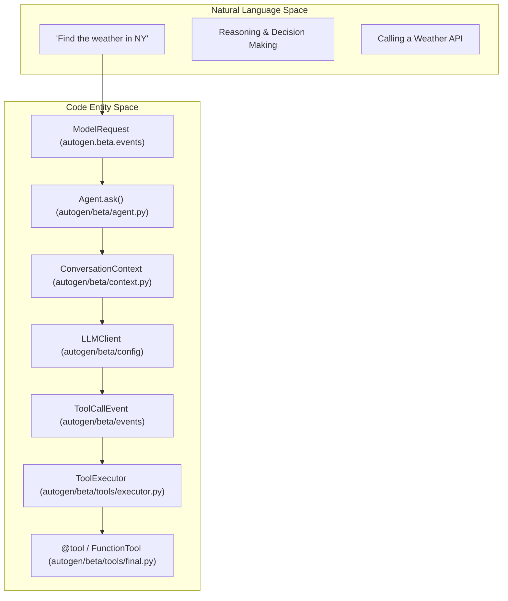
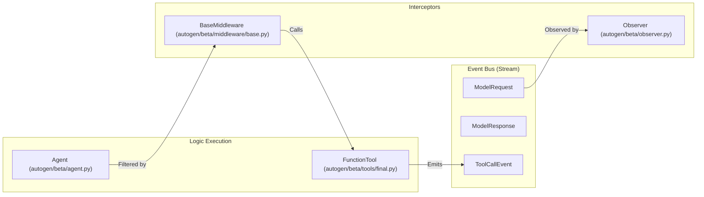

<!-- source: DeepWiki mcp.deepwiki.com · repo ag2ai/ag2 · page 8.1 Beta Agent Core · fetched 2026-10-27 -->

# Beta Agent Core

Relevant source files

The following files were used as context for generating this wiki page:

- [AGENTS.md](AGENTS.md)
- [autogen/beta/__init__.py](autogen/beta/__init__.py)
- [autogen/beta/agent.py](autogen/beta/agent.py)
- [autogen/beta/context.py](autogen/beta/context.py)
- [autogen/beta/events/__init__.py](autogen/beta/events/__init__.py)
- [autogen/beta/events/task_events.py](autogen/beta/events/task_events.py)
- [autogen/beta/middleware/builtin/tools/approval.py](autogen/beta/middleware/builtin/tools/approval.py)
- [autogen/beta/observer.py](autogen/beta/observer.py)
- [autogen/beta/stream.py](autogen/beta/stream.py)
- [autogen/beta/tools/subagents/__init__.py](autogen/beta/tools/subagents/__init__.py)
- [autogen/beta/tools/subagents/depth_limiter.py](autogen/beta/tools/subagents/depth_limiter.py)
- [autogen/beta/tools/subagents/persistent_stream.py](autogen/beta/tools/subagents/persistent_stream.py)
- [autogen/beta/tools/subagents/run_task.py](autogen/beta/tools/subagents/run_task.py)
- [autogen/beta/tools/subagents/subagent_tool.py](autogen/beta/tools/subagents/subagent_tool.py)
- [autogen/tools/experimental/__init__.py](autogen/tools/experimental/__init__.py)
- [pyproject.toml](pyproject.toml)
- [setup_autogen.py](setup_autogen.py)
- [test/beta/agent/test_observer.py](test/beta/agent/test_observer.py)
- [test/beta/test_task.py](test/beta/test_task.py)
- [test/beta/tools/test_persistent_stream.py](test/beta/tools/test_persistent_stream.py)
- [test/mypy/observer.py](test/mypy/observer.py)
- [website/docs/beta/advanced/observers.mdx](website/docs/beta/advanced/observers.mdx)
- [website/docs/user-guide/reference-tools/index.mdx](website/docs/user-guide/reference-tools/index.mdx)
- [website/mint-json-template.json.jinja](website/mint-json-template.json.jinja)

The `autogen.beta` package introduces a next-generation, protocol-driven async agent framework. Unlike the traditional `ConversableAgent` system, the Beta Agent Core is built on an event-driven architecture where all communication flows through an asynchronous stream as typed events. It emphasizes dependency injection, middleware-based interception, and a functional approach to tool definitions.

## Execution Pipeline

The execution of a beta agent is centered around the `Agent.ask` method and an internal asynchronous loop. When an agent is prompted, it enters a cycle of generating model requests, processing model responses, and executing tools until a terminal state is reached or a response is returned to the user.

### Pipeline Flow
1.  **Request Initiation**: `Agent.ask` is called, creating an initial `ModelRequest` event [autogen/beta/agent.py:190-202]().
2.  **Context Preparation**: A `ConversationContext` is initialized, carrying the `Stream`, dependencies, and variables [autogen/beta/agent.py:204-211]().
3.  **Middleware Execution**: The request passes through `AgentTurn` and `LLMCall` middleware hooks [autogen/beta/agent.py:35-35]().
4.  **LLM Interaction**: The `LLMClient` (e.g., `OpenAIClient`, `AnthropicClient`) processes the request [autogen/beta/agent.py:212-214]().
5.  **Event Dispatch**: `ModelResponse` or `ToolCallEvent` objects are emitted to the `Stream` [autogen/beta/agent.py:23-30]().
6.  **Tool Execution**: If tool calls are present, the `ToolExecutor` processes them, emitting `ToolResultEvent` back to the stream [autogen/beta/agent.py:29-32]().

### Natural Language to Code Mapping: Execution
The following diagram maps the logical flow of a conversation to the specific classes and protocols in the Beta core.

**Agent Execution Mapping**

Sources: [autogen/beta/agent.py:1-190](), [autogen/beta/context.py:82-102](), [autogen/beta/events/__init__.py:1-44](), [AGENTS.md:9-25]()

## Context and Stream

The `Stream` and `ConversationContext` are the backbone of the Beta architecture, enabling decoupled communication and state management.

### The Stream Protocol
The `Stream` is an asynchronous event bus. The default implementation is `MemoryStream`, which handles in-memory pub/sub of events [autogen/beta/stream.py]().
-   **Pub/Sub**: Agents and observers subscribe to specific event types using `Condition` objects [autogen/beta/context.py:38-66]().
-   **History**: Every stream maintains a `History` object that stores the sequence of events for LLM context window construction [autogen/beta/agent.py:127-128]().
-   **Filtering**: The `where()` method allows creating `SubStream` views filtered by event type or metadata [autogen/beta/context.py:29-29]().

### ConversationContext
`ConversationContext` (aliased as `Context` in many tools) provides the runtime environment for a single "turn" or task [autogen/beta/context.py:82-92]().
-   **Dependencies**: A dictionary for service-level objects (e.g., database connections) [autogen/beta/context.py:89-89]().
-   **Variables**: Serializable state that can persist or be passed between agents [autogen/beta/context.py:91-91]().
-   **Input**: Provides a structured way to request human feedback via `HumanInputRequest` and wait for a `HumanMessage` response [autogen/beta/context.py:93-98]().

Sources: [autogen/beta/context.py:19-102](), [autogen/beta/agent.py:127-129](), [AGENTS.md:47-52]()

## Dependency Injection

Beta agents use `fast-depends` to perform automatic parameter resolution for tools and hooks. This allows developers to request system components simply by type-hinting them.

| Annotation | Usage | Code Reference |
| :--- | :--- | :--- |
| `Context` | Injects the current `ConversationContext` | [autogen/beta/annotations.py:21-21]() |
| `Variable` | Injects a specific value from `context.variables` | [autogen/beta/annotations.py:14-14]() |
| `Inject` | Generic dependency injection for custom types | [autogen/beta/annotations.py:14-14]() |

### Tool Parameter Resolution
When a tool is executed, the system inspects its signature. If a parameter is annotated with `Context`, the `ToolExecutor` provides the active context object. If annotated with `Variable("key")`, it retrieves the value from the context's variable store [autogen/beta/tools/executor.py](), [AGENTS.md:51-52]().

Sources: [autogen/beta/agent.py:14-15](), [autogen/beta/context.py:85-86](), [AGENTS.md:47-52]()

## The Plugin and Observer System

Beta agents are extended through **Observers** and **Middleware**, rather than deep inheritance.

### Observers
Observers allow side-effect logic (logging, analytics, UI updates) to run without interfering with the agent's core logic.
-   **Registration**: Observers use the `register` method to attach to the stream [autogen/beta/observer.py:22-23]().
-   **Conditional Triggers**: The `@observer` decorator can target specific events, such as `ModelResponse` or `ToolCallEvent` [autogen/beta/observer.py:49-84]().

### Middleware
Middleware intercepts the execution flow at two primary points:
1.  **AgentTurn**: Intercepts the high-level `ask` call.
2.  **LLMCall**: Intercepts the raw interaction with the LLM provider.

**Entity Relationship: Plugins & Communication**

Sources: [autogen/beta/observer.py:1-84](), [autogen/beta/middleware/base.py:35-35](), [AGENTS.md:21-25]()

## Dynamic Prompts and Response Schemas

### Dynamic Prompts
The prompt for a Beta agent is not a static string but an `Iterable[str]` that can be modified at runtime via the `context.prompt` list [autogen/beta/agent.py:194-210](). This allows middleware or tools to inject instructions dynamically.

### Response Schemas
Beta agents support structured output through `ResponseProto`. When a `response_schema` (typically a Pydantic model) is provided to `ask`, the agent uses a validation loop [autogen/beta/agent.py:75-114]():
1.  **Validation**: Validates the LLM output against the schema.
2.  **Retry on Failure**: If validation fails, it automatically issues a new `ModelRequest` containing the validation error, asking the LLM to fix its response [autogen/beta/agent.py:100-114]().

Sources: [autogen/beta/agent.py:57-114](), [autogen/beta/response/](), [AGENTS.md:22-22]()

---

