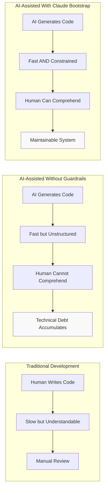
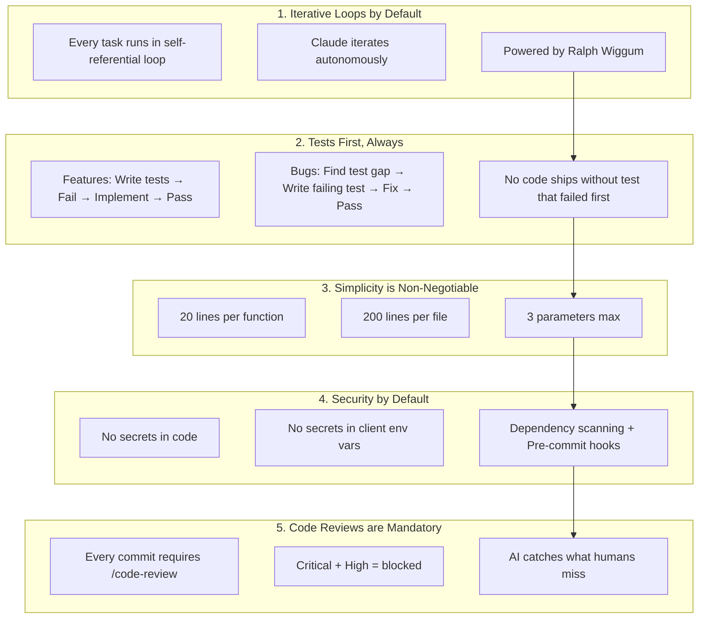
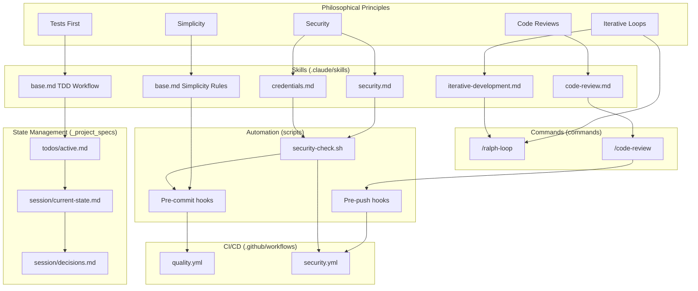
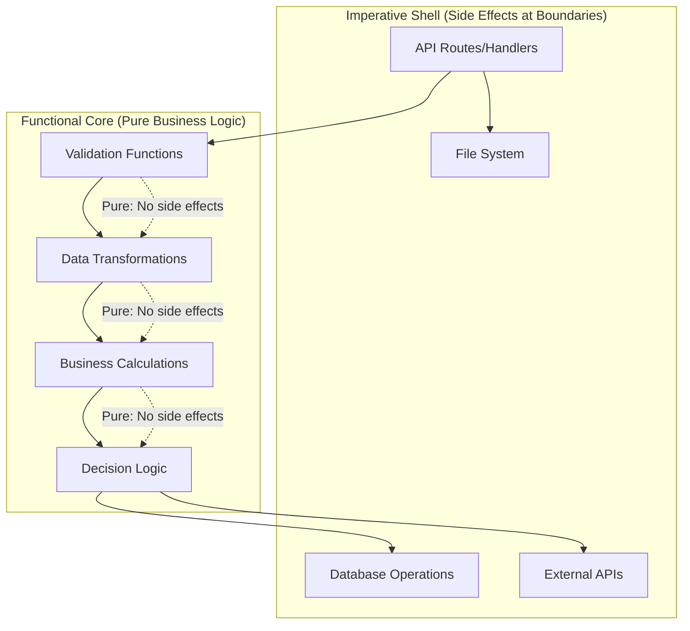
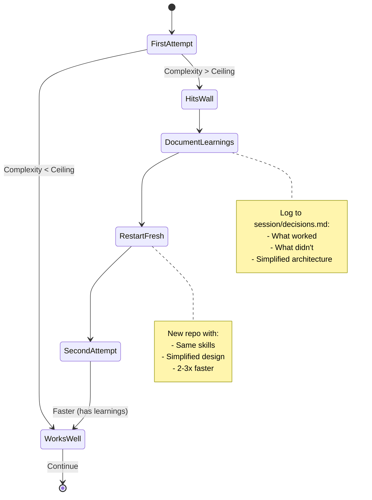
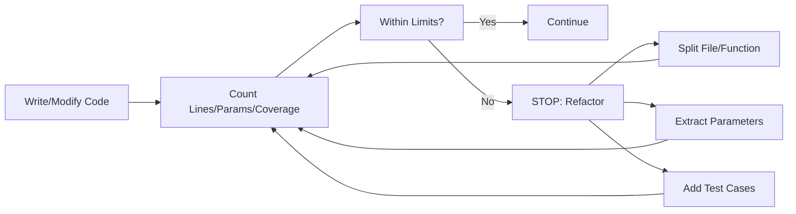

<!-- source: DeepWiki mcp.deepwiki.com · repo alinaqi/claude-bootstrap · page 3.1 Development Philosophy · fetched 2026-10-27 -->

# Development Philosophy

Relevant source files

The following files were used as context for generating this wiki page:

- [README.md](README.md)
- [skills/base.md](skills/base.md)
- [templates/CLAUDE.md](templates/CLAUDE.md)

## Purpose and Scope

This page explains the core philosophy underlying Claude Bootstrap: why it exists, what problems it solves, and the guiding principles that inform its design. This document focuses on the **rationale and motivation** behind the system's constraints and workflows.

For detailed implementation of the TDD workflow, see [TDD Workflow (RED-GREEN-VALIDATE)](#3.2). For enforcement mechanisms of complexity limits, see [Simplicity Rules and Enforcement](#3.3). For the practical workflow of breaking work into units, see [Atomic Todos and Project Specs](#3.4).

---

## The Problem: Code Comprehension is the Bottleneck

Claude Bootstrap exists because **the bottleneck in AI-assisted development has shifted from code generation to code comprehension**. AI can generate infinite code, but humans still need to review, understand, and maintain it.

**The fundamental insight**: After hundreds of AI-assisted projects across Node, React, Python, and React Native, three patterns emerged:

1. **Engineers struggle with Claude Code not because of the tool, but because of how they instruct it** - The delta is in the guardrails
2. **Complexity has a ceiling** - There's a point where AI loses coherent understanding of the system. That's a signal, not a failure
3. **Restart is a feature, not failure** - When fixing something increases complexity, restart with learnings. Each iteration is faster

Sources: [README.md:42-50]()

---

## Core Principles

Claude Bootstrap enforces five non-negotiable principles. Each principle addresses a specific failure mode in AI-assisted development.

### Principle Hierarchy

Sources: [README.md:9-39]()

### 1. Iterative Loops by Default

**Principle**: Every task runs in a self-referential loop until tests pass. Claude iterates autonomously. Developers describe **what**, not **how**.

**Rationale**: AI-generated code often requires multiple refinement passes. Without loops, developers must manually re-prompt, breaking flow and losing context. Automatic iteration treats refinement as the default, not an exception.

**Enforcement**: The `ralph-loop` plugin implements stop-hook interception that feeds the same prompt back with updated file states until completion criteria are met.

Sources: [README.md:11-15](), [skills/base.md:499-578]()

### 2. Tests First, Always

**Principle**: Features require tests that fail before implementation. Bug fixes require tests that reproduce the bug before fixing.

**Rationale**: AI can generate tests that always pass (false positives). Requiring tests to fail first proves they actually validate the requirement. For bugs, failing tests prove the test would have caught the issue.

**Enforcement**: The TDD execution log in atomic todos tracks RED (tests fail), GREEN (tests pass), and VALIDATE (quality gates) phases.

Sources: [README.md:17-21](), [skills/base.md:187-214]()

### 3. Simplicity is Non-Negotiable

**Principle**: Hard limits on function length (20 lines), file length (200 lines), and parameter count (3 max). If you can't understand the whole system in one session, it's too complex.

**Rationale**: Complexity correlates with defect rates. Large functions and files reduce AI's ability to maintain coherent context. Measurable constraints prevent the gradual accumulation of incomprehensible code.

**Enforcement**: Pre-completion checks count lines and parameters. Claude must stop and refactor on violations before continuing.

Sources: [README.md:23-27](), [skills/base.md:9-50]()

### 4. Security by Default

**Principle**: No secrets in code, no secrets in client-exposed environment variables, dependency scanning on every PR.

**Rationale**: AI doesn't inherently understand security boundaries. Without explicit rules, it will place API keys in client-side code or commit secrets to version control.

**Enforcement**: Multi-layer defense including `Access.txt` centralized credentials, pre-commit secret scanning, code review checks, and CI validation.

Sources: [README.md:29-32](), [skills/base.md:414-437]()

### 5. Code Reviews are Mandatory

**Principle**: Every commit requires `/code-review` before push. Critical and High severity issues block the push.

**Rationale**: AI catches patterns humans miss (security vulnerabilities, N+1 queries). Humans catch what AI misses (business logic, architectural coherence).

**Enforcement**: Pre-push hooks run `/code-review` and block on Critical/High issues. GitHub Actions run the same check in CI.

Sources: [README.md:34-38]()

---

## Philosophy to Implementation Mapping

The following diagram maps each philosophical principle to the concrete files and systems that enforce it:

Sources: [README.md:296-317](), [skills/base.md:1-50]()

---

## Why AI-Native Development Needs Guardrails

Traditional software development wisdom assumes humans write code slowly with deliberate thought. AI-assisted development inverts this:

| Aspect | Human-Written | AI-Generated Without Guardrails | AI-Generated With Guardrails |
|--------|---------------|----------------------------------|------------------------------|
| **Generation Speed** | Slow | Fast | Fast |
| **Initial Quality** | Variable | Variable | Constrained |
| **Comprehensibility** | High (human wrote it) | Low (no structure) | High (enforced structure) |
| **Test Coverage** | Often skipped | Often missing | Mandatory (TDD-first) |
| **Security** | Manual review needed | High risk | Multi-layer enforcement |
| **Maintainability** | Depends on discipline | Degrades quickly | Preserved by constraints |

### The Comprehension Problem

Without guardrails, AI generates code faster than humans can review it. The system becomes a black box where:
- Functions exceed cognitive load limits (>20 lines)
- Files become scrolling documents (>200 lines)
- Tests are written after implementation (if at all)
- Complexity accumulates invisibly

**Claude Bootstrap's solution**: Measurable constraints that keep code within human comprehension limits. Not "write clean code" (vague), but "20 lines per function" (measurable).

Sources: [README.md:3-6](), [skills/base.md:1-8]()

---

## Architectural Philosophy: Functional Core, Imperative Shell

Claude Bootstrap enforces a specific architectural pattern derived from functional programming principles:

**Key principles**:
- **Pure functions for business logic**: No side effects, deterministic, easy to test
- **Side effects only at boundaries**: API calls, database, file system at edges
- **Data in, data out**: Functions transform data, they don't mutate state

**Testing implications**:
- Core functions: 100% coverage, unit tests with no mocks
- Shell functions: Integration tests with real dependencies or stubs

Sources: [skills/base.md:54-69]()

---

## Restart as a Feature, Not Failure

**Counter-intuitive principle**: When fixing a bug increases complexity, restart the implementation with learnings from the first attempt.

### The Complexity Ceiling

There exists a point in every project where AI loses coherent understanding of the system. This manifests as:
- Repetitive fixes that don't solve the root cause
- New bugs introduced while fixing old bugs
- Increasing time per task as complexity grows

**Traditional response**: Push through, refactor later
**Claude Bootstrap response**: Restart is a feature

### Restart Workflow

**When to restart**:
1. Fixes take longer than initial implementation
2. New features break existing tests repeatedly
3. Codebase exceeds comprehension in one session

**Learnings to preserve**:
- Architectural decisions (what worked)
- API designs (keep stable interfaces)
- Test cases (business requirements)
- Integration patterns (external services)

Sources: [README.md:42-50]()

---

## Anti-Patterns Explicitly Prevented

Claude Bootstrap's philosophy codifies common failure modes as anti-patterns with automated prevention:

| Anti-Pattern | Why It Happens | How Claude Bootstrap Prevents |
|--------------|----------------|-------------------------------|
| **Tests after implementation** | AI generates working code first, tests feel redundant | TDD execution log requires RED phase before GREEN |
| **Fixing bugs without tests** | Pressure to ship quickly | Bug fix workflow requires test gap analysis first |
| **Large PRs (>400 lines)** | AI generates code fast, commits lag behind | Commit hygiene tracking warns at thresholds |
| **Secrets in code** | AI doesn't understand security boundaries | Multi-layer scanning (pre-commit, code review, CI) |
| **God objects** | Incremental feature additions bloat files | 200-line file limit enforced before completion |
| **Deep nesting** | Natural code structure without constraints | 2-level nesting max, enforced by base.md rules |
| **Missing type safety** | TypeScript/Python type hints are optional | Type checking in VALIDATE phase blocks completion |
| **Silent failures** | AI generates defensive code that swallows errors | Error handling rules: fail fast, fail loud |

Sources: [skills/base.md:82-96](), [skills/base.md:254-263](), [skills/base.md:336-341]()

---

## Measurable Constraints Over Vague Guidance

Traditional code review comments:
- ❌ "This function is too complex"
- ❌ "Add more tests"
- ❌ "Improve error handling"

Claude Bootstrap constraints:
- ✅ "Function exceeds 20 lines (currently 34), decompose"
- ✅ "Coverage at 72% (minimum 80%), add test cases for X, Y"
- ✅ "Error swallowed at line 15, throw or log explicitly"

**Why this matters for AI**: AI cannot improve against vague guidance. Measurable constraints provide clear success criteria that both AI and humans can verify.

### Constraint Enforcement Flow

Sources: [skills/base.md:9-50]()

---

## Summary: Philosophy in Practice

Claude Bootstrap's development philosophy rests on one core insight: **AI can generate infinite code, but humans have finite comprehension**. Every principle and constraint exists to keep AI-generated code within human understanding limits.

The five principles work together as a system:
1. **Iterative loops** ensure refinement happens automatically
2. **TDD** proves code works and tests are valid
3. **Simplicity rules** keep code comprehensible
4. **Security enforcement** prevents common vulnerabilities
5. **Code reviews** catch what automated checks miss

For implementation details of each principle, see the following pages:
- [TDD Workflow (RED-GREEN-VALIDATE)](#3.2) - The mechanics of test-first development
- [Simplicity Rules and Enforcement](#3.3) - How constraints are checked and enforced
- [Atomic Todos and Project Specs](#3.4) - Breaking work into verifiable units

Sources: [README.md:1-50](), [skills/base.md:1-96]()

---

