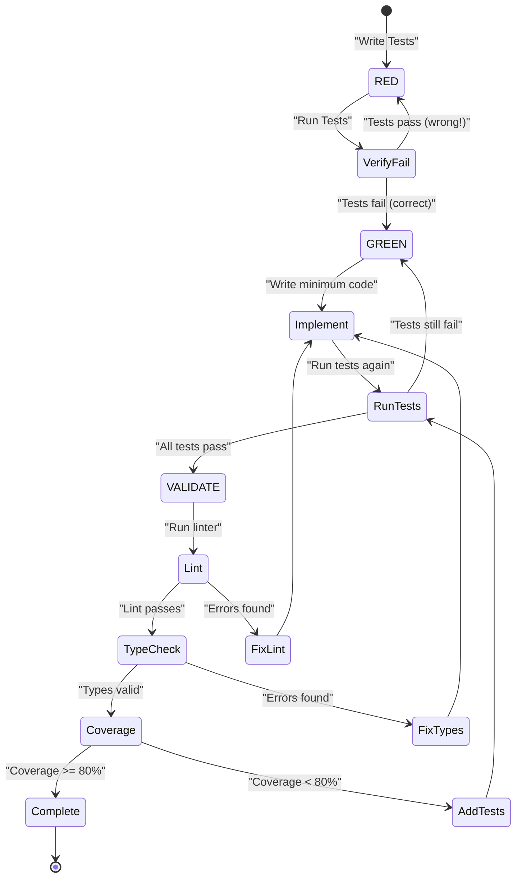
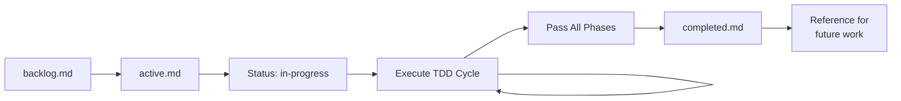
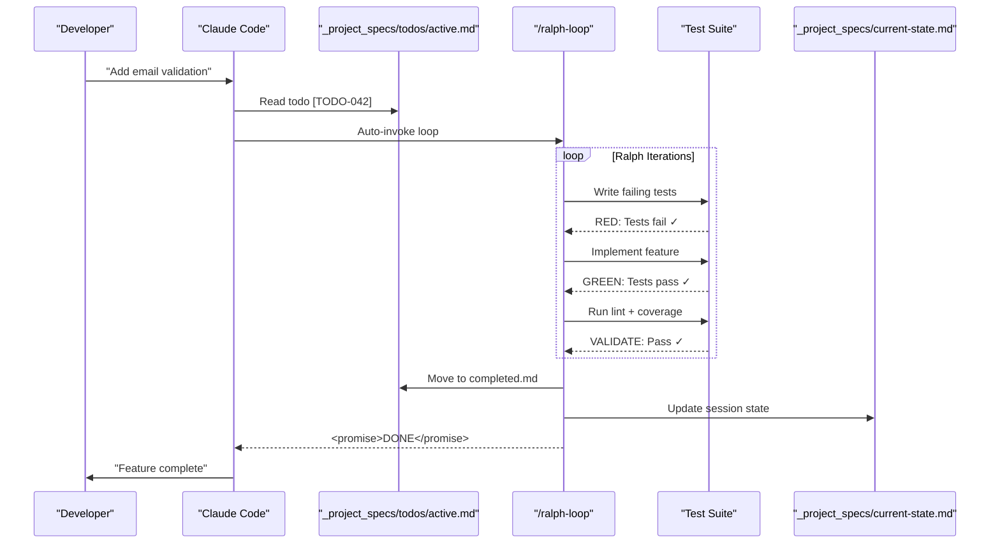
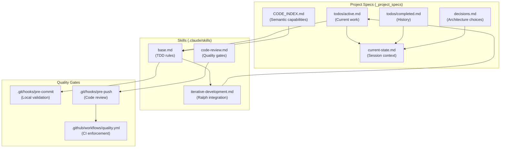
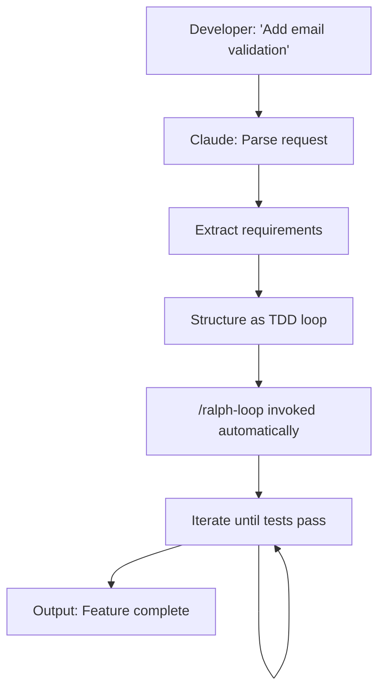
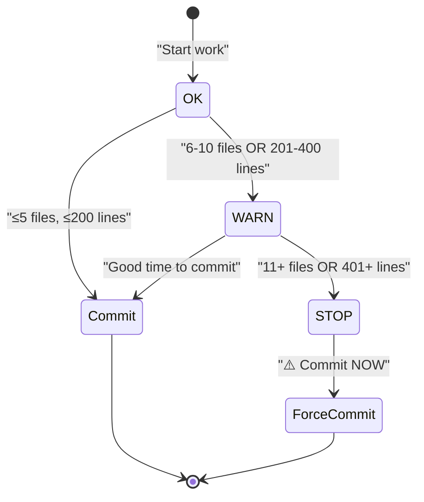
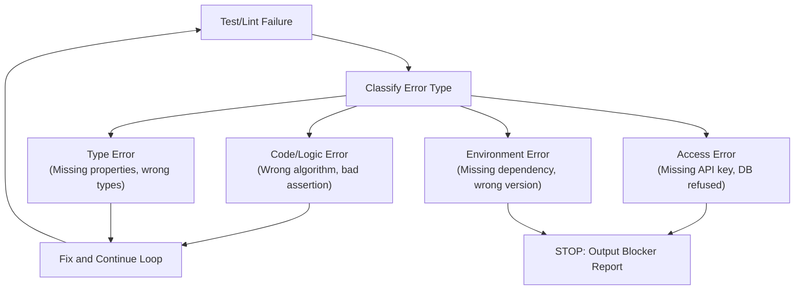
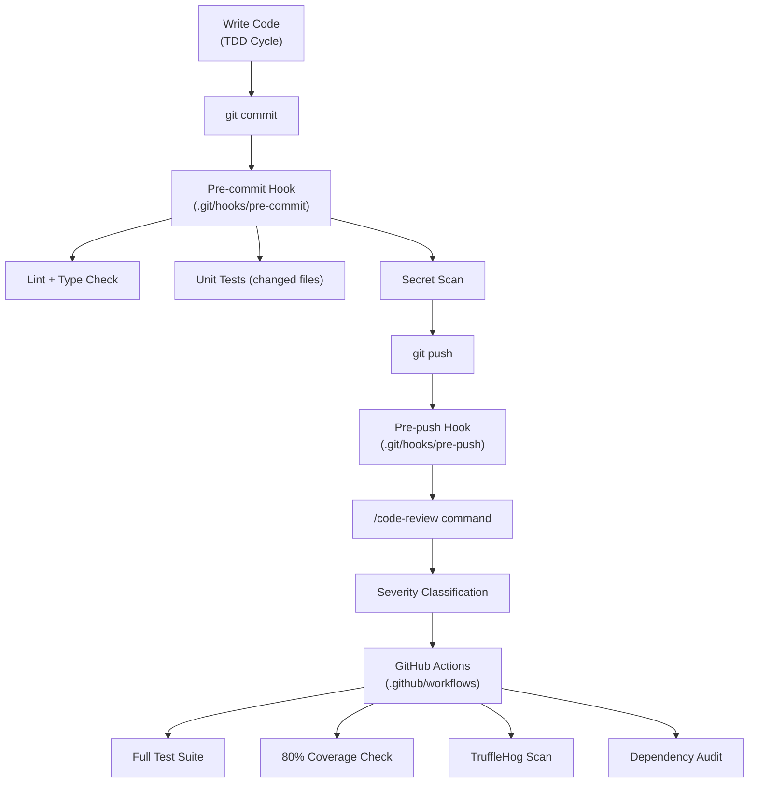

<!-- source: DeepWiki mcp.deepwiki.com · repo alinaqi/claude-bootstrap · page 4 Development Workflow · fetched 2026-10-27 -->

# Development Workflow

<details>
<summary>Relevant source files</summary>

The following files were used as context for generating this wiki page:

- [README.md](README.md)
- [skills/iterative-development.md](skills/iterative-development.md)

</details>


## Purpose and Scope

This page describes the end-to-end development workflow in Claude Bootstrap, from receiving a feature request to deploying code. It covers the TDD-first methodology, atomic todo management, and how the various system components integrate during active development.

For deep dives into specific workflow components, see:
- [Ralph Loop: Iterative Development](#4.1) - Details on autonomous TDD iteration
- [Session Management](#4.2) - Context preservation and checkpoint mechanisms
- [Quality Gates and Code Review](#4.3) - Multi-layer validation enforcement

## Overview

Claude Bootstrap enforces a structured development workflow built around three core principles:

1. **Test-Driven Development (TDD)** - Tests must be written first and must fail before implementation
2. **Iterative Loops** - Features are developed through self-referential cycles until completion criteria are met
3. **Quality Gates** - Multiple validation layers prevent defective code from progressing

The workflow transforms natural language requests into validated, tested code through a series of automated phases.

**Sources:** [README.md:1-40](), [skills/iterative-development.md:1-30]()

---

## The TDD Workflow: RED-GREEN-VALIDATE

### Three-Phase Cycle

Every feature, bug fix, and refactoring follows a mandatory three-phase cycle:



### Phase 1: RED - Write Failing Tests

Tests must be written **before** any implementation code. The tests must fail on first execution to prove they validate the requirements.

**For Features:**
```markdown
1. Read acceptance criteria from _project_specs/todos/active.md
2. Write test cases covering all criteria
3. Run: npm test (or pytest, etc.)
4. Verify: Tests FAIL with expected error messages
5. If tests pass: Fix tests, they're wrong
```

**For Bugs:**
```markdown
1. Reproduce the bug
2. Identify the test gap (why didn't existing tests catch this?)
3. Write a test that reproduces the bug
4. Run: npm test -- --grep "bug description"
5. Verify: Test FAILS (proves it catches the bug)
```

**Sources:** [README.md:321-343](), [skills/iterative-development.md:76-106]()

### Phase 2: GREEN - Minimum Implementation

Write the simplest code that makes tests pass. No premature optimization, no extra features.

```markdown
1. Implement the minimum code to pass tests
2. Run: npm test
3. If tests fail: Debug and fix
4. Repeat until all tests pass
5. Do NOT proceed to VALIDATE until tests are green
```

**Sources:** [README.md:324-331]()

### Phase 3: VALIDATE - Quality Enforcement

Once tests pass, validate code quality:

```markdown
1. Run linter: npm run lint (or ruff check)
2. Run type checker: tsc --noEmit (or mypy)
3. Run coverage: npm test -- --coverage
4. Verify: Coverage >= 80%
5. If any failures: Fix and re-run tests
```

**Sources:** [README.md:324-331](), [README.md:515-529]()

### TDD Execution Log

All todos track the TDD execution in structured tables:

```markdown
### TDD Execution Log
| Phase | Command | Result |
|-------|---------|--------|
| RED | `npm test -- --grep "email validation"` | 2 tests failed ✓ |
| GREEN | `npm test -- --grep "email validation"` | 2 tests passed ✓ |
| VALIDATE | `npm run lint && npm run typecheck && npm test -- --coverage` | Pass, 84% ✓ |
```

**Sources:** [README.md:552-558]()

---

## Atomic Todo System

### Todo File Structure

Development work is tracked through atomic todos stored in `_project_specs/todos/`:

```
_project_specs/
└── todos/
    ├── active.md          # Current work
    ├── completed.md       # Finished work (never deleted)
    └── backlog.md         # Future work
```

**Sources:** [README.md:308-312]()

### Todo Format

```markdown
## [TODO-042] Add email validation to signup form

**Status:** in-progress
**Priority:** high
**Estimate:** S

### Acceptance Criteria
- [ ] Email field shows error for invalid format
- [ ] Form cannot submit with invalid email
- [ ] Error clears when user fixes input

### Test Cases
| Input | Expected |
|-------|----------|
| user@example.com | Valid |
| notanemail | Error: "Invalid email format" |
| user@ | Error: "Invalid email format" |

### TDD Execution Log
| Phase | Command | Result |
|-------|---------|--------|
| RED | `npm test -- email-validation` | 3 tests failed ✓ |
| GREEN | `npm test -- email-validation` | 3 tests passed ✓ |
| VALIDATE | `npm run lint && npm test -- --coverage` | Pass, 82% ✓ |
```

**Sources:** [README.md:533-558]()

### Todo Lifecycle



**Key Rules:**
- Todos move from `active.md` to `completed.md`, never deleted
- Each todo is atomic (completable in one session)
- Test cases must be defined before starting
- Completion requires all TDD phases to pass

**Sources:** [README.md:389-395](), [README.md:533-577]()

---

## Development Session Flow

### Typical Session Structure



**Sources:** [README.md:71-94](), [skills/iterative-development.md:50-68]()

### Workflow Phases

| Phase | Activities | Files Modified | Exit Criteria |
|-------|-----------|----------------|---------------|
| **1. Planning** | Select todo, read specs | `active.md` (status update) | Todo claimed |
| **2. RED** | Write failing tests | Test files created/modified | Tests fail |
| **3. GREEN** | Implement minimum code | Source files modified | Tests pass |
| **4. VALIDATE** | Lint, typecheck, coverage | Config files may update | All checks pass |
| **5. Complete** | Move todo, update state | `completed.md`, `current-state.md` | Todo archived |

**Sources:** [README.md:321-331]()

---

## File Structure During Development

### Core Development Files



**Sources:** [README.md:296-317]()

### Session State Files

| File | Purpose | Updated When |
|------|---------|--------------|
| `_project_specs/current-state.md` | Current session context, progress, blockers | After each major change |
| `_project_specs/decisions.md` | Architecture and design decisions | When making technical choices |
| `_project_specs/CODE_INDEX.md` | Semantic capability index | After adding new functions |
| `_project_specs/todos/active.md` | Active work tracking | When claiming, updating, or completing todos |

**Sources:** [README.md:308-317]()

---

## Workflow Automation

### Automatic Ralph Loop Invocation

Claude automatically transforms natural language requests into iterative TDD loops:



**No manual `/ralph-loop` invocation needed.** Claude recognizes feature requests and automatically:
1. Extracts requirements
2. Identifies test cases
3. Structures as a TDD loop
4. Runs iterations until completion

**Opt-out phrases** (when you don't want loops):
- "Just explain..."
- "Quick fix..."
- "Don't loop..."

**Sources:** [README.md:71-100]()

### Commit Hygiene Monitoring

Claude automatically tracks changes and advises when to commit:



**Thresholds:**
- 🟢 **OK:** ≤ 5 files, ≤ 200 lines
- 🟡 **WARN:** 6-10 files, 201-400 lines → "Commit soon"
- 🔴 **STOP:** > 10 files, > 400 lines → "Commit NOW"

**Why this matters:**
- PRs < 200 lines: 15% defect rate
- PRs 200-400 lines: 23% defect rate
- PRs > 400 lines: 40%+ defect rate

**Sources:** [README.md:119-147]()

---

## Error Classification and Handling

### Error Types in Workflow

Not all failures require iteration. Claude classifies errors before deciding how to proceed:



**Sources:** [skills/iterative-development.md:293-331]()

### Blocker Report Format

When Claude detects an unfixable error, it stops immediately:

```markdown
## 🛑 LOOP BLOCKED - Human Action Required

**Error Type:** Access/Environment (cannot be fixed by code changes)

**Error Message:**
ECONNREFUSED 127.0.0.1:5432 - Connection refused

**Root Cause:**
PostgreSQL database is not running or not accessible.

**Required Human Actions:**
1. [ ] Start PostgreSQL: `brew services start postgresql`
2. [ ] Verify connection: `psql -U postgres -c "SELECT 1"`
3. [ ] Check DATABASE_URL in .env matches running instance

**After Fixing:**
Run `/ralph-loop` again with the same prompt.

<promise>BLOCKED ENVIRONMENT</promise>
```

**Sources:** [skills/iterative-development.md:333-359](), [README.md:579-612]()

### Common Blockers

| Error Pattern | Likely Cause | Human Fix |
|---------------|--------------|-----------|
| `ECONNREFUSED :5432` | PostgreSQL not running | `brew services start postgresql` |
| `ECONNREFUSED :6379` | Redis not running | `brew services start redis` |
| `401 Unauthorized` | Invalid/missing API key | Check `.env` file |
| `MODULE_NOT_FOUND` | Missing npm package | Run `npm install` |
| `ENOENT .env` | Missing .env file | Create from `.env.example` |

**Sources:** [skills/iterative-development.md:361-373](), [README.md:604-612]()

---

## Integration with Quality Gates

### Multi-Layer Validation

The development workflow integrates with three quality gate layers:



**Gate Behaviors:**
- **Pre-commit:** Fast checks on changed files only
- **Pre-push:** Full code review with severity-based blocking
- **CI:** Comprehensive validation with 80% coverage enforcement

For detailed information on each gate, see [Quality Gates and Code Review](#4.3).

**Sources:** [README.md:175-209](), [README.md:515-529]()

---

## Workflow Commands Reference

### Core Development Commands

| Command | Purpose | Typical Usage |
|---------|---------|---------------|
| `/initialize-project` | Set up project structure and skills | First time in new project |
| `/ralph-loop "prompt" --max-iterations N` | Manually invoke iterative loop | Complex multi-step features |
| `/cancel-ralph` | Stop active Ralph loop | Loop stuck or needs human input |
| `/code-review` | Run mandatory code review | Before pushing (auto-invoked by pre-push hook) |
| `/check-contributors` | Check team state and conflicts | Start of session in team projects |
| `/update-code-index` | Regenerate semantic capability index | After adding new functions |

**Sources:** [README.md:52-62](), [skills/iterative-development.md:52-68]()

### Ralph Loop State Management

```bash
# Check current iteration
grep '^iteration:' .claude/ralph-loop.local.md

# View full state
head -10 .claude/ralph-loop.local.md

# Cancel active loop
/cancel-ralph
```

**State file:** `.claude/ralph-loop.local.md` (gitignored, session-specific)

**Sources:** [skills/iterative-development.md:446-468]()

---

## Best Practices

### Session Start Checklist

```markdown
- [ ] Pull latest changes: `git pull`
- [ ] Check team state: `/check-contributors` (if team project)
- [ ] Review current-state.md for context
- [ ] Select todo from active.md
- [ ] Update todo status to "in-progress"
- [ ] Read acceptance criteria and test cases
```

**Sources:** [README.md:243-246]()

### During Development

```markdown
- [ ] Follow RED-GREEN-VALIDATE cycle strictly
- [ ] Monitor commit size (stay under 5 files, 200 lines if possible)
- [ ] Check CODE_INDEX.md before creating new functions
- [ ] Update current-state.md after major changes
- [ ] Document decisions in decisions.md
- [ ] Watch for blocker errors (stop and report)
```

**Sources:** [README.md:256-295](), [skills/iterative-development.md:576-595]()

### Session End Checklist

```markdown
- [ ] All tests passing
- [ ] Lint clean, types valid
- [ ] Coverage >= 80%
- [ ] Todo moved to completed.md
- [ ] current-state.md updated with progress
- [ ] Changes committed with atomic message
- [ ] Code review passed (if pushing)
```

**Sources:** [README.md:389-395](), [skills/iterative-development.md:576-595]()

---

## Anti-Patterns to Avoid

| Anti-Pattern | Why It's Wrong | Correct Approach |
|--------------|----------------|------------------|
| Writing implementation before tests | No proof tests validate requirements | Write tests first, verify they fail |
| Tests that always pass | False confidence | Run tests before implementation, must fail |
| Skipping VALIDATE phase | Quality issues slip through | Always run lint, typecheck, coverage |
| Fixing bugs without test first | Bug can recur | Write test that reproduces bug, then fix |
| Large commits (>10 files, >400 lines) | High defect rate, hard to review | Commit frequently at green states |
| Ignoring blocker reports | Loop wastes iterations | Stop immediately, fix environment |
| Manual loop exit without completion | Incomplete work | Let loop complete or hit max iterations |

**Sources:** [README.md:338-343](), [skills/iterative-development.md:519-527]()

---

## Summary

The Claude Bootstrap development workflow enforces a rigorous, automated TDD methodology:

1. **Atomic todos** define work with clear acceptance criteria and test cases
2. **RED-GREEN-VALIDATE** cycle ensures tests drive implementation
3. **Automatic iteration** via Ralph loops eliminates manual intervention
4. **Error classification** distinguishes fixable code issues from environment blockers
5. **Quality gates** enforce standards at commit, push, and CI levels
6. **Session management** preserves context and enables resumability

This workflow transforms natural language feature requests into production-ready code through a series of automated, validated phases, with human intervention required only for environment setup and architectural decisions.

**Sources:** [README.md:1-80](), [README.md:319-395](), [skills/iterative-development.md:1-595]()

---

