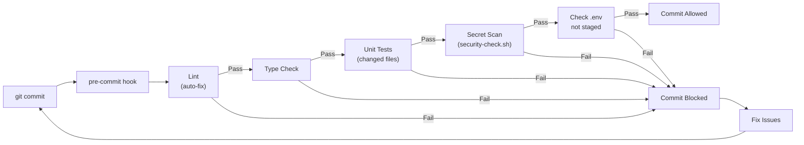
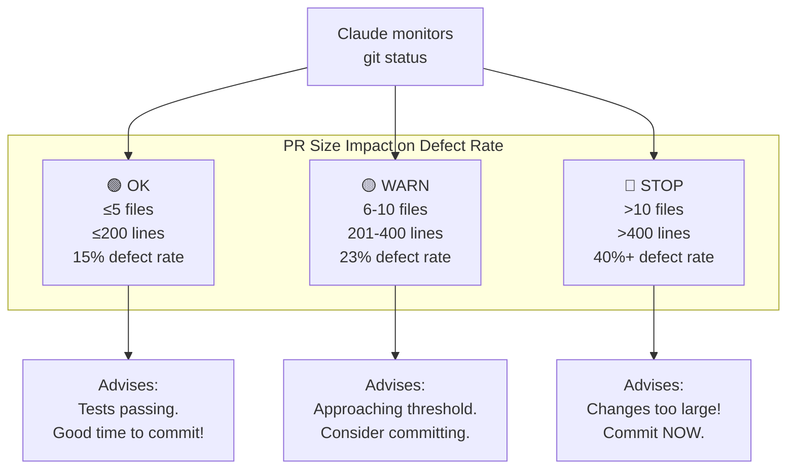
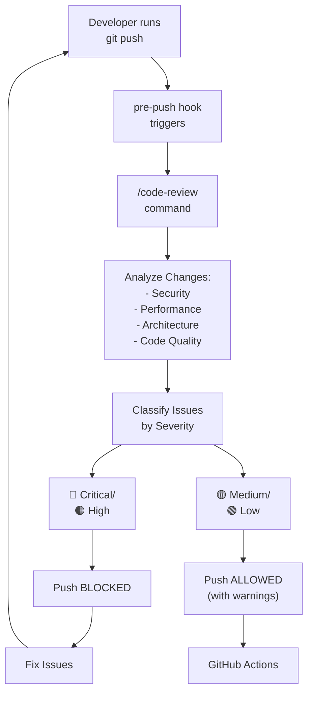
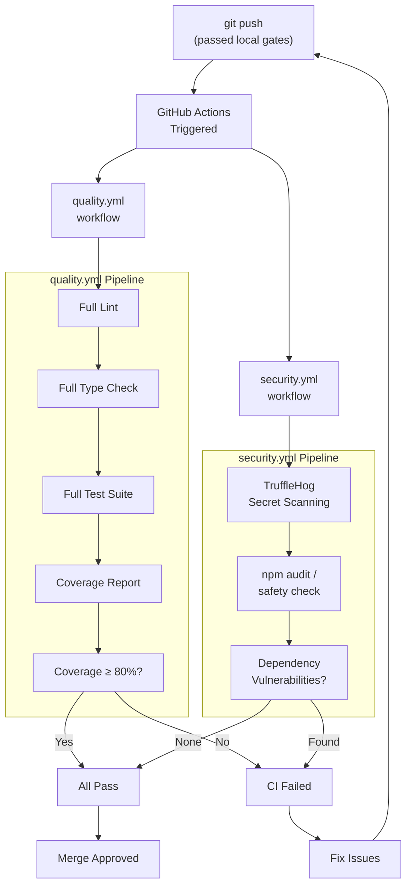
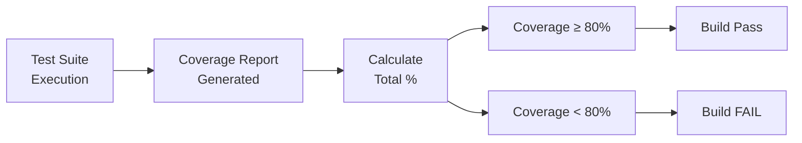
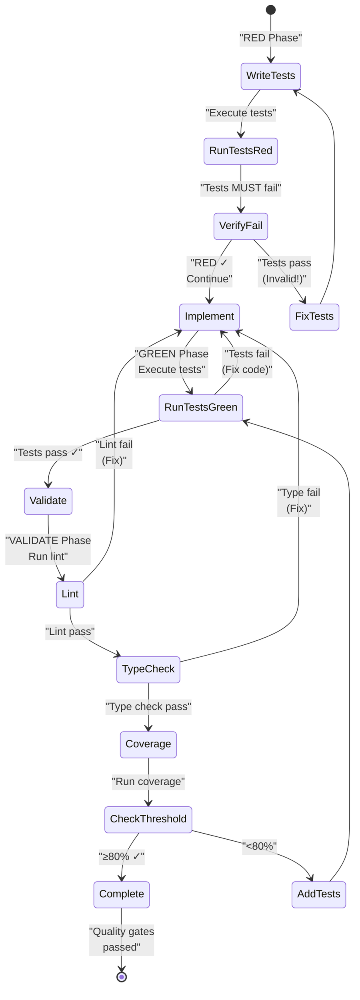
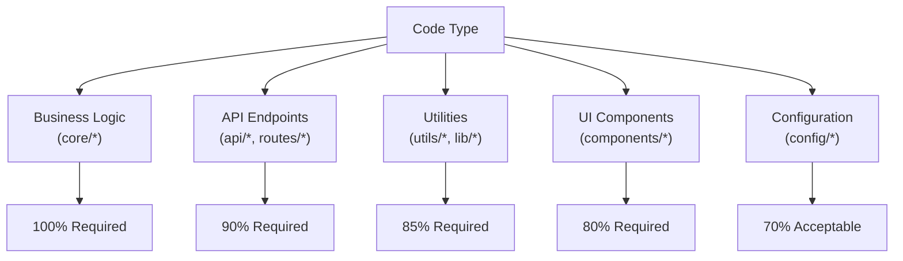
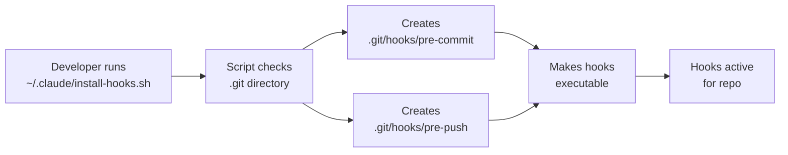

<!-- source: DeepWiki mcp.deepwiki.com · repo alinaqi/claude-bootstrap · page 4.3 Quality Gates and Code Review · fetched 2026-10-27 -->

# Quality Gates and Code Review

<details>
<summary>Relevant source files</summary>

The following files were used as context for generating this wiki page:

- [README.md](README.md)
- [skills/base.md](skills/base.md)
- [templates/CLAUDE.md](templates/CLAUDE.md)

</details>


## Purpose and Scope

This document describes Claude Bootstrap's multi-layer quality enforcement system that prevents defective code from progressing through the development pipeline. The system implements defense-in-depth validation through local pre-commit hooks, mandatory code review via `/code-review`, commit hygiene monitoring, and CI/CD validation with coverage enforcement.

For information about the iterative TDD workflow that produces code validated by these gates, see [Ralph Loop: Iterative Development](#4.1). For session context preservation after passing quality gates, see [Session Management](#4.2).

---

## Multi-Layer Enforcement Architecture

Claude Bootstrap implements five progressive layers of quality validation. Each layer catches different classes of issues, and failure at any layer triggers feedback to the development loop.

### Defense-in-Depth Layers

| Layer | Stage | Validation Type | Blocks On |
|-------|-------|----------------|-----------|
| **1. Pre-Commit Hooks** | `git commit` | Lint, type check, unit tests, secret scan | Any failure |
| **2. Commit Hygiene** | During development | PR size tracking | Advisory warnings |
| **3. Pre-Push Review** | `git push` | `/code-review` analysis | Critical/High issues |
| **4. CI/CD Validation** | GitHub Actions | Full test suite, coverage, security | Any failure |
| **5. Deployment Gates** | Production release | Final validation | Below 80% coverage |

**Sources:** [README.md:515-529](), [README.md:176-209]()

---

## Layer 1: Pre-Commit Hooks

Pre-commit hooks execute fast local validation on every commit attempt, providing immediate feedback before code enters version control.

### Pre-Commit Validation Pipeline



**Sources:** [README.md:517-523]()

### Installation

Pre-commit hooks are installed via a script in the global Claude installation:

```bash
~/.claude/install-hooks.sh
```

This script creates or updates `.git/hooks/pre-commit` in the current repository.

**Sources:** [README.md:190-192]()

### Validation Commands by Stack

**Node.js/TypeScript:**
```bash
# Pre-commit runs:
npm run lint          # ESLint with auto-fix
npm run typecheck     # TypeScript compiler (tsc --noEmit)
npm test -- --onlyChanged --bail  # Jest/Vitest on changed files
./scripts/security-check.sh       # Secret detection
```

**Python:**
```bash
# Pre-commit runs:
ruff check . --fix    # Linting with auto-fix
mypy .                # Type checking
pytest tests/ --exitfirst  # Tests on changed modules
./scripts/security-check.sh
```

**Sources:** [base.md:217-253]()

### Blocking Conditions

The pre-commit hook blocks when:

| Condition | Severity | Action |
|-----------|----------|--------|
| Linter errors | Error | Block (warnings may pass) |
| Type check failures | Error | Block |
| Test failures | Error | Block |
| Secrets detected | Critical | Block |
| `.env` file staged | Critical | Block |

**Sources:** [base.md:448-452](), [README.md:360-364]()

---

## Layer 2: Commit Hygiene Monitoring

Claude automatically tracks changes during development and advises when to commit, preventing oversized PRs that correlate with higher defect rates.

### Commit Size Thresholds



**Sources:** [README.md:119-147]()

### Automatic Tracking

Claude checks commit size after completing todos or when running quality checks:

| Files Changed | Lines Changed | Status | Claude Action |
|---------------|---------------|--------|---------------|
| ≤5 | ≤200 | 🟢 OK | "Good time to commit!" |
| 6-10 | 201-400 | 🟡 WARN | "Approaching threshold. Consider committing." |
| >10 | >400 | 🔴 STOP | "Changes too large! Commit now." |

### Atomic Commit Principle

If describing a commit requires the word "and", it should be split into multiple commits:

- ❌ "Add authentication and fix bug in signup"
- ✅ "Add authentication" + "Fix signup validation bug"

**Sources:** [README.md:119-147](), [skills/commit-hygiene.md]() (referenced but not provided)

---

## Layer 3: Pre-Push Code Review

Every push requires code review analysis via the `/code-review` command, which blocks pushes containing Critical or High severity issues.

### Code Review Command Flow



**Sources:** [README.md:176-209]()

### Severity Classification

The code review system classifies issues into four severity levels:

| Level | Symbol | Description | Push Allowed? | Required Action |
|-------|--------|-------------|---------------|-----------------|
| **Critical** | 🔴 | Security vulnerabilities, data loss risks | ❌ BLOCKED | Must fix now |
| **High** | 🟠 | Performance issues, architectural violations | ❌ BLOCKED | Must fix now |
| **Medium** | 🟡 | Code quality, maintainability concerns | ✅ Advisory | Fix soon |
| **Low** | 🟢 | Style suggestions, nice-to-haves | ✅ Advisory | Optional |

**Sources:** [README.md:194-201]()

### Issue Categories Detected

**Security (Critical/High):**
- SQL injection vulnerabilities
- XSS attack vectors
- Hardcoded secrets or API keys
- Insecure authentication patterns
- Missing input validation

**Performance (High/Medium):**
- N+1 query patterns
- Memory leaks
- Inefficient algorithms
- Missing database indexes

**Architecture (High/Medium):**
- Tight coupling between modules
- SOLID principle violations
- Circular dependencies
- God objects/files (>200 lines)

**Code Quality (Medium/Low):**
- Complexity violations (>20 lines/function)
- Missing type annotations
- Code duplication
- Missing test coverage

**Sources:** [README.md:203-207]()

### Pre-Push Hook Integration

To enable automatic code review on push:

```bash
~/.claude/install-hooks.sh
```

This creates `.git/hooks/pre-push` that invokes `/code-review` before allowing the push.

**Sources:** [README.md:189-192]()

### Manual Code Review

Developers can manually trigger code review at any time:

```bash
claude
> /code-review
```

This analyzes all uncommitted changes and provides the same severity-based feedback without blocking any operations.

**Sources:** [README.md:184-186]()

---

## Layer 4: CI/CD Validation

GitHub Actions workflows provide comprehensive validation on every push, enforcing quality requirements that cannot be bypassed.

### CI/CD Workflow Architecture



**Sources:** [README.md:525-529]()

### quality.yml Workflow

The quality workflow enforces code standards:

**Location:** `.github/workflows/quality.yml`

**Stages:**
1. **Lint** - Full codebase linting (no auto-fix in CI)
2. **Type Check** - Complete type validation
3. **Test Suite** - All tests executed
4. **Coverage** - Must be ≥80% or build fails

**Example (Node.js):**
```yaml
- name: Run tests with coverage
  run: npm test -- --coverage --coverageReporters=text-summary
  
- name: Check coverage threshold
  run: |
    coverage=$(npm test -- --coverage --coverageReporters=json | jq '.total.lines.pct')
    if (( $(echo "$coverage < 80" | bc -l) )); then
      echo "Coverage $coverage% is below 80% threshold"
      exit 1
    fi
```

**Sources:** [README.md:525-528]()

### security.yml Workflow

The security workflow scans for vulnerabilities:

**Location:** `.github/workflows/security.yml`

**Stages:**
1. **TruffleHog** - Scans git history for secrets
2. **Dependency Audit** - Checks for known vulnerabilities
3. **Pattern Detection** - Searches for common secret patterns

**Example:**
```yaml
- name: Run TruffleHog scan
  run: |
    docker run --rm -v "$(pwd):/src" \
      trufflesecurity/trufflehog:latest \
      filesystem /src --fail

- name: Audit dependencies
  run: npm audit --audit-level=moderate
```

**Sources:** [README.md:529](), [README.md:364]()

### Coverage Enforcement Mechanism



**Coverage Targets by Code Type:**

| Code Type | Coverage Target | Rationale |
|-----------|----------------|-----------|
| Business logic (core) | 100% | Critical functionality |
| API endpoints | ≥90% | High user impact |
| Utilities | ≥85% | Reused across codebase |
| UI components | ≥80% | Minimum threshold |
| Configuration | ≥70% | Lower complexity |

**Sources:** [base.md:440-445](), [README.md:356]()

---

## Layer 5: TDD Execution Validation

The quality gates system validates that TDD workflow was followed correctly, not just that tests pass at the end.

### TDD Execution Log Requirement

Every todo must document its TDD execution phases:

```markdown
### TDD Execution Log
| Phase | Command | Result | Timestamp |
|-------|---------|--------|-----------|
| RED | `npm test -- --grep "email validation"` | 2 tests failed ✓ | 2024-01-15 10:30 |
| GREEN | `npm test -- --grep "email validation"` | 2 tests passed ✓ | 2024-01-15 10:45 |
| VALIDATE | `npm run lint && npm run typecheck && npm test -- --coverage` | Pass, 84% ✓ | 2024-01-15 10:50 |
```

**Sources:** [base.md:172-177](), [README.md:533-577]()

### Validation Phase Commands

**Full validation command pattern:**

```bash
# Node.js/TypeScript
npm run lint && npm run typecheck && npm test -- --coverage

# Python
ruff check . && mypy . && pytest --cov --cov-fail-under=80

# React/Next.js
npm run lint && npm run typecheck && npm test -- --coverage --watchAll=false
```

**Sources:** [base.md:226-252]()

### Quality Gate Blocking Conditions

Tests and code cannot be marked complete if:

| Blocking Condition | Reason | Action Required |
|-------------------|--------|-----------------|
| Tests not written first | Skipped RED phase | Write tests before implementation |
| Tests didn't fail initially | Invalid test | Fix test to properly validate requirement |
| Any test failing | Implementation incomplete | Fix code until tests pass |
| Linter errors | Code quality violation | Fix lint errors |
| Type check errors | Type safety violation | Fix type errors |
| Coverage < 80% | Insufficient testing | Add tests for uncovered branches |

**Sources:** [base.md:254-263]()

---

## Integration with Ralph Loop

The Ralph Wiggum loop automatically integrates quality gates into its iterative TDD cycles.

### Ralph Loop with Quality Gates



**Sources:** [base.md:189-214](), Diagram 4 from context

### Error Classification in Quality Gates

Ralph loop classifies validation errors to determine whether to continue iterating or stop:

| Error Type | Examples | Ralph Action | Reason |
|------------|----------|--------------|--------|
| **Code Error** | Logic bug, wrong assertion, missing case | Continue loop | Claude can fix |
| **Type Error** | Type mismatch, missing property | Continue loop | Claude can fix |
| **Lint Error** | Complexity violation, unused variable | Continue loop | Claude can fix |
| **Coverage Error** | Missing test cases | Continue loop | Claude can fix |
| **Access Error** | DB connection refused, API 401 | Stop + report | Requires human |
| **Environment Error** | Missing package, wrong version | Stop + report | Requires human |

**Sources:** [README.md:579-612]()

### Blocker Report Format

When Ralph loop encounters an unfixable error:

```
🛑 LOOP BLOCKED - Human Action Required

Error: ECONNREFUSED 127.0.0.1:5432

Required Actions:
1. Start PostgreSQL: brew services start postgresql
2. Verify connection: psql -U postgres -c "SELECT 1"
3. Check DATABASE_URL in .env

After fixing, run /ralph-loop again.
```

**Sources:** [README.md:589-602]()

---

## Quality Gate Commands Reference

### Core Commands

| Command | Purpose | When to Use |
|---------|---------|-------------|
| `/code-review` | Run code review analysis | Before push, or manually anytime |
| `npm run lint` | Lint codebase | Before commit |
| `npm run typecheck` | Type checking | Before commit |
| `npm test -- --coverage` | Full test suite with coverage | Before push, in CI |
| `./scripts/security-check.sh` | Secret scanning | Pre-commit hook |

### Stack-Specific Validation

**Node.js/TypeScript:**
```bash
# Full validation
npm run lint && npm run typecheck && npm test -- --coverage

# Changed files only (pre-commit)
npm test -- --onlyChanged --bail
```

**Python:**
```bash
# Full validation
ruff check . && mypy . && pytest --cov --cov-fail-under=80

# Changed files only (pre-commit)
pytest tests/ --exitfirst
```

**React/Next.js:**
```bash
# Full validation
npm run lint && npm run typecheck && npm test -- --coverage --watchAll=false

# Specific component
npm test -- --testPathPattern="ComponentName"
```

**Sources:** [base.md:217-253]()

---

## Security Validation Patterns

### Secret Detection Patterns

The `security-check.sh` script scans for:

| Pattern | Env Var Type | Risk | Action |
|---------|-------------|------|--------|
| `sk-proj-*` | OpenAI API key | Critical | Block commit |
| `sk-ant-*` | Claude API key | Critical | Block commit |
| `VITE_*` with secret | Client-exposed secret | Critical | Block commit |
| `NEXT_PUBLIC_*` with secret | Client-exposed secret | Critical | Block commit |
| `.env` file staged | Environment file | High | Block commit |

**Sources:** [README.md:360-364](), [base.md:418-426]()

### Client-Side Environment Variable Check

Special validation for client-exposed variables:

```bash
# Check for secrets in client env vars (dangerous!)
grep -r "VITE_.*sk-" .env*
grep -r "NEXT_PUBLIC_.*sk-" .env*
```

These patterns indicate API keys are exposed to the browser, which is a critical security violation.

**Sources:** [README.md:31](), [README.md:361]()

---

## Coverage Requirements and Enforcement

### Coverage Thresholds



**Sources:** [base.md:440-445]()

### Coverage Calculation

Coverage is calculated across four dimensions:

| Metric | Description | Weight |
|--------|-------------|--------|
| **Line Coverage** | % of lines executed | Primary |
| **Branch Coverage** | % of if/else branches taken | Secondary |
| **Function Coverage** | % of functions called | Tertiary |
| **Statement Coverage** | % of statements executed | Primary |

**CI Enforcement:**
```bash
# Check total coverage
npm test -- --coverage --coverageReporters=text-summary

# Fail if below threshold
if [[ $coverage < 80 ]]; then
  echo "Coverage ${coverage}% is below 80% threshold"
  exit 1
fi
```

**Sources:** [README.md:527-528](), [base.md:442-445]()

---

## Pre-Commit Hook Installation

### Installation Script Location

```
~/.claude/install-hooks.sh
```

This script is installed globally during Claude Bootstrap setup via `install.sh`.

### Hook Installation Process



### Hook Script Contents

**pre-commit hook:**
```bash
#!/bin/bash
npm run lint || exit 1
npm run typecheck || exit 1
npm test -- --onlyChanged --bail || exit 1
./scripts/security-check.sh || exit 1
```

**pre-push hook:**
```bash
#!/bin/bash
claude --command /code-review || exit 1
```

**Sources:** [README.md:189-192]()

---

## Quality Gate Metrics and Reporting

### Metrics Tracked

Claude Bootstrap tracks quality metrics throughout development:

| Metric | Source | Threshold | Action on Violation |
|--------|--------|-----------|---------------------|
| Test coverage | Coverage report | ≥80% | Block CI |
| Files changed per commit | `git diff --stat` | ≤5 (warning at 6-10) | Advisory |
| Lines changed per commit | `git diff --stat` | ≤200 (warning at 201-400) | Advisory |
| Lines per function | Static analysis | ≤20 | Block completion |
| Lines per file | Line count | ≤200 | Block completion |
| Critical/High issues | `/code-review` | 0 | Block push |

**Sources:** [base.md:9-49](), [README.md:119-147](), [README.md:194-201]()

### Reporting Format

Quality gate results are reported in standardized format:

```markdown
## Quality Gate Results

### Pre-Commit Validation
✅ Lint: Pass
✅ Type Check: Pass
✅ Tests: 12 passed
✅ Secret Scan: No secrets detected

### Code Review Analysis
⚠️ Medium Issues: 2
- Complexity: Function `processData` has 25 lines (limit: 20)
- Duplication: Similar logic in auth.ts and session.ts

🟢 Low Issues: 1
- Style: Consider using const for immutable variables

### Coverage Report
Current: 84.2%
Threshold: 80%
Status: ✅ PASS
```

**Sources:** [README.md:203-207]()

---

## Summary

Claude Bootstrap's quality gates implement defense-in-depth validation:

1. **Pre-commit hooks** catch issues before they enter version control
2. **Commit hygiene monitoring** prevents oversized PRs with high defect correlation
3. **Pre-push code review** blocks Critical/High severity issues from reaching CI
4. **CI/CD validation** provides comprehensive automated testing and security scanning
5. **Coverage enforcement** ensures minimum 80% test coverage across the codebase

This multi-layer approach ensures that if one gate fails to catch an issue, subsequent gates provide additional protection. The system integrates seamlessly with the Ralph Loop TDD workflow to provide automatic, iterative quality validation.

**Sources:** [README.md:176-209](), [README.md:515-529](), [base.md:440-453](), Diagram 5 from context

---

