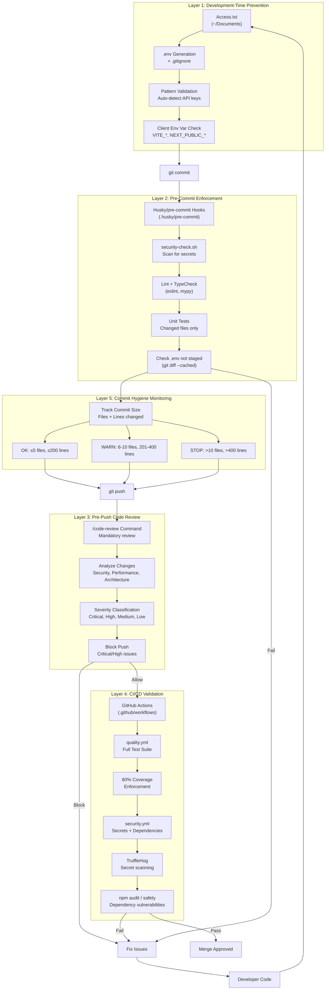
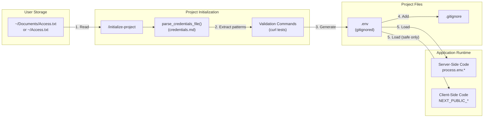
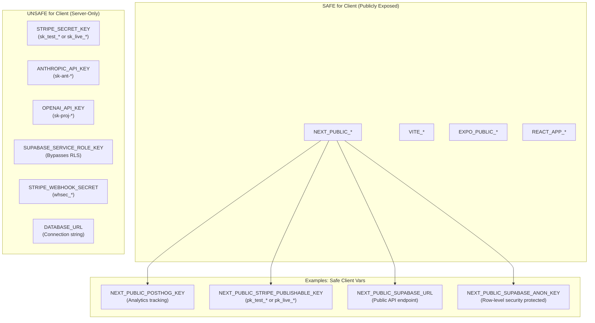
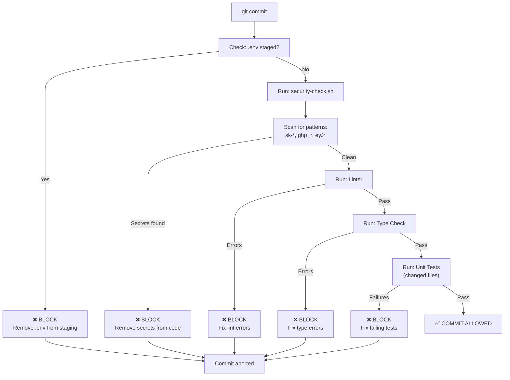
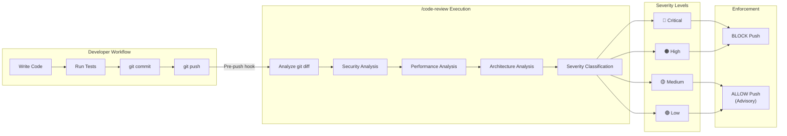
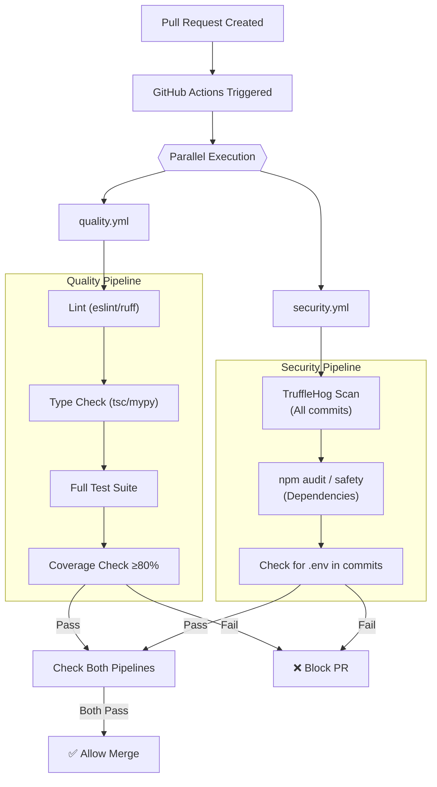
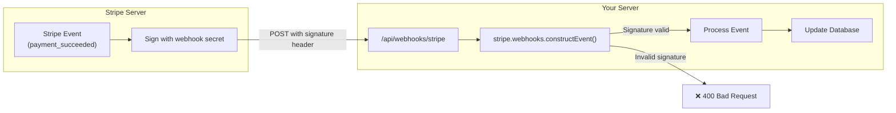

<!-- source: DeepWiki mcp.deepwiki.com · repo alinaqi/claude-bootstrap · page 6.1 Security Architecture · fetched 2026-10-27 -->

# Security Architecture

<details>
<summary>Relevant source files</summary>

The following files were used as context for generating this wiki page:

- [README.md](README.md)
- [skills/credentials.md](skills/credentials.md)
- [skills/posthog-analytics.md](skills/posthog-analytics.md)
- [skills/web-payments.md](skills/web-payments.md)

</details>


## Purpose and Scope

This document describes the security architecture of Claude Bootstrap: a five-layer defense-in-depth system that prevents secrets from entering the codebase, validates API credentials, and enforces security checks at every stage of the development lifecycle. 

For credential management patterns and Access.txt format, see [Credentials Management](#6.2). For secret detection patterns and scanning tools, see [Secret Scanning and Prevention](#6.3).

**Sources:** [README.md:29-39](), [README.md:358-365]()

---

## Core Security Philosophy

Claude Bootstrap implements **defense-in-depth**: if one security layer fails, subsequent layers provide backup protection. No single point of failure can expose secrets or vulnerable code.

**Three non-negotiable rules:**

1. **No secrets in code** - API keys, tokens, passwords never appear in source files
2. **No secrets in client environment variables** - `VITE_*`, `NEXT_PUBLIC_*`, `EXPO_PUBLIC_*` vars are publicly exposed
3. **Validation at every stage** - Pre-commit, pre-push, and CI/CD all run independent checks

**Sources:** [README.md:358-365]()

---

## Five-Layer Defense Architecture

### Layer Overview



**Sources:** [README.md:515-529](), Diagram 5 from high-level overview

---

## Layer 1: Development-Time Prevention

### Centralized Credentials (Access.txt)

All API keys are stored in a single file outside the repository, preventing accidental commits.

**Credentials Flow:**



**File format examples (Access.txt):**

[skills/credentials.md:34-56]()

**Pattern detection:**

The system automatically identifies API keys by their prefixes:

| Service | Pattern | Environment Variable |
|---------|---------|---------------------|
| OpenAI | `sk-proj-*` | `OPENAI_API_KEY` |
| Anthropic/Claude | `sk-ant-*` | `ANTHROPIC_API_KEY` |
| Stripe (Test) | `sk_test_*`, `pk_test_*` | `STRIPE_SECRET_KEY`, `STRIPE_PUBLISHABLE_KEY` |
| PostHog | `phc_*` | `POSTHOG_API_KEY` |
| GitHub | `ghp_*` or `github_pat_*` | `GITHUB_TOKEN` |
| Supabase | URL + `eyJ*` (JWT) | `SUPABASE_URL`, `SUPABASE_ANON_KEY` |

**Sources:** [skills/credentials.md:59-81](), [skills/credentials.md:84-138]()

### Environment Variable Classification

**Critical distinction: Client-exposed vs Server-only**



**Validation during initialization:**

The system checks for dangerous patterns:

```typescript
// ❌ CRITICAL ERROR - Will block initialization
NEXT_PUBLIC_STRIPE_SECRET_KEY=sk_test_xxx  // Secret key in client var!
VITE_ANTHROPIC_API_KEY=sk-ant-xxx         // API key in client var!

// ✅ CORRECT
STRIPE_SECRET_KEY=sk_test_xxx              // Server-only
NEXT_PUBLIC_STRIPE_PUBLISHABLE_KEY=pk_test_xxx  // Safe for client
```

**Sources:** [README.md:361](), [skills/credentials.md:307-314](), [skills/posthog-analytics.md:203-211](), [skills/web-payments.md:19-28]()

### .gitignore Enforcement

During project initialization, critical files are automatically added to `.gitignore`:

```bash
# Auto-generated by /initialize-project
.env
.env.local
.env.*.local
Access.txt
*.pem
*.key
```

**Sources:** [skills/credentials.md:269]()

---

## Layer 2: Pre-Commit Enforcement

### Hook Installation

Hooks are installed via `~/.claude/install-hooks.sh`:

```bash
# From project root
~/.claude/install-hooks.sh
```

This creates:
- `.husky/pre-commit` - Runs on every `git commit`
- `.husky/pre-push` - Runs on every `git push`

**Sources:** [README.md:189-192]()

### Pre-Commit Execution Flow



### security-check.sh

Located in `scripts/security-check.sh`, this script scans for:

**1. Hardcoded secrets:**
```bash
# Regex patterns checked
sk-[a-zA-Z0-9]{20,}          # API keys (OpenAI, Anthropic)
ghp_[a-zA-Z0-9]{36}          # GitHub tokens
pk_[a-z]+_[a-zA-Z0-9]{24,}   # Stripe publishable keys
sk_[a-z]+_[a-zA-Z0-9]{24,}   # Stripe secret keys
eyJ[a-zA-Z0-9_-]+\.[a-zA-Z0-9_-]+  # JWT tokens
```

**2. Staged .env files:**
```bash
git diff --cached --name-only | grep -E '^\.env'
```

**3. Client-side secret exposure:**
```bash
# Check for dangerous patterns in client env vars
grep -r "NEXT_PUBLIC_.*sk-" src/
grep -r "VITE_.*SECRET" src/
```

**Sources:** [README.md:519-523]()

---

## Layer 3: Pre-Push Code Review

### /code-review Command

The `/code-review` command provides mandatory security analysis before pushing code.

**Execution context:**



**Sources:** [README.md:176-209]()

### Security Issues Detected

| Category | Examples | Severity |
|----------|----------|----------|
| **Secrets Exposure** | Hardcoded API keys, credentials in client code | 🔴 Critical |
| **Injection Vulnerabilities** | SQL injection, XSS, command injection | 🔴 Critical |
| **Authentication Bypass** | Missing auth checks, weak session management | 🟠 High |
| **Sensitive Data Leaks** | Logging passwords, exposing PII | 🟠 High |
| **Insecure Dependencies** | Known CVEs in packages | 🟡 Medium |
| **Missing Input Validation** | Unvalidated user input | 🟡 Medium |
| **Rate Limiting** | Missing or weak rate limits | 🟢 Low |

**Sources:** [README.md:203-208]()

### Pre-Push Hook Integration

The pre-push hook in `.husky/pre-push` automatically runs `/code-review`:

```bash
#!/bin/sh
# Auto-generated by install-hooks.sh

# Run code review
claude --command /code-review

# Exit code determines if push proceeds
if [ $? -ne 0 ]; then
  echo "❌ Push blocked due to Critical/High severity issues"
  exit 1
fi
```

---

## Layer 4: CI/CD Validation

### GitHub Actions Workflows

**quality.yml** - Full test suite with coverage enforcement:

```yaml
# .github/workflows/quality.yml
name: Quality Gates

on: [push, pull_request]

jobs:
  test:
    runs-on: ubuntu-latest
    steps:
      - uses: actions/checkout@v3
      
      - name: Install dependencies
        run: npm ci
      
      - name: Lint
        run: npm run lint
      
      - name: Type check
        run: npm run typecheck
      
      - name: Test with coverage
        run: npm test -- --coverage
      
      - name: Enforce 80% coverage
        run: |
          COVERAGE=$(cat coverage/coverage-summary.json | jq '.total.lines.pct')
          if (( $(echo "$COVERAGE < 80" | bc -l) )); then
            echo "❌ Coverage $COVERAGE% is below 80% threshold"
            exit 1
          fi
```

**security.yml** - Secret scanning and dependency auditing:

```yaml
# .github/workflows/security.yml
name: Security Checks

on: [push, pull_request]

jobs:
  secret-scan:
    runs-on: ubuntu-latest
    steps:
      - uses: actions/checkout@v3
        with:
          fetch-depth: 0  # Full history for TruffleHog
      
      - name: TruffleHog Secret Scan
        uses: trufflesecurity/trufflehog@main
        with:
          path: ./
          base: ${{ github.event.repository.default_branch }}
          head: HEAD
  
  dependency-audit:
    runs-on: ubuntu-latest
    steps:
      - uses: actions/checkout@v3
      
      - name: npm audit
        run: npm audit --audit-level=moderate
      
      # For Python projects
      - name: Safety check
        run: |
          pip install safety
          safety check --json
```

**Sources:** [README.md:525-529]()

### CI/CD Enforcement Flow



**Sources:** [README.md:525-529]()

---

## Layer 5: Commit Hygiene Monitoring

### PR Size Thresholds

Claude Bootstrap tracks commit size to prevent oversized PRs, which correlate with higher defect rates.

**Thresholds:**

| Status | Files | Lines | Action |
|--------|-------|-------|--------|
| 🟢 OK | ≤5 | ≤200 | Normal review |
| 🟡 WARNING | 6-10 | 201-400 | Advise to commit soon |
| 🔴 STOP | >10 | >400 | Force commit immediately |

**Statistical backing:**

- PRs < 200 lines: **15% defect rate**
- PRs 200-400 lines: **23% defect rate**
- PRs > 400 lines: **40%+ defect rate** (often rubber-stamped)

**Sources:** [README.md:119-146]()

### Atomic Commit Principle

**Rule:** If you need "and" to describe your commit, split it.

```bash
# ❌ Bad: Multiple concerns
git commit -m "Add user auth and refactor database and fix bug in payment"

# ✅ Good: Atomic commits
git commit -m "Add user authentication flow"
git commit -m "Refactor database connection pooling"
git commit -m "Fix race condition in payment processing"
```

---

## Security Patterns in Practice

### Webhook Signature Verification

**Example from Stripe integration:**



**Code reference:**

[skills/web-payments.md:236-255]() shows webhook verification:

```typescript
// Verify signature before processing
try {
  event = stripe.webhooks.constructEvent(body, signature, webhookSecret);
} catch (err) {
  console.error("Webhook signature verification failed");
  return new Response("Invalid signature", { status: 400 });
}
```

**Why this matters:** Without signature verification, attackers could send fake payment success events to provision free access.

**Sources:** [skills/web-payments.md:229-303]()

### Idempotent Event Processing

**Pattern to prevent duplicate webhook processing:**

```typescript
// Example from webhook handler
const processedEvents = new Set<string>(); // Use Redis in production

export async function POST(request: Request) {
  // ... verify signature ...
  
  // Skip duplicate events
  if (processedEvents.has(event.id)) {
    return new Response("Already processed", { status: 200 });
  }
  processedEvents.add(event.id);
  
  // Process event...
}
```

**Sources:** [skills/web-payments.md:519-532]()

### Sanitizing Analytics Properties

**Example from PostHog integration:**

```typescript
// Prevent sensitive data from being tracked
const SENSITIVE_KEYS = ['password', 'token', 'secret', 'credit', 'ssn'];

function sanitizeProperties(props: Record<string, any>): Record<string, any> {
  return Object.fromEntries(
    Object.entries(props).filter(([key]) =>
      !SENSITIVE_KEYS.some(sensitive => key.toLowerCase().includes(sensitive))
    )
  );
}
```

**Sources:** [skills/posthog-analytics.md:788-802]()

---

## Security Checklist for New Projects

When initializing a project with `/initialize-project`, the system enforces these security measures:

### Initialization Checklist

- [ ] Access.txt file provided and validated
- [ ] .env file generated with required credentials
- [ ] .env added to .gitignore
- [ ] Client env vars validated (no secrets in NEXT_PUBLIC_*, VITE_*)
- [ ] Pre-commit hooks installed (security-check.sh)
- [ ] Pre-push hooks installed (/code-review)
- [ ] GitHub Actions workflows created (quality.yml, security.yml)
- [ ] Webhook secrets generated (if applicable)
- [ ] TruffleHog configured for CI
- [ ] Dependency audit enabled (npm audit / safety)

### Runtime Security Checklist

- [ ] All API calls use server-side credentials
- [ ] Webhook signatures verified before processing
- [ ] Event processing is idempotent (no duplicate processing)
- [ ] Sensitive data never logged or tracked
- [ ] Rate limiting implemented on public endpoints
- [ ] Input validation on all user-provided data
- [ ] Error messages don't leak sensitive information

**Sources:** [skills/credentials.md:226-280](), [README.md:358-365]()

---

## Anti-Patterns and Common Mistakes

### Critical Mistakes (Always Block)

| Anti-Pattern | Why It's Dangerous | Detection Layer |
|--------------|-------------------|-----------------|
| Hardcoded API keys in code | Exposed in git history forever | Layer 2 (pre-commit) |
| Secrets in NEXT_PUBLIC_* vars | Bundled into client JavaScript | Layer 1 (validation) |
| Skipping webhook verification | Attackers can forge events | Layer 3 (code review) |
| .env committed to git | Credentials exposed to all collaborators | Layer 2 (pre-commit) |
| Using floating-point for currency | Rounding errors cause financial loss | Layer 3 (code review) |
| Processing webhooks twice | Duplicate charges/provisions | Layer 3 (code review) |

### Warning Signs (Review Required)

| Pattern | Risk Level | Review Action |
|---------|-----------|---------------|
| Client-side payment creation | 🟠 High | Move to server-side |
| Missing error handling on API calls | 🟡 Medium | Add try-catch blocks |
| Logging user input without sanitization | 🟡 Medium | Sanitize before logging |
| No rate limiting on endpoints | 🟢 Low | Add rate limiting middleware |

**Sources:** [skills/web-payments.md:612-622]()

---

## Quick Reference

### Security Command Reference

```bash
# Install security hooks
~/.claude/install-hooks.sh

# Run manual code review
/code-review

# Test webhook signature verification (local)
stripe listen --forward-to localhost:3000/api/webhooks/stripe

# Scan for secrets manually
grep -r "sk-" src/
grep -r "ghp_" src/

# Check .env not staged
git diff --cached --name-only | grep -E '^\.env'

# Validate Access.txt patterns
cat ~/Documents/Access.txt | grep -E "(sk-ant-|sk-proj-|ghp_)"
```

### File Path Reference

| Security Component | File Path |
|-------------------|-----------|
| Credentials skill | `skills/credentials.md` |
| Security skill | `skills/security.md` |
| Pre-commit hook | `.husky/pre-commit` |
| Pre-push hook | `.husky/pre-push` |
| Security check script | `scripts/security-check.sh` |
| Quality workflow | `.github/workflows/quality.yml` |
| Security workflow | `.github/workflows/security.yml` |
| Git ignore | `.gitignore` |
| Environment vars | `.env` (never committed) |

### Environment Variable Prefixes

**Safe for client (public):**
- `NEXT_PUBLIC_*` (Next.js)
- `VITE_*` (Vite)
- `EXPO_PUBLIC_*` (Expo/React Native)
- `REACT_APP_*` (Create React App)

**Server-only (private):**
- No prefix required
- Never use client prefixes for secrets

**Sources:** [skills/credentials.md:1-349](), [skills/posthog-analytics.md:203-217](), [skills/web-payments.md:19-28]()

---

