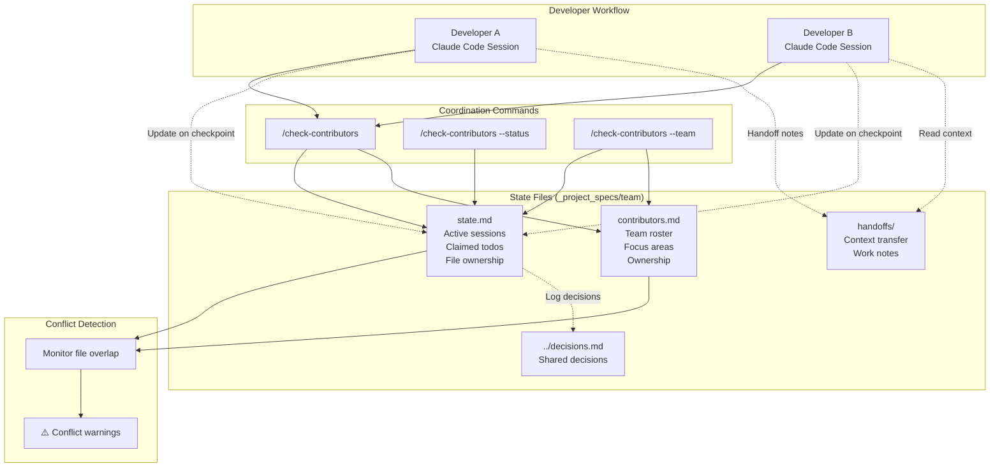
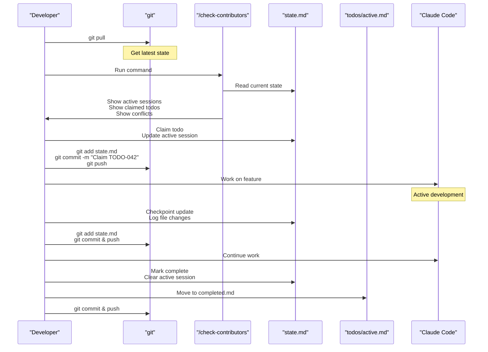
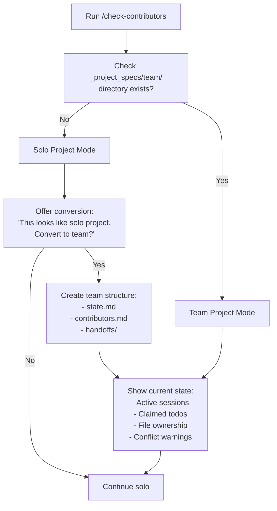
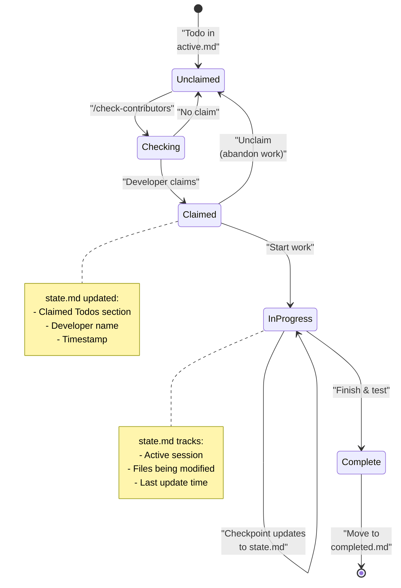
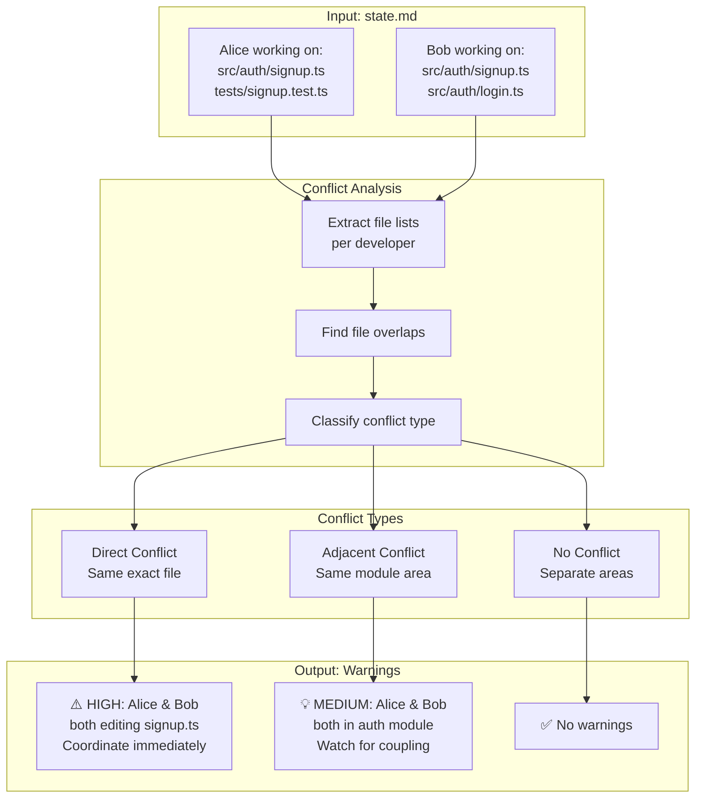
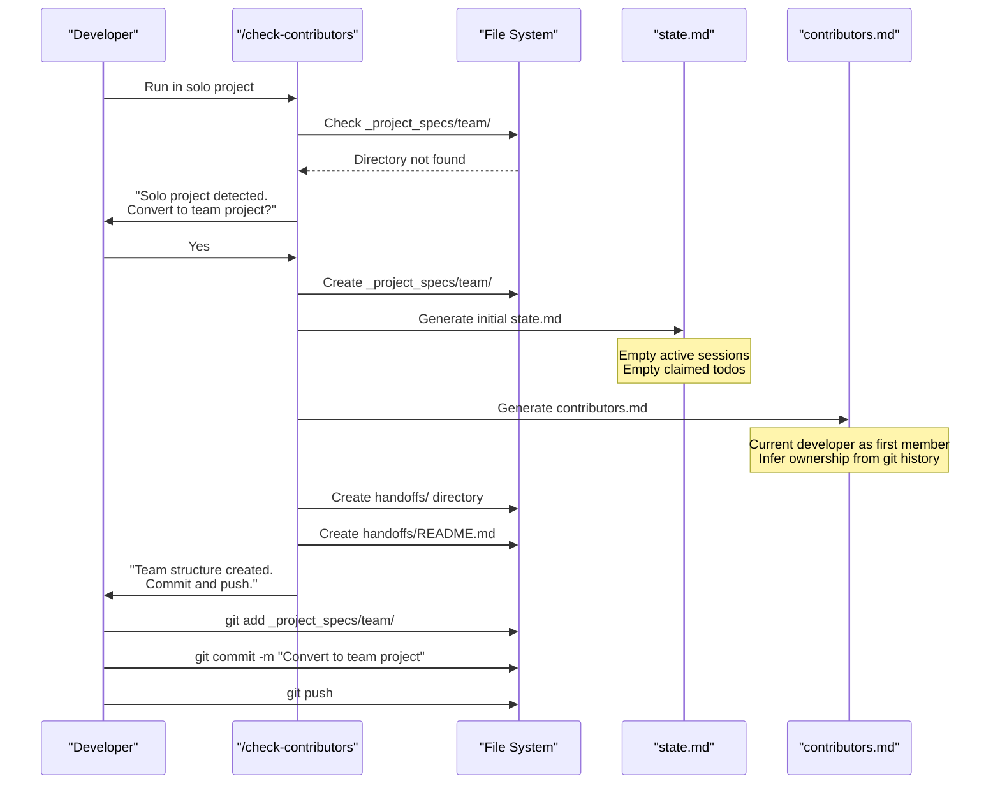
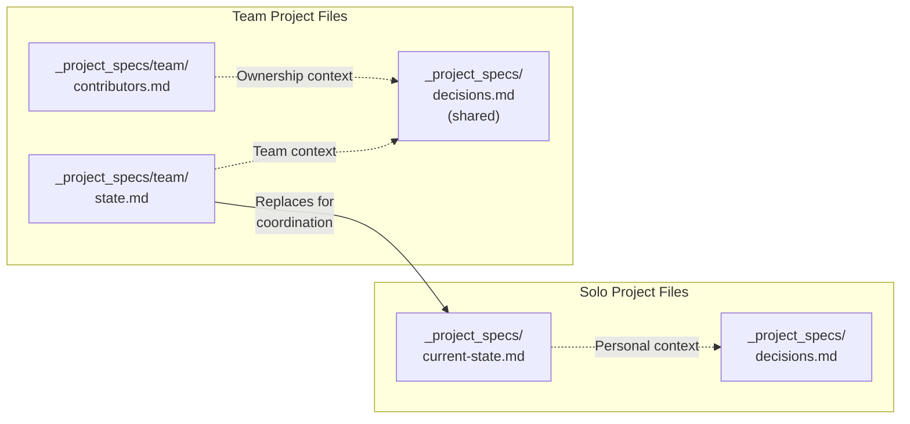

<!-- source: DeepWiki mcp.deepwiki.com · repo alinaqi/claude-bootstrap · page 8 Team Collaboration · fetched 2026-10-27 -->

# Team Collaboration

<details>
<summary>Relevant source files</summary>

The following files were used as context for generating this wiki page:

- [README.md](README.md)

</details>


## Purpose and Scope

This document explains how multiple developers coordinate work on the same repository when using Claude Code. The system provides file-based state management, todo claiming, active session tracking, and conflict detection to prevent duplicate work and merge conflicts.

For implementation details of the coordination commands, see [Multi-Developer Coordination](#8.1). For details about the shared state file structures, see [Shared State Management](#8.2).

## The Coordination Problem

When multiple developers use Claude Code (or Claude Desktop) on the same repository, several coordination challenges arise:

- **Duplicate work**: Two developers unknowingly implement the same todo
- **Merge conflicts**: Multiple developers modify the same files simultaneously
- **Context loss**: Developer B doesn't know what Developer A is currently working on
- **Decision drift**: Architectural decisions made by one developer are invisible to others

Claude Bootstrap solves this with a file-based state management system that tracks active sessions, claimed todos, and file ownership through standard git workflows.

**Sources:** [README.md:211-253]()

## System Architecture



**Diagram: Team Collaboration System Components**

The system uses three primary state files in `_project_specs/team/` that are committed to git, enabling coordination through standard pull/push workflows without requiring external infrastructure.

**Sources:** [README.md:225-231](), [README.md:235-242]()

## Core Workflow Pattern



**Diagram: Standard Team Collaboration Workflow**

The workflow enforces explicit state updates at key checkpoints: claiming work (start), progress updates (during), and completion (end). This creates visibility without requiring real-time communication.

**Sources:** [README.md:243-246]()

## The `/check-contributors` Command

The `/check-contributors` command is the primary entry point for team coordination. It detects whether a project is solo or team-based and offers appropriate actions.

**Command Variants:**

| Command | Purpose | Output |
|---------|---------|--------|
| `/check-contributors` | Full analysis and conversion | Detect mode, show state, offer conversion |
| `/check-contributors --status` | Quick status check | Show active sessions and claimed todos only |
| `/check-contributors --team` | Force team conversion | Create team structure immediately |

**Sources:** [README.md:249-253]()

### Detection Logic



**Diagram: Project Mode Detection and Conversion**

**Sources:** [README.md:215-222]()

## State File Structure

### state.md Format

The `_project_specs/team/state.md` file tracks real-time project state:

```markdown
# Project State

Last updated: 2024-01-15 14:30 UTC

## Active Sessions

| Developer | Working On | Files | Started | Last Update |
|-----------|------------|-------|---------|-------------|
| alice | TODO-042: Email validation | src/auth/signup.ts, tests/signup.test.ts | 2024-01-15 13:00 | 2024-01-15 14:30 |
| bob | TODO-038: API rate limiting | src/middleware/ratelimit.ts | 2024-01-15 12:00 | 2024-01-15 14:15 |

## Claimed Todos

| ID | Title | Claimed By | Claimed At |
|----|-------|------------|------------|
| TODO-042 | Add email validation | alice | 2024-01-15 13:00 |
| TODO-038 | Implement rate limiting | bob | 2024-01-15 12:00 |

## File Ownership (Current Session)

| File Path | Owner | Purpose |
|-----------|-------|---------|
| src/auth/signup.ts | alice | Email validation |
| tests/signup.test.ts | alice | Validation tests |
| src/middleware/ratelimit.ts | bob | Rate limiter |

## Conflict Warnings

⚠️ No conflicts detected
```

**Key sections:**

- **Active Sessions**: Who's working on what right now (in-memory state)
- **Claimed Todos**: Reserved work items (prevents duplicate work)
- **File Ownership**: Current file modification ownership (for conflict detection)
- **Conflict Warnings**: Alerts when multiple developers touch overlapping files

**Sources:** [README.md:227-230]()

### contributors.md Format

The `_project_specs/team/contributors.md` file maintains team roster and ownership:

```markdown
# Team Contributors

## Active Contributors

| Developer | Role | Focus Areas | Since |
|-----------|------|-------------|-------|
| alice | Backend Lead | Auth, API, Database | 2024-01-01 |
| bob | Frontend Lead | UI, Components, State | 2024-01-05 |
| carol | Full Stack | Features, Integration | 2024-01-10 |

## Code Ownership

| Area | Primary | Backup |
|------|---------|--------|
| Authentication | alice | carol |
| UI Components | bob | carol |
| Database Schema | alice | - |
| API Routes | alice | carol |

## Communication

- Stand-ups: Daily 10am EST (async via state.md updates)
- Handoffs: Use _project_specs/team/handoffs/ directory
- Decisions: Log in _project_specs/decisions.md
```

**Sources:** [README.md:229]()

### handoffs/ Directory

The `_project_specs/team/handoffs/` directory contains context transfer notes when passing work between developers:

```
_project_specs/team/handoffs/
├── 2024-01-15-alice-to-bob-auth-module.md
├── 2024-01-14-bob-to-carol-ui-refactor.md
└── README.md
```

**Handoff note format:**

```markdown
# Handoff: Auth Module Refactor

**From:** alice  
**To:** bob  
**Date:** 2024-01-15  
**Context:** TODO-042 Email validation

## Current State
- Email validation logic in src/auth/signup.ts:45-67
- Tests passing but need edge case coverage
- Found bug with internationalized email addresses

## Remaining Work
- [ ] Add test cases for IDN emails (user@münchen.de)
- [ ] Update validation regex to support RFC 6531
- [ ] Check mobile app compatibility

## Important Context
- Don't modify validatePhone() - it's used by 3 other modules
- Database schema expects lowercase emails (normalize before save)
- See decision DOC-012 about email normalization strategy

## Files Modified
- src/auth/signup.ts
- tests/auth/signup.test.ts

## Branch
- alice/email-validation (pushed, not merged)
```

**Sources:** [README.md:230]()

## Todo Claiming Mechanism



**Diagram: Todo Claim Lifecycle**

**Claiming prevents duplicate work:**

1. Developer runs `/check-contributors`
2. System shows unclaimed todos from `_project_specs/todos/active.md`
3. Developer claims by updating `state.md`
4. Commit and push claim (atomic reservation)
5. Other developers see claimed status after `git pull`

**Sources:** [README.md:237]()

## Conflict Detection Logic



**Diagram: Conflict Detection Algorithm**

**Conflict severity levels:**

| Level | Condition | Action |
|-------|-----------|--------|
| **HIGH** | Same exact file | Immediate coordination required |
| **MEDIUM** | Same directory/module | Awareness, watch for coupling |
| **LOW** | Related files (imports) | Informational only |
| **NONE** | Separate areas | No action needed |

**Sources:** [README.md:239]()

## Converting Solo to Team Projects



**Diagram: Solo to Team Conversion Process**

**Conversion steps:**

1. Detect no `_project_specs/team/` directory exists
2. Offer conversion to team mode
3. Create directory structure
4. Generate initial `state.md` with empty sessions
5. Generate `contributors.md` from git history
6. Create `handoffs/` directory with README
7. Prompt commit and push

**Sources:** [README.md:218-222]()

## State Update Triggers

The system defines specific checkpoints when developers should update `state.md`:

| Trigger | When | What to Update |
|---------|------|----------------|
| **Claim** | Before starting work | Add to Claimed Todos |
| **Start** | Begin active development | Add to Active Sessions with files |
| **Checkpoint** | Every 1-2 hours during work | Update Last Update timestamp, add new files |
| **Break** | Before ending session | Update status to "Paused" |
| **Handoff** | Passing work to another dev | Create handoff note, update File Ownership |
| **Complete** | Todo finished and tested | Remove from Active Sessions, remove claim |

**Sources:** [README.md:243-246]()

## Integration with Session Management

Team collaboration integrates with the session management system (see [Session Management](#4.2)):



**Diagram: Solo vs. Team State Management**

In team projects, `_project_specs/team/state.md` supplements (not replaces) individual session state. Developers still maintain personal `current-state.md` for their own context, but coordination state lives in the shared `team/state.md`.

**Key difference:**

- **Solo**: `current-state.md` tracks "what am I working on"
- **Team**: `team/state.md` tracks "what is everyone working on"

**Sources:** [README.md:227-230]()

## Example: Two Developer Workflow

**Scenario:** Alice and Bob working on authentication module

### 1. Alice Claims Todo

```bash
# Alice's session
git pull
claude
> /check-contributors
```

**Claude shows:**
```
Project Status: Team Project (2 contributors)

Active Sessions: None
Claimed Todos: None

Available Todos:
- TODO-042: Add email validation (unclaimed)
- TODO-038: Add rate limiting (unclaimed)

Would you like to claim a todo?
```

Alice claims TODO-042, updates `state.md`:

```markdown
## Claimed Todos
| ID | Title | Claimed By | Claimed At |
|----|-------|------------|------------|
| TODO-042 | Add email validation | alice | 2024-01-15 13:00 |
```

Commits: `git commit -m "Claim TODO-042"`

### 2. Bob Checks State

```bash
# Bob's session (after Alice pushed)
git pull
claude
> /check-contributors --status
```

**Claude shows:**
```
Claimed Todos:
- TODO-042: Email validation (alice, claimed 1 hour ago)

Available Todos:
- TODO-038: Add rate limiting (unclaimed)
```

Bob claims TODO-038, different area → no conflict.

### 3. Alice Starts Work

Alice updates `state.md` when beginning active work:

```markdown
## Active Sessions
| Developer | Working On | Files | Started |
|-----------|------------|-------|---------|
| alice | TODO-042 | src/auth/signup.ts, tests/signup.test.ts | 13:00 |
```

### 4. Bob Accidentally Modifies Same File

Bob starts work on rate limiting but mistakenly edits `signup.ts`. When Bob runs `/check-contributors`:

**Claude detects:**
```
⚠️ CONFLICT WARNING

You are modifying: src/auth/signup.ts
Alice is also working on: src/auth/signup.ts (active since 13:00)

Recommendation: Coordinate with alice before continuing.
Consider:
1. Different files for rate limiting logic
2. Wait for alice to complete
3. Coordinate on Slack/handoff note
```

### 5. Alice Completes and Hands Off

Alice finishes email validation but found an edge case that needs attention:

Creates `_project_specs/team/handoffs/2024-01-15-alice-to-bob-email.md`:

```markdown
# Email Validation Edge Case

## Context
Completed basic email validation for TODO-042, but discovered that
internationalized domain names (IDN) need special handling.

## What's Done
- Basic RFC 5322 email validation
- Tests for common cases
- Integration with signup form

## What's Needed
- [ ] Support for IDN emails (münchen.de, etc.)
- [ ] Update regex or use library like `validator.js`
- [ ] Add test cases for IDN

## Files
- src/auth/signup.ts:45-67 (validation logic)
- tests/auth/signup.test.ts (add IDN tests here)
```

Updates `state.md`:
```markdown
## Active Sessions
(empty - alice completed)

## Claimed Todos
(TODO-042 moved to completed)
```

**Sources:** [README.md:243-246]()

## Command Reference Quick Guide

| Command | Use Case | When to Run |
|---------|----------|-------------|
| `/check-contributors` | Start of work session | Before claiming or starting new work |
| `/check-contributors --status` | Quick check during work | Periodically to see team status |
| `/check-contributors --team` | Convert solo project | When adding second developer |

**Sources:** [README.md:249-253]()

## Anti-Patterns to Avoid

| Anti-Pattern | Why It Fails | Correct Approach |
|--------------|--------------|------------------|
| Skip state updates | Team loses visibility, conflicts arise | Update state.md at every checkpoint |
| Claim without pushing | Other devs don't see claim, duplicate work | Always commit and push claims immediately |
| Modify files without claiming | No conflict detection | Claim todo first, then start work |
| Skip handoff notes | Context lost between developers | Always create handoff when passing work |
| Work offline for days | State becomes stale, conflicts increase | Pull frequently, push state updates |

**Sources:** [README.md:235-242]()

## State Management Best Practices

1. **Pull before you start**: Always `git pull` before running `/check-contributors`
2. **Claim atomically**: Commit and push claims immediately to reserve work
3. **Checkpoint frequently**: Update state.md every 1-2 hours during active work
4. **Handoff explicitly**: Create handoff notes even for "obvious" context
5. **Check before commit**: Run `/check-contributors` before pushing to detect conflicts early
6. **Clear on completion**: Remove yourself from active sessions when done

**Sources:** [README.md:243-246]()

---

