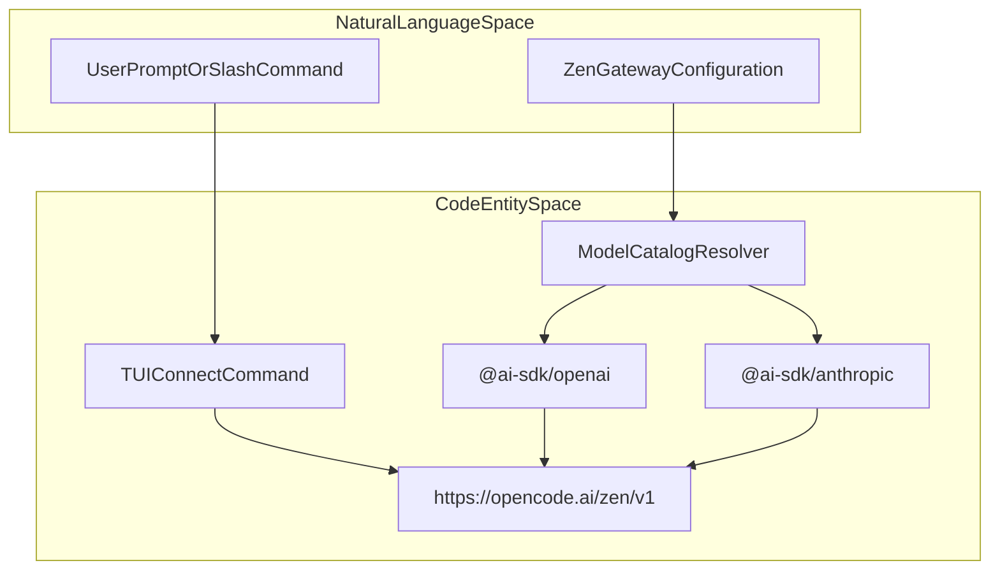
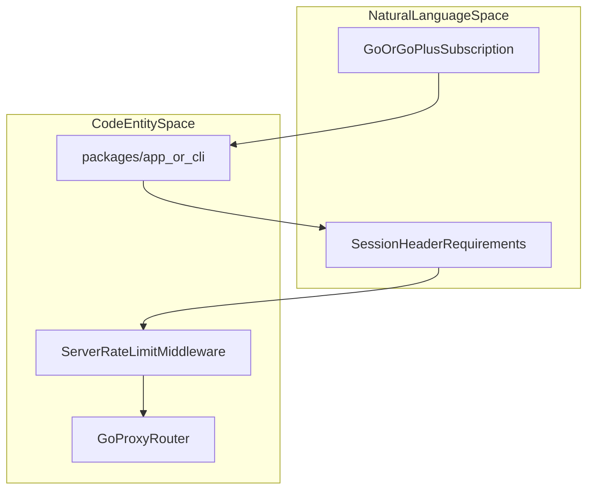
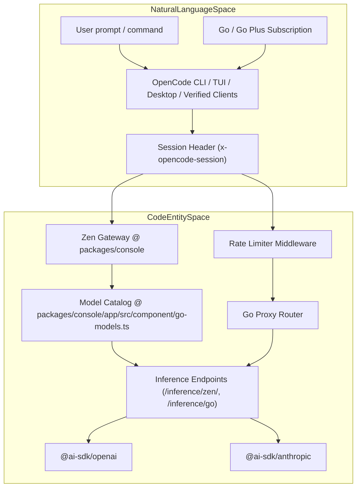

<!-- source: DeepWiki mcp.deepwiki.com · repo anomalyco/opencode · page 10.2 OpenCode Zen & Go Products · fetched 2026-10-27 -->

# OpenCode Zen & Go Products

Relevant source files

The following files were used as context for generating this wiki page:

- [packages/console/app/src/component/go-models.ts](packages/console/app/src/component/go-models.ts)
- [packages/console/app/src/routes/go/index.css](packages/console/app/src/routes/go/index.css)
- [packages/console/app/src/routes/go/index.tsx](packages/console/app/src/routes/go/index.tsx)
- [services/www/src/docs/content/console/api/budgets.mdx](services/www/src/docs/content/console/api/budgets.mdx)
- [services/www/src/docs/content/console/api/index.mdx](services/www/src/docs/content/console/api/index.mdx)
- [services/www/src/docs/content/console/api/inference.mdx](services/www/src/docs/content/console/api/inference.mdx)
- [services/www/src/docs/content/console/api/providers.mdx](services/www/src/docs/content/console/api/providers.mdx)
- [services/www/src/docs/content/console/billing.mdx](services/www/src/docs/content/console/billing.mdx)
- [services/www/src/docs/content/console/budgets.mdx](services/www/src/docs/content/console/budgets.mdx)
- [services/www/src/docs/content/console/go.mdx](services/www/src/docs/content/console/go.mdx)
- [services/www/src/docs/content/console/harnesses/claude-code.mdx](services/www/src/docs/content/console/harnesses/claude-code.mdx)
- [services/www/src/docs/content/console/harnesses/codex.mdx](services/www/src/docs/content/console/harnesses/codex.mdx)
- [services/www/src/docs/content/console/harnesses/hermes.mdx](services/www/src/docs/content/console/harnesses/hermes.mdx)
- [services/www/src/docs/content/console/harnesses/index.mdx](services/www/src/docs/content/console/harnesses/index.mdx)
- [services/www/src/docs/content/console/harnesses/pi.mdx](services/www/src/docs/content/console/harnesses/pi.mdx)
- [services/www/src/docs/content/console/harnesses/raycast.mdx](services/www/src/docs/content/console/harnesses/raycast.mdx)
- [services/www/src/docs/content/console/index.mdx](services/www/src/docs/content/console/index.mdx)
- [services/www/src/docs/content/console/members.mdx](services/www/src/docs/content/console/members.mdx)
- [services/www/src/docs/content/console/models.mdx](services/www/src/docs/content/console/models.mdx)
- [services/www/src/docs/content/console/providers.mdx](services/www/src/docs/content/console/providers.mdx)
- [services/www/src/docs/content/console/websearch.mdx](services/www/src/docs/content/console/websearch.mdx)
- [services/www/src/docs/content/websearch.mdx](services/www/src/docs/content/websearch.mdx)
- [services/www/src/docs/lib/navigation.ts](services/www/src/docs/lib/navigation.ts)

## Purpose and Scope
This page provides detailed technical information about the **OpenCode Zen** AI inference gateway and the **Go / Go Plus** subscription plans. It covers how Zen standardizes gateway endpoints and model catalogs with pricing models, how Go/Go Plus enhance subscription access with session header requirements and rate limits, client compatibility considerations, and the infrastructure supporting localized documentation for these products.

---

## 1. OpenCode Zen AI Gateway

OpenCode Zen is a curated, optional AI inference gateway enabling coding agents to reliably access a stable and verified set of models. It fixes inconsistencies common with generic providers by harmonizing model versions, parameter defaults, and routing through the OpenCode Console billing API. Zen is integrated directly in the TUI through the `/connect` and `/models` commands, making key provisioning and model selection straightforward for the user.

### Gateway Routing Architecture

The user query or TUI interaction flows through OpenCode’s configuration and model resolver to select the proper model endpoint. Zen supports different wire protocol implementations for each model family, routing calls to the corresponding OpenAI-compatible or Anthropic-compatible endpoint.

This abstraction ensures that clients do not need to handle varying model protocols or details of routing, providing a consistent interface for interacting with the AI gateway.

Sources: `packages/web/src/content/docs/zen.mdx:10-54`()

---

## 2. Zen Model Catalog & Endpoints

Zen manages requests by routing them to the appropriate specialized endpoints depending on each model’s API compatibility. Specifically:

| Model Family               | Example Model IDs                 | Endpoint URL                              | AI SDK Package          |
|---------------------------|---------------------------------|------------------------------------------|-------------------------|
| GPT-6 / GPT-5 Series      | `gpt-6-astra`, `gpt-5.4`        | `https://opencode.ai/zen/v1/responses`   | `@ai-sdk/openai` [docs]()|
| Claude Opus / Sonnet      | `claude-fable-5-1`, `claude-opus-5-5` | `https://opencode.ai/zen/v1/messages`    | `@ai-sdk/anthropic` [docs]() |

The endpoint paths `/responses` (OpenAI style) and `/messages` (Anthropic style) correspond to the wire API used by each model family. Zen internally manages billing and usage accounting via account credits configured in the OpenCode Console billing services.

This centralized catalog approach enables consistent pricing, usage policies, and variant management.

Sources: `packages/web/src/content/docs/zen.mdx:57-94`()

---

## 3. Go & Go Plus Subscription Tiers

The **Go** and **Go Plus** products are subscription tiers designed to offer reliable, priority access to a curated set of coding models with extended quotas, improved performance, and additional autonomous agent capabilities. Go is primarily intended for individual/Personal workspaces.

### Subscription & Session Architecture

### Key Details

- **Subscription Plans**:
  - **Go** ($10/month): Basic access to a subset of curated models.
  - **Go Plus** ($40/month): Higher usage limits, additional models, and priority routing.

- **Model Catalog for Go**: Includes models such as Grok 4.7, GLM-5.3, GPT 6 Luna, Claude Haiku 5.5, Gemini 4 Argon Contributor, Kimi K3, MiniMax M3, DeepSeek V4, and more. Some models are marked limited time or regionally restricted.

- **Request Limits**: Rate limits are enforced via sliding-window policies per model and subscription tier to prevent abuse and runaway loops.

- **Session Headers**: Every request must include a stable session identifier header `x-opencode-session` (or native session headers recognized) to optimize routing and prompt caching.

- **Client Compatibility**: Fully tested with:
  - OpenCode CLI daemon and TUI client
  - Desktop Electron app
  - Remote tunnel clients
  - Third-party validated clients like Hermes, Claude Code, Codex, ZCode, Pi, and others (some with version recommendations)

- **Enforcement**: The server inspects session headers and API keys to authenticate usage tiers and enforce rate limits accordingly.

Sources: 
- `services/www/src/docs/content/console/go.mdx:1-112`()
- `packages/console/app/src/routes/go/index.tsx:1-146`()

### Go Model Catalog & Rate Limits Detail

The `goModels` data structure enumerates the specific models available under Go, each with their request and monthly allowance limits. Additionally, separate plus tier limits are tracked.

Excerpt example:

| Model ID                  | Model Name                  | Requests / 5 hrs | Monthly Allowance | Go Plus Requests | Go Plus Allowance | Featured | Note               |
|---------------------------|-----------------------------|------------------|-------------------|------------------|-------------------|----------|--------------------|
| `kimi-k3`                 | Kimi K3                     | 110              | 15                | 440              | 60                | Yes      |                    |
| `gpt-5.6-luna`            | GPT 5.6 Luna                | 2050             | 15                | 8200             | 60                | No       |                    |
| `gemini-4-argon-contributor` | Gemini 4 Argon Contributor | 440              | 60                | 1760             | 240               | Yes      | Limited time       |
| `minimax-m3`              | MiniMax M3                  | 3200             | 60                | 9600             | 180               | Yes      |                    |
| `deepseek-v4-pro`         | DeepSeek V4 Pro             | 1050             | 15                | 4200             | 60                | No       |                    |

For some models, bonus multipliers apply to allow calibrated backward compatibility with older limits.

Sources: `packages/console/app/src/component/go-models.ts:1-152`()

---

## 4. Localized Documentation Infrastructure

OpenCode maintains a comprehensive localized documentation system for Zen and Go products in markdown `.mdx` format within the `packages/web/src/content/docs/` directory. The documentation covers usage guides, API details, subscription info, and integration instructions.

### Supported Locales

| Locale Code | Locale Name      | Example Path                       |
|-------------|------------------|----------------------------------|
| `en`        | English          | `/zen/`, `/go/`                  |
| `zh-cn`     | Simplified Chinese| `/zh-cn/zen/`                    |
| `ko`        | Korean           | `/ko/zen/`                      |
| `it`        | Italian          | `/it/zen/`                      |
| `ru`        | Russian          | `/ru/zen/`                      |
| `ar`        | Arabic           | `/ar/zen/`                      |
| `pl`        | Polish           | `/pl/zen/`                      |
| `fr`        | French           | `/fr/zen/`                      |
| `tr`        | Turkish          | `/tr/zen/`                      |
| `bs`        | Bosnian          | `/bs/zen/`                      |
| `nb`        | Norwegian        | `/nb/zen/`                      |
| `pt-br`     | Portuguese (Brazil)| `/pt-br/zen/`                   |

Localization is key for global adoption, especially since Go is designed for international users. The localized docs provide translations of marketing, onboarding, and technical usage documentation.

Sources: 
- `packages/web/src/content/docs/zen.mdx:1-10`()
- `packages/web/src/content/docs/zh-cn/zen.mdx:1-10`()
- `packages/web/src/content/docs/ko/zen.mdx:1-10`()

---

## Appendix: Client Compatibility Overview

The following table summarizes known compatibility and session header support for various third-party clients tested with Go subscriptions. This directly impacts how session headers must be sent and recognized for consistent routing and caching on OpenCode servers.

| Client            | Go Compatibility                 | Session Header Notes                                                                                                 |
|-------------------|--------------------------------|---------------------------------------------------------------------------------------------------------------------|
| Hermes            | Supported                       | Requires update to v0.21.6+ to send `x-opencode-session` header on all requests                                     |
| Claude Code       | Supported                       | Uses native session header recognized by Go, no wrapper needed                                                    |
| Codex             | Supported                       | Session header recognized if forwarded properly; some proxy setups may omit it                                      |
| ZCode             | Supported                       | Recognizes native header; `x-opencode-session` not strictly required                                                |
| Pi                | Supported                       | Sends session header in current builds; updates recommended                                                       |
| jcode             | Supported                       | Requires v0.81.6+ with fixed session header handling                                                                |
| Kilo Code CLI     | Supported                       | Needs PR #13752 applied for session header restoration                                                              |
| DeepSeek Harness  | Partial                        | Session missing on some model paths; ongoing fixes in discussion                                                    |
| GitHub Copilot Chat| Partial / To be improved       | Session header support requested in VS Code issue #334186                                                            |
| Kimi Code         | Partial / To be improved       | Session header fixes requested in issue #3506                                                                        |

Sources: `services/www/src/docs/content/console/go.mdx:70-111`()

---

# Summary Diagram: OpenCode Zen and Go Products

This diagram illustrates the interaction between natural language user space (CLI, TUI, third-party clients) and code entity space containing the relevant OpenCode packages, API endpoints, and subscription enforcement components.

---

# References to Documentation Sites

OpenCode offers thorough documentation on its Zen and Go product lines in the following locations with contextual links integrated into the docs site and monorepo:

- [Zen product documentation (English)](https://opencode.ai/docs/zen)
- [Go subscription and model catalog](https://opencode.ai/console/go)
- Integration instructions for popular coding agents and IDEs are also documented under the **Harnesses** section for Hermes, Codex, Claude Code, Pi, Raycast, etc.
- Session and header requirements, client compatibility, and usage policies are detailed in localized docs maintained under `packages/web/src/content/docs/` and their locale-specific subfolders.

---

# Summary

OpenCode Zen provides a standardized, curated AI gateway for stable and predictable model access, perfect for coding agents requiring consistent behavior. OpenCode Go and Go Plus offer subscription-based enhanced access with well-defined quotas, rate-limiting, and extended model catalogs, ideal for individual developers or personal workspaces.

The API design enforces authenticated sessions and per-request headers that allow fine-grained routing and rate control. The product ecosystem is supported by extensive client validation and multi-language documentation for international users.

---

# Sources

- `packages/web/src/content/docs/zen.mdx:10-94`  
- `services/www/src/docs/content/console/go.mdx:1-112`  
- `packages/console/app/src/routes/go/index.tsx:1-146`  
- `packages/console/app/src/component/go-models.ts:1-152`  
- `services/www/src/docs/content/console/harnesses/index.mdx:1-97`  
- `services/www/src/docs/content/console/harnesses/hermes.mdx:1-59`  
- `services/www/src/docs/content/console/harnesses/claude-code.mdx:1-93`  
- `services/www/src/docs/content/console/harnesses/codex.mdx:1-99`  
- `services/www/src/docs/content/console/index.mdx:1-97`  
- `packages/web/src/content/docs/zh-cn/zen.mdx:1-10`  
- `packages/web/src/content/docs/ko/zen.mdx:1-10`

---

